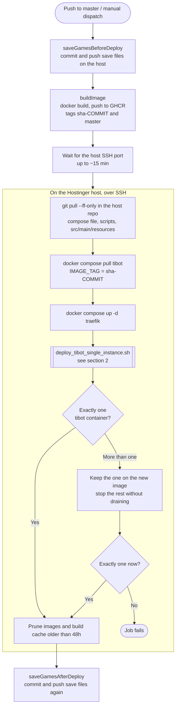
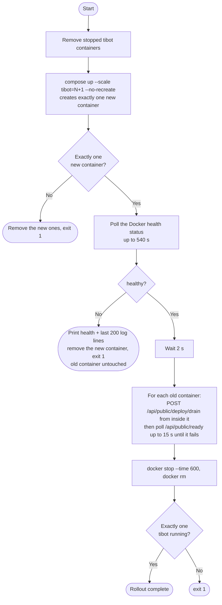
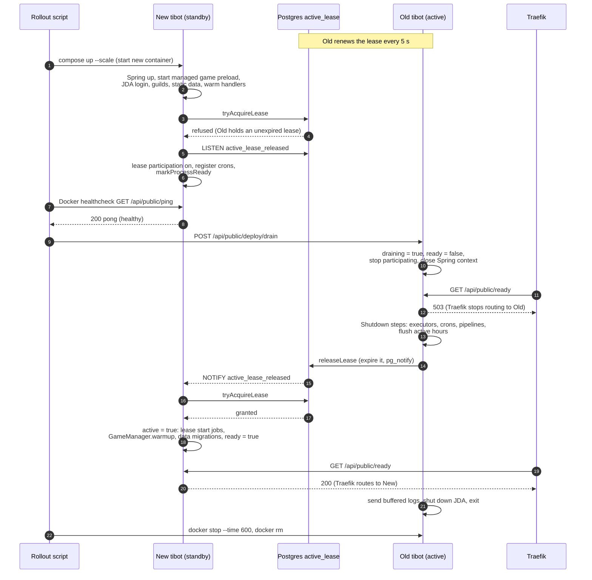
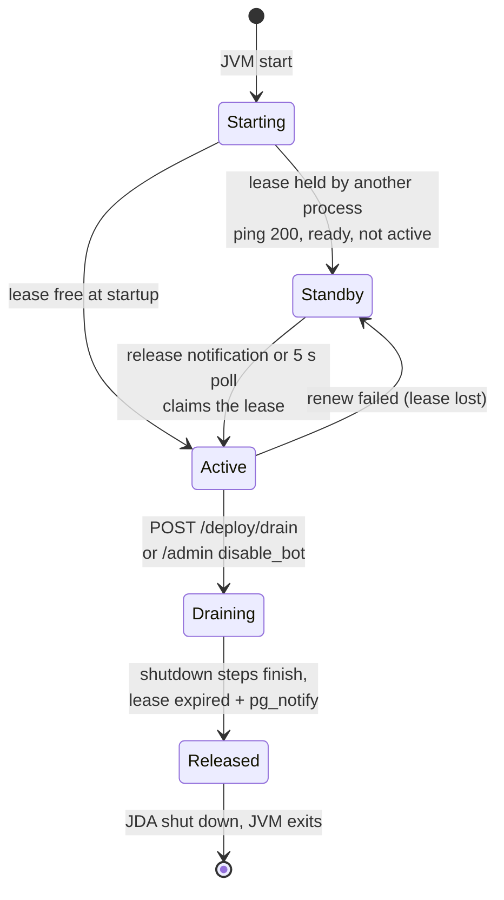

# Deployment and rollover

How a change on `master` reaches the production bot, and how the running bot hands over to
the new one without two processes acting on Discord or the games at once.

The pieces:

| Piece | File |
| --- | --- |
| Deploy workflow | [.github/workflows/deploy-to-production.yml](.github/workflows/deploy-to-production.yml) |
| Rollout script (run on the host) | [scripts/deploy_tibot_single_instance.sh](scripts/deploy_tibot_single_instance.sh) |
| Container setup (Traefik + `tibot`) | [docker-compose.production.yml](docker-compose.production.yml) |
| Image build | [Dockerfile](Dockerfile) |
| Startup order | [AsyncTI4DiscordBot.java](src/main/java/ti4/AsyncTI4DiscordBot.java) |
| Shutdown order | `JdaService.shutdown()` in [JdaService.java](src/main/java/ti4/discord/JdaService.java), see [Shutdown steps](#shutdown-steps) |
| Active lease | [ti4.spring.service.deploy](src/main/java/ti4/spring/service/deploy) |
| Health, readiness, drain endpoints | [PingController](src/main/java/ti4/spring/api/PingController.java), [ReadyController](src/main/java/ti4/spring/api/publicstatus/ReadyController.java), [DeployController](src/main/java/ti4/spring/api/publicstatus/DeployController.java) |

## 1. The deploy workflow

`BuildAndDeploy` runs on every push to `master` and on manual dispatch. A newer push cancels a
deploy that is still running (`cancel-in-progress`).

Each remote step also posts a timestamped line to the deploy Discord webhook.

Two things come from the host checkout rather than from the image: the compose file and
rollout script, and `src/main/resources`, which is mounted read-only into the container at
`/opt/resources`. The image only carries the compiled jar and classpath config. Save files
live on the host too, mounted at `/opt/STORAGE`.

`RestartBot` ([restart-bot.yml](.github/workflows/restart-bot.yml)) runs the same rollout
script against the `master` image tag without building, so it is a rollover onto the same code.
`StopBot` drains and stops every `tibot` container, and `StartBot` brings one up with plain
`docker compose up`, with no rollover.

## 2. The rollout script

The script never replaces the old container first. It adds one new container next to the
old one, waits for it to be healthy, then drains and removes the old one. If the new container
never gets healthy, it is removed and the old one keeps running.

"Healthy" is the compose healthcheck on `GET /api/public/ping`. Ping returns `200` only once
the process has reached lease participation, near the end of startup (see section 3). A new
process that is healthy is therefore fully started and waiting on standby; it is not yet
the active bot.

The drain endpoint only accepts loopback callers, which is why the script calls it with
`docker exec` inside the old container.

## 3. Rollover inside the bot: the active lease

During every rollover two bot processes are connected to Discord with the same token at the
same time, and both receive every event. One row in the Postgres `active_lease` table decides
which process acts. Each process has a random `INSTANCE_ID` (a new UUID per JVM start).

| Setting | Default | Property |
| --- | --- | --- |
| Lease key | `discord-bot` | `ti4.deploy.lease-key` |
| Lease duration | 3600 s | `ti4.deploy.lease-duration-seconds` |
| Heartbeat / renew interval | 5 s | `ti4.deploy.heartbeat-interval-seconds` |

The active process renews the lease every heartbeat, so it stays about an hour ahead of
expiry. A standby process can only claim the lease when the row is empty, already its own,
or expired.

If the `LISTEN` connection is down, the 5 s heartbeat poll on the standby (`maintainLease`)
picks up the released lease instead, so the notification only makes the handover faster.

### What each process is allowed to do

`ActiveLeaseService` keeps three flags per process: `active` (holds the lease), `draining`
and `ready`. The gates built from them:

| Work | Allowed when | Where |
| --- | --- | --- |
| Discord interactions (buttons, commands, modals, selects, messages, …) | `active` and not `draining` | each listener in `ti4.discord.interactions.listeners` |
| Scheduled crons | `active`, lease still owned in the DB, and not `draining` | first line of every cron, see [cron README](src/main/java/ti4/cron/README.md) |
| HTTP API (website) | `ready`, lease owned and not `draining` | [CircuitBreakerFilter](src/main/java/ti4/spring/resilience/CircuitBreakerFilter.java) |
| Saving a game from a web mutation | lease owned | [GameLockAndRequestContextInterceptor](src/main/java/ti4/spring/context/GameLockAndRequestContextInterceptor.java) |
| Routed HTTP traffic from Traefik | `GET /api/public/ready` returns 200 | Traefik load balancer healthcheck in the compose file |

A standby process silently ignores Discord events, so they are only handled once. An active
process that is still starting up (`ready` false) answers buttons with "the bot is rebooting".

### Process states

Log lines carry the state as a prefix: `[STANDBY xxxxxxxx]`, `[WARMING xxxxxxxx]` (active but
not ready) and `[DRAINING xxxxxxxx]`, where `xxxxxxxx` is the short instance id. The active,
ready process has no prefix.

### Startup work that waits for the lease

Some startup work must only run on the process that will own the games, so it runs from the
lease-acquired callback rather than in `main`: `CronManager.runLeaseStartJobs()`,
`GameManager.warmup()` and `DataMigrationManager.runMigrations()`. The managed game
preload, by contrast, starts right away on the standby, so the warmup after takeover can build
most games from the preload instead of from scratch.

### Shutdown steps

`JdaService.shutdown()` drains the old process in phases. The steps inside a phase run at the
same time, and each phase waits for the one before it:

1. Mark the process as shutting down, set the shutdown presence, stop accepting commands,
   then close the JDA event pool.
2. **In parallel:** `ExecutorServiceManager`, `CronManager` and the user active-hours flush.
3. **In parallel:** `SliceGenerationPipeline`, `MapRenderPipeline` and `StatisticsPipeline`.
4. **In parallel:** `GameWebStatePipeline` and `GameDatabaseSyncPipeline`.
5. **One after another:** release the active lease, send buffered logs, shut down JDA.

The phases follow who hands work to whom, so no executor closes while something upstream can
still submit to it:
- Event handlers queue work onto the workers and pipelines.
- Worker tasks start renders, slice generation and statistics jobs.
- Anything that saves a game (`GameManager.save`) queues onto the web-state and database-sync
  pipelines.
- The lease is released only after the database sync drains, so the new process never starts
  writing before the old one finishes.

When you add an executor, put it in the phase after everything that submits to it.

The new process can't take over until the lease is released, so phases 1–4 also set how long
interactions go unanswered during a rollover (see Known gaps). In the worst case, where every
step runs to its timeout, the old sequential order took about 235 s and the phased order takes
about 165 s:

```mermaid
gantt
    title Worst-case shutdown timeline (seconds)
    dateFormat X
    axisFormat %s

    section Before (sequential)
    JDA event pool            :b1, 0, 5s
    ExecutorServiceManager    :b2, after b1, 60s
    CronManager               :b3, after b2, 30s
    Active-hours flush        :b4, after b3, 1s
    SliceGenerationPipeline   :b5, after b4, 30s
    MapRenderPipeline         :b6, after b5, 20s
    StatisticsPipeline        :b7, after b6, 10s
    GameWebStatePipeline      :b8, after b7, 10s
    GameDatabaseSyncPipeline  :b9, after b8, 30s
    Lease, logs, JDA          :crit, b10, after b9, 40s

    section After (phased)
    JDA event pool            :a1, 0, 5s
    ExecutorServiceManager    :a2, after a1, 60s
    CronManager               :a3, after a1, 30s
    Active-hours flush        :a4, after a1, 1s
    SliceGenerationPipeline   :a5, after a2, 30s
    MapRenderPipeline         :a6, after a2, 20s
    StatisticsPipeline        :a7, after a2, 10s
    GameWebStatePipeline      :a8, after a5, 10s
    GameDatabaseSyncPipeline  :a9, after a5, 30s
    Lease, logs, JDA          :crit, a10, after a9, 40s
```

Each bar is that step's timeout. The flush has no timeout and is drawn as 1 s. Real shutdowns
are usually much faster, because most executors are idle.

## Known gaps

- **Interactions in the handover window go unanswered.** The old process stops handling
  Discord events the moment it starts draining, and the new one only starts once it holds the
  lease, after the old one's shutdown steps finish. Interactions in between get no reply.
- **A crashed active process blocks takeover for up to an hour.** Only a clean shutdown
  releases the lease. If the active JVM dies without running its shutdown steps, the lease
  stays valid until it expires (up to 3600 s after the last renewal). A restarted container
  gets a new `INSTANCE_ID`, so it cannot reclaim the old lease either.
- **A container that fails to become healthy in 540 s is rolled back**, even if it would
  have finished starting later. The old container keeps running, and the deploy job fails.
