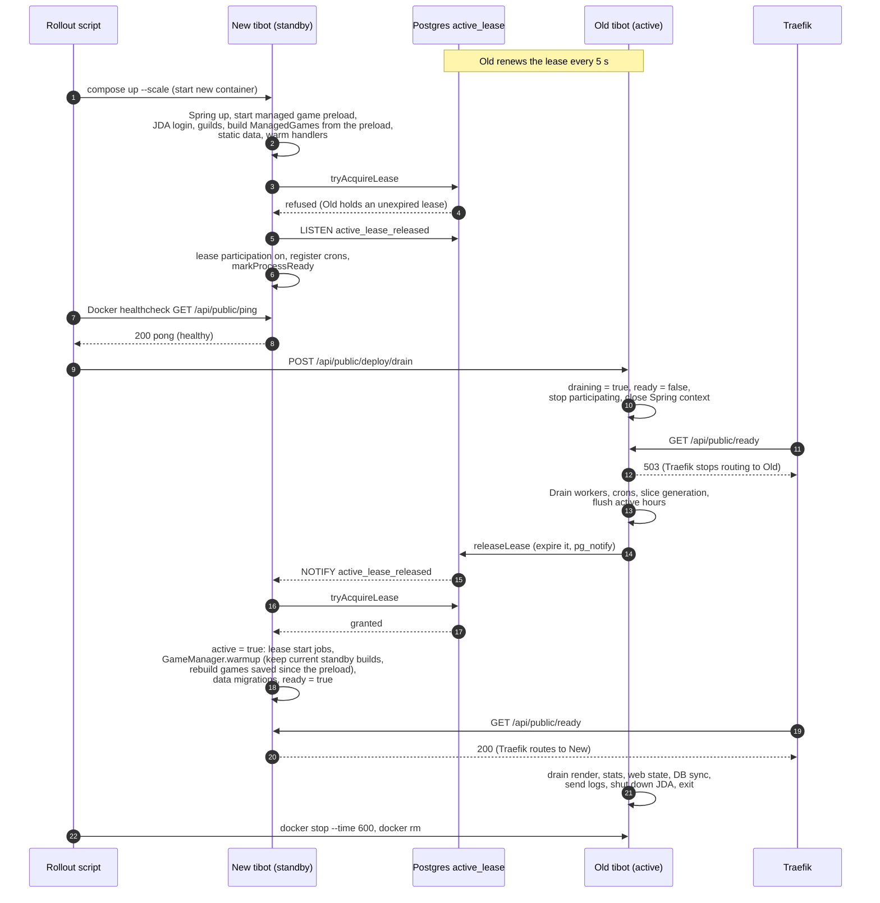
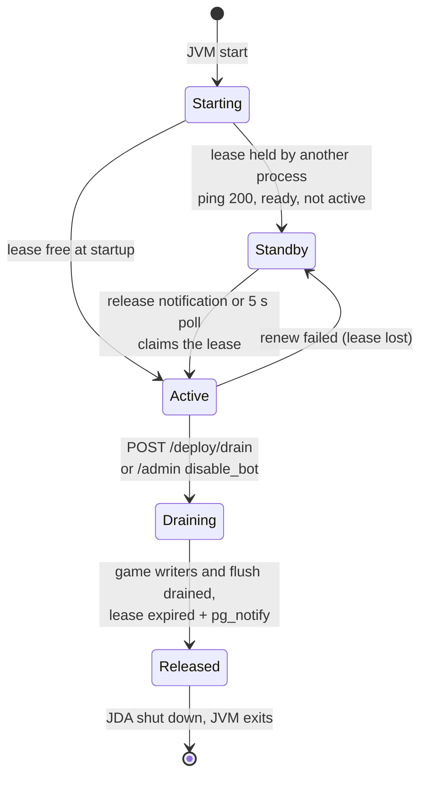

# Deployment and rollover

How a change on `master` reaches the production bot, and how the running bot hands over to
the new one without two processes acting on Discord or the games at once.

The pieces:

| Piece | File |
| --- | --- |
| Deploy workflow | [.github/workflows/deploy-to-production.yml](.github/workflows/deploy-to-production.yml) |
| Rollout script (run on the host) | [scripts/deploy_tibot_single_instance.sh](scripts/deploy_tibot_single_instance.sh) |
| Container setup (Traefik + `tibot`) | [docker-compose.production.yml](docker-compose.production.yml) |
| Image build | [Dockerfile](Dockerfile) |
| Startup order | [AsyncTI4DiscordBot.java](src/main/java/ti4/AsyncTI4DiscordBot.java) |
| Shutdown order | `JdaService.shutdown()` in [JdaService.java](src/main/java/ti4/discord/JdaService.java), see [Shutdown steps](#shutdown-steps) |
| Active lease | [ti4.spring.service.deploy](src/main/java/ti4/spring/service/deploy) |
| Health, readiness, drain endpoints | [PingController](src/main/java/ti4/spring/api/PingController.java), [ReadyController](src/main/java/ti4/spring/api/publicstatus/ReadyController.java), [DeployController](src/main/java/ti4/spring/api/publicstatus/DeployController.java) |

## 1. The deploy workflow

`BuildAndDeploy` runs on every push to `master` and on manual dispatch. A newer push cancels a
deploy that is still running (`cancel-in-progress`).

Each remote step also posts a timestamped line to the deploy Discord webhook.

Two things come from the host checkout rather than from the image: the compose file and
rollout script, and `src/main/resources`, which is mounted read-only into the container at
`/opt/resources`. The image only carries the compiled jar and classpath config. Save files
live on the host too, mounted at `/opt/STORAGE`.

`RestartBot` ([restart-bot.yml](.github/workflows/restart-bot.yml)) runs the same rollout
script against the `master` image tag without building, so it is a rollover onto the same code.
`StopBot` drains and stops every `tibot` container, and `StartBot` brings one up with plain
`docker compose up`, with no rollover.

## 2. The rollout script

The script never replaces the old container first. It adds one new container next to the
old one, waits for it to be healthy, then drains and removes the old one. If the new container
never gets healthy, it is removed and the old one keeps running.

"Healthy" is the compose healthcheck on `GET /api/public/ping`. Ping returns `200` only once
the process has reached lease participation, near the end of startup (see section 3). A new
process that is healthy is therefore fully started and waiting on standby; it is not yet
the active bot.

The drain endpoint only accepts loopback callers, which is why the script calls it with
`docker exec` inside the old container.

## 3. Rollover inside the bot: the active lease

During every rollover two bot processes are connected to Discord with the same token at the
same time, and both receive every event. One row in the Postgres `active_lease` table decides
which process acts. Each process has a random `INSTANCE_ID` (a new UUID per JVM start).

| Setting | Default | Property |
| --- | --- | --- |
| Lease key | `discord-bot` | `ti4.deploy.lease-key` |
| Lease duration | 3600 s | `ti4.deploy.lease-duration-seconds` |
| Heartbeat / renew interval | 5 s | `ti4.deploy.heartbeat-interval-seconds` |

The active process renews the lease every heartbeat, so it stays about an hour ahead of
expiry. A standby process can only claim the lease when the row is empty, already its own,
or expired.

If the `LISTEN` connection is down, the 5 s heartbeat poll on the standby (`maintainLease`)
picks up the released lease instead, so the notification only makes the handover faster.

### What each process is allowed to do

`ActiveLeaseService` keeps three flags per process: `active` (holds the lease), `draining`
and `ready`. The gates built from them:

| Work | Allowed when | Where |
| --- | --- | --- |
| Discord interactions (buttons, commands, modals, selects, messages, …) | `active` and not `draining` | each listener in `ti4.discord.interactions.listeners` |
| Scheduled crons | `active`, lease still owned in the DB, and not `draining` | first line of every cron, see [cron README](src/main/java/ti4/cron/README.md) |
| HTTP API (website) | `ready`, lease owned and not `draining` | [CircuitBreakerFilter](src/main/java/ti4/spring/resilience/CircuitBreakerFilter.java) |
| Saving a game from a web mutation | lease owned | [GameLockAndRequestContextInterceptor](src/main/java/ti4/spring/context/GameLockAndRequestContextInterceptor.java) |
| Routed HTTP traffic from Traefik | `GET /api/public/ready` returns 200 | Traefik load balancer healthcheck in the compose file |

A standby process silently ignores Discord events, so they are only handled once. An active
process that is still starting up (`ready` false) answers buttons with "the bot is rebooting".

### Process states

Log lines carry the state as a prefix: `[STANDBY xxxxxxxx]`, `[WARMING xxxxxxxx]` (active but
not ready) and `[DRAINING xxxxxxxx]`, where `xxxxxxxx` is the short instance id. The active,
ready process has no prefix. A draining process keeps the `[DRAINING]` prefix after it releases
the lease, until it exits.

### Startup work that waits for the lease

Some startup work must only run on the process that will own the games, so it runs from the
lease-acquired callback rather than in `main`: `CronManager.runLeaseStartJobs()`,
`GameManager.warmup()` and `DataMigrationManager.runMigrations()`.

The managed games, by contrast, are built on the standby. The preload loads the database rows
right after the Spring context starts, and the ManagedGames are built from them once JDA is
ready. Takeover then keeps the standby builds whose game files haven't changed since the
preload, and rebuilds only the rest. Commands that need ManagedGames wait for that, so it is
the part of the handover window the new process adds. See the
[persistence README](src/main/java/ti4/game/persistence/README.md#warmup) for the rules.

### Shutdown steps

`JdaService.shutdownPhases()` lists the shutdown in phases. The steps inside a phase run at the
same time, and each phase waits for every step in the one before it, even if the shutdown
thread is interrupted:

1. Mark the process as shutting down, set the shutdown presence, stop accepting commands,
   then close the JDA event pool.
2. **In parallel:** `ExecutorServiceManager` and `CronManager`.
3. **In parallel:** `SliceGenerationPipeline` and the user active-hours flush.
4. Release the active lease.
5. **In parallel:** `MapRenderPipeline`, `StatisticsPipeline`, `GameWebStatePipeline` and
   `GameDatabaseSyncPipeline`.
6. **One after another:** send buffered logs, shut down JDA.

**What has to finish before the lease.** Once the new process holds the lease, it loads games
from the shared game files and starts writing. Game file locks and the user settings lock only
work inside one process. So these finish before the lease is released:
- Every step that can save a game: workers, crons and slice generation.
- The active-hours flush. It rewrites whole `user_settings` rows, so after the handover it
  could overwrite a setting the new process had just saved.

**What drains after the lease:**
- Statistics and web state only read.
- Database writes go through `replaceIfMatchesGameFile`, `restoreIfMatchesGameFile` and
  `deleteIfGameFileMissing`, from both the sync pipeline and the reconciler. Each write takes a
  per-game Postgres advisory lock, then checks the game file:
  - A write is skipped if the snapshot's revision key no longer matches the file's. A newer save
    has already queued its own sync. This also keeps two quick saves of one game from reaching
    the database out of order.
  - A write is skipped if the game file is gone, so a stale sync can't bring a deleted game
    back. A delete is skipped if the file exists.
  - A write is skipped if the stored row has a newer `GameEntityMapper.MAPPING_VERSION`, so an
    old process can't overwrite a row the new code already rebuilt.
  - Game files saved before revision keys existed have none. They still sync while the file
    exists, but without the ordering protection.
- Map renders post to Discord, and also write website data, map overlays and the "latest map
  message" ids, without a lease check (see Known gaps).

The phases also follow who hands work to whom:
- Event handlers queue work onto the workers and pipelines.
- Worker tasks start renders, slice generation and statistics jobs, and record user active
  hours, so those wait for the workers.
- Workers and crons can drain together. Workers do schedule on the cron scheduler (circuit
  breaker resets, rate-limited log messages), but `CronManager.scheduleOnce` returns `false`
  instead of throwing once the scheduler is shut down. Anything scheduled after that point would
  never run anyway.
- Anything that saves a game (`GameManager.save`) queues onto the web-state and database-sync
  pipelines, so they close after every game writer.

This ordering is best effort, bounded by each executor's timeout (see Known gaps). When you add
an executor, put it in the phase after everything that submits to it. Put it before the lease if
it writes shared state that the new process also writes, unless that write is guarded the way
database sync is. `JdaServiceShutdownStepsTest` checks the order.

Interactions go unanswered from the start of the drain until the new process holds the lease.
In the worst case, where every executor runs to its timeout, the lease is released after about
95 s and the whole shutdown takes about 165 s:

```mermaid
gantt
    title Worst-case shutdown timeline (seconds)
    dateFormat X
    axisFormat %s

    section Before the lease
    JDA event pool            :a1, 0, 5s
    ExecutorServiceManager    :a2, after a1, 60s
    CronManager               :a3, after a1, 30s
    SliceGenerationPipeline   :a5, after a2, 30s
    Active-hours flush        :milestone, a4, after a2, 0s
    Lease released            :milestone, a11, after a5, 0s

    section After the lease
    MapRenderPipeline         :a6, after a5, 20s
    StatisticsPipeline        :a7, after a5, 10s
    GameWebStatePipeline      :a8, after a5, 10s
    GameDatabaseSyncPipeline  :a9, after a5, 30s
    JDA shutdown              :crit, a10, after a9, 40s
```

Each bar is that executor's timeout (JDA gets 20 s, then 20 s more after `shutdownNow`). The
active-hours flush, the lease release and sending buffered logs have no timeout. They are
usually quick, so they are drawn as points or left out. Real shutdowns are usually much faster,
because most executors are idle.

### Deployment log lines

A rollout posts these lines to the bot log, in this order. The instance prefixes are described
in [Process states](#process-states).

| Process | Line | Meaning |
| --- | --- | --- |
| New | `[STANDBY x] STARTED UP ON N SERVERS (N FOR NEW GAMES, N FOG OF WAR) IN N MS AFTER THE JVM STARTED: …` | Startup finished and the process is waiting for the lease. The list is the time each startup step took. When no process holds the lease, the new process takes it on startup instead: `TOOK THE ACTIVE LEASE (on startup)` comes first, and this line has no prefix. |
| Old | `[DRAINING x] STOPPED ACCEPTING COMMANDS` | The drain started. From here until the unblock line, interactions go unanswered. |
| Old | `[DRAINING x] RELEASED THE ACTIVE LEASE N MS AFTER STOPPING COMMANDS: …` | The steps that must finish before the handover, and how long each took. |
| New | `[WARMING x] TOOK THE ACTIVE LEASE (release notification)` | The new process holds the lease. The source is `on startup`, `release notification`, `poll` or `listener connect catch-up`. |
| New | `UNBLOCKED N MANAGED GAMES N MS AFTER TAKING THE LEASE: …` | Commands work again. The line breaks the takeover into steps and says where each ManagedGame came from. |
| Old | `[DRAINING x] FINISHED DRAINING N MS AFTER STOPPING COMMANDS: …` | The pipelines that drain after the handover, and how long each took. JDA shuts down next. |

The handover window is the time from `STOPPED ACCEPTING COMMANDS` to `UNBLOCKED`. Lines from
the two processes can arrive slightly out of order, because each posts through its own webhook
queue, so compare their timestamps rather than their order in the channel.

An executor that doesn't drain cleanly is marked in the summary, for example
`map rendering (timed out)`, and gets its own warning line.

## Known gaps

- **Interactions in the handover window go unanswered.** The old process stops handling
  Discord events the moment it starts draining, and the new one only starts once it holds the
  lease, after the old one has drained the steps that must finish first (see Shutdown steps).
  Interactions in between get no reply.
- **A crashed active process blocks takeover for up to an hour.** Only a clean shutdown
  releases the lease. If the active JVM dies without running its shutdown steps, the lease
  stays valid until it expires (up to 3600 s after the last renewal). A restarted container
  gets a new `INSTANCE_ID`, so it cannot reclaim the old lease either.
- **Shutdown ordering is bounded by timeouts.** An executor that hits its timeout may still be
  running when the next phase starts. A worker or cron that runs past its timeout can still save
  a game after the lease is released, overwriting the new process's change to that game file.
- **JDA callbacks outlive the executors.** REST callbacks (`queue(success, failure)`) run on
  JDA's own threads until JDA shuts down in the last phase. One that saves a game, queues a render
  or schedules a cron after its executor has closed has that work refused. The persistence
  pipelines log or drop the refused task.
- **Map renders after the handover can overwrite newer website data.** A render that drains
  after the lease is released still uploads website data, saves map overlays and records the
  "latest map message" ids, from a snapshot taken before the handover. If the new process
  renders the same game in that window, the older render can land last. Game files are not
  affected, and the next render fixes it.
- **A game file read error drops that game's database write.** The guarded writes read the game
  file inside the transaction. If that read fails, the write rolls back and is logged, and the
  row stays behind until the next save or reconcile.
- **A container that fails to become healthy in 540 s is rolled back**, even if it would
  have finished starting later. The old container keeps running, and the deploy job fails.
