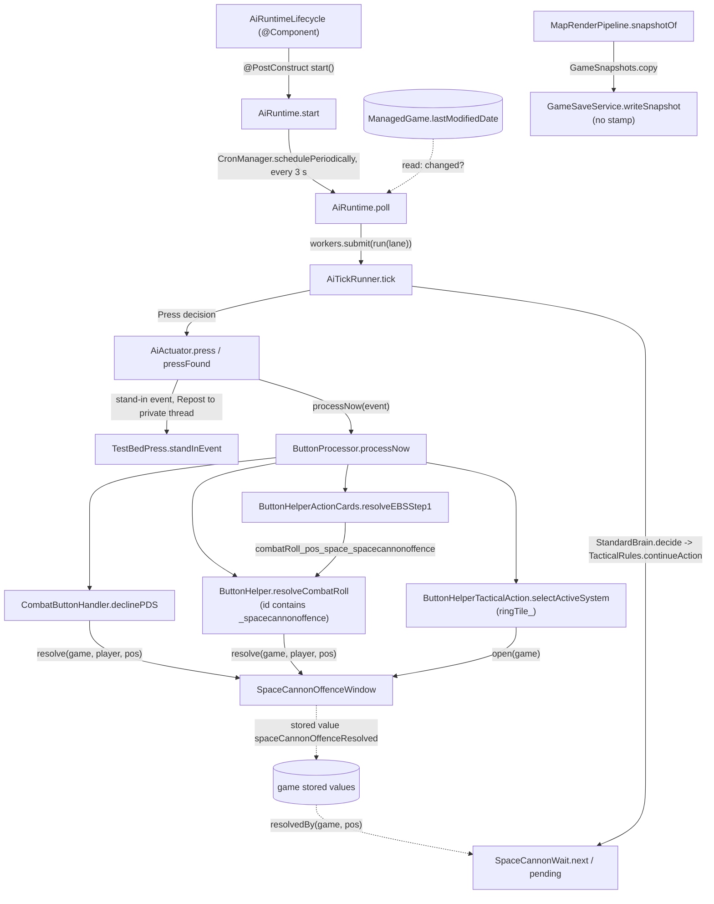
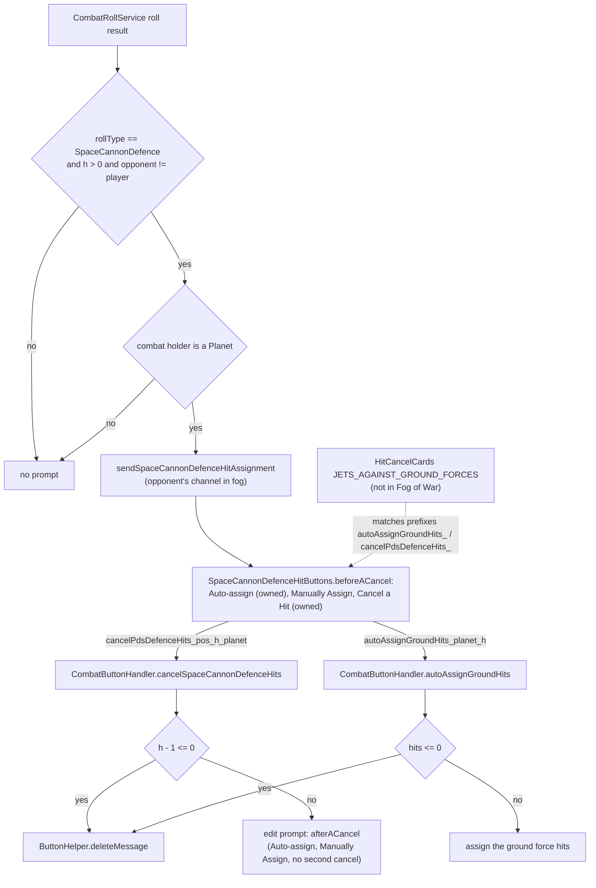

# Engine changes and AI data

Part of the [AI player architecture docs](/src/main/java/ti4/ai/README.md): a living document kept next to the code (packages: changes outside ti4.ai, data/ai resources, docs). The code is the source of truth; when you change behavior here, update this file.

## Components and responsibilities

Scope: every file the branch changes outside `src/main/java/ti4/ai` and `src/test/java/ti4/ai` (diff from the merge
base with `origin/master`, `73f948936b`, to `HEAD` `3deb66e249`), plus `src/main/resources/data/ai`, `docs/ai`,
`AI_PLAYER.md`, `AI_LOOKAHEAD_PLAN.md` and `AI_STRATEGIC_AUDIT.md`.

The diff touches 143 files outside the AI packages, 113 of them production Java files. 92 of those convert their random
draws to `RandomHelper.current()`, and 84 change nothing else (see
[RandomHelper](#randomhelper-seedable-random-source)). The rest fall into the groups below.

### Diagram: How the AI reaches the engine, and how an engine fact gets back to it

Solid arrows are calls; dotted arrows are data written or read.

`StandardBrain` is the single rules brain `FactionBrainRegistry` hands every AI seat, so this path covers every faction.
The `ManagedGame` stamp the poll reads is replaced only when the `ManagedGame` is rebuilt on a save or undo; renders
never moved it.

Human presses enter at `ButtonProcessor` the same way (through JDA instead of the stand-in event), so the recording
handlers run for both.

### AI kill switch (`GlobalSettings.AI_PLAYERS_ENABLED`)

**Role:** informs.
**Purpose:** per-bot on/off switch.
**Change:** a new enum constant `AI_PLAYERS_ENABLED` in
[GlobalSettings](/src/main/java/ti4/settings/GlobalSettings.java)`.ImplementedSettings`.
**Read by:** [AiSettings](/src/main/java/ti4/ai/AiSettings.java)`.isEnabled`, which reads the setting as `Object` with
default `false` and accepts a `Boolean` or a string parsed with `Boolean.parseBoolean`. Callers: `AiGameLauncher`
(`launch` refuses to start an AI game and replies with the command that turns the switch on), `AiStatus` (reports
"disabled on this bot, so the table chooses for it"), `AiTickRunner` (`mayActOnItsOwn` and `referee` return false),
`AiGameSupport.refusalReason` (refuses to add an AI seat, used by `AiSeatService`).
**Effect on the game:** none unless a developer sets it (`/developer setting setting_name:ai_players_enabled ...`, as
`AI_PLAYER.md` says).

### TestBedPress: public stand-in event and configurable repost header

**Role:** executes (engine side of the AI press).
**Purpose:** let AI code build a synthetic button interaction and choose the header of reposted ephemeral replies.
**Changes in** [TestBedPress](/src/main/java/ti4/service/testbed/TestBedPress.java):
- `standInEvent(Message, Button, Member, Recorder, Repost)` went from package-private to `public`.
- `record Repost(MessageChannel channel, String seatName)` became `public record Repost(channel, seatName, header)`
  with a two-argument constructor that keeps the old header `"-# 🧪 test bed: shown only to <seat> in a real game"`.
  `repostIfItHasComponents` now prepends `repost.header()` instead of the hard-coded text.
**Invoked when:** `AiActuator.pressFound` calls `TestBedPress.standInEvent(syncMessage.proxy(), button, actor,
recorder, repostTarget(seat))`; `repostTarget` returns `new Repost(<seat's private thread>, faction,
"-# 🤖 private prompt for this AI seat")` when the seat has a private thread id and JDA resolves it, else `null`.
**Algorithm (pre-existing, now reused):** ephemeral replies that carry components are re-sent as normal messages to
the repost channel with the header line; ephemeral text without components is not reposted
(`TestBedPressTest.ephemeralTextIsNotReposted`); if the header plus content exceeds `Message.MAX_CONTENT_LENGTH` the
content is sent without the header.
**Effect on the game:** none for human presses. For AI presses, ephemeral button prompts meant for the seat land in its
private cards info thread, which is where AI perception reads them.
**Evidence:** `TestBedPressTest` (`ephemeralButtonsAreRepostedWithIdenticalIds`,
`ephemeralReplyWithButtonsIsRepostedAndCallsBack`) uses the two-argument constructor, so it covers the default header
path, not the AI header.

### RandomHelper: seedable random source

**Role:** informs (infrastructure).
**Purpose:** one source of game randomness that a self-play test thread can seed, so a self-play game can be replayed
and snapshotted.
**Change in** [RandomHelper](/src/main/java/ti4/helpers/RandomHelper.java):
- `private static final ThreadLocal<Random> SEEDED`.
- `current()` returns the thread's seeded `Random` if one is set, else `ThreadLocalRandom.current()`.
- `seedThisThread(long)` sets `new Random(seed)`; `useForThisThread(Random)` installs a given instance;
  `unseedThisThread()` removes it.
- `isOneInX` and `pickRandomFromList` use `current()`.
**Call-site conversion:** across 92 production files (`Game`, `Player`, `ButtonHelper`, `CombatRollService`,
`DiceHelper`, decks, drafts, Milty, FoW setup, action card handlers, `StartScenario`, `SabotageAutoReactCron`, ...)
`ThreadLocalRandom.current()` became `RandomHelper.current()`, every one-argument `Collections.shuffle(list)` became
`Collections.shuffle(list, RandomHelper.current())`, and `WebObjectives` replaced `Math.random()` with
`RandomHelper.current().nextDouble()`. Dice (`DiceHelper`'s `nextInt(1, 11)`), deck shuffles, secret/card numeric
identifiers (`nextInt(1000)` / `nextInt(100)` in `Game` and `Player`) and draft/map generation all go through it.
**Who seeds:** only test code. `SelfPlayGame` calls `RandomHelper.seedThisThread(seed)` and, on snapshot restore,
`useForThisThread(<deserialized Random>)`; `SelfPlayEnvironment` unseeds; `DeterminizerTest` and
`RolloutExperimentTest` install their own `Random`. No production code calls the three seeding methods. Inside
`ti4.ai`, `AiSeats.randomDigits`, `AiPlay`, `AiWatch` and `AiSeatService` (profile creation) draw from
`RandomHelper.current()`.
**Effect on human games:** none in distribution: on a production thread nothing is seeded, so `current()` is
`ThreadLocalRandom.current()` exactly as before.
**Limitations:** not every game-relevant draw goes through it. Still unseeded in `HEAD`: `AgendaWhensAftersHelper`
`offerEveryonePrepassOnShenanigans` (`ThreadLocalRandom.current().nextInt(0, 6)`, decides whether a player without
shenanigans is pre-passed), `AuctionFrankenDraftService` (`Math.random()` and one one-argument `Collections.shuffle`,
Franken only), one-argument `Collections.shuffle` calls in `SecretObjectiveDeckService.shuffleIntoDeck` and
`SecretsOnlyService` (secrets-only mode), `TheodisiAgendaResolver` and `IxthLegendaryButtonHandler` (homebrew) and
`TileEmojis` (cosmetic), the joke texts in `TransactionHelper` (a `static final` list built at class load),
`PlanetEmojis`/`TI4Emoji` (emoji), `RenderRandom` (map rendering), `TournamentGrouper` (its own seeded `Random`) and
`TournamentPanelGroups` (`SecureRandom` seeds). Apart from `TransactionHelper` (changed only for
`acceptTransactionOffer`), none of these files is in the diff; the draws are the same on `origin/master`.

### Deterministic iteration order (combat roll, `Tile`)

**Role:** informs.
**Purpose:** make a seeded self-play game iterate collections in the same order on every run, so dice land on the
same units.
**Changes:**
- [CombatRollService](/src/main/java/ti4/service/combat/CombatRollService.java): every unit map that was a `HashMap`
  became a `LinkedHashMap` (selected units, `playerUnitsByQuantity`, adjusted units for Power Word/Wish and the
  Kryxos commander, `playerUnitsFlat`, `effectiveValues`, the unit maps built by `getUnitsInCombat*`,
  `getUnitsInSpaceCannonDefence`, the space cannon offense collector, `flattenUnitMap`, the choir breakthrough
  split). `Collectors.toMap(k, v)` calls became a private `orderedToMap(k, v)` that collects into a
  `LinkedHashMap` and throws `IllegalStateException("Duplicate key")` on a duplicate, as `Collectors.toMap` does.
  In the dice-to-unit grouping, `modelKeys` is now filled by iterating `playerUnits.keySet()` instead of an
  `IdentityHashMap`'s key set. The space-cannon-offense adjacency set is copied into a `LinkedHashSet` before the
  Sleipnir coverage systems are added to it, so the result set from `Adjacency.into` is no longer mutated.
  The best-candidate pick for the adjacent Salvage destroyer anti-fighter barrage uses `RandomHelper.current()`.
- [Tile](/src/main/java/ti4/game/Tile.java): `hashCode()` now returns `Objects.hashCode(tileID)` (`tileID` is
  `final`). `equals` is not overridden, so equality stays identity; the contract holds. `HashSet<Tile>` iteration
  now follows tile ids instead of identity hashes (commit `03b3a1812e` names Sling Relay buttons as the symptom).
**Effect on human games:** same rules and same probabilities; the order of units in roll output and the order of
some tile-derived buttons can differ from before, but is now stable between runs.
**Limitations:** the commit message and `AI_PLAYER.md` both state that across separate JVMs a seed reproduced a
game only into round 6 before a combat split, because hash orders of enum-keyed maps still differ between JVMs.

### Game snapshots do not stamp the live game

**Role:** informs.
**Purpose:** copying a game (for rendering or AI snapshots) must not look like a save.
**Changes:**
- [GameSaveService](/src/main/java/ti4/game/persistence/GameSaveService.java): `writeGame` now does
  `game.setLastModifiedDate(System.currentTimeMillis())` and then calls the new package-private
  `writeSnapshot(game, writer)`, which writes the file. The `LAST_MODIFIED_DATE` line writes
  `game.getLastModifiedDate()` instead of taking a fresh time inside the writer.
- [GameSnapshots](/src/main/java/ti4/game/persistence/GameSnapshots.java)`.copy` calls `writeSnapshot` instead of
  `writeGame`.
**Invoked when:** `GameSnapshots.copy` is called by `MapRenderPipeline` (every map render) and `FogWebDataService`;
tests (`AttackMemoryTest`, `PromiseGrievanceTest`, render tests) also use it. Test helper
[SaveText](/src/test/java/ti4/game/persistence/SaveText.java) uses `writeSnapshot` for self-play snapshots and
trajectory logs.
**Effect on the game:** before, every render set the live game's `lastModifiedDate` to now. Readers of the live
`Game.getLastModifiedDate()` then saw a change that was no save: AI caches keyed on it (`DecisionInputs`,
`KindPricing`, `DiplomacyUse`, `PlanInputs`), the self-play dormancy check in `AiTickRunner`, and the `GameMessage`
save times `MessageHelper` records (which `GameUndoService` uses to drop messages after an undone save).
`AiRuntime.poll` was not affected directly: it reads the `ManagedGame` stamp, which is copied from the game only when
the `ManagedGame` is rebuilt on a save or undo. Commit `7a9b10daf7` lists the fix among "self-play harness leaks".
Now the stamp moves only on a real save. The saved `LAST_MODIFIED_DATE` is still the time of the save.
**Evidence:** [GameSnapshotsTest](/src/test/java/ti4/game/persistence/GameSnapshotsTest.java)`.copyingLeavesTheModifiedStampAlone`
sets the stamp to 1,234,567, copies, and asserts both the live game and the copy still carry it.
`AI_LOOKAHEAD_PLAN.md` lists this as one of three harness leaks fixed on 2026-11-11 (commit `7a9b10daf7`).

### SpaceCannonOffenceWindow (who has answered SPACE CANNON OFFENSE)

**Role:** informs.
**Purpose:** record, per activation, which players have fired or declined SPACE CANNON OFFENSE at the active system,
so an AI seat can wait for them before landing or ending its tactical action.
**Class:** [SpaceCannonOffenceWindow](/src/main/java/ti4/service/combat/SpaceCannonOffenceWindow.java) (new).
**Invoked when (verified callers):**
- `open(game)` from `ButtonHelperTacticalAction.selectActiveSystem` (`ringTile_` handler) right after
  `game.setActiveSystem(pos)`: removes the stored value.
- `resolve(game, player, position)` from `CombatButtonHandler.declinePDS` (`declinePDS_<pos>`, only when
  `game.getTile(...)` finds the tile) and from `ButtonHelper.resolveCombatRoll` (`combatRoll_` handler) when the button
  id contains `_spacecannonoffence` (position = `buttonID.split("_")[1]`). The _Experimental Battlestation_ handler
  `ButtonHelperActionCards.resolveEBSStep1` calls the same public `resolveCombatRoll` with a
  `combatRoll_<pos>_space_spacecannonoffence` id, so its roll is recorded too.
- `resolvedBy(game, position)` from [SpaceCannonWait](/src/main/java/ti4/ai/tactical/SpaceCannonWait.java)`.pending`.
**Algorithm:** one game stored value, key `spaceCannonOffenceResolved`, format
`<round>|<active player's faction>|<position>|<faction>,<faction>,...`. `resolve` ignores a null player or blank
position, reads the current set for the same scope (empty if the stored prefix differs), adds the presser's faction
and rewrites the value. `resolvedBy` returns the factions only if the stored value starts with the current scope
prefix (round, active player, position), else an empty set.
**Effect on human games:** one extra stored value in the save; no behaviour change. It records a "resolved" for the
player who pressed, even if the subsequent roll fails.
**Consumer logic (AI side, for context):** `SpaceCannonWait.pending` lists players with PDS cover of the system
(`ButtonHelper.getPlayersWithPds2Cover`) other than the seat and its alliance members, not yet in `resolvedBy`,
skipped entirely when `game.isL1Hero()`, the tile is a Scar, or the seat has no ships there. `SpaceCannonWait.next`
only acts once the seat owns a `landUnits_`, `doneLanding_`, `tacticalActionBuild_` or `doneWithTacticalAction`
button; it then returns `Wait` until `since + grace` (grace 60 s when every pending player is an AI seat, 10 min
otherwise; `since` is memorised per action key), and after the grace an `Unsure` on the seat's first prompt of this
turn with a button it owns; if it has none, `next` returns nothing and `TacticalRules.continueAction` goes on with
the action.
`SpaceCannonWaitTest` checks these cases (wait for a human, unsure after the grace, move on after a resolve, no wait
without coverage, ships or finished movement, a resolution from another activation is ignored, `open` clears, the
short wait for an AI defender) and two cases of an AI seat answering as the covering player (declining with nothing to
shoot at, firing at ships in the system).
**Limitations:** a single stored value: only the most recent scope is kept, so resolutions for an older position are
lost when a new position is resolved in the same activation (rare: SPACE CANNON OFFENSE targets the active system).
Only the `ringTile_` activation calls `open`; other code that sets the active system (`MahactHeroButtonHandler`,
`TacticalActionButtonHandlers`) does not, so an answer recorded earlier in the same round, by the same active player
and for the same position would still count there.

### SPACE CANNON DEFENSE hit assignment with an owned "Cancel a Hit"

**Role:** executes (engine prompt) / informs (button ids the AI matches).
**Purpose:** give SPACE CANNON DEFENSE hits on landing ground forces the same Auto-assign / Manually Assign / Cancel a
Hit prompt as SPACE CANNON OFFENSE hits, so _Maneuvering Jets_ can cancel one.
**Classes:** [SpaceCannonDefenceHitButtons](/src/main/java/ti4/discord/interactions/buttons/handlers/combat/SpaceCannonDefenceHitButtons.java),
[CancelSpaceCannonDefenceHitsButtonId](/src/main/java/ti4/discord/interactions/buttons/handlers/combat/CancelSpaceCannonDefenceHitsButtonId.java),
`CombatRollService.sendSpaceCannonDefenceHitAssignment`, `CombatButtonHandler.cancelSpaceCannonDefenceHits`.
**Invoked when:** in the roll result path of `CombatRollService`, when `rollType == SpaceCannonDefence && h > 0 &&
opponent != player` and the combat holder is a `Planet`. Master only posted this prompt when the rolling player had the
_Stasis Field Generators_ technology (`player.hasTech("sfg")`); the branch posts it for every such roll.
**Outputs:** message `"<opponent>, assign the SPACE CANNON DEFENCE hit(s)."` plus the SFG reminder (empty unless the
roller has `sfg`), in the opponent's channel in fog games, otherwise the channel of the roll. Buttons
(`beforeACancel`):
1. green `<opponent FFCC>autoAssignGroundHits_<planet>_<h>` "Auto-assign Hit(s)",
2. red `getDamageButtons_<pos>deleteThis_groundcombat` "Manually Assign Hit(s)",
3. gray `<opponent FFCC>cancelPdsDefenceHits_<pos>_<h>_<planet>` "Cancel a Hit".
**Cancel handler:** parses the id (payload after `cancelPdsDefenceHits_`, split into 3: position, hits, planet;
the planet keeps underscores), posts the usual cancellation message, sets `h = hits - 1`; if `h <= 0` deletes the
prompt; otherwise edits it to `"..., you may automatically assign the hit/hits."` with `afterACancel` buttons
(Auto-assign and Manually Assign with suffix `_groundcombat`, no second cancel). The cancel button is owned by the
player taking the hits (`factionButtonChecker`). For comparison, the SPACE CANNON OFFENSE prompt's first
`cancelPdsOffenseHits_` button is owned as well (`FFCC_<faction>_`), but the cancel that `cancelPDSOffenseHits`
re-posts after one cancel is unowned. Unlike the SPACE CANNON OFFENSE prompt, this one adds no Twilight's Fall monument
cancel and no dummy variant (the _Sting of the Hive_ buttons are posted as a separate message, as before).
**AI consumer:** `HitCancelCards.Canceller.JETS_AGAINST_GROUND_FORCES` matches assign prefix `autoAssignGroundHits_`
and cancel prefix `cancelPdsDefenceHits_` (one cancel per card). `HitCancelCards.cancelHits` does nothing in Fog of War
games, when the `ai.combatcards` property is `false`, or when `ActionCardRules.mayPlayNow` refuses.
**Effect on human games:** visible: every SPACE CANNON DEFENSE hit against another player's landing now produces this
prompt (before, only when the roller held SFG; otherwise no prompt was posted). Humans gain the Auto-assign button and a
cancel button. In Fog of War games with a dummy or NPC defender, the pre-existing fog-only branch of the roll result
(`(opponent.isDummy() || opponent.isNpc()) && h > 0` on a planet) still posts its "Auto-assign Hit(s) For Dummy"
prompt, so such a roll now produces two assignment prompts; outside fog only the new prompt is posted.
**Evidence:** [SpaceCannonDefenceHitsTest](/src/test/java/ti4/discord/interactions/buttons/handlers/combat/SpaceCannonDefenceHitsTest.java)
checks the three buttons and the owned cancel, no second cancel after one, that
`sendSpaceCannonDefenceHitAssignment` posts to the channel it is given with the target's owned cancel id (it calls the
helper directly with a mocked channel; the roll path and the fog channel choice are not exercised), cancelling one of
two hits, cancelling the last hit removing the prompt, a 0-hit auto-assign clearing itself,
id parsing with and without the `FFCC_` prefix, and the longest realistic id staying within 100 characters.
**Limitations:** the cancel button is offered even when the roller has SFG, whose reminder text says the hits cannot
be cancelled; the handler does not check SFG.

#### Diagram: SPACE CANNON DEFENSE hit prompt and its cancel

### Zero-hit guards on hit prompts

**Role:** executes.
**Purpose:** a prompt for 0 hits must not stay on the table.
**Changes in** [CombatButtonHandler](/src/main/java/ti4/discord/interactions/buttons/handlers/combat/CombatButtonHandler.java):
`cancelAFBHits`, `cancelPDSOffenseHits`, `cancelGroundHits`, `cancelSpaceHits` and the new
`cancelSpaceCannonDefenceHits` delete the message (`ButtonHelper.deleteMessage`) and return when the remaining hits
`h <= 0`, after posting the cancellation message. `autoAssignGroundHits` deletes the message and returns when the
parsed hit count is `<= 0`.
**Why:** the test comment in `SpaceCannonDefenceHitsTest` states that an "Auto-assign Hits" for 0 hits did nothing
and left an AI seat pressing it forever.
**Effect on human games:** cancelling the last hit now removes the prompt instead of leaving 0-hit buttons.

### ButtonHelper.fleetCheck (fleet and capacity facts for the AI)

**Role:** informs.
**Purpose:** expose the engine's existing fleet pool and capacity assessment so the AI removes or keeps units by the
bot's own rules.
**Change in** [ButtonHelper](/src/main/java/ti4/helpers/ButtonHelper.java): new `public static FleetCheck
fleetCheck(Player, Game, Tile)` and `public record FleetCheck(int[] counts, boolean fleetSupplyViolated, boolean
capacityViolated, int capacitySlack)`, built from the private `assessFleetAndCapacity(player, game, tile, false)`.
`FleetAssessment` gained `capacityViolated` and `capacitySlack`; `capacitySlack = capacity - numInfNFightersNMechs`,
computed before the Fighter II overflow adjustment; an unassessed tile reports `Integer.MAX_VALUE`.
**Called by:** `FleetSupplyRules.helpsFit` (which passes the result to `keepsCargoAboard` and `fighterIIOverflow`) and
`FleetSupplyRules.overLimits`, `TacticalRules.fighterRoom` (both in `ti4.ai.tactical`), and `FleetSupplyRulesTest`.
**Effect on human games:** none; the existing messages and checks are unchanged.

### AgendaHistory (resolved and quashed agendas with their voters)

**Role:** informs.
**Purpose:** remember, after the agenda is gone, how an agenda ended and who voted for the winning outcome, so AI vote
promises and discard bounties can be settled later.
**Class:** [AgendaHistory](/src/main/java/ti4/helpers/AgendaHistory.java) (new).
**Invoked when:** `recordResolved(game, agendaId, winner)` from `AgendaResolveButtonHandler.resolveAgenda`
(`agendaResolution_`, after its `guardDoublePress` check) right after it stores
`resolvedAgendaId`/`resolvedAgendaOutcome`; `recordQuashed(game, agendaId)` from the _Quash_ resolution in
`ButtonHelperFactionSpecific`. Readers: `PromisedVotes` (`AgendaHistory.of(...).filter(Entry::resolved)`, outcome and
`votedForOutcome`) and `DiscardBountyDeals` (resolved vs quashed).
**Algorithm:** one stored value `agendaHistory`; records separated by `;`, fields by `|`:
`round|agenda|how|outcome|voter+voter`. `how` is `resolved` or `quashed`. Voters are read from
`game.getCurrentAgendaVotes()` for the entry whose key equals the outcome (case-insensitive): each `;`-separated
piece `<owner>_<digits>` contributes the lower-cased owner. A record is dropped if the agenda is blank or any of agenda,
outcome or voter names contains one of `;|+:,`. A new record replaces an earlier one for the same round and agenda;
the list keeps the newest 16 (`MAX_RECORDS`). `of(game, round, agenda)` returns the last matching entry; malformed
records are skipped on read.
**Effect on human games:** one more stored value in the save; no behaviour change.
**Evidence:** used in `ConditionalVoteDealsTest` and `DiscardBountiesTest` (in `ti4.ai.trade`), which record entries
directly; no engine-side test of the resolve/quash hooks was found.

### GameStats.actionCardTargets ("mean" action card targets)

**Role:** informs.
**Purpose:** record who aimed a player-targeted action card at whom, for the AI's hostility ledger.
**Change in** [GameStats](/src/main/java/ti4/game/GameStats.java): `List<ActionCardTarget> actionCardTargets` (Lombok
getter/setter, serialised with the rest of `GameStats` as JSON in the save) and `recordAcTarget(acName, player,
target)`, which ignores a null player or target and self-targets and stores `(actionCard, trackedId(player),
trackedId(target))`. `ActionCardTarget` is a Jackson bean with `NON_EMPTY` inclusion and `ignoreUnknown`.
**Invoked when:** in [ButtonHelperActionCards](/src/main/java/ti4/helpers/ButtonHelperActionCards.java) step-2
resolvers: Insubordination, Spy, Seize Artifact, Uprising, Assassinate Representative, Signal Jamming, Reactor
Meltdown (recorded before its null-target fizzle check), Plague, Cripple Defenses, Unstable Planet.
**Read by:** `Hostility.scanCards`/`meanCards`, which charges `MEAN_CARD_COST` = 2.0 TG of hostility per new entry
(offender = card player, victim = target), tracking how many entries it has processed in `aiHostilityTargets`.
`HostilityTest` records Plague and Uprising targets directly.
**Effect on human games:** the save's `GameStats` JSON grows by one entry per such card; no behaviour change.
**Limitations:** a step-2 button pressed twice records twice.

### Engine methods made public for AI callers

**Role:** informs / executes.
- `AgendaHelper.getVotingOrder(Game)` private -> public; called by `AgendaForecast`.
- `AgendaHelper.getVoteTotal(Player, Game)` package-private -> public; outside `ti4.helpers` only the test
  `AgendaTrace` calls it (no production AI caller).
- `TransactionHelper.acceptTransactionOffer(Player, Player, Game, ButtonInteractionEvent)` private -> public; called by
  `HumanAiDealRunner.transferAll` after it clears the AI's transaction items with the human and fills them with
  `sending<from>_receiving<to>_<item>_<detail>` entries. `HumanAiDealRunner.run` reaches it from four AI button
  handlers pressed by the human: `HumanAiDealButtons`, `ViscountUnlennSaleButtons`, `SpeakerSaleButtons` and
  `PromiseDealButtons`. It executes a transaction through the engine's accept path without a second button press.
**Effect on human games:** none from the visibility change itself.

### Performance changes without behaviour change

**Role:** informs.
From commit `6f65eca854` ("Halve AI self-play CPU per decision"); results are unchanged by construction:
- `ListTechService.getAllTechOfAType`: builds `new HashSet<>(game.getTechnologyDeck())` once instead of calling
  `getTechnologyDeck().contains` per technology, and moves the `isTechResearchable` filter to the end of the chain.
- `StringHelper.unescape`: returns the input unchanged unless it contains `{`, `\r` or `fin` (every escape token is
  `{...}`, the legacy markers are `666fin`/`667fin`). `StringHelperEscapeTest` checks the round trip, that plain text
  comes back as the same instance, and the legacy markers.
- `Tile.isMecatol(Game)`: looks up `game.getMecatolTile()` once.
- `Player.hasAbility`: the Twilight's Fall alias check moved into `hasTwilightsFallTechFor`, which returns
  `techs.contains("tf-" + ability without "_")` as soon as any `tf-` technology is found, else `false` (same result).

### Small engine bug fixes and guards

**Role:** executes.
- `FrameShiftBrActionCardHandler.isActive` (Blue Reverie): also requires `!activeSystem.isEmpty()`. `Game.getActiveSystem`
  falls back to `lastActiveSystem`, and a missing stored value reads as `""`, so with neither set the old check
  `"".equals("")` reported _Frame Shift_ active for every player. Callers: `IngressEgressRule` (adjacency) and
  `TacticalActionOutputService` (+1 move in the Fracture). Made in a merge commit; no test found.
- `ButtonHelperAbilities.getXxchaPeaceAccordsButtons`: the emoji on each target button now comes from the owner of the
  target planet (`planet2`) instead of the source planet.
- `FrankenHomeService.getPlayerHsRingPosition`: returns `null` when no home-system faction is found instead of
  dereferencing it.

### TODO comments added to engine code

**Role:** none (documentation of suspected bugs).
- `CombatRollService` before the temp-mod check: _Bunker_'s -4 waits in the defender's new temp mods until the defender
  rolls, so it probably never reaches the attacker's bombardment.
- `ButtonHelperFactionSpecific.resolveSolBtBuild` (`solBtBuild_`): `getPlaceUnitButtons` resets produced units, so
  pressing it mid-build drops the unfinished main build's tally; those units stay on the board unpaid, and an AI seat
  re-placed them in a loop.

### AI resource data files and their readers

**Role:** informs (static priors read by evaluators).

| File | Reader | Fields actually read | Consumers |
| --- | --- | --- | --- |
| [action_card_stats.json](/src/main/resources/data/ai/action_card_stats.json) | [ActionCardStats](/src/main/java/ti4/ai/actioncards/ActionCardStats.java) | `estimatedDrawsPerCopy`, `replayGames`, `average.{impact, cancelRateWeighted, playRate, baselineWinRate}`, per card `name, copies, impact, thin, winRate, playRate, cancelRate, wins, plays, cancels, replays, gamesReplayed` | `ActionCardPrior` |
| [action_card_expert_tiers.json](/src/main/resources/data/ai/action_card_expert_tiers.json) | [ExpertTiers](/src/main/java/ti4/ai/actioncards/ExpertTiers.java) | `cards[].{name, tier, rankInTier}` | `ActionCardPrior.strength`, `ExpertElectionValues` |
| [expedition_stats.json](/src/main/resources/data/ai/expedition_stats.json) | [ExpeditionStats](/src/main/java/ti4/ai/expedition/ExpeditionStats.java) | `factions.<faction>.<kind or none/any> = [wins, games]` | `BreakthroughValue` (`breakthroughLiftPoints`), `ExpeditionOutlook` (`kindNudge`) |

Unused by code (ignored through `@JsonIgnoreProperties(ignoreUnknown = true)`): `deck`, `sample`, `overruleTargets`,
`average.winRate`/`cancelRate`, per-card `firstPlayWins`, `firstPlaysUncanceled`, `replayWins`, `replaysUncanceled`
in the stats file; `source` and `rankedThrough` in the tiers file; everything except `factions` in the expedition file
(`byExpedition`, `byCount`, `lastExpedition`, ...).

**Loading:** each reader resolves the file through `ResourceHelper.getDataFile("ai/...")`, parses it with
`JsonMapperManager.basic()` once (double-checked or `synchronized` lazy load into a `volatile` field), and on a missing
file logs a `BotLogger.warning` and uses an empty snapshot; on a parse error logs `BotLogger.error` and uses the empty
snapshot. Downstream code then falls back to constants (see algorithms).

**Provenance:** `action_card_stats.json` is produced by [scripts/ai-action-card-stats.mjs](/scripts/ai-action-card-stats.mjs)
from the bot's action card statistics text output for deck `action_cards_te` (the file's `sample`: 6-player,
10-point, non-homebrew, non-Galactic-Event, non-Scenario games with winners, started after 2026-05-23; `replayGames`
1,763). The tiers file states it is a podcast tier
list covering cards from _Ancient Burial Sites_ to _Overrule_. The expedition file states it is Thunder's Edge win-rate
correlations from human games pasted on 2026-10-18.

### Engine-side test infrastructure used by AI tests

**Role:** informs (tests only).
- `src/test/java/ti4/testUtils/discord/` (`FakeDiscord`, `FakeChannel`, `FakeMessage`, `FakeRestAction`,
  `DiscordRouter`, `InMemoryGameMessages`, `ProxySupport`, `FakeDiscordTest`): an in-memory Discord that answers the
  JDA calls the bot makes; RestActions run inline, message ids are snowflakes from a supplied clock. Used by
  `SelfPlayEnvironment`, `SelfPlayGame`, `AiSelfPlayTest`, `RoundTwoSelfPlayTest`, `FactionComponentTracker`,
  `AiCombatThreadSelectionTest`.
- `ti4.game.persistence.SaveText` (save text via `writeSnapshot`, read back via `GameLoadService.readGame`) and
  `ManagedPlayers.forgetWithoutGames` (removes seat ids without games from `GameManager`'s private registry by
  reflection, so a replayed seed can reuse its AI seat ids).
- Engine tests `DirectHitButtonTest`, `MunitionsReservesButtonTest`, `SardakkCommanderButtonsTest`,
  `XxchaAgentInfantryRemovalTest`, `XxchaSpendMessageTest` cover engine fixes whose production code is not in this
  diff (it already is on `origin/master`; the related fixes landed through `#5974`, commit `d19887738a`).

### Repository documents in scope

**Role:** none (documentation). Status summary; details and contradictions are in section 7.
- `AGENTS.md`: adds the segregation rule (AI code in `ti4.ai`, seams only as listed in `AiSegregationTest`). Current.
- `GLOSSARY.md`: Transaction timing (LRR 94.1/94.6) and the terms Slay, Promise deal, Win threat, Boat float,
  Relations. Checked: `SlayIntent` posts "We must slay ...", `Relations.MAX` = 2, `TRADE_GOODS_PER_POINT` = 2.0,
  personalities STOOGE..WARLORD exist.
- `AI_PLAYER.md`: user and design guide (about 2,000 lines). Mostly current at class level (every backticked CamelCase
  class name exists in the repository, except the JDK's `StackOverflowError`), but its engine-change list in "Segregation" describes changes that are no longer in this diff
  and omits most that are; several limitation and value statements are outdated.
- `AI_LOOKAHEAD_PLAN.md`: a step plan with status. Its stated limits (20 s `DECIDE_TIMEOUT`, 2 worker threads, a press
  checks only that its button still exists) match the code; `AiActuator.press` also refuses a button that opens a
  modal.
- `AI_STRATEGIC_AUDIT.md`: an audit against baseline `b3766a0a2d`; describes architecture ("first applicable rule
  wins", "not a generic minimax or MCTS search") and `ScoringPaths` changes. Older than `HEAD`.
- `docs/ai/AGENDA_PLAN.md`: an implementation plan written in another worktree before the work (its header says
  "Nothing has been changed or built"), later extended with dated "Done" entries (2026-11-12 to 2026-11-14) under
  several milestones. It names some classes that were never created. Part plan, part status log; the header is out of
  date.
- `docs/ai/FACTION_USAGE_REPORT.md`: dated batch record measured by the test class `FactionComponentTracker`.
- `docs/ai/RELIC_REPORT.md`: relic report; its fragment value formula no longer matches `FragmentValue`.

## Scenarios

### Engine changes and AI data

| Scenario | Trigger | Handled by | Choices considered | How it chooses | Outcome / fallback |
| --- | --- | --- | --- | --- | --- |
| AI seat finished moving into a system a human's PDS covers | seat owns `landUnits_` / `doneLanding_` / `tacticalActionBuild_` / `doneWithTacticalAction` and the human has not fired or declined | `SpaceCannonWait.next` reading `SpaceCannonOffenceWindow.resolvedBy` | wait, continue, ask for help | waits while a covering non-ally is unresolved; grace 10 min for humans | `Wait` until the grace ends, then `Unsure` on its first owned prompt |
| Same, covering player is an AI seat | as above | `SpaceCannonWait.next` | wait, continue | grace 60 s when every pending player is an AI seat | `Wait`, then `Unsure` |
| Covering player fires or declines | `combatRoll_..._spacecannonoffence` or `declinePDS_<pos>` pressed | `ButtonHelper.resolveCombatRoll`, `CombatButtonHandler.declinePDS` -> `SpaceCannonOffenceWindow.resolve` | none | records the presser's faction for this round, active player and system | next AI tick finds nobody pending and continues |
| New system activation | `ringTile_` | `ButtonHelperTacticalAction.selectActiveSystem` -> `SpaceCannonOffenceWindow.open` | none | clears the stored value | earlier answers no longer count |
| Ground forces land, defender rolls SPACE CANNON DEFENSE | roll with hits against another player on a planet | `CombatRollService.sendSpaceCannonDefenceHitAssignment` | auto-assign, manual, cancel a hit | engine posts all three; an AI seat taking the hits may play Maneuvering Jets through `HitCancelCards` (not in Fog of War) | hits assigned; cancel offered once per roll |
| Last hit cancelled | `cancelPdsDefenceHits_`, `cancelAFBHits_`, `cancelPdsOffenseHits_`, `cancelGroundHits_`, `cancelSpaceHits_` with 1 hit left | `CombatButtonHandler` cancel handlers | none | `h <= 0` | prompt deleted instead of a 0-hit Auto-assign |
| Stale 0-hit Auto-assign pressed | `autoAssignGroundHits_<planet>_0` | `CombatButtonHandler.autoAssignGroundHits` | none | parsed hits `<= 0` | prompt deleted |
| Map rendered between saves | any map render | `MapRenderPipeline` -> `GameSnapshots.copy` -> `GameSaveService.writeSnapshot` | none | copy does not touch `lastModifiedDate` | caches keyed on the live game's stamp and message save times stay valid; the AI poll reads the `ManagedGame` stamp and was not driven by renders |
| Agenda resolved | resolve button | `AgendaResolveButtonHandler` -> `AgendaHistory.recordResolved` | none | stores outcome and voters | `PromisedVotes`, `DiscardBountyDeals` can settle later |
| Agenda quashed | Quash resolution | `ButtonHelperFactionSpecific` -> `AgendaHistory.recordQuashed` | none | stores `quashed` | bounty logic tells quashed from resolved |
| A player aims Spy, Plague, Uprising, ... at an AI seat | step-2 target button | `ButtonHelperActionCards` -> `GameStats.recordAcTarget` | none | records card, player, target | `Hostility` charges 2 TG per new entry |
| AI press that answers with an ephemeral prompt | AI presses a button whose handler replies ephemerally with components | `AiActuator.pressFound` -> `TestBedPress.standInEvent` with `Repost` | none | components present? | reposted to the seat's private thread under "-# 🤖 private prompt for this AI seat"; plain text is not reposted |
| Developer enables the test bed in a game with AI seats | `/testbed enable` (also reset, run, apply) | `TestBedService.findNonDeveloper` | none | AI seats skipped | no refusal because of an AI seat |
| Kill switch off | setting absent or false | `AiSettings.isEnabled` | none | default `false` | `/ai` is still registered and the poll still runs, but seats do not act or referee; starting an AI game (`AiGameLauncher.launch`) and adding a seat (`AiGameSupport.refusalReason`) are refused with the command that turns it on |
| Seeded self-play game | test thread calls `RandomHelper.seedThisThread` | `RandomHelper.current` at every converted call site | none | thread-local `Random` | same dice, shuffles and ids for the same seed (within one JVM) |
| AI seat over fleet pool or capacity | hit-assignment / removal buttons after movement or production | `FleetSupplyRules`, `TacticalRules.fighterRoom` via `ButtonHelper.fleetCheck` | which unit to remove, how many fighters to build | engine's own assessment | removal matches the bot's rule; build fits the slack |
| Human accepts an AI deal or sale | AI-posted accept button | `HumanAiDealButtons`, `ViscountUnlennSaleButtons`, `SpeakerSaleButtons` or `PromiseDealButtons` -> `HumanAiDealRunner.run` -> `transferAll` -> `TransactionHelper.acceptTransactionOffer` | none here | transfers prepared as transaction items | engine transaction executes in the human's press |
| A covering player fires with _Experimental Battlestation_ | `resolveEBSStep1_` | `ButtonHelperActionCards.resolveEBSStep1` -> `ButtonHelper.resolveCombatRoll` | none | id built with `_spacecannonoffence` | recorded as an answer, like a normal SPACE CANNON OFFENSE roll |

#### Waiting for SPACE CANNON OFFENSE before continuing a tactical action

- **Trigger:** an AI seat's tactical action reaches the point after movement: it owns one of `landUnits_`,
  `doneLanding_`, `tacticalActionBuild_` or `doneWithTacticalAction`. `StandardBrain` calls `TacticalRules.continueAction`,
  which calls `SpaceCannonWait.next` before continuing.
- **Responsible components:** `SpaceCannonOffenceWindow` (engine, records) and `SpaceCannonWait` (AI, decides).
- **Choices:** wait, continue the action, or declare itself unsure.
- **Selection:** `pending` = players returned by `ButtonHelper.getPlayersWithPds2Cover(seat, game, position)` minus the
  seat, minus alliance members, minus factions in `resolvedBy`. Empty when the game is in the L1Z1X hero state
  (`game.isL1Hero()`), the tile is a Scar, or the seat has no ships in the tile. Non-empty -> wait until
  `since + grace`.
- **Why similar situations differ:** an all-AI pending set waits 60 s, any human in it waits 10 min; a resolution made
  during another player's activation or another round has a different scope prefix and does not count; a seat whose
  ships all died has nothing to protect and does not wait.
- **Fallback:** after the grace, `Unsure` on the first prompt of this turn with an owned button, which hands the
  choice to the AI's fallback path (outside scope). With no such prompt, `SpaceCannonWait.next` returns nothing and
  `continueAction` moves on (combat wait, landing, exploration, ...).
- **Limitation:** the engine records a press, not a completed roll; a pressed roll that fails still counts as resolved.

#### SPACE CANNON DEFENSE prompt and Maneuvering Jets

- **Trigger:** `CombatRollService` finishes a SPACE CANNON DEFENSE roll with `h > 0` against a different player on a
  `Planet`.
- **Engine output:** a message to the player taking the hits with `autoAssignGroundHits_<planet>_<h>` (owned),
  `getDamageButtons_<pos>deleteThis_groundcombat`, and an owned `cancelPdsDefenceHits_<pos>_<h>_<planet>`.
- **AI side:** `HitCancelCards.cancelHits` (reached from `CombatCardRules`) returns nothing in Fog of War games, with
  `-Dai.combatcards=false`, or when `ActionCardRules.mayPlayNow` refuses. Otherwise it scans visible prompts newest
  first; for `JETS_AGAINST_GROUND_FORCES` it needs an enabled owned `autoAssignGroundHits_` button not yet pressed and
  a cancel offer, no earlier play remembered for that message, a held `mjets1..4`, and its own `worthCancelling`
  test, then starts the card play aimed at that message.
- **Outcome:** after one cancel, the prompt is edited to the two assignment buttons; with no hits left it is deleted.
- **Difference from master for humans:** master posted this prompt only when the roller held _Stasis Field
  Generators_; other SPACE CANNON DEFENSE hits got no assignment prompt (except the fog-only dummy/NPC prompt, which
  still posts and now comes alongside this one).

#### Doing nothing on purpose

- The engine changes never act by themselves. Recording hooks (`resolve`, `recordResolved`, `recordAcTarget`) run
  inside the human or AI press that triggers them.
- With the kill switch off the AI runtime still polls but `mayActOnItsOwn` and `referee` return false.
- A copy of the game (render, web data) is deliberately not a change: it leaves the live game's stamp alone, so caches
  keyed on that stamp are not invalidated by it.
- `AiRuntime.poll` returns without work while the process is not ready (JDA not connected or not ready, no active
  lease, bot unstable, circuit breaker open).
- `SpaceCannonWait` never waits in an L1Z1X hero activation, in a Scar, or when the seat has no ships left in the
  system.

## Algorithms and priorities

### No search, simulation or opponent model in this scope

None of the engine changes decides anything for the AI. They record facts (`SpaceCannonOffenceWindow`,
`AgendaHistory`, `GameStats.actionCardTargets`), expose existing engine computations (`ButtonHelper.fleetCheck`,
`AgendaHelper.getVotingOrder`), change prompts (SPACE CANNON DEFENSE assignment, zero-hit guards) or make randomness
and iteration order reproducible. There is no search, rollout, simulation or opponent prediction in these files. The
rollout experiment that the seeding enables (`RolloutExperimentTest`, `Determinizer`) lives in test code and in
`ti4.ai`, outside this scope.

### Randomness

- Source: `RandomHelper.current()` = the thread's installed `java.util.Random` if any, else
  `ThreadLocalRandom.current()`. Production threads never install one, so production randomness is unseeded and
  unchanged. Test threads install `new Random(seed)` (`seedThisThread`) or a restored instance (`useForThisThread`).
- Draw types routed through it: d10 rolls (`DiceHelper`, `nextInt(1, 11)`), shuffles of every deck and list that used
  the one-argument `Collections.shuffle`, numeric ids for cards (`nextInt(1000)`, `nextInt(100)` with a retry loop
  on collision in `Game` and `Player`), draft, slice and map generation, random speaker/seat orders, and flavour texts
  chosen at use time.
- Not routed: `AgendaWhensAftersHelper.offerEveryonePrepassOnShenanigans` (`ThreadLocalRandom.nextInt(0, 6)`, a player
  without shenanigans is pre-passed unless the draw is 5), `AuctionFrankenDraftService` (`Math.random`, one
  one-argument shuffle), one-argument `Collections.shuffle` in `SecretObjectiveDeckService.shuffleIntoDeck` and
  `SecretsOnlyService` (secrets-only mode), `TheodisiAgendaResolver`, `IxthLegendaryButtonHandler` and `TileEmojis`,
  flavour texts built at class load in `TransactionHelper`, emoji pickers, `RenderRandom`, tournament grouping.
- No softmax or temperature exists in this scope.

### Deterministic ordering

- `CombatRollService` keeps every unit map in insertion order (`LinkedHashMap`, `orderedToMap`) and groups unit keys
  for dice by iterating `playerUnits.keySet()` in that order. The insertion order itself comes from iterating
  `tile.getUnitHolders().values()` and the holders' unit maps.
- `Tile.hashCode() = Objects.hashCode(tileID)` gives `HashSet<Tile>`/`HashMap<Tile,…>` an order that depends on tile ids
  only. Ties among tiles with the same id (two copies of a tile id on one map) fall back to insertion within the bucket.

### SpaceCannonOffenceWindow scope rule

- Stored value `spaceCannonOffenceResolved = <round>|<active faction>|<position>|<f1>,<f2>,…`.
- `resolvedBy(position)` = the faction list if the stored string starts with the current
  `<round>|<active faction>|<position>|`, else empty. `resolve` = union of that set with the presser's faction.
  `open` (each system activation) deletes it.
- AI use (`SpaceCannonWait`): wait while any player with PDS cover of the active system (excluding the seat and its
  alliance members) is not in the set; grace 60,000 ms when every pending player is an AI seat, 600,000 ms otherwise,
  measured from the first time the wait was seen for this action (`spaceCannonExpectedSince|<action key>` in seat
  memory); after the grace return `Unsure` on the first prompt of this turn with a button the seat owns, or nothing
  (the action continues) when there is none. Nobody is pending when `game.isL1Hero()`, the tile is a Scar, or the
  seat has no ships in the tile.

### AgendaHistory record rule

- Record = `(round, agenda, how ∈ {resolved, quashed}, outcome, voters)`.
- `voters` = lower-cased owners `x` of every piece `x_<digits>` in the `;`-split value of
  `currentAgendaVotes[outcome]` (case-insensitive key match), deduplicated in first-seen order.
- Write = drop any record with the same `(round, agenda)`, append, keep the last 16. Records with any of `; | + : ,` in
  agenda, outcome or voter names are not written. `of(round, agenda)` returns the last match.

### GameStats.actionCardTargets and its hostility charge

- `recordAcTarget(card, player, target)` appends `(card, trackedId(player), trackedId(target))` unless either is null
  or they are the same player.
- `Hostility.meanCards` charges each entry past the processed count (`aiHostilityTargets`) 2.0 TG of hostility from the
  card player toward the target (`MEAN_CARD_COST`). `Relations` turns hostility into relation points at 2 TG per point
  (`TRADE_GOODS_PER_POINT` = 2.0, floor of the quotient).

### ButtonHelper.fleetCheck values

- `capacitySlack = capacity - (infantry + fighters + mechs that need capacity)`, computed before the Fighter II overflow
  adjustment; `Integer.MAX_VALUE` when the tile was not assessed.
- AI uses (in `ti4.ai.tactical`): a ship may be removed for fleet pool only if `capacity <= 0 || capacitySlack >=
  ship capacity` (`keepsCargoAboard`); cargo in space may be removed when `capacityViolated`, or when
  `fleetSupplyViolated` and the Fighter II overflow count is positive; `fighterRoom = max(0, capacitySlack +
  max(0, counts[IGNORED_FIGHTERS_INDEX] - fighters in space))`.

### Action card priors from the data files (`ActionCardPrior`)

Constants: `AVERAGE_CARD` 1.2, `NEUTRAL_STRENGTH` 1.0, strength clamp [0.5, 2.0], `THIN_PULL` 0.5, `STRENGTH_SHARE`
0.5, `CANCEL_APPETITE_CAP` 4.0, `CANCEL_SHRINK_PLAYS` 50, `ONE_OF_RETRIEVAL` 0.065, fallbacks `FALLBACK_IMPACT` 30.0 and
`FALLBACK_CANCEL_RATE` 0.0442 when the file's averages are 0 or the file is missing.

- Human strength = `clamp(impact / averageImpact, 0.5, 2.0)`; if the card's impact is marked thin (`*`), pulled halfway
  to 1.0: `s + 0.5 × (1 − s)`. `averageImpact` = `average.impact` (30 in the file).
- Expert strength (`ExpertTiers.strengthsFor`): tier ranges S 2.2→1.8, A 1.7→1.4, B 1.35→1.05, C 1.0→0.8,
  D 0.75→0.45. Position = `(rankInTier − 1) / (tierSize − 1)` (0 for a one-card tier); strength = `best + position ×
  (worst − best)`. The file has 62 ranked cards: S 6, A 6, B 16, C 14, D 20. A tier letter outside S–D is skipped.
- `strength(alias)`: no expert value → human value, or 1.0 when the card has no statistics; with an expert value →
  `clamp((human + expert) / 2, 0.5, 2.0)`, or `clamp(expert, 0.5, 2.0)` without human statistics. Names are matched by
  the card's display name (`Mapper.getActionCard(alias).getName()`).
- `keepPrior = 1.2 × (0.5 + 0.5 × strength)`.
- `cancelAppetite = 0` for cards that cannot be sabotaged (`ActionCardHelper.cannotBeSabotaged`: Sabotage, Shatter and
  cards the engine marks not cancelable), else `min(4.0, shrunk / typical)` with `shrunk = (cancels +
  50 × typical) / (plays + 50)` and `typical = average.cancelRateWeighted` (0.0442); 1.0 for a card without statistics.
- `firstPlayRate`: for a one-copy card with replay data, `(plays − replays) / estimatedDrawsPerCopy` (1,072 in the
  file; `playRate` if that is 0); otherwise `playRate`; 0 without statistics.
- `retrieval`: for a one-copy card with replay data and at least one first play, `replays / (plays − replays)`;
  otherwise 0.065.

Worked values computed from the shipped files with these formulas:

| Card | Expert (tier, rank) | Human strength | Strength | Keep prior | Other |
| --- | --- | --- | --- | --- | --- |
| Overrule | 2.200 (S1) | 2.000 (impact 96.4, clamped) | 2.000 (mean 2.1 clamped) | 1.800 | cancel appetite 4.0 (cap), first-play rate (923−225)/1072 = 0.651, retrieval 225/698 = 0.322 |
| Master Plan | 1.800 (S6) | 1.207 | 1.503 | 1.502 | |
| Morale Boost | 0.624 (D9) | 0.833 | 0.729 | 1.037 | |
| Maneuvering Jets | 0.513 (D16) | 0.500 (impact 8, clamped) | 0.507 | 0.904 | |
| Sabotage | not ranked | 1.353 | 1.353 | 1.412 | cancel appetite 0: `ActionCardHelper.cannotBeSabotaged` is true for any alias containing `sabo` or `shatter`, so the shrinkage formula is not used |
| Strategize | not ranked (after _Overrule_ alphabetically) | 1.173 | 1.173 | 1.304 | |

### Expedition priors (`ExpeditionStats`)

Records are `[wins, games]` per faction and kind (`techSkip`, `tradeGoods`, `fiveRes`, `fiveInf`, `secret`,
`actionCards`), plus `none` (no expedition) and `any`. `firmament` reads `obsidian`'s record.

- `breakthroughLiftPoints(f)` (in win-rate percentage points): if `none` or `any` is missing, `PRIOR_LIFT × 100` = 1.0.
  Else `with = wins_any / games_any`; `without = (wins_none + 200 × (with − 0.01)) / (games_none + 200)`; result
  `100 × (with − without)`. The 200-game prior pulls `without` toward "1 point below `with`".
- `kindNudge(f, kind)`: 0 if the faction or kind is missing; `mean` = pooled win rate over all six kinds;
  `shrunk = (wins_kind + 100 × mean) / (games_kind + 100)`; nudge `= clamp(0.2 × 100 × (shrunk − mean), −1.0, 1.0)`.
- `BreakthroughValue.of` uses the lift as `max(floor, max(0.75, 2.0 + 0.5 × lift)) × timing`, with `timing =
  min(1, roundsLeft / 4)`, floor 8.0 for Hacan and Letnev and 0 otherwise, and the larger of that and
  `YinAscendant.value`. `ExpeditionOutlook` adds the nudge to a kind's value before subtracting its price.

Example (Sol, from the file: `any` 189/1049, `none` 26/152): `with` = 0.1802, `without` = (26 + 200 × 0.1702)/352 =
0.1706, lift = 0.96 points, so a locked Sol breakthrough is worth `2.0 + 0.48 = 2.48` TG times timing. Sol's pooled
kind mean is 236/1283 = 0.1839; `techSkip` 43/190 shrinks to 0.2117, nudge +0.56; `secret` 17/204 shrinks to 0.1164,
nudge −1.35, clamped to −1.0. Nekro (`any` 60/402, `none` 88/506) gets a lift of −1.48 points, so its value is
`max(0.75, 2.0 − 0.74) = 1.26` times timing.

### Value scale

Values in this scope that feed the AI are in trade goods: hostility (2.0 per mean card), breakthrough value, kind
nudges (TG added to a kind's net value), keep priors. `ValueScale` (outside scope) fixes 1 TG = 1.0, 1 resource =
1 influence = 1 commodity = 0.8.

The self-play harness's own algorithms (determinizer, seeding, virtual clock, report statistics) are in section 9.4.

## Edge cases and fallbacks

### Hit prompts

- **Zero hits left after a cancel.** `cancelAFBHits`, `cancelPDSOffenseHits`, `cancelGroundHits`, `cancelSpaceHits` and
  `cancelSpaceCannonDefenceHits` post the cancellation message and then delete the prompt when `h <= 0` instead of
  rebuilding it for 0 hits.
- **Stale 0-hit Auto-assign.** `autoAssignGroundHits` deletes the message when the parsed count is `<= 0` (covered by
  `SpaceCannonDefenceHitsTest.autoAssigningNoHitsClearsTheMessage`). The other auto-assign handlers
  (`autoAssignAFBHits_`, `autoAssignSpaceHits_`, `autoAssignSpaceCannonOffenceHits_`) have no such guard in this diff.
- **Cancel id parsing.** `CancelSpaceCannonDefenceHitsButtonId.parse` takes the text after the first
  `cancelPdsDefenceHits_` occurrence, so a leading `FFCC_<faction>_` is ignored, and splits with limit 3 so planet names
  containing `_` survive. A non-numeric hit count throws `NumberFormatException` inside the handler (no guard).
- **Tile gone.** `cancelSpaceCannonDefenceHits` reads `game.getTileByPosition`; a null tile is passed to
  `afterACancel`, which calls `tile.getPosition()` and would throw. Only reachable if the system was removed between the
  roll and the cancel.
- **Custom id length.** `SpaceCannonDefenceHitsTest.longestRealisticIdFitsDiscordCustomIdLimit` checks the cancel id
  stays within Discord's 100 characters.
- **SFG.** With the roller holding _Stasis Field Generators_ the reminder says the hits cannot be cancelled, but the
  "Cancel a Hit" button is still offered and its handler does not refuse.
- **Dummy defender in fog.** The fog-only dummy/NPC branch of the roll result posts its own "Auto-assign Hit(s) For
  Dummy" prompt for any planet roll with hits, so a SPACE CANNON DEFENSE hit on a dummy in a Fog of War game now gets
  that prompt and the new one.

### SPACE CANNON OFFENSE window

- `resolve` ignores a null player or a blank position. `declinePDS` only resolves when the tile exists.
- `resolvedBy` returns an empty set when the stored scope differs (other round, other active player, other position);
  a stale value from an earlier activation therefore never counts.
- No active player: the scope uses an empty faction; `open` and `resolve` still work.
- The value is not cleared at the end of a tactical action; it is cleared at the next `ringTile_` activation, and a
  different scope makes it inert in between. Activations that set the active system without `ringTile_`
  (`MahactHeroButtonHandler`, `TacticalActionButtonHandlers`) do not clear it.

### AgendaHistory

- Blank agenda id (e.g. `AgendaHelper.getCurrentAgendaId` returned null, defaulted to `""`): not recorded.
- Agenda, outcome or voter names containing `; | + : ,` are not recorded rather than corrupting the encoding.
- Malformed stored records (wrong field count, non-numeric round) are skipped on read.
- Recording the same agenda twice in a round replaces the first record. An identical second press of the same
  `agendaResolution_` button is stopped earlier by `AgendaResolveButtonHandler.guardDoublePress` ("Double press
  suspected") and records nothing.
- At most 16 records are kept; older ones are dropped first.

### GameStats.actionCardTargets

- Null player, null target or self-target: not recorded (`Reactor Meltdown` records before its own null check, which is
  harmless because of this guard).
- Old saves without the field load with an empty list (the field defaults to `new ArrayList<>()` in `GameStats`);
  unknown properties inside an entry are ignored (`@JsonIgnoreProperties(ignoreUnknown = true)` on
  `ActionCardTarget`).

### Snapshots and stamps

- `GameSnapshots.copy` wraps an `IOException` from the writer in `UncheckedIOException`; `MapRenderPipeline.snapshotOf`
  catches any exception, logs "Could not snapshot the game for rendering, rendering the live game." and renders the live
  game (that file is not changed here).
- `writeGame` stamps before writing, so the saved `LAST_MODIFIED_DATE` equals the in-memory stamp.

### Randomness

- If a test leaves a seeded `Random` on a pooled thread, every later draw on that thread is seeded. `SelfPlayEnvironment`
  (on `close`, when it seeded) and `DeterminizerTest` (`@AfterEach`) call `unseedThisThread`. `RolloutExperimentTest`
  installs a `Random` and leaves the thread seeded for the continuation on purpose; it only runs with
  `-Dai.selfplay.rollouts=true`. Production code never seeds, so production threads are unaffected.

### Data files

- Missing file: `BotLogger.warning`, empty snapshot. Unreadable file: `BotLogger.error`, empty snapshot. The empty
  snapshots make `ActionCardPrior` fall back to impact 30.0 and cancel rate 0.0442, every card to strength 1.0 (no
  stats, no tiers), cancel appetite 1.0, first-play rate 0, retrieval 0.065; `ExpeditionStats` gives a lift of 1.0 point
  and kind nudges of 0.
- A card name that does not match `ActionCardModel.getName()` exactly (spelling, punctuation) silently gets no
  statistics or tier.
- `ExpeditionStats` assumes each record list has at least two entries; a shorter list in the file would throw
  `IndexOutOfBoundsException` at use, not at load.

### Fleet check

- An unassessed tile returns `capacitySlack = Integer.MAX_VALUE`; `TacticalRules.fighterRoom` passes that through as
  "unlimited" instead of adding to it. A position with no tile gives `fighterRoom` 0 and `overLimits`/`helpsFit`
  false.

### Test bed

- `findNonDeveloper` still treats bots (`isBot`), virtual seats and developers as safe; AI seats are now added to that
  list by id pattern only, so any player whose id matches `7100000` + 9 digits is treated as an AI seat.

## Known limitations

### Determinism is partial

- Game-relevant randomness that bypasses `RandomHelper`: `AgendaWhensAftersHelper.offerEveryonePrepassOnShenanigans`
  (`ThreadLocalRandom.current().nextInt(0, 6)`), `AuctionFrankenDraftService` (`Math.random()`), and one-argument
  `Collections.shuffle` calls in `SecretObjectiveDeckService.shuffleIntoDeck`/`SecretsOnlyService` (secrets-only
  mode), `TheodisiAgendaResolver` and `IxthLegendaryButtonHandler`. All exist on `origin/master` too. The first is called by `AgendaHelper.revealAgenda` for every agenda revealed outside an action (`!action`), once per
  real player, so a seeded self-play game can still diverge there.
  `AI_PLAYER.md` ("every random draw the game makes goes through `RandomHelper.current()`") and commit `03b3a1812e`
  ("Every ThreadLocalRandom ... goes through it") are no longer exact.
- Across JVMs, enum-keyed hash orders still differ (stated in `AI_PLAYER.md` and the commit message; a seed reproduced
  a game into round 6 before a combat split). Not re-measured here.

### SPACE CANNON DEFENSE prompt

- The "Cancel a Hit" button is offered even when the roller has _Stasis Field Generators_ (evidence:
  `SpaceCannonDefenceHitButtons.beforeACancel` has no SFG check; the reminder from
  `BlueReverieTechHelper.getStasisFieldGeneratorsHitAssignmentReminder` says the hits cannot be cancelled).
- Human games now always get this prompt for SPACE CANNON DEFENSE hits against another player's landing; master only
  posted it when the roller held SFG. In Fog of War games a dummy/NPC defender now gets two prompts: the fog-only dummy
  branch of the roll result ("Auto-assign Hit(s) For Dummy") and this one. Outside fog the dummy branch does not run
  for SPACE CANNON DEFENSE.

### SPACE CANNON OFFENSE window

- One stored value per game; only the latest round/active player/position scope is kept.
- Only `ringTile_` clears it; activations through other handlers (Mahact hero, `TacticalActionButtonHandlers`) keep
  any answers already recorded for the same round, active player and position.
- A press counts as an answer even when its roll later fails.
- Humans who neither fire nor decline hold an AI seat for 10 minutes per activation before it asks for help
  (`SpaceCannonWait.HUMAN_GRACE_MILLIS`).

### Recording hooks

- `AgendaHistory` records only agendas resolved through `AgendaResolveButtonHandler` and quashes through the Quash
  handler; agendas discarded or resolved by other paths (for example commands) are not recorded. It keeps 16 records.
- `GameStats.actionCardTargets` covers ten cards only (Insubordination, Spy, Seize Artifact, Uprising, Assassinate
  Representative, Signal Jamming, Reactor Meltdown, Plague, Cripple Defenses, Unstable Planet), recorded at the step-2
  target press, so a target chosen and then abandoned still counts, and a repeated press counts twice.

### Engine TODOs added by the branch

- `CombatRollService`: "Bunker's -4 waits in the defender's new temp mods until the defender rolls, so it probably never
  reaches the attacker's bombardment."
- `ButtonHelperFactionSpecific.resolveSolBtBuild`: `getPlaceUnitButtons` resets produced units, so a mid-build press
  leaves the main build's units unpaid; an AI seat re-placed them in a loop. "Keep or restore the tally."

### Data priors

- `action_card_expert_tiers.json` ranks cards only through _Overrule_ alphabetically (`rankedThrough`), so cards after
  it (Sabotage, Strategize, ...) use human statistics alone.
- The strength clamp at 2.0 cuts the S tier's top (2.2 to 2.0) and human impact above 60 (2 × 30).
- Card matching is by display name; a renamed card loses its prior silently.
- `expedition_stats.json` and `action_card_stats.json` are static snapshots of human games (dates in the files); they
  are not refreshed by the bot. The regeneration script exists only for the action card file.
- `ExpeditionStats` correlations come from human games where finishing expeditions correlates with already winning;
  `AI_PLAYER.md` calls the 0.5 factor on the lift a guess. `BreakthroughValue.PER_WIN_POINT` is 0.5.

### Visibility and seams

- `AiSegregationTest` only detects textual `ti4.ai.` references; implicit coupling (button id prefixes such as
  `cancelPdsDefenceHits_` and `autoAssignGroundHits_` that `HitCancelCards` matches, stored value keys, the fields of
  `ButtonHelper.FleetCheck`) is not checked, so renaming an engine button prefix can break AI rules without a build
  failure.
- `HumanAiDealRunner` calls `TransactionHelper.acceptTransactionOffer` directly (from the human's press of an AI deal,
  sale or promise button); this is the one engine method made public in this diff that AI code uses to execute an
  engine action without pressing the engine's button for it.

## Cross-references

**Engine -> `ti4.ai` (textual references, the only two allowed by `AiSegregationTest`):**
- `SlashCommandManager` -> `new ai.discord.AiCommand()`.
- `TestBedService.findNonDeveloper` -> `AiSeats.isAiSeat(Player)`.

**Engine -> `ti4.ai` (no textual reference):**
- Spring: `AiRuntimeLifecycle.start/stop` -> `AiRuntime.start/shutdown`.
- `AnnotationHandler` class-path scan of `ti4*` -> AI `@ButtonHandler`s (`HumanAiDealButtons`, `AiSeatPickButtonHandler`,
  `ViscountUnlennSaleButtons`, `SpeakerSaleButtons`, `PromiseDealButtons`).
- `CronManager` -> `AiRuntime.poll`.

**`ti4.ai` -> engine code changed in this branch:**

| Engine symbol | Called from |
| --- | --- |
| `GlobalSettings.ImplementedSettings.AI_PLAYERS_ENABLED` | `AiSettings.isEnabled` |
| `TestBedPress.standInEvent`, `TestBedPress.Repost(channel, seat, header)`, `TestBedPress.Recorder` | `AiActuator.pressFound`, `AiActuator.repostTarget` |
| `RandomHelper.current` | `AiSeats.randomDigits`, `AiPlay`, `AiWatch`, `AiSeatService` (profile seeds) |
| `SpaceCannonOffenceWindow.resolvedBy` | `SpaceCannonWait.pending` |
| `ButtonHelper.fleetCheck`, `ButtonHelper.FleetCheck` | `FleetSupplyRules.helpsFit`, `FleetSupplyRules.overLimits`, `TacticalRules.fighterRoom` |
| `AgendaHistory.of`, `Entry.resolved/quashed/outcome/votedForOutcome` | `PromisedVotes`, `DiscardBountyDeals` |
| `GameStats.getActionCardTargets`, `ActionCardTarget` | `Hostility.scanCards`, `Hostility.meanCards` |
| `AgendaHelper.getVotingOrder` | `AgendaForecast` |
| `TransactionHelper.acceptTransactionOffer` | `HumanAiDealRunner.transferAll` (via `HumanAiDealRunner.run` from `HumanAiDealButtons`, `ViscountUnlennSaleButtons`, `SpeakerSaleButtons`, `PromiseDealButtons`) |
| `ButtonHelper.resolveCombatRoll` (records the window) | also called directly by `ButtonHelperActionCards.resolveEBSStep1` (engine) |
| button prefixes `autoAssignGroundHits_`, `cancelPdsDefenceHits_` | `HitCancelCards.Canceller.JETS_AGAINST_GROUND_FORCES` |
| `GameSnapshots.copy` (stamp-free) | AI tests (`AttackMemoryTest`, `PromiseGrievanceTest`); production callers are `MapRenderPipeline` and `FogWebDataService` |

**`ti4.ai` -> resource data:** `ActionCardStats` and `ExpertTiers` -> `ActionCardPrior` (and `ExpertTiers` ->
`ExpertElectionValues`); `ExpeditionStats` -> `BreakthroughValue`, `ExpeditionOutlook`.

**Tests outside `ti4.ai` used by AI tests:** `ti4.testUtils.discord.*` (self-play), `SaveText` (`SelfPlayGame`,
`TrajectoryLog`, `TrajectoryReplay`), `ManagedPlayers` (`DeterminismSelfPlayTest`). Seeding calls:
`SelfPlayGame` (`seedThisThread`, `useForThisThread`), `SelfPlayEnvironment` (`unseedThisThread`), `DeterminizerTest`,
`RolloutExperimentTest`.
