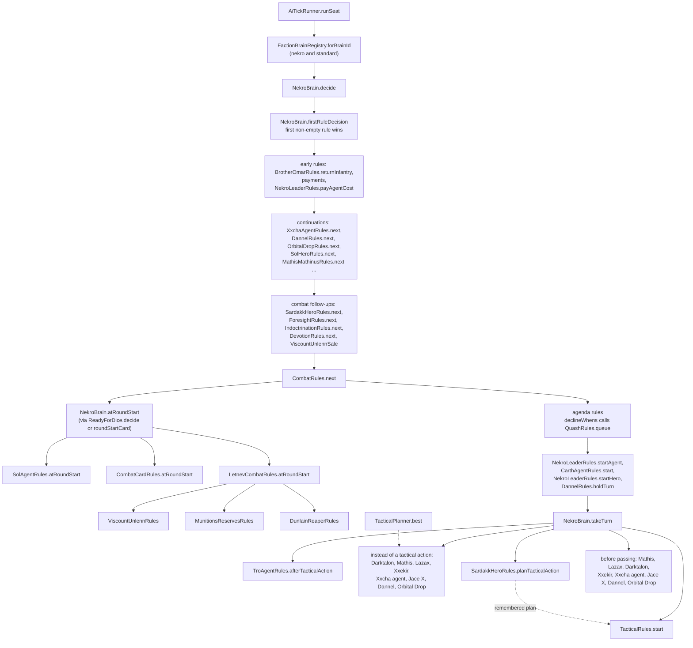
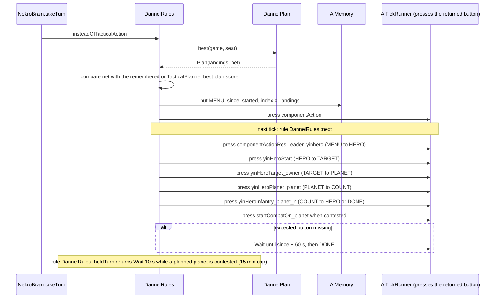

# Faction packages

Part of the [AI player architecture docs](/src/main/java/ti4/ai/README.md): a living document kept next to the code (packages: nekro, yin, letnev, sol, sardakk, winnu, naalu, xxcha, hacan). The code is the source of truth; when you change behavior here, update this file.

## Components and responsibilities

Scope: `ti4.ai.nekro`, `ti4.ai.yin`, `ti4.ai.letnev`, `ti4.ai.sol`, `ti4.ai.sardakk`, `ti4.ai.winnu`,
`ti4.ai.naalu`, `ti4.ai.xxcha`, `ti4.ai.hacan` (60 production files, about 7,660 lines, all added on this branch).

Common vocabulary used below:

- A **rule** is a function `AiTurnContext -> Optional<AiDecision>`. An empty result means "not my business, ask the next
  rule". A present result ends the decision for this tick.
- `AiDecision.Press` presses one real bot button; `AiDecision.Wait(untilMillis, reason)` tells the runtime to wake the seat
  again later without pressing anything; `AiDecision.Post` posts a new message with buttons (in these packages only
  `ViscountUnlennSale.offer` uses it; outside them `SpeakerSale`, `DiscardBountyDeals` and `PromiseDeals` do too).
- **Memory** is the seat's per-seat key/value store (`AiTurnContext.memory()`); `context.turnKey()` is
  `activePlayerID@lastActivePlayerChange`, so a key suffixed with it lasts for one turn of one player.
- A **hidden** prompt is one in the AI seat's own thread (`AiPrompt.PromptSource.AI_THREAD`); `COMBAT_THREAD` prompts are
  combat-thread messages; "owned" buttons carry the seat's faction in their id envelope, "unowned" ones carry none.
- Values are in trade-good units unless stated: `ValueScale.TRADE_GOOD = 1.0`, `ValueScale.RESOURCE = 0.8`,
  `ValueScale.INFLUENCE = 0.8`, `ObjectiveValue.VICTORY_POINT_VALUE = 8.0`, `Stall.ACTION_VALUE = 1.5`.

---

### How faction behaviour is plugged in

#### FactionBrainRegistry / NekroBrain (the one shared brain)

- **Role:** decides (dispatcher).
- **Purpose:** the only `FactionBrain` implementation. Despite the name, [NekroBrain](/src/main/java/ti4/ai/nekro/NekroBrain.java)
  is the brain of every AI seat, whatever its faction.
- **Invoked when:** every seat tick. `AiTickRunner.runSeat` reads `AiProfile.brainId()` and calls
  `FactionBrainRegistry.forBrainId`; the registry maps both `"nekro"` and `"standard"` to the same `NekroBrain` instance
  ([FactionBrainRegistry](/src/main/java/ti4/ai/brain/FactionBrainRegistry.java)). `AiSettings.brainFor(faction)` returns
  `"nekro"` for Nekro and `"standard"` for every other faction (used by `AiSeatService` when the seat is created), so the
  id differs but the object is identical. `AiTickRunner.decide` then calls `NekroBrain.decide` inside the thinking
  budget (`AiSettings.thinkingLimits()`), catching `ThinkingAborted`, `StackOverflowError` and `RuntimeException`.
- **Inputs:** `AiTurnContext` (game, seat, profile, visible prompts, already-pressed keys, memory, now).
- **Outputs / decisions:** the first non-empty result of an ordered list of 144 rules
  (`NekroBrain.firstRuleDecision`), or `AiDecision.idle()` when none answers.
- **Algorithm:**
  1. `NekroBrain.decide` wraps the evaluation in `DecidingSeat.of(seat, ...)` and iterates `namedRules` in list order,
     timing each with `Thinking.measure` and recording the winner with `TimingReport.decidedBy`.
  2. Faction rules are **not** selected by faction id. Every faction rule is in the list for every seat and gates itself
     on the component the seat holds: `Player.hasAbility` (Propagation, Devotion, Indoctrination, Orbital Drop, Foresight,
     Munitions Reserves, Quash, Peace Accords via `PeaceAccords.applies`), `hasLeaderUnlocked` / `hasUnexhaustedLeader` /
     `hasLeader` (agents, heroes), `Game.playerHasLeaderUnlockedOrAlliance` (Brother Omar, G'hom Sek'kus, so alliances
     count), `hasUnit` (flagships and mechs by unit id), `hasTech` / `hasTechReady` (Yin Spinner `yso`, Quantum Datahub
     Node `qdn`, Lazax Gate Folding `lgf`, Hegemonic Trade Policy `htp`), `hasUnlockedBreakthrough` (`solbt`,
     `sardakkbt`, `letnevbt`, `naalubt`) and promissory notes held (`acq`). No class in scope compares
     `getFaction()` to a faction name; the only faction-string uses are message ownership and the Munitions stored value.
     Consequently a Nekro that copied a technology, a Franken-style seat, or an alliance holder triggers the same rules.
  3. Rule order encodes priority. Roughly: observers (`AttackLedger`, `Hostility`, ...), the status-phase token gain,
     payments, relic/legendary/exploration follow-ups, production follow-ups, strategy-card secondaries, multi-step
     leader continuations (most faction flows), action card and promissory continuations, trading, Sabotage, combat
     follow-ups, the combat rule (with the faction round-start hook), agenda rules, strategy phase pick, own-turn agent
     starters and holds, `takeTurn`, strategy-card follows, status scoring. The faction rules registered directly in the list, in order:
     `BrotherOmarRules::returnInfantry`, `NekroLeaderRules::payAgentCost`, `OracleRules::play`,
     `NekroRules::propagationTokens`, `NekroRules::commanderDraw`, `NekroRules::dacxiveAnimators`,
     `YinSpinnerRules::afterOtherProduction`, `IconoclastRules::deploy`, `MatriarchRules::returnFighters`,
     `DatahubRules::next`, `StartingTechRules::choose`, `PeaceAccordsRules::resolve`, `BellumGloriosumRules::next`,
     `XxchaAgentRules::next`, `XxekirGromRules::next`, `NorrSupremacyRules::next`, `ReclaimerRules::next`,
     `DarktalonTreillaRules::next`, `RearAdmiralFarranRules::gainTradeGood`, `MathisMathinusRules::next`,
     `LazaxGateFolding::next`, `OrbitalDropRules::next`, `SolHeroRules::next`, `DannelRules::next`,
     `NekroLeaderRules::chooseAgentTarget`, `CarthAgentRules::chooseTarget`, `SolAgentRules::chooseTarget`,
     `ZeuAgentRules::next`, `NekroLeaderRules::continueHero`, `WrathOfKenaraRules::next`, `SardakkHeroRules::next`,
     `SardakkCommanderRules::next`, `ForesightRules::next`, `SolCommanderRules::next`, `BrotherMilorRules::next`,
     `IndoctrinationRules::next`, `DevotionRules::next`, `ViscountUnlennSale::answer`, `ViscountUnlennSale::holdRoll`,
     `ViscountUnlennSale::offer`, `MatriarchRules::continueHits`, then the combat rule, then (agenda)
     `QuashRules` inside `declineWhens`, then `NekroLeaderRules::startAgent`, `CarthAgentRules::start`,
     `NekroLeaderRules::startHero`, `DannelRules::holdTurn`, `takeTurn`.
  4. Faction hooks inside other rules: `NekroBrain.atRoundStart` (passed to `CombatRules.next`) chains
     `SolAgentRules.atRoundStart`, `CombatCardRules.atRoundStart`, `LetnevCombatRules.atRoundStart`, so the Sol agent is
     asked before combat cards and the Letnev rules after them. `NekroBrain.takeTurn` calls the "instead of a tactical
     action" and "before passing" hooks of the heroes and component actions (see the `takeTurn` component below).
     `NekroBrain.declineWhens` calls `QuashRules.queue` after the Veto check and `QuashRules.awaitBounty`.
  5. `PUBLIC_WINDOW_PREFIXES` lists unowned button prefixes the perception layer must show this seat even though they
     carry no owner, including faction ones: `nekroAgentRes_`, `XxchaAgentRules.USER_PREFIX`/`READY_PREFIX`,
     `XxekirGromRules.UNIT_PREFIX`, `DannelRules.TARGET_PREFIX`/`COMBAT_PREFIX`, `BrotherOmarRules.STEP_ONE`/
     `REMOVAL_PREFIX`, `YinSpinnerRules.START`, `DatahubRules.START`/`SELECT_PREFIX`/`SWAP_PREFIX`,
     `WrathOfKenaraRules.FINISH_PREFIX`, `ReclaimerRules.PREFIX`, `MathisMathinusRules.IMPERIAL_POINT`,
     `RearAdmiralFarranRules.GAIN`, `OrbitalDropRules.MECH_PREFIX`/`FINISH`, `BellumGloriosumRules.OFFER_PREFIX`,
     `CommanderReach.BUTTON_PREFIX`. `publicWindowHandlerPrefixes` returns this set plus
     `ActionCardRules.targetPrefixes()`, and `AiTickRunner.runSeat` passes the result to
     `snapshot.promptsFor(seat, windowPrefixes)`. The set only filters main-channel prompts (`AiPerception.isRelevant`):
     a main-channel prompt is shown when it has a button owned by the seat or an unowned button with one of these
     prefixes. Combat-thread prompts and prompts in the seat's own thread are always shown, and strategy-card threads
     are filtered by ownership only. So a faction rule whose unowned button appears in the actions channel, with no owned
     button beside it, never sees that prompt unless its prefix is in the set.
  6. Other rules defined inside `NekroBrain` itself (not faction rules, listed so they are not mistaken for gaps):
     `finishCommandTokenGain` (status phase: on the hidden `increase_tactic_cc` prompt, grows pools until the gain
     target, then moves a surplus token, then presses "Done Redistributing"), `startStatusHomework` /
     `readyOnTheHomeworkMessage` (presses `redistributeCCButtons`, then the ready button once the gain is done),
     `discardExcessSecret` (only one unscored secret allowed in round 1 while no real public objective is revealed and
     extra-secret mode is off; otherwise the normal limit), `discardExcessActionCards`, `queueProveEndurance`,
     `declineWhens` / `declineAfters`, `abstainFromAgenda`, `breakAgendaTie` (speaker only), `pickStrategyCard`
     (including Checks and Balances hand-overs and `SpeakerSale`), `declineStrategyCardFollow` and
     `scorePublicObjective`.
- **Depends on:** every `ti4.ai` package; in scope, every faction package.
- **Effect on the game:** none directly; the runtime executes the returned decision.
- **Fallbacks:** when no rule answers, `AiDecision.idle()`; `AiTickRunner.handleIdle` then applies the runtime fallback
  (outside scope).
- **Limitations:** a rule earlier in the list that returns a `Wait` blocks every later rule for that tick (several faction
  flows wait up to 60 s for the bot's next prompt, see section 8). The name `NekroBrain` and the `"nekro"` id are historical;
  there are no per-faction brains.

#### NekroBrain.takeTurn (own action-phase turn, faction hook order)

- **Role:** decides.
- **Purpose:** the action-phase turn of the active seat; this is where heroes and faction component actions compete
  with the tactical action and with passing.
- **Invoked when:** rule `this::takeTurn`, only when `context.isActivePlayer()` and the phase is `action`.
- **Algorithm (faction-relevant order, first present result wins):**
  1. An in-progress tactical action is continued (`TacticalRules.continueAction`); pending strategy-card follows first.
  2. `SlayIntent.announce`, strategy-card primary resolution, waiting for secondaries.
  3. `TroAgentRules.afterTacticalAction` (Sardakk agent offers after a tactical action).
  4. Master Plan, second action, expedition, end-of-turn technology, secret redraw, legendary planet end-of-turn uses,
     then `turnEnd` / `endOfTurnAbilities`.
  5. If the tactical action is already picking a system: continue it; if an action was taken: return empty.
  6. Transit Diodes, then `DarktalonTreillaRules.insteadOfTacticalAction`, Warfare-before-follow-up (Fleet Logistics),
     Sling Relay, relic actions, Trade Convoys, a planned strategy card, component action cards, technology actions,
     then in this order: `MathisMathinusRules.insteadOfTacticalAction`, `LazaxGateFolding.insteadOfTacticalAction`,
     `XxekirGromRules.insteadOfTacticalAction`, `XxchaAgentRules.insteadOfTacticalAction`,
     `SolHeroRules.insteadOfTacticalAction`, `DannelRules.insteadOfTacticalAction`,
     `OrbitalDropRules.insteadOfTacticalAction`.
  7. `SardakkHeroRules.planTacticalAction` (side effect only: may replace the remembered tactical plan), then
     `TacticalRules.start`.
  8. Play an unplayed own strategy card (unless it yields to Overrule).
  9. Before passing, in order: action cards, `MathisMathinusRules.beforePassing`, `LazaxGateFolding.beforePassing`, relic,
     expedition, `DarktalonTreillaRules.beforePassing`, `XxekirGromRules.beforePassing`, `XxchaAgentRules.beforePassing`,
     `SolHeroRules.beforePassing`, `DannelRules.beforePassing`, `OrbitalDropRules.beforePassing`, Convoys, technology,
     endurance stall, secret redraw, legendary, Avernus, then `passForRound` / `passingAbilities`.
- **Limitations:** the order is a fixed priority list; there is no comparison between two faction hooks. If two heroes
  both qualify (possible only for a seat holding several, e.g. through copies), the earlier one in the list is used.
  Hooks that compare against the best tactical plan (Dannel, Orbital Drop, Lazax Gate Folding, Xxcha agent) each compute
  or reuse the remembered plan (`TacticalRules.rememberedPlan`, `TacticalRules.remember`) independently.

---

##### Diagram: Where faction rules sit in the shared brain

Solid arrows are calls or "ask next" in rule order; dotted arrows are data read.

### Nekro Virus (`ti4.ai.nekro`)

#### CommandTokenPolicy

- **Role:** informs (pool targets) and is used by deciders that press the token buttons.
- **Purpose:** single place that says which command-token pool a gained token goes to, which pool to give one up from,
  and how many tokens a gain may take. Used by every faction, not only Nekro.
- **Invoked when:** `NekroBrain.finishCommandTokenGain` and `NekroBrain.readyOnTheHomeworkMessage` (status phase);
  `NekroRules.gainTokens` (Propagation, N'orr Supremacy, `RiderPayouts`); `NorrSupremacyRules.gainToken`
  (`gainWithinReinforcements`); `NekroLeaderRules.pay` (giving up a token);
  outside scope `StrategyCardRules` (Leadership), `WarfareTokens` (Thunder's Edge Warfare redistribution),
  `ExploreGains`, `TokenGainRules`, `LegendaryRules`, `ActionCardRules`, `AiActionCards`, `EconomyTargets`;
  `RedistributionGuard` uses `Pool`.
- **Inputs:** seat token pools, board (largest non-fighter stack per system, ships on the board, production per
  system), revealed objectives (`raise_fleet`, `command_armada`), laws (`regulations`), `TokenPlan`, `FleetLimit.bonus`,
  `ProductionPlanner.heroFleetTarget`, `FractureCampaign`, `StallCount`, secrets (Adapt New Strategies route via
  `TechPath`), a held Strategize card.
- **Outputs:** `poolToGrow` (handler id `increase_<pool>_cc`), `poolToRedistributeFrom`, `poolsToShrink` (ordered list
  of `decrease_<pool>_cc`), `ideal`, `idealKeepingFleet`, `midRoundSurplus`, `poolToRefill`, `statusPhaseGain`,
  `gainWithinReinforcements`, `netGainSoFar`.
- **Algorithm:**
  - `statusPhaseGain = 2`, +1 each for ability `versatile`, tech `hm` (Hyper Metabolism), tech `tf-inheritancesystems`,
    holding another player's `ce` note (Cybernetic Enhancements); −1 when holding another player's `malevolency` note
    and the seat has no Mahact tokens. `statusPhaseGainWithinReinforcements = min(gain, gainWithinReinforcements)`, where
    `gainWithinReinforcements = max(0, commandTokenLimit − tokens on board/pools + netGainSoFar)`.
  - `netGainSoFar` compares the pools with the stored value `originalCCsFor<faction>` (`ButtonHelper.checkNetGain`); 0
    when that value is blank.
  - **Priority levels** (`priorities`): a list of (pool, target count). `poolToGrow` returns the first level whose pool is
    below its target, else tactic. `ideal(tokens)` fills the levels in order with the available tokens and puts the rest
    into tactic. `bonus = FleetLimit.bonus(seat)` (Armada and similar) is subtracted from fleet targets; `cap = 4 + bonus`
    under _Fleet Regulations_, else unlimited.
    - Action phase: fleet `min(cap, largest) − bonus`; tactic 1; fleet kept for building; fleet for the hero fleet
      target; fleet for an open objective slot; objective fleet; Fracture fleet; strategy `TokenPlan.strategy()`; tactic
      `TokenPlan.tactic()`; stacking fleet.
    - Otherwise (status phase): fleet `min(cap, largest) − bonus`; tactic 1; hero fleet; fleet for an open slot; then
      either `FOLLOWS_FIRST` = strategy 1, strategy 2, tactic 2, or (when `fearsAStall`) `TWO_TACTICS_PER_STRATEGY` =
      tactic 2, strategy 1, tactic 4, strategy 2; fleet `min(cap, 2)`; if `fleetToBuild(nextRound) > 0`: tactic 3 and fleet
      `min(growth, toBuild) − bonus`; objective fleet; strategy `strategyTarget`; Fracture fleet; stacking fleet;
      tactic 5; strategy 3.
  - `growth = min(cap, 3 when round ≤ 2 else 5)` (round + 1 in the status phase).
  - `objectiveFleet`: 5 when _Raise a Fleet_ is revealed and unscored and `cap ≥ 5`; for _Command an Armada_
    `min(8, max(5, nonFighterShips + 2))`; the result is capped at `largest + 2`. `fleetForAnOpenSlot` is 0 when another
    non-spend public objective (not those two) is scorable now.
  - `fleetToBuild`: the tile with the highest production value; 0 unless production ≥ 4 and budget ≥ 6, budget being
    resources (total next round, available now) + trade goods × `Wallet.tradeGoodValue`; else ships already there +
    `min(production, budget / 3)`.
  - `stackingFleet = min(5, largest + 1)` when more non-fighter ships exist than the largest stack holds and the largest
    stack is ≥ 3; else 0. `fractureFleet = FractureCampaign.FLEET_SHIPS` when largest ≥ 2, `routeShare ≥ 1` and a dock
    exists.
  - `fearsAStall`: `round(max over rivals of StallCount.of(rival) − StallCount.besidesTokens(seat)) > 1`.
  - `strategyTarget = 2`, +1 while holding Adapt New Strategies with a reachable route still needing research, +1 while
    a playable Strategize is held.
  - `poolToRedistributeFrom`: the first of fleet, strategy, tactic above its `ideal(total)` share.
  - `poolsToShrink`: pools with tokens, sorted so that fleet goes last when fleet ≤ floor (floor = max(largest − bonus,
    fleet kept for building)), then by `ideal(total − 1) − count` ascending (most over its share first).
  - `idealKeepingFleet` keeps the current fleet count and distributes the rest over the non-fleet levels;
    `midRoundSurplus` returns strategy or tactic above that split; `poolToRefill` grows whichever of tactic/strategy is
    furthest below it.
- **Depends on:** `TokenPlan`, `FleetLimit`, `ProductionPlanner`, `FractureCampaign`, `StallCount`, `ObjectivePolicy`,
  `ObjectiveCatalog`, `TechPath`, `ActionCardRules.holdsPlayableStrategize`, `Wallet`, `BoardView`, `Helper`.
- **Effect on the game:** indirect; the callers press the chosen `increase_`/`decrease_` buttons.
- **Limitations:** fixed targets, no lookahead beyond "next round's build" and "round ≤ 2". Levels can produce a negative
  target after subtracting the bonus; `ideal` clamps the take at 0.
- **Example:** status phase, round 3, no Fleet Regulations, largest stack 3, no bonus, no objective fleet need, no build
  dock with production ≥ 4, no stall fear, no hero fleet target, and 7 tokens in the pools in total: `ideal(7)` fills
  fleet 3, tactic 1, strategy 1, strategy 2, tactic 2 → tactic 2, strategy 2, fleet 3. While gaining, each token goes to
  the first level the seat's current pools do not yet meet (`poolToGrow`).
- **Tested:** [CommandTokenPolicyTest](/src/test/java/ti4/ai/nekro/CommandTokenPolicyTest.java) covers the default gain of
  2, Versatile and Hyper Metabolism, tactic→strategy ordering, two tactics per strategy under a stall threat, Fleet
  Regulations, the 3-strategy cap, redistribution settling, mid-round splits and building fleets (method names read; the
  assertions were not all read).

#### NekroRules (Propagation, Nekro Acidos, Dacxive Animators, shared token gain)

- **Role:** decides / executes.
- **Purpose:** three small Nekro rules plus `gainTokens`, the shared "press grow until the target, then Done Gaining"
  routine.
- **Invoked when:** rules `NekroRules::propagationTokens`, `::commanderDraw`, `::dacxiveAnimators`; `gainTokens` also from
  `NorrSupremacyRules.gainToken` and `RiderPayouts`.
- **Algorithm:**
  - `propagationTokens`: needs ability `propagation`; for prompts at most 30 min old, newest first, parses
    `because of **Propagation**, you instead gain (\d+) command tokens` in a prompt that mentions the seat; target =
    `min(parsed, gainWithinReinforcements)`, remembered per message id (`propagationGain|<messageId>`) so it survives
    the bot rewriting the prompt. Then `gainTokens`.
  - `gainTokens(prompt, gained, target)`: requires a "Done Gaining" `deleteButtons` button owned by the seat or unowned;
    while `gained < target` presses `CommandTokenPolicy.poolToGrow`; otherwise clears the memory key and presses Done.
  - `commanderDraw`: a visible prompt naming "Nekro Acidos" and the seat with `draw_1_ACDelete` → press (no valuation).
  - `dacxiveAnimators`: first owned `dacxive_*` button not already pressed → press (no valuation, no planet choice
    beyond the first button).
- **Fallbacks:** if the grow button for the chosen pool is not on the prompt it presses Done early.
- **Tested:** [NekroRulesTest](/src/test/java/ti4/ai/nekro/NekroRulesTest.java) (Propagation after a prompt rewrite; stops at
  the token limit).

#### NekroLeaderRules (Nekro Malleon agent, UNIT.DSGN.FLAYESH hero)

- **Role:** decides.
- **Invoked when:** rules `payAgentCost` (early, every seat), `chooseAgentTarget`, `continueHero`, `startAgent`,
  `startHero` (late, own turn). `ownsReadyAgent` is also read by `DrawnCardValue` (outside scope).
- **Agent (`startAgent` → `chooseAgentTarget`):**
  - Start conditions: owns `nekroagent` unexhausted, active player in the action phase with no tactical action in
    progress or taken, `canSpareActionCard` (≥ 1 card; not when holding Form a Spy Network with ≤ `SpyNetwork.CARDS`
    cards; `ActionCardValue.hasSpareCard`), not yet started this turn, and an owned `exhaustAgent_nekroagent` button this
    turn. Stores the start time under `nekroAgent|<turnKey>`.
  - Target: a prompt created since start − 5 s naming "Nekro Malleon" and the seat; `AgentPick.target` picks the button
    naming the seat's own faction or colour. Waits up to 60 s, then gives up.
  - So the agent is only ever used on the seat itself, for 2 trade goods.
- **Agent cost (`payAgentCost`, any AI seat, including when a human Nekro names it):**
  - Detects a visible prompt with owned `decrease_*` buttons and the text "Use buttons to lose tokens." (or a remembered
    `nekroAgentCost|<messageId>`). Records the action-card count at first sight; it counts as paid when the stored state is
    `paid`, the hand shrank, or `netGainSoFar < 0`.
  - Unpaid: when an action card can be spared, presses the lowest-value discard (`ActionCardValue.worstDiscard`) in a
    hidden prompt ending " use buttons to discard" created since the token prompt; if that prompt is not there yet, waits
    up to 60 s from the token prompt. Otherwise presses the first `CommandTokenPolicy.poolsToShrink` pool that has an
    enabled `decrease_*` button; with neither, it tries the same discard prompt again even without a spare card. Then
    presses its "Done Losing" button, which it also does when nothing could be paid.
  - **Prompt text mismatch (likely defect):** the engine's agent module
    ([NekroAgent](/src/main/java/ti4/service/leader/agent/modules/NekroAgent.java)) now posts the discard prompt as
    "<player>, please choose the action card to discard.", which does not end with " use buttons to discard". As the code
    reads, the AI never finds the discard prompt in a live game: it waits 60 s, then loses a command token (or, with no
    `decrease_*` button, presses "Done Losing" unpaid). `NekroLeaderRulesTest` builds its discard prompt with the old
    text, so it does not catch this.
- **Hero (`startHero` → `continueHero`):**
  - Start conditions: `nekrohero` unlocked, own action-phase turn, no action taken, not started this turn, no
    `turnEnd`/`endOfTurnAbilities` button this turn, an unpressed `componentAction` button, and a best target worth ≥ 3.0.
  - `bestHeroTarget`: every planet with a technology specialty (`ButtonHelper.checkForTechSkips`) in a system containing
    the seat's units; value = 0.5 × (resources + influence) + max over technologies of that specialty colour of
    `CopiedTechPolicy.value` + 1.0 × enemy units on the planet. Highest value wins.
  - Steps (stored as `MENU~since~planet` etc.): MENU presses `componentActionRes_leader_nekrohero`; LEADER presses the
    planned `nekroHeroStep2_<planet>` (or recomputes the best among those offered, else the first); PLANET presses the
    owned `getTech_<alias>__noPay` button that `CopiedTechPolicy.best` prefers (else the first). Each step waits up to
    60 s from the stage's timestamp, then marks DONE.
- **Limitations:** the 0.5 per trade good here is half of `ValueScale.TRADE_GOOD`; trade goods from the hero are valued
  lower than elsewhere in the AI. Dacxive/Acidos are pressed whenever offered.
- **Tested:** [NekroLeaderRulesTest](/src/test/java/ti4/ai/nekro/NekroLeaderRulesTest.java) (uses the agent on itself, keeps
  5 cards with Form a Spy Network, pays with a card or a token, waits for the discard prompt, any targeted seat pays,
  other seats never use it, hero through the menu, keeps the hero without a qualifying planet).

Other Nekro-specific behaviour lives outside scope and is only referenced here: `SingularityRules` (Technological
Singularity copy, registered in the list), `GalacticThreatRules` (agenda), `CopiedTechPolicy` (`vax`/`vay` Valefar
Assimilators), `FlagshipRating`/`MechRating` entries, `CombatRules` (`nekro_flagship`).

---

### Yin Brotherhood (`ti4.ai.yin`, WIP faction)

#### IndoctrinationRules + IndoctrinationBudget

- **Role:** decides (rules), informs (budget).
- **Invoked when:** rule `IndoctrinationRules::next` (after `BrotherMilorRules::next`, before `DevotionRules::next`, all
  before the combat rule). `IndoctrinationBudget` is read only by `DannelPlan.best`.
- **Algorithm:**
  - Needs ability `indoctrination`. Scans `COMBAT_THREAD` prompts.
  - `start`: an owned `initialIndoctrination_<planet>` button; decided once per (message, planet) key; skipped when the
    seat's ground combat round tracker for that planet is > 0 (already rolled). `best` evaluates infantry (2 influence)
    and, if the seat has unit `yin_mech` (Moyin's Ashes), mech (3 influence): each option exists only if
    `ScoringReserve.planAfterReserve(influence)` finds a payment and `CombatForecast.conversionGain(...).gain() > 0`;
    net = gain + `BrotherOmar.unlockBonus` (1.0 while the Yin commander is not unlocked) − influence × 0.8. Highest net
    ≥ 0 wins. It presses start and stores `indoctrinationChoice|<planet> = unit~now`.
  - `choose`: waits up to 30 s for the unowned `indoctrinate_<planet>_<unit>` button; falls back to the infantry button
    when the planned unit is not offered; then `resolve`: recomputes the payment, registers it with
    `PaymentRules.expect(..., "deleteButtons")` and presses; when it cannot pay, presses the unowned "Decline" button.
  - `IndoctrinationBudget.conversions`: how many conversions (≤ 3) are affordable after the scoring reserve at 3
    influence each when a mech replacement is available (`yin_mech`, `GroundDrops.mechAvailable`, 3 affordable), else 2.
- **Tested:** [IndoctrinationRulesTest](/src/test/java/ti4/ai/yin/IndoctrinationRulesTest.java),
  [YinBrainTest](/src/test/java/ti4/ai/yin/YinBrainTest.java) (`indoctrinatesBeforeRollingTheFirstRound`).

#### DevotionRules

- **Role:** decides.
- **Invoked when:** rule `DevotionRules::next`; needs ability `devotion`.
- **Algorithm:** over `COMBAT_THREAD` prompts, in order `target` → `sacrifice` → `start`.
  - `start`: positions from owned `startDevotion_<pos>` or unowned `refreshViewOfSystem_<pos>_..._space` buttons. Only
    when the seat's space round tracker is ≥ 1, every opponent with ships there has rolled at least as many rounds
    (`roundFinished`), and no `autoAssignSpaceHits_` button for the position is pending. Decided once per
    (position, round): `worthIt` takes the cheapest destroyer or cruiser the seat has there (`SACRIFICES` order,
    by unit cost) and the first opponent with ships; for every enemy ship type, gain =
    `CombatForecast.shipTradeGain(sacrifice, target).gain() + BrotherOmar.unlockBonus`; best gain ≥ 0.5 → remembers
    `devotionPlan|<pos> = sacrifice~target`, presses `startDevotion_<pos>`. When the start button is gone (the bot
    deletes it after use), presses the refresh button once to bring it back.
  - `sacrifice`: among owned `resolveDevote_<pos>_<unit>` buttons, the planned type first, then destroyer, cruiser.
  - `target`: on owned `hitOpponent_<pos>_...` buttons, presses the planned target's damaged variant first, else the
    plain one; clears the plan.
- **Tested:** [DevotionRulesTest](/src/test/java/ti4/ai/yin/DevotionRulesTest.java) (close fight, waits for the opponent's
  round and hit assignment, never before dice, refresh, cheapest ship, best target, once per round).

#### BrotherMilorRules (Yin agent)

- **Role:** decides.
- **Invoked when:** rule `BrotherMilorRules::next`: `continueFlow` → `receive` → `offer`.
- **Algorithm:**
  - `offer` (needs `yinagent` unexhausted and no flow in progress): on an owned `yinagent_<pos>` button in a combat
    thread, the first time it sees that message it only stores a baseline of its unit counts per holder (space ships,
    ground forces per planet). Later, for each holder where its count dropped (and is not 0) while an enemy is still
    there, gain = `CombatForecast.reinforcementGain(type, 2).gain()` with fighters for space, infantry for a planet; best
    gain ≥ 1.0 → stores the flow and presses.
  - `continueFlow`: OWNER stage presses `exhaustAgent_yinagent_<pos>_<ownFaction>`; PLACE stage presses
    `placeOneNDone_skipbuild_2ff_<pos>` or `placeOneNDone_skipbuild_2gf_<planet>`. Waits up to 30 s per stage.
  - `receive` (any seat, e.g. a human Yin gives Milor to this AI): on a prompt naming "Brother Milor" with owned
    placement buttons, an infantry placement on a contested planet first, else fighters, else the first.
- **Limitations:** never used for another player's losses; the baseline only exists if the AI saw the button before the
  loss.
- **Tested:** [BrotherMilorRulesTest](/src/test/java/ti4/ai/yin/BrotherMilorRulesTest.java).

#### BrotherOmar + BrotherOmarRules (Yin commander)

- **Role:** informs (`BrotherOmar`), decides (`BrotherOmarRules`).
- **Invoked when:** `BrotherOmar.skips` / `ignoresPrerequisites` / `INFANTRY_VALUE` from `PrerequisiteSkips`,
  `ResearchPolicy`, `TechPath`; `unlockBonus` from Indoctrination and Devotion. `BrotherOmarRules.expect` from
  `StrategyCardRules` when `PrerequisiteSkips.Plan.returnsInfantry()`; `BrotherOmarRules::returnInfantry` is a rule.
- **Algorithm:**
  - `active` = `playerHasLeaderUnlockedOrAlliance(yincommander)`. `skips` = one biotic skip when active.
    `ignoresPrerequisites` when active, the seat has infantry on the board, and the technology is in
    `ButtonHelperCommanders.getVeldyrCommanderTechs(seat, game, true)`. `INFANTRY_VALUE = 0.5 × 0.8 = 0.4`.
    `unlockBonus = 1.0` while the seat has the commander but has not unlocked it.
  - `returnInfantry`: active only while `brotherOmar|<round>` was set by `expect` within 10 minutes. First it presses the
    unowned `yinCommanderStep1_` on a research payment prompt (one with `PaymentRules.TECHNOLOGY_DONE`), then on the
    removal prompt picks the `yinCommanderRemoval_<pos>_<holder>` button with the highest score = infantry count on that
    holder, −1 for space, +0.5 in the home system.
- **Tested:** [BrotherOmarTest](/src/test/java/ti4/ai/yin/BrotherOmarTest.java).

#### DannelPlan + DannelRules (Yin hero, Dannel of the Tenth)

- **Role:** evaluates (`DannelPlan`), decides (`DannelRules`).
- **Invoked when:** `NekroBrain.takeTurn` → `DannelRules.insteadOfTacticalAction` / `DannelRules.beforePassing`; rules
  `DannelRules::next` and `DannelRules::holdTurn`.
- **Algorithm (`DannelPlan.best`):**
  - Needs `yinhero` unlocked. Budget = `min(3, infantry in reinforcements)` (3 when the cap is unknown).
  - Candidates: every planet outside home systems that is not a space station, not Mallice, not carrying a `dmz` token,
    not the seat's own, and either has enemy ground forces or no enemy structures; Mecatol under the custodians only when
    `ScoringReserve.planForCustodians` finds a payment. Stake = `BoardView.planetValue` + own objective gain from
    gaining it (≥ 0) + denial of the holder's public objective progress (clamped 0..8, 0 for neutral) + Fracture value
    (`FracturePrize.relic` when unowned or neutral + `FracturePrize.point`) + Mecatol value (`MecatolStake.holdValue` + 8
    for custodians + `imperialPoint`: 8 when holding an unplayed Imperial or an Overrule, +2 with Fleet Logistics).
  - Point plays (stake ≥ 8) sorted by stake get up to `IndoctrinationBudget.conversions` planned conversions.
  - For each candidate and infantry count 1..budget: value = `CombatForecast.landingWinWithConversion(...)` × stake,
    stopping at a certain win. A grouped knapsack (rooms budget..1, each candidate at most once) maximises total value.
  - Net = total − `holdValue`, where `holdValue = 0.25 × 8 = 2` when more than one round is left and no landing is worth
    ≥ 8 × `WinOdds.MAJORITY`; else 0.
- **Decision (`DannelRules`):** start only when the hero is unlocked, own action turn, no tactical action in progress or
  taken, no flow this turn. `insteadOfTacticalAction`: net > 0 and greater than the best tactical plan's score
  (remembered or computed). `beforePassing`: net > 0. Opens `componentAction`, then walks MENU (`componentActionRes_leader_
  yinhero`) → HERO (`yinHeroStart`) → TARGET (unowned `yinHeroTarget_<owner>`) → PLANET (`yinHeroPlanet_<planet>`) → COUNT
  (`yinHeroInfantry_<planet>_<n>`, registering the custodians payment when needed) → next landing or DONE. Each step
  waits up to 60 s. After each landing it presses the unowned `startCombatOn_<planet>` once per planet when contested.
  `holdTurn` (only while the seat is the active player and the flow is DONE) returns `Wait(now + 10 s)` while any
  planned planet is still contested, for up to 15 minutes from the start.
- **Tested:** [DannelRulesTest](/src/test/java/ti4/ai/yin/DannelRulesTest.java).

##### Diagram: A multi-step leader flow (Dannel of the Tenth)

Every step is a separate tick; the flow state lives in the seat memory under `dannel|<turnKey>`.

#### VanHauge, YinAscendant, YinSpinnerRules

- **VanHauge** (informs): `applyTo(player, force)` returns `force.detonating()` when the player has unit `yin_flagship`
  and the force contains a flagship. Called from `CombatForces` (outside scope) for space forces only, so space-combat
  odds built there treat the Yin flagship as detonating, for whichever side owns it. Tested by [VanHaugeTest](/src/test/java/ti4/ai/yin/VanHaugeTest.java).
- **YinAscendant** (evaluates): `value = 1.5 × (1 + GameHorizon.roundsLeft)` while the `yinbt` breakthrough is held and
  locked, else 0; read by `BreakthroughValue`. Tested by [YinAscendantTest](/src/test/java/ti4/ai/yin/YinAscendantTest.java).
- **YinSpinnerRules** (decides): needs tech `yso`. On a prompt mentioning the seat whose enabled buttons are only
  `startYinSpinner`, and only when no owned `placeOneNDone_dontskip*` build button is still open since that prompt, it
  delegates to `TechRules.startYinSpinner`. Tested by
  [YinSpinnerRulesTest](/src/test/java/ti4/ai/yin/YinSpinnerRulesTest.java).

---

### Barony of Letnev (`ti4.ai.letnev`)

#### LetnevCombatRules (round-start chain)

- **Role:** decides (dispatcher).
- **Invoked when:** `CombatRules.next(context, NekroBrain::atRoundStart)` calls the hook at the start of a combat round
  in the active system with both sides on the same round and no hits pending, on three paths: `ReadyForDice.decide`
  before the seat declares it is ready for dice (after its decision delay), `CombatRules.roundStartCard` just before it
  presses the roll button after the grace period (not while ground automation is under way), and the ground-combat
  automation confirmation (`confirmAutomation` → `ReadyForDice.decide`). `atRoundStart` asks `SolAgentRules`, then
  `CombatCardRules`, then `LetnevCombatRules.atRoundStart`, which asks `ViscountUnlennRules`, `MunitionsReservesRules`,
  `DunlainReaperRules`. When all are empty, the combat rule declares readiness, confirms the automation or presses the
  roll.

#### ViscountUnlennRules (agent, own combat)

- **Role:** decides.
- **Algorithm:** space combats only; once per (position, round): when the seat owns `letnevagent` unexhausted and an
  owned `getAgentSelection_letnevagent` is in a combat thread, presses it, then presses the unowned
  `exhaustAgent_letnevagent_<ownFaction>` (waits up to 30 s for it). There is **no value check**: it is used in every space
  combat round the seat rolls while the agent is ready.
- **Tested:** [ViscountUnlennRulesTest](/src/test/java/ti4/ai/letnev/ViscountUnlennRulesTest.java) (the names
  `usesTheAgentOnAFightItHasAlreadyWon`, `usesTheAgentOnAHopelessFight`, `usesTheAgentOnAFightTheDieCannotSave`
  match the code).

#### ViscountUnlennSale + ViscountUnlennSaleButtons (selling the agent)

- **Role:** decides (`offer`, `answer`, `holdRoll`), executes (`@ButtonHandler`s).
- **Invoked when:** rules `ViscountUnlennSale::answer`, `::holdRoll`, `::offer`; button handlers `unlennBuy_` and
  `unlennNo_` are registered through `@ButtonHandler` (new UI added by this branch, owned by the buyer).
- **Algorithm:**
  - `offer` (seller: owns the ready agent): on an unowned `combatRoll_<pos>_space` in a combat thread for the active
    system, once per (position, game round), when exactly two players have ships there, the seller is not one of them,
    both are on the same round, and the fight is fair (`CombatForecast.spaceOutlook` win in 0.4..0.6 for both). Buyers =
    non-neutral fighters with ≥ 1 trade good. Returns `AiDecision.Post` with "Buy for 1 TG" / "No thanks" per buyer.
  - `answer` (buyer): if its buy button was already pressed, nothing; buys when it has ≥ 1 TG and the offer is for the
    current round; otherwise declines.
  - `holdRoll` (a seat with ships in the system): while an offer for the current round is on the table, `Wait` until the
    message is 5 minutes old, which keeps it from rolling.
  - Buy handler: finds the first real player owning the ready agent, checks the round is unchanged, builds a
    `HumanAiDeal` (exhaust `letnevagent` for the buyer, transfer 1 TG to the seller), validates and runs it via
    `HumanAiDealRunner`. Decline removes only that buyer's buttons.
- **Tested:** [ViscountUnlennSaleTest](/src/test/java/ti4/ai/letnev/ViscountUnlennSaleTest.java),
  [ViscountUnlennSaleButtonsTest](/src/test/java/ti4/ai/letnev/ViscountUnlennSaleButtonsTest.java).

#### MunitionsReservesRules

- **Role:** decides. Space combat only; needs ability `munitions`, ≥ 2 TG, and the stored value `munitionsReserves` not
  already set to the seat's faction (a previous payment awaiting its roll). Once per (position, round): presses the owned
  `munitionsReserves` button when `CombatForecast.rerollGain` has win chance ≥ 0.1 and gain ≥ `requiredGain` =
  2 × 1.0 × 1.25 = 2.5, plus 8 when paying 2 TG breaks a scoring reserve (`ScoringReserve.planAfterReserve` empty).
- **Tested:** [MunitionsReservesRulesTest](/src/test/java/ti4/ai/letnev/MunitionsReservesRulesTest.java).

#### DunlainReaperRules (mech)

- **Role:** decides. Ground combat only; needs unit `letnev_mech`. Once per (position, planet, round) when the owned
  `letnevMechRes_<planet>_mech` button is in a combat thread: requires a 2-resource payment after the scoring reserve
  and `CombatForecast.mechSwapGain(...).gain() ≥ 2 × 1.0 = 2.0`; registers the payment (`PaymentRules.expect`) and
  presses.
- **Tested:** [DunlainReaperRulesTest](/src/test/java/ti4/ai/letnev/DunlainReaperRulesTest.java).

#### LetnevSpaceCombat, GravleashPlan, L4Disruptors (informers for other packages)

- **LetnevSpaceCombat.applyTo** (called by `CombatForces`): Arc Secundus (`letnev_flagship` in the force) → `repairing()`;
  `plannedRerolls = min(3, TG / 2)` with ability `munitions` → `rerollingMissesInFirstRounds`; with `letnevbt` unlocked
  (Gravleash Maneuvers) the unit with the most dice (cost as tie-break, last one wins on equal cost) hits on
  `hitsOn − number of distinct ship types`.
- **GravleashPlan:** `cardBonus = 6.0` for Imperial, or Warfare with the breakthrough, while `letnevhero` is unlocked
  (read by `StrategyCardRanking`); `driveBonus = 8.0` for Gravity Drive `gd` with the breakthrough (read by
  `ResearchPolicy`); `SHIP_TYPE_VALUE = 1.0` and `hasBreakthrough` read by `ProductionPlanner` and `TacticalPlanner`;
  `holdsUnplayed` read by Darktalon.
- **L4Disruptors.shieldsInvaders**: `l4` or `l4_br`; read by `StrikeEvaluator` and `DefenseOutlook`.
- **Tested:** [GravleashPlanTest](/src/test/java/ti4/ai/letnev/GravleashPlanTest.java),
  [ArmadaFleetSupplyTest](/src/test/java/ti4/ai/letnev/ArmadaFleetSupplyTest.java).

#### DarktalonTreillaRules (hero)

- **Role:** decides.
- **Invoked when:** `takeTurn` → `insteadOfTacticalAction` (before Warfare/Sling Relay/relics and every other faction
  hook) and `beforePassing`; rule `DarktalonTreillaRules::next`.
- **Algorithm:** `ready` = `letnevhero` unlocked and `FleetLimit.heroLiftsLimit` false. `canAct` also requires not Fog of
  War, own action turn, no tactical action in progress or taken, no hero flow this turn. `insteadOfTacticalAction` is
  checked once per turn (`checked~<turnKey>`), and plays when either
  - `assaultsMecatol`: the seat does not control Mecatol, holds unplayed Imperial (or unplayed Warfare with `letnevbt`),
    a plan against Mecatol of kind EXPAND or ATTACK exists when the fleet limit is assumed unlimited, and more ships can
    reach Mecatol than `FleetLimit.ships(seat)`; or
  - `wantsToStackMoreThanTheFleetAllows`: the unlimited best plan is an ATTACK whose target stack exceeds fleet pool,
    and its score minus max(0, the real best plan score) ≥ 4.0.
  `beforePassing` plays it when another player is still acting and `WinRace.canWinThisRound` holds for some rival (a
  stall). `next` presses `componentActionRes_leader_letnevhero` within 60 s of opening the menu.
- **Tested:** [DarktalonTreillaRulesTest](/src/test/java/ti4/ai/letnev/DarktalonTreillaRulesTest.java).

#### RearAdmiralFarranRules (commander)

- Presses the unowned `gain1tgFromLetnevCommander` on any visible prompt that mentions the seat, once per button. No
  valuation. Tested by [RearAdmiralFarranRulesTest](/src/test/java/ti4/ai/letnev/RearAdmiralFarranRulesTest.java).

---

### Federation of Sol (`ti4.ai.sol`)

#### OrbitalDropRules

- **Role:** decides.
- **Invoked when:** `takeTurn` → `insteadOfTacticalAction` (last of the faction hooks before `TacticalRules.start`) and
  `beforePassing`; rule `OrbitalDropRules::next`.
- **Algorithm (`plan`):**
  - Start requires ability `orbital_drop`, ≥ 1 strategy token, own action turn, no tactical action in progress or
    taken, no flow this turn.
  - Token cost: empty unless `StrategyTokenCost.canSpare`; `spare = strategy tokens − 1 − tokens wanted for follows`;
    cost = 2.0 × scarcity(spare) (0.4 for spare ≥ 3, 0.6 for 2, 0.8 for 1, 1.0 otherwise) + 1.5 when spare < 0.
  - For each `GroundDrops.drops` planet (planets the seat controls, alliance mode included): net = drop.infantry +
    (mechNet when ≥ 0.5) + `Stall.actionValue` − cost, where mechNet = drop.mech − (3 − mech cost) ×
    `ProductionPlanner.fillerValuePerResource` and the mech is considered only with `sol_mech` and a 3-resource payment
    after the reserve. Best net ≥ 0.6 → plan.
  - `GroundDrops.drop`: infantry = best of (holding: defense cost reduction from 2 infantry on a guarded system;
    staging: up to 2 × 1.0 per missing transport load when the best tactical plan launches an EXPAND/ATTACK from there,
    0.5 otherwise; Occupy the Fringe value) + 0.25 × the other two + 0.3 × 2.
  - `insteadOfTacticalAction` additionally requires net > the best tactical plan's score.
- **Flow:** MENU (`componentActionRes_ability_orbitalDrop`) → PLANET (owned `placeOneNDone_skipbuildorbital_2gf_<planet>`,
  the planned one or else any) → FOLLOW_UP: with a planned mech, the unowned `orbitalMechDrop_<planet>` after registering
  a 3-resource payment; else the unowned `finishComponentAction_spitItOut` labelled "Finish". Each stage waits up to
  60 s; the FOLLOW_UP stage stops waiting early when the turn can already end (`turnEnd` button). With a planned mech
  whose payment is no longer available it presses neither button and waits out the stage.
- **Tested:** [OrbitalDropRulesTest](/src/test/java/ti4/ai/sol/OrbitalDropRulesTest.java),
  [SolBrainTest](/src/test/java/ti4/ai/sol/SolBrainTest.java).

#### SolAgentRules (Evelyn Delouis), SolCommanderRules (Claire Gibson), SolHeroRules (Jace X), BellumGloriosumRules

- **SolAgentRules** (decides): round-start hook (first in `NekroBrain.atRoundStart`) for ground combats only, while
  `solagent` is unexhausted. Once per (position, planet, round): the seat must have ground forces there and an enemy
  must too; uses it when `CombatForecast.extraDie(...).worthSpending()` = win without < 0.95 and win with ≥ 0.05; then
  presses the owned `getAgentSelection_solagent` and records `started~now`. Until 30 s pass, `atRoundStart` returns a
  `Wait` so the roll is held. `chooseTarget` (rule) presses the unowned `exhaustAgent_solagent_<ownFaction>`. Tested by
  [SolAgentRulesTest](/src/test/java/ti4/ai/sol/SolAgentRulesTest.java) (`fight(8,1)` keeps, `fight(1,12)` keeps,
  `fight(1,1)` uses).
- **SolCommanderRules** (decides): on a combat-thread owned `utilizeSolCommander_<planet>` button while every player's
  ground round tracker on that planet is 0, presses it (no valuation). Tested by
  [SolCommanderRulesTest](/src/test/java/ti4/ai/sol/SolCommanderRulesTest.java).
- **SolHeroRules** (decides): `worthPlaying` = `solhero` unlocked, own action turn, no action taken, ≥ 1 tactic token,
  some system holds the seat's command token, and `FreedPlays.gain(game, seat).points() ≥ 1.0`. Same test for
  `insteadOfTacticalAction` and `beforePassing` (no tactical score comparison). Flow: `componentAction` →
  `componentActionRes_leader_solhero`; gives up when the turn can end or after 60 s. Tested by
  [SolHeroRulesTest](/src/test/java/ti4/ai/sol/SolHeroRulesTest.java).
- **BellumGloriosumRules** (decides): needs `solbt` unlocked. On an unowned `solBtBuild_<pos>_<limit>` offer at most
  10 min old that mentions the seat, once per message: waits (returns empty) while the main build of this turn is still
  open (owned `place_*`, "Done Producing Units", or the unowned "Done Exhausting Planets" payment, not for the Bellum
  source); plans with `ProductionPlanner.bellumGloriosum(tile, limit, GroundDrops.bestPlanetIn, DefenseOutlook)`; an empty
  plan → presses the unowned `deleteButtons` decline. Otherwise presses the offer, then places units with
  `TacticalRules.placeUnits` and pays with `TacticalRules.payForUnits` (Bellum source), polling every 3 s and giving up 20 s
  after the last step. Tested by [BellumGloriosumRulesTest](/src/test/java/ti4/ai/sol/BellumGloriosumRulesTest.java) and
  [BellumGloriosumPlanningTest](/src/test/java/ti4/ai/sol/BellumGloriosumPlanningTest.java).

---

### Sardakk N'orr (`ti4.ai.sardakk`)

#### CommanderReach (G'hom Sek'kus reach)

- **Role:** informs. `pulls(game, seat, target, garrison)` returns, for each adjacent system (`FoWHelper.getAdjacentTiles`)
  not under the seat's command token (unless Dominus Orb is in play), each planet with a spare infantry (else a spare
  mech), where spare means the planet is uncontested, has no enemy ships in its system, and keeps
  `garrison.toKeep(tile, planet)` ground forces (mechs counted as staying first). Read by `TacticalPlanner` (planning
  landings), `SardakkHeroRules`, `SardakkCommanderRules`. Tested by
  [CommanderPlanningTest](/src/test/java/ti4/ai/sardakk/CommanderPlanningTest.java).

#### SardakkCommanderRules

- **Role:** decides. Own action-phase turn with the commander unlocked (or alliance), a tactical action in progress, no
  pending space combat in the active system, and an owned `doneLanding_<pos>` button this turn. Offers are owned
  `sardakkcommander_<kind>_<destination>_<source>` buttons, minus sources already used this action and sources that cannot
  spare the unit. `plannedPull`: for each planned landing (not custodians), if the plan's landing count exceeds what is on
  the planet plus what space still holds, presses the best offer (mech first on hazardous planets, infantry otherwise;
  then the source with most ground forces). `reinforcement`: on contested planets, adds one when the landing win is in
  [0.3, 0.85) and one more unit raises it by ≥ 0.08. Tested by
  [SardakkCommanderRulesTest](/src/test/java/ti4/ai/sardakk/SardakkCommanderRulesTest.java).

#### SardakkHeroRules (Sh'val, Harbinger)

- **Role:** evaluates (`planTacticalAction`, before the tactical action) and decides (`next`, during it).
- `planTacticalAction` (once per turn): computes the best plan with `SkippedSpaceCombat.assuming` (space combat skipped,
  ships lost). If it is an ATTACK with landings and `heroPlanWorthIt(withHero, without)` = withHero ≥ 8 and
  withHero − max(0, without) ≥ 4, it remembers that plan as the tactical plan and stores its target.
- `next`: during the tactical action in the active system, when the owned `purgeSardakkHero` button is up and a space
  outlook exists. For each planet the seat does not own (or that is contested): committable ground forces = all ground
  forces in space + one per `CommanderReach.pulls` (not on custodians); `Case(spaceWin, fleetCost, ourLoss,
  landingWin, stake)`; best by net = (1 − spaceWin) × landingWin × stake − (fleetCost − fightLoss) − 4. Plays when the
  system was planned for it, or `worthPlaying`: stake ≥ 8, landingWin ≥ 0.65, spaceWin ≤ 0.6 and the net > 0. Stake =
  own objective gain + denial (clamp 0..8) + Mecatol (`MecatolStake.holdValue`, +8 with payable custodians) + 8 +
  planet value for another player's home system. It then remembers a one-planet landing plan with all committed forces.
- Tested by [SardakkHeroRulesTest](/src/test/java/ti4/ai/sardakk/SardakkHeroRulesTest.java).

#### TroAgentRules (T'ro An), NorrSupremacyRules (breakthrough)

- **TroAgentRules.afterTacticalAction** (decides, from `takeTurn` after primaries): owned `exhaustAgent_sardakkagent_<pos>_
  <planet>` offers this turn for planets the seat controls. Places min(2, infantry room). Score `special` =
  exposure × 0.5 × `PlanetStake.of` + 0.5 × objective loss if the planet were lost + 0.5 × `MecatolStake.holdValue` on
  Mecatol; exposure = (1.0 if an enemy can reach, 0.5 if freshly taken this round, else 0) × 2 / (2 + own ground
  forces). Best by special, then planet value, then name. Uses it when special ≥ 0.5 or in the "last windows" (≤ 1 tactic
  token or nobody else still acting); otherwise presses decline. With no infantry room it declines. Tested by
  [TroAgentRulesTest](/src/test/java/ti4/ai/sardakk/TroAgentRulesTest.java).
- **NorrSupremacyRules** (decides): needs `sardakkbt` unlocked. `claim`: an owned `sardakkbtRes` reminder this turn and an
  unclaimed win in the active system (some round was rolled on that holder, the seat is present and nobody else is) →
  press, once per battlefield per turn. Then the unowned `acquireAUnitUpgrade_` vs `gain_CC_` choice: research worth =
  `ResearchPolicy.worthWithPoints` of the best researchable unit upgrade (0 if the seat cannot research); token worth =
  `CommandTokenValue.tactic(1)`, ×2 when tactic + strategy ≤ 1. Research when > 0 and ≥ token; else token when > 0; else the
  unowned "neither". The token is gained through `NekroRules.gainTokens` (target min(1, room)). Tested by
  [NorrSupremacyRulesTest](/src/test/java/ti4/ai/sardakk/NorrSupremacyRulesTest.java).

---

### The Winnu (`ti4.ai.winnu`, WIP faction)

- **StartingTechRules** (decides; any faction with `startingTechOptions`): in round 1 while fewer than
  `startingTechAmount` options are owned, presses the owned `getTech_<alias>__noPay__comp` button that
  `ResearchPolicy.best` ranks first. Tested by [StartingTechRulesTest](/src/test/java/ti4/ai/winnu/StartingTechRulesTest.java).
- **MathisMathinusRules** (decides, hero): `imperialPoints` = 1 for controlling Mecatol + 1 when
  `ObjectivePolicy.scorablePublics` count exceeds `ScoringReserve.scoringChances`. `insteadOfTacticalAction` when points
  ≥ 2 or points reach the game's VP target; `beforePassing` when points ≥ 1; requires an Imperial card in the game's
  strategy-card list. Flow: `componentAction` → `componentActionRes_leader_winnuhero` → unowned
  `winnuHero_<imperialInitiative>` (calls `StrategyCardRules.beginOverruledPrimary`) → on the owned
  `winnuHeroAllowFollow_*` prompt, presses `deleteButtons` without allowing anyone. Tested by
  [MathisMathinusRulesTest](/src/test/java/ti4/ai/winnu/MathisMathinusRulesTest.java).
- **LazaxGateFolding** (informs + decides): `movementLinks` (read by `ti4.ai.eval.Adjacency`) adds Mecatol as a movement
  destination from any alpha/beta system while the seat has `lgf` and does not control Mecatol. The action: with `lgf`
  ready, Mecatol controlled and infantry in reinforcements, once per turn; `insteadOfTacticalAction` when the best
  tactical score < 1.0 + `Stall.actionValue` (or no tactical plan exists); `beforePassing` unconditionally. Then
  `LazaxGateFolding::next` presses `exhaustTech_lgf`; this step has no timeout, it returns empty until the button shows.
  Tested by
  [LazaxGateFoldingTest](/src/test/java/ti4/ai/winnu/LazaxGateFoldingTest.java).
- **ReclaimerRules** (decides): on the active player's turn, unowned `winnuStructure_<sd|pds>_<planet>` offers for its own
  planets: a space dock when one is in reinforcements and the system has none of its docks, else a PDS when one is in
  reinforcements and the planet has < 2; one structure per Reclaimer mech on the planet (counted by pressed offers), then
  `deleteButtons`. Tested by [ReclaimerRulesTest](/src/test/java/ti4/ai/winnu/ReclaimerRulesTest.java).
- **WinnuProduction** (decides inside production payment): `TacticalRules` calls `discount(context, payment, owed,
  reserve)` before choosing planets: presses the owned `exhaustAgent_winnuagent` (Berekar Berekon) when owed ≥ 2 and the
  agent is ready and not spent this window; otherwise Hegemonic Trade Policy: best `spend_<planet>_res` button whose
  influence − resources ≥ 2 and whose exhaustion keeps the reserve payable; presses the planet when `htp` was already
  spent this window, otherwise exhausts `htp` when owed ≥ planet resources + 2. `plannedDiscount` (2 while the agent is
  ready) and `swappedGain` feed `ProductionPlanner` and `TacticalRules`. Tested by
  [WinnuProductionTest](/src/test/java/ti4/ai/winnu/WinnuProductionTest.java).
- **Informers:** `Reclamation.captureBonus` (`PlanetStake.SPACE_DOCK` + `PlanetStake.PDS` for each in reinforcements,
  while the seat has `reclamation` and does not hold Mecatol; read by `TacticalPlanner`); `BloodTies.waivesCustodiansInfluence`
  (`blood_ties`; read by `CustodiansRace` and `TacticalRules.expectCustodiansPayment`); `SalaiSaiCorian.dice`
  (`winnu_flagship` with 0 model dice rolls one die per enemy non-fighter ship; read by `CombatForces`); `Acquiescence`
  (`acq` held from another player: `playButton` finds the hidden unowned `winnuPNPlay_<initiative>`; read by
  `ScepterFollow`; `HELD_VALUE = 1.0`, `GIVE_COST = 0.5` read by `NotesForTrade`). Tested by
  [ReclamationTest](/src/test/java/ti4/ai/winnu/ReclamationTest.java), [BloodTiesTest](/src/test/java/ti4/ai/winnu/BloodTiesTest.java),
  [WinnuCombatTest](/src/test/java/ti4/ai/winnu/WinnuCombatTest.java), [AcquiescenceTest](/src/test/java/ti4/ai/winnu/AcquiescenceTest.java).

---

### Naalu Collective (`ti4.ai.naalu`, WIP faction)

- **ForesightRules** (decides): needs ability `foresight`. `decide`: not as the active player, needs ≥ 1 strategy
  token; on an owned `retreat_<pos>_..._foresight` button in a combat thread before any round was rolled there, decided
  once per (round, position, active player): escape when win < 0.5 and `ourLoss − win × stake > tokenCost + lockLoss`,
  where stake = `PlanetStake.of` + structures of the seat's planets in the system, tokenCost =
  `StrategyTokenCost.toSpend` (`CardValueScale.STRATEGY_TOKEN` 1.0 × 0.75 with ≥ 3 strategy tokens, × 1.0 with 2,
  × 1.5 with ≤ 1; `StrategyTokenCost.UNSPARED` 2.0 when it cannot spare one) and lockLoss = the minimum
  `CommandTokenValue.lockLoss` over the Skilled Retreat destinations (none → no escape). `chooseDestination` presses the
  owned `retreatUnitsFrom_<origin>_<dest>..._skilled` with the highest `RetreatRules.skilledDestinationValue`. Tested by
  [ForesightRulesTest](/src/test/java/ti4/ai/naalu/ForesightRulesTest.java).
- **ZeuAgentRules** (decides, Thunder's Edge agent `naaluagent-te`): hidden owned `exhaustAgent_naaluagent-te_<pos>_<owner>`
  offers. Declines another player's token, an offer from an earlier turn, a token no longer on the board, or when it has
  no tactic token; on its own activation (active player, active system) uses it at once; otherwise uses it when
  `CardFacade.tokenUnlockGain(position) ≥ 1.0`, else declines. Tested by [ZeuAgentRulesTest](/src/test/java/ti4/ai/naalu/ZeuAgentRulesTest.java).
- **OracleRules** (decides, hero): `naaluhero` unlocked, the hidden unowned `naaluHeroInitiation` button, and at least one
  other player with a promissory note in hand (not in play area) → press. No valuation. Tested by
  [OracleRulesTest](/src/test/java/ti4/ai/naalu/OracleRulesTest.java).
- **MatriarchRules** (decides, flagship `naalu_flagship`): `commitFighters` (from `TacticalRules` at the landing step):
  with the flagship and fighters in the system, picks the contested planet (own ground forces landed, enemy ground forces)
  with most enemy ground forces and presses `landUnits_<pos>_<n>ff_<planet>_<colour>` for 2 fighters, else 1.
  `returnFighters` (rule): presses the unowned `returnFFToSpace_<pos>` once fighters are on a planet and no ground combat
  goes on. `assignHitsByHand` (from `CombatRules.assignHits`): with fighters and ground forces on the planet, presses
  the by-hand damage button instead of auto-assign and stores the hit count; `continueHits` (rule) then presses per hit:
  a sustain first, else destroy in order fighter, infantry, mech (per type the button with the most `_`-separated id
  parts), then `deleteButtons`. It runs only while the stored value `<faction>latestAssignHits` is `groundcombat`. Tested by [MatriarchRulesTest](/src/test/java/ti4/ai/naalu/MatriarchRulesTest.java).
- **IconoclastRules** (decides, mech `naalu_mech_te`): on a prompt containing "DEPLOY 1 Iconoclast" with owned
  `placeOneNDone_skipbuild_mech_<planet>` buttons: declines when no mech is in reinforcements, else the planet with the
  highest `GroundDrops` mech value, then resources, then name. Tested by [IconoclastRulesTest](/src/test/java/ti4/ai/naalu/IconoclastRulesTest.java).
- **MindsieveFollow** (evaluates/decides, breakthrough `naalubt`; called from `StrategyCardRules`): for a played card that
  is not Trade and whose primary player is another player, finds hidden unowned `mindsieveFollow_<initiative>_<note>`
  buttons, prices each giveable note (held, not in play area, not withheld, not Support for the Throne/Alliance) with
  `TradeRules.noteGiveCost`, and returns the cheapest whose cost ≤ the strategy token value. `covers` lets the follow
  proceed without a spare token; `giveNoteFirst` presses the gift before the follow. Tested by
  [MindsieveFollowTest](/src/test/java/ti4/ai/naalu/MindsieveFollowTest.java).
- **GiftOfPrescience** (informs): `giveCost() = 8.0`, read by `NotesForTrade`. Tested by
  [GiftOfPrescienceTest](/src/test/java/ti4/ai/naalu/GiftOfPrescienceTest.java).

---

### Xxcha Kingdom (`ti4.ai.xxcha`)

- **QuashRules** (decides, ability `quash`): `canQuash` = ability + ≥ 1 strategy token. `queue` (from
  `NekroBrain.declineWhens` after Veto): no queued "when" of its own and the when window open; `worthQuashing` =
  `AgendaPolicy.expectedLoss > threshold` or a quash bounty that lifts `signedLoss + bounty` over the threshold; without a
  forecast `AgendaPolicy.worthDiscarding`. threshold = `CardFacade.strategyToken()` + 1.0 when the seat's
  `AGENDA_VALUE_TABLE` experiment is on, else + 0. Presses hidden `queueWhen_ability_quash`, else opens `queueAWhen`.
  `bountyNeeded` and `canQuash` are read by `DiscardBountyDeals`; `awaitBounty` delegates to `DiscardBounties.awaitOffers`.
  Tested by [QuashRulesTest](/src/test/java/ti4/ai/xxcha/QuashRulesTest.java).
- **PeaceAccordsRules** (decides): when `PeaceAccords.applies`, on visible owned `PeaceAccords.BUTTON_PREFIX` buttons at
  most 30 min old, presses the first button matching the first claim in `PeaceAccords.claims` order, else `deleteButtons`.
  Tested by [PeaceAccordsRulesTest](/src/test/java/ti4/ai/xxcha/PeaceAccordsRulesTest.java).
- **XxchaAgentRules** (decides, Ggrocuto Rinn `xxchaagent`): not in Fog of War; own action turn. `beforePassing`: the best
  single exhausted own planet by `ReadyingValue.bestSingle` with value + stall ≥ 1.0. `insteadOfTacticalAction`: if the best
  tactical plan scores below `TacticalPlanner.MIN_SCORE`, uses the top `ReadyingValue.eachAlone` pick as the stall when the
  stall value > 0; otherwise the first pick worth ≥ 1.5 (≥ 3.0 while an unscored spend objective is revealed; none at all
  if some pick unlocks a score then) when it beats the tactical score minus stall. With no tactical plan at all (neither
  remembered nor found by `TacticalPlanner.best`) it does not use the agent mid-turn. Flow: `componentAction` →
  `componentActionRes_leader_xxchaagent` → unowned `exhaustAgent_xxchaagent_<ownFaction>` → unowned
  `khraskHeroStep4Ready_<faction>_<planet>`, 60 s per step. Tested by
  [XxchaAgentRulesTest](/src/test/java/ti4/ai/xxcha/XxchaAgentRulesTest.java),
  [XxchaAgentTimingTest](/src/test/java/ti4/ai/xxcha/XxchaAgentTimingTest.java).
- **XxekirGromRules** (decides, Thunder's Edge hero `xxchahero-te`): `unlocksSpendObjective` = readying the 4 exhausted
  planets with the highest max(resource, influence) makes a spend objective payable (`SpendUnlock.unlocks`).
  `insteadOfTacticalAction`: plays when that holds, or when `SpendOutlook.spendingAhead` and the sum of the 4 best
  `ReadyingValue` picks ≥ 4.0 (no comparison with the tactical plan). `beforePassing`: only for the spend objective.
  Placements: unit = PDS when a PDS has room and a structure objective is near, else mech if available, else PDS if room,
  else mech; planet: for PDS `StructurePolicy.planetFor` over exhausted candidates, for mechs max of `GroundDrops` mech value +
  readying value, then resources, then name. Waits up to 60 s after the last step. Tested by
  [XxekirGromRulesTest](/src/test/java/ti4/ai/xxcha/XxekirGromRulesTest.java).

---

### Emirates of Hacan (`ti4.ai.hacan`)

- **CarthAgentRules** (decides, `hacanagent`): own action-phase turn, agent ready, not used this turn, no human deal
  pending. Target: none while some player still holds an unplayed Trade card; otherwise `TradeRules.carthTarget`. A
  human target → `TradeRules.carthProposal` (a deal proposal, not a press). Without a target, uses it on itself only when
  `worthGaining`: commodity room > 0, Trade not pending, and room ≥ 2 or nobody else still acting. Presses the owned
  `exhaustAgent_hacanagent`, then (`chooseTarget`) the `AgentPick.target` button for the remembered target or itself, within
  60 s. Tested by [CarthAgentRulesTest](/src/test/java/ti4/ai/hacan/CarthAgentRulesTest.java).
- **DatahubRules** (decides, Quantum Datahub Node `qdn`): once per round on a visible prompt with "Quantum Datahub Node"
  mentioning the seat and the unowned `startQDN`: `bestSwap` requires ≥ 3 TG, ≥ 1 strategy token, enough tokens for
  the scoring reserve and a 3-TG payment after the reserve. For every other player's card × own card offered (all own
  cards when the other holds > 1, else the first): skip when it hands the points leader Imperial or a card worth more to
  them; gain = (`StrategyCardRanking.baseValue` theirs − mine for the seat) − 0.5 × (their gain from the swap + 3) −
  (3 × 1.0 + 1.0 + 1.5 if the token costs a planned follow). Best gain > 0.5 → press start, write the card plan
  (`CardPlanMemory`), then press `selectBeforeSwapSCs_<faction>_qdn` and `swapSCs_<faction>_qdn_<theirs>_<mine>`; else
  `deleteButtons`. Tested by [DatahubRulesTest](/src/test/java/ti4/ai/hacan/DatahubRulesTest.java).
- **WrathOfKenaraRules** (decides, flagship `hacan_flagship`): on a visible prompt containing "Wrath of Kenara" with owned
  `hacanFlagship_<pos>_<a>_<b>` and/or unowned `hacanFlagshipFinish_<pos>_<hits>` buttons: wanted hits =
  min(largest spare TG count that keeps the scoring reserve payable, capped by eligible dice and TG; enemy hit points in
  space counting one extra per undamaged sustain ship). Presses the largest add ≤ wanted, then Finish when
  0 < hits ≤ wanted, presses an unowned add-0 button to start over when over (the engine's
  `HacanFlagshipService` posts the add buttons owned and the start-over button unowned), else declines. Tested by
  [WrathOfKenaraRulesTest](/src/test/java/ti4/ai/hacan/WrathOfKenaraRulesTest.java).
- **Beneficiary** (informs): `leastThreatening` = among candidates other than the seat, non-points-leaders first (all if
  none), lowest `threat` = VP + best scorable public VP, then fewest TG + commodities. Read by `TechRules`,
  `ThundersEdgeRules`; `isPointsLeader` by `DatahubRules`.

---

### Supported factions without a package: L1Z1X Mindnet and Universities of Jol-Nar

`AiSettings.FACTION_NAMES` lists `l1z1x` and `jolnar`, so `/ai add` offers them and `AiGameSupport.refusalReason`
accepts them; neither is in `DEFAULT_FACTIONS` (`nekro, sardakk, hacan, letnev, sol, xxcha`) or `WIP_FACTIONS`
(`naalu, winnu, yin`). They run the same `NekroBrain` rule list with no rule that gates on their abilities, leaders,
flagship or mech. What the AI does know about them is in shared tables outside scope: `FlagshipRating`, `MechRating`,
`AllianceValue`, `FactionAggression` (both listed), `ExpertLawValues` (`l1z1x` likes Conscription), `ExpertElectionValues`/
`ExpertDirectiveValues` (`jolnar`), and `CommandTokenPolicy.statusPhaseGain`, which counts L1Z1X's Cybernetic
Enhancements note (`ce`) when another player holds it. Their component actions or leader prompts have no AI rule; such
prompts reach the runtime fallback (outside scope). No code in scope implements Harrow, Assimilate, Fragile, Brilliant,
Analytical or their leaders.

## Scenarios

### Faction packages

| Scenario | Trigger | Handled by | Choices considered | How it chooses | Outcome / fallback |
| --- | --- | --- | --- | --- | --- |
| Any faction picks its brain | Seat tick | `FactionBrainRegistry.forBrainId` | `"nekro"` or `"standard"` | both map to the same `NekroBrain` | one rule list for all factions |
| Status phase command tokens | `statusHomework` phase, hidden `increase_tactic_cc` prompt | `NekroBrain.finishCommandTokenGain`, `CommandTokenPolicy` | grow a pool, move a surplus token, finish | first unmet priority level; surplus from fleet, strategy, tactic over `ideal` | presses "Done Redistributing" when balanced |
| Propagation tokens (Nekro) | Prompt text "because of **Propagation**, you instead gain N command tokens" naming the seat | `NekroRules.propagationTokens` | which pool, when to stop | `poolToGrow` until `min(N, room)` | Done Gaining; target remembered across prompt rewrites |
| Nekro Acidos card draw | Visible prompt naming "Nekro Acidos" and the seat | `NekroRules.commanderDraw` | draw or not | always draws | none |
| Dacxive Animators | Owned `dacxive_*` button | `NekroRules.dacxiveAnimators` | press or not | always presses the first | none |
| Nekro Malleon on its own turn | Own action turn, ready agent, spare action card | `NekroLeaderRules.startAgent` / `chooseAgentTarget` | use or not; target | only itself; only with a spare card | waits 60 s for the target prompt, then gives up |
| Paying a Nekro agent | "Use buttons to lose tokens." prompt with own `decrease_*` buttons | `NekroLeaderRules.payAgentCost` | discard a card or lose a token | card when spare (lowest value), else the first pool in `poolsToShrink` with a button | waits 60 s for the discard prompt; then token; then Done Losing (the engine's current discard prompt text does not match, see below) |
| Nekro hero | Own action turn, hero unlocked, component action available | `NekroLeaderRules.startHero` / `continueHero` | planets with a tech specialty in systems with own units | max of 0.5×(R+I) + best copied tech + enemy units; play only at ≥ 3.0 | 60 s per step, then DONE |
| Ground combat, Sol agent | Round start of a ground combat in the active system (before the ready-for-dice declaration or the roll) | `SolAgentRules.atRoundStart` | use agent or roll | `ExtraDie.worthSpending`: win without < 0.95 and with ≥ 0.05 | holds the roll up to 30 s for the target buttons |
| Space combat round start, Letnev | Same hook, space combat | `ViscountUnlennRules`, `MunitionsReservesRules` | agent; 2 TG reroll | agent: always while ready; Munitions: gain ≥ 2.5 (+8 if it breaks a scoring reserve), win ≥ 0.1 | roll pressed by the combat rule when both decline |
| Ground combat round start, Letnev mech | Same hook, ground combat with `letnevMechRes_<planet>_mech` | `DunlainReaperRules` | swap an infantry for the mech for 2 resources | `mechSwapGain ≥ 2.0` and a payment after the reserve | asked once per round |
| Another player's close space fight (Letnev outsider) | Unowned `combatRoll_<active>_space`, two other fleets, both 40-60% | `ViscountUnlennSale.offer` | offer to buyers with ≥ 1 TG | fixed price 1 TG, both sides | buyers' AI seats buy at once; roll held up to 5 min |
| Letnev hero (Darktalon Treilla) | Own action turn, `letnevhero` unlocked, no action taken (checked once a turn), not Fog of War; or before passing | `DarktalonTreillaRules` | play instead of a tactical action, as a stall before passing, or not | Mecatol assault (unplayed Imperial, or Warfare with `letnevbt`, and more ships can reach than fleet supply allows) or unlimited attack score − max(0, best plan) ≥ 4.0; before passing only while others act and a rival can win this round | `next` presses `componentActionRes_leader_letnevhero`; gives up after 60 s |
| Letnev commander (Rear Admiral Farran) | Visible prompt mentioning the seat with the unowned `gain1tgFromLetnevCommander` | `RearAdmiralFarranRules.gainTradeGood` | press or not | always presses, once per button | none |
| Yin ground combat start | `initialIndoctrination_<planet>` before any roll | `IndoctrinationRules` | infantry (2 inf.), mech (3 inf.), none | max net = conversion gain + Omar unlock − influence × 0.8, ≥ 0 | 30 s for the choice; infantry fallback; Decline when unpayable |
| Yin space combat after a round | Both sides rolled, hits assigned, `startDevotion_` or refresh | `DevotionRules` | sacrifice destroyer/cruiser for which enemy ship | max `shipTradeGain` + Omar unlock ≥ 0.5 | refreshes the button once if the bot removed it |
| Yin losses in combat | Owned `yinagent_<pos>` and a count drop vs baseline | `BrotherMilorRules` | 2 fighters (space) or 2 infantry (planet) | max `reinforcementGain` ≥ 1.0 | 30 s per step |
| Yin research ignoring prerequisites | Research choice where `PrerequisiteSkips` returns `returnsInfantry` | `BrotherOmarRules.returnInfantry` | which infantry to return | most infantry on the holder, −1 space, +0.5 home | memory expires after 10 min |
| Yin hero | Own action turn, hero unlocked | `DannelRules` + `DannelPlan` | up to 3 infantry over planets | knapsack over win × stake, minus 2 for keeping the hero | walks 5 button stages, starts combats, holds turn ≤ 15 min |
| Yin Spinner | Spinner-only prompt mentioning the seat, build closed | `YinSpinnerRules` | spin or wait | waits while a build placement is open | delegates to `TechRules.startYinSpinner` |
| Sol Orbital Drop | Own action turn, ≥ 1 strategy token | `OrbitalDropRules` | each controlled planet, with or without mech | best net ≥ 0.6, and > tactical score unless passing | Finish without a mech when none is planned; a planned mech that is no longer payable leaves the flow waiting (see details) |
| Sol hero | Own action turn, tactic token, own token on board | `SolHeroRules` | play or not | `FreedPlays` points ≥ 1 | stops waiting when the turn can end |
| Sol commander (Claire Gibson) | Combat-thread prompt with an owned `utilizeSolCommander_<planet>` button | `SolCommanderRules.next` | place 1 free infantry or not | always places while every player's ground round tracker on that planet is 0 | none; skipped once a round has been rolled |
| Bellum Gloriosum | Unowned `solBtBuild_` offer mentioning the seat | `BellumGloriosumRules` | units within the limit | `ProductionPlanner.bellumGloriosum` | declines when empty; waits for the main build first |
| Sardakk commander pull | `doneLanding_<pos>` during own tactical action | `SardakkCommanderRules` | offers per source planet | fill the plan's landing; else +1 unit when it lifts a 30-85% win by ≥ 0.08 | one pull per source per action |
| Sardakk hero | `purgeSardakkHero` during own tactical action | `SardakkHeroRules` | planets in the active system | max net; play when planned or `worthPlaying` | lands everything on the target (remembered plan) |
| Sardakk agent | `exhaustAgent_sardakkagent_` offers after a tactical action | `TroAgentRules` | own planets offered | max `special`; use at ≥ 0.5 or in the last windows | decline otherwise |
| N'orr Supremacy | `sardakkbtRes` reminder and a won combat in the active system | `NorrSupremacyRules` | unit upgrade, token, neither | research worth ≥ token worth > 0 → research | 60 s wait for the choice |
| Winnu starting technology | Round 1, owned free starting tech buttons | `StartingTechRules` | offered options | `ResearchPolicy.best` | none |
| Winnu hero | Own action turn, Imperial in the card list | `MathisMathinusRules` | play now / before passing / not | points ≥ 2 or winning; ≥ 1 before passing | lets nobody follow |
| Lazax Gate Folding action | Own action turn, Mecatol held, `lgf` ready | `LazaxGateFolding` | 1 infantry on Mecatol | tactical score < 1.0 + stall; always before passing | none |
| Reclaimer | Unowned `winnuStructure_` offers on own planet | `ReclaimerRules` | dock or PDS | dock if no own dock in system, else PDS (< 2) | closes the offer |
| Production payment (Winnu) | Production payment prompt with something owed | `WinnuProduction.discount` | agent −2, HTP swap | agent when owed ≥ 2; HTP when owed ≥ resources + 2 and gain ≥ 2 | regular planet payment |
| Naalu Foresight | Another player's space combat against the seat, before round 1 | `ForesightRules` | escape or stay | win < 0.5 and saved fleet − win × stake > token + lock loss | decided once per round/system/attacker |
| Z'eu offer | Hidden owned `exhaustAgent_naaluagent-te_` | `ZeuAgentRules` | use or decline | own activation: use; else unlock gain ≥ 1.0 | declines others' tokens and stale offers |
| Oracle | Hidden `naaluHeroInitiation` | `OracleRules` | play or wait | someone holds a note in hand | none |
| Matriarch landing | Landing step with flagship and fighters | `MatriarchRules.commitFighters` | planet, 2 or 1 fighters | contested planet with most enemy ground forces | return fighters after the combat |
| Matriarch hit assignment | Ground hits with own fighters on the planet | `MatriarchRules.assignHitsByHand` / `continueHits` | sustain, fighter, infantry, mech | fixed order | Done after the counted hits |
| Iconoclast | Prompt "DEPLOY 1 Iconoclast" | `IconoclastRules` | planets offered | `GroundDrops` mech value, resources, name | declines with no mech in reinforcements |
| Mindsieve follow | Following a non-Trade card of another player | `MindsieveFollow` | notes offered | cheapest note with cost ≤ token value | normal token follow |
| Quash | Agenda "when" window | `QuashRules` (via `declineWhens`) | quash or pass | expected loss > token value (+1 experiment) or bounty | pass on whens |
| Peace Accords | Owned Peace Accords buttons | `PeaceAccordsRules` | offered planets | first in `PeaceAccords.claims` order | decline |
| Xxcha agent | Own action turn, not FoW | `XxchaAgentRules` | exhausted own planets | `ReadyingValue` thresholds 1.0 / 1.5 / 3.0 | 60 s per step |
| Xxekir Grom | Own action turn | `XxekirGromRules` | play; 4 placements | spend objective unlock, or readying ≥ 4 while spending is ahead | 60 s after the last step |
| Carth of Golden Sands | Own action turn, agent ready | `CarthAgentRules` | self, AI partner, human partner | wait for Trade; partner from `TradeRules.carthTarget`; self when room ≥ 2 or last to act | human partner gets a proposal |
| Quantum Datahub Node | Visible prompt naming Quantum Datahub Node and the seat, with the unowned `startQDN` | `DatahubRules` | every (their card, my card) pair | max gain − cost > 0.5, never helping the points leader | declines |
| Wrath of Kenara | Prompt with "Wrath of Kenara" buttons | `WrathOfKenaraRules` | number of hits to buy | min(affordable after reserve, enemy hit points) | decline |
| L1Z1X / Jol-Nar seat | Any | shared rules only | — | — | no faction-specific rule; fallback for their prompts |

#### Why the same leader is used in some situations and not others

- **Viscount Unlenn vs Munitions Reserves.** Both are offered at the start of a Letnev space-combat round. The agent
  readies every status phase and has no cost, so `ViscountUnlennRules` uses it whenever it is ready and the button is
  there, including fights already won or lost. Munitions costs 2 trade goods, so `MunitionsReservesRules` requires
  `rerollGain ≥ 2.5` and a win chance of at least 0.1. In the same round the agent is asked first; if it presses, the
  Munitions question is asked on the next tick (keys are per position and round).
- **Sol agent vs Viscount Unlenn.** Evelyn Delouis is gated by `ExtraDie.worthSpending` (keeps the agent when the
  fight is ≥ 95% won or the die cannot lift it to 5%); Unlenn has no gate. Both are used only on the seat's own side.
- **Dannel vs Orbital Drop vs tactical action.** All three compare against the best tactical plan score, but in
  `takeTurn` order: Dannel (`DannelRules.insteadOfTacticalAction`) is asked before Orbital Drop. A seat holding both
  (copies) gets Dannel when it qualifies.

#### Nekro agent payment (any AI seat)

- **Trigger:** the bot gives 2 trade goods first and then posts "Use buttons to lose tokens." to the named player with
  `decrease_*` buttons; a separate discard prompt arrives in the seat's thread.
- **Responsible:** `NekroLeaderRules.payAgentCost` (registered early in the list, so it runs for every seat).
- **Choices:** discard an action card (`ActionCardValue.worstDiscard`), lose a token (`CommandTokenPolicy.poolsToShrink`),
  finish.
- **Selection:** remembers the hand size when it first sees the token prompt; considers the cost paid when the hand shrank,
  a token was already lost (`netGainSoFar < 0`), or it pressed a payment. Prefers a card when `canSpareActionCard`.
- **Interaction:** if the discard prompt is late it returns `Wait` for up to 60 s from the token prompt; this blocks later
  rules for that tick.
- **Outcome / fallback:** after 60 s without a discard prompt it loses a token; with no usable token button it looks for
  the discard prompt once more; then presses "Done Losing", paid or not.
- **Likely defect:** the engine's agent module now titles the discard prompt "<player>, please choose the action card to
  discard.", while `NekroLeaderRules` looks for a prompt ending " use buttons to discard". As the code reads, the card
  payment is never made in a live game; the seat waits 60 s and pays with a token.

#### Yin hero landing sequence

- **Trigger:** own action turn with `yinhero` unlocked, either a better net than the tactical plan or before passing.
- **Responsible:** `DannelRules`, valued by `DannelPlan.best`.
- **Choices:** for each candidate planet, 1..budget infantry; at most 3 infantry in total.
- **Selection:** grouped knapsack on `landingWinWithConversion × stake`; net subtracts 2.0 for spending the hero unless at
  most one round is left (`GameHorizon.roundsLeft ≤ 1`) or a landing is worth ≥ 8 × `WinOdds.MAJORITY` (4.0).
- **Interactions:** registers the custodians payment for a Mecatol landing; plans Indoctrination conversions for point
  landings (the conversion itself is pressed later by `IndoctrinationRules`).
- **Outcome:** walks MENU → HERO → TARGET → PLANET → COUNT for each landing; after each landing presses
  `startCombatOn_<planet>` when contested; `holdTurn` keeps the seat from ending its turn (poll every 10 s) while any
  planned planet is contested, up to 15 minutes from the start.
- **Fallback:** a step whose button does not appear within 60 s marks the flow DONE.
- **Limitation:** the landings are executed one after another; there is no commitment of all infantry before the combats
  (noted in AI_PLAYER.md as not handled).

#### Orbital Drop with a planned mech

- **Trigger / responsible:** `OrbitalDropRules.next`, FOLLOW_UP stage.
- **Selection:** the mech was planned when its net (`GroundDrops` mech value minus the body premium) was ≥ 0.5 and a
  3-resource payment after the reserve existed at planning time.
- **Interaction:** the planned mech survives only if the bot dropped on the planned planet (`flow.mech() &&
  chosen.equals(flow.planet())`).
- **Outcome / fallback:** if the mech button is up but the payment is no longer available, `followUp` returns empty and
  does not press Finish; `next` then waits until 60 s pass (or the turn can end), marks DONE and leaves the open
  Finish button to later rules or the fallback.

#### Viscount Unlenn sale between two other fleets

- **Trigger:** a Letnev AI (ready agent, not fighting) sees the unowned roll button of a space combat in the active system
  with exactly two fleets on the same round and both win chances in [0.4, 0.6].
- **Outcome:** `AiDecision.Post` in the combat channel with buy/decline buttons per buyer that has ≥ 1 TG. Any AI buyer
  answers with `ViscountUnlennSale.answer` (buys when it has the trade good and the round still matches). Any AI with ships
  in that system holds its roll (`holdRoll`) until the offer message is 5 minutes old.
- **Execution:** the buy handler validates the deal (`HumanAiDealRunner.validate`) and runs it: the agent is exhausted on
  the buyer's behalf and 1 TG goes to the seller.
- **Limitation:** the seller is found as "the first real player with the ready agent", not from the offer message.

#### Deliberate waiting and doing nothing

- `ViscountUnlennSale.holdRoll`, `SolAgentRules.atRoundStart` (agent started), `IndoctrinationRules.choose`,
  `NekroLeaderRules.pay`, and every multi-step leader flow return `Wait` while the bot's next prompt is expected.
- `DannelRules.holdTurn` waits for the hero's ground combats before the turn may end.
- `BellumGloriosumRules.offer` returns empty while the main build is still open, so the free build is answered after it.
- `YinSpinnerRules` skips a spinner prompt while a build placement is still open.
- `ForesightRules.decide` does nothing as the active player or once a round was rolled.
- `CarthAgentRules.start` does nothing while any Trade card is still unplayed (Trade would replenish commodities anyway).
- `TroAgentRules` declines and keeps the agent when no offer reaches `special ≥ 0.5` and the round is not ending.
- `ZeuAgentRules` declines rather than ignores, so the bot's prompt is closed.

## Algorithms and priorities

### Overall structure

- **No per-faction brain, no search.** One ordered rule list (`NekroBrain.rules`) is evaluated top to bottom every tick;
  the first rule that returns a decision wins. Faction rules gate on components the seat holds (ability, leader, unit,
  technology, breakthrough, note), never on the faction name.
- **No randomness in scope.** No class in the nine packages draws a random number. Ties are broken by explicit
  comparators (planet name, note name, resources) or by list/stream order (newest prompt first,
  `Prompts.newestFirst`, then button order).
- **No rollouts, simulation or opponent prediction in scope.** Probabilities come from calls to
  `CombatForecast` / `CombatOdds` (outside scope); plan scores from `TacticalPlanner`. The faction code combines those
  numbers with fixed constants. The only optimisation is the small knapsack in `DannelPlan.best` (exhaustive over at most
  3 infantry).
- **State machines in memory.** Multi-step leader flows store `stage~timestamp~data` strings keyed by `turnKey`, round,
  message id or combat position. Each stage looks for its expected button among prompts created since the stage
  timestamp minus a 5 s clock-skew tolerance, waits a fixed time, then gives up.

### Value scales used

| Constant | Value | Where |
| --- | --- | --- |
| `ValueScale.TRADE_GOOD` / `CardValueScale.TRADE_GOOD` | 1.0 | Munitions, Dunlain Reaper (also used as "resource value" there) |
| `ValueScale.RESOURCE`, `ValueScale.INFLUENCE` | 0.8 | Indoctrination influence cost, Brother Omar infantry (0.5 × 0.8 = 0.4) |
| `ObjectiveValue.VICTORY_POINT_VALUE` | 8.0 | Dannel, Sh'val, Munitions reserve penalty, Gift of Prescience give cost |
| `Stall.ACTION_VALUE` | 1.5 (+ `Endurance.stallBonus`), only while someone else is still acting | Orbital Drop, Lazax Gate Folding, Xxcha agent |
| `StrategyTokenCost.UNSPARED` | 2.0 | Foresight, Mindsieve when no token can be spared |
| Nekro hero trade good | 0.5 per (resource + influence) | `NekroLeaderRules.heroValue` |
| Datahub trade good / strategy token | 1.0 / 1.0 (+1.5 for a lost follow) | `DatahubRules` |
| Orbital Drop token | 2.0 × scarcity (+1.5 for a lost follow) | `OrbitalDropRules.tokenCost` |

### Formulas

**Nekro hero target** (`NekroLeaderRules.heroValue`):
`0.5 × (R + I) + max_tech CopiedTechPolicy.value + 1.0 × enemyUnitsOnPlanet`; play when the best ≥ 3.0.

**Indoctrination** (`IndoctrinationRules.option`):
`net = conversionGain + unlockBonus − influence × 0.8`, influence 2 (infantry) or 3 (mech); option exists only when
`conversionGain > 0` and the influence is payable after the scoring reserve; best with `net ≥ 0`.

**Devotion** (`DevotionRules.worthIt`): sacrifice = cheapest of {destroyer, cruiser} present;
`gain(target) = shipTradeGain(sacrifice, target) + unlockBonus`; best ≥ 0.5.

**Brother Milor** (`BrotherMilorRules.worthUsing`): for holders that lost units with the enemy still present,
`reinforcementGain(type = fighter in space | infantry on planet, 2)`; best ≥ 1.0.

**Brother Omar removal** (`BrotherOmarRules.removalScore`): `infantry on holder − (1 if space) + (0.5 if home)`.

**Dannel** (`DannelPlan.best`):
- `stake = planetValue + max(0, ownObjectiveGain) + clamp(holderObjectiveLoss, 0, 8) + fracture + mecatol`, with
  `mecatol = MecatolStake.holdValue + 8·custodians + (8 + 2·FleetLogistics if unplayed Imperial or Overrule held)`.
- `value(planet, n) = landingWinWithConversion(n infantry, conversion?) × stake`.
- Grouped 0/1 knapsack, capacity `min(3, reinforcements)`; `net = best total − holdValue`,
  `holdValue = 2.0` if `roundsLeft > 1` and no chosen landing ≥ `8 × WinOdds.MAJORITY`, else 0.
- Decision: `net > 0` and (`net > tacticalScore` or passing).

**Indoctrination budget** (`IndoctrinationBudget.conversions`): largest `k ≤ 3` with `k × (3 or 2)` influence payable
after the reserve.

**Yin Ascendant** (`YinAscendant.value`): `1.5 × (1 + roundsLeft)` while locked.

**Letnev**:
- Munitions: use when `rerollGain.winChance ≥ 0.1` and `rerollGain.gain ≥ 2 × 1.0 × 1.25 (+8 if a 2 TG spend breaks the
  scoring reserve)`.
- Dunlain Reaper: `mechSwapGain ≥ 2.0` and 2 resources payable after the reserve.
- Gravleash odds: the unit with most dice (higher cost wins ties, later unit wins equal cost) gets
  `hitsOn −= distinct ship types`.
- Munitions odds: reroll misses in the first `min(3, TG / 2)` rounds.
- Darktalon: play when `unlimitedAttackScore − max(0, limitedScore) ≥ 4.0` and the attack stack exceeds fleet pool,
  or the Mecatol assault test (unplayed Imperial, or Warfare with the breakthrough; a Mecatol plan exists without the
  limit; more ships reach Mecatol than the limit). Stall before passing when a rival `WinRace.canWinThisRound`.
- Viscount sale: offer when both fleets' `spaceOutlook.win` ∈ [0.4, 0.6]; price 1 TG.
- Strategy-card and research bonuses (read elsewhere): +6.0 for Imperial (and Warfare with the breakthrough) while the
  hero is unlocked; +8.0 for Gravity Drive with the breakthrough.

**Sol**:
- Orbital Drop: `cost = 2.0 × s(spare) + 1.5·[spare < 0]`, `s = 0.4 (≥3), 0.6 (2), 0.8 (1), 1.0 (≤0)`,
  `spare = strategyTokens − 1 − followsWanted`.
  `net(planet) = drop.infantry + mechNet·[mechNet ≥ 0.5] + stall − cost`,
  `mechNet = drop.mech − (3 − mechCost) × fillerValuePerResource`. Use best when `net ≥ 0.6` (and `> tacticalScore` when
  not passing).
- `GroundDrops.drop.infantry = max(h, s, o) + 0.25 × (h + s + o − max) + 0.3 × 2`, h = defense cost drop for 2 infantry,
  s = `min(2, transport shortfall) × (1.0 if the best plan launches an invasion from there else 0.5)`, o = Occupy the
  Fringe value.
- Agent: `winWithout < 0.95 ∧ winWith ≥ 0.05`.
- Hero: `FreedPlays.gain(...).points() ≥ 1.0` (computed outside scope).

**Sardakk**:
- Commander reinforcement: `0.3 ≤ win < 0.85` and `win(+1 unit) − win ≥ 0.08`.
- Sh'val: `net = (1 − spaceWin) × landingWin × stake − (fleetCost − fightLoss) − 4.0`; play when planned, or when
  `stake ≥ 8 ∧ landingWin ≥ 0.65 ∧ spaceWin ≤ 0.6 ∧ net > 0`. Plan ahead when
  `skippedCombatPlanScore ≥ 8 ∧ skippedCombatPlanScore − max(0, normalScore) ≥ 4`.
- T'ro An: `special = exposure × 0.5 × PlanetStake + 0.5 × objectiveLoss + 0.5 × MecatolHold·[Mecatol]`,
  `exposure = base × 2 / (2 + ownGroundForces)`, `base = 1.0 reachable / 0.5 taken this round / 0`; use at ≥ 0.5 or in the
  last windows.
- N'orr Supremacy: `research = worthWithPoints(best unit upgrade)`, `token = CommandTokenValue.tactic(1) × (2 if
  tactic + strategy ≤ 1)`; research if > 0 and ≥ token, else token if > 0, else neither.

**Winnu**:
- Mathis Mathinus: `points = [controls Mecatol] + [scorable publics > scoring chances]`; play instead of a tactical action
  when `points ≥ 2` or it reaches the VP target, before passing when `points ≥ 1`.
- Lazax Gate Folding action: instead of a tactical action when `tacticalScore < 1.0 + stall`.
- HTP: swap gain = `influence − resources ≥ 2`, exhaust when `owed ≥ resources + 2`; Berekar when `owed ≥ 2`.
- Reclamation capture bonus: `PlanetStake.SPACE_DOCK + PlanetStake.PDS` for those in reinforcements.

**Naalu**:
- Foresight: escape iff `win < 0.5 ∧ ourLoss − win × stake > tokenCost + min lockLoss`.
- Z'eu: use when own activation, else `tokenUnlockGain ≥ 1.0`.
- Mindsieve: cheapest giveable note with `noteGiveCost ≤ StrategyTokenCost.toSpend` (or 2.0).

**Xxcha**:
- Quash threshold: `CardFacade.strategyToken() + (1.0 if AGENDA_VALUE_TABLE experiment)`; quash when expected loss exceeds
  it or a bounty lifts `signedLoss + bounty` over it; `bountyNeeded = max(1, floor(threshold − loss) + 1)`.
- Ggrocuto Rinn: before passing `bestSingle + stall ≥ 1.0`; mid-turn first pick ≥ 1.5 (≥ 3.0 with an unscored spend
  objective) and `tacticalScore < pick + stall`; stall use when `tacticalScore < MIN_SCORE` and stall > 0.
- Xxekir Grom: spend-objective unlock with the 4 highest-value exhausted planets, or `Σ top-4 readying ≥ 4.0` with
  spending ahead.

**Hacan**:
- Datahub: `gain = (v_me(theirs) − v_me(mine)) − 0.5 × (v_them(mine) − v_them(theirs) + 3) − (3 + 1 + 1.5·[lost follow])`;
  best `> 0.5`, excluding swaps that hand the points leader Imperial or a better card.
- Wrath of Kenara: `hits = min(max spare TG keeping the reserve, eligible, enemy ships + undamaged sustainers)`.
- Beneficiary: min of `VP + best scorable public VP`, non-leaders first, then fewest TG + commodities.

### Command token priority list

See `CommandTokenPolicy` in section 4 for the full level list. The algorithm is a greedy fill of an ordered list of
(pool, target) levels: each gained token goes to the first level not yet met; redistribution moves one token from the
first pool (fleet, strategy, tactic order) above its greedy share, and the next tick grows the pool `poolToGrow` names.
The levels depend partly on the current pools (`fleetKeptForBuilding` reads the fleet count), so settling is not
obvious from the code; `redistributionAlwaysSettles` in
[CommandTokenPolicyTest](/src/test/java/ti4/ai/nekro/CommandTokenPolicyTest.java) checks it for its test boards.

### What is not here

- No machine learning, no learned weights; the constants are hand-set.
- No opponent modelling in scope beyond reading other players' public state (VP, scorable objectives, ships, notes held)
  through shared evaluators.
- No lookahead across turns except fixed heuristics such as `GameHorizon.roundsLeft` and "next round's build".

## Edge cases and fallbacks

### Missing or late buttons

| Component | Waits for | Timeout | On timeout |
| --- | --- | --- | --- |
| `NekroLeaderRules.chooseAgentTarget` | Nekro Malleon target prompt | 60 s from start | marks `done`, returns empty |
| `NekroLeaderRules.pay` | hidden discard prompt ending " use buttons to discard" | 60 s from the token prompt | loses a token instead; with no usable `decrease_*` button presses "Done Losing" unpaid. The engine's current prompt text does not match, so in live games this timeout is the normal path (see section 10) |
| `NekroLeaderRules.continueHero` | next hero button | 60 s per stage | stage DONE |
| `BrotherMilorRules.continueFlow` | owner / placement button | 30 s per stage | flow removed |
| `BrotherOmarRules.returnInfantry` | step-one / removal buttons | 10 min from `expect` | memory removed |
| `DannelRules.next` | each hero button | 60 s per stage | flow DONE |
| `DannelRules.holdTurn` | contested landings to resolve | 15 min from the hero start (poll 10 s) | stops holding |
| `IndoctrinationRules.choose` | `indoctrinate_<planet>_<unit>` | 30 s | key removed |
| `ViscountUnlennRules.chooseTarget` | own-faction target button | 30 s | `decided`, roll proceeds |
| `ViscountUnlennSale.holdRoll` | buyers' answers | until the offer is 5 min old | stops holding |
| `SolAgentRules.awaitTarget` | own target button | 30 s | roll proceeds |
| `SolHeroRules.next` | hero button | 60 s, or as soon as `turnEnd` appears | DONE |
| `OrbitalDropRules.next` | ability / planet / follow-up | 60 s per stage; FOLLOW_UP ends early when `turnEnd` appears | DONE |
| `BellumGloriosumRules.proceed` | placement / payment | 20 s after the last step (poll 3 s) | DONE |
| `DarktalonTreillaRules.next` | hero button | 60 s | DONE |
| `NorrSupremacyRules.followUp` | choice / token prompt | 60 s | flow removed |
| `MathisMathinusRules` (MENU, LEADER) | hero / Imperial pick | 60 s | DONE |
| `XxchaAgentRules.next` | each agent button | 60 s per stage | DONE |
| `XxekirGromRules.next` | hero / unit / placement | 60 s after the last step | DONE |
| `CarthAgentRules.chooseTarget` | target prompt | 60 s | `done` |
| `LazaxGateFolding.next` | `exhaustTech_lgf` | none | returns empty (no `Wait`) until the button shows; the turn's key stays `menu` |
| `MathisMathinusRules` (PICKED) | follow-permission prompt | none | returns empty (no `Wait`) |
| `SolAgentRules.chooseTarget` | own target button | none (only `atRoundStart` stops holding the roll after 30 s) | keeps looking for the button while the key says `started` |

The rows with a timeout return `AiDecision.Wait(until, reason)` while waiting (the three rows without one return empty). Because the rule list stops at the first present
decision, a waiting rule high in the list (e.g. `NekroLeaderRules.payAgentCost`, `DarktalonTreillaRules::next`) delays
every rule below it until its button appears or the timeout passes.

### Duplicate presses and replays

- The rules filter candidates with `context.alreadyPressed(prompt, button)` (keyed by message id and custom id), or
  records a per-message/per-round memory key (`HANDLED_KEY`, `KEY + position + round`, `CLAIMED_KEY`, `USED_KEY`) so the
  same offer is not answered twice even when the bot leaves the button on screen
  (`SardakkCommanderRulesTest.neverUsesTheSameStackTwiceEvenIfTheButtonStaysOnScreen`,
  `ViscountUnlennSaleTest.offersOncePerSystemAndRound`, `TroAgentRulesTest.doesNotPressTheSameOfferTwice`).
- `NekroRules.propagationTarget` remembers the parsed target per message id because the bot rewrites the prompt text
  as tokens are gained (`NekroRulesTest.gainsEveryPropagationTokenAfterTheBotRewritesThePrompt`).
- `MunitionsReservesRules.armed` reads the stored value `munitionsReserves`; while it equals the seat's faction it does not
  pay again (`doesNotPayWhileTheLastPaymentIsStillWaitingForItsRoll`).
- `DevotionRules` stores `pressed` per (position, round) and presses the refresh button once when the bot has removed the
  Devotion button (`bringsTheButtonBackWhenAnEarlierRoundUsedIt`).

### Unaffordable or unavailable choices

- Payment-gated choices re-check the payment at press time: `IndoctrinationRules.resolve` presses Decline when the
  influence is gone; `DunlainReaperRules` and `MunitionsReservesRules` return empty (the roll proceeds);
  `OrbitalDropRules.payForMech` returns empty (see section 10 for the resulting wait).
- Reinforcement limits: `TroAgentRules` declines with no infantry room; `IconoclastRules` declines when no mech is in
  reinforcements; `ReclaimerRules` closes the offer when neither structure fits; `DannelPlan` caps the budget by
  reinforcements; `LazaxGateFolding.mayUse` requires infantry in reinforcements.
- Token room: `NekroRules.propagationTarget` and `NorrSupremacyRules.gainToken` cap the gain at
  `CommandTokenPolicy.gainWithinReinforcements`; `gainTokens` presses Done when the planned grow button is missing.
- `NorrSupremacyRules.answerChoice` with `NEITHER` and no "neither" button returns empty and waits out the 60 s.
- `DatahubRules.next` returns empty (no wait) when the remembered swap's buttons never show; the state stays for the
  round.
- No tactical plan: `XxchaAgentRules.insteadOfTacticalAction` returns empty when neither a remembered plan nor
  `TacticalPlanner.best` gives one, while `LazaxGateFolding`, `DannelRules` and `OrbitalDropRules` treat a missing plan as
  "nothing to beat".

### Malformed state

- Every memory decoder (`Flow.decode`, `HeroStep.decode`, `Active.decode`, `Swap.decode`, field splits) validates field
  counts and numeric fields and returns empty on mismatch; most callers then remove the key or treat the flow as absent.
  `BrotherOmarRules.returnInfantry` removes a malformed key. `MatriarchRules.continueHits` skips a state that does not have
  three fields, but calls `Integer.parseInt` / `Long.parseLong` on the stored fields without a numeric check (a
  hand-edited key would throw, caught by `AiTickRunner.decide` as a brain failure).
- Button id parsing (`ViscountUnlennSale`, `SardakkCommanderRules.parse`, `WrathOfKenaraRules.number`,
  `TroAgentRules.offer`) checks part counts and numeric parts and skips non-matching ids.

### Timing guards

- `SolCommanderRules`, `ForesightRules.decide`, `IndoctrinationRules.start` act only before any combat round has been
  rolled (round trackers 0).
- `DevotionRules.start` acts only after both sides finished a round and no hits are pending.
- `ViscountUnlennSale` offers only while both fleets are on the same round and refuses a sale once the buyer has rolled
  (`stillBeforeTheRoll` in the button handler).
- Round-start hooks run from `CombatRules.next` on three paths: `ReadyForDice.decide` (before the ready-for-dice
  declaration, after its decision delay), `CombatRules.roundStartCard` (before the roll after the grace period) and the
  ground-automation confirmation. All require the combat to be in the active system, both sides on the same round and no
  pending hits; the first two also skip a ground combat whose automation is under way.

### Exceptions

The only `catch` blocks in scope are in the memory decoders (`NekroLeaderRules.HeroStep.decode` and the `Flow.decode`
methods of `DannelRules`, `OrbitalDropRules`, `XxchaAgentRules`, `NorrSupremacyRules`), which catch the
`IllegalArgumentException` of an unknown enum stage. Any other runtime exception propagates to `AiTickRunner.decide`,
which logs it (`BotLogger.error`) and returns idle for that tick.

## Known limitations

There are no `TODO` or `FIXME` comments in the nine packages (searched). The limits below come from explicit guards,
missing handlers and approximations visible in the code.

### Faction coverage

- **L1Z1X and Jol-Nar have no rules.** They are in `AiSettings.FACTION_NAMES` (so seatable through `/ai add` and accepted
  by `AiGameSupport.refusalReason`) but not in `DEFAULT_FACTIONS` or `WIP_FACTIONS`, and no rule in the brain gates on their
  abilities, leaders, flagships or mechs. Only shared value tables mention them (see section 4).
- **WIP factions** (`AiSettings.WIP_FACTIONS = naalu, winnu, yin`): the flag is used only by
  `AiGameSupportTest` (asserting DEFAULT and WIP are disjoint). The code paths that pick AI factions automatically
  (`AiGameSupport.firstFreeFaction`, `SelfPlaySetup.pickFactions`, `SelfPlaySetup.pickOpponentFactions`) draw from
  `DEFAULT_FACTIONS`, so WIP factions are seated only by name. `AiPlay.randomFaction` (the human's random faction in
  `/ai play`) draws from all `SUPPORTED_FACTIONS`, so a human may get a WIP or rule-less faction.
- **Leaders and abilities pressed without valuation:** Nekro Acidos draw, Dacxive Animators, Rear Admiral Farran, Claire
  Gibson, The Oracle, Viscount Unlenn (own combat), Reclaimer placement order, Iconoclast (always deployed when a mech is
  available).
- **Uses on other players are not made:** Nekro Malleon, Viscount Unlenn, Evelyn Delouis, Brother Milor, T'ro An,
  Ggrocuto Rinn and Z'eu are used only on the seat itself (agents' targets are always its own faction/colour). Carth of
  Golden Sands is the exception (partner via `TradeRules.carthTarget`).
- **Gravleash Maneuvers is split across packages.** `LetnevSpaceCombat` models only the combat bonus; the movement side
  is handled outside scope in `TacticalPlanner` (`linkedReaches`, `carriesItsOwnSpeed`, `moveBoostsNeededFrom` and
  `gravityDriveShip` branch on `GravleashPlan.hasBreakthrough`), which these docs do not trace.
- Multi-landing Dannel: landings are resolved one at a time; combats start after each landing.

### Approximations

- **Constants differ from the shared value scale.** `NekroLeaderRules` values a trade good at 0.5, `DatahubRules` values a
  strategy token at 1.0 and a trade good at 1.0, `DunlainReaperRules` calls `CardValueScale.TRADE_GOOD` (1.0) its
  "resource value" while `ValueScale.RESOURCE` is 0.8, `OrbitalDropRules` uses its own token value 2.0 × scarcity, and
  `StrategyTokenCost` (used by Foresight and Mindsieve) uses `CardValueScale.STRATEGY_TOKEN` × 0.75/1.0/1.5. Different
  components therefore price a strategy token differently.
- `SolHeroRules`, `XxekirGromRules` (spend-objective path and the readying ≥ 4.0 path) and `MathisMathinusRules` do not
  compare with the best tactical plan; they pre-empt the tactical action when their own condition holds.
- `MathisMathinusRules.imperialPoints` counts at most 2 points (Mecatol + one extra public) and does not consider a
  secret objective drawn by Imperial.
- `DevotionRules.worthIt` uses the first opponent with ships in the system; in a multi-player system only that opponent is
  considered.
- `CommanderReach.pulls` uses `FoWHelper.getAdjacentTiles`, which AGENTS.md lists as deprecated in favour of
  `ti4.helpers.adjacency.Adjacency`; one-way adjacency may be treated as two-way here.
- `IndoctrinationBudget` assumes every conversion costs the mech price when a mech is available.
- `TroAgentRules.exposure` treats "an enemy can reach" as binary (`Threats.anyEnemyCanReach`).
- `ForesightRules` uses the minimum lock loss over all destinations for the decision, but the destination chosen later
  is the best by `RetreatRules.skilledDestinationValue`, which may not be the minimum-lock-loss one.

### Possible defects found while reading (not confirmed by running)

- **Nekro Malleon card payment never matches the engine prompt.** `NekroLeaderRules.discardFor` looks for a hidden
  prompt whose text ends with " use buttons to discard". Since the agent-module migration, the engine's
  [NekroAgent](/src/main/java/ti4/service/leader/agent/modules/NekroAgent.java) posts the discard prompt in the
  cards info thread as "<player>, please choose the action card to discard.". So the AI waits 60 s on every payment and
  then loses a command token; with no usable `decrease_*` button it presses "Done Losing" without paying.
  `NekroLeaderRulesTest` builds the prompt with the old text, so the test still passes.
- **Lazax Gate Folding exhaust step has no timeout.** After opening the component-action menu, `LazaxGateFolding.next`
  returns empty until `exhaustTech_lgf` shows; if it never shows, the turn key stays `menu` and nothing finishes the flow
  (it does not block other rules).
- **Viscount Unlenn sale seller lookup.** `ViscountUnlennSaleButtons.buy` takes the first real player with a ready
  `letnevagent` as the seller, not the seat that posted the offer. With two seats holding the agent (e.g. a copy), the
  wrong seat may be exhausted and paid.
- **Orbital Drop mech payment lost.** When a mech was planned and the mech button appears but the 3-resource payment is
  no longer available, `OrbitalDropRules.followUp` returns empty instead of pressing Finish, so the flow waits until its
  60 s timeout (or until `turnEnd` appears) and leaves the open Finish button to the fallback.
- **NorrSupremacyRules NEITHER without a button** waits 60 s before giving up (same pattern).
- **MathisMathinusRules PICKED stage** has no timeout: if the follow-permission prompt never appears the state stays at
  PICKED for the turn (it returns empty, so it does not block other rules).

### Guards that disable features

- `DarktalonTreillaRules.canAct` and `XxchaAgentRules.canStart` return false in Fog of War games
  (`game.isFowMode()`); AI seats are refused in Fog of War games anyway (`AiGameSupport.unsupportedModes`).
- `ForesightRules.decide` never acts on the seat's own turn; `MindsieveFollow.cheapestGift` never for Trade;
  `CarthAgentRules` never while Trade is unplayed.
- `DarktalonTreillaRules.ready` is false once the hero's effect is active (`FleetLimit.heroLiftsLimit`).

## Cross-references

### Callers outside scope → into scope

| Caller | Calls |
| --- | --- |
| `AiTickRunner.runSeat` | `FactionBrainRegistry.forBrainId` → `NekroBrain.publicWindowHandlerPrefixes`, `NekroBrain.decide` (via `AiTickRunner.decide`) |
| `FactionBrainRegistry` | constructs the single `NekroBrain` |
| `AiSeatService` | `AiSettings.brainFor` (`"nekro"` / `"standard"`) |
| `AiStallDetector` | `NekroBrain.noRealObjectiveRevealed` |
| `ActionCardRules`, `AiActionCards`, `EconomyTargets`, `ExploreGains`, `TokenGainRules`, `LegendaryRules`, `StrategyCardRules`, `WarfareTokens`, `RedistributionGuard` | `CommandTokenPolicy.gainWithinReinforcements` / `netGainSoFar` / `poolToGrow` / `midRoundSurplus` / `poolToRefill` / `Pool` |
| `RiderPayouts` | `NekroRules.gainTokens` |
| `DrawnCardValue` | `NekroLeaderRules.ownsReadyAgent` |
| `CombatRules.next` (hook, via `ReadyForDice.decide` and `CombatRules.roundStartCard`) | `NekroBrain.atRoundStart` → `SolAgentRules.atRoundStart`, `CombatCardRules.atRoundStart` (outside scope), `LetnevCombatRules.atRoundStart` |
| `AiPerception.Snapshot.promptsFor` | `NekroBrain.publicWindowHandlerPrefixes` result (filters main-channel prompts only) |
| `NorrSupremacyRules` (in scope) | `CommandTokenPolicy.gainWithinReinforcements`, `NekroRules.gainTokens` |
| `CombatRules.assignHits` | `MatriarchRules.assignHitsByHand` |
| `TacticalRules` (landing step) | `MatriarchRules.commitFighters` |
| `TacticalRules` (production payment) | `WinnuProduction.discount`, `plannedDiscount`, `swappedGain`, `AGENT`, `AGENT_DISCOUNT`; `BloodTies.waivesCustodiansInfluence` |
| `ProductionPlanner` | `WinnuProduction.plannedDiscount`, `GravleashPlan.hasBreakthrough`, `GravleashPlan.SHIP_TYPE_VALUE` |
| `TacticalPlanner` | `CommanderReach.pulls` / `Garrison` / `Pull`, `GravleashPlan.hasBreakthrough`, `Reclamation.captureBonus` |
| `CombatForces` | `VanHauge.applyTo`, `LetnevSpaceCombat.applyTo`, `SalaiSaiCorian.dice` |
| `StrikeEvaluator`, `DefenseOutlook` | `L4Disruptors.shieldsInvaders` |
| `StrategyCardRanking` | `GravleashPlan.cardBonus` |
| `ResearchPolicy` | `GravleashPlan.driveBonus`, `BrotherOmar.skips` |
| `PrerequisiteSkips` | `BrotherOmar.ignoresPrerequisites`, `skips`, `INFANTRY_VALUE` |
| `TechPath` | `BrotherOmar.skips` |
| `StrategyCardRules` | `BrotherOmarRules.expect`; `MindsieveFollow.covers`, `pending`, `giveNoteFirst`, `remember` |
| `ScepterFollow` | `Acquiescence.playButton` |
| `NotesForTrade` | `Acquiescence.NOTE`, `HELD_VALUE`, `GIVE_COST`; `GiftOfPrescience.ALIAS`, `giveCost` |
| `BreakthroughValue` | `YinAscendant.value` |
| `CustodiansRace` | `BloodTies.waivesCustodiansInfluence` |
| `ti4.ai.eval.Adjacency` | `LazaxGateFolding.movementLinks` |
| `DiscardBountyDeals` | `QuashRules.bountyNeeded`, `QuashRules::canQuash` |
| `TechRules`, `ThundersEdgeRules` | `Beneficiary.leastThreatening` |
| Discord button routing (`@ButtonHandler`) | `ViscountUnlennSaleButtons.buy` (`unlennBuy_`), `decline` (`unlennNo_`) |

### Calls from scope → outside (main ones)

- Brain plumbing: `AiTurnContext`, `AiMemory`, `Prompts` (`owned`, `unowned`, `thisTurn`, `mentions`, `newestFirst`),
  `AgentPick.target`, `AiDecision`, `DecidingSeat.of`, `Thinking.measure`, `TimingReport.decidedBy`.
- Tactical: `TacticalRules.inProgress` / `actionTaken` / `rememberedPlan` / `remember` / `plan` / `actionKey` /
  `placeUnits` / `payForUnits`, `TacticalPlanner.best` / `ranked` / `bestForWarfare` / `shipsReaching` / `garrison` /
  `MIN_SCORE`, `SkippedSpaceCombat.assuming`, `FleetLimit.assumingUnlimited` / `ships` / `heroLiftsLimit` / `bonus`,
  `GroundDrops.drops` / `mechAvailable` / `bestPlanetIn`, `ProductionPlanner.bellumGloriosum` /
  `fillerValuePerResource` / `heroFleetTarget`, `DefenseOutlook`, `Stall.actionValue` / `othersStillActing`,
  `RetreatRules.skilledRetreatDestinations` / `skilledDestinationValue`, `PeaceAccords`.
- Combat estimates: `CombatForecast.conversionGain`, `shipTradeGain`, `reinforcementGain`,
  `landingWin`, `landingWinWithConversion`, `spaceOutlook`, `rerollGain`, `mechSwapGain`, `extraDie`; `CombatRules.tracker`.
- Scoring/economy: `ScoringReserve.planAfterReserve` / `planForCustodians` / `scoringChances` / `of`, `PaymentRules.expect`,
  `SpendCost`, `Wallet`, `ObjectiveValue`, `ObjectivePolicy`, `ObjectiveCatalog`, `WinRace.canWinThisRound`,
  `WinOdds.MAJORITY`, `SpendUnlock.unlocks`.
- Strategy/tech: `StrategyCardRanking` (`initiative`, `ranked`, `baseValue`, `pickPlan`), `StrategyCardRules`
  (`play`, `follow`, `expectResearch`, `beginOverruledPrimary`, `strategyTokensWantedForFollows`, `cannotResearch`),
  `CardPlanMemory.write`, `ResearchPolicy.best` / `worthWithPoints` / `researchValue`, `CopiedTechPolicy`,
  `ReadyingValue`, `SpendOutlook`, `StructurePolicy`, `CommandTokenValue`, `StrategyTokenCost`, `CardFacade`,
  `TechRules.startYinSpinner`.
- Evaluation: `BoardView`, `PlanetStake`, `MecatolStake`, `FracturePrize`, `GameHorizon`, `Threats`, `FractureCampaign`,
  `StallCount`, `TokenPlan`.
- Trade: `TradeRules.carthTarget` / `carthProposal` / `rememberCarthTarget` / `rememberedCarthTarget` /
  `humanDealPending` / `noteGiveCost` / `offerDiscardBounty`, `NoteGiving`, `HumanAiDeal`, `HumanAiDealRunner`.
- Engine: `Game`, `Player`, `Tile`, `Planet`, `ButtonHelper`, `ButtonHelperCommanders.getVeldyrCommanderTechs`,
  `Helper`, `FoWHelper.getAdjacentTiles` / `doesTileHaveAlphaOrBeta`, `ListTechService`, `Buttons`, `MessageHelper`,
  `ComponentIdEnvelope`.
