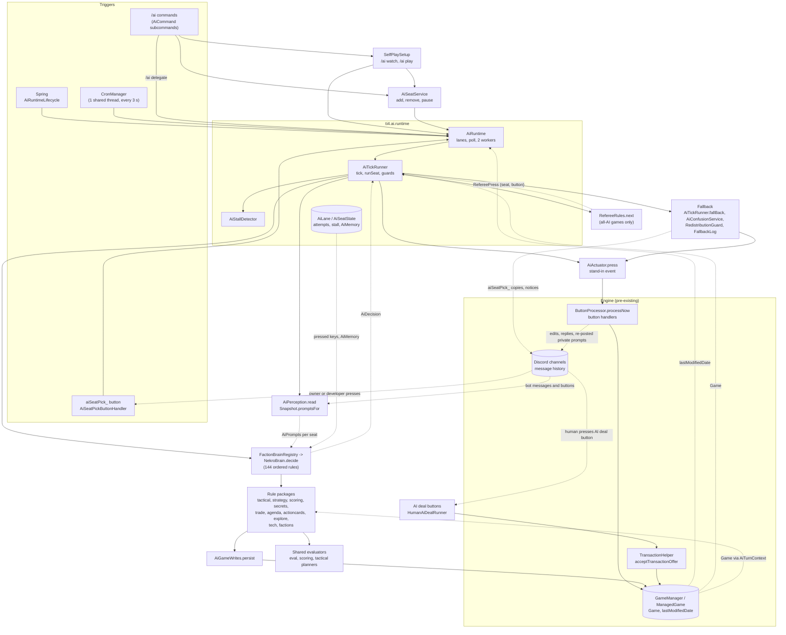
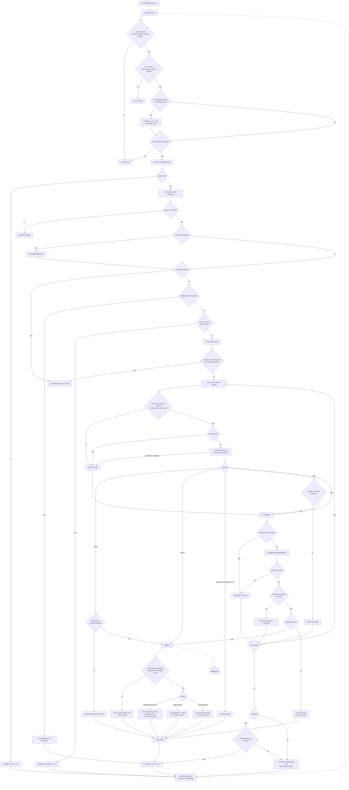
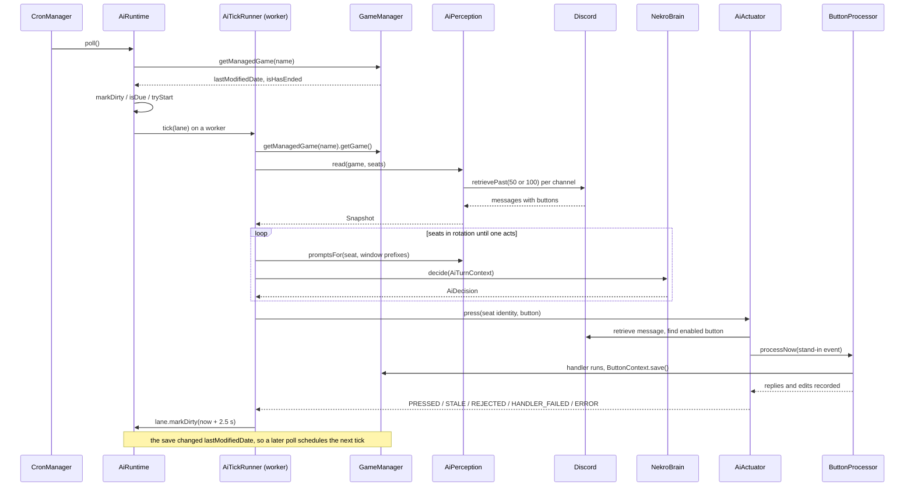
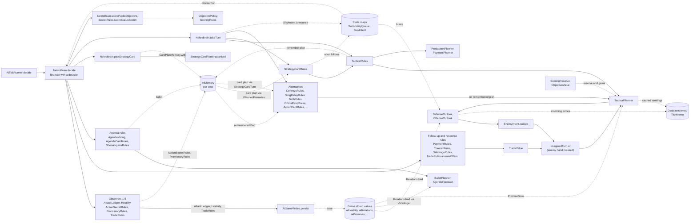
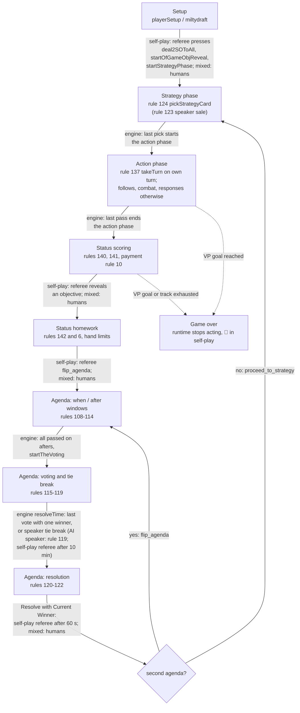
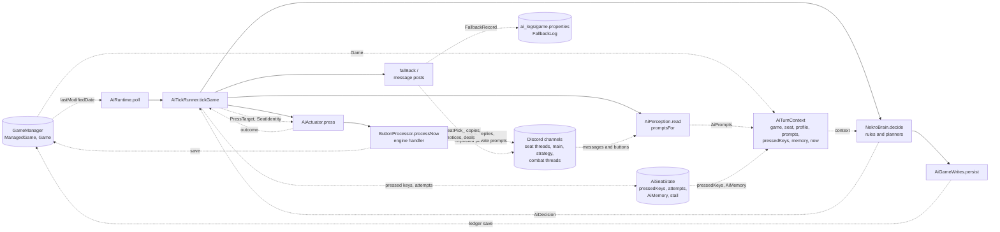

# AI players: architecture and behavior

This is a living document kept next to the code, in `src/main/java/ti4/ai/README.md`. It describes how the AI
players are built and how they decide, subsystem by subsystem. The code is the source of truth: when this document
and the code disagree, the code wins and this document should be fixed in the same change. The user guide (commands,
settings, how to run a game with AI seats) is [AI_PLAYER.md](/AI_PLAYER.md); [DOC_DRIFT.md](/src/main/java/ti4/ai/DOC_DRIFT.md) lists the statements in it
that the code no longer supports. Terms follow [GLOSSARY.md](/GLOSSARY.md).

This hub holds the overview, architecture, decision lifecycle, how the subsystems interact, the game phases, the
scenario overview, data flow, testing summary, unverified points and the key changes. Each subsystem has its own
document next to its package (see [Subsystem documents](#subsystem-documents)) with its components, scenarios,
algorithms, edge cases, limitations and cross-references. Statements in older docs that the code no longer supports are
in [DOC_DRIFT.md](/src/main/java/ti4/ai/DOC_DRIFT.md).

These documents were written for the pull request that adds the AI (merge base `73f948936b`). Section 11 and phrases
such as "this branch" describe that change and should be reworded once it is merged.

## Contents

- [1. Overview](#1-overview)
  - [Purpose](#purpose)
  - [What the AI does](#what-the-ai-does)
  - [Scope](#scope)
  - [Design in brief](#design-in-brief)
- [2. Architecture](#2-architecture)
  - [Major components](#major-components)
  - [Diagram 1: high-level architecture](#diagram-1-high-level-architecture)
- [3. Decision lifecycle](#3-decision-lifecycle)
  - [Step 1. Trigger: the poll](#step-1-trigger-the-poll)
  - [Step 2. The tick](#step-2-the-tick)
  - [Step 3. One seat: runSeat](#step-3-one-seat-runseat)
  - [Step 4. Idle and the stall timer: handleIdle](#step-4-idle-and-the-stall-timer-handleidle)
  - [Step 5. Fallback: fallBack](#step-5-fallback-fallback)
  - [Step 6. Delegated round trip](#step-6-delegated-round-trip)
  - [Step 7. Next cycle](#step-7-next-cycle)
  - [Timeouts and limits at a glance](#timeouts-and-limits-at-a-glance)
  - [Diagram 2: complete decision lifecycle](#diagram-2-complete-decision-lifecycle)
  - [One tick in sequence](#one-tick-in-sequence)
- [4. AI components and responsibilities](#4-ai-components-and-responsibilities)
  - [4.1 How the specialized rules interact](#41-how-the-specialized-rules-interact)
  - [Subsystem documents](#subsystem-documents)
- [5. Game scenarios and supported behavior](#5-game-scenarios-and-supported-behavior)
  - [5.1 Game phases](#51-game-phases)
  - [5.2 Scenario overview](#52-scenario-overview)
- [6. Decision algorithms and priorities](#6-decision-algorithms-and-priorities)
  - [6.1 Common to all subsystems](#61-common-to-all-subsystems)
- [7. Interactions and data flow](#7-interactions-and-data-flow)
  - [Game state](#game-state)
  - [Prompts and buttons](#prompts-and-buttons)
  - [Candidate actions and evaluations](#candidate-actions-and-evaluations)
  - [Executed presses and messages](#executed-presses-and-messages)
  - [Feedback into the next cycle](#feedback-into-the-next-cycle)
  - [Data flow diagram](#data-flow-diagram)
  - [Who calls whom](#who-calls-whom)
- [8. Edge cases and fallbacks](#8-edge-cases-and-fallbacks)
- [9. Self-play, simulation and testing](#9-self-play-simulation-and-testing)
  - [9.1 What is tested and what is only implemented](#91-what-is-tested-and-what-is-only-implemented)
- [10. Known limitations](#10-known-limitations)
  - [10.15 Not verified](#1015-not-verified)
- [11. Key implementation changes](#11-key-implementation-changes)
  - [11.1 Seams between the engine and ti4.ai](#111-seams-between-the-engine-and-ti4ai)
  - [11.2 Engine changes outside ti4.ai](#112-engine-changes-outside-ti4ai)
  - [11.3 New on this branch versus existing engine behavior](#113-new-on-this-branch-versus-existing-engine-behavior)

## 1. Overview

### Purpose

The `ti4.ai` packages add bot-controlled players ("AI seats") to the async TI4 bot. An AI seat is an ordinary `Player` in an
ordinary game. Its user id is synthetic: `7100000` followed by 9 random digits ([AiSeats](/src/main/java/ti4/ai/AiSeats.java)).
The seat plays through the same Discord buttons a human presses. There are two uses:

- **Mixed games.** One or more AI seats fill chairs at a table of humans (`/ai add`).
- **Self-play.** Every seat is an AI: `/ai watch`, and the JUnit harness under `src/test/java/ti4/ai`, which uses
  self-play to measure and regression-test the AI.
- **`/ai play`.** A developer command that builds the game with the same
  [SelfPlaySetup](/src/main/java/ti4/ai/selfplay/SelfPlaySetup.java) code but seats the developer in one random chair.
  At run time this is a mixed game, not self-play: `AiSeats.isSelfPlay` is false because one real player is human, so
  the referee does not run, fast pace never applies, and the human presses the "any player" phase buttons (the start
  message tells them to press **Deal 2 Secret Objectives**).

All AI code is under `src/main/java/ti4/ai/` (about 84,000 lines in 35 packages and six root classes). None of it exists on `origin/master`.
Outside `ti4.ai`, engine code names the AI in only two places, which `AiSegregationTest` enforces:
`SlashCommandManager` registers `/ai`, and `TestBedService.findNonDeveloper` skips AI seats. Spring starts the
runtime through [AiRuntimeLifecycle](/src/main/java/ti4/ai/runtime/AiRuntimeLifecycle.java), and the router's
class-path scan finds the AI's own `@ButtonHandler`s. Neither of these needs an engine import.

### What the AI does

- **Strategy phase.** It ranks the strategy cards and picks one. It also handles Checks and Balances and the
  speaker-sale deal.
- **Action phase.** It plans and runs tactical actions: activation, movement, landing, production and payment. It
  plays strategy cards and follows other players' cards. It uses component actions, action cards, relics,
  exploration, technologies, leaders and promissory notes. It considers a second action when one is allowed, and it
  passes.
- **Combat.** It rolls, assigns hits, plays combat cards and abilities, and decides on retreats, including in combat
  threads.
- **Status phase.** It scores public and secret objectives, then gains and redistributes command tokens.
- **Agenda phase.** It queues or declines "when" and "after" cards and riders. It plans and casts votes from a
  forecast of the other voters, breaks ties as speaker, and uses Veto, Quash, Galactic Threat and the shenanigans
  cards.
- **Trade and diplomacy.** It answers and starts transactions. It trades promissory notes, makes promise and debt
  deals, extorts, and gives or answers bounties. It keeps trust and relation ledgers per player.
- **Housekeeping.** It discards down to its hand limits and discards a starting secret objective. It resolves
  explorations, relic draws and rider payouts.

### Scope

- **Factions.** [AiSettings](/src/main/java/ti4/ai/AiSettings.java) lists 11 supported factions: Nekro, Sardakk,
  Hacan, Letnev, L1Z1X, Naalu, Sol, Jol-Nar, Xxcha, Yin and Winnu. A seat without a named faction takes the first free
  faction of `DEFAULT_FACTIONS` (Nekro, Sardakk, Hacan, Letnev, Sol, Xxcha). Naalu, Winnu and Yin are listed as
  work in progress (`WIP_FACTIONS`). No production code reads that list. They are kept out of default picks only
  because `DEFAULT_FACTIONS` leaves them out. Every faction uses the same brain. `FactionBrainRegistry` maps the brain
  ids `nekro` and `standard` to one `NekroBrain` instance. Faction behaviour comes from rules that check for a
  specific ability, leader, unit or technology.
- **Game modes.** [AiGameSupport](/src/main/java/ti4/ai/seat/AiGameSupport.java) refuses to add a seat in these cases:
  - the kill switch is off;
  - the faction is unsupported or already held, or the game has 8 real players;
  - a Milty draft is running, or the game has started;
  - the game uses TIGL, Fog of War (full or light), Community, Alliance, Twilight's Fall, Franken, Homebrew,
    Discordant Stars, Absol, MiltyMod, homebrew strategy cards, Omega Phase, extra secrets, any galactic-event mode,
    or a scenario (Liberation C4, Ordinian C1, Erwan's Gambit).

  So the AI plays base game, Prophecy of Kings and Thunder's Edge content in standard games. The Homebrew check is
  skipped once the game already has an AI seat, because `AiSeatService.addSeat` itself marks the game homebrew
  (`game.setHomebrew(true)`). The same call also turns on the new transaction method and writes bot-style user
  settings for the seat id (for example auto debt clearance off).
- **Kill switch.** The global setting `AI_PLAYERS_ENABLED` defaults to false (`AiSettings.isEnabled`). When it is off:
  - No new seats can be added, and no new self-play games can start.
  - Seats make no choices of their own, and the self-play referee presses nothing.
  - The runtime still polls and ticks AI games and still reads Discord.
  - Stalls on public prompts are still copied to the table, and a choice someone makes for a seat is still pressed.
    A stall on a private prompt, and any stall in self-play, only gets a "stuck" notice, because the safe-default and
    self-play presses require the seat to be allowed to act on its own.
- **Per-seat pause.** `/ai pause` stops a seat's own decisions. `/ai delegate` hands its blocking choice to the game
  owner or a bot developer.
- **Commands.** `/ai` has the subcommands `add`, `status`, `pause`, `resume`, `delegate`, `remove`, `watch`, `play`,
  `fallbacks`, `profile` and `debug`.

### Design in brief

- **One ordered rule list.** A seat's decision is [NekroBrain.decide](/src/main/java/ti4/ai/nekro/NekroBrain.java). It
  walks 144 rules in a fixed order and returns the first decision any rule produces. The first five rules only
  observe. The list order is the only priority between rules: there is no scoring across rules. The valuing happens
  inside each rule. Rules call shared planners and evaluators that put a value on options in trade goods (TG). Each
  rule then presses the best option, waits, or declines the decision.
- **Acts through real buttons.**
  - The AI reads its options as [AiPrompt](/src/main/java/ti4/ai/perception/AiPrompt.java)s, built from bot messages
    in its own cards info thread, the main actions channel, strategy card threads and combat threads.
  - [AiActuator](/src/main/java/ti4/ai/actuation/AiActuator.java) presses a button by building a stand-in
    `ButtonInteractionEvent` for the seat (`TestBedPress.standInEvent`). It runs the event through the bot's normal
    `ButtonProcessor.processNow`, so the engine's ownership checks, handlers, saves and undo all apply.
  - Buttons that open modals, and select menus, are never used.
- **Not only button presses.** The AI also does three other things:
  - It posts its own messages: notices, deal proposals, table talk and delegation copies.
  - It saves its own ledgers as game stored values through
    [AiGameWrites.persist](/src/main/java/ti4/ai/AiGameWrites.java). These cover hostility, attacks, relations,
    promises, deals, bounties, speaker sales, Boat Float arrangements and extortion.
  - When a human accepts an AI deal, the AI's deal button handlers run `HumanAiDealRunner.run`, which calls
    `TransactionHelper.acceptTransactionOffer` directly (and `AgentLifecycle.press` for a deal step that exhausts an
    agent).
- **Pull, not push.** The engine does not notify the AI. [AiRuntime](/src/main/java/ti4/ai/runtime/AiRuntime.java)
  polls each game's save time every 3 seconds and ticks the game 2.5 s after the first save it has not seen. A
  watchdog also ticks every non-dormant game once a minute. A tick lets the seats decide in rotation and does at
  most one thing.
- **Guarded.** Several limits keep a seat from looping or flooding a game:
  - a minimum gap of 1.5 s between AI actions;
  - at most 150 presses per seat per hour (600 at self-play fast pace);
  - at most 2 presses of the same button on an unchanged game state;
  - a health check on failed presses;
  - a 20-second thinking budget checked at span entry;
  - a loop guard on repeated fallbacks;
  - caps on hand-overs per round.
- **Fallback to the table.** A seat can be unsure, make no progress, or be waited on for 3 minutes (1 minute at fast
  pace in self-play). It then hands the blocking choice over:
  - a public prompt is copied into the actions channel as `aiSeatPick_` buttons, which only the game owner or a bot
    developer may press;
  - a private prompt gets a declining option (decline, pass, done, skip, cancel and similar), or a "stuck" notice when
    there is none;
  - in self-play, the seat presses a choice itself: a declining option if there is one, otherwise the first enabled
    button that does not open a form, undo, cancel hits or pass early. This is not always a safe choice.
- **Deterministic heuristics.** The AI does not search over sequences of moves, run rollouts or learn. Planning is
  greedy generate-and-score with exact dice odds. Opponents are predicted one ply ahead by running the AI's own
  tactical planner from their seat with their unscored secrets and action cards masked. The only sampled randomness
  in decisions is the agenda forecast, whose generator is seeded from the game, agenda and seat. A few timing delays
  are pseudo-random hashes of message or game data and the seat's `aiSeed`, not draws.

## 2. Architecture

### Major components

The AI is a loop built from five parts:

1. **Scheduler.** It decides when a game is looked at.
2. **Tick runner.** It owns one decision cycle.
3. **Perception layer.** It turns Discord messages into prompts.
4. **Brain.** One ordered rule list that turns prompts and game state into a single decision.
5. **Actuator.** It presses the chosen button through the engine.

Around the loop sit three more groups:

- **Rule packages and planners.** They are grouped by game area and do the actual valuing.
- **Fallback and self-play.** These parts handle the cases the brain does not resolve.
- **Seat management and the `/ai` commands.**

Ownership is narrow:

- [AiTickRunner](/src/main/java/ti4/ai/runtime/AiTickRunner.java) is the only caller of `AiPerception.read` and of
  `FactionBrain.decide`.
- `AiTickRunner` and the fallback code it calls are the only paths to `AiActuator.press` for a seat's own presses.
- The engine never calls into a rule. A rule sees the game only through its
  [AiTurnContext](/src/main/java/ti4/ai/brain/AiTurnContext.java): the `Game`, the seat, its profile, its filtered
  prompts, its pressed keys, its `AiMemory` and the clock.

| Package | Role | Responsibility | Key classes |
| --- | --- | --- | --- |
| [`ti4.ai.runtime`](/src/main/java/ti4/ai/runtime/) | decides (when and what to carry out) | Polls games, keeps per-game and per-seat runtime state, runs a tick, applies the guards, routes each decision to the actuator, the fallback or a message, and detects stalls | `AiRuntime`, `AiRuntimeLifecycle`, `AiLane`, `AiSeatState`, `AiTickRunner`, `AiStallDetector`, `AiProgress` |
| [`ti4.ai.perception`](/src/main/java/ti4/ai/perception/) | informs | Reads the seat's thread, the actions channel, strategy threads and the 2 newest relevant combat threads per seat, then filters the prompts per seat | `AiPerception`, `AiPrompt`, `PromptButton` |
| [`ti4.ai.brain`](/src/main/java/ti4/ai/brain/) | informs (types, memory, caches) | Brain interface and registry, decision variants, turn context, per-seat memory, per-decision, per-tick and per-search caches, prompt helpers | `FactionBrain`, `FactionBrainRegistry`, `AiDecision`, `AiTurnContext`, `AiMemory`, `DecisionMemo`, `TickMemo`, `SearchMemo`, `Prompts` |
| [`ti4.ai.nekro`](/src/main/java/ti4/ai/nekro/) | decides | The single rule list every AI seat runs. Also holds the rules written inline (strategy card pick, own turn, scoring, homework, when/after declines, tie break), Nekro faction rules and command token policy | `NekroBrain`, `NekroRules`, `NekroLeaderRules`, `CommandTokenPolicy` |
| [`ti4.ai.actuation`](/src/main/java/ti4/ai/actuation/) | executes | Presses a real button as the seat with a stand-in event, and classifies the result | `AiActuator`, `AiActor`, `SyncMessage`, `Proxies` |
| [`ti4.ai.fallback`](/src/main/java/ti4/ai/fallback/) | decides and executes | Hands blocking choices to the table, picks private safe defaults, records fallbacks | `AiConfusionService`, `DelegationChoice`, `DelegatedPress`, `FallbackLog`, `RedistributionGuard` |
| [`ti4.ai.selfplay`](/src/main/java/ti4/ai/selfplay/) | decides | Sets up `/ai watch` (all AI), `/ai play` (one human chair) and harness games. `RefereeRules` chooses which "any player" phase button to press in all-AI games; `AiTickRunner.referee` presses it | `SelfPlaySetup`, `RefereeRules` |
| [`ti4.ai.seat`](/src/main/java/ti4/ai/seat/), [`ti4.ai.profile`](/src/main/java/ti4/ai/profile/), [`ti4.ai.discord`](/src/main/java/ti4/ai/discord/) | executes and informs | Adds, removes and pauses seats, checks game support, holds the stored per-seat profile, and provides the `/ai` command tree and the `aiSeatPick_` handler | `AiSeatService`, `AiGameSupport`, `AiSetupRestore`, `AiProfile`, `AiCommand`, `AiSeatPickButtonHandler` |
| [`ti4.ai.trace`](/src/main/java/ti4/ai/trace/) | informs | Thinking limits and profiles, timing and debug logs, the per-game AI log file | `Thinking`, `ThinkingAborted`, `ThinkingStats`, `TimingReport`, `AiDebugLog`, `AiLogStore` |
| [`ti4.ai.eval`](/src/main/java/ti4/ai/eval/) | evaluates and informs | The value scale, board view, movement reach, territory zones, exact combat and dice odds, threats, stakes (Mecatol, icons, Fracture, planets), custodians race, imagined opponent turns | `ValueScale`, `BoardView`, `MovementGraph`, `Territory`, `CombatOdds`, `DiceOdds`, `CustodiansRace`, `ImaginedTurn`, `DecidingSeat` |
| [`ti4.ai.tactical`](/src/main/java/ti4/ai/tactical/) | decides and evaluates | Plans activations, drives the tactical action buttons, production, payment, combat, retreats, defense and offense outlooks, stalling | `TacticalPlanner`, `TacticalRules`, `ProductionPlanner`, `PaymentPlanner`, `CombatRules`, `DefenseOutlook`, `StrikeEvaluator`, `EnemyIntent`, `AttackLedger`, `Stall` |
| [`ti4.ai.strategy`](/src/main/java/ti4/ai/strategy/) | decides and evaluates | Ranks strategy cards for the pick, plays and resolves primaries, follows secondaries, chooses research, plans tokens | `StrategyCardRanking`, `StrategyCardRules`, `StrategyCardTurn`, `ResearchPolicy`, `TokenPlan`, `SecondaryQueue`, `SpeakerSale` |
| [`ti4.ai.scoring`](/src/main/java/ti4/ai/scoring/), [`ti4.ai.secrets`](/src/main/java/ti4/ai/secrets/) | decides and evaluates | Objective values and progress, which objective to score, scoring payments and reserve, win odds and races, secret values, draws and action-phase secrets | `ObjectiveValue`, `ObjectivePolicy`, `ScoringRules`, `ScoringReserve`, `ScoringStakes`, `WinOdds`, `WinRace`, `Wallet`, `PaymentRules`, `SecretValue`, `SecretRules`, `ActionSecretRules` |
| [`ti4.ai.trade`](/src/main/java/ti4/ai/trade/), [`ti4.ai.deal`](/src/main/java/ti4/ai/deal/), [`ti4.ai.promise`](/src/main/java/ti4/ai/promise/), [`ti4.ai.promissory`](/src/main/java/ti4/ai/promissory/) | decides and evaluates | Transactions, deal search and valuation, trust and relations, promise and human-AI deals, extortion, debts, promissory note play | `TradeRules`, `TradeValue`, `Relations`, `Trust`, `PromiseBook`, `HumanAiDealRunner`, `PromissoryRules` |
| [`ti4.ai.agenda`](/src/main/java/ti4/ai/agenda/) | decides and evaluates | Agenda values, forecast of every voter, ballot planning, voting buttons, riders, Veto/Quash/Galactic Threat, shenanigans | `AgendaVoting`, `BallotPlanner`, `AgendaForecast`, `AgendaValues`, `AgendaQueue`, `ShenanigansRules` |
| [`ti4.ai.actioncards`](/src/main/java/ti4/ai/actioncards/) | decides and evaluates | Action card values and priors, own-turn plays, responses, Sabotage, combat cards, agenda-phase cards (Veto, riders), keep and discard | `ActionCardRules`, `ActionCardValue`, `ActionCardResponses`, `SabotageRules`, `CombatCardRules`, `AgendaCardRules` |
| [`ti4.ai.explore`](/src/main/java/ti4/ai/explore/), [`ti4.ai.expedition`](/src/main/java/ti4/ai/expedition/), [`ti4.ai.legendary`](/src/main/java/ti4/ai/legendary/), [`ti4.ai.tech`](/src/main/java/ti4/ai/tech/) | decides and evaluates | Exploration and relic choices, relic actions, Thunder's Edge expeditions, legendary planets, technology abilities | `ExplorationRules`, `RelicActionRules`, `ExpeditionRules`, `LegendaryRules`, `TechRules` |
| [`ti4.ai.hacan`](/src/main/java/ti4/ai/hacan/), [`letnev`](/src/main/java/ti4/ai/letnev/), [`naalu`](/src/main/java/ti4/ai/naalu/), [`sardakk`](/src/main/java/ti4/ai/sardakk/), [`sol`](/src/main/java/ti4/ai/sol/), [`winnu`](/src/main/java/ti4/ai/winnu/), [`xxcha`](/src/main/java/ti4/ai/xxcha/), [`yin`](/src/main/java/ti4/ai/yin/) | decides | Faction leaders, abilities, units and technologies. Each rule checks for its component | `SolAgentRules`, `XxchaAgentRules`, `SardakkHeroRules`, `DatahubRules`, `YinSpinnerRules`, ... |
| [`ti4.ai.endurance`](/src/main/java/ti4/ai/endurance/) | evaluates | Prove Endurance stall race and stall counts | `Endurance`, `StallCount` |
| root `ti4.ai` | informs and executes | Seat ids, settings and kill switch, feature flags, the hostility ledger, personalities, and the one helper for direct game writes | `AiSeats`, `AiSettings`, `AiExperiments`, `Hostility`, `AiPersonality`, `AiGameWrites` |

### Diagram 1: high-level architecture

Legend: solid arrows (`-->`) are calls (control flow). Dotted arrows (`-.->`) are data read or written.

Notes on the diagram:

- `AiTickRunner` also posts `Announce` notices through `AiConfusionService.notice`, `Propose` deals through
  `HumanAiDealMessage.post`, and `Post` messages through `MessageHelper.sendMessageToChannelWithButtons`. These are
  folded into the fallback and Discord edges above.
- The engine's button router reaches the AI deal handlers (`HumanAiDealButtons`, `PromiseDealButtons`,
  `SpeakerSaleButtons`, `ViscountUnlennSaleButtons`) and `AiSeatPickButtonHandler` through its `@ButtonHandler`
  class-path scan. It needs no import of `ti4.ai`.
- A save through either `ButtonContext.save()` or `AiGameWrites.persist` changes `lastModifiedDate`. That is what
  makes the next poll schedule another tick.
- `RefereeRules` does not press anything itself. `AiTickRunner.referee` asks `RefereeRules.next` for a press and then
  presses it through the same `pressAsSeat` path as a seat's own press, so the referee edge goes back to the tick
  runner, not to the actuator.
- The fallback's own presses (the private safe default and the self-play choice) also go through
  `AiTickRunner.pressAsSeat`, wrapped by `RedistributionGuard.pressRestoringTokens`. `AiConfusionService` only reads
  messages through `AiActuator.retrieve` and posts.

## 3. Decision lifecycle

A decision cycle starts when a game changes, or when a timer runs out. It ends with at most one action and a time for
the next tick. Everything below is in [AiRuntime](/src/main/java/ti4/ai/runtime/AiRuntime.java) and
[AiTickRunner](/src/main/java/ti4/ai/runtime/AiTickRunner.java) unless another class is named. The times are the
constants in [AiSettings](/src/main/java/ti4/ai/AiSettings.java).

### Step 1. Trigger: the poll

`AiRuntime.start` (from Spring) registers `AiRuntime::poll` with `CronManager`. The first poll runs after 60 s, then
one runs every 3 s, on the bot's one shared cron thread. Each poll does the following:

1. It returns at once unless the process is ready. "Ready" means:
   - JDA is up and accepts commands;
   - this process holds the active lease;
   - the bot is not unstable;
   - the circuit breaker is closed.

   The kill switch is not checked here.
2. Until discovery succeeds, the poll registers every non-ended game with an AI seat, retrying every 60 s.
3. For each lane (one per game with AI seats), it does four checks:
   - **Gone or ended.** The game is missing or has ended: the poll drops the lane.
   - **Saved.** `ManagedGame.lastModifiedDate` differs from the last value the lane saw: the lane is marked due 2.5 s
     from now. Marking keeps the earliest due time already set, so a burst of saves ticks 2.5 s after the first one.
   - **Watchdog.** The game was saved within the last day and the 60 s watchdog is due: the lane is due now.
   - **Due.** The lane is due and not already running: the poll submits `AiTickRunner.tick(lane)` to a pool of 2
     worker threads. At most two games tick at once, and each game runs at most one tick at a time.

Other entry points schedule a lane outside the save check:

- `/ai delegate` calls `requestDelegation`, which marks the lane due now.
- A table member's `aiSeatPick_` press calls `enqueueDelegatedPress`, which marks the lane due now.
- `/ai add` (through `AiSeatService.addSeat`), `/ai resume` and `SelfPlaySetup.setUp` call `register`, which marks the
  lane due 2.5 s from now.
- `/ai remove` calls `AiRuntime.forget` when no AI seat is left, and `/ai pause` and `/ai resume` clear the seat's
  stall timer.

### Step 2. The tick

`tickOnce`, then `tickGame`:

1. **May mutate?** This needs the process ready and allowed to run scheduled work. If not, the tick retries in 30 s.
2. **Load the game.** The game is loaded from `GameManager`, and a `TickMemo` scope opens for the tick. If no active AI
   seat is left, the lane is forgotten.
3. **Undo check.** If the newest undo file number dropped, `lane.forgetAfterUndo()` runs. It clears every seat's
   memory, pressed keys, attempts, handed-over prompts, recent decisions, thinking hold, stall and loop guard, plus
   the open follows (`SecondaryQueue`), the attack ledger pictures and the referee's press record.
4. **Victory.** If the game has a victory point goal above 0 and some player has reached it, the tick stops. In
   self-play it posts 🏁 once.
5. **Delegated press.** If a table choice is queued, the tick presses it for the seat (`pressDelegated`), re-arms
   2.5 s later and stops. Only one delegated press runs per tick.
6. **Pacing.** If less than 1.5 s has passed since the lane's last AI press, the tick re-arms at that mark and
   stops. The mark is set by `pressAsSeat` and `pressDelegated`. Posting a message (`Announce`, `Propose`, `Post`) does
   not set it.
7. **Perceive.** `AiPerception.read(game, seats)` runs once for every seat. It does blocking reads of Discord
   history: 50 messages per channel, 100 per combat thread.
8. **Game end (self-play).** If the objective track is exhausted and an end-game button is offered, the tick posts 🏁
   once and stops.
9. **Seats.** For each seat in rotation, `runSeat` runs. The rotation is the order of `game.getPlayers()` (a
   `LinkedHashMap`, so the order players were added, not the table's seating order), starting after the seat that
   pressed last. The first seat that **acts** ends the tick, and the lane re-arms 2.5 s later. Otherwise the tick keeps the
   earliest wake time any seat asked for.
10. **Referee (self-play only).** If no seat acted, `referee` may press one "any player" phase button. If it did,
    the lane re-arms 2.5 s later.
11. **Schedule.** The lane is marked due at the earliest wake time collected. In self-play, when the game was saved
    within the last day, the referee delay (20 s, or 10 s at fast pace) is added as a wake time. If no wake time was
    collected, the lane waits for the next save or the watchdog.

### Step 3. One seat: `runSeat`

1. The tick reads the seat's [AiProfile](/src/main/java/ti4/ai/profile/AiProfile.java) (player stored values) and looks
   up the brain (`FactionBrainRegistry.forBrainId`). It filters the perception snapshot into this seat's prompts,
   using the brain's public window prefixes.
2. **May the seat choose?** It may only if all of these hold:
   - a brain is found and the seat is not paused;
   - the kill switch is on;
   - the lane is healthy: under 3 failed presses in 10 min in this game, and under 10 across all games;
   - the seat has made under 150 presses in the last hour (600 at fast pace).

   If any check fails, the decision is `Idle`. When all hold, the tick also makes sure, once per seat id and process,
   that the seat's user setting for automatic debt clearance is off (`AiSeatService.ensureTradePreferences`).
3. **Decide.** `decide` skips the brain and returns `Idle` while thinking is held. Thinking is held after an abort
   on the same progress fingerprint, for up to 5 min. Otherwise `decide` opens a `Thinking` session and a
   `DecisionMemo` scope, then calls `NekroBrain.decide`. The `Thinking` limits are checked each time a rule or
   evaluator enters a named span (`Thinking.enter`): 20 s budget (system property `ai.thinking.budget.seconds`), at
   most 200,000 entries of one span name, at most 8 nested re-entries of one span, and at most 60 nested spans.
   - `NekroBrain.decide` walks the 144 rules and returns the first decision a rule produces, or `Idle`.
   - A `ThinkingAborted` or `StackOverflowError` cuts the decision short. The seat holds thinking at this fingerprint,
     a `THINKING_ABORTED` fallback record is written, and the decision is `Idle`.
   - Any other `RuntimeException` is logged and the decision is `Idle`.
   - A decision that took 2 s or more logs a "thinking was slow" warning, at most once a minute per game. When every
     active seat has aborted 3 times in a row, one error is logged for the game until some seat decides normally.
4. **Dispatch** on the [AiDecision](/src/main/java/ti4/ai/brain/AiDecision.java) variant:

| Decision | What the runtime does | Ends the tick? |
| --- | --- | --- |
| `Press` | Builds an attempt key from the message, button and progress fingerprint. While fewer than 2 attempts are recorded on that key it records one and presses as the seat through `AiActuator`. `PRESSED` records the press key and the hourly count. `STALE` (channel, message or enabled button gone) counts as done. Both reset the loop guard. `REJECTED`, `HANDLER_FAILED` and `ERROR` record a lane failure and 2 more attempts, so the next decision on that key falls back at once. Once 2 attempts are recorded (two presses that left the fingerprint unchanged, or one failed press), it falls back with `NO_PROGRESS` instead, and the first such fallback also records a lane failure | yes |
| `Unsure` | Falls back at once with kind `UNSURE` | if the fallback acted |
| `Wait` | Wakes the lane at `untilMillis`. Stall detection is skipped unless a delegation request is pending | no |
| `Idle` | `handleIdle` (stall detection) | if it handed over, chose or announced |
| `Announce` | Posts the text in the actions channel | yes |
| `Propose` | Posts a human-AI deal with its buttons | yes |
| `Post` | Posts text and buttons to a channel | yes |

When the process may not mutate, presses and posts are skipped but still count as acted.

### Step 4. Idle and the stall timer: `handleIdle`

1. **Paused.** A paused seat without a delegation request clears its stall timer and does nothing.
2. **Wait reasons.** [AiStallDetector](/src/main/java/ti4/ai/runtime/AiStallDetector.java) names what the game
   waits on from this seat:
   - its turn;
   - public or secret objective scoring;
   - status homework;
   - following a played strategy card;
   - a combat;
   - discarding a starting secret objective;
   - an agenda "when" or "after" window.

   The stall timer restarts whenever the set of reasons changes.
3. **Delegation request.** A pending request is consumed. An explicit `/ai delegate` for this seat forces a
   hand-over. A game-wide one forces it only when there is a reason.
4. **No reason and not forced:** nothing happens until the next save or the watchdog.
5. **Below the threshold:** the threshold is 3 min (1 min at fast pace in self-play). The seat wakes when it would
   pass.
6. **Pick the blocking prompt.** The newest prompt that has enabled buttons, was not handed over before, has no
   button this seat already pressed, and is tied to a reason. When the hand-over is forced and there is no reason,
   it is instead the newest public prompt with a button owned by the seat. It goes to `fallBack` with kind
   `TIMEOUT`, or `REQUESTED` when forced. If no such prompt exists, the seat announces "stuck" once per stall (every
   time when forced); otherwise it wakes again one threshold later.

   An agenda vote is not one of the wait reasons. A seat that is the active voter is covered only by "its turn",
   and with `EXPLOIT_GUARDS` on its vote buttons are never copied to the table (see below), so a stalled vote
   usually ends in a "stuck" notice rather than a hand-over.

### Step 5. Fallback: `fallBack`

1. A prompt this seat already handed over is skipped.
2. **Loop guard.** The guard is keyed on the fallback reason plus the active player's turn start. The first 5
   fallbacks choose. The 6th posts a 🔁 notice and stops. Later ones do nothing. A requested hand-over or a pending
   `/ai delegate` skips and resets the guard.
3. **Ceilings.** A seat may hand over 30 prompts per round, and a game 60 per round. Past that, the seat announces
   "stuck" once.
4. **Where the choice goes:**
   - **Self-play, seat not paused:** the seat presses a choice itself, guarded by `RedistributionGuard`, which puts
     back command tokens a failed redistribution moved. For a `TIMEOUT` or `REQUESTED` stall on a system picker,
     `AiConfusionService.stalledChoice` takes the first system that holds only the seat's own units. Otherwise
     `selfPlayChoice` takes a declining option, else the first enabled button that does not open a form, undo,
     cancel hits or pass early. The choice must also be offerable (see below). If there is none, or the seat may not
     act on its own (kill switch, lane health, hourly cap), it announces "stuck" instead.
   - **Public prompt:** `AiConfusionService.delegate` copies the offerable buttons into the actions channel as
     `aiSeatPick_` buttons, at most 25, labels cut to 80 characters. Offerable means enabled, not opening a form,
     unowned or owned by this seat, and for `combatRoll_` buttons only the seat's own roll. With `EXPLOIT_GUARDS` on
     (the default), only the game owner or a bot developer may press them, and some buttons are never copied: a
     pass while the seat still has tactic tokens or an unplayed strategy card, an end of turn, or a vote
     (`vote`, `outcome_`, `planetOutcomes_`, `exhaustForVotes_`, `resolveAgendaVote_`, `proceedToFinalizingVote`). If
     nothing is left to copy, or the original message cannot be read, the seat announces "stuck". This path does not
     check the kill switch.
   - **Private prompt:** `AiConfusionService.safeDefault` presses the first button whose handler id or label contains
     one of `decline`, `pass`, `no_`, `not follow`, `deletebuttons`, `done`, `skip` or `cancel` (in that order of
     preference), skipping buttons that open a form, cancel hits or pass early. It does so only if the seat is not
     paused and may act on its own. Otherwise the seat announces "stuck".
5. Every outcome is written to [FallbackLog](/src/main/java/ti4/ai/fallback/FallbackLog.java), a ring of 10 records in
   `<storage>/ai_logs/<game>.properties` that `/ai fallbacks` shows.

### Step 6. Delegated round trip

1. A table member presses an `aiSeatPick_` copy. Outside testbed games, the engine's listener context rejects anyone
   who is not a player of the game ("is not a player of the game") before the handler runs, so a developer who is
   not seated cannot choose. `AiSeatPickButtonHandler` then checks `mayChooseFor` (owner or developer while
   `EXPLOIT_GUARDS` is on), claims the message (first press wins, in process memory), edits it to show the choice
   and removes its buttons, and calls `AiRuntime.enqueueDelegatedPress`, which marks the lane due now.
2. On the next tick, step 5 of the tick checks that the seat is still an active AI seat, re-reads the original
   message and takes the button at the stored index. If its id matches the stored CRC32, and the process may mutate,
   the button is pressed as the seat. `AiConfusionService.resolve` then appends ✅ or ⚠️ to the delegation message.
3. This path checks neither the kill switch, health, pause, nor the hourly cap. A successful press does count
   toward the cap.

### Step 7. Next cycle

A successful press runs the engine handler, which saves the game. That changes `lastModifiedDate`, and the next poll
marks the lane due 2.5 s later. The same happens for a direct write through `AiGameWrites.persist`. A press whose
handler does not save leaves the lane waiting for its own re-arm (2.5 s after acting) and the watchdog. Rules that
return `Wait` choose their own wake time. The runtime never times out a `Wait`, so the rule must stop waiting by
itself.

### Timeouts and limits at a glance

| Purpose | Value |
| --- | --- |
| Poll period / first poll | 3 s / 60 s |
| Re-arm after a seen save or an action | 2.5 s |
| Minimum gap between AI actions in a game | 1.5 s |
| Watchdog (games saved within a day) | 60 s |
| Process not ready | retry in 30 s |
| Thinking budget (checked at span entry) | 20 s |
| Thinking caps per decision | 200,000 entries per span name, 8 re-entries, 60 nested spans |
| Slow-decision warning | 2 s, at most once a minute per game |
| Retry after a thinking abort on an unchanged game | 5 min |
| Stall threshold | 3 min (1 min fast pace) |
| Referee delay / agenda resolution / tie break | 20 s (10 s fast) / 60 s / 10 min |
| Presses of the same button on the same state | 2 |
| Presses per seat per hour | 150 (600 fast pace) |
| Failures before a lane cools down | 3 per game or 10 globally in 10 min |
| Hand-overs per round | 30 per seat, 60 per game |
| Buttons copied per hand-over | 25 |
| Repeated fallbacks before stopping | 5 |
| Actuator wait for message edits | 15 s |

### Diagram 2: complete decision lifecycle

Legend: solid arrows (`-->`) are control flow and branches. Dotted arrows (`-.->`) are data: a fallback record
written, and the lane's due time read by the next poll.

Simplifications in the diagram:

- In `fallBack`, a "notice" (the 6th repeat of a fallback, or the first time the ceilings are hit) counts as acting.
  A silently skipped fallback does not.
- In the `Wait` branch with a pending request, the seat keeps its wake time if `handleIdle` did not act.

### One tick in sequence

The sequence adds two facts the flowchart does not show:

- The press runs synchronously on the same worker thread. `ButtonProcessor.processNow` takes the game's execution
  lock for the handler, a write lock when the handler saves and a read lock otherwise.
- The next tick is scheduled twice, by the runtime's own re-arm and by the save the press caused. `markDirty` keeps
  the earliest of the two.

## 4. AI components and responsibilities

Section 4.1 explains how the specialized rules work together. Sections 4.2 to 4.14 then describe each subsystem's
classes: role, purpose, when they are invoked, inputs, outputs and the tests that cover them. Each subsystem's
diagrams sit next to the class they draw.

### 4.1 How the specialized rules interact

#### Delegation: one list, first decision wins

Every AI seat runs the same brain, [NekroBrain](/src/main/java/ti4/ai/nekro/NekroBrain.java).
`FactionBrainRegistry` maps the brain ids `nekro` and `standard` to one instance.

`NekroBrain.decide` does three things:

1. It sets the thread-local [DecidingSeat](/src/main/java/ti4/ai/eval/DecidingSeat.java), so evaluators know whose
   hand they may see.
2. It walks a fixed list of 144 `BrainRule`s. Each rule is a
   `Function<AiTurnContext, Optional<AiDecision>>`, most of them a method reference to a static method in a
   specialized rule class.
3. It returns the first present result, or `Idle` if no rule produced one.

There is no arbitration between rule sets beyond this order:

- No rule's value is compared with another rule's value.
- A rule that returns `Optional.empty()` passes the decision on.
- A rule that returns any decision ends the search, including a `Wait`.

The list order encodes the priorities:

| Positions | What they do | Examples |
| --- | --- | --- |
| 1-5 | Observers, which always return empty | `AttackLedger.observe`, `Hostility.observe`, `ActionSecretRules.observe`, `PromissoryRules.observe`, `TradeRules.observe` |
| 6-73 | Prompts that must be finished first: the status-phase token placement (6), pending payments and costs, continuing multi-step components, technology, relic, exploration and strategy-card follow-up steps, leaders, action card and note continuations | `NekroBrain.finishCommandTokenGain`, `PaymentRules.pay`, `RelicActionRules.next`, `ExplorationRules.next`, `StrategyCardRules.chooseTechnology`, `SolAgentRules.chooseTarget`, `ActionCardRules.continuePlay` |
| 74-110 | Prove Endurance queueing, secret redraw and hand limits, then answering others: trade offers, action card responses, Sabotage windows, Ceasefire, combat cards and combat, action-phase secrets, agenda secrets and notes | `NekroBrain.queueProveEndurance`, `NekroBrain.discardExcessActionCards`, `TradeRules.answerOffers`, `SabotageRules.answerWindows`, `CombatRules.next`, `ActionSecretRules.next` |
| 111-122 | The agenda phase | `NekroBrain.declineWhens`, `AgendaCardRules.riders`, `AgendaVoting.next`, `NekroBrain.breakAgendaTie`, `TradeRules.offerDeadlyPlotBounty`, `ShenanigansRules.react` |
| 123-124 | The strategy phase: a speaker-token seller names the card it wants, then the pick | `SpeakerSale.declare`, `NekroBrain.pickStrategyCard` |
| 125-136 | Turn starters and holds that run before the own turn: agents and heroes, then `Wait`s that hold the turn for a Ceasefire, a card, a deal or Dannel | `NekroLeaderRules.startAgent`, `ActionCardRules.holdOwnTurn`, `PromissoryRules.holdForCeasefire`, `TradeRules.startDeals`, `DannelRules.holdTurn` |
| 137 | The own action phase turn | `NekroBrain.takeTurn` |
| 138-144 | Follows, declines, status scoring, homework, and waits for secondaries | `StrategyCardRules.follow`, `NekroBrain.scorePublicObjective`, `SecretRules.scoreStatusSecret`, `NekroBrain.startStatusHomework` |

Most rules gate themselves on phase, active player and prompt handler ids. In practice only the rules for the current
window produce a result. Faction rules gate on the component (ability, leader, unit or technology), not on the faction
name, so the same list serves all 11 factions. A rule that wants the turn to wait can pre-empt every later rule by
returning a `Wait`. Examples are `ActionCardRules.holdOwnTurn` (128), `DannelRules.holdTurn` (136) and the strategy card waits (143, 144). The runtime never times out a `Wait`.

#### Rules call one another

The list is not the only path into a rule class. Three rules are coordinators that call other rule classes directly.

- **`NekroBrain.takeTurn` (137) orchestrates the own turn.** In a fixed chain, it calls:
  - `TacticalRules` (`inProgress`, `continueAction`, `pickingSystem`, `start`, `secondAction`, `stall`);
  - `StrategyCardRules` (`followsPending`, `resolvePrimary`, `awaitingSecondaries`, `play`);
  - `SlayIntent.announce`, `TroAgentRules.afterTacticalAction`, `ActionCardRules.masterPlan`, and end-of-turn
    components (`ExpeditionRules`, `TechRules`, `SecretRedrawRules`, `LegendaryRules`);
  - about fifteen "instead of a tactical action" alternatives (Transit Diodes, Darktalon Treilla, Warfare with Fleet
    Logistics, Sling Relay, relics, Convoys, `StrategyCardTurn.playIfDue`, action cards, technologies, Lazax Gate
    Folding, faction heroes and agents, Orbital Drop), then `TacticalRules.start`, then playing a strategy card,
    then the "before passing" counterparts, `TacticalRules.stall`, and the pass buttons.

  The first alternative that returns a decision takes the turn. Each alternative checks its own worth against the
  tactical plan; see "Shared evaluators" below. Two early exits return empty on purpose so that later rules run:
  while the seat's played card still awaits secondaries (`StrategyCardRules.awaitingSecondaries`, so rule 143 can
  `Wait`), and once the tactical action is taken but nothing in the chain applies (`TacticalRules.actionTaken`).
- **`NekroBrain.pickStrategyCard` (124)** calls `StrategyCardRanking.ranked`, `ChecksAndBalances.plan` and
  `SpeakerSale` (`awaitSellerPick`, `withoutPromisedCard`). It writes the chosen plan with `CardPlanMemory.write`.
- **`NekroBrain.scorePublicObjective` (140)** calls `ObjectivePolicy.bestScorablePublic` and
  `ScoringRules.scoreAndExpectPayment`. For objectives that open a planet payment prompt, the latter leaves an
  expectation (`PaymentRules.expectWhenScored`) that rule 10 (`PaymentRules.pay`) uses on a later tick.

Rule classes also call each other's planners. For example:

- `StrategyCardRules` drives Warfare and Construction builds through `TacticalRules.start`, `payForUnits` and
  `placeUnits`, `TacticalPlanner.worthProducingAt`, and the card plan in `PlannedPrimaries`.
  `TacticalPlanner.bestForWarfare` is called by `NekroBrain.warfareBeforeFollowUp`, `CardTiming` and
  `PlannedPrimaries`.
- `TacticalRules` calls `ProductionPlanner`, `PaymentPlanner`, `SpaceCannonWait` and `BombardmentRules`.
- `TacticalPlanner.produce` also calls `ProductionPlanner`.

A calling rule never overrides another rule's result after the fact. The only override is order: an earlier rule's
decision means a later rule is never asked. A few rules return empty on purpose to leave a window to later rules.
For example, `NekroBrain.declineWhens` returns nothing while the seat holds a played Veto, so `AgendaCardRules` can
act.

#### Shared evaluators

The specialized rules share evaluators instead of re-deriving values:

- [TacticalPlanner](/src/main/java/ti4/ai/tactical/TacticalPlanner.java) produces the seat's best tactical plan and its
  score in trade goods. Many alternatives compare their own net value with that score: Convoys, Sling Relay,
  technologies, Lazax Gate Folding, Orbital Drop, action cards, Darktalon Treilla, Sardakk hero, legendary planets.
  Each one reads the plan through `TacticalRules.rememberedPlan`, or computes it with `TacticalPlanner.best` and
  stores it with `TacticalRules.remember`. A typical test is `plan.score() >= actionValue`, as in
  `ConvoysRules.tacticalActionBeats`. The tactical plan therefore acts as the common yardstick for "is this worth my
  action".
- `TacticalPlanner` itself builds `DefenseOutlook` and `OffenseOutlook`, and reads three other subsystems:
  - `ScoringReserve.of`, for the tokens and resources kept back to score;
  - `ObjectiveValue`, for the gains;
  - `PromiseBook.forbidsActivating`, for promises made in trade.
- `DefenseOutlook` asks `EnemyIntent.ranked`. That runs `TacticalPlanner.ranked` from the enemy's seat inside
  `ImaginedTurn.of`, which masks the enemy's secrets and action cards and opens fresh memo scopes. `TradeValue` uses
  the same `ImaginedTurn.of` to value a deal from the partner's side.
- [ValueScale](/src/main/java/ti4/ai/eval/ValueScale.java), `ObjectiveValue.VICTORY_POINT_VALUE` (8.0),
  `ScoringStakes.WIN_VALUE` (30) and `Stall.ACTION_VALUE` (1.5) are the common constants. See "Decision algorithms
  and priorities".

#### Shared state

| Store | Lifetime | Written by | Read by |
| --- | --- | --- | --- |
| `AiMemory` (per seat, up to 500 keys) | Until undo or restart | Rules (`TacticalRules.remember` plan per action, `CardPlanMemory.write`, agenda ballots, step flags) | Other rules of the same seat (`TacticalRules.rememberedPlan` in about 15 classes; `StrategyCardTurn`, `PlannedPrimaries`, `StrategyCardReplanner`, `DatahubRules` read the card plan) |
| `DecisionMemo` | One seat decision | `remember` in `TacticalPlanner`, `WinOdds`, `WinRace`, `ScoringReserve`, `DenialMap`, `PlanetTake`, `StyxTake`, `eval.Adjacency`, `CombatModifiers` | The same evaluators, so rules that ask the same question share one computation |
| `TickMemo` | One tick, all seats | `IncomingForces`, `TacticalStrength` | The same, across the seats of that tick |
| `SearchMemo` | One imagined turn or deal search. Scopes are opened by `ImaginedTurn.of`, `FragmentDeals`, `MilitarySupportDeals`, `NoteDeals` and `TechnologyRequest` | `remember` in `ScoringStakes`, `ScoringPaths`, `PublicScoringPlan`, `SpendUnlock`, `ResearchPolicy`, `AgendaPrior` and several trade classes. Outside an open scope it falls back to `DecisionMemo` | The same scope |
| Game stored values written through `AiGameWrites.persist` | In the save, rolled back by undo | `Hostility` (`aiHostility`), `AttackLedger`, `Relations` (`aiRelations`), `PromiseBook` (`aiPromises`), `HumanAiDealStore`, `DiscardBounties`, `SpeakerPromise`, `Extortion`, `BoatFloat` | `Relations.hostility` reads `Hostility.amount`. `OffenseOutlook` (tactical) and `VoteAnger` (agenda) read `Relations.bad`. `TacticalPlanner` reads `PromiseBook` |
| Static per-game maps | Until `AiRuntime.forget` clears them through `AiGameState.forget`. `SecondaryQueue` and `AttackLedger` are also cleared on undo. When the poll drops a lane because its game ended or vanished, it removes only the lane, not these maps | `SecondaryQueue` (strategy follows), `SlayIntent`, `FractureMarch`, `AttackLedger` pictures | `NekroBrain.declineStrategyCardFollow` and `StrategyCardRules` read `SecondaryQueue`. `DefenseOutlook` reads `SlayIntent.hunts` |
| `DecidingSeat` (thread-local) | One `NekroBrain.decide` call | `NekroBrain.decide` | `SecretOdds`, `WinOdds`, `WinRace`, `DenialMap`, `ScoringStakes`, `TacticalStrength`, `PromiseBook`, `AttackLedger`, ... |
| `AiExperiments` flags | Process property `ai.experiments.off`, or seat stored value `aiExperimentsOff` | Tests and operators | 50 production files. Every flag is on by default |

#### How the observers feed later rules

The observers (rules 1-5) run on every decision of every seat the tick reaches that may choose and whose thinking is
not held. `AttackLedger`, `Hostility` and `TradeRules` can update the stored-value ledgers above before any rule decides;
`ActionSecretRules` and `PromissoryRules` write only seat memory:

- `Hostility.observe` charges ships in another player's home, slice or lane zones, blockades of space docks, and
  aimed action cards.
- `AttackLedger.observe` records attack losses and adds them to `Hostility`, only while the `ATTACK_MEMORY` flag is
  on for the seat.
- `ActionSecretRules.observe` watches combats, home planets and space cannon, heavy cannon and bombardment results
  for the action-phase secrets the seat holds, in the action phase only.
- `PromissoryRules.observe` remembers note play buttons and watches Ceasefire and play-area notes.
- `TradeRules.observe` refreshes trust, offers, rejections, promises and bounties, unless trading is off (system
  property `ai.trading=false`).

Some of these saves go through `AiGameWrites.persist`. A save changes `lastModifiedDate` and re-arms the lane, and
later seats in the same tick see the changed `Game`.

#### Diagram 3: delegation and shared data

Legend: solid arrows (`-->`) are delegation, one class calling another to decide or evaluate. Dotted arrows
(`-.->`) are shared data, written or read through memory, caches, stored values or static maps.

Notes on the diagram:

- `SV -.-> DO` stands for `OffenseOutlook` reading `Relations.bad`, which is built from `Hostility.amount` and the
  stored relation levels. `DefenseOutlook` reads attack grudges through `Standings.angerRatio`.
- `SQ -.-> NB` is `NekroBrain.declineStrategyCardFollow` checking `SecondaryQueue.blockerFor`.
- `EARLY --> TV` is `TradeRules.answerOffers` reaching `TradeValue.of` through `OfferResponder`.
- `DO -.-> DM` is `DefenseOutlook` building `IncomingForces`, which caches in `TickMemo`.

### Subsystem documents

| Subsystem | Document | Packages |
| --- | --- | --- |
| Core runtime, brain, perception and actuation | [runtime/README.md](/src/main/java/ti4/ai/runtime/README.md) | runtime, brain, perception, actuation, trace, root classes |
| Seats, commands, fallback and self-play setup | [seat/README.md](/src/main/java/ti4/ai/seat/README.md) | seat, profile, discord, fallback, endurance, selfplay |
| Shared valuation and technology automation | [eval/README.md](/src/main/java/ti4/ai/eval/README.md) | eval, tech |
| Tactical planning, combat and production | [tactical/README.md](/src/main/java/ti4/ai/tactical/README.md) | tactical |
| Strategy cards and technology research | [strategy/README.md](/src/main/java/ti4/ai/strategy/README.md) | strategy |
| Trading, deals, promises and promissory notes | [trade/README.md](/src/main/java/ti4/ai/trade/README.md) | trade, deal, promise, promissory |
| Agenda phase | [agenda/README.md](/src/main/java/ti4/ai/agenda/README.md) | agenda |
| Action cards | [actioncards/README.md](/src/main/java/ti4/ai/actioncards/README.md) | actioncards |
| Scoring and secret objectives | [scoring/README.md](/src/main/java/ti4/ai/scoring/README.md) | scoring, secrets |
| Exploration, relics, expeditions and legendary planets | [explore/README.md](/src/main/java/ti4/ai/explore/README.md) | explore, expedition, legendary |
| Faction packages | [FACTIONS.md](/src/main/java/ti4/ai/FACTIONS.md) | nekro, yin, letnev, sol, sardakk, winnu, naalu, xxcha, hacan |
| Engine changes and AI data | [ENGINE_CHANGES.md](/src/main/java/ti4/ai/ENGINE_CHANGES.md) | changes outside ti4.ai, data/ai resources, docs |
| Testing and self-play harness | [src/test/java/ti4/ai/README.md](/src/test/java/ti4/ai/README.md) | src/test/java/ti4/ai, FakeDiscord |
| Outdated statements in older docs | [DOC_DRIFT.md](/src/main/java/ti4/ai/DOC_DRIFT.md) | AI_PLAYER.md, old PR description |

Per-subsystem detail for this section lives in the subsystem documents listed under [Subsystem documents](#subsystem-documents).

## 5. Game scenarios and supported behavior

Section 5.1 describes the game phases and who moves the game on. Section 5.2 lists every scenario the subsystems
handle, grouped by phase or decision category. Sections 5.3 to 5.14 give each subsystem's full scenario table (trigger,
handler, choices, how it chooses, outcome or fallback) and walk through the important cases. The self-play harness
scenarios are in section 9.3.

### 5.1 Game phases

#### What tells the AI the phase

The AI has no phase machine of its own. On every tick, each rule reads the live `Game` from its `AiTurnContext`.
There are four signals:

- **The phase string.** `game.getPhaseOfGame()` gives `strategy`, `action`, `statusScoring`, `statusHomework`, the
  agenda phases (`agendawaiting`, `agendaVoting`, `agendaEnd`), and `playerSetup` / `miltydraft` at setup. Rules
  compare it case-insensitively. For example, `NekroBrain.pickStrategyCard` requires `strategy` and `takeTurn`
  requires `action`.
- **Whose turn it is.** `AiTurnContext.isActivePlayer` and the turn start (`lastActivePlayerChange`) tell a seat
  whether it is its turn.
- **Per-round stored values.** For example, `<faction>round<N>PO` and `<faction>round<N>SO` (scored or declined this
  status phase), `statusHomeworkReactionFor<faction>Round<N>`, the engine's agenda when/after queue values, and
  `followedSC…`.
- **The prompts.** A rule acts only when it finds an enabled button with the handler id it expects, for example
  `scPick_`, `po_no_scoring`, `redistributeCCButtons` or `resolveAgendaVote_`.

So a phase change reaches the AI as a save, and then as new prompts on the next tick.
[AiStallDetector](/src/main/java/ti4/ai/runtime/AiStallDetector.java) reads the same signals to decide what the game
waits on.

#### Who moves the game on

Most phase transitions are made by the engine itself, in the handler of the last required button press:

- **Action phase starts.** `PickStrategyCardService` starts it once every card is picked.
- **Status phase starts.** `EndTurnService` calls `EndPhaseService.EndActionPhase` after the last pass, which runs
  `StatusHelper.beginScoring`.
- **Homework starts.** Revealing the objective runs `StartPhaseService.startStatusHomework`.
- **Agenda sub-phases.** `AgendaHelper.revealAgenda` (the agenda flip) sets `agendawaiting`. Once every player has
  passed on "after"s, `AgendaWhensAftersHelper` calls `AgendaHelper.startTheVoting`, which sets `agendaVoting`. When
  the last vote leaves a single winner, or the speaker presses a tie-break outcome, the vote handler
  (`AgendaHelper.resolvingAnAgendaVote`) calls `AgendaHelper.resolveTime`, which sets `agendaEnd` and posts the
  "Resolve with Current Winner" (`agendaResolution_`) and "Resolve it Manually" buttons in the actions channel. On a
  tie, the engine instead makes the speaker the active player and sends them `resolveAgendaVote_outcomeTie` buttons
  owned by the speaker; the phase stays `agendaVoting` until one is pressed.

When an AI seat's own press is that last press, the AI moves the game on in the same way a human would.

Some steps need someone to press an "any player" or speaker button in the actions channel:

- deal the starting secrets, and reveal the first objectives;
- start the strategy phase;
- reveal a public objective;
- flip an agenda;
- resolve an agenda with the current winner;
- break an agenda tie;
- proceed to the strategy phase.

How those steps get pressed depends on the game:

- **Mixed games (including `/ai play`).** The AI never presses the "any player" buttons. No rule outside
  [RefereeRules](/src/main/java/ti4/ai/selfplay/RefereeRules.java) refers to `deal2SOToAll`, `startOfGameObjReveal`,
  `reveal_stage_…`, `startStrategyPhase`, `flip_agenda` or `proceed_to_strategy`, and none presses "Resolve with
  Current Winner". The humans press them. They are also not stall reasons, so the AI never hands them over either.
  Two agenda steps are exceptions: an AI speaker breaks a tie itself with `NekroBrain.breakAgendaTie` (rule 119), and
  `ShenanigansRules` may press an `agendaResolution_` button to elect itself with Confounding Legal Text.
- **Self-play (all seats AI).** `RefereeRules.next` picks one of these steps and `AiTickRunner.referee` presses it,
  only when no seat acted in the tick and under these conditions:
  - the kill switch is on and the lane is healthy;
  - no seat is paused or at its hourly cap;
  - at least the referee delay (20 s, or 10 s at fast pace) has passed since the last AI press, and the prompt is
    at least that old;
  - an agenda resolution ("Resolve with Current Winner") is pressed only on a prompt at least 60 s old, and a tie
    break only on one at least 10 minutes old;
  - the starting secrets are dealt only once every map seat is filled, and objective reveals are skipped once the
    objective track is exhausted;
  - the same button is not pressed twice on the same referee state fingerprint (round, phase, speaker, secret counts
    and stored values);
  - the end-game button is never pressed.

  The steps are tried in a fixed order: deal secrets, first objectives, stage 1 and stage 2 reveals, start the
  strategy phase, flip the agenda, resolve with the current winner, break a tie, proceed to the strategy phase. An
  owned button is pressed only by the AI seat that owns it. An unowned one is pressed by the speaker seat, else the
  first seat. The game ends when a player reaches the victory point goal, or when the objective track is exhausted
  (stage 2 deck empty, or stage 1 in Omega Phase) and an end-game button is offered. Either way the runtime posts 🏁
  once and stops acting.

#### Setup

- **Mixed games.** `/ai add` puts a seat into a game that has not started. `AiGameSupport.hasStarted` refuses the add
  if any of these is true:
  - the round is above 1, or the phase is past `strategy`;
  - a strategy card has been played, or this round's objectives were revealed (`revealedFlop<round>`);
  - some player already holds a strategy card, or holds or has scored a secret.

  `AiSeatService.addSeat` then sets the seat up:
  - It creates the player with a synthetic id and runs the engine's `PlayerSetupService.setupPlayer`. If the seat
    does not end up as a real player with a home system and planets, it restores what it changed and removes the
    player.
  - It writes bot-style user settings for the seat id and the hidden profile: brain id, aggression, pause and seed.
  - It remembers what it changed, so `/ai remove` can restore it. `/ai remove` is refused once the game has started.
  - It marks the game homebrew and turns on the new transaction method.
  - It registers the game with the runtime.

  From then on the seat answers its own setup prompts with ordinary rules. `StartingTechRules.choose` (rule 44) picks
  starting technologies, `NekroBrain.discardExcessSecret` (rule 76) discards down to one secret in round 1, and
  `PaymentRules` and the rest handle the other prompts.
- **Self-play and `/ai play`.** `SelfPlaySetup` (for `/ai watch`, `/ai play` and the harness) creates the game for 3
  to 6 seats, lays out the Thunder Dreaming map and adds an AI seat for every chair with `AiSeatService.addSeat`,
  except the developer's chair in `/ai play`, which goes through `PlayerSetupService.setupPlayer`. Factions are drawn
  from `DEFAULT_FACTIONS`. With 4 or fewer seats each player takes 2 strategy cards. `/ai watch` defaults to fast
  pace (`aiPace` = `fast`). Setup then finishes, saves, and registers the lane. If any step fails, the game and its AI
  log are deleted. In `/ai watch` the referee deals the secrets, reveals the first objectives and starts the
  strategy phase. In `/ai play` the human does.

#### Strategy phase (`strategy`)

- `NekroBrain.pickStrategyCard` (rule 124) acts when the seat is the active player. In order:
  1. It hands over a Checks and Balances card if one is planned.
  2. If it bought the speaker token, it waits (`SpeakerSale.awaitSellerPick`, a `Wait`) until the seller has named
     the card it wants.
  3. It leaves out the card the seller named (`SpeakerSale.withoutPromisedCard`).
  4. It picks with `ChecksAndBalances.plan` when Checks and Balances is in play and a plan exists, otherwise the top
     of `StrategyCardRanking.ranked`.
- The ranking's plan is written to `AiMemory` (`CardPlanMemory`), and the action phase reads it back.
- The speaker sale itself is offered earlier, while resolving the Politics primary (`SpeakerSale.sell`, called
  from `StrategyCardRules`): the AI offers the speaker token to its right neighbour for trade goods with
  `speakerBuy_` / `speakerNo_` buttons. An AI buyer answers with `SpeakerSale.answer` (rule 101). In the next
  strategy phase, the seller names its wanted card with `SpeakerSale.declare` (rule 123), a `Post` to its channel.
- Hacan's Quantum Datahub Node swap (`DatahubRules`, rule 36) answers the engine's `startQDN` offer.

#### Action phase (`action`)

- **On the seat's own turn**, `NekroBrain.takeTurn` (rule 137) runs a fixed chain:
  1. continue a tactical action in progress;
  2. finish pending follows;
  3. announce a planned attack (`SlayIntent.announce`);
  4. resolve its strategy card's primary, or give way (return empty) while its played card awaits secondaries;
  5. Tro's agent after a tactical action, Master Plan, then a second action;
  6. use end-of-turn components, then press the owned end-of-turn button;
  7. start a tactical action or one of about fifteen alternatives;
  8. play a strategy card;
  9. use the pre-pass components, including a Prove Endurance stall;
  10. pass.

  Earlier rules intercept steps of a running action: payments, combat, space cannon waits, production and component
  follow-ups.
- **On other players' turns**, the seat answers:
  - strategy card follows (rules 138 and 139);
  - trade offers, Sabotage windows and action card responses;
  - combat in combat threads, through `CombatRules`;
  - Ceasefire and other promissory note windows;
  - action-phase secrets.
- In self-play the referee has nothing to do here. The engine starts the status phase after the last pass.

#### Status phase (`statusScoring`, then `statusHomework`)

- **Scoring.**
  - `NekroBrain.scorePublicObjective` (rule 140) scores the best public objective it can afford
    (`ObjectivePolicy.bestScorablePublic`), or presses "no scoring". It acts only while `<faction>round<N>PO` is
    empty.
  - `SecretRules.scoreStatusSecret` (rule 141) does the same for secrets.
  - `PaymentRules.pay` (rule 10) pays the cost on a later tick.
- **Objective reveal.** Once everyone has scored, the engine offers the reveal buttons. Humans press them in mixed
  games, and the referee in self-play. The reveal starts the homework.
- **Homework.**
  - `NekroBrain.startStatusHomework` (rule 142) opens the command-token redistribution on the homework message.
  - `NekroBrain.finishCommandTokenGain` (rule 6) places the gained tokens by `CommandTokenPolicy` priorities and
    presses Done.
  - `startStatusHomework` then presses "ready" once the reaction is stored.
  - Other status prompts are handled by the follow-up rules: readying, hand limits (rules 76 and 77) and secret
    draws.
- **Agenda.** In a mixed game a human flips the agenda. In self-play the referee does.

#### Agenda phase (`agendawaiting`, `agendaVoting`, `agendaEnd`)

- **When and after windows (`agendawaiting`).**
  - `PromissoryRules.queueAgendaNote` (rule 109) and `BoatFloat.arrange` (rule 110) act first.
  - `NekroBrain.declineWhens` (rule 111) queues Veto or Quash or offers bounties, else declines the "when" window.
  - `GalacticThreatRules` (112) and `AgendaCardRules.riders` (113) run next.
  - `NekroBrain.declineAfters` (114) queues a rider or declines the "after" window.
  - `SecretRules.scoreAgendaSecret` (rule 108) runs before all of them.
- **Voting (`agendaVoting`).**
  - Trade rules first: `TradeRules.payTheAnswerer` (115) and `TradeRules.holdVoteForDeals` (116) may pay or hold the
    vote for a deal.
  - `AgendaVoting.next` (117) casts the planned ballot, using `BallotPlanner` and `AgendaForecast`, when the seat is
    the active voter.
  - Otherwise `NekroBrain.abstainFromAgenda` (118) abstains.
  - `NekroBrain.breakAgendaTie` (119) breaks a tie when the seat is speaker and the active player, before the phase
    reaches `agendaEnd`. The engine makes the speaker active and sends the tie buttons only on a tie. This rule acts
    in mixed games too. In self-play, the referee presses a tie button that is at least 10 minutes old if no seat
    did.
- **Resolution (`agendaEnd`).**
  - `TradeRules.offerDeadlyPlotBounty` (120) may post a Deadly Plot bounty for the current agenda (it gates on the
    agenda, not on a sub-phase).
  - `ShenanigansRules.react` (121) handles Deadly Plot, Confounding Legal Text and the courtesy reactions, waiting
    a seeded delay first. It does nothing in Fog of War.
  - `TradeRules.payDebtInAgenda` (122) pays debts.
  - The rider payouts (rules 22 and 23) are claimed through the payout prompts.
- **End of phase.** Humans, or the referee in self-play, press "Resolve with Current Winner", flip the second agenda
  and proceed to the strategy phase.

#### Diagram 4: phases and transitions

Legend: solid arrows (`-->`) are phase transitions, with who presses the step that causes them. Dotted arrows (`-.->`)
are the conditions the runtime reads to stop acting. Rule numbers are positions in `NekroBrain`'s rule list.

The agenda sub-phases are set by `AgendaHelper.revealAgenda` (`agendawaiting`), `AgendaHelper.startTheVoting`
(`agendaVoting`, called from `AgendaWhensAftersHelper` once every player has passed on "after"s) and
`AgendaHelper.resolveTime` (`agendaEnd`, called from the vote handler). The AI only reads the resulting phase and
prompts. Omega Phase and Hidden Agenda add a pre-vote step before `startTheVoting`; both are refused modes for AI
seats, so this document does not cover them.

### 5.2 Scenario overview

Each row names a scenario, the subsystem section that describes it and the code that handles it. The full rows,
with triggers, choices, selection logic and fallbacks, are in the subsystem sections below.

| Phase / category | Scenario | Subsystem | Handled by |
| --- | --- | --- | --- |
| **Runtime, seats and fallback (any phase)** | Someone saves the game (a human press, an AI press, an AI ledger write) | [Core runtime, brain, perception and actuation](/src/main/java/ti4/ai/runtime/README.md) | `AiRuntime.poll` |
|  | Nothing saved for a while | [Core runtime, brain, perception and actuation](/src/main/java/ti4/ai/runtime/README.md) | `AiRuntime.poll` |
|  | Process not allowed to act | [Core runtime, brain, perception and actuation](/src/main/java/ti4/ai/runtime/README.md) | `AiRuntime.isProcessReady` / `mayMutate` |
|  | Bot restarted | [Core runtime, brain, perception and actuation](/src/main/java/ti4/ai/runtime/README.md) | `AiRuntime.discover` |
|  | Several AI seats can act | [Core runtime, brain, perception and actuation](/src/main/java/ti4/ai/runtime/README.md) | `AiTickRunner.tickGame`, `AiLane.rotation` |
|  | A seat is eliminated | [Core runtime, brain, perception and actuation](/src/main/java/ti4/ai/runtime/README.md) | `AiTickRunner.tickGame`, `AiSeats.isActiveAiSeat` |
|  | A seat's own turn, action phase | [Core runtime, brain, perception and actuation](/src/main/java/ti4/ai/runtime/README.md) | `NekroBrain.takeTurn` (rule 137) |
|  | A rule returns `Wait` | [Core runtime, brain, perception and actuation](/src/main/java/ti4/ai/runtime/README.md) | `AiTickRunner.runSeat` |
|  | No rule applies and nothing is waited on | [Core runtime, brain, perception and actuation](/src/main/java/ti4/ai/runtime/README.md) | `AiTickRunner.handleIdle` |
|  | No rule applies but the game waits on the seat | [Core runtime, brain, perception and actuation](/src/main/java/ti4/ai/runtime/README.md) | `handleIdle` |
|  | A rule is unsure | [Core runtime, brain, perception and actuation](/src/main/java/ti4/ai/runtime/README.md) | `AiTickRunner.fallBack` |
|  | The chosen button changes nothing | [Core runtime, brain, perception and actuation](/src/main/java/ti4/ai/runtime/README.md) | `AiTickRunner.handlePress` |
|  | The press is refused or the handler fails | [Core runtime, brain, perception and actuation](/src/main/java/ti4/ai/runtime/README.md) | `pressAsSeat`, `handlePress` |
|  | The button is gone | [Core runtime, brain, perception and actuation](/src/main/java/ti4/ai/runtime/README.md) | `pressAsSeat` |
|  | A player presses an `aiSeatPick_` choice | [Core runtime, brain, perception and actuation](/src/main/java/ti4/ai/runtime/README.md) | `AiSeatPickButtonHandler.pick` → `AiRuntime.enqueueDelegatedPress` → `AiTickRunner.pressDelegated` |
|  | `/ai delegate` with a seat named | [Core runtime, brain, perception and actuation](/src/main/java/ti4/ai/runtime/README.md) | `AiRuntime.requestDelegation(…, true)` → `AiSeatState.requestDelegation(true)` |
|  | `/ai delegate` without a seat | [Core runtime, brain, perception and actuation](/src/main/java/ti4/ai/runtime/README.md) | `requestDelegation(false)` per AI seat |
|  | Seat paused | [Core runtime, brain, perception and actuation](/src/main/java/ti4/ai/runtime/README.md) | `runSeat`, `handleIdle` |
|  | `/ai resume` | [Core runtime, brain, perception and actuation](/src/main/java/ti4/ai/runtime/README.md) | `AiRuntime.register` |
|  | Kill switch off | [Core runtime, brain, perception and actuation](/src/main/java/ti4/ai/runtime/README.md) | `mayActOnItsOwn` |
|  | Hourly cap reached | [Core runtime, brain, perception and actuation](/src/main/java/ti4/ai/runtime/README.md) | `underActionCap` |
|  | Thinking cut short | [Core runtime, brain, perception and actuation](/src/main/java/ti4/ai/runtime/README.md) | `AiTickRunner.cutShort` |
|  | A rule throws | [Core runtime, brain, perception and actuation](/src/main/java/ti4/ai/runtime/README.md) | `AiTickRunner.decide` |
|  | `/game undo` | [Core runtime, brain, perception and actuation](/src/main/java/ti4/ai/runtime/README.md) | `AiLane.forgetAfterUndo` |
|  | Victory point goal reached | [Core runtime, brain, perception and actuation](/src/main/java/ti4/ai/runtime/README.md) | `tickGame` |
|  | Self-play, objective track exhausted | [Core runtime, brain, perception and actuation](/src/main/java/ti4/ai/runtime/README.md) | `tickGame` |
|  | Self-play, nobody acts | [Core runtime, brain, perception and actuation](/src/main/java/ti4/ai/runtime/README.md) | `AiTickRunner.referee`, `RefereeRules.next` |
|  | Self-play hand-over | [Core runtime, brain, perception and actuation](/src/main/java/ti4/ai/runtime/README.md) | `chooseWithoutHumans` |
|  | Private prompt hand-over | [Core runtime, brain, perception and actuation](/src/main/java/ti4/ai/runtime/README.md) | `fallBack`, `AiConfusionService.safeDefault` |
|  | Same fallback over and over | [Core runtime, brain, perception and actuation](/src/main/java/ti4/ai/runtime/README.md) | `AiSeatState.recordFallback` |
|  | Hand-over ceiling | [Core runtime, brain, perception and actuation](/src/main/java/ti4/ai/runtime/README.md) | `fallBack` |
|  | Add a seat | [Seats, commands, fallback and self-play setup](/src/main/java/ti4/ai/seat/README.md) | `AiAdd.execute` -> `AiSeatService.addSeat` |
|  | Add refused | [Seats, commands, fallback and self-play setup](/src/main/java/ti4/ai/seat/README.md) | `AiGameSupport.refusalReason`, `AiSeatService.addSeat` |
|  | Engine setup fails | [Seats, commands, fallback and self-play setup](/src/main/java/ti4/ai/seat/README.md) | `AiSeatService.addSeat` |
|  | Remove before start | [Seats, commands, fallback and self-play setup](/src/main/java/ti4/ai/seat/README.md) | `AiRemove` -> `AiSeatService.removeSeat` |
|  | Remove after start | [Seats, commands, fallback and self-play setup](/src/main/java/ti4/ai/seat/README.md) | `AiSeatService.removeSeat` |
|  | Pause | [Seats, commands, fallback and self-play setup](/src/main/java/ti4/ai/seat/README.md) | `AiSeatService.setPaused(true)` |
|  | Paused seat waiting | [Seats, commands, fallback and self-play setup](/src/main/java/ti4/ai/seat/README.md) | `AiTickRunner.handleIdle` |
|  | Resume | [Seats, commands, fallback and self-play setup](/src/main/java/ti4/ai/seat/README.md) | `AiSeatService.setPaused(false)`, `AiRuntime.register` |
|  | Delegate, seat named | [Seats, commands, fallback and self-play setup](/src/main/java/ti4/ai/seat/README.md) | `AiRuntime.requestDelegation(explicit=true)` -> `handleIdle` |
|  | Delegate, no seat named | [Seats, commands, fallback and self-play setup](/src/main/java/ti4/ai/seat/README.md) | `requestDelegation(explicit=false)` |
|  | Brain unsure, public prompt, human game | [Seats, commands, fallback and self-play setup](/src/main/java/ti4/ai/seat/README.md) | `AiTickRunner.fallBack` -> `AiConfusionService.delegate` |
|  | Brain unsure, private prompt, human game | [Seats, commands, fallback and self-play setup](/src/main/java/ti4/ai/seat/README.md) | `fallBack` -> `safeDefault` |
|  | Unsure / stalled in self-play | [Seats, commands, fallback and self-play setup](/src/main/java/ti4/ai/seat/README.md) | `chooseWithoutHumans` |
|  | Stall timeout | [Seats, commands, fallback and self-play setup](/src/main/java/ti4/ai/seat/README.md) | `handleIdle` |
|  | Stalled system picker in self-play | [Seats, commands, fallback and self-play setup](/src/main/java/ti4/ai/seat/README.md) | `AiConfusionService.stalledChoice` |
|  | Press makes no progress | [Seats, commands, fallback and self-play setup](/src/main/java/ti4/ai/seat/README.md) | `AiTickRunner.handlePress` |
|  | Same fallback repeats | [Seats, commands, fallback and self-play setup](/src/main/java/ti4/ai/seat/README.md) | `AiSeatState.recordFallback` |
|  | Delegation caps exhausted | [Seats, commands, fallback and self-play setup](/src/main/java/ti4/ai/seat/README.md) | `fallBack` |
|  | No prompt to hand over | [Seats, commands, fallback and self-play setup](/src/main/java/ti4/ai/seat/README.md) | `handleIdle` |
|  | Delegation button pressed | [Seats, commands, fallback and self-play setup](/src/main/java/ti4/ai/seat/README.md) | `AiSeatPickButtonHandler.pick` |
|  | Delegation by a non-owner | [Seats, commands, fallback and self-play setup](/src/main/java/ti4/ai/seat/README.md) | `AiSeatPickButtonHandler.pick` |
|  | Delegation by a non-player | [Seats, commands, fallback and self-play setup](/src/main/java/ti4/ai/seat/README.md) | engine `ListenerContext` |
|  | Second presser | [Seats, commands, fallback and self-play setup](/src/main/java/ti4/ai/seat/README.md) | `AiConfusionService.claim` |
|  | Queued delegated press | [Seats, commands, fallback and self-play setup](/src/main/java/ti4/ai/seat/README.md) | `AiTickRunner.pressDelegated` |
|  | Fallback "Done Redistributing" short of tokens | [Seats, commands, fallback and self-play setup](/src/main/java/ti4/ai/seat/README.md) | `RedistributionGuard.pressRestoringTokens` |
|  | Kill switch off | [Seats, commands, fallback and self-play setup](/src/main/java/ti4/ai/seat/README.md) | several (see detail) |
|  | Button failures | [Seats, commands, fallback and self-play setup](/src/main/java/ti4/ai/seat/README.md) | `AiTickRunner.isHealthy` |
|  | Thinking cut short | [Seats, commands, fallback and self-play setup](/src/main/java/ti4/ai/seat/README.md) | `AiTickRunner.cutShort` |
|  | Referee step | [Seats, commands, fallback and self-play setup](/src/main/java/ti4/ai/seat/README.md) | `AiTickRunner.referee` -> `RefereeRules.next` |
|  | Referee blocked | [Seats, commands, fallback and self-play setup](/src/main/java/ti4/ai/seat/README.md) | `AiTickRunner.referee` |
|  | Victory point goal reached | [Seats, commands, fallback and self-play setup](/src/main/java/ti4/ai/seat/README.md) | `AiTickRunner.tickGame` |
|  | Objectives exhausted (self-play) | [Seats, commands, fallback and self-play setup](/src/main/java/ti4/ai/seat/README.md) | `tickGame` |
|  | Prove Endurance contested | [Seats, commands, fallback and self-play setup](/src/main/java/ti4/ai/seat/README.md) | `Endurance.stallBonus` (read by `Stall` etc.) |
|  | Prove Endurance not winnable | [Seats, commands, fallback and self-play setup](/src/main/java/ti4/ai/seat/README.md) | `Endurance.savesCardsForLater` |
|  | `/ai watch` | [Seats, commands, fallback and self-play setup](/src/main/java/ti4/ai/seat/README.md) | `AiWatch` -> `AiGameLauncher` -> `SelfPlaySetup` |
|  | `/ai play` | [Seats, commands, fallback and self-play setup](/src/main/java/ti4/ai/seat/README.md) | `AiPlay` -> `AiGameLauncher` -> `SelfPlaySetup` |
|  | `/ai fallbacks` | [Seats, commands, fallback and self-play setup](/src/main/java/ti4/ai/seat/README.md) | `AiFallbacks` |
|  | Any faction picks its brain | [Faction packages](/src/main/java/ti4/ai/FACTIONS.md) | `FactionBrainRegistry.forBrainId` |
| **Setup and strategy phase** | Strategy phase pick | [Core runtime, brain, perception and actuation](/src/main/java/ti4/ai/runtime/README.md) | `NekroBrain.pickStrategyCard` (rule 124) |
|  | Pick a strategy card | [Strategy cards and technology research](/src/main/java/ti4/ai/strategy/README.md) | `NekroBrain.pickStrategyCard` → `StrategyCardRanking.ranked` |
|  | Pick under *Checks and Balances* | [Strategy cards and technology research](/src/main/java/ti4/ai/strategy/README.md) | `ChecksAndBalances.plan`, then `recipient` |
|  | Buyer of a speaker sale picks | [Strategy cards and technology research](/src/main/java/ti4/ai/strategy/README.md) | `SpeakerSale.awaitSellerPick`, `withoutPromisedCard` |
|  | Seller declares its card | [Strategy cards and technology research](/src/main/java/ti4/ai/strategy/README.md) | `SpeakerSale.declare` |
|  | Winnu starting technology | [Faction packages](/src/main/java/ti4/ai/FACTIONS.md) | `StartingTechRules` |
|  | Starting secrets | [Scoring and secret objectives](/src/main/java/ti4/ai/scoring/README.md) | `NekroBrain.discardExcessSecret` |
| **Action phase: tactical actions and movement** | Start of own action turn | [Tactical planning](/src/main/java/ti4/ai/tactical/README.md) | `TacticalRules.start` → `TacticalPlanner.best` |
|  | No tactic token | [Tactical planning](/src/main/java/ti4/ai/tactical/README.md) | `TacticalPlanner.bestAffordable` |
|  | Token reserve for a spend objective | [Tactical planning](/src/main/java/ti4/ai/tactical/README.md) | `bestAffordable`, `withinTokenBudget` |
|  | Best plan is PRODUCE at a system that still has ships to move out | [Tactical planning](/src/main/java/ti4/ai/tactical/README.md) | `bestAffordable` |
|  | Expand to free planets | [Tactical planning](/src/main/java/ti4/ai/tactical/README.md) | `TacticalPlanner.expand` |
|  | Attack a single opponent | [Tactical planning](/src/main/java/ti4/ai/tactical/README.md) | `bestAttack` → `candidatePool` → `finalPlan` |
|  | Raid into another player's home | [Tactical planning](/src/main/java/ti4/ai/tactical/README.md) | `TacticalPlanner.candidate` |
|  | Two or more other parties share the target | [Tactical planning](/src/main/java/ti4/ai/tactical/README.md) | `SharedSystemAttack.best` |
|  | Space-cannon raid | [Tactical planning](/src/main/java/ti4/ai/tactical/README.md) | `cannonRaid` |
|  | Home under threat | [Tactical planning](/src/main/java/ti4/ai/tactical/README.md) | `defend`, `holdBack`, `groundToKeep`, production |
|  | Fleet cannot reach a worthwhile target this round | [Tactical planning](/src/main/java/ti4/ai/tactical/README.md) | `stage`, `stageAgainst`, `stagePlan` |
|  | March on Styx (Fracture) | [Tactical planning](/src/main/java/ti4/ai/tactical/README.md) | `stage` with lead 3, `marchForfeit`, `FractureMarch` |
|  | Custodians race | [Tactical planning](/src/main/java/ti4/ai/tactical/README.md) | `approachPlans` |
|  | Free icon tile out of reach | [Tactical planning](/src/main/java/ti4/ai/tactical/README.md) | `marchPlans` |
|  | Presence objectives | [Tactical planning](/src/main/java/ti4/ai/tactical/README.md) | `position`, `groupPosition` |
|  | Fracture screen | [Tactical planning](/src/main/java/ti4/ai/tactical/README.md) | `screen`, `FractureScreen` |
|  | Units waiting at a dock without transport | [Tactical planning](/src/main/java/ti4/ai/tactical/README.md) | `pickup` |
|  | Round-1 rival Warfare to follow | [Tactical planning](/src/main/java/ti4/ai/tactical/README.md) | `holdForWarfareBuild` |
|  | Round-1 Gravity Drive expected | [Tactical planning](/src/main/java/ti4/ai/tactical/README.md) | `holdForGravityDrive`, `stallsWithAStrategyCard` |
|  | Nothing ≥ 1.0 but tokens to spare | [Tactical planning](/src/main/java/ti4/ai/tactical/README.md) | `withinTokenBudget` |
|  | Endurance stall before passing | [Tactical planning](/src/main/java/ti4/ai/tactical/README.md) | `TacticalRules.stall` → `StallPlans.enduranceStall` |
|  | Second action (Fleet Logistics) | [Tactical planning](/src/main/java/ti4/ai/tactical/README.md) | `TacticalRules.secondAction` |
|  | Warfare (Thunder's Edge) token-free action | [Tactical planning](/src/main/java/ti4/ai/tactical/README.md) | `bestForWarfare` |
|  | Picker does not show the planned system | [Tactical planning](/src/main/java/ti4/ai/tactical/README.md) | `TacticalRules.pickSystem`, `bestOffered` |
|  | Planned unit button missing | [Tactical planning](/src/main/java/ti4/ai/tactical/README.md) | `TacticalRules.unitView` |
|  | Ceasefire blocks movement | [Tactical planning](/src/main/java/ti4/ai/tactical/README.md) | `TacticalRules.holdPosition` |
|  | Space combat in active system | [Tactical planning](/src/main/java/ti4/ai/tactical/README.md) | `TacticalRules.waitForCombat` |
|  | Pending space cannon offense from others | [Tactical planning](/src/main/java/ti4/ai/tactical/README.md) | `SpaceCannonWait.next` |
|  | Landing | [Tactical planning](/src/main/java/ti4/ai/tactical/README.md) | `TacticalRules.landing` |
|  | Build after moving | [Tactical planning](/src/main/java/ti4/ai/tactical/README.md) | `TacticalRules.build` |
| **Action phase: combat and production** | Opponent already rolled this round | [Combat and production](/src/main/java/ti4/ai/tactical/README.md) | `CombatRules.combatRound` (`rollAllowed` = `NOW`) |
|  | Start of a round, "Declare Ready" button present | [Combat and production](/src/main/java/ti4/ai/tactical/README.md) | `CombatRules` -> `ReadyForDice` |
|  | Start of a round, no ready button | [Combat and production](/src/main/java/ti4/ai/tactical/README.md) | `CombatRules.combatRound` (`AFTER_GRACE`) |
|  | AI defender against AI attacker, round 1 | [Combat and production](/src/main/java/ti4/ai/tactical/README.md) | `CombatRules.rollAllowed` = `NOT_NOW` + `ReadyForDice.decide` |
|  | Hits pending for this combat | [Combat and production](/src/main/java/ti4/ai/tactical/README.md) | `CombatRules.hitsPending` |
|  | Seat must take hits but has not rolled while behind | [Combat and production](/src/main/java/ti4/ai/tactical/README.md) | `CombatRules.assignHits` |
|  | Seat must take hits | [Combat and production](/src/main/java/ti4/ai/tactical/README.md) | `CombatRules.assignHits` |
|  | Opponent's ability assigns one hit to a chosen unit | [Combat and production](/src/main/java/ti4/ai/tactical/README.md) | `CombatRules.takeSingleHit` |
|  | Opponent fires Assault Cannon | [Combat and production](/src/main/java/ti4/ai/tactical/README.md) | `CombatRules.destroyShipForAssaultCannon` |
|  | Seat may choose which enemy ship to hit | [Combat and production](/src/main/java/ti4/ai/tactical/README.md) | `CombatTechRules.hitOpposingShip` |
|  | Seat may choose which enemy ground force to hit | [Combat and production](/src/main/java/ti4/ai/tactical/README.md) | `CombatRules.hitOpposingGroundForce` |
|  | Space cannon offense, seat covers someone else's activation | [Combat and production](/src/main/java/ti4/ai/tactical/README.md) | `CombatRules.spaceCannonOffence` |
|  | Space cannon offense on own activation | [Combat and production](/src/main/java/ti4/ai/tactical/README.md) | `CombatRules.spaceCannonOffence` |
|  | Waiting for others' space cannon on own ships | [Combat and production](/src/main/java/ti4/ai/tactical/README.md) | `SpaceCannonWait.next` |
|  | Space cannon defense | [Combat and production](/src/main/java/ti4/ai/tactical/README.md) | `CombatRules.spaceCannonDefence` |
|  | Assault Cannon (own) | [Combat and production](/src/main/java/ti4/ai/tactical/README.md) | `CombatRules.assaultCannon` |
|  | Anti-fighter barrage | [Combat and production](/src/main/java/ti4/ai/tactical/README.md) | `CombatRules.antiFighterBarrage` |
|  | Combat technologies | [Combat and production](/src/main/java/ti4/ai/tactical/README.md) | `CombatTechRules` |
|  | Losing space combat | [Combat and production](/src/main/java/ti4/ai/tactical/README.md) | `RetreatRules.announceOrRetreat` |
|  | Retreat destination | [Combat and production](/src/main/java/ti4/ai/tactical/README.md) | `RetreatRules.chooseDestination` |
|  | Ground forces during a retreat | [Combat and production](/src/main/java/ti4/ai/tactical/README.md) | `RetreatRules.groundForces` |
|  | Neutral units in the Fracture | [Combat and production](/src/main/java/ti4/ai/tactical/README.md) | `NeutralCombat.next` (next AI seat) |
|  | Bombardment before landing | [Combat and production](/src/main/java/ti4/ai/tactical/README.md) | `BombardmentRules.beforeLanding` |
|  | Ground combat automation offered by opponent | [Combat and production](/src/main/java/ti4/ai/tactical/README.md) | `CombatRules.confirmAutomation` |
|  | Building on a tactical action | [Combat and production](/src/main/java/ti4/ai/tactical/README.md) | `TacticalRules.build` + `ProductionPlanner.plan` |
|  | Placing planned units | [Combat and production](/src/main/java/ti4/ai/tactical/README.md) | `TacticalRules.placeUnits` |
|  | Paying for units | [Combat and production](/src/main/java/ti4/ai/tactical/README.md) | `TacticalRules.payForUnits` + `PaymentPlanner` |
|  | Blockaded dock | [Combat and production](/src/main/java/ti4/ai/tactical/README.md) | `ProductionPlanner.blockadedPlan` |
|  | Over fleet pool or capacity | [Combat and production](/src/main/java/ti4/ai/tactical/README.md) | `FleetSupplyRules.removeExcessShips` |
|  | Integrated Economy offer | [Combat and production](/src/main/java/ti4/ai/tactical/README.md) | `IntegratedEconomyRules` |
|  | Sling Relay | [Combat and production](/src/main/java/ti4/ai/tactical/README.md) | `SlingRelayRules` |
|  | Transit Diodes | [Combat and production](/src/main/java/ti4/ai/tactical/README.md) | `TransitDiodesRules.start` |
|  | Technological Singularity | [Combat and production](/src/main/java/ti4/ai/tactical/README.md) | `SingularityRules` |
|  | Combat round start | [Action cards](/src/main/java/ti4/ai/actioncards/README.md) | `CombatCardRules.atRoundStart` |
|  | Hits to assign | [Action cards](/src/main/java/ti4/ai/actioncards/README.md) | `CombatCardRules.cancelHits` → `HitCancelCards` |
| **Action phase: strategy cards, action cards, technologies, exploration and faction abilities** | Another player's strategy card | [Core runtime, brain, perception and actuation](/src/main/java/ti4/ai/runtime/README.md) | `StrategyCardRules.follow`, `NekroBrain.declineStrategyCardFollow`, `StrategyCardRules.awaitFollowTurn` (rules 138, 139, 144) |
|  | Play a card now or later | [Strategy cards and technology research](/src/main/java/ti4/ai/strategy/README.md) | `StrategyCardTurn.playIfDue` → `CardTiming.of` |
|  | Thunder's Edge Warfare for an attack | [Strategy cards and technology research](/src/main/java/ti4/ai/strategy/README.md) | `NekroBrain.warfareBeforeFollowUp` (before `playIfDue`) |
|  | Fallback card play | [Strategy cards and technology research](/src/main/java/ti4/ai/strategy/README.md) | `NekroBrain.takeTurn` loop |
|  | Second strategic action | [Strategy cards and technology research](/src/main/java/ti4/ai/strategy/README.md) | `NekroBrain.secondStrategicAction` |
|  | Imperial primary | [Strategy cards and technology research](/src/main/java/ti4/ai/strategy/README.md) | `StrategyCardRules.imperial` |
|  | Technology primary | [Strategy cards and technology research](/src/main/java/ti4/ai/strategy/README.md) | `StrategyCardRules.technology` → `chooseTechnology` |
|  | Leadership primary | [Strategy cards and technology research](/src/main/java/ti4/ai/strategy/README.md) | `StrategyCardRules.leadership`, `gainTokens` |
|  | Politics primary | [Strategy cards and technology research](/src/main/java/ti4/ai/strategy/README.md) | `StrategyCardRules.politics` |
|  | Construction primary (PoK) | [Strategy cards and technology research](/src/main/java/ti4/ai/strategy/README.md) | `construction`, `placeStructure` |
|  | Construction primary (Thunder's Edge) | [Strategy cards and technology research](/src/main/java/ti4/ai/strategy/README.md) | `PlannedPrimaries.produceWithConstruction` |
|  | Diplomacy primary | [Strategy cards and technology research](/src/main/java/ti4/ai/strategy/README.md) | `PlannedPrimaries.lockWithDiplomacy`, then `readyPlanets` |
|  | Warfare primary (PoK) | [Strategy cards and technology research](/src/main/java/ti4/ai/strategy/README.md) | `removeTokenWithWarfare` |
|  | Warfare primary (Thunder's Edge) | [Strategy cards and technology research](/src/main/java/ti4/ai/strategy/README.md) | `PlannedPrimaries.warfareTarget`, `WarfareTokens`, `TacticalRules` |
|  | Trade primary | [Strategy cards and technology research](/src/main/java/ti4/ai/strategy/README.md) | Engine (`TradeStrategyCardService.doPrimary` runs on play), then `StrategyCardRules.trade` |
|  | Follow a played card | [Strategy cards and technology research](/src/main/java/ti4/ai/strategy/README.md) | `StrategyCardRules.follow` |
|  | Wait to follow | [Strategy cards and technology research](/src/main/java/ti4/ai/strategy/README.md) | `awaitFollowTurn`, `SecondaryQueue.blockerFor` |
|  | Holder waits for secondaries | [Strategy cards and technology research](/src/main/java/ti4/ai/strategy/README.md) | `awaitSecondaries` / `NekroBrain.takeTurn` |
|  | Busy paying | [Strategy cards and technology research](/src/main/java/ti4/ai/strategy/README.md) | `busyPaying`, `waitsToFollow` |
|  | Round-1 Gravity Drive opening | [Strategy cards and technology research](/src/main/java/ti4/ai/strategy/README.md) | `CardTiming.opensTheRound`, `OpeningHold`, `StrategyCardReplanner` |
|  | Round-1 Construction vs. moving out | [Strategy cards and technology research](/src/main/java/ti4/ai/strategy/README.md) | `CardTiming.movesOutBeforeConstruction` |
|  | Wait for a rival's Warfare build | [Strategy cards and technology research](/src/main/java/ti4/ai/strategy/README.md) | `OpeningHold.awaitsWarfareBuild` (read by `TacticalPlanner`) |
|  | Technology held for a payer | [Strategy cards and technology research](/src/main/java/ti4/ai/strategy/README.md) | `TechnologyTiming.heldBack` |
|  | Technology requested early | [Strategy cards and technology research](/src/main/java/ti4/ai/strategy/README.md) | `StrategyCardTurn.playRequestedTechnology` |
|  | Imperial vs. Overrule | [Strategy cards and technology research](/src/main/java/ti4/ai/strategy/README.md) | `OverruleChoice.overrulesOwnImperialFirst` |
|  | Strategize secondary | [Strategy cards and technology research](/src/main/java/ti4/ai/strategy/README.md) | `StrategizeCard` → `secondaryValue`/`startSecondary` |
|  | Research with AI Development Algorithm or Prophet's Tears | [Strategy cards and technology research](/src/main/java/ti4/ai/strategy/README.md) | `StrategyCardRules.exhaustAiDevelopmentForResearch` / `exhaustProphetsTearsForResearch` |
|  | Component card instead of a tactical action | [Action cards](/src/main/java/ti4/ai/actioncards/README.md) | `ActionCardRules.insteadOfTacticalAction` |
|  | Component card before passing | [Action cards](/src/main/java/ti4/ai/actioncards/README.md) | `ActionCardRules.playBeforePassing` |
|  | Nothing worth playing | [Action cards](/src/main/java/ti4/ai/actioncards/README.md) | same |
|  | Last player acting | [Action cards](/src/main/java/ti4/ai/actioncards/README.md) | evaluators via `Stall.cardActionValue` |
|  | Spy Network hold | [Action cards](/src/main/java/ti4/ai/actioncards/README.md) | `ActionCardRules.mayPlayNow` / `keepsSpyNetworkCards` |
|  | Censured / over the limit / passed vs Transparasteel | [Action cards](/src/main/java/ti4/ai/actioncards/README.md) | `ActionCardRules.mayPlay` |
|  | Another player activates a system with the seat's units | [Action cards](/src/main/java/ti4/ai/actioncards/README.md) | `ActionCardRules.afterActivation` |
|  | Flank Speed | [Action cards](/src/main/java/ti4/ai/actioncards/README.md) | `ActionCardRules.flankSpeed` |
|  | Master Plan | [Action cards](/src/main/java/ti4/ai/actioncards/README.md) | `ActionCardRules.masterPlan` (from `NekroBrain.takeTurn`) |
|  | Summit drawn | [Action cards](/src/main/java/ti4/ai/actioncards/README.md) | `ActionCardRules.presetSummit` |
|  | War Machine at production | [Action cards](/src/main/java/ti4/ai/actioncards/README.md) | `TacticalRules.warMachine` → `ProductionCards.playWarMachine` |
|  | Sabotage window of another player's card | [Action cards](/src/main/java/ti4/ai/actioncards/README.md) | `SabotageRules.answerWindows` / `answerWindowsAimedAtSeat` |
|  | Seat's own card in a Sabotage window | [Action cards](/src/main/java/ti4/ai/actioncards/README.md) | `ActionCardRules.duringWindow` |
|  | Crisis / Coup d'Etat against the seat were sabotaged | [Action cards](/src/main/java/ti4/ai/actioncards/README.md) | `SabotageRules.followUp` |
|  | Spy played on the seat | [Action cards](/src/main/java/ti4/ai/actioncards/README.md) | `ActionCardResponses.sendSpyCard` |
|  | Diplomatic Pressure / forced note | [Action cards](/src/main/java/ti4/ai/actioncards/README.md) | `ActionCardResponses.giveForcedNote` |
|  | Extreme Duress on the seat | [Action cards](/src/main/java/ti4/ai/actioncards/README.md) | `ActionCardResponses.extremeDuress` |
|  | Explore a planet just taken in a tactical action | [Exploration, relics, expeditions and legendary planets](/src/main/java/ti4/ai/explore/README.md) | `TacticalRules.continueAction` -> `ExplorationRules.explore` |
|  | Explore outside a tactical action (card or ability offer) | [Exploration, relics, expeditions and legendary planets](/src/main/java/ti4/ai/explore/README.md) | `ExplorationRules.next` |
|  | Scanlink Drone Network offer | [Exploration, relics, expeditions and legendary planets](/src/main/java/ti4/ai/explore/README.md) | `ExplorationRules.next` (also during the tactical action) |
|  | Crown of Emphidia exploration | [Exploration, relics, expeditions and legendary planets](/src/main/java/ti4/ai/explore/README.md) | `ExplorationRules.crown` |
|  | Volatile Fuel Source, Core Mine, Expedition card | [Exploration, relics, expeditions and legendary planets](/src/main/java/ti4/ai/explore/README.md) | `CardRules.unitCard` |
|  | Local Fabricators | [Exploration, relics, expeditions and legendary planets](/src/main/java/ti4/ai/explore/README.md) | `CardRules.localFabricators` |
|  | Functioning Base | [Exploration, relics, expeditions and legendary planets](/src/main/java/ti4/ai/explore/README.md) | `CardRules.functioningBase` |
|  | Abandoned Warehouses | [Exploration, relics, expeditions and legendary planets](/src/main/java/ti4/ai/explore/README.md) | `CardRules.abandonedWarehouses` |
|  | Merchant Station | [Exploration, relics, expeditions and legendary planets](/src/main/java/ti4/ai/explore/README.md) | `CardRules.merchantStation` |
|  | Ion Storm | [Exploration, relics, expeditions and legendary planets](/src/main/java/ti4/ai/explore/README.md) | `CardRules.ionStorm` + `IonStormRules` |
|  | Freelancers | [Exploration, relics, expeditions and legendary planets](/src/main/java/ti4/ai/explore/README.md) | `FreelancersRules` |
|  | Exploration grants command tokens | [Exploration, relics, expeditions and legendary planets](/src/main/java/ti4/ai/explore/README.md) | `TokenGainRules` |
|  | Card it cannot use | [Exploration, relics, expeditions and legendary planets](/src/main/java/ti4/ai/explore/README.md) | `CardRules.onlyDeclineLeft` |
|  | Make a relic from fragments | [Exploration, relics, expeditions and legendary planets](/src/main/java/ti4/ai/explore/README.md) | `FragmentRules` |
|  | Enigmatic Device | [Exploration, relics, expeditions and legendary planets](/src/main/java/ti4/ai/explore/README.md) | `EnigmaticDeviceRules` |
|  | Other relic actions | [Exploration, relics, expeditions and legendary planets](/src/main/java/ti4/ai/explore/README.md) | `RelicFlows` |
|  | Book of Latvinia drawn | [Exploration, relics, expeditions and legendary planets](/src/main/java/ti4/ai/explore/README.md) | `LatviniaFlow.freeTechnologies` |
|  | Crown of Emphidia point | [Exploration, relics, expeditions and legendary planets](/src/main/java/ti4/ai/explore/README.md) | `CrownOfEmphidiaRules` |
|  | Maw of Worlds | [Exploration, relics, expeditions and legendary planets](/src/main/java/ti4/ai/explore/README.md) | `MawOfWorldsRules` |
|  | Expedition at end of turn | [Exploration, relics, expeditions and legendary planets](/src/main/java/ti4/ai/explore/README.md) | `ExpeditionRules.endOfTurn` |
|  | Expedition at the pass | [Exploration, relics, expeditions and legendary planets](/src/main/java/ti4/ai/explore/README.md) | `ExpeditionRules.beforePassing` |
|  | Expedition payment / discard | [Exploration, relics, expeditions and legendary planets](/src/main/java/ti4/ai/explore/README.md) | `ExpeditionRules.continueFlow` |
|  | Fracture roll | [Exploration, relics, expeditions and legendary planets](/src/main/java/ti4/ai/explore/README.md) | `FractureRules.roll` |
|  | Ingress token placement | [Exploration, relics, expeditions and legendary planets](/src/main/java/ti4/ai/explore/README.md) | `FractureRules.placeIngress` |
|  | Thunder's Edge placement | [Exploration, relics, expeditions and legendary planets](/src/main/java/ti4/ai/explore/README.md) | `ThundersEdgeRules` |
|  | End-of-turn legendary ability | [Exploration, relics, expeditions and legendary planets](/src/main/java/ti4/ai/explore/README.md) | `LegendaryRules.endOfTurn` |
|  | Passing legendary ability | [Exploration, relics, expeditions and legendary planets](/src/main/java/ti4/ai/explore/README.md) | `LegendaryRules.beforePassing` |
|  | Avernus (Nucleus) | [Exploration, relics, expeditions and legendary planets](/src/main/java/ti4/ai/explore/README.md) | `AvernusRules` |
|  | Tempesta | [Exploration, relics, expeditions and legendary planets](/src/main/java/ti4/ai/explore/README.md) | `TempestaRules.boost` |
|  | Frontier token explored by Dark Energy Tap | [Exploration, relics, expeditions and legendary planets](/src/main/java/ti4/ai/explore/README.md) | engine (`ButtonHelper.resolveFullFrontierExplore`) |
|  | Voidsailors frontier choice | [Exploration, relics, expeditions and legendary planets](/src/main/java/ti4/ai/explore/README.md) | no rule in scope |
|  | Hope's End / Primor / flight academy placement without a matching drop | [Exploration, relics, expeditions and legendary planets](/src/main/java/ti4/ai/explore/README.md) | `LegendaryRules.bestOwned` |
|  | Infantry II revival | [Shared valuation and technology automation](/src/main/java/ti4/ai/eval/README.md) | `TechRules.reviveInfantry` |
|  | Yin Spinner | [Shared valuation and technology automation](/src/main/java/ti4/ai/eval/README.md) | `TechRules.startYinSpinner`, `placeSpinnerInfantry` |
|  | Self-Assembly Routines | [Shared valuation and technology automation](/src/main/java/ti4/ai/eval/README.md) | `TechRules.startSelfAssembly`, `placeSelfAssemblyMech` |
|  | Magen Defense Grid | [Shared valuation and technology automation](/src/main/java/ti4/ai/eval/README.md) | `TechRules.placeMagenInfantry` |
|  | Bio-Stims | [Shared valuation and technology automation](/src/main/java/ti4/ai/eval/README.md) | `TechRules.endOfTurn` |
|  | Production Biomes | [Shared valuation and technology automation](/src/main/java/ti4/ai/eval/README.md) | `TechRules.insteadOfTacticalAction`, `beforePassing`, `continueProductionBiomes` |
|  | Nullification Field | [Shared valuation and technology automation](/src/main/java/ti4/ai/eval/README.md) | `TechRules.nullificationField` |
|  | Neural Parasite | [Shared valuation and technology automation](/src/main/java/ti4/ai/eval/README.md) | `TechRules.neuralParasite` |
|  | Salvage Operations | [Shared valuation and technology automation](/src/main/java/ti4/ai/eval/README.md) | `TechRules.salvageOperations` |
|  | Psychoarchaeology | [Shared valuation and technology automation](/src/main/java/ti4/ai/eval/README.md) | `TechRules.beforePassing` → psychoarchaeology |
|  | Propagation tokens (Nekro) | [Faction packages](/src/main/java/ti4/ai/FACTIONS.md) | `NekroRules.propagationTokens` |
|  | Nekro Acidos card draw | [Faction packages](/src/main/java/ti4/ai/FACTIONS.md) | `NekroRules.commanderDraw` |
|  | Dacxive Animators | [Faction packages](/src/main/java/ti4/ai/FACTIONS.md) | `NekroRules.dacxiveAnimators` |
|  | Nekro Malleon on its own turn | [Faction packages](/src/main/java/ti4/ai/FACTIONS.md) | `NekroLeaderRules.startAgent` / `chooseAgentTarget` |
|  | Paying a Nekro agent | [Faction packages](/src/main/java/ti4/ai/FACTIONS.md) | `NekroLeaderRules.payAgentCost` |
|  | Nekro hero | [Faction packages](/src/main/java/ti4/ai/FACTIONS.md) | `NekroLeaderRules.startHero` / `continueHero` |
|  | Ground combat, Sol agent | [Faction packages](/src/main/java/ti4/ai/FACTIONS.md) | `SolAgentRules.atRoundStart` |
|  | Space combat round start, Letnev | [Faction packages](/src/main/java/ti4/ai/FACTIONS.md) | `ViscountUnlennRules`, `MunitionsReservesRules` |
|  | Ground combat round start, Letnev mech | [Faction packages](/src/main/java/ti4/ai/FACTIONS.md) | `DunlainReaperRules` |
|  | Another player's close space fight (Letnev outsider) | [Faction packages](/src/main/java/ti4/ai/FACTIONS.md) | `ViscountUnlennSale.offer` |
|  | Letnev hero (Darktalon Treilla) | [Faction packages](/src/main/java/ti4/ai/FACTIONS.md) | `DarktalonTreillaRules` |
|  | Letnev commander (Rear Admiral Farran) | [Faction packages](/src/main/java/ti4/ai/FACTIONS.md) | `RearAdmiralFarranRules.gainTradeGood` |
|  | Yin ground combat start | [Faction packages](/src/main/java/ti4/ai/FACTIONS.md) | `IndoctrinationRules` |
|  | Yin space combat after a round | [Faction packages](/src/main/java/ti4/ai/FACTIONS.md) | `DevotionRules` |
|  | Yin losses in combat | [Faction packages](/src/main/java/ti4/ai/FACTIONS.md) | `BrotherMilorRules` |
|  | Yin research ignoring prerequisites | [Faction packages](/src/main/java/ti4/ai/FACTIONS.md) | `BrotherOmarRules.returnInfantry` |
|  | Yin hero | [Faction packages](/src/main/java/ti4/ai/FACTIONS.md) | `DannelRules` + `DannelPlan` |
|  | Yin Spinner | [Faction packages](/src/main/java/ti4/ai/FACTIONS.md) | `YinSpinnerRules` |
|  | Sol Orbital Drop | [Faction packages](/src/main/java/ti4/ai/FACTIONS.md) | `OrbitalDropRules` |
|  | Sol hero | [Faction packages](/src/main/java/ti4/ai/FACTIONS.md) | `SolHeroRules` |
|  | Sol commander (Claire Gibson) | [Faction packages](/src/main/java/ti4/ai/FACTIONS.md) | `SolCommanderRules.next` |
|  | Bellum Gloriosum | [Faction packages](/src/main/java/ti4/ai/FACTIONS.md) | `BellumGloriosumRules` |
|  | Sardakk commander pull | [Faction packages](/src/main/java/ti4/ai/FACTIONS.md) | `SardakkCommanderRules` |
|  | Sardakk hero | [Faction packages](/src/main/java/ti4/ai/FACTIONS.md) | `SardakkHeroRules` |
|  | Sardakk agent | [Faction packages](/src/main/java/ti4/ai/FACTIONS.md) | `TroAgentRules` |
|  | N'orr Supremacy | [Faction packages](/src/main/java/ti4/ai/FACTIONS.md) | `NorrSupremacyRules` |
|  | Winnu hero | [Faction packages](/src/main/java/ti4/ai/FACTIONS.md) | `MathisMathinusRules` |
|  | Lazax Gate Folding action | [Faction packages](/src/main/java/ti4/ai/FACTIONS.md) | `LazaxGateFolding` |
|  | Reclaimer | [Faction packages](/src/main/java/ti4/ai/FACTIONS.md) | `ReclaimerRules` |
|  | Production payment (Winnu) | [Faction packages](/src/main/java/ti4/ai/FACTIONS.md) | `WinnuProduction.discount` |
|  | Naalu Foresight | [Faction packages](/src/main/java/ti4/ai/FACTIONS.md) | `ForesightRules` |
|  | Z'eu offer | [Faction packages](/src/main/java/ti4/ai/FACTIONS.md) | `ZeuAgentRules` |
|  | Oracle | [Faction packages](/src/main/java/ti4/ai/FACTIONS.md) | `OracleRules` |
|  | Matriarch landing | [Faction packages](/src/main/java/ti4/ai/FACTIONS.md) | `MatriarchRules.commitFighters` |
|  | Matriarch hit assignment | [Faction packages](/src/main/java/ti4/ai/FACTIONS.md) | `MatriarchRules.assignHitsByHand` / `continueHits` |
|  | Iconoclast | [Faction packages](/src/main/java/ti4/ai/FACTIONS.md) | `IconoclastRules` |
|  | Mindsieve follow | [Faction packages](/src/main/java/ti4/ai/FACTIONS.md) | `MindsieveFollow` |
|  | Quash | [Faction packages](/src/main/java/ti4/ai/FACTIONS.md) | `QuashRules` (via `declineWhens`) |
|  | Peace Accords | [Faction packages](/src/main/java/ti4/ai/FACTIONS.md) | `PeaceAccordsRules` |
|  | Xxcha agent | [Faction packages](/src/main/java/ti4/ai/FACTIONS.md) | `XxchaAgentRules` |
|  | Xxekir Grom | [Faction packages](/src/main/java/ti4/ai/FACTIONS.md) | `XxekirGromRules` |
|  | Carth of Golden Sands | [Faction packages](/src/main/java/ti4/ai/FACTIONS.md) | `CarthAgentRules` |
|  | Quantum Datahub Node | [Faction packages](/src/main/java/ti4/ai/FACTIONS.md) | `DatahubRules` |
|  | Wrath of Kenara | [Faction packages](/src/main/java/ti4/ai/FACTIONS.md) | `WrathOfKenaraRules` |
|  | L1Z1X / Jol-Nar seat | [Faction packages](/src/main/java/ti4/ai/FACTIONS.md) | shared rules only |
|  | Combat earns an action secret | [Scoring and secret objectives](/src/main/java/ti4/ai/scoring/README.md) | `ActionSecretRules.observe` / `next` |
|  | Space cannon kills an invader's last ships | [Scoring and secret objectives](/src/main/java/ti4/ai/scoring/README.md) | `ActionSecretRules.watchCannonResult` |
|  | Enemy flagship / war sun destroyed | [Scoring and secret objectives](/src/main/java/ti4/ai/scoring/README.md) | `ActionSecretRules.resolve` / `watchHeavyCannonResult` |
|  | Bombardment wipes a planet | [Scoring and secret objectives](/src/main/java/ti4/ai/scoring/README.md) | `ActionSecretRules.watchBombardmentResult` |
|  | Lost a home-system planet | [Scoring and secret objectives](/src/main/java/ti4/ai/scoring/README.md) | `ActionSecretRules.watchHomePlanets` |
|  | Imperial primary | [Scoring and secret objectives](/src/main/java/ti4/ai/scoring/README.md) | `ObjectivePolicy.bestScorablePublic`, then the card's Mecatol / secret buttons |
|  | Imperial secondary | [Scoring and secret objectives](/src/main/java/ti4/ai/scoring/README.md) | `StrategyCardRules.followImperial` |
|  | Draw leaves the hand over the limit | [Scoring and secret objectives](/src/main/java/ti4/ai/scoring/README.md) | `NekroBrain.discardExcessSecret` |
|  | Full hand of strong secrets | [Scoring and secret objectives](/src/main/java/ti4/ai/scoring/README.md) | `SecretDraws.worthDrawing` false |
|  | Mecatol Rex redraw | [Scoring and secret objectives](/src/main/java/ti4/ai/scoring/README.md) | `SecretRedrawRules.endOfTurn` / `discardForRedraw` |
|  | Action phase reserve for a spend objective | [Scoring and secret objectives](/src/main/java/ti4/ai/scoring/README.md) | `ScoringReserve.reserved` |
|  | Reserve dropped | [Scoring and secret objectives](/src/main/java/ti4/ai/scoring/README.md) | `ScoringReserve.reserved` |
|  | Custodians reserve | [Scoring and secret objectives](/src/main/java/ti4/ai/scoring/README.md) | `ScoringReserve.custodiansReserve` |
|  | Action secret: pursue or be patient | [Scoring and secret objectives](/src/main/java/ti4/ai/scoring/README.md) | `ActionSecretTiming.pursueNow` |
|  | Rival might win | [Scoring and secret objectives](/src/main/java/ti4/ai/scoring/README.md) | `WinOdds`, `WinRace`, `ScoringStakes.contender` |
|  | Desperation | [Scoring and secret objectives](/src/main/java/ti4/ai/scoring/README.md) | none |
| **Status phase** | Status phase scoring | [Core runtime, brain, perception and actuation](/src/main/java/ti4/ai/runtime/README.md) | `NekroBrain.scorePublicObjective`, `SecretRules.scoreStatusSecret` (140, 141) |
|  | Status phase command tokens | [Core runtime, brain, perception and actuation](/src/main/java/ti4/ai/runtime/README.md) | `NekroBrain.finishCommandTokenGain` (6), `startStatusHomework` (142) |
|  | Hand limit at status / any time over the limit | [Action cards](/src/main/java/ti4/ai/actioncards/README.md) | `NekroBrain.discardExcessActionCards` → `ActionCardValue.worstDiscard` |
|  | Entropic Scar technology | [Shared valuation and technology automation](/src/main/java/ti4/ai/eval/README.md) | `EntropicScarRules.next` |
|  | Status phase command tokens | [Faction packages](/src/main/java/ti4/ai/FACTIONS.md) | `NekroBrain.finishCommandTokenGain`, `CommandTokenPolicy` |
|  | Status phase, one or more publics qualify | [Scoring and secret objectives](/src/main/java/ti4/ai/scoring/README.md) | `NekroBrain.scorePublicObjective` -> `ObjectivePolicy.bestScorablePublic` |
|  | Status phase, no public qualifies | [Scoring and secret objectives](/src/main/java/ti4/ai/scoring/README.md) | `NekroBrain.scorePublicObjective` |
|  | Engine already marked the public step | [Scoring and secret objectives](/src/main/java/ti4/ai/scoring/README.md) | `NekroBrain.scorePublicObjective` |
|  | Spend objective payment | [Scoring and secret objectives](/src/main/java/ti4/ai/scoring/README.md) | `PaymentRules.pay` |
|  | Status phase, one status secret qualifies | [Scoring and secret objectives](/src/main/java/ti4/ai/scoring/README.md) | `SecretRules.scoreStatusSecret` |
|  | Status phase, several status secrets qualify | [Scoring and secret objectives](/src/main/java/ti4/ai/scoring/README.md) | `SecretValue.bestScorableStatusSecret` |
|  | Status phase, no status secret qualifies | [Scoring and secret objectives](/src/main/java/ti4/ai/scoring/README.md) | `SecretRules.scoreStatusSecret` |
|  | Engine auto-opted the seat out of secrets | [Scoring and secret objectives](/src/main/java/ti4/ai/scoring/README.md) | `SecretRules.scoreStatusSecret` |
|  | Score buttons not on screen | [Scoring and secret objectives](/src/main/java/ti4/ai/scoring/README.md) | `SecretScoring.score` |
|  | Form a Spy Network / Destroy Heretical Works cost | [Scoring and secret objectives](/src/main/java/ti4/ai/scoring/README.md) | `SecretCostRules.pay` |
| **Agenda phase** | Agenda "when"/"after" | [Core runtime, brain, perception and actuation](/src/main/java/ti4/ai/runtime/README.md) | `NekroBrain.declineWhens` (111), `declineAfters` (114) and the agenda rules between them |
|  | Agenda "when" | [Action cards](/src/main/java/ti4/ai/actioncards/README.md) | `NekroBrain.declineWhens` → `AgendaCardRules.queueVeto` |
|  | Agenda "after" | [Action cards](/src/main/java/ti4/ai/actioncards/README.md) | `NekroBrain.declineAfters` → `AgendaCardRules.queueRider` |
|  | Agenda shenanigans | [Action cards](/src/main/java/ti4/ai/actioncards/README.md) | `ShenanigansRules.react` → `ShenaniganCards.playIfWorthIt` |
|  | Agenda phase secrets | [Scoring and secret objectives](/src/main/java/ti4/ai/scoring/README.md) | `SecretRules.scoreAgendaSecret` |
|  | Own turn to vote, the outcome matters | [Agenda phase](/src/main/java/ti4/ai/agenda/README.md) | `AgendaVoting.next` → `plan` → `BallotPlanner.choose` |
|  | Own turn to vote, nothing at stake | [Agenda phase](/src/main/java/ti4/ai/agenda/README.md) | `BallotPlanner.choose` returns empty → `NekroBrain.abstainFromAgenda` |
|  | Final agenda of the phase | [Agenda phase](/src/main/java/ti4/ai/agenda/README.md) | `BallotPlanner.allIn` (unless the agenda depends on the own vote) |
|  | First agenda, last planet | [Agenda phase](/src/main/java/ti4/ai/agenda/README.md) | `BallotPlanner` (expert) / `planetToExhaust` (legacy) |
|  | No forecast available | [Agenda phase](/src/main/java/ti4/ai/agenda/README.md) | `BallotPlanner.withoutForecast` |
|  | Agenda with no listable outcomes | [Agenda phase](/src/main/java/ti4/ai/agenda/README.md) | `AgendaOutcomes.of` empty |
|  | Homebrew agenda without a value | [Agenda phase](/src/main/java/ti4/ai/agenda/README.md) | `AgendaUtility` fallback |
|  | Nekro (Galactic Threat) | [Agenda phase](/src/main/java/ti4/ai/agenda/README.md) | `AgendaVoting.cannotVote` |
|  | Silenced or rider placed | [Agenda phase](/src/main/java/ti4/ai/agenda/README.md) | `AgendaVoting.sitsOutThisAgenda` |
|  | Outcome buttons offered without a `vote` press | [Agenda phase](/src/main/java/ti4/ai/agenda/README.md) | `AgendaVoting.next` plans late; `chooseOutcome` |
|  | Bound by a vote promise | [Agenda phase](/src/main/java/ti4/ai/agenda/README.md) | `AgendaVoting.plan` / `keepingPromise` |
|  | `NOT_FOR` / `NOT_AGAINST` promise | [Agenda phase](/src/main/java/ti4/ai/agenda/README.md) | `BallotPlanner` (outcome removed) / `AgendaVoting.plan` filter / `keepingOutOfTheVote` |
|  | Boat float on Articles of War | [Agenda phase](/src/main/java/ti4/ai/agenda/README.md) | `BoatFloat.arrange` → `AgendaVoting.plan` → `AgendaPolicy.chooseOutcome` |
|  | Speaker breaks a tie | [Agenda phase](/src/main/java/ti4/ai/agenda/README.md) | `NekroBrain.breakAgendaTie` → `AgendaPolicy.chooseOutcome` |
|  | Speaker picks the owner of tied planets | [Agenda phase](/src/main/java/ti4/ai/agenda/README.md) | `AgendaPolicy.choosePlanetOwner` |
|  | Gila the Silvertongue TG votes | [Agenda phase](/src/main/java/ti4/ai/agenda/README.md) | `GilaVotes` via `AgendaVoting.spendTradeGoods` |
|  | Predictive Intelligence | [Agenda phase](/src/main/java/ti4/ai/agenda/README.md) | `AgendaVoting.spendPlanets` |
|  | Veto in hand | [Agenda phase](/src/main/java/ti4/ai/agenda/README.md) | `AgendaCardRules.queueVeto` |
|  | Veto holder, a bounty may come | [Agenda phase](/src/main/java/ti4/ai/agenda/README.md) | `AgendaCardRules.awaitVetoBounty` → `DiscardBounties.awaitOffers` |
|  | Quash (Xxcha) | [Agenda phase](/src/main/java/ti4/ai/agenda/README.md) | `QuashRules.queue` (out of scope) |
|  | Political Secret / Favor | [Agenda phase](/src/main/java/ti4/ai/agenda/README.md) | `AgendaNotes.queue` (out of scope) |
|  | Rider in hand | [Agenda phase](/src/main/java/ti4/ai/agenda/README.md) | `AgendaCardRules.queueRider` / `placeRider` (out of scope) |
|  | Galactic Threat queue | [Agenda phase](/src/main/java/ti4/ai/agenda/README.md) | `GalacticThreatRules.next` |
|  | Galactic Threat prediction | [Agenda phase](/src/main/java/ti4/ai/agenda/README.md) | `GalacticThreatRules.predict` |
|  | Galactic Threat copy | [Agenda phase](/src/main/java/ti4/ai/agenda/README.md) | `GalacticThreatRules.chooseTechnology` |
|  | Rider pays out: Technology / Leadership | [Agenda phase](/src/main/java/ti4/ai/agenda/README.md) | `RiderPayouts.technology` / `leadership` (Leadership suspected never to fire, 10.8) |
|  | End-of-agenda shenanigans | [Agenda phase](/src/main/java/ti4/ai/agenda/README.md) | `ShenanigansRules.react` |
|  | Deadly Plot holder, a bounty may come | [Agenda phase](/src/main/java/ti4/ai/agenda/README.md) | `DiscardBounties.awaitDeadlyPlotOffers` |
|  | Selling or buying votes | [Agenda phase](/src/main/java/ti4/ai/agenda/README.md) | `PromiseDeals.proposeVotes` with `VoteDeals` (trade package) |
|  | Holding the turn for vote offers | [Agenda phase](/src/main/java/ti4/ai/agenda/README.md) | `VoteTurnDeals.hold` (trade) |
|  | Politics agenda peek | [Agenda phase](/src/main/java/ti4/ai/agenda/README.md) | `PlannedPrimaries` → `AgendaPeek.keepOnTop` |
| **Trade and diplomacy (any phase)** | Incoming offer, ordinary | [Trading, deals, promises and promissory notes](/src/main/java/ti4/ai/trade/README.md) | `OfferResponder.answer` |
|  | Incoming offer with items changed after first sight | [Trading, deals, promises and promissory notes](/src/main/java/ti4/ai/trade/README.md) | `OfferResponder.changedSinceSeen` |
|  | Incoming offer while its own offer to that partner is pending, or a draft with it is open | [Trading, deals, promises and promissory notes](/src/main/java/ti4/ai/trade/README.md) | `OfferResponder.waitsFor` |
|  | Offer containing an action card between non-card-traders, or free-text details from a human | [Trading, deals, promises and promissory notes](/src/main/java/ti4/ai/trade/README.md) | `OfferResponder.withoutUnsupported` |
|  | Offer asking for two notes, or illegal | [Trading, deals, promises and promissory notes](/src/main/java/ti4/ai/trade/README.md) | `OfferResponder.verdict` |
|  | Loan request from a human | [Trading, deals, promises and promissory notes](/src/main/java/ti4/ai/trade/README.md) | `OfferResponder.verdict` |
|  | Third uneven offer from the same player in one window | [Trading, deals, promises and promissory notes](/src/main/java/ti4/ai/trade/README.md) | `OfferResponder.mayCounter` |
|  | Trade follower bill from an AI holder it followed | [Trading, deals, promises and promissory notes](/src/main/java/ti4/ai/trade/README.md) | `TradeCardRules.honours` |
|  | Debt collection from its creditor | [Trading, deals, promises and promissory notes](/src/main/java/ti4/ai/trade/README.md) | `DebtRules.owedCollection` |
|  | Its own pending offer is rejected | [Trading, deals, promises and promissory notes](/src/main/java/ti4/ai/trade/README.md) | `OfferRejections.observe`, `PendingOffers.rescindStale` |
|  | Its own pending offer unanswered | [Trading, deals, promises and promissory notes](/src/main/java/ti4/ai/trade/README.md) | `PendingOffers.rescindStale` |
|  | Crossing offers | [Trading, deals, promises and promissory notes](/src/main/java/ti4/ai/trade/README.md) | `PendingOffers.crossed` |
|  | Start of own turn, owes debt | [Trading, deals, promises and promissory notes](/src/main/java/ti4/ai/trade/README.md) | `OwnTurnDeals.payDebt` |
|  | Start of own turn, short of TG for a spend objective | [Trading, deals, promises and promissory notes](/src/main/java/ti4/ai/trade/README.md) | `OwnTurnDeals.desperation` |
|  | Start of own turn, free commodities and partners with commodities | [Trading, deals, promises and promissory notes](/src/main/java/ti4/ai/trade/README.md) | `OwnTurnDeals.wash` |
|  | Free commodities, no partner has commodities | [Trading, deals, promises and promissory notes](/src/main/java/ti4/ai/trade/README.md) | `OwnTurnDeals.sell` |
|  | No free commodities, friend has commodities | [Trading, deals, promises and promissory notes](/src/main/java/ti4/ai/trade/README.md) | `FriendlyTrade.offerFlip` |
|  | Note deals | [Trading, deals, promises and promissory notes](/src/main/java/ti4/ai/trade/README.md) | `NoteDeals.propose` |
|  | Trade Convoys instead of a tactical action | [Trading, deals, promises and promissory notes](/src/main/java/ti4/ai/trade/README.md) | `ConvoysRules.insteadOfTacticalAction` / `next` |
|  | Fragment deals | [Trading, deals, promises and promissory notes](/src/main/java/ti4/ai/trade/README.md) | `FragmentDeals.propose` |
|  | Military Support | [Trading, deals, promises and promissory notes](/src/main/java/ti4/ai/trade/README.md) | `MilitarySupportDeals` |
|  | Extortion | [Trading, deals, promises and promissory notes](/src/main/java/ti4/ai/trade/README.md) | `Extortion.propose` |
|  | AI is the extortion victim | [Trading, deals, promises and promissory notes](/src/main/java/ti4/ai/trade/README.md) | `OfferResponder.verdict` |
|  | Played Trade | [Trading, deals, promises and promissory notes](/src/main/java/ti4/ai/trade/README.md) | `TradeCardRules.announce`, `settle` |
|  | Following an AI's Trade | [Trading, deals, promises and promissory notes](/src/main/java/ti4/ai/trade/README.md) | `TradeCardRules.followChoice` |
|  | Following a human's Trade | [Trading, deals, promises and promissory notes](/src/main/java/ti4/ai/trade/README.md) | `TradeCardRules.followChoice` |
|  | Hacan facilitation | [Trading, deals, promises and promissory notes](/src/main/java/ti4/ai/trade/README.md) | `Facilitation.start` |
|  | Carth of Golden Sands | [Trading, deals, promises and promissory notes](/src/main/java/ti4/ai/trade/README.md) | `CarthDeals`, `CarthAgentRules` |
|  | Technology timing deal | [Trading, deals, promises and promissory notes](/src/main/java/ti4/ai/trade/README.md) | `TechnologyRequest` |
|  | Territorial promise | [Trading, deals, promises and promissory notes](/src/main/java/ti4/ai/trade/README.md) | `PromiseDeals.proposeOwnTurn` |
|  | Promise offer to the AI | [Trading, deals, promises and promissory notes](/src/main/java/ti4/ai/trade/README.md) | `PromiseDeals.answer` |
|  | Vote deals | [Trading, deals, promises and promissory notes](/src/main/java/ti4/ai/trade/README.md) | `VoteTurnDeals.hold`, `PromiseDeals.proposeVotes` |
|  | Pay the answerer | [Trading, deals, promises and promissory notes](/src/main/java/ti4/ai/trade/README.md) | `AnswererDeals.propose` |
|  | Avoidance bribe | [Trading, deals, promises and promissory notes](/src/main/java/ti4/ai/trade/README.md) | `AvoidanceBribes.propose` |
|  | Discard bounty | [Trading, deals, promises and promissory notes](/src/main/java/ti4/ai/trade/README.md) | `DiscardBountyDeals` |
|  | Owed promise bill | [Trading, deals, promises and promissory notes](/src/main/java/ti4/ai/trade/README.md) | `PromiseDeals.postOwed`, `payOwed` |
|  | Debt in the agenda phase | [Trading, deals, promises and promissory notes](/src/main/java/ti4/ai/trade/README.md) | `DebtRules.payInAgenda` |
|  | Holding someone's note | [Trading, deals, promises and promissory notes](/src/main/java/ti4/ai/trade/README.md) | `ti4.ai.promissory` |
|  | Speaker sale | [Trading, deals, promises and promissory notes](/src/main/java/ti4/ai/trade/README.md) | `SpeakerSale` (outside scope) |
|  | Trading disabled | [Trading, deals, promises and promissory notes](/src/main/java/ti4/ai/trade/README.md) | `TradeRules`, `OfferResponder` |
| **Valuation questions (no action of their own)** | Value of losing a planet | [Shared valuation and technology automation](/src/main/java/ti4/ai/eval/README.md) | `PlanetStake.of` (+ `structures`) for `DefenseOutlook`, `RetreatRules`, `CombatForecast`, `ForesightRules`, `SkilledRetreatCard` |
|  | Exact combat odds | [Shared valuation and technology automation](/src/main/java/ti4/ai/eval/README.md) | `CombatOdds.resolveDetailed` for `StrikeEvaluator`, `CombatForecast`, `DefenseOutlook`, `CombatForces` |
|  | Landing under space cannon | [Shared valuation and technology automation](/src/main/java/ti4/ai/eval/README.md) | `CannonDice` + `DiceOdds` for `StrikeEvaluator`, `CannonExposure`, `CustodiansRace` |
|  | Who can reach a system | [Shared valuation and technology automation](/src/main/java/ti4/ai/eval/README.md) | `Threats` |
|  | Race for the custodians | [Shared valuation and technology automation](/src/main/java/ti4/ai/eval/README.md) | `CustodiansRace.Snapshot` |
|  | Zone of a system | [Shared valuation and technology automation](/src/main/java/ti4/ai/eval/README.md) | `Territory.zone` |
|  | Value of a relic draw | [Shared valuation and technology automation](/src/main/java/ti4/ai/eval/README.md) | `RelicValue.draw` |
|  | Order of planets to claim | [Shared valuation and technology automation](/src/main/java/ti4/ai/eval/README.md) | `IconStake.claimOrder` for `TacticalPlanner`, `StrikeEvaluator` |
|  | Fracture dock | [Shared valuation and technology automation](/src/main/java/ti4/ai/eval/README.md) | `FractureCampaign.dock` |
|  | Ship limit | [Shared valuation and technology automation](/src/main/java/ti4/ai/eval/README.md) | `FleetLimit.ships` |
|  | Imagined enemy turn | [Shared valuation and technology automation](/src/main/java/ti4/ai/eval/README.md) | `ImaginedTurn.of` inside `EnemyIntent` |
| **Engine-side behavior** | AI seat finished moving into a system a human's PDS covers | [Engine changes and AI data](/src/main/java/ti4/ai/ENGINE_CHANGES.md) | `SpaceCannonWait.next` reading `SpaceCannonOffenceWindow.resolvedBy` |
|  | Same, covering player is an AI seat | [Engine changes and AI data](/src/main/java/ti4/ai/ENGINE_CHANGES.md) | `SpaceCannonWait.next` |
|  | Covering player fires or declines | [Engine changes and AI data](/src/main/java/ti4/ai/ENGINE_CHANGES.md) | `ButtonHelper.resolveCombatRoll`, `CombatButtonHandler.declinePDS` -> `SpaceCannonOffenceWindow.resolve` |
|  | New system activation | [Engine changes and AI data](/src/main/java/ti4/ai/ENGINE_CHANGES.md) | `ButtonHelperTacticalAction.selectActiveSystem` -> `SpaceCannonOffenceWindow.open` |
|  | Ground forces land, defender rolls SPACE CANNON DEFENSE | [Engine changes and AI data](/src/main/java/ti4/ai/ENGINE_CHANGES.md) | `CombatRollService.sendSpaceCannonDefenceHitAssignment` |
|  | Last hit cancelled | [Engine changes and AI data](/src/main/java/ti4/ai/ENGINE_CHANGES.md) | `CombatButtonHandler` cancel handlers |
|  | Stale 0-hit Auto-assign pressed | [Engine changes and AI data](/src/main/java/ti4/ai/ENGINE_CHANGES.md) | `CombatButtonHandler.autoAssignGroundHits` |
|  | Map rendered between saves | [Engine changes and AI data](/src/main/java/ti4/ai/ENGINE_CHANGES.md) | `MapRenderPipeline` -> `GameSnapshots.copy` -> `GameSaveService.writeSnapshot` |
|  | Agenda resolved | [Engine changes and AI data](/src/main/java/ti4/ai/ENGINE_CHANGES.md) | `AgendaResolveButtonHandler` -> `AgendaHistory.recordResolved` |
|  | Agenda quashed | [Engine changes and AI data](/src/main/java/ti4/ai/ENGINE_CHANGES.md) | `ButtonHelperFactionSpecific` -> `AgendaHistory.recordQuashed` |
|  | A player aims Spy, Plague, Uprising, ... at an AI seat | [Engine changes and AI data](/src/main/java/ti4/ai/ENGINE_CHANGES.md) | `ButtonHelperActionCards` -> `GameStats.recordAcTarget` |
|  | AI press that answers with an ephemeral prompt | [Engine changes and AI data](/src/main/java/ti4/ai/ENGINE_CHANGES.md) | `AiActuator.pressFound` -> `TestBedPress.standInEvent` with `Repost` |
|  | Developer enables the test bed in a game with AI seats | [Engine changes and AI data](/src/main/java/ti4/ai/ENGINE_CHANGES.md) | `TestBedService.findNonDeveloper` |
|  | Kill switch off | [Engine changes and AI data](/src/main/java/ti4/ai/ENGINE_CHANGES.md) | `AiSettings.isEnabled` |
|  | Seeded self-play game | [Engine changes and AI data](/src/main/java/ti4/ai/ENGINE_CHANGES.md) | `RandomHelper.current` at every converted call site |
|  | AI seat over fleet pool or capacity | [Engine changes and AI data](/src/main/java/ti4/ai/ENGINE_CHANGES.md) | `FleetSupplyRules`, `TacticalRules.fighterRoom` via `ButtonHelper.fleetCheck` |
|  | Human accepts an AI deal or sale | [Engine changes and AI data](/src/main/java/ti4/ai/ENGINE_CHANGES.md) | `HumanAiDealButtons`, `ViscountUnlennSaleButtons`, `SpeakerSaleButtons` or `PromiseDealButtons` -> `HumanAiDealRunner.run` -> `transferAll` -> `TransactionHelper.acceptTransactionOffer` |
|  | A covering player fires with _Experimental Battlestation_ | [Engine changes and AI data](/src/main/java/ti4/ai/ENGINE_CHANGES.md) | `ButtonHelperActionCards.resolveEBSStep1` -> `ButtonHelper.resolveCombatRoll` |

Per-subsystem detail for this section lives in the subsystem documents listed under [Subsystem documents](#subsystem-documents).

## 6. Decision algorithms and priorities

### 6.1 Common to all subsystems

This section covers what all subsystems share: the value scale, how competing options are ranked, where randomness
enters, and what the AI does not do. The per-subsystem sections that follow describe each planner's own scoring.

#### The common value scale

Every evaluator scores in **trade goods (TG)**. The base constants are:

| Quantity | Value | Defined in |
| --- | --- | --- |
| Trade good | 1.0 | [ValueScale](/src/main/java/ti4/ai/eval/ValueScale.java) `TRADE_GOOD` |
| Resource, influence, commodity | 0.8 each | `ValueScale.RESOURCE`, `INFLUENCE`, `COMMODITY`, and `ValueScale.spendable(r, i)` |
| Victory point, flat | 8.0 | [ObjectiveValue](/src/main/java/ti4/ai/scoring/ObjectiveValue.java) `VICTORY_POINT_VALUE` (also `CardValueScale.VICTORY_POINT`), used by objective, card and some `eval` valuations |
| Victory point, scoring stake | 6 to 12 | `ScoringStakes.vpWorth` = min(12, 6 + 2 × max(0, VP − (goal − 4)) + 2 while any player is within 2 of the goal); `scoreValue` multiplies points by it |
| Winning the game | 30 | [ScoringStakes](/src/main/java/ti4/ai/scoring/ScoringStakes.java) `WIN_VALUE` |
| Held command token | 2.4 (3 influence × 0.8) | [CardValueScale](/src/main/java/ti4/ai/strategy/CardValueScale.java) `HELD_TOKEN` |
| Command token floor | 1.5 | `CardValueScale.TOKEN_FLOOR` |
| Command token (exploration and neutral attacks) | 2.0 | `ExploreValues.COMMAND_TOKEN` |
| Using an action to stall | 1.5, plus `Endurance.stallBonus` while Prove Endurance is held | [Stall](/src/main/java/ti4/ai/tactical/Stall.java) `ACTION_VALUE` |
| Unit losses | the unit's cost in resources, not converted by 0.8 | `UnitModel.getCost`, summed in the tactical evaluators |

Because the scale is shared, values from different packages can be added and compared directly. Some examples:

- A tactical plan's score sits on the same axis as a relic action's net value, an action card's play value, or a
  strategy card plan.
- An agenda outcome's utility and a deal's value are in the same TG.
- An exploration result is in TG too.

Probabilities enter as expected values: chance × stake in TG. Examples are combat win chances times the planet or
objective at stake, objective odds times 8.0 per point, and agenda outcome chances times outcome utility.

#### How competing actions are ranked

Ranking happens at three levels, and only the lowest one compares numbers.

1. **Between rules: fixed order.** `NekroBrain.decide` takes the first of its 144 rules that returns a decision.
   Whether a follow-up payment, a combat roll, a trade answer or the own turn comes first is set by list position,
   not by value. Rules are written to act only in their own window, so the order rarely has to choose between two
   live options. When it does, the earlier rule wins.
2. **Within the own turn: a fixed chain with value gates.** `NekroBrain.takeTurn` asks for options in a fixed order:
   - continue an action;
   - pending follows;
   - an attack announcement (`SlayIntent`);
   - the primary;
   - Tro's agent, Master Plan, a second action;
   - end-of-turn uses and the end-of-turn button;
   - about fifteen alternatives to a tactical action;
   - `TacticalRules.start`;
   - playing a strategy card;
   - pre-pass uses;
   - pass.

   Each alternative decides for itself whether it is worth the action. Most compare their own net value with the
   **tactical plan score**, which serves as the shared yardstick. They read the plan from `AiMemory` through
   `TacticalRules.rememberedPlan`, or compute it with `TacticalPlanner.best`, and give way when
   `plan.score() >= actionValue`.

   `StrategyCardTurn.playIfDue` is one of the alternatives, after Transit Diodes, Darktalon Treilla, Warfare with
   Fleet Logistics, Sling Relay, relic actions and Convoys. It plays a strategy card ahead of the tactical action
   only when the card's timing (`CardTiming`) says `NOW`, or when a Technology play was requested and is not held
   back. Otherwise the later alternatives and the tactical plan from `TacticalRules.start` go first, and the
   generic `strategicAction_` play comes only when none of them returned a decision.
3. **Within a subsystem: generate, score, take the best.** Each planner generates candidates and keeps the
   highest-scoring one that clears its floors:
   - `TacticalPlanner` keeps the best plan per activatable system, adds staging and Flank Speed plans, and sorts by
     score. A plan must reach `MIN_SCORE` 1.0, attacks on players 4.0, and attacks on the neutral 2.0. Stall and
     positioning plans use a lower floor of 0.3.
   - `StrategyCardRanking` keeps the top card value.
   - `ObjectivePolicy` prefers more points, then a lower real cost, then (in the status phase) a spend objective.
   - `BallotPlanner` keeps the best outcome and vote total above abstaining plus 0.5 TG. On the final agenda of the
     phase any gain over abstaining is enough.
   - Trade proposals must clear a margin.

   Ties fall to explicit tie-breaks where a planner has them, else to stream or list order. Planners do not
   randomise ties.

Cross-cutting reserves shape these choices before ranking:

- `ScoringReserve` keeps the tokens and resources needed to score.
- `TacticalPlanner.bestAffordable` drops plans that would spend the token reserve. The reserve is waived when it
  cannot be kept, or when a plan is worth more than the reserved points.
- The opening holds, the technology follow reserve and the debt limit in trade cap what a plan may spend.

The flags in [AiExperiments](/src/main/java/ti4/ai/AiExperiments.java) switch whole value terms on or off per seat.
All 29 are on by default, and tests use them for A/B self-play.

#### Search and simulation

What the code contains:

- **No game-tree search, no rollouts in production, no learning.** No production class searches over sequences of
  the seat's own moves or simulates a game forward. The constants are hand-set or read from static data files under
  `src/main/resources/data/ai/`: action card statistics, expert tiers and expedition statistics. Nothing is fitted at
  run time.
- **One-ply opponent prediction.**
  - `EnemyIntent.ranked` runs the AI's own `TacticalPlanner.ranked` from an enemy's seat inside `ImaginedTurn.of`.
    That call masks the enemy's unscored secrets and action cards and opens fresh `DecisionMemo` and `SearchMemo`
    scopes. Inside an imagined turn, nobody is imagined further.
  - `TradeValue` uses the same scope to value a deal from the partner's side.
  - `IncomingForces` is a reach projection, not a prediction: it collects the enemy units that could reach a
    system this turn (one move, from systems without the enemy's token) or by next round (two moves), using
    `MovementGraph.reach`.
- **One-round staging.** STAGE plans (move now, strike next round) are scored by evaluating the next-round strike
  once (`TacticalPlanner.futureScore`), with a share of 0.35 against players.
- **Exact odds, not sampling.** Combat chances come from `CombatOdds`, a Markov chain over the hits each side has
  absorbed, iterated round by round for up to 60 rounds and pruning states below 1e-7 probability. Dice
  distributions come from convolution (`DiceOdds.atLeast`, `CannonDice`).
- **A sampled agenda forecast.** [AgendaForecast](/src/main/java/ti4/ai/agenda/AgendaForecast.java) models every
  voter's choice. It draws 256 samples from a softmax over outcome utilities, with temperature 3.0 TG. The ballot
  planner values candidate ballots against that forecast. It is a stochastic model of other voters, not a search over
  the seat's own actions.
- **A test-only rollout.** `RolloutExperimentTest`, with `Determinizer` resampling hidden cards, is the only
  determinized rollout. It lives in `src/test/java/ti4/ai/runtime/` and no production code calls it.

#### Randomness and seeding

- **Decisions are deterministic given their inputs.** For the same `Game`, prompts, pressed keys, `AiMemory`, static
  per-game maps (open follows, slay intents, Fracture marches, attack pictures) and clock, a seat returns the same
  decision. This was read from the code, not tested.
- **Where randomness enters:**
  - **Agenda forecast.** Its `SplittableRandom` is seeded with `Objects.hash(game name, current agenda info, viewer
    faction)`, so a seat repeats its forecast for the same agenda.
  - **Timing delays.** Three rules wait a pseudo-random time inside a fixed window: Sabotage pass delays
    (`SabotageRules`), shenanigans reactions (`ShenanigansRules`) and "ready for dice" pauses (`ReadyForDice`). The
    time is a hash of message or game data XORed with the seat's `aiSeed`, so it differs between seats but repeats
    for the same seat and message.
  - **Seat creation.** The 9-digit seat id, the hidden aggression level and `aiSeed` are drawn from
    `RandomHelper.current()`. The aggression level is stored but no decision reads it.
- **Engine randomness.** This branch routes most engine draws (dice, deck shuffles, card numbers) through
  `RandomHelper.current()`. That source is a thread-local random in production. The self-play harness seeds it per
  thread (`RandomHelper.seedThisThread` in `SelfPlayEnvironment`, `SelfPlayGame` and the rollout tests), so a seeded
  harness game replays the same dice and shuffles. Some engine call sites still use other random sources (for
  example `ThreadLocalRandom` in `AgendaWhensAftersHelper` and `RenderRandom`; about 30 matches outside `ti4.ai`).
- **Non-determinism outside decisions.**
  - `AiRuntime.poll` iterates lanes in `ConcurrentHashMap` order.
  - Two worker threads run different games at the same time.
  - Ticks of the same game are serialised, so these affect timing between games, not a game's decisions.

Per-subsystem detail for this section lives in the subsystem documents listed under [Subsystem documents](#subsystem-documents).

## 7. Interactions and data flow

Data moves in one loop:

1. The engine's game state and Discord messages flow into perception and the brain.
2. A single decision flows out to the actuator or a message.
3. The resulting save flows back to the scheduler.

The sections below follow each kind of data.

### Game state

- **Source.** `GameManager` holds a `ManagedGame` per game. It carries `lastModifiedDate` and `isHasEnded`, and gives
  the live `Game` object. `GameSaveService.writeGame` stamps `lastModifiedDate` on every save. This branch splits
  `writeSnapshot` out of it, so in-memory copies for rendering no longer bump the stamp.
- **Read by the scheduler.** `AiRuntime.poll` compares `lastModifiedDate` with the lane's last seen value. That is
  the only change signal.
- **Read by the tick.** `AiTickRunner` loads the `Game` once per tick and passes the same instance to every seat in
  an [AiTurnContext](/src/main/java/ti4/ai/brain/AiTurnContext.java). Rules read units, planets, cards, tokens, stored
  values, phase and active player directly from that object. They also use the evaluators in `ti4.ai.eval` (for
  example `BoardView`, `MovementGraph` and `Territory`) and the engine helpers those call.
- **Hidden information.** A rule sees the whole `Game`, including other players' hands. The evaluators that predict
  an opponent use `ImaginedTurn.of`, which makes `ImaginedTurn.unscoredSecrets` and `actionCards` return empty maps
  for the imagined seat, and `DecidingSeat` marks whose hand is visible. The masking covers only reads through those two
  accessors (24 call sites). Nothing masks a direct read of another player's cards from `Game`.
- **Written.** The game changes in two ways:
  - mostly through button handlers that the actuator triggers;
  - directly through `AiGameWrites.persist`. Persist applies the change to the given instance and to the managed
    instance under the game's `WRITE` lock, then calls `GameManager.save`. These writes are the AI's ledgers: hostility,
    attacks, relations, promises, deals, bounties, speaker promises and extortion.

  The per-seat profile (`aiBrain`, `aiPaused`, `aiSeed`, …) lives in player stored values, so `/game undo` rolls it
  back with the game.

### Prompts and buttons

- **Read.** `AiPerception.read(game, seats)` runs once per tick, with blocking `retrievePast` calls. It reads:
  - each AI seat's cards info thread (source `AI_THREAD`, the only hidden source);
  - the main actions channel;
  - strategy card threads with activity in the last 15 minutes;
  - combat threads that involve an AI seat.

  It keeps bot messages with buttons, plus a few buttonless kinds: rejection notices in the seat's thread, AI table
  talk and the Leadership rider payout line in the actions channel, and every message in a combat thread, including
  human ones (with empty content). Strategy threads are read only for played cards and only if not archived. Combat
  threads must be unarchived threads of the actions channel named `<game>-round-…-vs-…`, the newest per pair of
  participants, still contested (the seat and a named opponent both have units in the system), or a neutral combat
  the seat watches.
- **Shape.** Each kept message becomes an [AiPrompt](/src/main/java/ti4/ai/perception/AiPrompt.java) with these
  fields: channel id, message id, source, content, buttons, creation time. Each button becomes a
  [PromptButton](/src/main/java/ti4/ai/perception/PromptButton.java), decoded by `ComponentIdEnvelope`: handler id,
  owner faction, label, disabled flag and index. Select menus and modals are not perceived.
- **Filtered per seat.** `Snapshot.promptsFor(seat, prefixes)` keeps:
  - every kept prompt of the seat's own thread (prompts with buttons, and rejection notices);
  - main-channel prompts with a button owned by the seat, an unowned button whose handler id starts with one of
    `NekroBrain`'s public window prefixes (plus the action card target prefixes), or AI table talk. Other buttonless
    main-channel messages, such as the Leadership payout line kept above, are dropped here;
  - strategy-thread prompts with a button owned by the seat;
  - every prompt of the 2 newest combat threads that involve the seat.

  It drops any prompt that carries an `aiSeatPick_` delegation button.
- **Private prompts.** Ephemeral replies cannot reach a stand-in interaction. The actuator's
  `TestBedPress.Repost` re-posts any reply that has components into the seat's cards info thread, under the header
  `-# 🤖 private prompt for this AI seat`. The next tick perceives it as an `AI_THREAD` prompt.

### Candidate actions and evaluations

The brain receives the context and returns one [AiDecision](/src/main/java/ti4/ai/brain/AiDecision.java). Inside the
rule that decides, candidates come from two places:

- **Buttons on the prompts.** Rules look for enabled buttons with expected handler ids (`Prompts.owned`, `unowned`,
  `first`, `newestFirst`). They skip keys already in `pressedKeys`, which holds the seat's last 200 `messageId|customId`
  presses.
- **Plans built from game state.** The planners generate options and score them in trade goods:
  - `TacticalPlanner` builds the best plan for each system it may activate (`bestFor`), adds staging and Flank Speed
    plans, and sorts them by score;
  - `StrategyCardRanking` values each card;
  - `BallotPlanner` values each outcome and vote total;
  - `ProductionPlanner` builds a build order;
  - the trade code searches candidate deals.

  The rule then maps the best option to the button that carries it out. For example, it activates `ringTile_<pos>`,
  then moves units, lands and builds, over several ticks.

Plans that span several ticks are kept in `AiMemory`. Examples are the tactical plan per action, the strategy card
plan, the agenda ballot and step flags. Evaluations are cached for one decision in `DecisionMemo` and for one tick in
`TickMemo`.

### Executed presses and messages

| Decision | Data handed on | Destination |
| --- | --- | --- |
| `Press(prompt, button, reason)` | `PressTarget(channelId, messageId, customId)` and the seat's `SeatIdentity` | `AiActuator.press`. It re-reads the message, requires an enabled button with that exact id, builds a proxy `Member` and `User` for the seat and a stand-in `ButtonInteractionEvent`, and runs `ButtonProcessor.processNow` |
| `Announce(text)` | text | `AiConfusionService.notice`, posted to the actions channel |
| `Propose(deal)` | `HumanAiDeal` | `HumanAiDealMessage.post`, which posts buttons that `HumanAiDealButtons` handle |
| `Post(channelId, text, buttons)` | text and buttons | `MessageHelper.sendMessageToChannelWithButtons` |
| `Unsure(prompt, reason)` / stall | prompt, reason, cause kind | `fallBack`. The prompt may become `aiSeatPick_` copies, a safe-default press or a self-play press, and a `FallbackRecord` is written to `AiLogStore` |

After the actuator returns, it classifies the result:

- The handler's replies and edits are recorded by the `SyncMessage` proxy. The actuator waits up to 15 s for the
  edits.
- A "The button failed" reply gives `HANDLER_FAILED`.
- An owner-check reply ("is not a player of the game", "these buttons are for someone else") or an opened modal
  gives `REJECTED`. A custom id that marks a modal (`~MDL`) is refused as `REJECTED` before anything is read.
- A vanished channel, message or enabled button gives `STALE`.
- No JDA connection, or an exception thrown while building or processing the stand-in event, gives `ERROR`.

`AiTickRunner` turns the outcome into seat state:

- `PRESSED` records the press key and the hourly count.
- Any failure counts toward lane health and adds attempts.

### Feedback into the next cycle

- The handler's save changes `lastModifiedDate`, and the poll sees it.
- The handler's edited and new messages are re-read by perception on the next tick.
- Seat state (`pressedKeys`, attempts, `AiMemory`, stall timer) stays in `AiLane` memory. It is cleared on undo or
  restart, and never saved.
- `AiProgress.fingerprint` hashes the game fields a press could change. Comparing it before and after tells "pressed
  and nothing happened" apart from progress.

### Data flow diagram

Legend: solid arrows (`-->`) are calls (control flow). Dotted arrows (`-.->`) are data passed or stored.

### Who calls whom

The main hand-offs between subsystems, condensed from the cross-reference tables below. Read each row as "caller
calls callee, and this is what passes between them".

| Caller | Callee | What flows |
| --- | --- | --- |
| `CronManager` (shared scheduler) | `AiRuntime.poll`, every 3 s | each lane's last seen `ManagedGame.lastModifiedDate`; a changed save marks the lane due 2.5 s later |
| `AiRuntime` worker | `AiTickRunner.tick(lane, now)` | one due lane; the tick does at most one thing for the whole game |
| `AiTickRunner.tickGame` | `AiPerception.read` | a snapshot of `AiPrompt`s and `PromptButton`s from the seat's cards info thread, the actions channel, strategy card threads and combat threads |
| `AiTickRunner.runSeat` | `FactionBrainRegistry.forBrainId` → `NekroBrain.decide` | in: `AiTurnContext` (game, seat, prompts, memory); out: one `AiDecision` (`Press`, `Wait`, `Unsure`, `Announce`, `Post`, `Propose`) or none (`Idle`) |
| `NekroBrain.decide` | the 144 `BrainRule`s, in order | `Optional<AiDecision>`; the first present result ends the decision |
| `NekroBrain.takeTurn` | `TacticalRules.start` / `continueAction` → `TacticalPlanner.best` | the chosen `TacticalPlan`, then one press per tick while the action runs |
| `TacticalPlanner` | `StrikeEvaluator`, `OffenseOutlook`, `DefenseOutlook`, `CannonExposure`, `CombatOdds`, `BattleMath` | strike estimates, exact win probabilities, expected losses and defense cost, in TG |
| `DefenseOutlook` | `EnemyIntent` → `ImaginedTurn.of` → `TacticalPlanner` from the enemy's seat | the enemy's ranked plans, with its unscored secrets and action cards masked |
| `TacticalRules` (landing, build, payment) | `SpaceCannonWait`, `BombardmentRules`, `ProductionPlanner`, `PaymentPlanner`, `ExplorationRules.explore` | waits for space cannon offense, bombardment targets, a build plan, the planets and TG to spend, exploration choices |
| `NekroBrain` rules | `CombatRules.next`, with the `atRoundStart` hook → `SolAgentRules`, `CombatCardRules`, `LetnevCombatRules` | roll, hit assignment, combat card and retreat presses |
| `NekroBrain.pickStrategyCard` | `StrategyCardRanking.ranked` | the ranked `scPick_` buttons; the first is pressed |
| `StrategyCardRules` | `TacticalRules`, `TacticalPlanner.worthProducingAt`, `ObjectivePolicy`, `SecretDraws` | primary and secondary choices (builds, Imperial scoring, secret draws) |
| `NekroBrain.scorePublicObjective`, `StrategyCardRules.imperial` | `ObjectivePolicy.bestScorablePublic`, `ScoringRules.scoreAndExpectPayment` | the objective to score and the payment it will ask for |
| 17 deciders (production, research, cards, leaders, trade) | `PaymentRules.expect` / `isPending` / `wasPaid` | the payment a press is expected to open, so the next tick pays it |
| `NekroBrain` rules | `TradeRules` (`observe`, `answerOffers`, `settleTrade`, ...) | verdicts on incoming offers, new offers and counter-offers (`Post`, `Propose`) |
| `AiTickRunner` | `HumanAiDealMessage.post` | an AI deal offered to a human, with accept and deny buttons |
| `HumanAiDealButtons`, `SpeakerSaleButtons`, `ViscountUnlennSaleButtons`, `PromiseDealButtons` | `HumanAiDealRunner.run` → `TransactionHelper.acceptTransactionOffer` | the items of an accepted deal, transferred by the engine |
| `NekroBrain` rules | `AgendaVoting.next`, `GalacticThreatRules.next`, `BoatFloat.arrange` | the ballot (outcome and vote count), Galactic Threat presses, Articles of War floats |
| `AgendaVoting` | `AgendaForecast.of` (with `AgendaHelper.getVotingOrder`), `BallotPlanner.choose` | the other voters' predicted votes, outcome chances, and the seat's best ballot |
| `AgendaCardRules`, `ShenaniganCards`, `SabotagePolicy` | `AgendaForecast`, `AgendaSwing`, `AgendaPolicy` | whether a Veto, Deadly Plot, rider or Sabotage changes the agenda's result |
| `NekroBrain` rules and `takeTurn` | `ActionCardRules`, `SabotageRules`, `ActionCardResponses` | card plays (instead of a tactical action, before passing, in windows) and Sabotage answers |
| `NekroBrain` rules and `takeTurn` | `ExplorationRules`, `RelicActionRules`, `ExpeditionRules`, `LegendaryRules`, `AvernusRules` | exploration choices, relic, expedition and legendary actions |
| `TacticalPlanner.Context.exploreValue` | `ExploreDeck.expectedValueOfPlanet`, `ExploreOutlook` | the expected value of exploring a planet, added to plan scores |
| Most evaluators | `ValueScale`, `ScoringStakes.scoreValue` (40 call sites), `ObjectiveValue` | values on the common TG scale; a victory point is 8 TG in `ObjectiveValue` and 6 to 12 TG in `ScoringStakes.scoreValue` |
| `TacticalPlanner`, `WinOdds`, `WinRace`, `ScoringReserve`, `DenialMap` | `DecisionMemo.remember`; `ImaginedTurn.of` and deal searches → `SearchMemo` | values cached for one decision or one search |
| `AiTickRunner.handlePress` | `AiActuator.press` → `TestBedPress.standInEvent` → `ButtonProcessor.processNow` | a stand-in button event for the seat; back: `PRESSED`, `STALE`, `REJECTED`, `HANDLER_FAILED` or `ERROR` |
| `AiTickRunner.handleIdle` | `AiStallDetector.waitReasons` (with `TacticalRules.isSystemPicker`, `CombatRules.awaitsSeat`, `AgendaQueue`, `AgendaCardRules.vetoPlayedAndPending`, `NekroBrain.noRealObjectiveRevealed`) | the reasons the game waits on the seat, and so the stall age |
| `AiTickRunner.fallBack` | `AiConfusionService.delegate` / `safeDefault` / `selfPlayChoice` / `stalledChoice`; `FallbackLog.record` | an `aiSeatPick_` message in the actions channel, or a declining option pressed; a fallback record in `AiLogStore` |
| `AiSeatPickButtonHandler.pick` | `AiRuntime.enqueueDelegatedPress` → `AiTickRunner.pressDelegated` | the chooser's pick, pressed as the seat on the next tick |
| `AttackLedger`, `Relations`, `BoatFloat`, `DiscardBounties`, `HumanAiDealStore`, `PromiseBook`, `SpeakerPromise`, `Extortion` | `AiGameWrites.persist` | AI ledgers saved as game stored values under the game lock |
| `Hostility` | `GameStats.getActionCardTargets`, `Territory`, `BoardView` | hostility per pair of players; `Relations` reads it with `AiPersonality.of` to set the relation level |
| `AiSeatService.addSeat`, `AiResume`, `AiDelegate`, `AiSeatService.setPaused` | `AiRuntime.register`, `requestDelegation`, `clearStall` | new or resumed lanes, delegation requests, cleared stall timers |
| `SpaceCannonWait.pending` | `SpaceCannonOffenceWindow.resolvedBy` (engine) | which covering players have answered space cannon offense |
| `FleetSupplyRules`, `TacticalRules.fighterRoom` | `ButtonHelper.fleetCheck` (engine) | fleet pool and capacity facts, by the engine's own rules |
| `PromisedVotes`, `DiscardBountyDeals` | `AgendaHistory.of` (engine) | resolved and quashed agendas with their voters |
| `ActionCardPrior`, `ExpertTiers`, `ExpeditionStats` | `data/ai/*.json` | play statistics and expert tiers for action cards, expedition priors |
| Test harness (`SelfPlayGame.run`, `SelfPlayEnvironment`) | `AiTickRunner.tick(lane, now)`, `AiActuator.press` | ticks on a virtual clock and real presses, routed to an in-memory `FakeDiscord` |

Per-subsystem detail for this section lives in the subsystem documents listed under [Subsystem documents](#subsystem-documents).

## 8. Edge cases and fallbacks

Section 3 describes the shared fallback path (stall timer, hand-over to the table, safe defaults, self-play choices,
loop guard and caps). This section lists, per subsystem, the invalid or unavailable actions, exhausted choices,
unexpected states, retries, timeouts and recovery that the subsystem handles itself.

Per-subsystem detail for this section lives in the subsystem documents listed under [Subsystem documents](#subsystem-documents).

## 9. Self-play, simulation and testing

### 9.1 What is tested and what is only implemented

The AI is tested at three levels. Only the first two run in every build.

| Level | What runs | Where it runs | What it proves |
| --- | --- | --- | --- |
| **Unit tests** | about 4,400 test methods in `src/test/java/ti4/ai`, per package: tactical 894, trade 537, actioncards 535, agenda 460, strategy 458, scoring 176, secrets 124, eval 122, runtime 106, explore 105, factions 522 (nekro 89, letnev 79, sardakk 66, sol 65, naalu 63, yin 54, winnu 48, xxcha 44, hacan 14), and smaller packages | every `mvn test` and CI (`mvn verify`) | the asserted behavior of each class: values, rankings, guards, button flows on fixture games |
| **Scenario self-play tests** | `AiSelfPlayTest.sixAiSeatsPlayTheirFirstRound`, `SabotageSelfPlayTest`, `LegendarySelfPlayTest`, `RelicSelfPlayTest`, `FractureSelfPlayTest`, `TradeFlowSelfPlayTest`, `HumanSeatSetupTest`, plus `AiSegregationTest` | every `mvn test` and CI | six AI seats play a real game through the real button handlers on an in-memory Discord, from a forced state, and reach the asserted result |
| **Gated self-play batches** | full games, round-one and round-two batches, determinism, snapshot and replay checks, rollouts | only with their `-Dai.selfplay.*` switch | full games finish; most batches only print measurements |

At the merge with `master` on 2026-11-17 the full test suite passed: 7,661 tests, 0 failures.

**Tested** means a test asserts the behavior. **Implemented only** means the code exists and was traced, but no test
asserts it. The main implemented-only areas are:

- **Human tables.** Every harness game except `HumanSeatSetupTest` (setup only) is all-AI, so the hand-over to the
  table (`AiConfusionService.delegate`, `AiTickRunner.pressDelegated`), Sabotage delays against humans and trust in
  human partners are never exercised in a game. Some have unit tests (`AiConfusionServiceTest`, `DelegationChoiceTest`,
  `SabotagePassDelayTest`, `TrustTest`).
- **Production scheduling.** The harness ticks every 10 virtual seconds on the test thread. The 3 s poll, worker
  threads, the 1.5 s gap and the 2.5 s debounce never bind; only `AiRuntimeTest` covers the poll, with one case.
- **Fast pace and the thinking budget.** Harness games use the normal pace and no time budget, so the fast-pace
  timings, the 600-per-hour cap and time-budget aborts are never reached in a game.
- **Play quality.** Points, scoring rates and action card rates are reported, never checked against a threshold.
- **Determinism, snapshot and replay** are checked only by gated tests, not by CI.
- **Untested classes.** 105 of the 573 production classes are not named by any test (an upper bound on untested
  code); the largest are listed below. The `/ai` command handlers other than the command tree are not executed by any
  test.

The details follow.

#### Nondeterminism in tests that run by default

The tests that run in every `mvn test` (and in the CI workflow `run-tests.yml`, which runs `mvn verify` without `ai.*` properties) are: `AiSelfPlayTest.sixAiSeatsPlayTheirFirstRound`, `SabotageSelfPlayTest`, `LegendarySelfPlayTest`, `RelicSelfPlayTest`, `FractureSelfPlayTest`, `TradeFlowSelfPlayTest`, `HumanSeatSetupTest`, plus all unit tests. The self-play ones apart from `HumanSeatSetupTest` (fixed seeds 11 and 12, setup only) draw `BASE_SEED` from `System.nanoTime()` and names from `ThreadLocalRandom` unless `-Dai.selfplay.seed` is given, so dice, decks and seat ids differ on every run. Only `FractureSelfPlayTest` retries (fleet lost to neutral dice, 3 attempts). A failure can be reproduced from the seed printed in the report header.

#### Tests that measure but do not assert

`RoundOneSelfPlayTest.playRoundOne`, `RoundTwoSelfPlayTest.playTwoRounds` and `RolloutExperimentTest.comparePicksByRollout` only print. `AiSelfPlayTest.sixAiSeatsPlayFullGames` asserts only that every game finished; `sixAiSeatsPlayTheirFirstRound` asserts only that round 2 was reached. Play quality (points, scoring rates, action card rates against human rates) is reported, never checked against a threshold.

#### Gated tests

Skipped unless their system property is `true`: `AiSelfPlayTest.sixAiSeatsPlayFullGames` (`ai.selfplay.full`), `RoundOneSelfPlayTest` (`ai.selfplay.roundone`), `RoundTwoSelfPlayTest` (`ai.selfplay.roundtwo`), `DeterminismSelfPlayTest` (`ai.selfplay.determinism`), `EnvironmentSnapshotTest` (`ai.selfplay.snapshot`), `TrajectoryReplayTest` (`ai.selfplay.replay`), `RolloutExperimentTest` (`ai.selfplay.rollouts`). The determinism, snapshot and replay guarantees are therefore not checked by CI.

#### Disabled unit tests (work in progress)

`AgendaExamTest` holds the only `@Disabled` tests in `src/test/java/ti4/ai` (25), each naming a milestone from the agenda plan: avoidance bribes on Public Execution (10), rider-backed vote buying (5, 10), paying for Veto and Quash (11), single-outcome riders (5c), rival Politics Rider and Imperial poison pill (5a), strong-mech Articles of War vote and early own-secret vote (1e follow-ups), buying votes from indifferent seats (10), forecast voting order for Zeal (4a), Argent Zeal votes (4d), Blood Pact and Xxcha hero votes (4e), rider payoff values for Warfare/Construction/Diplomacy (5b) and pressing those payouts (5d), Predictive Intelligence only when decisive and Bribery (7), Deadly Plot, Assassinate Representative, Confounding Legal Text on Censure/Arbiter (8), Mutiny, Seed of an Empire, Unconventional Measures, Miscount Disclosed (9), Imperial Arbiter timing and Prophecy of Ixth fighter value (13). Several of these behaviours have since got their own enabled tests elsewhere (for example `VetoCardTest`, `RiderPayoutsTest`, `DiscardBountiesTest`); the disabled exam cases were not re-checked against them.

#### Major behaviours without a test

Production classes never named by any test (a token search over `src/test/java`, counting `XTest` as naming `X`): 105 of 573 classes in `src/main/java/ti4/ai`. Many are reached indirectly through brain or planner tests, so "not named" is an upper bound on "untested". The largest:

| Lines | Class | Note |
| --- | --- | --- |
| 696 | `tactical/OffenseOutlook` | probably exercised through `OffenseTest` and `TacticalPlannerTest` (not checked) |
| 412 | `actioncards/StrikeCards` | |
| 348 | `agenda/ForAgainstLawValues` | agenda value tests go through `AgendaValues` |
| 279 | `agenda/ElectionValues` | same |
| 237 | `actioncards/TableCards` | |
| 232 | `legendary/LegendaryOutlook` | `LegendaryRulesTest`, `LegendarySelfPlayTest` reach legendary rules |
| 209 | `agenda/PlanetElectionValues` | `ExpertPlanetValuesTest` covers the expert table |
| 187 | `promissory/CombatNotes` | |
| 180 | `explore/ExpansionOutlook` | |
| 178 | `tactical/NeutralCombat` | `FractureTargetsTest`, `NeutralUnitsTest` likely reach it |
| 177 | `promissory/NoteOffers` | |
| 173 | `trade/CounterOffers` | |
| 155 | `discord/AiGameLauncher` | `/ai watch` launch: no test; `SelfPlaySetup` is tested |
| 131 | `deal/HumanAiDealRunner` | `HumanAiDealTest` covers store, message and buttons; the runner is not named |
| 99 | `strategy/MassProduction` | no test mentions Mass Production |

Other command handlers without a test of their execution: `AiPause`, `AiResume`, `AiRemove`, `AiDelegate`, `AiStatus`, `AiFallbacks`, `AiDebug`, `AiSeatPickButtonHandler` (`AiCommandTest` only checks that the command builds and offers its choices). `AbortReport` and `AiRuntimeLifecycle` are not named either.

Behaviours with tests only in unit form, never in a harness game: Fog of War guards, human delegation, the production poll, fast pace, the hourly action cap (whether it can hold the referee back in a long trade sequence is not measured).

#### Claims the harness depends on that are not verified here

- Whole-game determinism across JVMs (documented in `AI_PLAYER.md` as reaching round 6 before a combat split) cannot be checked by reading code; `DeterminismSelfPlayTest` only compares two runs in one JVM.
- Timing figures (first round in about 30 s, a game in about 2 minutes, 10 games in 3 minutes on 8 cores, 40 MB of snapshots per game) are not checked by any test.

#### Coverage gaps noted per subsystem

##### Exploration, relics, expeditions and legendary planets: test coverage gaps

- `LegendaryRulesTest.exhaustsTempestaForAMoveThatReachesOneSystemTooFar` asserts the press only inside
  `if (TempestaRules.needsBoost(...))`; it would pass if the map never needed the boost.
- `RelicFlowsTest.purgesTheMawOfWorldsForAWorthwhileTechnology` asserts consistency with `MawOfWorldsRules.net`, not a
  specific outcome.
- No test in scope covers Ion Storm beyond one placement (`CardRulesTest.ionStormLinksTowardTheFreePlanets`), Industrex,
  Dynamis Core's negative case, or the expedition `CLAIM` give-up for the specialty planet re-pricing.
##### Combat and production: not verified by tests

- `CombatTechRules.impulseCoreTrade` returns after examining only the first other real player with non-fighter ships.
- `NeutralCombat` press behaviour has no unit test that names it (`NeutralUnitsTest` covers neutral unit values only).
  [FractureSelfPlayTest](/src/test/java/ti4/ai/runtime/FractureSelfPlayTest.java)
  `aSeatTakesStyxFromTheNeutralUnitsAndScoresItsPoint` runs a self-play game against neutral units end to end; its
  assertions were not read in detail here.

Per-subsystem detail for this section lives in the subsystem documents listed under [Subsystem documents](#subsystem-documents).

## 10. Known limitations

Limitations are listed per subsystem, in each subsystem document, as found in the code: explicit guards and unsupported situations,
approximations, and known or suspected weaknesses. Gaps in test coverage are in section 9.1. Section 10.15 lists what
could not be verified by reading the code, and [DOC_DRIFT.md](/src/main/java/ti4/ai/DOC_DRIFT.md) the statements in `AI_PLAYER.md` and the old PR
description that the code no longer supports.

Per-subsystem detail for this section lives in the subsystem documents listed under [Subsystem documents](#subsystem-documents).

### 10.15 Not verified

These points were read from the code but not confirmed by running it or by a test.

#### Cross-cutting

- Whether the engine makes the active voter the active player during `agendaVoting`. The "its turn" wait reason,
  and so any stall hand-over of a vote, depends on it. Votes are never copied to the table while `EXPLOIT_GUARDS` is
  on, so a stalled vote most likely ends in a "stuck" notice.
- The removed rationale for the seeded timing delays ("a seat's waiting time does not reveal whether it holds a
  card"). The code only shows that the delay is a hash of message or game data XORed with `aiSeed`.
- "Unit losses are valued at the unit's resource cost, not converted by 0.8" (algorithms table). Several tactical
  evaluators use `UnitModel.getCost()` directly; not every evaluator was checked.
- `NekroBrain.declineWhens` returning empty while a played Veto is held lets a later rule act on it; which later
  rule handles the held Veto was not traced.
- The poll drops the lane of an ended or deleted game with `LANES.remove` only, without `AiGameState.forget`, so the
  static per-game maps for that game stay in memory until restart. Read from code; impact not measured.

#### Core runtime, brain, perception and actuation

- Whether Spring's destruction order runs `AiRuntimeLifecycle.stop` before the active lease is released
  (`ActiveLeaseService`), as AI_PLAYER.md says; only the `@DependsOn("jdaLifecycleService")` was read.
- Whether `GameManager.get(name)` (behind `ManagedGame.getGame`) returns the same live instance the button handlers
  mutate, so that a rule's reads after its own press in later ticks see the new state without reloading. Behaviour
  within one tick does not depend on it, since a tick acts at most once.
- That every save path sets `lastModifiedDate`; only `GameSaveService.writeGame` was read. `GameManager.undo` and
  `GameManager.reload` were traced as far as replacing the `ManagedGame` when it no longer matches the restored game
  (name, `lastModifiedDate`, revision key); whether the undo service itself saves (and so stamps a new time) was not
  traced. A restored file whose `lastModifiedDate` equals the last value a lane saw would not be noticed until the
  watchdog.
- Whether `AiSeatPickButtonHandler.pick` receives a non-null `Player` for a game owner or bot developer who is not a
  player of the game; if the routing passes `null`, such a presser gets "This choice is no longer valid." even though
  `mayChooseFor` would allow them.
- `NeutralCombat.watches` (which neutral combats a seat reads), and, in this core-runtime pass, the internal
  conditions of the 130 rules that are method references to classes outside `NekroBrain` (and `CombatRules.next`
  behind rule 106). Those rules were read in their own subsystem passes, whose results are in sections 4 and 5.
- `ComponentIdEnvelope` "spoofed faction" semantics beyond what `PromptButton.of` uses.
- The exact `BrainRule` name the JVM gives the lambda (rule 106): the format is `NekroBrain.lambda$<…>$<n>` (a lambda in
  a field initializer is normally compiled as `lambda$new$<n>`), the exact string was not observed.

#### Seats, commands, fallback and self-play setup

- Whether `/game replace` (engine) handles the AI profile stored values on hand-over; not traced.
- Whether a fallback reason string produced by the brain (`AiDecision.Unsure.reason`, posted in delegation messages)
  can ever contain hidden information; the reasons are built across many brain classes and were not audited.
- Resolved in review: `PromptSource.AI_THREAD` (`AiPrompt.isHidden()`) is assigned only to prompts read from the seat's
  cards info thread (`AiPerception.privateThread`, via `getCardsInfoThreadID`). Main-channel and strategy-thread prompts
  are `PUBLIC`, combat-thread prompts `COMBAT_THREAD`; both count as public for the fallback.
- `PlayerSetupService.setupPlayer` side effects beyond color handling and the cards info thread post were not traced.
- Test coverage summaries for `AiGameSupportTest`, `AiSetupRestoreTest`, `AiProfileTest`, `AiCommandTest`, `AiPlayTest`,
  `AiThinkingProfileTest`, `DelegationChoiceTest`, `EnduranceTest`, `EnduranceBrainTest`, `RefereeRulesTest` and
  `SelfPlaySetupTest` are based on method names and comments; only the bodies listed in section 4 were read.
- The diff against `origin/master` also changes about 110 engine files outside `ti4.ai`; the sampled ones
  (`MiltyService`, `CreateGameService`) replace `ThreadLocalRandom` / unseeded `Collections.shuffle` with
  `RandomHelper.current()`. The rest were not inspected.

#### Shared valuation and technology automation

- `Game.tileMap` is a `HashMap`, so ties in `FractureCampaign.dock` depend on hash order of position strings; not
  checked whether any test relies on a particular winner.
- Whether `UnitModel.getSpaceCannonDieCount(player)` / `getSpaceCannonHitsOn(player)` already include Plasma Scoring
  and similar boosts was not traced.
- The rule basis for `CannonDice` returning no dice in an Entropic Scar (`tile.isScar(game)`) was not checked against
  `docs/rules/`.
- The Vuil'raith / Dimensional Tear / Fractal Spike Drives consequence for `MovementGraph` (origin treated as a gravity
  rift, so no reach) is read from `Tile.isGravityRift(game, player)` and `hasCabalSpaceDockOrGravRiftToken`; no test
  covers it and it was not observed in a game.
- Whether hyperlane traversal is fully handled inside the engine's `MOVEMENT` adjacency (so rejecting hyperlane tiles
  in `canEnter` loses nothing) was not verified.
- Production Biomes: if the `exhaustTech_pm` button never appears after the component menu was opened, the memory
  state stays `menu` for the turn; what the brain then does depends on later rules (not traced).
- Psychoarchaeology presses one planet per call while the memory key exists; whether every planet is traded before the
  seat passes depends on `beforePassing` being reached on the following ticks.
- The relic, flagship, mech and faction tables were not compared to the expert notes or the rules; they are documented
  as written.
- Several test classes listed as evidence (`FractureTargetsTest`, `StyxWinThreatTest`, `ThroneSaleTest`,
  `IconStakeClaimOrderTest`, `GameHorizonTest`, `ShardPrizeTest`, `MechRatingTest`, `FactionAggressionTest`,
  `EntropicScarRulesTest`) were checked by test names, not by reading each assertion. Read in full during review:
  `CombatOddsTest.matchesTheClosedFormForASingleDuel`, `MecatolStakeTest`, `ThreatsTest`, `TerritoryTest`
  (six-player zones), `ImaginedTurnTest`, the `CustodiansCoverTest` survival assertions.
- Unverified: the Mermaid diagrams were checked by reading, not rendered on GitHub.
- Unverified: the Thunder's Edge Mecatol Rex `mrte` counting as legendary in `BoardView.planetValue` (its planet file
  has a legendary ability; `Planet.isLegendary` was not traced).
- Unverified: whether Chaos Mapping or Wormhole Generator need any button press at all in the engine's current flows
  (only the absence of an AI rule was checked).

#### Tactical planning

- The exact contents of `ObjectiveValue.gain` (step shares, win-aware variant) and `ProductionPlanner.plan` were not
  traced; they are treated as black boxes here.
- `BattleMath.expectedCannonHits` / `afterCannonFire` rounding and kill order were not read line by line; the
  description "rounded expected hits remove the cheapest units" follows names and the `CANNON_COVER_RISK` comments in
  `CannonCoverRiskTest`.
- How the engine reacts to a RAID plan (activation with no movement) and who presses the space cannon offense buttons
  was not traced; `TacticalRules` has no RAID-specific branch.
- Whether `AiConfusionService` posts every `Unsure` to the table in normal games, and the stall threshold value, were
  not checked.
- Unverified in review (formulas taken from the writer's reading, not re-checked line by line against the source):
  the expansion score terms and `secondPass` (section 4 "Expansion"), the combat secret slot shares
  (`secretSlots`, `secretTerms`, `TradedSecretPoint.share`), the `position` / `screen` / `advance` / `garrison` score
  terms, `OffenseOutlook` anger, counterstrike, blockade, `winBreak` and `imperial` terms, `SharedSystemAttack`
  second-fight and follow-on scoring, `SeatStrike` / `SeatCover` / `SupplyLines` numbers, `Exposure.firstRoundLoss`,
  `TraitRaid`, `FreedPlays` point counting and `NullificationOutlook`. The surrounding control flow, thresholds and
  constants named in those sections were checked.
- `SpaceCannonWait.pending` returns nothing when `game.isL1Hero()` is set; section 8 reads this as the L1Z1X hero
  flag, which was not traced further.
- Tests were mostly read by method name and leading comment; bodies were read for `dropsTheTokenReserveWhenAnotherSeatWinsFirst`,
  `holdsTheCarrierHomeForARivalsWarfareBuild`, `doesNotActivateADockToBuildFewerThanFourUnits`,
  `buildsALoneFlagshipThatScoresAnObjective`, `doesNothingWithoutTacticTokens`, `refusesAttacksWithPoorOdds`, and the
  `TacticalRulesTest` cases on starting, picking, moving, landing waits, combat waits and second actions.

#### Combat and production

- Which units the engine's auto-assign routine (`ButtonHelperModifyUnits.autoAssignSpaceCombatHits`) kills after
  sustains; I only confirmed it handles sustains first and is unchanged by this branch.
- Resolved in review: the engine's Assault Cannon loss buttons (`ButtonHelper.getButtonsForRemovingAllUnitsInSystem`
  with type `assaultcannoncombat`) leave out fighters, space docks, mechs and infantry and have no sustain buttons.
- Resolved in review: the engine's `magenHit_` handler (`ButtonHelperModifyUnits.magenHit`) posts
  `getOpposingUnitsToHitOnGround`, whose buttons are `hitOpponentGround_<planet>_<unit>`, so `groundHitValue` (damaged
  mech, then infantry, then mech) picks the Magen target.
- Whether the neutral anti-fighter barrage key written before the stand-in grace (see section 8) loses a barrage in practice: no test
  drives a stand-in through a neutral anti-fighter barrage prompt.
- Whether `SpaceCannonDefenceHitButtons` / `CancelSpaceCannonDefenceHitsButtonId` make space cannon defense hits
  "always" get auto-assign buttons (section (d)); only the added files and handler were seen, not every caller.
- `DefenseOutlook.cost` / `isGuarded`, `PresenceReach.credit`, `FringeStack.best`, `TraitRaid.infantryToBuild`,
  `FlagshipRating`, `ScoringReserve.planAfterReserve` are outside the scope and were not read; their effect on
  production is described only at the call sites.
- `NeutralCombat.roller` relies on `game.getRealPlayers()` order being seating order; not checked.
- `PaymentPlanner.choosePlanet(game, payment, owed)` (the `Pooling.SEPARATE` overload) has no production caller; only
  tests use it.

#### Strategy cards and technology research

- **Construction primary, second structure.** After the first structure step returns empty (for example, no unit), `resolvePrimary` reports the primary resolved for that tick. The second structure step runs only on a later tick, when `resolvePrimary` is called again. Whether `NekroBrain.takeTurn` can end the turn in between, when no secondaries are outstanding, was not traced.
- **PoK Warfare's "+1 command token".** The engine does not grant it automatically: after the removal, `ButtonHelper.resolveRemovingYourCC` posts a `redistributeCCButtons_deleteThisMessage` button ("Redistribute & Gain Command Tokens"). `removeTokenWithWarfare` marks Warfare finished without pressing it, and a search of `ti4.ai` found `redistributeCCButtons` pressed only by `NekroBrain.startStatusHomework`/`readyOnTheHomeworkMessage` (status phase) and by `WarfareTokens` (Thunder's Edge Warfare). So the AI appears to forgo the PoK Warfare token. This was not confirmed in a running game.
- **Trade primary (resolved).** The engine resolves it on play: `PlayStrategyCardService` calls `TradeStrategyCardService.doPrimary` when the card uses the `pok5trade` automation. What `doPrimary` grants was not read.
- **The source of the static tables** (`PickPrior` counts, `ResearchPrior` counts, the `GENERIC_VALUE` and `FACTION_VALUE` tables) is not documented in code.
- **`AiMemory` persistence** (step flags and requests) is outside this package and was not checked.
- **Test coverage.** Assertions were read for `PickPriorTest`, `SecondaryQueueTest`, `StrategyTokenCostTest`, `SpeakerSaleTest`, `OpeningOutlookTest`, `TradeAndPoliticsPickValueTest`, `TechnologyTimingTest` (part), `LeadershipTimingTest` (part), `StrategyCardRankingTest` (part) and `StrategyCardRulesTest` (the Warfare cases). For the other 46 test classes in `src/test/java/ti4/ai/strategy`, only the method names were reviewed.
- **Outside this package:** `TacticalPlanner.bestForWarfare`'s internal threshold, and the semantics of `CustodiansRace.raceValueActingAt`/`openCards`, were not read.

#### Trading, deals, promises and promissory notes

- Whether the engine enforces LRR 94.1 (only the active player transacts with neighbours) when two non-active players
  exchange offers; the AI's `TradeLegality.canTransact` does not require it.
- How `AgendaForecast`, `VoteDeals`, `AgendaVoting`, `PromisedVotes.verdict` and `DiscardBounties` compute their numbers
  (outside scope); this documentation only describes how trade code uses their results.
- How `TacticalPlanner.ranked` scores plans and how `ExtortionPlans` effects show in later planning beyond the code
  read (`adjust`, `honourPayments`, `fearOf`).
- That `HumanAiDealRunner.run` clearing all transaction items between the two players can wipe a concurrent offer: the
  code does clear them; no test was found for the interaction.
- That a human's Accept on a promise offer can push the payer over the table debt limit: `PromiseDealButtons` and
  `HumanAiDealRunner.validate` do not check `DebtRules.room`; whether the engine's `acceptTransactionOffer` refuses
  such debt was not checked.
- The speaker-sale description (right-hand neighbour, 2 TG or the buyer's whole gain when the buyer leads late,
  the named-card condition) was checked only in `SpeakerSale.offerFor`/`price`/`rightNeighbour` and
  `SpeakerSaleButtons.buy`; the rest of `SpeakerSale` was not traced.
- Exact behaviour of the engine's builder pickers (caps of 20 TG / 5 debt are mentioned in `OfferBuilderTest` comments;
  not checked in engine code).
- Test classes cited as evidence: only the bodies of `DebtRulesTest` (three debt-limit tests), `TrustTest` (two refresh
  tests), `PendingOffersTest` (timeouts and crossing tests), `OfferResponderTest` (counter cap, lending),
  `OfferBuilderTest` (nine presses, asks before gives), `ExtortionTest` (two demand tests) and `OwnTurnDealsTest`
  (two deals a turn) were read. Other test classes were only listed by name.

#### Agenda phase

- **Resolved: the current agenda is in the discard map while it is voted on.** `Game.revealAgenda` calls
  `addDiscardAgenda` at the reveal, so `AgendaRound.keepsAVoteBack` is false on Mutiny itself and the seat may spend
  its last vote there. Whether that is intended was not checked with the author.
- **Resolved: the 0-vote confirm.** `AgendaHelper.proceedToFinalizingVote` builds the confirm as
  `factionButtonChecker + "resolveAgendaVote_" + votes`, so a 0-vote confirm has the same id as Abstain and
  `NekroBrain.abstainFromAgenda` presses it. No test covers that last press
  (`castsNoVotesWhenTheOutcomesAreOfferedDirectly` stops at `proceedToFinalizingVote`).
- **Partly resolved: Representative Government.** The `agendaStartVoteCounts` snapshot is written from
  `AgendaHelper.getVoteTotal`, which sets the count to 1 while `rep_govt` is in play and `executiveOrder` is empty,
  so the forecast's start votes account for it (`AgendaForecastTest.representativeGovernmentKeepsNoVoteBack` uses a
  1-vote snapshot). Not traced: whether `getSpecificPlanetsVoteWorth` does too. If it does not, `BallotPlanner` and
  `castableVotes` plan with full planet votes under Representative Government, and the engine's `outcome_` handler
  then goes straight to the confirm with 1 vote.
- **Resolved: `agendaCount`.** `StatusCleanupService` sets it to 0, each reveal adds 1, and `resolveVeto`,
  `handleMiscountRevote` and the Emergency Session reveal take 1 back before revealing again, so a Veto's replacement
  agenda keeps the vetoed agenda's count. Other engine paths that change it (Rehashed Debates, Voice of Arvid,
  homebrew Kaltrim units) were not traced.
- **`AgendaKnowledge` with the Naalu commander.** `topOutsideHands` uses `game.lookAtTopAgenda(index)` and
  `getSentAgendas`. Its behaviour with Covert Legislation draws was not traced.
- **How `PromptButton.handlerId` strips the `FFCC_<faction>_` ownership prefix.** This was inferred from
  `PromptButton` and the tests' button ids, not read in full.

##### Unverified

- The per-agenda expert and legacy value tables in section 4 were spot-checked (election, planet, Articles of
  War, Rearmament, Conscription, Homeland Defense), not checked row by row against `ExpertLawValues`,
  `ExpertDirectiveValues`, `ExpertCardValues`, `ForAgainstLawValues`, `DirectiveValues`, `LawChangeValues` and
  `CardElectionValues`.
- `EarlyDeadlyPlot.worthDiscarding` and `lostSecondAgendaVotes` (the "0.8 × readied planet votes" term in the
  Deadly Plot gain) were not read.
- The disarmament "TG + resources × 0.8 < 6" test: the code compares `Wallet` trade goods × trade-good value +
  `Wallet.resources()` with 6; whether `resources()` is already in TG units was not checked.
- "Politics agenda peek … after the custodians are taken" (section 5) was not traced in `PlannedPrimaries`.

#### Action cards

- Whether the post-answer hold in `SabotageRules.answerWindowsAimedAtSeat` (applied only when the seat can cancel)
  produces a timing difference other players can observe; the code path differs by hand, the pass delay does not.
- `CombatForecast` swing and loss formulas, `RetreatRules.retreatBelow`, `NeutralSetups.value`,
  `ProductionPlanner.warMachinePlan`, `AgendaForecast` (including whether other seats' riders are modelled) and
  `Endurance.stallBonus` / `savesCardsForLater` are outside this scope and were not traced.
- `context.profile().seed()` origin, now verified: `AiProfile.createHidden` draws `random.nextLong() & Long.MAX_VALUE`
  when `AiSeatService` creates the seat, and `AiProfile.writeTo` stores it in the seat's `aiSeed` stored value.
- `OverruleCardTest` (33 tests), `ComponentCardFlowTest`, `StallCardFlowTest` were read by test names only; claims
  cite only tests whose bodies or names directly state the behavior.
- The keep-prior table in section 6 was computed from the JSON with the code's formulas outside Java (Node);
  `ActionCardPriorTest` checks the formula shape and some appetites (Rout 3.89, Confounding 3.73, Political
  Stability 3.45, Parley 3.44, Public Disgrace 3.26), which match.

##### Unverified

- Whether `GameMessageManager` marks a window as reacted for a seat that pressed the Instinct Training button; if
  not, the seat presses "No Sabotage" on the same window on a later tick (`InstinctTraining.spentOn` then skips the
  cancel choice).
- Whether the Veto agenda key and the shenanigan cards can collide: both use `acPlay|agenda:<currentAgendaInfo>`, and
  `ShenaniganCards.playIfWorthIt` returns nothing while that key exists. Whether `getCurrentAgendaInfo` changes after a
  Veto discards the agenda (which would make the collision moot) was not traced.
- The exact page size of the bot's Mercenary Contract list (`NewStuffHelper.checkAndHandlePaginationChange` passes
  24, including navigation buttons) versus `NeutralUnitCards.FIRST_PAGE_PLANETS = 22`.

#### Scoring and secret objectives

- `CustodiansRace` arrival and win-chance internals, `PlanetTake`, `StyxTake`, `SeatStrike`, `GroundCampaign`, `TechPath`
  and `SupplyLines` were not read in full; their outputs are described only by how this scope uses them.
- `AiTurnContext.alreadyPressed` and `Prompts.newestFirst` were not read; their behaviour is taken from the names and the
  way the code uses them.
- `NekroBrain.allowedUnscoredSecrets` assumes `game.getRound() <= 1` at setup; not checked what round number the engine
  uses before round 1 starts.
- Which homebrew secrets `homebrewSecretThreshold` gives a positive threshold was not checked.
- `StatusHelper` sets `<faction>round<N>SO` to `None` when its own count of scorable secrets is 0 and the player holds no
  secrets, is an NPC or has the "bot" sandbag preference; whether AI seats carry that preference was not checked.
- Whether the engine accepts a `bam` score for a home planet lost outside the action phase (see section 10) was not
  checked.

#### Exploration, relics, expeditions and legendary planets

- Whether every engine prompt matches the handler shapes the AI expects was checked only for the handler names (all
  exist on `master`): `movedNExplored_<source><planet>_<trait>` (`ButtonHelper.getPlanetExplorationButtons`),
  `purge_Frags_<kind>_<n>`, `placeOneNDone_dontskipfreelancers` (assembled in `ButtonHelperExplore` and
  `ButtonHelperModifyUnits`), `addIngressToken_<pos>_..._<n>` (trailing count). The per-card handler formats such as
  `resolveVolatileMech_<planet>` were taken from the AI code and `ExplorationRulesTest`, not traced in the engine.
- Stellar Converter target eligibility is decided by the engine's `ButtonHelper.getButtonsForStellar`; the AI code only
  adds its own-units and controller checks. A skim of the engine method shows adjacency to the seat's tiles and the
  exclusion of space stations, the seat's own planets and legendary or home planets, plus extra branches (Mecatol Rex
  holder, home-system planets held, bombardment tiles) that were not traced.
- Whether `jrResolution_<faction>` is the exact id the engine builds (`AgendaRiderHelper.getPlayerOutcomeButtons` with
  prefix `jrResolution`) was not traced.
- `Prompts.mentions` (used by `ExploreWindow.isOwn`, `EnigmaticDeviceRules`, `JuniorFlow`, `ThundersEdgeRules`) was not
  read; "mentions the seat" is taken from its name.
- Maw of Worlds timing: the AI presses `resolveMaw` whenever visible; when the engine offers it was not traced.
- `TacticalRules.secondTacticalActionIsWorthIt` (Thunder's Edge legendary) and `GroundDrops` (Hope's End, Primor) were
  not read; their thresholds are not described here.
- `RelicValue.draw` depends on the relic deck and `RelicValue.of`; its typical value (and so the fragment mid-turn
  threshold) was not computed.
- `AiPrompt.isHidden` semantics (ephemeral prompts re-posted to the private thread) were inferred from use in
  `EnigmaticDeviceRules.chooseType` and `ExpeditionRules.discardCards`, not read.
- `CardValue` `dv` uses `seat.getGame()` instead of `site.game()`; whether these can differ during planning on a game
  copy was not checked.
- `FactionBrainRegistry` maps both brain ids `nekro` and `standard` to the same `NekroBrain` instance, so these rules
  run for every AI seat using either id; how a seat's brain id is assigned was not read.
- `ButtonHelperTacticalAction` posts the Crown of Emphidia exploration offer; at which point of the tactical action
  (and so whether `ExplorationRules.next` or `TacticalRules.continueAction` answers its follow-up) was not traced.

#### Faction packages

- The numeric content of out-of-scope evaluators used as inputs (`CombatForecast.*Gain`, `FreedPlays.gain`,
  `ReadyingValue`, `PlanetStake`, `MecatolStake.holdValue`, `ProductionPlanner.bellumGloriosum`,
  `CommandTokenValue.tactic`, `CardFacade.tokenUnlockGain`, `TradeRules.carthTarget`) was not traced; only how the faction
  code combines them.
- When exactly the engine posts some prompts (e.g. `naaluHeroInitiation`, `startQDN`, `sardakkbtRes`,
  `exhaustAgent_sardakkagent_`) was not traced in engine code; descriptions rely on the AI code's filters and test names.
- `BrotherOmar.ignoresPrerequisites` relies on `ButtonHelperCommanders.getVeldyrCommanderTechs(seat, game, true)`; that this
  list equals "technologies another player owns, not faction technologies" is taken from `AI_PLAYER.md` and the test name
  `anInfantryIgnoresThePrerequisitesOfATechnologyAnotherPlayerOwns`, not from reading the helper.
- Whether the engine's combat model applies Jol-Nar's Fragile or L1Z1X's Harrow (outside `ti4.ai`) was not checked.
- What the runtime fallback (`AiTickRunner.handleIdle`, `ti4.ai.fallback`) does with a leader prompt no rule answers (relevant
  for L1Z1X and Jol-Nar) was not traced.
- `Technological Singularity` gating: `CombatForces` and `OffenseOutlook` test the string `technological_singularity`
  (an ability id), which suggests ability gating rather than faction gating, but `SingularityRules` itself was not read.
- The Nekro Malleon discard-prompt mismatch (section 10) was found by comparing `NekroLeaderRules.DISCARD_PROMPT_ENDING`
  with the text in `NekroAgent.resolveFor`; `AgentLifecycle` sends the addressee's name followed by that text, so the
  message ends with "to discard." It was not reproduced in a live game.
- `GroundDrops.drops` ("planets the seat controls, alliance mode included") and `StrategyTokenCost.canSpare` internals
  are outside scope and were only skimmed.
- Tests: method names of every test class in the nine test packages were listed; only
  [SolAgentRulesTest](/src/test/java/ti4/ai/sol/SolAgentRulesTest.java) bodies were read in full for the cases cited. Other
  "Tested" lines cite method names that match the behaviour described; their assertions were not individually read.

#### Engine changes and AI data

- Resolved: a dummy or NPC defender gets two prompts for SPACE CANNON DEFENSE hits only in Fog of War games (the dummy
  block sits in the fog-only `else` branch of the roll result); outside fog only the new prompt is posted.
- Why `getVoteTotal` was made public: only the test `AgendaTrace` and same-package `AgendaWhensAftersHelper` call it.
- Whether the render stamp ever re-ticked an AI lane: `AiRuntime.poll` reads the `ManagedGame` stamp, which renders
  did not change, so the motivation stated here is the live-game readers (AI caches, message save times, self-play)
  plus the commit's "harness leak" wording; a production symptom was not found.
- The `FrameShiftBrActionCardHandler.isActive` empty-system guard was made in a merge commit; its motivation is inferred
  from the code (missing stored value reads as `""`), not from a message or test.
- `isTechResearchable` was assumed side-effect free when stating the `ListTechService` reorder keeps results identical
  (the commit message says no decision changed in a verification build).
- Whether the cross-JVM determinism gap (enum-keyed hash orders) still exists at `HEAD` was not re-measured.
- `/ai` and the top-level command count: `SlashCommandManager` lists 71 parent commands at `HEAD`, below 100;
  context-menu commands, if any count against the same cap, were not added, and `SlashCommandLimitsTest` was not run.
- Which production paths other than `AgendaResolveButtonHandler` and the Quash handler end an agenda (e.g. slash
  commands) and therefore skip `AgendaHistory`.

#### Testing and self-play harness

- Whether `OffenseOutlook`, `StrikeCards`, `ElectionValues` and the other unnamed classes are covered indirectly by brain or planner tests was not traced.
- The unit-test mapping in section 4 is from test method names and class comments for most classes; only the classes marked "read" were read line by line.
- Whether the hourly action cap (150 per seat) ever holds the referee back in harness games (`AiTickRunner.referee` returns false while any seat is over it) was not measured.
- Whether `TrajectoryReplayTest` passes today: the replay does not restore the seeded `Random`, `AiSeatState` beyond pressed keys and memory, or the `TickMemo` scope; a brain decision that reads any of these could replay differently. Not run.
- Whether `DeterminismSelfPlayTest` and `EnvironmentSnapshotTest` pass on this head: not run.
- The production `AiTickRunner.RECENT_FAILURES` interaction across parallel games (section 10) is inferred from the code; no failing run was observed.
- Unverified: that an unseeded full game's referee runs up to a minute late once the virtual clock is a day ahead of the wall-clock `lastModifiedDate` (section 5, referee fallback). Inferred from `AiTickRunner.tickGame` and `GameSaveService.writeGame`; not measured.
- Unverified: whether the games `RoundOneSelfPlayTest` and `RoundTwoSelfPlayTest` leave registered in `GameManager` affect tests that run later in the same JVM.
- Not checked line by line: the per-tracker columns of the tracker table in section 4 (MecatolTracker, ExpeditionTracker, LeaderTracker, FactionComponentTracker, ObjectiveTracker and its per-secret trackers, RelicTracker, ScoringDiagnostic) beyond the call sites and system properties.

## 11. Key implementation changes

All AI code is new and lives under `src/main/java/ti4/ai`. This section covers what the branch changes outside it:
the two seams the engine has to the AI, the generic engine changes the AI relies on, and, per subsystem, what is new
on this branch and what was already engine behavior.

### 11.1 Seams between the engine and `ti4.ai`

#### SlashCommandManager seam (`/ai` registration)

**Role:** informs (wiring only).
**Purpose:** registers the `/ai` parent command.
**Invoked when:** at command registration. [SlashCommandManager](/src/main/java/ti4/discord/interactions/commands/SlashCommandManager.java)
adds `new AiCommand()` to its command list, right after `TestBedCommand`.
**Inputs / outputs:** none. [AiCommand](/src/main/java/ti4/ai/discord/AiCommand.java) is a `ParentCommand` with 11
subcommands: `AiAdd`, `AiStatus`, `AiPause`, `AiResume`, `AiDelegate`, `AiRemove`, `AiWatch`, `AiPlay`, `AiFallbacks`,
`AiThinkingProfile`, `AiDebug`.
**Depends on:** `AiCommand` (inside `ti4.ai`).
**Effect on the game:** adds one top-level slash command to every guild the bot registers commands in. It does not
depend on the kill switch: the command is always registered; its subcommands check `AiSettings.isEnabled()` themselves
(`AiGameLauncher`, `AiStatus`, `AiGameSupport`).
**Limitations:** one more top-level command counts against Discord's 100-command cap. `SlashCommandManager` lists 71
parent commands at `HEAD` (counted from its `Stream.of(...)` list, `/ai` included), so the cap is not reached;
[SlashCommandLimitsTest](/src/test/java/ti4/discord/interactions/commands/SlashCommandLimitsTest.java) checks the 100
commands and the 25 option slots per command (not run here). The import of `ti4.ai.discord.AiCommand` is one of the two
allowed references to `ti4.ai` in engine code ([AiSegregationTest](/src/test/java/ti4/ai/AiSegregationTest.java)).

#### TestBedService seam (AI seats are not "non-developers")

**Role:** informs.
**Purpose:** lets test-bed commands run in games that contain AI seats.
**Invoked when:** [TestBedService](/src/main/java/ti4/service/testbed/TestBedService.java)`.findNonDeveloper` is called by
`TestBedEnable` (refuses to enable when a non-developer is seated) and, through `TestBedService.destructiveCommandRefusal`,
by `TestBedApply`, `TestBedReset` and `TestBedRun`.
**Algorithm:** the filter for "a real player who is not a developer" gained `&& !AiSeats.isAiSeat(player)`.
`AiSeats.isAiSeat` is true when the user id is 16 characters, starts with `7100000` and is all digits. Without the
change an AI seat (whose synthetic id is no guild member, so `isDeveloperId` is false) counted as a non-developer and
blocked `/testbed enable`, `reset`, `run` and `apply`.
**Effect on the game:** none outside the test bed. For human games the refusal is unchanged.
**Depends on:** `ti4.ai.AiSeats` (second allowed seam in `AiSegregationTest`).

#### Implicit seams that need no `ti4.ai` reference

**Role:** informs (wiring).
These connect the AI to the engine without any engine file naming `ti4.ai`, so `AiSegregationTest` does not see them:

- **Spring component scan.** [AiRuntimeLifecycle](/src/main/java/ti4/ai/runtime/AiRuntimeLifecycle.java) is a
  `@Component` with `@DependsOn("jdaLifecycleService")`; `@PostConstruct` calls `AiRuntime.start()`, `@PreDestroy`
  calls `AiRuntime.shutdown()`. `AiRuntime.start` creates a 2-thread worker pool and schedules `AiRuntime::poll` with
  `CronManager.schedulePeriodically` every `AiSettings.POLL_PERIOD` (3 s). The poll returns at once unless
  `AiRuntime.isProcessReady()` holds (JDA connected and ready for commands, this process holds the active lease, the
  bot is not unstable, the circuit breaker is closed). It runs whether or not the kill switch is on; `AiTickRunner`
  checks `AiSettings.isEnabled()` before acting.
- **Button handler scan.** [AnnotationHandler](/src/main/java/ti4/discord/interactions/routing/AnnotationHandler.java)
  scans the class path for classes whose package starts with `ti4`, so the AI's own `@ButtonHandler`s
  (`HumanAiDealButtons`, `AiSeatPickButtonHandler`, `ViscountUnlennSaleButtons`, `SpeakerSaleButtons`,
  `PromiseDealButtons`) are routed like engine handlers.
- **Button presses.** [AiActuator](/src/main/java/ti4/ai/actuation/AiActuator.java)`.press` builds a stand-in
  `ButtonInteractionEvent` with `TestBedPress.standInEvent` and runs it through the pre-existing
  `ButtonProcessor.processNow`, i.e. through the same handler as a human press.
- **Change detection.** `AiRuntime.poll` compares each tracked game's `ManagedGame.getLastModifiedDate()` and marks
  the lane dirty (after a 2.5 s `DEBOUNCE`) when it moved; a watchdog also marks it dirty every minute unless the game
  has been untouched for a day (`DORMANT_AFTER`). The `ManagedGame` stamp is copied from the game only when the
  `ManagedGame` is rebuilt (save, undo), so it is not what the snapshot change below protects; that change protects
  readers of the live `Game.getLastModifiedDate()`.
- **Stored values and `GameStats`.** The engine writes facts the AI later reads (`spaceCannonOffenceResolved`,
  `agendaHistory`, `GameStats.actionCardTargets`) through ordinary game state, without referencing the AI.

### 11.2 Engine changes outside `ti4.ai`

Diff from the merge base `73f948936b` to `HEAD` `3deb66e249`, excluding `src/main/java/ti4/ai` and
`src/test/java/ti4/ai`: 143 files, about 9,000 added and 360 removed lines, of which about 3,200 are documents, 2,300
are JSON data and 2,500 are test code. 113 production Java files change.

#### Seams to `ti4.ai`
- [SlashCommandManager](/src/main/java/ti4/discord/interactions/commands/SlashCommandManager.java): registers `AiCommand` (`/ai`).
- [TestBedService](/src/main/java/ti4/service/testbed/TestBedService.java)`.findNonDeveloper`: skips `AiSeats.isAiSeat` players.
- [AiSegregationTest](/src/test/java/ti4/ai/AiSegregationTest.java) allows exactly these two files.

#### Switches and AI access to engine actions
- [GlobalSettings](/src/main/java/ti4/settings/GlobalSettings.java): `ImplementedSettings.AI_PLAYERS_ENABLED`.
- [TestBedPress](/src/main/java/ti4/service/testbed/TestBedPress.java): `standInEvent` public; `Repost` public with a `header`
  component and a two-argument constructor keeping the test-bed header.
- [TransactionHelper](/src/main/java/ti4/helpers/TransactionHelper.java)`.acceptTransactionOffer`: private -> public
  (`HumanAiDealRunner`, reached from four AI deal and sale button handlers).
- [AgendaHelper](/src/main/java/ti4/helpers/AgendaHelper.java)`.getVotingOrder` private -> public (`AgendaForecast`);
  `getVoteTotal` package-private -> public.
- [ButtonHelper](/src/main/java/ti4/helpers/ButtonHelper.java): `fleetCheck(Player, Game, Tile)` and record `FleetCheck`;
  `FleetAssessment` gains `capacityViolated`, `capacitySlack`.

#### Reproducible randomness and ordering
- [RandomHelper](/src/main/java/ti4/helpers/RandomHelper.java): `current()`, `seedThisThread`, `useForThisThread`,
  `unseedThisThread` (thread-local seeded `Random`, else `ThreadLocalRandom`).
- 92 production files: `ThreadLocalRandom.current()` -> `RandomHelper.current()`; `Collections.shuffle(list)` ->
  `Collections.shuffle(list, RandomHelper.current())`; `WebObjectives` `Math.random()` -> `RandomHelper.current().nextDouble()`.
  Largest: `Game` (decks, objectives, ids), `Player` (ids), `ButtonHelper`, `NucleusSliceGeneratorService`,
  `MiltyRandomSetupService`, `MiltyService`, `StartScenario`, `DiceHelper`.
- [CombatRollService](/src/main/java/ti4/service/combat/CombatRollService.java): `HashMap` -> `LinkedHashMap` for unit maps,
  private `orderedToMap` collector, dice grouping iterates `playerUnits.keySet()` instead of an `IdentityHashMap`,
  space-cannon adjacency copied to a `LinkedHashSet`.
- [Tile](/src/main/java/ti4/game/Tile.java): `hashCode()` from `tileID`.

#### Persistence
- [GameSaveService](/src/main/java/ti4/game/persistence/GameSaveService.java): `writeGame` stamps `lastModifiedDate`, new
  `writeSnapshot` writes without stamping; `LAST_MODIFIED_DATE` line uses the game's stamp.
- [GameSnapshots](/src/main/java/ti4/game/persistence/GameSnapshots.java)`.copy`: uses `writeSnapshot`.
- [GameStats](/src/main/java/ti4/game/GameStats.java): `actionCardTargets`, `recordAcTarget`, nested `ActionCardTarget`.
- [AgendaHistory](/src/main/java/ti4/helpers/AgendaHistory.java) (new): stored value `agendaHistory`, `recordResolved`,
  `recordQuashed`, `of`, `all`, record `Entry`.

#### Combat prompts
- [SpaceCannonOffenceWindow](/src/main/java/ti4/service/combat/SpaceCannonOffenceWindow.java) (new): `open`, `resolve`,
  `resolvedBy`; hooked into `ButtonHelperTacticalAction.selectActiveSystem`, `CombatButtonHandler.declinePDS`,
  `ButtonHelper.resolveCombatRoll` (which the _Experimental Battlestation_ step also calls).
- `CombatRollService.sendSpaceCannonDefenceHitAssignment` (new) replaces the SFG-only SPACE CANNON DEFENSE prompt; posted
  for every planet-side SPACE CANNON DEFENSE hit on another player (in fog games a dummy defender also keeps its older
  dummy prompt).
- [SpaceCannonDefenceHitButtons](/src/main/java/ti4/discord/interactions/buttons/handlers/combat/SpaceCannonDefenceHitButtons.java)
  (new): `beforeACancel`, `afterACancel`.
- [CancelSpaceCannonDefenceHitsButtonId](/src/main/java/ti4/discord/interactions/buttons/handlers/combat/CancelSpaceCannonDefenceHitsButtonId.java)
  (new): prefix `cancelPdsDefenceHits_`, `of`, `toButtonId`, `parse`.
- [CombatButtonHandler](/src/main/java/ti4/discord/interactions/buttons/handlers/combat/CombatButtonHandler.java):
  `cancelSpaceCannonDefenceHits` (new); `h <= 0` -> delete prompt in `cancelAFBHits`, `cancelPDSOffenseHits`,
  `cancelGroundHits`, `cancelSpaceHits`; `autoAssignGroundHits` deletes a 0-hit prompt; `declinePDS` records the window.

#### Recording hooks
- [ButtonHelperActionCards](/src/main/java/ti4/helpers/ButtonHelperActionCards.java): `recordAcTarget` in the step-2
  resolvers of Insubordination, Spy, Seize Artifact, Uprising, Assassinate Representative, Signal Jamming, Reactor
  Meltdown, Plague, Cripple Defenses, Unstable Planet.
- [AgendaResolveButtonHandler](/src/main/java/ti4/discord/interactions/buttons/handlers/agenda/AgendaResolveButtonHandler.java):
  `AgendaHistory.recordResolved`.
- [ButtonHelperFactionSpecific](/src/main/java/ti4/helpers/ButtonHelperFactionSpecific.java): `AgendaHistory.recordQuashed`
  in the Quash resolution; TODO on `resolveSolBtBuild`.

#### Performance (same results)
- [ListTechService](/src/main/java/ti4/service/tech/ListTechService.java)`.getAllTechOfAType`: deck as a `HashSet`, built once;
  researchability filter last.
- [StringHelper](/src/main/java/ti4/helpers/StringHelper.java)`.unescape`: early return via `holdsEscapedText`.
- `Tile.isMecatol(Game)`: one lookup. [Player](/src/main/java/ti4/game/Player.java)`.hasAbility`: `hasTwilightsFallTechFor`.

#### Bug fixes and guards
- [FrameShiftBrActionCardHandler](/src/main/java/ti4/discord/interactions/buttons/handlers/actioncards/bluereverie/FrameShiftBrActionCardHandler.java)`.isActive`:
  false when the active system is empty.
- [ButtonHelperAbilities](/src/main/java/ti4/helpers/ButtonHelperAbilities.java)`.getXxchaPeaceAccordsButtons`: emoji from
  the target planet's owner.
- [FrankenHomeService](/src/main/java/ti4/service/franken/FrankenHomeService.java)`.getPlayerHsRingPosition`: null guard.
- `CombatRollService`: TODO about _Bunker_ and bombardment.

#### Data and tooling
- [data/ai/action_card_stats.json](/src/main/resources/data/ai/action_card_stats.json) (read by `ActionCardStats`),
  [data/ai/action_card_expert_tiers.json](/src/main/resources/data/ai/action_card_expert_tiers.json) (`ExpertTiers`),
  [data/ai/expedition_stats.json](/src/main/resources/data/ai/expedition_stats.json) (`ExpeditionStats`).
- [scripts/ai-action-card-stats.mjs](/scripts/ai-action-card-stats.mjs): turns the bot's action card statistics text into
  `action_card_stats.json` (Node, `node scripts/ai-action-card-stats.mjs <stats.txt> <repo root> <out.json>`).

#### Tests outside `ti4.ai`
- New engine tests: `SpaceCannonDefenceHitsTest`, `GameSnapshotsTest`, `StringHelperEscapeTest`, `DirectHitButtonTest`,
  `MunitionsReservesButtonTest`, `SardakkCommanderButtonsTest`, `XxchaAgentInfantryRemovalTest`, `XxchaSpendMessageTest`
  (all eight files are new in this diff; the last five test production code that is already on master, from #5974).
- Test utilities: `ti4.testUtils.discord` (`FakeDiscord`, `FakeChannel`, `FakeMessage`, `FakeRestAction`, `DiscordRouter`,
  `InMemoryGameMessages`, `ProxySupport`, `FakeDiscordTest`), `ti4.game.persistence.SaveText`, `ManagedPlayers`.

#### Documents
- `AGENTS.md` (segregation rule), `GLOSSARY.md` (Transaction timing; Slay, Promise deal, Win threat, Boat float,
  Relations), new `AI_PLAYER.md`, `AI_LOOKAHEAD_PLAN.md`, `AI_STRATEGIC_AUDIT.md`, `docs/ai/AGENDA_PLAN.md`,
  `docs/ai/FACTION_USAGE_REPORT.md`, `docs/ai/RELIC_REPORT.md`.

### 11.3 New on this branch versus existing engine behavior

#### Core runtime, brain, perception and actuation

- **New (this branch):** every class in scope: `ti4.ai.runtime`, `ti4.ai.brain`, `ti4.ai.perception`,
  `ti4.ai.actuation`, `ti4.ai.trace`, and `AiSeats`, `AiSettings`, `AiGameWrites`, `AiExperiments`, `Hostility`,
  `AiPersonality`.
- **Engine changes in the branch touching this scope** (diff against the merge base `73f948936b`):
  - `TestBedPress.Repost` became public with a configurable `header` (the AI uses `-# 🤖 private prompt for this AI
    seat`), and `TestBedPress.standInEvent(message, button, member, recorder, repost)` became public.
  - `TestBedService` skips AI seats (`AiSeats.isAiSeat`).
  - `GlobalSettings.ImplementedSettings.AI_PLAYERS_ENABLED` added (the kill switch).
  - `GameSaveService.writeGame` now sets `lastModifiedDate` before writing and delegates to a new `writeSnapshot`, which
    `GameSnapshots` uses so in-memory copies do not bump the modification time.
  - `SlashCommandManager` registers `/ai`.
- **Pre-existing engine behaviour the core relies on:** `CronManager.schedulePeriodically` (single-thread fixed-rate
  scheduler), `ButtonProcessor.processNow` (synchronous routing under `ExecutionLockManager`, present at the merge base),
  the test bed's stand-in interaction and ephemeral re-posting, the router's "The button failed." reply
  (`AnnotationHandler`), the owner checks and "these buttons are for someone else" reply (`ListenerContext`),
  `ComponentIdEnvelope` (`FFCC_<faction>_` ownership), `GameUndoNameService`, `ManagedGame.lastModifiedDate`,
  `ActiveLeaseService`, `CircuitBreaker`, `GameStats` action card tracking.

#### Seats, commands, fallback and self-play setup

- Everything under `src/main/java/ti4/ai/` is new (`origin/master` has no `ti4/ai` directory), including all six
  packages in scope.
- Engine seams that reference `ti4.ai` (enforced by `AiSegregationTest.SEAMS`): `SlashCommandManager` registering
  `AiCommand`, and `TestBedService.findNonDeveloper` skipping AI seats.
- Generic engine changes used by this scope: `GlobalSettings.ImplementedSettings.AI_PLAYERS_ENABLED` (new setting);
  `TestBedPress.standInEvent` made public and `TestBedPress.Repost` given a configurable header (used by `AiActuator`);
  `RandomHelper.current()` / `seedThisThread` / `useForThisThread` / `unseedThisThread` (new thread-seedable random,
  used by `AiSeats.newSeatId`, `AiSeatService.addSeat`, `AiPlay`, `AiWatch`), with engine call sites switched to it.
- Pre-existing engine behaviour reused unchanged: `PlayerSetupService.setupPlayer`, `CreateGameService.createNewGame`,
  `AddTileListService`, `UserSettings`, the button routing context (rejecting non-players), stored values and undo.

#### Shared valuation and technology automation

- New: every file in `ti4.ai.eval` and `ti4.ai.tech` (`git ls-tree origin/master src/main/java/ti4/ai` is empty; the
  diff adds 30 files, 3,116 lines).
- Pre-existing engine code the layer relies on: `ti4.helpers.adjacency.Adjacency` and the deprecated
  `FoWHelper.getAdjacentTiles` wrappers (both on `origin/master`), `CombatModHelper`, `ButtonHelper.getPlayersWithPds2Cover`,
  `Helper` resource/influence helpers, `ListPlayerInfoService` objective thresholds, `Tile` anomaly predicates.
- Engine changes on this branch that touch what the layer reads: `Tile.isMecatol` now reads `getMecatolTile()` once and
  `Tile` gained a `hashCode` on `tileID` (no matching `equals` override was added in that diff). `Player.hasAbility`
  (read by `FleetLimit.bonus` for `armada`) now checks the Twilight's Fall `tf-` technology only when the player has
  any `tf-` technology; the result is the same. The other `Player` and `ButtonHelper` changes on this branch (random
  source moved to `RandomHelper`, `ButtonHelper.fleetCheck` and capacity slack added) are not used by these packages.

#### Tactical planning

- The whole `ti4.ai` package, including every class in this scope, is absent from `origin/master`
  (`git ls-tree origin/master src/main/java/ti4/ai/` is empty): all planning, scoring and execution described here is
  new.
- Pre-existing engine pieces the planner relies on unchanged: `ButtonHelper.canActivateTile`,
  `CheckDistanceHelper.getTileDistancesRelativeToAllYourUnlockedTiles`, the tactical-action button ids
  (`tacticalAction`, `ringTile_`, `ring_`, `getTilesThisFarAway_`, `tacticalMoveFrom_`, `unitTacticalMove_`,
  `doneWithOneSystem_`, `concludeMove_`, `landUnits_`, `doneLanding_`, `tacticalActionBuild_`,
  `doneWithTacticalAction`), `Game.getTacticalActionDisplacement`, and the `currentActionSummary<faction>` stored
  value read by `TacticalRules.inProgress`.
- Engine changes in this branch used by this scope: `ButtonHelper.fleetCheck` and the `FleetCheck` record
  (capacity slack, used by `TacticalRules.fighterRoom`); `SpaceCannonOffenceWindow` (new, used by `SpaceCannonWait`).
  The bot acts only by pressing the same buttons a human would.

#### Combat and production

- Everything under `src/main/java/ti4/ai` is new (absent from `origin/master`); all classes in this scope are new.
- Pre-existing engine behaviour the AI relies on: the combat thread buttons (`combatRoll_`, `autoAssign*`,
  `assignHits_`, `retreat_`, `announceARetreat`, `announceReadyForDice_`, `place_`, `spend_..._res`, ...), the round
  counter `combatRoundTracker...`, the hit auto-assign routine, fleet and capacity assessment.
- Engine changes made in this branch for the AI (seams): `SpaceCannonOffenceWindow` (new; opened on activation in
  `ButtonHelperTacticalAction`, resolved by `declinePDS_` and space cannon offense rolls), `ButtonHelper.fleetCheck` and
  `FleetCheck` (capacity violation and slack exposed), `SpaceCannonDefenceHitButtons` and
  `CancelSpaceCannonDefenceHitsButtonId` (space cannon defense hits always get auto-assign buttons, formerly only with
  `sfg`), early returns when a cancel brings hits to 0, `RandomHelper.current()` (seedable dice), `LinkedHashMap`
  ordering in `CombatRollService`, and a To-Do about Bunker and bombardment in `CombatRollService`.

#### Strategy cards and technology research

- **New in this branch:**
  - The whole of `ti4.ai.strategy`. `origin/master` has no `src/main/java/ti4/ai` directory.
  - The new engine-facing UI: the speaker-sale offer message and its `speakerBuy_`/`speakerNo_` button handlers (`SpeakerSaleButtons`, registered with `@ButtonHandler`), the `aiSpeakerSale` stored value, AI announcements (Trade terms, Warfare idle, follow pings) and the AI pick log (`aiScPickLog|`).
- **Pre-existing engine:** the button handlers the AI presses already exist on master. The ones checked with `git grep origin/master` are:
  - `leadershipGenerateCCButtons`, `diploRefresh2`, `acquireATechWithSC`;
  - `primaryOfTeWarfare`, `beginTacticalTeWarfare`, `constructionPrimary_produce`, `warfareTeBuild`;
  - `sc_3_assign_speaker_to_`, `checksNBalancesPt2_`, `drawAgenda_2`;
  - `redistributeCCButtons`, `scepterE_follow_`.

  `speakerBuy_` was absent on master. The AI drives the existing strategy-card flows by pressing those buttons, and engine rules apply unchanged.

#### Trading, deals, promises and promissory notes

- New: everything under `ti4.ai.trade`, `ti4.ai.deal`, `ti4.ai.promise`, `ti4.ai.promissory` (the merge base with
  `origin/master` has no `src/main/java/ti4/ai`). New button handlers: `aiPromiseYes_`, `aiPromiseNo_`,
  `aiPromisePay_` (`PromiseDealButtons`), `aiDealAccept_`, `aiDealDeny_` (`HumanAiDealButtons`); new game stored
  values `aiPromises`, `aiPromisePayment|<id>`, `humanAiDeal|<id>`, `humanAiDealLatest|<faction>`, `aiRelations`,
  `aiExtortionThreat|…`, `aiExtortionPaid|…`, `aiExtortionCount`, `tradePaid|<round>` (on the follower).
- Engine seams changed in this branch: `TransactionHelper.acceptTransactionOffer` made public (used by
  `HumanAiDealRunner`); `AgendaHelper.getVoteTotal` and `getVotingOrder` made public (used by agenda code);
  `ThreadLocalRandom` replaced by `RandomHelper.current()` in `TransactionHelper` (flavour texts) and `Player` (the
  random identifiers `setActionCard`, `setPromissoryNote` and the other `set...Card` methods assign; these are the
  hand numbers that deal items such as `PNs_<n>` and `ACs_<n>` reference), which changes how the numbers are drawn,
  not the trade logic; `Player.hasAbility`'s Twilight's Fall tech check was moved into `hasTwilightsFallTechFor`
  (same result).
- Pre-existing engine behaviour the AI drives without changing it: the transaction builder and its buttons
  (`transaction`, `transactWith_`, `getNewTransaction_`, `newTransact_`, `offerToTransact_`, `sendOffer_`,
  `resetOffer_`, `rescindOffer_`, `acceptOffer_`, `rejectOffer_`, `deleteButtons`), the offer counter
  `offerFrom<A>To<B>`, the "has been rejected" / "has been rescinded" notices, Trade's `sc_refresh` and
  `sc_trade_follow` buttons and the `followedSC<card>_<round>` stored value, the agenda debt reminder (`sendTGTo_`),
  promissory note play buttons (`resolvePNPlay_`, `useTA_`, `queueWhen_pn_`, `componentActionRes_pn_`), and agent
  exhaust (`exhaustAgent_`).

#### Agenda phase

- New: all of `ti4.ai` (merge base `73f948936b` has no `src/main/java/ti4/ai` files), so everything in this package
  is new.
- Engine changes for the agenda scope are small:
  - `AgendaHelper.getVotingOrder` and `getVoteTotal` changed from private/package to public.
  - `AgendaResolveButtonHandler` calls the new `AgendaHistory.recordResolved` when an agenda resolves.
  - `AgendaHistory` itself is new, in `ti4.helpers`.
- Already in the engine: the voting buttons and their flow (`vote`, `outcome_`, `planetOutcomes_`,
  `exhaustForVotes_*`, `proceedToFinalizingVote`, `resolveAgendaVote_*`, tie and `tiedPlanets_` buttons), the
  when/after queue stored values, `agendaStartVoteCounts`, `agendaCount`, `AssassinatedReps`, the shenanigans
  reaction buttons, `resolvedAgendaOutcome`, Galactic Threat and rider payout buttons. The AI reads these and presses
  them. It adds no agenda logic to the engine.

#### Action cards

- New: the whole `ti4.ai.actioncards` package and `src/main/resources/data/ai/action_card_stats.json` /
  `action_card_expert_tiers.json` (neither exists on `origin/master`; `git ls-tree origin/master -- src/main/java/ti4/ai`
  is empty).
- New engine hooks used by AI code: `GameStats.recordAcTarget` / `getActionCardTargets` (added in this branch, called
  from the Spy, Insubordination, Seize Artifact, Uprising, Assassinate Representative, Signal Jamming, Reactor
  Meltdown, Plague, Cripple Defenses and Unstable Planet handlers in `ButtonHelperActionCards`; read by
  `ti4.ai.Hostility`, not by this package). `ActionCardHelper` and `ButtonHelperActionCards` shuffles now use
  `RandomHelper.current()` (seedable randomness for self-play).
- Pre-existing engine behavior this package relies on unchanged: the button handlers (`ac_play_from_hand`,
  `sabotage_ac_`, `no_sabotage`, resolve and step buttons), `GameStats.getActionCardPlays` with `isCanceled`,
  `GameMessageManager` reaction tracking, `SabotageService`, `ActionCardHelper.cannotBeSabotaged`,
  `TeHelperActionCards.legalPirateTarget`, `ButtonHelperActionCards.getPlagiarizeButtons`.

#### Scoring and secret objectives

- Everything under `src/main/java/ti4/ai` is new on this branch: `git ls-tree origin/master -- src/main/java/ti4/ai`
  lists no files.
- Pre-existing engine behaviour this scope relies on: objective thresholds and progress
  (`ListPlayerInfoService`, unchanged against master), `Helper.canPlayerScorePOs`, the status-phase stored values and
  automatic "None" marking (`StatusHelper`, unchanged), the score breakdown (`WebScoreBreakdown`, unchanged), and the
  buttons `po_scoring_*`, `po_no_scoring`, `so_score_hand_*`, `so_no_scoring`, `get_so_score_buttons`,
  `get_so_discard_buttons`, `discardSecret_*`, `planetAbilityExhaust_mrte` / `_mc` (the Mecatol Rex planet ability that
  offers `discardSecret_<i>redraw`, in `PlanetExhaustAbility`), `sc_draw_so`, `score_imperial`, `autoProveEndurance_yes`.
- Engine change on this branch in a related file: `SecretObjectiveHelper` now shuffles shown secrets with
  `RandomHelper.current()` instead of the default random source (two lines).

#### Exploration, relics, expeditions and legendary planets

- New: all of `ti4.ai.explore`, `ti4.ai.expedition`, `ti4.ai.legendary` (the merge base has no `src/main/java/ti4/ai`),
  and `src/main/resources/data/ai/expedition_stats.json` (46 lines, added in commit `ab1d00e89c`).
- Pre-existing engine behavior that the AI only drives through button presses: every handler named above
  (`movedNExplored_`, `crownofemphidiaexplore`, `resolveCrownOfE`, `resolveMaw`, `purge_Frags_`, `drawRelicFromFrag`,
  `codexCardPick_`, `nanoforgePlanet_`, `jrResolution_`, `stellarConvert_`, `freelancersBuild_`, `addIonStorm_`,
  `mallice_convert_comm`, `TEexpedition_`, `placeThundersEdge`, `rollFracture`, `addIngressToken_`,
  `planetAbilityExhaust_`, `starforgeTileFree_`, `emelparReady_planet_`, `faunusTake_`, `industrexPickType_`), the
  end-of-turn and passing menus (`GamePhaseButtonHandler.endOfTurnAbilities / passingAbilities`, whose passing menu
  appends the end-of-turn abilities including `expeditionInfoAndButtons`), automatic Dark Energy Tap frontier
  exploration, and the engine helpers the AI reads (`hasCircletTargets`, `getButtonsForStellar`, `getFaunusButtons`,
  `getIndustrexButtonsPart1`, `canFractureEnterPlay`, `getNormalFragmentCount`). A grep count of these names in
  non-AI sources is identical on the merge base and `HEAD`.

#### Faction packages

- All 60 files in the nine packages are new on this branch (`git diff --stat <merge-base> HEAD` over the packages: 60
  files, 7,659 insertions; `origin/master` has no `src/main/java/ti4/ai`).
- The rules press buttons the engine already posts: every engine button id they look for (`hacanFlagship_`,
  `hacanFlagshipFinish_`, `winnuStructure_`, `solBtBuild_`, `yinHeroTarget_`, `mindsieveFollow_`, `startDevotion_`,
  `resolveDevote_`, `initialIndoctrination_`, `yinCommanderStep1_`, `yinCommanderRemoval_`, `orbitalMechDrop_`, `startQDN`,
  `selectBeforeSwapSCs_`, `winnuHero_`, `winnuHeroAllowFollow_`, `naaluHeroInitiation`, `sardakkbtRes`,
  `purgeSardakkHero`, `sardakkcommander_`, `letnevMechRes_`, `munitionsReserves`, `gain1tgFromLetnevCommander`,
  `utilizeSolCommander_`, `startYinSpinner`, `xxchaHeroTEStep2_`, `khraskHeroStep4Ready_`, `winnuPNPlay_`,
  `returnFFToSpace_`, `dacxive_`, `nekroHeroStep2_`, `retreat_`, `startCombatOn_`, `yinagent_`) exists in engine code at
  the merge base, and no added line outside `ti4.ai` introduces one.
- The only new player-facing UI in scope is the Viscount Unlenn sale (`ViscountUnlennSale.offer` posts buy/decline buttons;
  `ViscountUnlennSaleButtons` handles `unlennBuy_` / `unlennNo_` and settles through `HumanAiDealRunner`).
- The branch also changes 66 engine files under `ti4.helpers` and `ti4.service` (482 insertions, 220 deletions); those
  changes were not analysed here.

#### Engine changes and AI data

**New code (did not exist on master):** `RandomHelper.SEEDED/current/seedThisThread/useForThisThread/unseedThisThread`;
`SpaceCannonOffenceWindow`; `SpaceCannonDefenceHitButtons`; `CancelSpaceCannonDefenceHitsButtonId`;
`CombatButtonHandler.cancelSpaceCannonDefenceHits`; `CombatRollService.sendSpaceCannonDefenceHitAssignment` and
`orderedToMap`; `ButtonHelper.fleetCheck`/`FleetCheck` and the two new `FleetAssessment` fields; `AgendaHistory`;
`GameStats.actionCardTargets`/`recordAcTarget`/`ActionCardTarget`; `GameSaveService.writeSnapshot`; `Tile.hashCode`;
`Player.hasTwilightsFallTechFor`; `TestBedPress.Repost.header`; `GlobalSettings.AI_PLAYERS_ENABLED`; the
`data/ai/*.json` files; `scripts/ai-action-card-stats.mjs`; the test utilities under `ti4.testUtils.discord`,
`SaveText`, `ManagedPlayers`, `GameSnapshotsTest`, `SpaceCannonDefenceHitsTest`, `StringHelperEscapeTest`.

**Changed behaviour visible in human games:** the SPACE CANNON DEFENSE prompt is posted for every defender's hits on
another player's landing (master: only with SFG) and has an owned Cancel a Hit (in fog games a dummy defender now gets
it next to the existing dummy prompt); hit prompts disappear when the last hit is
cancelled or a 0-hit auto-assign is pressed; renders no longer change `lastModifiedDate`; unit order in combat output and
some tile-set orders differ (stable now); Frame Shift is no longer active when there is no active system; Peace Accords
buttons show the target planet owner's emoji; `/ai` appears in the command list.

**Unchanged for human games (refactors):** randomness distribution, `ListTechService`, `StringHelper.unescape`,
`Tile.isMecatol`, `Player.hasAbility` results, save file contents, test-bed refusals for human seats.

**Pre-existing engine behaviour the AI relies on:** `ButtonProcessor.processNow`, `TestBedPress`'s stand-in event and
ephemeral repost, `ButtonHelper.getPlayersWithPds2Cover`, the hit-assignment button families, `assessFleetAndCapacity`,
`TransactionHelper`'s transaction items, `GameStats.actionCardPlays`, `ManagedGame.lastModifiedDate`.

#### Testing and self-play harness

- New: every file under `src/test/java/ti4/ai` (516, `git diff --name-status` against the merge base shows all as added) and all of `src/test/java/ti4/testUtils/discord` (8 files: `DiscordRouter`, `FakeChannel`, `FakeDiscord`, `FakeDiscordTest`, `FakeMessage`, `FakeRestAction`, `InMemoryGameMessages`, `ProxySupport`).
- New engine-side tests and helpers: `SpaceCannonDefenceHitsTest`, `DirectHitButtonTest`, `MunitionsReservesButtonTest`, `SardakkCommanderButtonsTest`, `StringHelperEscapeTest`, `XxchaAgentInfantryRemovalTest`, `XxchaSpendMessageTest`, `GameSnapshotsTest`, `SaveText`, `ManagedPlayers`. No pre-existing test file outside `ti4.ai` was modified.
- New engine changes the harness depends on (small, outside `ti4.ai`): `RandomHelper` per-thread seeding and engine shuffles routed through `RandomHelper.current()` (for example `Game.shuffleDecks`, `Game.shuffleAgendas`, `FractureService`); `Tile.hashCode` by tile id (stable iteration order across runs); `GameSaveService.writeSnapshot` split from `writeGame` so a snapshot does not stamp `lastModifiedDate`; a public `TestBedPress.standInEvent` with a configurable repost header (used by `AiActuator`).
- Pre-existing and reused: the test-bed press path (`TestBedPress`, `ButtonProcessor.processNow`), `GameManager`, `GameSaveService`/`GameLoadService`, `BaseTi4Test`, `pom.xml` surefire setup (unchanged; no test exclusions), the CI workflow (unchanged; runs `mvn verify`).
