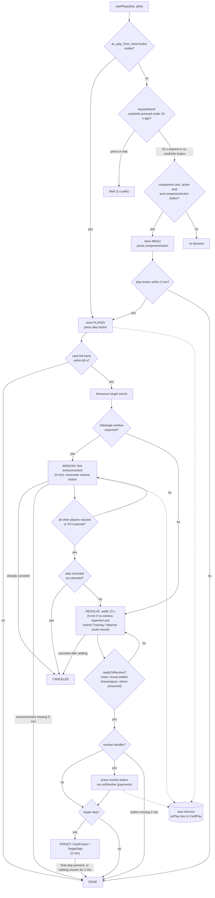
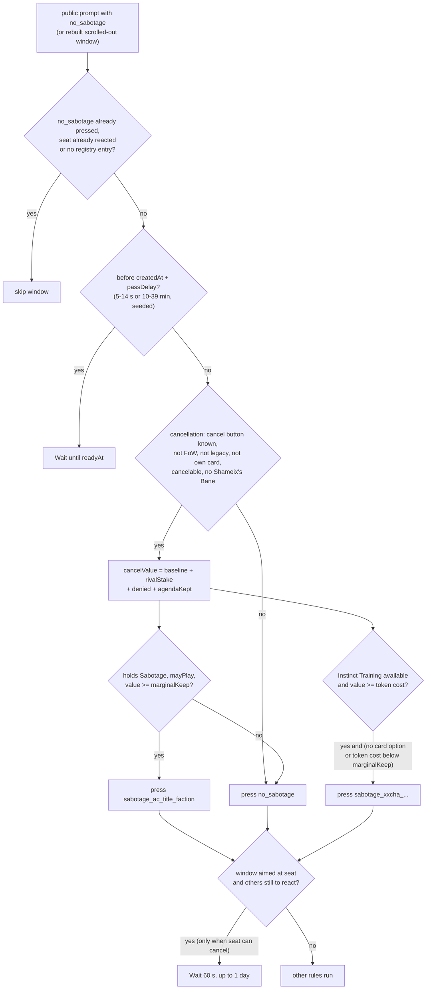

# Action cards

Part of the [AI player architecture docs](/src/main/java/ti4/ai/README.md): a living document kept next to the code (packages: actioncards). The code is the source of truth; when you change behavior here, update this file.

## Components and responsibilities

Scope: [src/main/java/ti4/ai/actioncards](/src/main/java/ti4/ai/actioncards), 58 files, about 7,350 lines,
plus the two data files [action_card_stats.json](/src/main/resources/data/ai/action_card_stats.json) and
[action_card_expert_tiers.json](/src/main/resources/data/ai/action_card_expert_tiers.json).

All units are the AI's trade good scale (1 TG = 1.0, `ValueScale.TRADE_GOOD`). "Keep prior" is
`ActionCardPrior.keepPrior(alias)`. "Stall" is `Stall.cardActionValue(game, seat)`, which is
`1.5 + Endurance.stallBonus(...)` while at least one other player has not passed and `Endurance.savesCardsForLater`
is false, otherwise 0. "Standing" is `TableStanding.of(game, seat, other)`.

Every AI decision in this package reaches the game the same way: a returned `AiDecision.Press` of a bot button, an
`AiDecision.Wait`, or an `AiDecision.Announce` (a chat line). Nothing here mutates the `Game` directly; the only
state written is the seat's AI memory (`context.memory()`), including the keys other packages read
(`TacticalRules.allowAnotherAction`, `StrategyCardRules.beginOverruledPrimary`, `PaymentRules.expect`).

---

### Card registry: `AiActionCards`, `AiCard`, `Evaluator`, `Plan`, `TargetStep`, `ActivationTest`

**Role:** informs (registry) and evaluates (each card's `Evaluator`).

**Purpose:** the single list of action cards the AI knows how to use, each with its timing window, a plan evaluator,
a keep floor, the bot handler that resolves it and the target step that answers its follow-up buttons.

**Invoked when:** looked up by every other component: `AiActionCards.of(alias)` (in `ActionCardValue` and
`ActionCardRules.startPlay` / `masterPlan`), `AiActionCards.forPlay(alias)` (adds `ShenaniganCards` for
_Confounding Legal Text_ and _Deadly Plot_; used by the `ActionCardRules` play state machine),
`AiActionCards.inWindow` and `componentCards` (`CardRecovery`),
`AiActionCards.usable` (test `StallCardPlansTest`), `AiActionCards.isComponentCard` (`ti4.ai.endurance.StallCount`),
`AiActionCards.isSabotage` (`ti4.ai.trade.TradeActionCards`, `SabotagePolicy`, `ActionCardValue`),
`AiActionCards.targetPrefixes` (via `ActionCardRules.targetPrefixes` into `NekroBrain.WINDOW_PREFIXES`, the set of
unowned public button prefixes the AI's perception keeps).

**Inputs:** a card alias from the seat's hand.

**Outputs / decisions:** an `AiCard` record: `key`, `matches` (alias predicate, so every copy of a 4-of card maps
to one entry), `window`, `evaluator`, `keepFloor`, `resolveHandler`, `targetPrefixes`, `target`, `onResolve`,
`playSuffix`. A `Plan` is `(value, target, announcement, urgent)`; `target` is a pre-chosen suffix the target step
prefers later; `urgent` makes a play skip the tactical-action comparison (only Overrule's points plays set it).

**Algorithm:**
- `AiCard.Window` values and what they mean in this package:
  `ECONOMY` and `COMPONENT_ACTION` (played as the turn's component action), `AFTER_ACTIVATION` (played by a
  non-active seat after another player activates a system; also Flank Speed for the active seat), `PRE_PLAY`
  (Summit), `AFTER_ACTION` (Master Plan), `REACTION` (Sabotage), `AGENDA_WHEN` (Veto), `AGENDA_AFTER` (riders,
  Confounding Legal Text, Deadly Plot), `COMBAT_ROUND` (Morale Boost, Fighter Prototype, Emergency Repairs, Direct
  Hit, Skilled Retreat), `HIT_ASSIGNMENT` (Shields Holding, Maneuvering Jets), `PRODUCTION` (War Machine).
- `AiActionCards.of(alias)` returns the first registered card whose `matches` accepts the alias. The registry order
  is the literal list in `AiActionCards.CARDS` followed by `CombatCards.all()` and `HitCancelCards.all()`.
- Builders wrap evaluators:
  - `AiActionCards.component(...)` and `componentOfCopies(...)` and `componentWithResolveHook(...)` wrap the
    evaluator in `withStall`, which adds `Stall.cardActionValue` to every plan.
  - `economy(...)` uses `ActionCardValue.economyPlan`, which adds the stall itself.
  - `reaction(...)` and `reactionWithPlayButton(...)` wrap the evaluator in `whenActivated`: the plan is empty
    unless `game.getActiveSystem()` resolves to a tile and the card's `ActivationTest` holds. No stall is added.
  - `combatRound`, `hitAssignment`, `production`, `afterAction` use the evaluator `NEVER` (always empty): these
    cards are started by their own rule with an explicit `Plan`, not by the generic best-play search.
- `AiCard.readyToResolve`: an `AGENDA_WHEN` card waits for `AgendaCards.revealSettled`; a shenanigan card waits for
  `ShenaniganCards.othersAnswered`; every other card is ready at once.
- `AiCard.keepFloorFor` defaults to the keep prior (`PRIOR`); Overrule uses `OverruleReserve.keepFloor`, Direct Hit
  uses `DirectHitCards.keepFloor()`.
- Summit is registered inline: window `PRE_PLAY`, plan value `2.0 × min(2, CommandTokenPolicy.gainWithinReinforcements)`
  (`SUMMIT_TOKEN_VALUE = 2.0`, `EconomyTargets.SUMMIT_TOKENS = 2`), no stall. This value only feeds
  `keepValue`; `ActionCardRules.presetSummit` pre-plays Summit without comparing it to anything.
- Flank Speed and Sabotage are registered with `NEVER`: they exist so `keepValue` and `targetPrefixes` know them,
  while `ActionCardRules.flankSpeed` and `SabotageRules` start them.

**Depends on:** every card class in the package; `ti4.ai.tactical.Stall`, `ti4.ai.eval.MoveBoost`,
`ti4.ai.nekro.CommandTokenPolicy`, `ti4.helpers.ActionCardHelper.isSabotageOrShatter`.

**Effect on the game:** none directly.

**Fallbacks:** an alias with no entry yields `Optional.empty()` everywhere; such a card is worth 0 in the hand
(`ActionCardValue.keepValue`) and is never played.

**Limitations:** the code comment in `AiActionCards` says Exchange Program is not played ("its agreement needs a
negotiation and the other way costs both players a fleet token"). _Confounding Legal Text_ and _Deadly Plot_ are
only in `ShenaniganCards`, so `AiActionCards.of` does not find them and `keepValue` returns 0 for them (see
section 10).

---

### Prior: `ActionCardPrior`, `ActionCardStats`, `ExpertTiers`

**Role:** informs.

**Purpose:** a board-independent worth for every card, from human play statistics blended with an expert tier list.

**Invoked when:** `ActionCardPrior.keepPrior` is read by `ActionCardValue` (keep values, play threshold, margins),
`CombatCardRules` (combat card margin), `ShenaniganCards.worthPlaying`, `AgendaCardRules.holdValue`,
`ActionCardValue.discardOrder` (tie-break), `ti4.ai.trade.TradeActionCards` (price of a card shown to a seat that
cannot see the hand). `ActionCardPrior.AVERAGE_CARD` (1.2) is read across `ti4.ai.agenda`, `ti4.ai.strategy`
(`CardValueScale.ACTION_CARD`), `ti4.ai.expedition.KindPricing` and `DrawnCardValue`. `cancelAppetite` is read only
by `SabotagePolicy.cancelValue`. `firstPlayRate` / `firstPlayRateOfName` are read only by tests
(`ActionCardPriorTest`, and `firstPlayRateOfName` by the `AiSelfPlayTest` report); `retrieval`
has no caller outside its own test. `ExpertTiers.strengthOfName` is also read by `ti4.ai.agenda.ExpertElectionValues`.

**Inputs:** `action_card_stats.json` (107 cards, deck `action_cards_te`; `average.impact = 30`,
`average.cancelRateWeighted = 0.0442`, `estimatedDrawsPerCopy = 1072`) and `action_card_expert_tiers.json` (62
cards, S..D, `rankInTier` 1 is best, "rankedThrough": "Overrule"). Cards are joined by display name
(`Mapper.getActionCard(alias).getName()`).

**Outputs / decisions:** per alias: `strength`, `keepPrior`, `cancelAppetite`, `firstPlayRate`, `retrieval`.

**Algorithm:**
- Human strength: `clamp(impact / 30, 0.5, 2.0)`; a card flagged `thin` is pulled halfway to 1:
  `s + 0.5 × (1 − s)`. Reference impact falls back to 30 when the file's average is 0.
- Expert strength (`ExpertTiers.strengthsFor`): tier ranges S 2.2→1.8, A 1.7→1.4, B 1.35→1.05, C 1.0→0.8,
  D 0.75→0.45; position `(rankInTier − 1) / (tierSize − 1)` (0 for a tier of one) interpolates linearly from the
  first to the second number.
- `strength(alias)`: no expert entry → human strength (or 1.0 with no stats); expert entry → mean of human and
  expert (expert alone without stats), clamped to [0.5, 2.0].
- `keepPrior = 1.2 × (0.5 + 0.5 × strength)`, so it ranges 0.9 to 1.8.
- `cancelAppetite`: 0 when `ActionCardHelper.cannotBeSabotaged(model)` (Sabotage/Shatter or not cancelable);
  1.0 for a card without stats; otherwise `min(4.0, shrunk / typical)` with
  `shrunk = (cancels + 50 × typical) / (plays + 50)` and `typical = 0.0442` (fallback 0.0442).
- `firstPlayRate`: single-copy card with `replays`: `(plays − replays) / 1072`; otherwise `playRate`.
- `retrieval`: single-copy card: `replays / (plays − replays)`; otherwise 0.065.
- Both JSON files are loaded lazily once (synchronized, volatile cache); a missing or unreadable file logs through
  `BotLogger` and yields an empty snapshot. Without the stats file, ranked cards use the expert strength alone and
  every other card has strength 1.0 (keep prior 1.2); every card's appetite is 1.0 (0 for cards that cannot be
  sabotaged). Without the tier file, the human strength is used alone.

**Example (computed from the shipped JSON):** Overrule: human 96.4/30 = 3.2 → clamped 2.0; expert S1 = 2.2; mean
2.1 → clamped 2.0; keep prior 1.8; appetite 4.0 (cap). Sabotage: no expert rank, human 40.6/30 = 1.35, keep prior
1.41. Maneuvering Jets: human 0.5 (floor), expert D16 ≈ 0.51, keep prior 0.90. Full table in section 6.

**Depends on:** `ti4.model.Mapper`, `ti4.ResourceHelper`, `ti4.json.JsonMapperManager`.

**Effect on the game:** none.

**Limitations:** the expert list stops at _Overrule_ alphabetically ("Covers cards alphabetically from Ancient
Burial Sites to Overrule; later cards are not ranked yet" in the JSON); cards after it use statistics only. The
stats describe one deck (`action_cards_te`); other decks' cards without a stats row are average cards.

---

### Valuation and hand order: `ActionCardValue`

**Role:** evaluates (and decides the discard choice when asked).

**Purpose:** what each card is worth to keep now, which card to play among the hand, the discard order, and the
"spare" card that may be sold or spent.

**Invoked when:**
- `bestComponentPlay` / `bestNewComponentPlay` / `bestReactionPlay`: from `ActionCardRules.playBeforePassing`,
  `insteadOfTacticalAction`, `afterActivation`; `wouldPlayComponent` inside `spareCard`.
- `keepValue`: `ti4.ai.agenda` (`AgendaValueMath`, `ExpertElectionValues`, `ExpertLawValues`),
  `ti4.ai.expedition.KindPricing`, `ti4.ai.explore.CodexFlow`, `ti4.ai.trade.TradeActionCards`.
- `discardOrder`: `HandPressure.forcedDiscard`, `ti4.ai.agenda.ExpertLawValues`, `ti4.ai.expedition.KindPricing`,
  `ti4.ai.trade.TradeActionCards`.
- `worstDiscard`: `NekroBrain.discardExcessActionCards` (hand limit, prefix `AC_DISCARD`),
  `ti4.ai.expedition.ExpeditionRules`, `ti4.ai.nekro.NekroLeaderRules` (agent cost), `ti4.ai.secrets.SecretCostRules`.
- `spareCard` / `hasSpareCard`: `ti4.ai.trade.CardSales`, `NekroLeaderRules`, `DrawnCardValue.malleonWantsACard`.

**Inputs:** game, seat, hand (`seat.getActionCards()`; `discardKeys` reads `ImaginedTurn.actionCards(seat)`).

**Outputs / decisions:** `Candidate(alias, value, urgent)`; keep values; an ordered discard list; an optional spare
alias; the discard button to press.

**Algorithm:**
- `bestPlay(windows)`: for each hand card registered in one of the windows, take its plan at the moment
  (`IN_TURN` or `BEFORE_PASSING`, the package-private `PlayMoment` enum); keep candidates with
  `value ≥ HandPressure.share(game, seat, moment, alias) × keepPrior(alias)`; pick the max by
  `margin = value − keepPrior`, then `value`, then the alphabetically first alias (the comparator reverses the
  alias order inside a `max`). Returns empty for a legacy
  seat (`AiSettings.usesLegacyActionCards`).
- Legacy path (`bestComponentPlay` for a legacy seat): only the six economy cards; value `playValue` without the
  stall; threshold 2.0, or 1.0 when `acCount ≥ ACLimit − 1`; max by value.
- `playValue` (economy cards, no stall):
  - Mining Initiative: `gain + ScoringStakes.scoreValue(SpendUnlock.pointDelta(gain))`, gain = the highest
    resource value of its planets, Triad excluded.
  - Industrial Initiative: same with gain = number of its industrial planets
    (`ButtonHelper.getNumberOfXTypePlanets(..., "industrial", true)`).
  - Economic Initiative: `scoreValue(SpendUnlock.pointsUnlocked(exhausted cultural planets, 0))`; `economyPlan`
    adds `ReadyingValue.of(exhausted cultural planets)`.
  - Rise of a Messiah: `0.5 + 0.5 × planets` when at least 3 eligible planets (non-space-station, no DMZ, no
    destroyed world, no Arcane Shield token), else 0.
  - Frontline Deployment: 2.0 when it has any planet. War Effort: 2.0 when `canPlaceCruiser`.
- `economyPlan`: empty when not playable (Mining/Frontline need a planet, Messiah needs ≥1 eligible planet, War
  Effort needs a cruiser tile and room under the cruiser cap); else `playValue (+ ReadyingValue for Economic) + stall`.
- `canPlaceCruiser` / `cruiserTiles`: a tile with own ships where `nonFighterShips + 1 ≤ FleetLimit.ships(seat)`,
  and on-board cruisers below the cap.
- `keepValue`: legacy seat → `LegacyKeepValue`; unregistered card → 0; Sabotage → `sabotageKeep`; otherwise
  `max(keepFloor, min(playValueFor(IN_TURN), 3.0))` (`ECONOMY_CAP = 3.0`). For component cards the play value
  includes the stall, so a playable component card is worth at least `min(stall, 3)` while others act.
- `sabotageKeep`: a Sabotage whose alias sorts after another held Sabotage is worth `0.6 × prior`
  (`EXTRA_SABOTAGE_SHARE`); the first is worth `max(prior, SabotagePolicy.reserve(game, seat, ""))`.
- `discardKeys`: sorted ascending by `keep`, then `prior`, then the (lazily computed) `playValue`, then alias. A
  thread-local guard (`RANKING_THE_HAND`) detects re-entry for the same faction (keep values can call back into the
  hand ranking through other valuators) and then uses the prior as the keep and 0 as the play value.
- `spareCard`: the first card of the discard order, when its keep is below 2.0 (`SPARE_BELOW`) and it is not the card
  `bestComponentPlay` would play now.
- `worstDiscard(prompt, prefix, suffix, usable)`: walks the discard order and returns the first enabled button whose
  handler is `prefix + handIndex + suffix`.

**Example:** hand {Mining Initiative, Plague, Sabotage}, 3 cards under a limit of 7, best planet 3 resources, no
spend objective unlocked, two opponents still acting, no Prove Endurance bonus. Mining plan = 3 + 0 + 1.5 = 4.5,
prior 1.32, margin 3.18. Plague with no infantry on a rival planet: every target scores 0, plan 0 + 1.5 = 1.5,
prior 1.14, margin 0.36. Sabotage has no component plan. `bestNewComponentPlay` returns Mining Initiative.

**Depends on:** `ScoringStakes`, `SpendUnlock`, `ReadyingValue`, `Stall`, `FleetLimit`, `BoardView`,
`ImaginedTurn`, `Thinking` (timing spans), `ButtonHelper`.

**Effect on the game:** none directly; callers press the chosen play or discard.

**Fallbacks:** unknown alias → value 0; empty hand → empty results.

**Limitations:** the `ECONOMY_CAP` of 3.0 caps the board-dependent part of every keep value, so a card that would
score a point now is still kept at no more than 3 (unless its keep floor is higher, as for Overrule and Direct Hit).

---

### Hand pressure: `HandPressure`

**Role:** evaluates (a multiplier on the play threshold).

**Purpose:** lowers the bar to play a card when the hand is nearly full or the game is ending, and drops it to 0 for
the card a full hand would discard anyway.

**Invoked when:** `ActionCardValue.bestPlay` for every candidate.

**Algorithm:** `share = 1.0`; `min(share, 0.5)` when `acCount ≥ ACLimit − 1`; `min(share, 0.5)` when
`GameHorizon.roundsLeft(game) ≤ 1` (rounds left = `ceil((goal − leader points) / 2)`, at least 1); 0 when the moment
is `BEFORE_PASSING`, `acCount ≥ ACLimit` and the alias is the first of `discardOrder`.

**Tested:** `HandPressureTest` (`aHandWellUnderTheLimitKeepsTheFullBar`,
`theCardAFullHandWouldDiscardIsFreeToPlayBeforePassing`).

---

### Play driver: `ActionCardRules`

**Role:** decides (whether to start a play now) and executes (the multi-step play).

**Purpose:** the entry points `NekroBrain` calls for every non-combat, non-agenda card play, and the state machine
that carries a play from its first press to its last target button across many ticks.

**Invoked when (verified in `NekroBrain`):**
- Rule list, in this order: `ActionCardRules::continuePlay`, `::afterActivation`, `::flankSpeed`,
  `::presetSummit` (after the leader rules, before `PromissoryRules::continuePlay`), and much later
  `ActionCardRules::holdOwnTurn` (just before `PromissoryRules::holdForCeasefire` and `takeTurn`).
- Inside `NekroBrain.takeTurn`: `ActionCardRules.masterPlan(context, secondActionIsWorthIt(...))` after a primary
  has resolved and before the second action; `ActionCardRules.insteadOfTacticalAction` after
  `StrategyCardTurn.playIfDue` and before `TechRules.insteadOfTacticalAction` and `TacticalRules.start`;
  `ActionCardRules.playBeforePassing` after no tactical action and no strategic action remain, before the other
  `beforePassing` rules and the pass.
- `ActionCardRules.startPlay` is also called by `CombatCardRules`, `DirectHitRules`, `HitCancelCards`,
  `ProductionCards`, `ShenaniganCards`.
- `mayPlayNow` is read by `CombatCardRules`, `DirectHitRules`, `HitCancelCards`, `AgendaCardRules`,
  `ShenaniganCards`, `ProductionCards`, `StrategizeCard`, `ti4.ai.strategy.OverruleChoice`.
- `holdsPlayableStrategize` / `strategizeSecondaryWorthAToken`: `ti4.ai.nekro.CommandTokenPolicy`,
  `ti4.ai.strategy.TokenPurchase`, `ti4.ai.strategy.TokenPlan`. `frontlineValue`: `ti4.ai.promissory.NoteOffers`.

**Inputs:** `AiTurnContext` (game, seat, memory, prompts, now, active-player flag).

**Outputs / decisions:** an `AiDecision` (press, wait, announce) or empty.

**Algorithm (entry gates):**
- `mayPlay`: false when the seat is elected under _Censure_ (`censure`, `absol_censure`), over the hand limit
  (`ButtonHelper.isPlayerOverLimit`), or passed while the active player owns Transparasteel Plating (`tp`).
  `mayPlayNow` adds: not a legacy seat, and not `keepsSpyNetworkCards` (the unscored secret objective _Form a Spy
  Network_ is held and `acCount ≤ SpyNetwork.CARDS` = 5). `flankSpeed` and `presetSummit` check only `mayPlay`, so
  they still run while the Spy Network hold is on; `presetSummit` also runs for a legacy seat.
- `playBeforePassing`: memory key `acPlay|turn:<turnKey>` unused, `mayPlay`, not Spy Network → best component play
  at `BEFORE_PASSING`; no comparison with anything else (the tactical and strategic options are already exhausted
  at that point in `takeTurn`). It is the only turn-time entry point a legacy seat reaches (through the legacy branch
  of `ActionCardValue.bestComponentPlay`); the only other play a legacy seat makes is the Summit pre-play.
- `insteadOfTacticalAction`: same gates; best component play at `IN_TURN`; if the plan is not urgent and the
  tactical plan's `score ≥ card value` it returns empty. The tactical plan is `TacticalRules.rememberedPlan` or,
  if none, `TacticalPlanner.best(game, seat)` (then remembered).
- `afterActivation`: seat is not the active player, not legacy, phase "action", active system set and on the map,
  key `acPlay|msg:<turnKey>@<activeSystem>` unused, `mayPlay`, not Spy Network →
  `bestReactionPlay(AFTER_ACTIVATION)` (Forward Supply Base, Counterstroke).
- `flankSpeed`: active player, not legacy, phase "action", active system set, stored value `flankspeedBoost`
  empty, `TacticalRules.activatedThisTurn`, turn key unused, `mayPlay`, holds a Flank Speed
  (`MoveBoost.flankSpeedCard`), and the remembered tactical plan targets the active system and
  `TacticalPlanner.needsFlankSpeed` (some non-fighter ship cannot reach the target without the extra move).
- `masterPlan`: `secondActionIsWorthIt` from `NekroBrain`, key `acPlay|plan:<turnKey>` unused, not legacy,
  `mayPlay`, not Spy Network → the alphabetically first held `AFTER_ACTION` card (Master Plan).
- `presetSummit`: holds `summit`, `mayPlay`, no active Summit play remembered; if stored value `Summit` already
  contains the faction it only records a `PRESET` play; else requires
  `CommandTokenPolicy.gainWithinReinforcements ≥ 1` and presses the hidden unowned `resolvePreassignment_Summit`.
- `holdOwnTurn`: while the active seat has an active play under its turn or Master Plan key → `Wait(now + 60 s)`.

**Algorithm (`startPlay`):** look up the hand index; find the hidden unowned button
`Constants.AC_PLAY_FROM_HAND + index + playSuffix` (`ActionCardHand.playButton`); if found, store a `PLAYED`
`CardPlay` (recording `windowExpected = SabotageWindow.expected(...)` and the current count of recorded plays),
remember the announcement text and press. If the button is not visible, `ActionCardHand.requestHand` presses
`cardsInfo` once and waits (polls every 3 s, up to 20 s). After that, a component card opens the
`componentAction` menu (active seat only, stage `MENU`); other cards give up.

**Algorithm (state machine `advance`, called by `continuePlay` for every active key):** first
`CardRecovery.recover`. Keys scanned: turn, Master Plan, Summit, agenda, every `acPlay|msg:`, `acPlay|build:`,
`acPlay|combat:` key. A combat key whose system is no longer active (or phase is not "action") is `CANCELED`.
- `MENU`: card gone from hand → `DONE`; play button visible (posted since the menu press, 5 s clock skew) →
  `PLAYED` and press; else after 2 min → `DONE`.
- `PRESET` (Summit): waits until the card leaves the hand; censured → `DONE`; else `WINDOW` if a Sabotage window is
  expected, otherwise `RESOLVE`.
- `PLAYED`: card still in hand after 60 s → `DONE`. Once gone, emit the stored announcement once
  (`AiDecision.Announce`), then `WINDOW` or `RESOLVE`.
- `WINDOW`: canceled (a later recorded play of this title by this seat marked canceled) → `CANCELED`. Find the
  announcement message (newest public prompt since play − 5 s with the seat's `moveAlongAfterAllHaveReactedToAC_`
  button, or both `sabotage_ac_<title>_<faction>` and `no_sabotage`); missing for 5 min → `DONE`. Remember the
  resolve button. Wait while `SabotageWindow.open` (some other real player has not reacted, or the registry has no
  entry yet and less than 15 s passed) unless 24 h passed; then re-check cancel → `RESOLVE`.
- `RESOLVE`: card unknown or seat censured → `DONE`. Wait the settle time (10 s; 5 min when no window was expected
  but another player could cancel with Instinct Training or the Watcher mech, `SabotageService`). Canceled →
  `CANCELED`. Wait for `readyToResolve`. No resolve handler → next stage directly. Otherwise press the seat-owned
  public button matching the handler (or the remembered one from `acResolveRef|<key>`); missing for 2 min → `DONE`.
  Runs `onResolve` (Impersonation and Pirate Fleet register their expected payment with `PaymentRules.expect`).
  Next stage is `TARGET` when the card has a target step, else `DONE`.
- `TARGET`: the card's `TargetStep`; nothing chosen for 2 min → `DONE`.

**Depends on:** `ActionCardValue`, `PlayMemory`, `CardPlay`, `SabotageWindow`, `CardPrompts`, `CardRecovery`,
`ActionCardHand`, `TacticalRules`, `TacticalPlanner`, `MoveBoost`, `CommandTokenPolicy`, `SpyNetwork`,
`IsPlayerElectedService`, `SabotageService`, `ButtonHelper`.

**Effect on the game:** presses the bot's own play, menu, resolve and target buttons; posts one announcement line
per targeted play.

**Fallbacks:** `MENU`, `PLAYED`, the announcement search in `WINDOW`, the resolve-button search in `RESOLVE` and
`TARGET` time out to `DONE`; the 24 h window ceiling moves on to `RESOLVE` instead. `PRESET` (waiting for Summit to
leave the hand) and the `readyToResolve` wait in `RESOLVE` have no timeout. A timed-out play is not retried in the
same scope because its memory key is still present; seat memory holds at most 500 entries (`AiMemory.MAX_ENTRIES`,
oldest evicted first), so an old key can eventually disappear.

**Tested:** `ActionCardRulesTest` (e.g. `waitsForTheSabotageWindowBeforeResolving`, `neverResolvesASabotagedCard`,
`resolvesAButtonThatScrolledOutOfView`, `picksUpAPlayAfterLosingItsMemory`, `keepsItsCardsForFormASpyNetwork`,
`playsACardThatGainsNothingAsAPureStallWhileOthersStillAct`,
`keepsACardThatIsNotWorthPlayingOnceEveryOtherPlayerHasPassed`), `ComponentCardFlowTest`, `StallCardFlowTest`.

---

#### Diagram: A card play from start to resolution (`ActionCardRules`)

Control flow is solid; data stored in seat memory is dotted.



### Play record and memory: `CardPlay`, `PlayMemory`, `ActionCardHand`, `CardPrompts`

**Role:** informs (state) and executes (button lookups).

**Purpose:** persist a play across ticks in seat memory, and find the buttons a play needs.

**Algorithm:**
- `CardPlay` encodes 8 `~`-separated fields: stage, since, playedAt, alias, announcementId, windowExpected,
  playsBefore, extra (the plan target). Decoding rejects a wrong field count or non-numeric numbers.
- `PlayMemory` keys: `acPlay|turn:<turnKey>`, `acPlay|plan:<turnKey>`, `acPlay|summit`,
  `acPlay|agenda:<currentAgendaInfo>`, `acPlay|msg:<turnKey>@<activeSystem>`, `acPlay|build:<scope>`,
  `acPlay|combat:<position>@<holder>#<round>:start`; announcements under `acAnnounce|<key>`. `turnKey` is
  `activePlayerID@lastActivePlayerChange`.
- `CardPrompts.targetOffers`: unowned enabled buttons with the prefix in public prompts posted since the play
  (−5 s) that mention the seat; `unmentionedTargetOffers` drops the mention requirement and counts from the start
  of the current stage (`play.since() − 5 s`) instead of the play time; `ownedOffers` takes
  seat-owned buttons. `matches(handler, prefix)` is a prefix match when the prefix ends with `_` or `@`, else
  equality. `CardPrompts.choose` takes the offer equal to the planned suffix if present, else the max by the value
  function, ties to the alphabetically lower suffix.
- `CardChains.chain(links...)`: for multi-step targets, scans the links from the last to the first and presses the
  first link that has offers with value > −∞; pressing the `last` link marks the play `DONE`. The plan target is
  split on `|` and part *i* is the planned suffix for link *i*.

---

### Sabotage windows: `SabotageRules`

**Role:** executes (and decides pass versus cancel via `SabotagePolicy`).

**Purpose:** answer every Sabotage window of another player's card, with a delay that does not depend on the hand.

**Invoked when:** `NekroBrain` rules `SabotageRules::answerWindowsAimedAtSeat`, `SabotageRules::followUp`,
`SabotageRules::answerWindows`, in that order, after `ActionCardResponses::respond` and before the combat and turn
rules.

**Inputs:** public prompts with an enabled `no_sabotage` button; `GameMessageManager` entries of type
`ACTION_CARD` (which factions reacted); seat profile seed.

**Outputs / decisions:** `Wait` until the seat's ready time; then press `sabotage_ac_<title>_<faction>`, the
Instinct Training button `sabotage_xxcha_<title>_<faction>`, or `no_sabotage`.

**Algorithm:**
- `windows`: newest-first public prompts with an enabled `no_sabotage`; each one's cancel button custom id is
  remembered under `saboBtn|<messageId>`. Windows from `GameMessageManager` that are no longer visible and that the
  seat has not reacted to are rebuilt as synthetic prompts (with the remembered cancel button when known).
- `answer`: skip if `no_sabotage` was already pressed or the window is closed for the seat (its faction is in
  `factionsThatReacted`, or the window has no registry entry). `readyAt = createdAt + passDelay`; before that →
  `Wait(readyAt)`. Then `cancelChoice` (skipped when Instinct Training was already spent on this window) or press
  `no_sabotage`. Windows are answered newest first and the first window still inside its delay returns its `Wait`,
  so an older window whose delay has passed is answered only after the newer one. Because `NekroBrain` takes the
  first rule that returns a decision, this `Wait` also holds every rule listed after the Sabotage rules (combat,
  agenda voting, the seat's own turn) until the delay expires.
- `passDelay`: `seed = messageId.hashCode() ^ (int) profile.seed()` (`AiProfile.seed` is a non-negative random long
  drawn when the AI seat is created and stored in the seat's `aiSeed` stored value). When the game is self-play
  (`AiSeats.isSelfPlay`) or every human other than the card player has reacted: `5 + floorMod(seed, 10)` seconds
  (5–14 s). Otherwise `10 + floorMod(messageId.hashCode() ^ profile.seed(), 30)` minutes (10–39 min). The delay is
  computed before, and independently of, the cancel decision.
- `answerWindowsAimedAtSeat`: only windows where `SabotagePolicy.aimedAtSeat` holds (requires the seat to be able to
  cancel, with a Sabotage or Instinct Training). Same `answer`; if the seat already answered and some non-card-player
  faction has not reacted and the window is younger than one day → `Wait(now + 60 s)` ("a Sabotage window aimed at
  it").
- `followUp` (active seat, not legacy): if the latest _Crisis_ play was canceled, press unowned
  `crisisSabotaged_<color>` posted this turn; if the latest _Coup d'Etat_ was canceled and a prompt this turn
  mentions the seat with "have been Coup'd", play its unplayed strategy card via `StrategyCardRules.play` (once per
  turn, key `saboFollowUp|<turnKey>`).

**Tested:** `SabotagePolicyTest.waitsTheSameWhateverItWillPress` (the `Wait` time is identical for an Overrule it
would cancel and the same window with an empty hand), `pressesTheSabotageButtonInsteadOfNoSabotage`,
`doesNotPressOnAWindowThatHasClosed`, `cancelsAWindowThatScrolledOutAfterItWasSeen`,
`holdsItsTurnWhileAWindowAimedAtItIsStillOpen`, `pressesCrisisSabotagedWhenCrisisWasCancelled`;
`SabotagePassDelayTest.keepsWaitingWhileAHumanHasNotAnswered`, `passesQuicklyOnceEveryHumanHasAnswered`.

---

### Sabotage decision: `SabotagePolicy`, `Involvement`, `TableStanding`, `CardScoring`, `InstinctTraining`, `EarlyDeadlyPlot` (part)

**Role:** decides (cancel or not, and with what) and evaluates (cancel value).

**Purpose:** compare what cancelling the card is worth with what the Sabotage (or Instinct Training token) is worth
to keep.

**Invoked when:** `SabotageRules.cancelChoice` → `SabotagePolicy.choose`; `SabotageRules.answerWindowsAimedAtSeat`
→ `aimedAtSeat`; `cardPlayerFaction` from `SabotageRules`. `SabotagePolicy.reserve` from
`ActionCardValue.sabotageKeep`. `cancelWith` is public but has no caller outside tests.

**Inputs:** the window's cancel button `sabotage_ac_<title>_<cardPlayerFactionOrColor>`; seat hand; scoring stakes.

**Outputs / decisions:** `Choice(prompt, button, reason, instinctTraining)` or empty (pass).

**Algorithm:**
- `cancellation`: empty for a legacy seat or in Fog of War; requires the enabled unowned `sabotage_ac_` button;
  title and card player parsed from the handler; card player must exist and not be the seat; not blocked by
  Shameix's Bane (`SabotageService.isShameixBaneCancellationBlocked`); the title must map to a card that can be
  sabotaged.
- `mayCancelWithCard`: holds a Sabotage and `ActionCardRules.mayPlay` (note: the Spy Network hold does not apply).
  The Instinct Training option is not gated by `mayPlay`, so a censured, over-the-limit or Transparasteel-blocked
  seat can still cancel with the token.
- `cancelValue = baseline + rival + denied + agendaKept`:
  - `baseline = 1.2 × cancelAppetite(alias) × Involvement.level × TableStanding.of(seat, cardPlayer)`.
  - `Involvement.level`: 1.0 when aimed at the seat; else 0.6 when the phase contains "agenda"; else 0.35.
    Aimed at the seat: _Coup d'Etat_, _Extreme Duress_, _Crisis_ while the seat is the active player; _Public
    Disgrace_ while the seat is active in the strategy phase; one of 25 combat card titles when both the seat and the
    card player have units in the active system.
  - `TableStanding.of`: 3.0 when `ScoringStakes.contender(seat, other)`; 1.3 when the other is alone in the lead and
    ahead of the seat; 0.6 when the other is 2 or more points behind the seat; else 1.0.
  - `rival = CardScoring.rivalStake(title, cardPlayer)`: `ScoringStakes.rivalStake(cardPlayer, pointsFor(title))`
    (full score value when those points reach the goal, else a quarter); for _Imperial Rider_:
    `chance × rivalStake(cardPlayer, 1)` with the chance from `AgendaForecast.riderOutcome` (0.6 when unplaced).
    `pointsFor`: Overrule → `ScoringStakes.overrulePoints`; Imperial Rider 0.6; Political Stability, Puppets on a
    String, Master Plan → 0.5 while the player holds an unplayed Imperial; Mining/Industrial/Economic Initiative →
    the spend-objective points they unlock; Uprising → `SpendUnlock.pointDelta(2)`; Focused Research, Divert
    Funding, Plagiarize → 1 when a public objective is one technology short; else 0.
  - `denied` (only when aimed at the seat): `ScoringStakes.scoreValue(seat, pointsDenied(title))`. `pointsDenied`:
    combat cards → `SystemStake.points` of the active system; Public Disgrace/Coup/Crisis → the best stake of the
    seat's unplayed strategy cards (Imperial: 1 if ≥2 scorable publics, +1 if it controls Mecatol Rex; other cards 1
    if their ranking value ≥ one victory point); Extreme Duress → points lost by losing all trade goods;
    Confounding Legal Text, Deadly Plot, Veto, Assassinate Representative → 1 when
    `AgendaPolicy.wouldElectToAPoint`.
  - `agendaKept`: when experiment `AGENDA_SABOTAGE` is on (default) and `AgendaSwing.changesTheAgenda(title)`:
    `−AgendaSwing.forViewer(seat, title, cardPlayer)`.
- `marginalKeep(title)`: no Sabotage → `Double.MAX_VALUE`; two or more → `0.6 × prior(first sorted)`; one →
  `max(prior, reserve(title))`.
- `reserve(title)`: 4.0 when any opponent is a contender; at least 3.0 when the title is not Overrule and
  `overruleUnseen` (not purged, not in the seat's hand, in the deck, not in the discard pile, never recorded as
  played).
- `choose`: card option when `mayCancelWithCard` and `cancelValue ≥ marginalKeep`; token option when
  `InstinctTraining.available` (tech `it` ready, `StrategyTokenCost.toSpend` present, unowned button
  `sabotage_xxcha_<title>_<faction>` visible) and `cancelValue ≥ token cost`. The token is chosen when present and
  either no card option exists or `token cost < marginalKeep`; otherwise the card option.

**Example:** quiet table (no contender, Overrule already played), an uninvolved seat holds one Sabotage
(`marginalKeep = 1.41`), a player at even standing plays _Parley_ in another system: baseline
`1.2 × 3.44 × 0.35 × 1.0 = 1.44 ≥ 1.41` → cancel. The same card from a player 2 points behind the seat:
`× 0.6 = 0.87` → pass. `SabotagePolicyTest.anUninvolvedSeatSpendsItsSabotageOnTheCardsHumansCancelMostOnceOverruleIsPlayed`
lists exactly Confounding Legal Text, Imperial Rider, Lie in Wait, Overrule, Parley, Political Stability, Rout.

**Tested:** `SabotagePolicyTest` (34 tests including `theBaselineGrid`, `cancelsOverruleByAPlayerWhoCouldWinWithIt`,
`keepsItsLastSabotageForAContendersImportantCards`, `neverCancelsWhenShameixsBaneBlocksIt`, `aLegacySeatNeverCancels`),
`InstinctTrainingTest`, `InvolvementTest`, `CardScoringTest`, `AgendaSabotageTest`.

---

#### Diagram: Answering a Sabotage window (`SabotageRules`, `SabotagePolicy`)



### Overrule: `OverruleCard`, `OverruleReserve`

**Role:** evaluates and decides (target strategy card).

**Purpose:** play Overrule on an unplayed Imperial or Technology when the use is worth the card's reserve.

**Invoked when:** as a `COMPONENT_ACTION` card through `ActionCardValue.bestPlay`; its target step from
`ActionCardRules.target`.

**Algorithm:**
- Options from `ti4.ai.strategy.OverruleChoice.option` per unplayed initiative, only Imperial and Technology
  (`OverruleChoice.PLAYABLE`). Imperial: `scoreValue(overrulePlay.points) + secret draw value (when it does not
  hold Mecatol Rex and a draw is worth it) + 0.5`; points play when ≥1 point or a win. Technology:
  `StrategyCardPlanner` plan value + 0.16. Plus the stall (component builder).
- `OverruleReserve.active(moment)`: true when `ScoringStakes.contenderExists` is false (no non-eliminated player
  is within 2 points of the goal; this test ignores points in reach); else false at `BEFORE_PASSING`; else true
  when the seat can win with the card (`ScoringStakes.contender(seat, seat)`, or points + points in reach + 1 ≥
  goal).
- `keptOptions`: at `IN_TURN`, if `OverruleChoice.takesMecatolFirst` → only winning options. If reserved and not
  `ScoringStakes.lateGame` (nobody within 4 points) → only winning options. Otherwise options that are a points
  play, or any option when not reserved, or with `value ≥ 10.8` (`0.9 × 12`).
- Plan value is the best kept option; a points play is `urgent` (skips the tactical comparison).
- Keep floor `OverruleReserve.keepFloor`: 10.8 while `active(IN_TURN)`, else the keep prior.
- Target step `winnuHero_<initiative>_overrule` (`Source.ANYONE`): the planned initiative, or any kept option, or
  any option when none is kept; on press it calls `StrategyCardRules.beginOverruledPrimary`.
- Plan is empty in Fog of War.

**Tested:** `OverruleCardTest` (33 tests; not individually reviewed here beyond its names).

---

### Strategize: `StrategizeCard`

**Role:** evaluates and executes the follow step.

**Algorithm:** empty in Fog of War. Ordinary plan (strategy CC ≥ 1): rank each unplayed strategy card not held by
another player by `StrategyCardRules.secondaryValue` (Imperial, Diplomacy, Construction, Warfare, Politics, Trade;
Technology and Leadership return empty), best first; requires `StrategyCardRules.hasSpareStrategyToken`; value =
best − 1.0 (`CardFacade.strategyToken()`). At `BEFORE_PASSING` also `CardFacade.stalledLeadershipValue`
(Leadership secondary to buy tokens, target `LEADERSHIP` with a `+` when a strategy token is spent). Step: in
public prompts since the play that mention the seat, try the Leadership step when planned, else
`StrategyCardRules.startSecondary` for the planned card first and then the others in ranked order.
`secondaryWorthAToken`: playable and best secondary value > 1.0. Strategize is built with
`AiActionCards.componentOfCopies`, so the stall is added to both plans; a plan is the max of the ordinary and the
stalled-Leadership plan.

**Tested:** `StrategizeCardTest`, `StrategizeTokensTest`, `StrategizeLeadershipTest`
(e.g. `whenOutOfTacticTokensWithLeadershipStillToComeStrategizeBuysTokensInsteadOfPassing`,
`theSameSituationDuringTheTurnPlaysNothing`).

---

### Component card evaluators (target and value per card)

**Role:** evaluate (plan value and target) and execute (target step). All add the stall (component builder) unless
noted. All plan functions return empty when the card has no legal target. Spy, Insubordination and Forward Supply
Base live in [PlayerTargetCards](/src/main/java/ti4/ai/actioncards/PlayerTargetCards.java) (`spyPlan`,
`insubordinationPlan`, `forwardSupplyBasePlan` and a shared faction-choice target step), registered in
`AiActionCards.CARDS`.

| Card (alias) | Plan value | Target / step | FoW guard |
| --- | --- | --- | --- |
| Spy (`spy`) | `1.2 × standing(target)` | max by contender, AC count, VP, faction reverse; step `spyStep2_` weights contender 100,000 + AC×100 + VP | no |
| Insubordination (`insub`) | `(0.75 + lostBuild) × standing`; lostBuild = `0.3 × min(unspent R+TG, 6)` when the target has exactly 1 tactic token, has not passed, has a dock and ≥3 unspent | target with tactic CC > 0 and not passed; contender first, then value, VP, tactic CC | no |
| Forward Supply Base (`fsb`, AFTER_ACTIVATION, no stall) | 3.0 | when another player activates a system containing the seat's units; trade good to the fewest-points player other than the active player when possible | no |
| Uprising (`uprising`) | `R + scoreValue(pointDelta(R)) + (owner not passed ? 0.25 × (R+I) × standing : 0) + rivalStake(owner, pointsLostByExhausting)` | readied non-home planet of another player; two steps (owner, planet) | no |
| Archaeological Expedition (`arch_expedition`) | `3 × mean fragment value per card` of the industrial/cultural/hazardous deck (discard when empty) for a trait it owns | `arcExp_<type>` | no |
| Ghost Ship (`ghost_ship`) | `1 + (next to/in own fleet ? 1 : 0) + 0.5 × max(0, objective gain of a destroyer there) + Mallice access 1` | wormhole non-home system without other ships, within fleet pool, destroyer in reinforcements | no |
| Exploration Probe (`probe`) | 1.5 (`ExploreValues.FRONTIER_CARD`) | frontier token in or next to own ships, lowest position string | no |
| Fighter Conscription (`f_conscription`) | `0.5 × min(eligible systems, fighter room)` | none | no |
| Refit Troops (`refit`) | `(2.0 − 0.7) × swaps`, swaps ≤ min(2, mech room) | its infantry planets by planet value, spread one per planet first; step presses `mitoMechPlacement_..._refit` until the list is empty | no |
| Focused Research (`f_researched`) | `ResearchPolicy.worthWithPoints(best researchable) − 4` | needs 4 TG after `ScoringReserve`; not when `StrategyCardRules.cannotResearch` | no |
| Divert Funding (`divert_funding`) | `worthWithPoints(best, researchValue − heldValue(returned))` | returns the lowest `heldValue` non-unit-upgrade, non-faction tech | no |
| Plagiarize (`plagiarize`) | `worthWithPoints(tech) − InfluencePayments.cost(5 influence)` | best copyable tech from the bot's own `getPlagiarizeButtons`; the copy step registers the payment with `PaymentRules.expect` | no |
| Impersonation (`impersonation`) | `SecretDrawValue − InfluencePayments.cost(3 influence)` | none; payment registered on resolve | no |
| Unexpected Action (`unexpected`) | `max(0, CardFacade.tokenUnlockGain(best own-token system))` | own token only | yes |
| Signal Jamming (`jamming`) | `interest × standing + DenialMap.locked` per (player, origin, system); interest = `0.3 × value of planets the player lacks + 1 for Mecatol Rex` when the player has ships in/next to it and tactic CC > 0 | three-step chain | yes |
| Pirate Contract (`piratecontract1-4`) | `max(block, max(setup, dust))` when that best is > 0, else block; block = −∞ next to own presence, else `min(3, Σ 0.5 × standing of rivals nearby)`; setup `NeutralSetups.value` (0 at BEFORE_PASSING); dust `DustTarget.value` | legal pirate system | yes |
| Pirate Fleet (`piratefleet`) | `max(block, setup − 3)` when `setup > 0`, else block; block = `2 × 3.0 − 3` when a contender is nearby and not on own routes, else −∞ | needs 3 resources after `ScoringReserve`; payment registered | yes |
| Mercenary Contract (`mercenarycontract`) | `rivalStake(owner, lostPoints) + 0.3 × planetValue − 2` | only a contender's empty non-home planet among the first 22 candidates; needs 2 TG | yes |
| Cripple Defenses (`cripple`) | `1.0 × PDS on planet × standing` | rival planet without own PDS | yes |
| Plague (`plague`) | `0.5 × infantry × 0.5 × standing` | rival planet without own ground forces | yes |
| Unstable Planet (`unstable`) | `((readied ? 0.5 × planetValue : 0) + 0.5 × min(3, owner infantry)) × standing` | rival hazardous planet without own ground forces | yes |
| Reactor Meltdown (`meltdown`) | `dockValue × standing` (4.0 through round 3, then 2.0) | rival non-home dock, not Custodia/Ghoti | yes |
| Tactical Bombardment (`tactical`) | `Σ 0.5 × planetValue × standing` of readied rival planets | systems with own BOMBARDMENT units | yes |
| Lucky Shot (`lucky`) | `cost × standing` of the best rival dreadnought/cruiser/destroyer (+0.5 damaged in step) | system with a planet it controls | yes |
| Scuttle (`scuttle`) | `0.2 × cost + scoreValue(pointDelta(cost))` | own ship in a system with no enemies, not active, no own planet; a lone ship only if objectives do not lose | yes |
| Seize Artifact (`seize`) | `fragmentValue × (1 + 0.5 × standing)` | neighbour with fragments | yes |
| Repeal Law (`repeal`) | law harm: 3.0 for a law punishing the elected seat; 1.5 for a law punishing its planet; for a law favouring a rival: `rivalStake(1) × standing` for a point law, else `0.5 × standing` | only laws with harm > 0 | yes |
| Brilliance (`brilliance`) | ready a spent tech-skip planet (`ReadyingValue`), or own breakthrough 2.0, or another non-contender's breakthrough `−VP × 0.001` | best option | yes |
| Counterstroke (`counterstroke`, AFTER_ACTIVATION, no stall) | `CardFacade.returnedTacticToken + max(0, tokenUnlockGain(active system))` (token ≥ 1.5) | condition: the activated system holds the seat's token; play button id gets suffix `_counterstroke_<position>` | no |

**Tested:** `ComponentCardPlansTest`, `StallCardPlansTest`, `ResearchCardTest`, `SecretCardTest`,
`NeutralUnitCardsTest`, `DustTargetTest`, `SignalJammingWinBreakTest`, `CounterstrokeCardTest`.

**Limitations:** see section 10 (FoW guards are partial; probe ignores value differences; Mercenary Contract scans
only 22 planets).

---

### Summit, War Machine, Master Plan, Flank Speed

- **Summit** (`EconomyTargets.summitTokens`): after resolve, on the seat's "Done Gaining" prompt it presses
  `CommandTokenPolicy.poolToGrow` until `netGainSoFar ≥ min(2, gainWithinReinforcements)` (fixed when first seen,
  stored in `extra`), then "Done Gaining". Tested: `ActionCardRulesTest.preplaysSummitAndCollectsItsTokens`.
- **War Machine** (`ProductionCards`): no evaluator. `TacticalRules.plannedBuild` asks
  `ProductionPlanner.warMachinePlan` (outside scope) for a boosted build when `holdsWarMachine`; then
  `TacticalRules.warMachine` calls `ProductionCards.playWarMachine` (key `acPlay|build:<scope>`, `Plan.of(0)`),
  waits while `PENDING`, and on `SETTLED` builds with or without the boost depending on `WAR_MACHINE_SPENT`.
- **Master Plan** (`ExtraActionCard.masterPlan`): played by `ActionCardRules.masterPlan`; its target step calls
  `TacticalRules.allowAnotherAction` and marks the play `DONE`. Tested: `MasterPlanCardTest`.
- **Flank Speed**: played by `ActionCardRules.flankSpeed`; its value lives in `TacticalPlanner.flankSpeedPlans`
  (outside scope): with one extra move it computes the best plan for every activatable system plus staging plans
  toward Fracture systems, keeps only plans where `needsFlankSpeed` holds, and charges 1.5 on their score.
- **Frontline Deployment** (`EconomyTargets.frontline`): among the seat-owned `placeOneNDone_skipbuild_3gf_<planet>`
  buttons it takes the max of `0.25 × (R + I) + 3.0 (own dock or a capacity ship in the system) + 2.0 (enemy ships
  in an adjacent system) − max(0, own ground forces there − 2)`; ties to the alphabetically first handler.
  `ActionCardRules.frontlineValue` exposes the same value to `ti4.ai.promissory.NoteOffers`.
- **War Effort** (`EconomyTargets.warEffort`): among the seat-owned `placeOneNDone_skipbuild_cruiser_<position>`
  buttons whose system is in `ActionCardValue.cruiserTiles`, the max of `own non-fighter ships + 10 (enemy ships
  adjacent) + 1 (home system)`. The play is marked `DONE` as soon as any cruiser button is offered, even when none
  of them is a legal tile, in which case nothing is pressed.

---

### Agenda cards: `AgendaCardRules`, `AgendaCards`, `ShenaniganCards`, `EarlyDeadlyPlot`

**Role:** decide and execute.

**Invoked when:** `NekroBrain.declineWhens` → `AgendaCardRules.holdsPlayedVeto`, `queueVeto`, `awaitVetoBounty`;
`NekroBrain.declineAfters` → `holdsUnplacedRider`, `queueRider`; rule `AgendaCardRules::riders` (before
`declineAfters`); `ti4.ai.runtime.AiStallDetector` → `vetoPlayedAndPending`; `ti4.ai.trade.DiscardBountyDeals` →
`holdsVeto`, `holdsDeadlyPlot`; `ti4.ai.trade.PromiseDeals` → `holdsUnplacedRider`; `ti4.ai.agenda.ShenanigansRules.react`
→ `ShenaniganCards.playIfWorthIt`, `playing`.

**Algorithm:**
- Veto: queue (`queueWhen_ac_<alias>`, else open `queueAWhen`) when phase `agendawaiting`, whens not resolved, no
  queued when, `mayPlayNow`, holds a Veto and `AgendaPolicy.veryBadFor` or `worthDiscardingFor(vetoBounty)`. The
  played Veto is recovered by `CardRecovery.recoverAgenda` (resolve handler `resolveVeto`) and resolved after the
  window and `AgendaCards.revealSettled` (7 s after `lastAgendaReactTime`, or the stamp is more than 60 s in the
  future). `holdsPlayedVeto` (a Veto sits in the seat's queued-when slot, whens are still open and it was not
  cancelled) blocks passing on whens while the tracked agenda play is active, or for up to 5 min from first sight
  when no play is tracked.
- Riders (Imperial, Trade, Politics, Technology, Leadership only): `queueRider` when phase `agendawaiting`, no rider
  entry this agenda, no queued after, `mayPlayNow`, `PromisedVotes.forbidsRider` false. `bestRider`: forecast
  (`AgendaForecast.of`) must enumerate outcomes; for each rider and outcome
  `gain = ridden.expectedUtility(seat, keptVote) − baseline value`; keep `gain ≥ holdValue` (prior, or for Imperial
  with experiments `AGENDA_VALUE_TABLE` and `IMPERIAL_RIDER_HOLD`: `max(prior, 0.5 × scoreValue(1))` and also
  `chance × RiderPayoff(IMPERIAL) ≥ that`); max gain. `riders`: drop a queued rider once voting starts, lock it in
  (`lockAftersIn`) while waiting, and place a played rider on the button with the best gain (the first offered
  button when the forecast is empty). `holdsUnplacedRider` keeps `declineAfters` from passing for up to 5 min after
  the rider play is first seen, until it is placed or cancelled.
- Confounding Legal Text / Deadly Plot (`ShenaniganCards`, experiment `AGENDA_SABOTAGE`): in phase `agendaEnd`,
  when the bot asks for the shenanigans confirmation. Legal: a current winner exists; Confounding needs the seat
  electable and not the winner; Deadly Plot needs the seat to have backed another outcome and either the final agenda,
  a Deadly Plot bounty, or `EarlyDeadlyPlot.worthDiscarding` (points go only to others, or a rival doing well gains
  utility ≥ its VP worth). `gain = AgendaSwing.forViewer + bounty (− lost second-agenda votes × 0.8 for an early
  Deadly Plot)`; play when `gain ≥ keepPrior`. Step: press `autoresolve_manual` on the "Resolve with Current Winner"
  prompt, then `agendaResolution_<faction>` (Confounding) or `resolveWithNoEffect` (Deadly Plot); waits until every
  other player answered the shenanigans prompts. `playIfWorthIt` does not check the experiment itself;
  `ShenanigansRules.playInstead` does. When a held Deadly Plot is not worth playing, `ShenanigansRules` calls
  `DiscardBounties.awaitDeadlyPlotOffers` (outside scope) before pressing its "No" confirmation.

**Tested:** `VetoCardTest`, `AgendaCardRulesTest`, `AgendaSabotageTest`, `AgendaRevealClockTest`.

---

### Combat cards: `CombatCardRules`, `CombatCards`, `DirectHitRules`, `DirectHitCards`, `SkilledRetreatCard`, `HitCancelCards`

**Role:** decide and execute.

**Invoked when:** `NekroBrain.atRoundStart` (passed to `CombatRules.next`) → `CombatCardRules.atRoundStart`
(after `SolAgentRules`, before `LetnevCombatRules`); rules `CombatCardRules::hold`, `::afterSpaceCannon`,
`::cancelHits`; `CombatRules` space cannon press → `CombatCardRules.watchSpaceCannon`.

**Algorithm:**
- `atRoundStart`: Direct Hit first (`DirectHitRules.atRoundStart`: space combat in the active system only, gated by
  combat cards on and not FoW, and by `mayPlayNow` only when it plays; the pending-modifier check below does not
  apply to it). Then requires `AiSettings.isCombatCardsEnabled` (`-Dai.combatcards`, default
  true), not FoW, `mayPlayNow`, no pending AC combat modifier, key `acPlay|combat:<pos>@<holder>#<round>:start`
  unused. Candidates: each held card with round-start value > 0 and `value − keepPrior ≥ 0`, max margin. Values:
  Emergency Repairs `CombatForecast.repairSwing`; Morale Boost (`mb1`..`mb4`, plus the homebrew alias
  `morale_boost_ds` in `CombatCards.MORALE_BOOSTS`) `firstRoundSwing(+1 all units)`; Fighter Prototype
  `firstRoundSwing(+2 fighters)` only in round 0 of a space combat; Skilled Retreat `SkilledRetreatCard.value`.
  Fallbacks in order: first Morale Boost when `CombatForecast.lossChance ∈ [0.2, 0.8]`; first Skilled Retreat when
  `deniesASecret`.
- `hold`: any active combat play → `Wait(10 s)`; a done modifier card whose modifier has not appeared → `Wait(2 s)`
  up to 20 s after resolve.
- Direct Hit: snapshot of damaged enemy ships per round (`directHitSeen|<pos>`); from round 1, ships with more damage
  than at the previous snapshot are fresh; after own space cannon, snapshot `directHitCannon|<pos>` and compare 10 s
  later once no `autoAssignSpaceCannonOffenceHits_<pos>_` button remains (window closes after 10 min or when space
  combat began). Worth playing: flagship or war sun always; else win-chance gain ≥ 0.1, or cost ≥ 4 and win chance
  < 0.95. Value `cost × standing + loss swing (+ scoreValue(1) for a heavy ship while holding Destroy Their Greatest
  Ship)`. Keep floor `max(prior, DTGS held ? 3.0 : 2.0)`.
- Skilled Retreat: space only, not the seat's own home system, own non-fighter ships, destinations exist, an opponent's ships present;
  value when win chance < `RetreatRules.retreatBelow`: `shipCost × loss − planetStake × (1 − loss) − least
  disruption (CommandTokenValue.lockLoss over destinations)`. `deniesASecret`: loss ≥ 0.5, the opponent (the first
  other real player with ships there) is not neutral and holds an unscored secret, and may score one here (anomaly,
  foreign home system, seat leads, the opponent's or the seat's flagship or the seat's war sun present, opponent
  holds a note of the seat), and savings + rival stake of 1 point > disruption.
- Hit cancels (`HitCancelCards.cancelHits`): on a public prompt with the seat-owned assignment button and a cancel
  button: Shields Holding on space combat hits (`autoAssignSpaceHits_` / `cancelSpaceHits_`) when hits ≥ 2 and win
  chance ∈ [0.4, 0.8], cancelling up to 2; Maneuvering Jets on space cannon offense hits unless saved for the planned
  invasion's defense shot (active seat, one copy, remembered plan targets this system and its landing faces space
  cannon), and always on space cannon defense hits against landing ground forces, cancelling 1. Each cancel button
  press decrements the planned count in the play's `extra`.

**Tested:** `CombatCardFlowTest` (36), `CombatCardPlumbingTest`, `DirectHitCardTest` (22), `SkilledRetreatCardTest`
(18), `HitCancelCardsTest` (21).

---

### Responses to other players' cards: `ActionCardResponses`

**Role:** decides and executes.

**Invoked when:** rule `ActionCardResponses::respond` (before the Sabotage rules).

**Algorithm:**
- Spy: when the seat has cards and the latest Spy play is not canceled and no `ACTION_CARD` window is missing more
  than one faction's reaction, press the first hidden unowned `spyStep3_` button ("send a random action card").
- Forced promissory note (prompt text "forced to give a promissory note" or "promissory note you wish to send";
  skipped for the forced text while Diplomatic Pressure is pending): the note owed in a deal
  (`NoteGiving.owed`), else the minimum by (withheld, Support for the Throne/Alliance, `TradeRules.noteGiveCost`,
  `NoteGiving.giveRank`).
- Extreme Duress: if the latest Duress was canceled, press `deleteButtons` on the concede prompt; if an action was
  already taken, there is no give-in button, or no unplayed strategy card to play: return no decision while the Duress
  is pending (its latest play cancelled, or any `ACTION_CARD` window missing more than one reaction), else press
  `concedeToED_`; otherwise press `deleteButtons` ("give in ... and play a strategy card") and play the
  strategy card next tick via `StrategyCardRules.play` (this give-in path does not wait for the Duress's Sabotage
  window; if an action has been taken by then, it records the turn as done and plays nothing).

**Tested:** `ActionCardResponsesTest` (5 tests), `ActionCardRulesTest.handsOverACardToASpy`,
`givesTheLeastHarmfulNoteToDiplomaticPressure`, `playsAStrategyCardUnderExtremeDuress`.

---

### Recovery: `CardRecovery`

**Role:** informs (rebuilds lost play state).

**Invoked when:** first line of `ActionCardRules.continuePlay`.

**Algorithm:** agenda phase: if no agenda key, look for a seat-owned public resolve button of an `AGENDA_WHEN` card
(Veto) since the agenda was seen. Action phase: combat (when no combat play is tracked or recent, a `COMBAT_ROUND`
card no longer in hand whose latest recorded play by the seat is uncanceled, with a visible resolve button since turn
start); active seat: a component card's resolve button since turn start, or a target prompt offered to the seat for a
card no longer in hand whose latest play is uncanceled; non-active seat: an `AFTER_ACTIVATION` card's resolve button.
Only the combat and target-prompt paths check the recorded play; the agenda, own-turn resolve and after-activation
paths rebuild from the resolve button alone. A resolve-button rebuild has `playedAt` = resolve prompt time − 60 s and
starts at `WINDOW` with `windowExpected` set when the announcement is found, else at `RESOLVE`; a target-prompt
rebuild starts at `TARGET` with `playedAt` = prompt time − 5 s. Both record the index of the seat's latest play of the
title, so the cancel checks still apply.

**Tested:** `ActionCardRulesTest.picksUpAPlayAfterLosingItsMemory`, `CombatCardFlowTest.aPlayIsPickedUpAgainFromItsVisibleResolveButton`.

---

### Small evaluators: `DrawnCardValue`, `InfluencePayments`, `SecretCards`, `LegacyKeepValue`, `DustTarget`

- `DrawnCardValue.of(cards, perCard)`: `perCard × cards`, except the first card is
  `max(perCard, 2 × 1.0)` when the seat owns a ready Nekro agent (Malleon) and has no spare card
  (`ActionCardValue.hasSpareCard`; thread-local guard against recursion). Called across `ti4.ai.agenda`,
  `ti4.ai.strategy`, `ti4.ai.explore`. Tested: `DrawnCardValueTest`, `HandPricingRecursionTest`.
- `InfluencePayments`: payment for N influence through `ScoringReserve.planAfterReserve`, else `Wallet.plan`; cost
  = `Σ (0.25 × influence + 0.3 × fillerValuePerResource × resources)` of the exhausted planets + trade goods × 1.0.
- `LegacyKeepValue` (legacy seats only): Sabotage 1.5; 26 listed cards and Direct Hit 0; stage-one economy cards and
  Summit `max(3.0 or 2.0, min(playValue, 3))`; Morale Boost, Shields Holding, riders, Veto 1.0; others 0.5.
- `DustTarget.value` (Pirate Contract for a seat with the cannon-wipe ability, `CannonWipeRules.held`):
  `8.0 × (1 − (1 − kill)^raids)` (`ObjectiveValue.VICTORY_POINT_VALUE = 8.0`, kill =
  `CannonWipeRules.chanceToKillOneShip`, `raids = min(2, roundsLeft)`), minus
  `raids × 1.5 + 1.2 + 1.5 + lane costs` (0.4 when it owns a planet in the system, 0.4 per adjacent system with own
  presence, 3.0 for a Mecatol Rex system). −∞ unless the net is positive, and −∞ when the seat lacks the ability,
  has its own dock in the system, or `CannonWipeRules.NEUTRAL_SHIPS_COUNT` is false (it is `true`). Tested:
  `DustTargetTest`.

## Scenarios

### Action cards

| Scenario | Trigger | Handled by | Choices considered | How it chooses | Outcome / fallback |
| --- | --- | --- | --- | --- | --- |
| Component card instead of a tactical action | Own turn, action phase, nothing earlier in `NekroBrain.takeTurn` acted | `ActionCardRules.insteadOfTacticalAction` | every held `ECONOMY` / `COMPONENT_ACTION` card with a plan | plan ≥ hand-pressure share × keep prior; max margin (value − prior); then tactical plan score ≥ card value blocks it unless urgent | presses `ac_play_from_hand<index>`; if the hand message is out of view, asks for it once (20 s), then opens the component action menu |
| Component card before passing | Own turn, no tactical or strategic action left | `ActionCardRules.playBeforePassing` | same set at `BEFORE_PASSING` (Overrule reserve may lift, Pirate setup value 0, Strategize may buy Leadership) | same filter and margin, no tactical comparison; at full hand the card it would discard has threshold 0 | play, or fall through to the other before-passing rules and pass |
| Nothing worth playing | Same triggers, every plan below its threshold | same | — | filter empties the list | no play; card stays at its keep value |
| Last player acting | Every other player has passed | evaluators via `Stall.cardActionValue` | — | stall drops to 0 | weak cards no longer clear the bar (`keepsACardThatIsNotWorthPlayingOnceEveryOtherPlayerHasPassed`) |
| Spy Network hold | Seat holds _Form a Spy Network_ and ≤ 5 cards | `ActionCardRules.mayPlayNow` / `keepsSpyNetworkCards` | — | gate | no card plays (turn, reaction, combat, agenda); Sabotage, Flank Speed and the Summit pre-play still run (they check `mayPlay` only) |
| Censured / over the limit / passed vs Transparasteel | state | `ActionCardRules.mayPlay` | — | gate | no plays and no Sabotage card; the Instinct Training token is not gated by `mayPlay`; over the limit `NekroBrain.discardExcessActionCards` discards first |
| Another player activates a system with the seat's units | Non-active seat, active system set | `ActionCardRules.afterActivation` | Forward Supply Base, Counterstroke | best margin among the two whose activation test holds | one play per activation key |
| Flank Speed | Active seat activated the system its remembered plan targets and the plan needs one more move | `ActionCardRules.flankSpeed` | the alphabetically first Flank Speed copy | `TacticalPlanner.needsFlankSpeed` | play; the planner already charged 1.5 for the card |
| Master Plan | First action concluded and the bot offers another action | `ActionCardRules.masterPlan` (from `NekroBrain.takeTurn`) | first held `AFTER_ACTION` card | `NekroBrain.secondActionIsWorthIt` | play, then `TacticalRules.allowAnotherAction` |
| Summit drawn | Hidden `resolvePreassignment_Summit` button visible | `ActionCardRules.presetSummit` | — | needs ≥1 token gain within reinforcements | pre-play; later gains up to 2 tokens |
| War Machine at production | Tactical production step with a boosted plan | `TacticalRules.warMachine` → `ProductionCards.playWarMachine` | — | `ProductionPlanner.warMachinePlan` (outside scope) | play, wait while pending, then build with or without the boost |
| Sabotage window of another player's card | Public prompt with `no_sabotage` | `SabotageRules.answerWindows` / `answerWindowsAimedAtSeat` | Sabotage card, Instinct Training token, pass | `SabotagePolicy.choose`: value ≥ marginal keep (card) or ≥ token cost (token); token preferred when cheaper than the card's keep | press after the seeded delay; scrolled-out windows are rebuilt |
| Seat's own card in a Sabotage window | Own play reached `WINDOW` | `ActionCardRules.duringWindow` | — | wait until all other players reacted (≤ 24 h) | resolve, or `CANCELED` when the play is recorded canceled |
| Crisis / Coup d'Etat against the seat were sabotaged | latest play of the title canceled | `SabotageRules.followUp` | — | — | press `crisisSabotaged_<color>`, or replay the strategy card after a canceled Coup |
| Spy played on the seat | hidden `spyStep3_` button | `ActionCardResponses.sendSpyCard` | — | waits until windows close | sends a random card |
| Diplomatic Pressure / forced note | hidden prompt asking for a note | `ActionCardResponses.giveForcedNote` | each sendable note | deal-owed note first, else least harmful by tuple | press |
| Extreme Duress on the seat | seat-owned `concedeToED_` this turn | `ActionCardResponses.extremeDuress` | concede, give in and play a strategy card | gives in when an unplayed strategy card is available and no action taken yet | press, then plays the strategy card |
| Combat round start | `CombatRules` reaches the seat's round roll | `CombatCardRules.atRoundStart` | Direct Hit; Emergency Repairs, Morale Boost, Fighter Prototype, Skilled Retreat | swing > 0 and swing ≥ prior; else Morale Boost for loss chance in [0.2, 0.8]; else Skilled Retreat vs a secret | one play per round key; roll waits while the play is active |
| Hits to assign | public prompt with seat-owned assign button and cancel button | `CombatCardRules.cancelHits` → `HitCancelCards` | Shields Holding, Maneuvering Jets | thresholds per canceller | play, then press the cancel button once per planned hit |
| Agenda "when" | phase `agendawaiting`, whens open | `NekroBrain.declineWhens` → `AgendaCardRules.queueVeto` | Veto | `AgendaPolicy.veryBadFor` or worth discarding with the bounty | queue; else wait for a bounty offer; else decline whens |
| Agenda "after" | same phase | `NekroBrain.declineAfters` → `AgendaCardRules.queueRider` | five riders × forecast outcomes | max gain with gain ≥ hold value | queue, lock in, place; else decline afters |
| Agenda shenanigans | phase `agendaEnd`, bot confirmation buttons | `ShenanigansRules.react` → `ShenaniganCards.playIfWorthIt` | Confounding Legal Text, Deadly Plot | legal and gain ≥ prior | play and resolve by hand; else press the "No ..." confirmation after a seeded 5–24 s delay |
| Hand limit at status / any time over the limit | `ButtonHelper.isPlayerOverLimit` | `NekroBrain.discardExcessActionCards` → `ActionCardValue.worstDiscard` | hand | discard order (keep, prior, play value, alias) | press the first available discard button |

#### Component card versus tactical action

- **Trigger:** `NekroBrain.takeTurn` on the seat's own turn, before its first action, after the earlier
  instead-of-tactical rules in `takeTurn` (Transit Diodes, Darktalon Treilla, Warfare first, Sling Relay, relics,
  convoys, the planned strategy card) returned nothing.
- **Component:** `ActionCardRules.insteadOfTacticalAction` → `ActionCardValue.bestNewComponentPlay` (IN_TURN).
- **Choices:** each held card registered with window `ECONOMY` or `COMPONENT_ACTION` whose evaluator returns a plan.
- **Selection:** `value ≥ share × keepPrior` with `share` 1.0, 0.5 when one below the limit or in the projected
  last round; maximise `value − keepPrior`, then `value`, then the alphabetically first alias. Then compare with the tactical plan:
  if `TacticalPlan.score ≥ card value` and the plan is not urgent, no card is played this tick.
- **Interactions:** the tactical plan is shared with `TacticalRules` through `rememberedPlan`/`remember`, so a
  computed plan is reused when the seat goes on to `TacticalRules.start`.
- **Outcome:** a press of the play button; the play then advances through `continuePlay` on later ticks.
- **Why similar situations differ:** the same _Plague_ with no worthwhile target is a 1.5 stall while others act
  (played when its prior 1.14 is below 1.5 and nothing has a bigger margin) and worth 0 once everyone else passed
  (kept). A _Mining Initiative_ worth 4.5 loses to a tactical plan scoring 5 in turn, but is played before passing.
- **Limitations:** compares only the single best card with the single best tactical plan; no sequencing of a card
  and a tactical action across turns.

#### Sabotage window

- **Trigger:** any public message with an enabled `no_sabotage` button, or an `ACTION_CARD` registry entry the
  seat has not reacted to.
- **Component:** `SabotageRules` (timing and press) and `SabotagePolicy` (choice).
- **Choices:** press the card's cancel button with a Sabotage, press Instinct Training, or press "No Sabotage".
- **Selection:** wait until `createdAt + passDelay`; then `SabotagePolicy.choose`:
  `cancelValue = 1.2 × appetite × involvement × standing + rivalStake + denied + agendaKept`; card option when
  `cancelValue ≥ marginalKeep` (`+∞` without a Sabotage; `0.6 × prior` with two or more; else
  `max(prior, reserve)`, reserve 4.0 with an opposing contender and ≥ 3.0 while Overrule is unseen unless the card is
  Overrule); token option when `cancelValue ≥ token cost`; token wins when cheaper than the card's keep.
- **Constraints:** not in Fog of War, not for a legacy seat, never the seat's own card, never a card that cannot be
  sabotaged, never under Shameix's Bane, card option needs `ActionCardRules.mayPlay`.
- **Interactions:** the ordering in `NekroBrain` puts `answerWindowsAimedAtSeat` before `answerWindows` and both
  before combat, agenda voting and the turn; `NekroBrain` takes the first rule that returns a decision, so the `Wait`
  returned by `answer` holds every later rule until the delay expires (rules listed earlier, such as
  `ActionCardRules.continuePlay`, still run).
- **Why similar situations differ:** a _Parley_ from an even-standing player (1.44) is cancelled by a seat with a
  single Sabotage once Overrule has been seen (1.41 bar) but not while Overrule is unseen (3.0 bar); the same Parley
  from a player 2 points behind (0.87) is passed; any card aimed at the seat with a scoring stake, or a contender's
  Overrule, clears the 4.0 bar.
- **Outcome / fallback:** a closed window (seat in `factionsThatReacted`, or no registry entry) is skipped; after
  pressing, a window aimed at the seat keeps the seat waiting (60 s polls, ≤ 1 day) until the other players react.

#### Overrule held or played

- **Trigger:** the generic component-card search (Overrule is a `COMPONENT_ACTION` card).
- **Selection:** options are unplayed Imperial or Technology only. Before the late game (nobody within 4 points)
  while reserved, only a winning option qualifies. In the late game while reserved, a points play or a use worth
  ≥ 10.8. Unreserved (a contender exists and the seat cannot win with the card, or a contender exists and it is about
  to pass) any option. At IN_TURN, when `OverruleChoice.takesMecatolFirst`, only winning options. A points play is
  `urgent`, so the tactical comparison is skipped.
- **Keep:** 10.8 while the reserve is active at IN_TURN, so Overrule is the last card of the discard order then;
  unreserved it is kept at `max(1.8, min(plan, 3.0))`.
- **Deliberately waits:** with no contender anywhere the reserve is active even before passing, so Overrule is kept
  through the pass unless it has a winning use (before the late game) or a points play or a use worth ≥ 10.8 (late
  game, someone within 4 points).

#### Combat round start

- **Trigger:** `CombatRules.next(context, NekroBrain::atRoundStart)` calls the hook just before the seat's round
  roll (conditions of that call are in `CombatRules`, outside this scope).
- **Order:** `DirectHitRules.atRoundStart` (only from round 1, for ships whose damage grew since the last snapshot),
  then the best-margin card, then Morale Boost on close odds, then Skilled Retreat against a secret.
- **Deliberately does nothing:** with combat cards switched off, in FoW, when a card-sourced combat modifier is
  already pending, or once a card was played this round.
- **Why similar situations differ:** a _Morale Boost_ in a cheap fight with a 0.5 loss chance is played through the
  close-odds fallback although its swing is below the prior; the same card in a fight with a 0.1 loss chance is kept.

#### Veto and riders

- **Veto:** queued only when the forecast election is very bad for the seat or worth discarding given a bounty; a
  played Veto blocks passing on whens for up to 5 minutes; resolved with `resolveVeto` at least 7 s after the last
  reveal.
- **Riders:** gain over the seat's current ballot plan; an Imperial Rider for a point may be held for a likelier
  agenda (hold value `0.5 × scoreValue(1)`), and only played on an outcome whose chance × payoff reaches that hold.
- **Interactions:** `PromisedVotes.forbidsRider` (a vote deal) blocks riders; a queued "after" entry blocks a rider.

#### Deliberate waiting, summarised

| Wait | Where | Length |
| --- | --- | --- |
| Sabotage window delay before any answer | `SabotageRules.answer` | 5–14 s (self-play or every human answered) or 10–39 min |
| Seat's own play in its Sabotage window | `ActionCardRules.duringWindow` | until all others react, ≤ 24 h |
| Settle after the window | `ActionCardRules.resolve` | 10 s; 5 min if no window was expected but another player could cancel by Instinct Training or the Watcher mech |
| Holding its own turn during a play | `ActionCardRules.holdOwnTurn` | 60 s polls |
| Hand message refresh | `ActionCardHand.requestHand` | ≤ 20 s, 3 s polls |
| Combat card in play | `CombatCardRules.hold` | 10 s polls; 2 s polls ≤ 20 s for a modifier |
| Window aimed at the seat still open after answering | `SabotageRules.answerWindowsAimedAtSeat` | 60 s polls, ≤ 1 day |
| Shenanigans confirmation | `ShenanigansRules.react` | 5–24 s seeded |

## Algorithms and priorities

### What kind of algorithm this is

Every action card decision is a hand-written scoring rule evaluated on the current game state: each card has a
closed-form value function, a threshold and a deterministic tie-break. There is no search, no rollout, no
simulation of future turns and no learned model inside `ti4.ai.actioncards`. Probabilities that appear (combat win
and loss chances, agenda outcome chances, secret readiness) come from other packages (`ti4.ai.tactical.CombatForecast`,
`ti4.ai.agenda.AgendaForecast`, `ti4.ai.scoring.ScoringStakes`/`SecretOdds`) and are used as inputs. Opponents are
modelled only through public state: points, standing, contender status, units on the board, the number of cards in
their hands, whether they hold unscored secrets. No code in this package reads another player's hand (the forecasts
it calls are outside this scope and were not checked for this).

The only data-driven parts are two static JSON priors loaded once at runtime; nothing is fitted or updated during a
game.

### Value scale

- 1 trade good = 1.0. An average action card = 1.2 (`ActionCardPrior.AVERAGE_CARD`).
- A victory point: `ScoringStakes.vpWorth = min(12, 6 + 2 × max(0, VP − (goal − 4)) + (contender exists ? 2 : 0))`;
  a score that reaches the goal is worth 30 (`WIN_VALUE`). `rivalStake` is the full score value for points that
  reach the goal, else a quarter (`RIVAL_POINT_SHARE = 0.25`).
- Stall: `1.5 + Endurance.stallBonus` while another player is still acting (`Stall.ACTION_VALUE`).
- Strategy token for Strategize and Instinct Training scarcity: `CardValueScale.STRATEGY_TOKEN = 1.0`
  (`StrategyTokenCost.toSpend` multiplies it by a scarcity share outside this scope).

### Prior (board independent)

```
human     = clamp(impact / 30, 0.5, 2.0); thin cards: human + 0.5 × (1 − human)
expert    = tier range interpolated by (rankInTier − 1) / (tierSize − 1)
            S 2.2→1.8, A 1.7→1.4, B 1.35→1.05, C 1.0→0.8, D 0.75→0.45
strength  = expert ranked ? clamp(mean(human, expert), 0.5, 2.0) : human (1.0 without stats)
keepPrior = 1.2 × (0.5 + 0.5 × strength)                       ∈ [0.9, 1.8]
appetite  = cannot be sabotaged ? 0
          : no stats ? 1.0
          : min(4, ((cancels + 50 × 0.0442) / (plays + 50)) / 0.0442)
```

Values computed from the shipped JSON files (human, expert, strength, keep prior, cancel appetite; "-" = absent):

| Card | Human | Expert | Strength | Keep prior | Appetite |
| --- | --- | --- | --- | --- | --- |
| Overrule | 2.00 | 2.20 | 2.00 | 1.80 | 4.00 |
| Divert Funding | 1.50 | 2.04 | 1.77 | 1.66 | 0.51 |
| Focused Research | 1.21 | 2.12 | 1.67 | 1.60 | 0.34 |
| Lie in Wait | 1.68 | 1.58 | 1.63 | 1.58 | 4.00 |
| Flank Speed | 1.32 | 1.96 | 1.64 | 1.58 | 2.04 |
| Parley | 1.61 | - | 1.61 | 1.57 | 3.44 |
| Confounding Legal Text | 1.45 | 1.70 | 1.58 | 1.55 | 3.73 |
| Uprising | 1.53 | - | 1.53 | 1.52 | 1.41 |
| Unexpected Action | 1.53 | - | 1.53 | 1.52 | 2.13 |
| Imperial Rider | 1.43 | 1.64 | 1.53 | 1.52 | 2.20 |
| Impersonation | 1.19 | 1.88 | 1.53 | 1.52 | 0.44 |
| Master Plan | 1.21 | 1.80 | 1.50 | 1.50 | 1.39 |
| Sabotage | 1.35 | - | 1.35 | 1.41 | (0: cannot be sabotaged) |
| Public Disgrace | 1.33 | - | 1.33 | 1.40 | 3.26 |
| Crisis | 1.24 | 1.35 | 1.30 | 1.38 | 2.10 |
| Coup d'Etat | 1.31 | 1.25 | 1.28 | 1.37 | 2.66 |
| Signal Jamming | 1.28 | - | 1.28 | 1.37 | 1.98 |
| Rise of a Messiah | 1.24 | - | 1.24 | 1.34 | 0.31 |
| Political Stability | 1.23 | - | 1.23 | 1.34 | 3.45 |
| Summit | 1.20 | - | 1.20 | 1.32 | 0.26 |
| Spy | 1.20 | - | 1.20 | 1.32 | 1.90 |
| Mining Initiative | 1.18 | 1.23 | 1.21 | 1.32 | 0.17 |
| Counterstroke | 1.07 | 1.33 | 1.20 | 1.32 | 1.14 |
| Insubordination | 1.26 | 1.11 | 1.18 | 1.31 | 1.85 |
| Extreme Duress | 1.17 | 1.21 | 1.19 | 1.31 | 2.24 |
| Leadership Rider | 0.96 | 1.40 | 1.18 | 1.31 | 0.51 |
| Strategize | 1.17 | - | 1.17 | 1.30 | 0.92 |
| Fighter Prototype | 1.16 | 1.15 | 1.16 | 1.29 | 1.11 |
| Crash Landing | 0.85 | 1.46 | 1.16 | 1.29 | 1.70 |
| Brilliance | 1.20 | 1.07 | 1.13 | 1.28 | 0.17 |
| Technology Rider | 1.14 | - | 1.14 | 1.28 | 0.35 |
| Archaeological Expedition | 1.15 | 1.09 | 1.12 | 1.27 | 0.10 |
| Ghost Ship | 1.07 | 1.17 | 1.12 | 1.27 | 0.21 |
| Exchange Program | 0.73 | 1.52 | 1.13 | 1.27 | 0.31 |
| Plagiarize | 1.11 | - | 1.11 | 1.26 | 0.96 |
| Reactor Meltdown | 1.10 | - | 1.10 | 1.26 | 1.64 |
| Rout | 1.10 | - | 1.10 | 1.26 | 3.89 |
| Fighter Conscription | 1.25 | 0.91 | 1.08 | 1.25 | 0.18 |
| Exploration Probe | 1.03 | 1.13 | 1.08 | 1.25 | 0.17 |
| Emergency Repairs | 0.91 | 1.27 | 1.09 | 1.25 | 1.67 |
| Deadly Plot | 0.95 | 1.19 | 1.07 | 1.24 | 2.52 |
| War Machine | 1.03 | - | 1.03 | 1.22 | 0.25 |
| Repeal Law | 1.03 | - | 1.03 | 1.22 | 1.36 |
| Forward Supply Base | 1.07 | 0.97 | 1.02 | 1.21 | 0.16 |
| Politics Rider | 1.01 | - | 1.01 | 1.21 | 2.19 |
| Frontline Deployment | 0.88 | 1.05 | 0.96 | 1.18 | 0.20 |
| Seize Artifact | 0.94 | - | 0.94 | 1.17 | 0.66 |
| Cripple Defenses | 1.05 | 0.82 | 0.93 | 1.16 | 1.61 |
| Shields Holding | 0.94 | - | 0.94 | 1.16 | 1.42 |
| Trade Rider | 0.93 | - | 0.93 | 1.16 | 0.11 |
| Scuttle | 0.92 | - | 0.92 | 1.15 | 0.48 |
| Plague | 0.90 | - | 0.90 | 1.14 | 0.95 |
| Pirate Fleet | 0.90 | - | 0.90 | 1.14 | 0.59 |
| Economic Initiative | 0.75 | 1.00 | 0.88 | 1.13 | 0.14 |
| Refit Troops | 0.85 | - | 0.85 | 1.11 | 0.20 |
| War Effort | 0.85 | - | 0.85 | 1.11 | 0.18 |
| Industrial Initiative | 0.79 | 0.89 | 0.84 | 1.10 | 0.09 |
| Direct Hit | 0.92 | 0.69 | 0.80 | 1.08 | 1.79 |
| Tactical Bombardment | 0.77 | - | 0.77 | 1.06 | 0.33 |
| Morale Boost | 0.83 | 0.62 | 0.73 | 1.04 | 0.85 |
| Pirate Contract | 0.72 | - | 0.72 | 1.03 | 0.27 |
| Skilled Retreat | 0.72 | - | 0.72 | 1.03 | 1.74 |
| Mercenary Contract | 0.55 | 0.88 | 0.72 | 1.03 | 1.10 |
| Unstable Planet | 0.70 | - | 0.70 | 1.02 | 0.67 |
| Lucky Shot | 0.68 | 0.48 | 0.58 | 0.95 | 0.81 |
| Veto | 0.58 | - | 0.58 | 0.95 | 1.25 |
| Maneuvering Jets | 0.50 | 0.51 | 0.51 | 0.90 | 0.72 |

(The table lists every card the AI plays plus the cards named elsewhere in this document; all 107 rows of the
stats file get a value the same way. The figures assume every alias resolves to the stats row of the same name.)

### Play value and threshold

```
plan(card)      = card evaluator (+ stall for ECONOMY and COMPONENT_ACTION cards)
share           = 0 for the card a full hand would discard (BEFORE_PASSING only)
                  else min(1, 0.5 if acCount ≥ limit − 1, 0.5 if roundsLeft ≤ 1)
eligible        = plan ≥ share × keepPrior
choice          = argmax (plan − keepPrior), then plan, then the alphabetically first alias
in turn         = skip if not urgent and tacticalPlan.score ≥ plan
```

Combat round start uses `value > 0 and value − keepPrior ≥ 0`, max margin, then two fallbacks (Morale Boost in a
0.2–0.8 loss-chance band; Skilled Retreat denying a secret). Riders use `gain ≥ max(keepPrior, Imperial hold)`.
Shenanigan cards use `gain ≥ keepPrior`. Hit cancels and Direct Hit use fixed thresholds, not the prior.

### Keep value and discard order

```
keep(card) = 0                               if AiActionCards.of has no entry (also Confounding Legal Text and
                                             Deadly Plot, which only ShenaniganCards registers)
           = Sabotage: 0.6 × prior            for each extra copy (by alias order)
                       max(prior, reserve)    for the first copy
           = max(keepFloor, min(plan_IN_TURN, 3.0))   otherwise
reserve    = max(contender opponent ? 4.0 : 0, Overrule unseen and card ≠ Overrule ? 3.0 : 0)
keepFloor  = keepPrior, except Overrule (10.8 while its reserve is active) and Direct Hit (max(prior, 2.0 or 3.0))
discard    = ascending (keep, prior, playValue, alias)
spare      = first of the discard order if keep < 2.0 and it is not the card the AI would play now
```

### Sabotage cancel value

```
cancel  = 1.2 × appetite × involvement × standing + rivalStake + denied + agendaKept
involvement = 1.0 aimed at seat | 0.6 agenda phase | 0.35 otherwise
standing    = 3.0 contender | 1.3 alone in the lead and ahead | 0.6 ≥ 2 VP behind the seat | 1.0
card bar    = marginalKeep (∞ without Sabotage; 0.6 × prior with ≥2; max(prior, reserve) with 1)
token bar   = StrategyTokenCost.toSpend
token opt   = Instinct Training ready, token spendable, its button visible, and cancel ≥ token bar
card opt    = holds a Sabotage, ActionCardRules.mayPlay, and cancel ≥ card bar
choice      = token opt if present and (no card opt or token cost < marginalKeep); else card opt; else pass
```

`SabotagePolicyTest.theBaselineGrid` checks the baseline against the lone-Sabotage bar (1.41) for appetites 4.0
(Overrule), 3.26 (Public Disgrace) and 0.1 across the involvement × standing grid.

### Combat cards

- Morale Boost: `CombatForecast.firstRoundSwing(+1 to all units)`; Fighter Prototype: `firstRoundSwing(+2 fighters)`
  round 0, space only; Emergency Repairs: `CombatForecast.repairSwing`. The swing formula is in `CombatForecast`
  (outside scope).
- Direct Hit worth playing: heavy ship, or `winAfter − winBefore ≥ 0.1`, or `cost ≥ 4 and winBefore < 0.95`;
  value `cost × standing + swing (+ scoreValue(1) for a heavy ship with Destroy Their Greatest Ship)`.
- Skilled Retreat: `shipCost × loss − planetStake × (1 − loss) − min lockLoss over destinations`, only when the win
  chance is below `RetreatRules.retreatBelow`.
- Shields Holding: hits ≥ 2 and win chance in [0.4, 0.8]. Maneuvering Jets: always on space cannon defense hits;
  on space cannon offense hits unless saved for a planned invasion.

### Randomness

- Sabotage answer delay: `seed = messageId.hashCode() ^ (int) profile.seed()`; `5 + floorMod(seed, 10)` seconds when
  the game is self-play or every human other than the card player has answered; else
  `10 + floorMod(messageId.hashCode() ^ profile.seed(), 30)` minutes. Deterministic for a given window and seat;
  it does not depend on the hand or on the decision.
- Shenanigans confirmation delay (`ti4.ai.agenda.ShenanigansRules`, which calls into this package):
  `5 + floorMod((messageId + handlerId).hashCode() ^ (int) profile.seed(), 20)` seconds.
- No other randomness: every choice is an `argmax` with a lexical tie-break (usually alias, faction, position or
  suffix in reverse order).

### Search, rollout, simulation, opponent prediction

None in this package. The tactical comparison uses one `TacticalPlanner.best` plan; the agenda rider choice uses one
`AgendaForecast` and its `withRider` variant (outside this scope); combat values use one `CombatForecast` call per
card. No future turns are simulated and no opponent action is predicted beyond those forecasts.

## Edge cases and fallbacks

### Unavailable or invalid actions

| Situation | Guard | Result |
| --- | --- | --- |
| Card has no AI rule | `AiActionCards.of` empty | keep value 0, first to discard, never played |
| Card has no legal target (no rival planet, no frontier token, no own token on the board, War Effort without room) | the card's plan function returns `Optional.empty()` | not a candidate |
| Target value −∞ (e.g. Plague on a planet with own ground forces, Mercenary Contract on a non-contender's planet) | filtered in the plan functions and in `CardChains.chain` | offer ignored by `CardChains`; steps that call `CardPrompts.choose` directly (Spy, Insubordination, Forward Supply Base, Uprising, Ghost Ship) score only unparseable offers −∞ and do not filter them, so such an offer can be pressed when it is the only one |
| Planned target no longer offered | `CardPrompts.choose` | takes the best offered suffix by the same value function |
| Censure, over the hand limit, passed under Transparasteel | `ActionCardRules.mayPlay` | no play, no Sabotage card; Instinct Training can still cancel |
| Seat censured after playing | `afterPreset`, `resolve` | play moved to `DONE` without resolving |
| Legacy seat (`aiLegacyActionCards` stored value true) | checks in `ActionCardRules`, `ActionCardValue`, `SabotagePolicy`, `AgendaCardRules`, `SabotageRules.followUp` | only economy cards before passing (legacy thresholds) and the Summit pre-play; no Sabotage, Veto, riders, reaction, combat or Master Plan plays; keep values from `LegacyKeepValue` |
| Combat cards switched off (`-Dai.combatcards=false`) | `AiSettings.isCombatCardsEnabled` | no round-start card, no hit cancel, no Direct Hit |
| Fog of War | explicit `game.isFowMode()` checks in `SabotagePolicy.cancellation`, combat cards, Overrule, Strategize and many targeted cards | not played; AI seats are also refused in FoW games by `AiGameSupport.unsupportedModes` |
| The engine offers no cancel button for a hit | `HitCancelCards.cancelOffer` empty | nothing played (`nothingIsPlayedWhenTheEngineOffersNoCancelButton`) |
| Sabotage button already pressed or window closed for the seat | `SabotageRules.answer` checks `alreadyPressed` and `factionsThatReacted` | skipped |
| Instinct Training already used on this window | `InstinctTraining.spentOn` (`instinctTraining|<messageId>`) | only "No Sabotage" remains |

### Timeouts in the play state machine (`ActionCardRules`)

| Stage | Wait for | Limit | On expiry |
| --- | --- | --- | --- |
| `MENU` | play button after opening the component action menu | 2 min (`PROMPT_MILLIS`) | `DONE` |
| `PLAYED` | card to leave the hand | 60 s (`CONFIRM_MILLIS`) | `DONE` (the play is abandoned for this turn) |
| `WINDOW` | the bot's announcement message | 5 min (`ANNOUNCEMENT_MILLIS`) | `DONE` |
| `WINDOW` | every other real player to react | 24 h (`WINDOW_CEILING_MILLIS`) | proceeds to `RESOLVE` |
| `PRESET` | Summit to leave the hand | none | keeps waiting |
| `RESOLVE` | settle time | 10 s, or 5 min when no window was expected and another player could cancel by Instinct Training or the Watcher mech | — |
| `RESOLVE` | `readyToResolve` (Veto: reveal settled; shenanigans: every other player answered) | none | keeps waiting |
| `RESOLVE` | resolve button | 2 min | `DONE` |
| `TARGET` | a target button | 2 min | `DONE` |
| hand refresh | the play button after pressing `cardsInfo` | 20 s (3 s polls) | gives up (component cards then try the menu) |
| combat modifier | the modifier in `getNewTempCombatModifiers` | 20 s (2 s polls) | stops waiting |
| Direct Hit after space cannon | the opponent's assignment buttons to disappear | settles 10 s, window 10 min | snapshot dropped |
| Played Veto with no tracked play / unplaced rider | the bot's buttons | 5 min (`GIVE_UP_MILLIS`) | stops holding the "when"/"after" pass (a tracked Veto play holds while it is active) |

A play that reaches `DONE` by timeout keeps its memory key, so the same scope (turn, activation, round, agenda) does
not start another play; the seat memory keeps at most 500 entries and evicts the oldest. After a `MENU` or `PLAYED`
timeout the card stays in the hand.

### Cancelled plays

- `SabotageWindow.canceled` looks for the newest recorded play (`GameStats.getActionCardPlays`) of the title by the
  seat at or after the index recorded when the play started, and reads `isCanceled()`. Checked in `WINDOW` (before
  and after waiting) and in `RESOLVE`. A cancelled play moves to `CANCELED` and nothing is resolved
  (`ActionCardRulesTest.neverResolvesASabotagedCard`, `CombatCardFlowTest.aCanceledPlayReleasesTheRoll`,
  `HitCancelCardsTest.aSabotagedShieldsHoldingCancelsNoHit`, `SkilledRetreatCardTest.aSabotagedRetreatIsNotResolved`,
  `VetoCardTest.neverRevealsAfterASabotagedVeto`).
- Riders: `AgendaCardRules.canceled` / `placed` stop the placement; `passesOnAftersWhenTheRiderWasSabotaged`.
- Crisis and Coup d'Etat played against the seat and cancelled are followed up by `SabotageRules.followUp`.

### Lost memory and scrolled-out messages

- `CardRecovery.recover` rebuilds a play from a visible seat-owned resolve button (agenda "when" cards, combat-round
  cards, component cards, after-activation cards) or a target prompt offered to the seat. Only the combat and
  target-prompt paths require that the card left the hand and its latest recorded play is uncancelled; the others
  rely on the resolve button alone. The rebuilt `playedAt` is the resolve prompt time − 60 s (target prompt: − 5 s).
- The resolve button is remembered under `acResolveRef|<key>` (channel, message, custom id, label) during the
  window, and pressed from memory if the message scrolled out (`ActionCardRulesTest.resolvesAButtonThatScrolledOutOfView`).
- Sabotage windows that scrolled out are rebuilt from `GameMessageManager` with a synthetic `no_sabotage` button and
  the cancel button remembered under `saboBtn|<messageId>` (`SabotagePolicyTest.cancelsAWindowThatScrolledOutAfterItWasSeen`).
- If a window was never seen while visible, a rebuilt window has no cancel button, so the seat can only pass on it.

### Re-entrancy

- `ActionCardValue.discardKeys` uses a thread-local set of factions being ranked; a nested call for the same faction
  uses priors only (`HandPricingRecursionTest` checks that pricing Strategize through an expedition slice
  terminates with a finite value).
- `DrawnCardValue.malleonWantsACard` uses a thread-local flag so that pricing a drawn card does not recurse into the
  hand's spare-card search.

### Combat specifics

- A combat play whose system is no longer the active system, or after the action phase, is cancelled in memory
  (`CombatCardRules.outdated`).
- Only one card-sourced combat modifier at a time: `holdsRoundModifier` blocks another round-start card.
- Direct Hit uses round-0 snapshots only to record existing damage, so a ship already damaged before the fight is not
  targeted (`DirectHitCardTest.isNotPlayedOnAShipThatWasAlreadyDamagedBeforeTheFight`). The code carries a TODO:
  "A ship that arrived already damaged and was first seen after round 0 counts as freshly sustained."

### Retries

There are no explicit retries. Every rule is re-evaluated on each tick; `context.alreadyPressed(prompt, button)`
prevents pressing the same button twice, and memory keys prevent restarting a play in the same scope.

## Known limitations

### Which cards are implemented

Deck checked: `action_cards_te` in [thundersedge.json](/src/main/resources/data/decks/thundersedge.json) (140 card ids).
"Implemented" means an `AiCard` entry plus a rule that starts it; "response" means the AI answers the card when
another player plays it on the seat.

| Status | Cards |
| --- | --- |
| Played, economy (`ECONOMY`) | Mining Initiative, Industrial Initiative, Economic Initiative, Rise of a Messiah, Frontline Deployment, War Effort |
| Played, component action | Spy, Insubordination, Uprising, Archaeological Expedition, Ghost Ship, Exploration Probe, Fighter Conscription, Refit Troops, Focused Research, Divert Funding, Plagiarize, Impersonation, Unexpected Action, Signal Jamming, Pirate Contract (4), Pirate Fleet, Mercenary Contract, Cripple Defenses, Plague, Unstable Planet, Reactor Meltdown, Tactical Bombardment, Lucky Shot, Scuttle, Seize Artifact, Repeal Law, Brilliance, Strategize (4), Overrule |
| Played, other timing | Summit (pre-play), Forward Supply Base and Counterstroke (after activation), Flank Speed (4), Master Plan, War Machine (4), Sabotage (4), Veto, Imperial / Trade / Politics / Technology / Leadership Rider, Confounding Legal Text and Deadly Plot (agenda shenanigans, experiment `AGENDA_SABOTAGE`), Morale Boost (4), Fighter Prototype, Emergency Repairs, Direct Hit (4), Skilled Retreat (4), Shields Holding (4), Maneuvering Jets (4) |
| Response only | Spy (sends a card), Diplomatic Pressure (gives a note), Extreme Duress (concede or play a strategy card), Crisis and Coup d'Etat (follow-up after they were sabotaged) |
| Not played (no `AiCard`, keep value 0) | Ancient Burial Sites, Assassinate Representative, Black Market Dealings, Blitz, Bribery, Bunker, Confusing Legal Text, Construction Rider, Coup d'Etat, Courageous to the End, Crash Landing, Crisis, Decoy Operation, Diplomacy Rider, Diplomatic Pressure, Disable, Distinguished Councilor, Exchange Program, Experimental Battlestation, Extreme Duress, Fire Team, Ghost Squad, Hack Election, Harness Energy, In The Silence Of Space, Infiltrate, Insider Information, Intercept, Lie in Wait, Lost Star Chart, Manipulate Investments, Nav Suite, Parley, Political Stability, Public Disgrace, Puppets on a String, Rally, Reflective Shielding, Reparations, Rescue, Reveal Prototype, Reverse Engineer, Rout, Salvage, Sanction, Scramble Frequency, Solar Flare, Upgrade, Warfare Rider, Waylay |

Evidence: the `AiActionCards.CARDS` list, `CombatCards.all`, `HitCancelCards.all`, `ShenaniganCards.CARDS`.
`StallCardPlansTest.everyActionWindowCardOfTheDeckIsRegisteredOrExplicitlyDeferred` asserts that every card whose
window is exactly "Action" is registered, except the explicitly deferred Exchange Program.

### Explicit TODOs and deferrals in code

- `AiActionCards`: "TODO Exchange Program is not played: its agreement needs a negotiation and the other way costs
  both players a fleet token."
- `DirectHitRules.atRoundStart`: "TODO A ship that arrived already damaged and was first seen after round 0 counts as
  freshly sustained."

### Structural limits

- **Shenanigan cards are worth 0 in the hand.** _Confounding Legal Text_ and _Deadly Plot_ are registered only in
  `ShenaniganCards`; `ActionCardValue.keepValue` uses `AiActionCards.of`, which does not see them, so both are
  valued 0 and sort with the unplayed cards in the discard order (ahead of every card with a positive keep value),
  can be the `spareCard` that `ti4.ai.trade.CardSales` offers and Nekro's agent spends, and cost 0 in
  `TradeActionCards.giveCost` when the
  valuation is not seat-private, although the AI can play them and their keep priors are 1.55 and 1.24.
- **Overrule:** only Imperial and Technology can be targeted (`OverruleChoice.PLAYABLE`).
- **Strategize:** `StrategyCardRules.secondaryValue` returns empty for Technology and Leadership; Leadership is
  reachable only through `CardFacade.stalledLeadershipValue` at `BEFORE_PASSING`.
- **Riders:** only the five listed in `AgendaCardRules.RIDER_TITLES`; placement riders and Sanction are not played.
- **Hit cancels:** Shields Holding only on space combat hits; Maneuvering Jets only on space cannon hits (offense and
  defense), never on space combat or ground combat hits (`HitCancelCardsTest`).
- **Flank Speed:** played only for a plan that needs the extra move; the planner generates boosted plans only for
  Fracture targets plus every tile through `bestFor` (`TacticalPlanner.flankSpeedPlans`, outside scope).
- **Mercenary Contract:** scans only the first 22 candidate planets (`FIRST_PAGE_PLANETS`), filtered the same way
  as the bot's `beginTeMercenaryContract` list, intended to match its first page (`teMercenaryContract_page0`); a
  better target beyond those 22 is never seen. That the bot's first page holds exactly 22 planets was not verified
  (the pagination call passes a page size of 24).
- **Exploration Probe:** every legal frontier token is valued 1.5; it picks the alphabetically lowest position and
  the target step values all offers 0.
- **Archaeological Expedition:** values only relic fragments in the deck (other explore results count 0).
- **Forward Supply Base / Counterstroke:** their values (3.0; ≥ 1.5) exceed their keep priors (1.21; 1.32) at any
  hand pressure, so the card is played at the first qualifying activation.
- **Economy cap:** the board-dependent part of a keep value is capped at 3.0 (`ECONOMY_CAP`), so a card that would
  score a point right now is not kept above 3 unless its keep floor is higher.
- **Sabotage while holding cards for _Form a Spy Network_:** `SabotagePolicy.mayCancelWithCard` uses
  `ActionCardRules.mayPlay`, not `mayPlayNow`, so a Sabotage is spent even when every other play is held for the
  secret.
- **Possible timing difference after answering:** `SabotageRules.answerWindowsAimedAtSeat` only applies to windows
  where the seat can cancel (holds a Sabotage or has Instinct Training available); only then does the seat keep
  waiting after it answered until the others react. A seat without either answers the same window after the same
  delay through `answerWindows` but does not hold afterwards. The pass delay itself is identical
  (`SabotagePolicyTest.waitsTheSameWhateverItWillPress`); whether the later hold is observable to other players was
  not verified.
- **Spy response gating:** `ActionCardResponses.pending` treats any `ACTION_CARD` window missing more than one
  reaction as pending, not only the Spy's own window, so an unrelated open window delays handing over the card.
- **Rounds-left estimate:** `GameHorizon.roundsLeft` assumes the leader scores 2 points a round; hand pressure and
  Dust raids use it.
- **Priors:** the expert ranking stops at _Overrule_; Strategize, Summit, Sabotage, Signal Jamming, Spy and the other
  cards after it alphabetically use statistics alone. The statistics come from one deck and one sample of human games
  ("6-player, 10-victory-point ... games started after 2026-05-23" in the JSON `sample` field).
- **Unused outputs:** `ActionCardPrior.retrieval` and `SabotagePolicy.cancelWith` have no production caller;
  `ActionCardPrior.firstPlayRate` is read only by the self-play test report.
- **Fog of War guards are partial:** Spy, Insubordination, Forward Supply Base, Uprising, Archaeological Expedition,
  Ghost Ship, Exploration Probe, Fighter Conscription, Refit Troops, the research cards, Impersonation, Counterstroke
  and the economy cards have no `isFowMode` check. This is moot while `AiGameSupport.unsupportedModes` refuses AI
  seats in Fog of War games.
- **Legacy switch:** `AiSettings.usesLegacyActionCards` reads the seat stored value `aiLegacyActionCards`; in this
  branch only test code (`SelfPlayGame.markLegacySeats`, unit tests) sets it.
- **Sabotage windows hold the seat:** the `Wait` from `SabotageRules.answer` (5–14 s, or 10–39 min while a human has
  not answered) stops every `NekroBrain` rule listed after the Sabotage rules, including the seat's own turn and agenda
  voting. Windows are answered newest first, so an older window already past its delay waits for a newer one's delay.
- **Homebrew alias in an official class:** `CombatCards.MORALE_BOOSTS` lists `morale_boost_ds` (Discordant Stars)
  next to `mb1`..`mb4`.

### Approximations

- Combat card swings, retreat thresholds and win/loss chances come from `CombatForecast` / `RetreatRules`; the card
  rules apply fixed bands (Morale Boost loss chance 0.2–0.8, Shields Holding win chance 0.4–0.8, Direct Hit 0.95 and
  0.1) on top.
- Target values use fixed shares (0.25, 0.3, 0.5) of planet resource and influence values and the standing
  multipliers 3.0 / 1.3 / 0.6 / 1.0.
- Plans are computed once at play time; the target step re-values the offered buttons with the same function, so a
  board change between play and resolve can pick a different target, but the decision to play is not revisited.
  Some steps use a different function than the plan: Signal Jamming's system step drops the standing multiplier,
  and the player steps of the strike cards (Cripple Defenses, Plague, Unstable Planet, Reactor Meltdown) and Signal
  Jamming rank players by victory points (more points first for the strike cards, fewer first for Signal Jamming)
  when the planned player is not offered.

## Cross-references

**Callers from outside the package (verified by grep):**

| Caller | Calls |
| --- | --- |
| `ti4.ai.nekro.NekroBrain` rule list | `ActionCardRules.continuePlay`, `afterActivation`, `flankSpeed`, `presetSummit`, `holdOwnTurn`; `ActionCardResponses.respond`; `SabotageRules.answerWindowsAimedAtSeat`, `followUp`, `answerWindows`; `CombatCardRules.hold`, `afterSpaceCannon`, `cancelHits`; `AgendaCardRules.riders` |
| `NekroBrain.takeTurn` | `ActionCardRules.masterPlan`, `insteadOfTacticalAction`, `playBeforePassing` |
| `NekroBrain.atRoundStart` (hook passed to `CombatRules.next`) | `CombatCardRules.atRoundStart` |
| `NekroBrain.declineWhens` / `declineAfters` | `AgendaCardRules.holdsPlayedVeto`, `queueVeto`, `awaitVetoBounty`, `holdsUnplacedRider`, `queueRider` |
| `NekroBrain.discardExcessActionCards` | `ActionCardValue.worstDiscard` |
| `NekroBrain.WINDOW_PREFIXES` | `ActionCardRules.targetPrefixes` |
| `ti4.ai.tactical.CombatRules` | `CombatCardRules.watchSpaceCannon` |
| `ti4.ai.tactical.TacticalRules` | `ProductionCards.holdsWarMachine`, `warMachine`, `playWarMachine` |
| `ti4.ai.agenda.ShenanigansRules` | `ShenaniganCards.playIfWorthIt`, `playing`; `AgendaCardRules.holdsDeadlyPlot` |
| `ti4.ai.runtime.AiStallDetector` | `AgendaCardRules.vetoPlayedAndPending` |
| `ti4.ai.trade.DiscardBountyDeals` | `AgendaCardRules.holdsVeto`, `holdsDeadlyPlot` |
| `ti4.ai.trade.PromiseDeals` | `AgendaCardRules.holdsUnplacedRider` |
| `ti4.ai.trade.CardSales` | `ActionCardValue.spareCard` |
| `ti4.ai.trade.TradeActionCards` | `ActionCardValue.keepValue`, `discardOrder`; `ActionCardPrior.keepPrior`; `AiActionCards.isSabotage` |
| `ti4.ai.nekro.NekroLeaderRules` | `ActionCardValue.worstDiscard`, `hasSpareCard` |
| `ti4.ai.secrets.SecretCostRules`, `ti4.ai.expedition.ExpeditionRules` | `ActionCardValue.worstDiscard` |
| `ti4.ai.expedition.KindPricing` | `ActionCardValue.discardOrder`, `keepValue`; `ActionCardPrior.AVERAGE_CARD` |
| `ti4.ai.explore.CodexFlow` | `ActionCardValue.keepValue` |
| `ti4.ai.explore.ExploreValues`, `ti4.ai.strategy.PoliticsUses`, `ti4.ai.strategy.StrategyCardRules`, `ti4.ai.agenda.RiderPayoff`, `AgendaValueMath`, `DirectiveValues`, `ExpertCardValues` | `DrawnCardValue.of` |
| `ti4.ai.agenda` (`AgendaValueMath`, `ElectionValues`, `ExpertElectionValues`, `ExpertLawValues`, `ForAgainstLawValues`) | `ActionCardPrior.AVERAGE_CARD`, `ActionCardValue.keepValue` / `discardOrder`, `ExpertTiers.strengthOfName` |
| `ti4.ai.strategy.CardValueScale` | `ActionCardPrior.AVERAGE_CARD` |
| `ti4.ai.strategy.OverruleChoice` | `ActionCardRules.mayPlayNow` |
| `ti4.ai.strategy.TokenPlan`, `TokenPurchase`; `ti4.ai.nekro.CommandTokenPolicy` | `ActionCardRules.strategizeSecondaryWorthAToken`, `holdsPlayableStrategize` |
| `ti4.ai.promissory.NoteOffers` | `ActionCardRules.frontlineValue` |
| `ti4.ai.endurance.StallCount` | `AiActionCards.isComponentCard` |
| test `ti4.ai.runtime.AiSelfPlayTest` | `ActionCardPrior.firstPlayRate` |

**Calls out of the package (main ones):** `ScoringStakes` (`contender`, `anyOpponentIsContender`, `scoreValue`,
`rivalStake`, `vpWorth`, `lateGame`, `contenderExists`, `pointsInReach`, `overrulePoints`, `holdsUnplayedImperial`),
`SpendUnlock`, `ScoringReserve.planAfterReserve`, `Wallet`, `PaymentRules.expect`, `ObjectiveValue`, `Footprint`,
`SystemStake`, `DenialMap`; `Stall.cardActionValue`; `TacticalRules` (`rememberedPlan`, `remember`,
`activatedThisTurn`, `allowAnotherAction`, `actionTaken`); `TacticalPlanner.best`, `needsFlankSpeed`;
`CombatForecast` (`repairSwing`, `firstRoundSwing`, `lossChance`, `enemyShipLoss`, `landingFacesSpaceCannon`);
`RetreatRules`; `NeutralSetups.value`; `CannonWipeRules`; `StrategyCardRules` (`secondaryValue`, `startSecondary`,
`startLeadershipSecondary`, `hasSpareStrategyToken`, `cannotResearch`, `expectResearch`, `beginOverruledPrimary`,
`play`); `ResearchPolicy`; `OverruleChoice`; `CardFacade`; `ReadyingValue`; `SecretDrawValue`;
`AgendaForecast`, `AgendaPolicy`, `AgendaSwing`, `AgendaQueue`, `AgendaVoting`, `DiscardBounties`,
`PromisedVotes`, `RiderPayoff`, `AgendaClock`, `AgendaRound`; `CommandTokenPolicy`; `MoveBoost`; `SpyNetwork`;
`NoteGiving`, `TradeRules.noteGiveCost`; engine: `ButtonHelper`, `ActionCardHelper.cannotBeSabotaged` /
`isSabotageOrShatter`, `SabotageService` (`isSaboAllowed`, `couldUseInstinctTraining`, `couldUseWatcherMech`,
`isShameixBaneCancellationBlocked`), `IsPlayerElectedService`, `GameMessageManager`, `GameStats.getActionCardPlays`,
`ButtonHelperActionCards.getPlagiarizeButtons`, `TeHelperActionCards.legalPirateTarget`, `Mapper`.
