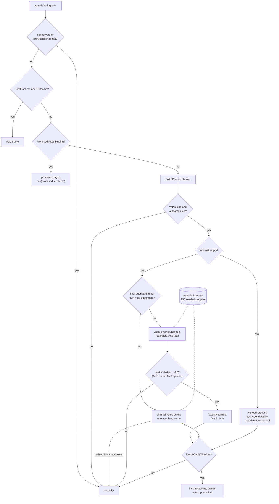
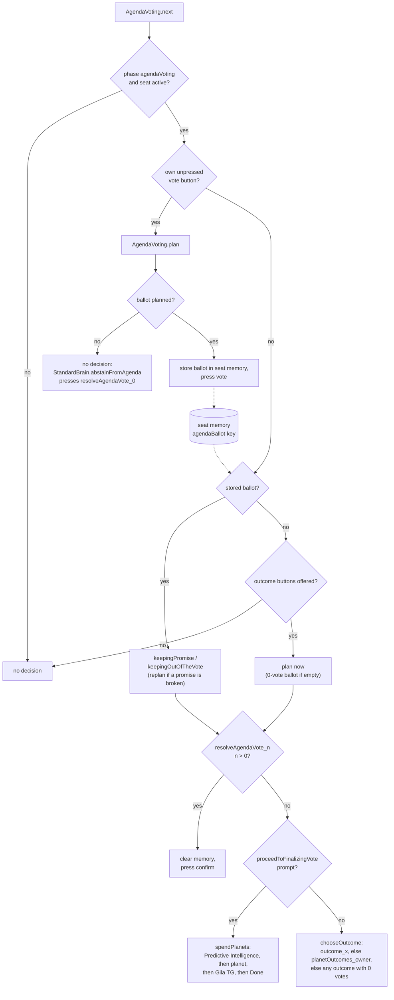

# Agenda phase

Part of the [AI player architecture docs](/src/main/java/ti4/ai/README.md): a living document kept next to the code (packages: agenda). The code is the source of truth; when you change behavior here, update this file.

## Components and responsibilities

The package holds 43 classes, about 7,500 lines. Every AI seat runs the same rule list,
[StandardBrain](/src/main/java/ti4/ai/brain/StandardBrain.java). `FactionBrainRegistry` maps the brain id `standard` (and
`nekro`, from older saves) to one `StandardBrain` instance. The rule list is ordered, and the first rule that returns a decision wins
the tick. These are the agenda-phase rules, in list order:

`RiderPayouts::technology`, `RiderPayouts::leadership` (early in the list), then ...
`SecretRules::scoreAgendaSecret`, `PromissoryRules::queueAgendaNote`, `BoatFloat::arrange`, `StandardBrain.declineWhens`
(bounties, Veto, Quash), `GalacticThreatRules::next`, `AgendaCardRules::riders`, `StandardBrain.declineAfters`,
`TradeRules::payTheAnswerer`, `TradeRules::holdVoteForDeals`, `AgendaVoting::next`, `StandardBrain.abstainFromAgenda`,
`StandardBrain.breakAgendaTie`, `TradeRules::offerDeadlyPlotBounty`, `ShenanigansRules::react`,
`TradeRules::payDebtInAgenda`.

Most AI behaviour is gated by experiment flags in [AiExperiments](/src/main/java/ti4/ai/AiExperiments.java). The
agenda-related flags are `AGENDA_VALUE_TABLE`, `AGENDA_HELD_BALLOTS`, `AGENDA_ABSTAIN_CHOICE`,
`GALACTIC_THREAT_COST`, `GALACTIC_THREAT_TIMING`, `GALACTIC_THREAT_BY_VOTERS`, `RIVAL_RIDER_STAKES`,
`IMPERIAL_RIDER_HOLD`, `BOAT_FLOAT`, `VOTE_ANGER`, `DISCARD_BOUNTIES`, `PROMISE_DEALS`, `CONDITIONAL_VOTE_DEALS`,
`RIDER_EXTORTION`, `AVOIDANCE_BRIBES` and `PAY_THE_ANSWERER` (trade side), `STRENGTH_WEIGHTED_ANGER` (read by
`TacticalStrength.angerWeight`, which `VoteAnger` uses) and `AGENDA_SABOTAGE`.

How the flags resolve:

- `AiExperiments.enabled` returns true unless one of two things disables the flag: the system property
  `ai.experiments.off` (a list of experiments turned off for every seat), or the seat's stored value
  `aiExperimentsOff`, a comma-separated list of the experiments turned off for that seat (a "control seat" in A/B
  self-play). Only the listed experiments are off; the value `-` marks a seat with none off.
- So every flag is on by default. These docs describe the flag-on path first and name the legacy path only where it
  still runs.
- The flag check always reads the flags of the seat named in the call. A forecast built by one seat models the
  other seats' utilities with each modelled seat's own `AGENDA_VALUE_TABLE` flag
  (`AgendaValues.usesExpertTable(voter)`). Human seats carry no disabled key, so they are modelled with the expert
  table.

Value units are trade goods (TG). [ValueScale](/src/main/java/ti4/ai/eval/ValueScale.java) sets:

- 1 TG = 1.0
- 1 resource = 1 influence = 1 commodity = 0.8

Related constants:

- `CardValueScale.HELD_TOKEN` = 3 × 0.8 = 2.4.
- `CardValueScale.TOKEN_FLOOR` = 1.5.
- `CardValueScale.STRATEGY_TOKEN` = 1.0.
- `ActionCardPrior.AVERAGE_CARD` = 1.2.

[ScoringStakes](/src/main/java/ti4/ai/scoring/ScoringStakes.java) prices victory points:

- `scoreValue(p, n)` is 30 (`WIN_VALUE`) when the points reach the goal.
- Otherwise it is n × `vpWorth`. `vpWorth` = 6 + 2 per VP beyond (goal − 4), + 2 if any player is within 2 VP of the
  goal, capped at 12.
- `rivalPointStake` is `scoreValue` × 0.75, or × 0.25 when the rival is far behind. It is the full `scoreValue` when
  the points win the rival the game.

---

### AgendaForecast

**Role:** informs. It computes the outcome probabilities and per-voter utilities that most other components use.

**Purpose:** a Monte Carlo estimate of which outcome of the current agenda wins. It is built from one seat's point
of view. It also answers what-ifs: with a rider placed, with a given ballot cast, or with a voter silenced.

**Invoked when:** `AgendaForecast.of(game, viewer)` is called by:

- in scope: `BallotPlanner.choose`, `AgendaVoting.itsBallot`, `AgendaPolicy` (`chooseOutcome`,
  `wouldElectToAPoint`, `predictedElectionScore`), `AgendaSwing`, `GilaVotes`, `GalacticThreatRules`, `VoteDeals`,
  `DiscardBounties`, `BoatFloat` (only `votingOrder`)
- outside scope: `AgendaCardRules.bestRider` and `bestPlacement`, `CardScoring.imperialRiderChance`,
  `EarlyDeadlyPlot`, `AnswererDeals`, `AvoidanceBribes`, `RiderExtortion`
- `DiscardBountyDeals` and `AgendaPolicy.expectedLoss` / `signedLoss` / `worthDiscardingFor` reach it through
  `AgendaVoting.forecastWithItsBallot`, not through `of` directly

Each call builds a new object, so there is no cache across calls. Within one object the utility table and the
simulation result are cached lazily.

**Inputs:**

- `Game.getCurrentAgendaInfo()`. `AgendaHelper.agendaInfoFor` writes it as
  `type_target_<game.getDiscardAgendas() value>_alias`, or as `type_target_CL_covert` for Covert Legislation.
- `AgendaOutcomes.of(game)`.
- Voting order: `AgendaHelper.getVotingOrder`, filtered to real players. The fallback is speaker order rotated so the
  speaker votes last.
- Vote counts at the reveal: `AgendaHelper.getAgendaStartVoteCounts`, which reads the stored value
  `agendaStartVoteCounts`.
- `Game.getCurrentAgendaVotes()`: pieces such as `color_7` for votes and `faction_Imperial Rider` for riders.
- The active player, the phase, the `AssassinatedReps` stored value, Xxcha commander status, and accepted vote
  promises.

**Outputs:**

- `chances()`: outcome → P(win).
- `votedChance(o)`: P(o wins and its tally exceeds the votes cast by Galactic Threat predictors).
- `threatWorth(o)`: the expected copyable technology value for a Galactic Threat on o.
- `utility(player, o)`, `expected(f)`, `expectedUtility(player[, ownVote])`, `mostLikely()`, `votesLeft`,
  `breaksTieToward`, `ridersOf`, `riderOutcome`. `hasRivalImperialRider` is public but has no caller in production
  or test code.
- Derived forecasts: `withVotes`, `withRider`, `without`.

**Algorithm:**

1. Returns the empty `NONE` forecast in any of these cases:
   - Fog of War, Hidden Agenda mode or Omega Phase mode
   - the phase is null or does not start with `agenda`
   - there are no outcomes or no voters
2. Base utility table `base[voter][outcome]` = `AgendaUtility.of(game, voter, voter == viewer, agenda, outcome)`.
   Only the viewer's own row reads private information (its own secrets and hand). Every other row is built from
   public information.
3. Placed pieces are parsed from `getCurrentAgendaVotes`:
   - A piece `<owner>_<digits>` adds votes to `cast[outcome]`, `castBy[voter][outcome]` and `byVoter[voter]`.
   - A piece whose suffix contains `Rider` or `Sanction` becomes a `Rider(owner, title, outcome, payoff,
     rivalStake)`, where payoff = `RiderPayoff.of(game, viewer, owner, title)` and rivalStake =
     `ScoringStakes.rivalPointStake(owner, 1)`.
4. Remaining votes per voter:
   - 0 if the phase is `agendaend`.
   - 0 if the voter is earlier in the order than the active voter (only in phase `agendavoting`).
   - 0 if the voter is blocked: it has Galactic Threat without the Xxcha commander (`AgendaVoting.cannotVote`), or,
     without the Xxcha commander, it placed a rider or is listed in `AssassinatedReps`.
   - Otherwise snapshot − already cast − kept back. Kept back is the smallest readied planet's votes
     (`BallotPlanner.reserve`), and only applies when all three hold: `AgendaRound.keepsAVoteBack`, not under
     Representative Government, and the viewer has `AGENDA_VALUE_TABLE`.
5. `PromisedVotes.placeAccepted` applies accepted vote promises by other seats on this agenda, only when the
   viewer's promise book is active. A `NOT_AGAINST` promiser is removed (`without`). Every other accepted vote
   promise casts min(promised, left) on its target (`withVotes`), or all its votes left when the promise names 0.
   That branch takes `VOTE_FOR` and also `NOT_FOR`, so a `NOT_FOR` promiser is modelled as voting for the outcome
   it promised to avoid (see section 10).
6. Utilities with riders. For each placed rider on an outcome:
   - The owner gains its payoff. For a Galactic Threat Rider with `GALACTIC_THREAT_COST`, the payoff is the best
     copy worth among non-predictor voters who already cast votes on that outcome.
   - Every other voter loses `rivalStake` for an Imperial Rider.
   - For other non-Sanction riders with `RIVAL_RIDER_STAKES`, every other voter loses
     gain × `threatOfStake(rivalStake)` / max(1, live rivals). Here `threatOfStake` = clamp(stake / 4.5, 0.5, 3.0).
7. Ballot costs: when `GALACTIC_THREAT_COST` is on, each non-viewer voter's choice row is reduced by
   `GalacticThreatCost.cost` (1.0, or 0.5 if others already voted there) on the outcome a Galactic Threat Rider
   predicts.
8. Random draws:
   - `SAMPLES` = 256 draws × voters of uniform doubles from `SplittableRandom(Objects.hash(game name,
     currentAgendaInfo, viewer faction))`.
   - The same draws are reused by every derived forecast (`withVotes`, `withRider`, `without` share the `Frame`).
     The comparisons are therefore common-random-number comparisons, and they are deterministic for a given agenda
     and viewer (`AgendaForecastTest.theSameGameGivesTheSameForecast`).
9. Per draw (`simulate`):
   1. Each voter with votes picks an outcome.
      - If the spread (max − min) of its row (utility − ballot cost) is at most `INDIFFERENT_SPREAD` = 1.0 TG, the
        voter abstains (`AGENDA_VALUE_TABLE` on). With the flag off it abstains when draw < 0.3 and otherwise picks
        a uniform outcome.
      - Otherwise it picks by softmax over the row at `TEMPERATURE` = 3.0 (cumulative distribution, the first
        outcome with draw ≤ cumulative).
   2. Voters are processed in voting order. A voter's hypothetical votes (`pending`, from `withVotes`) are added to
      the tally when the loop reaches that voter. Earlier voters see them only through `laterVotes` (in
      `heldBallot`, `pickOrAbstain`).
   3. With `AGENDA_ABSTAIN_CHOICE` and an agenda whose value depends on the voter's own ballot (`ownVoteTerms`, see
      AgendaValues):
      - Non-last voters run `pickOrAbstain`. They compare abstaining against voting for each outcome with all their
        votes, given later voters' picks. They abstain if the best gain over abstaining is ≤ 1.0. Otherwise they
        sample a softmax over the outcomes plus abstain.
      - The last voter in the voting order, when it has votes left, runs `answerTally`: a deterministic best response that casts
        min(votes, max(1, votes needed to win)) on the best outcome, or abstains if nothing beats abstaining by more
        than 1e-9.
   4. Ballot size:
      - With `AGENDA_HELD_BALLOTS` on a non-final agenda, a voter casts only `heldBallot` votes: the minimum needed
        to beat every rival outcome. Later voters are counted with their full votes on their picks, margin 0 when the
        pick wins the speaker's tie-break, else 1, and at least 1 if the agenda depends on the own vote.
      - If that minimum is more than it has, it casts everything when it can still keep its pick alive ("alive"
        check), otherwise 0. A ballot of 0 is an abstention.
      - Otherwise a voter casts all its remaining votes.
   5. Mutiny (`joinShift`, needs `AGENDA_HELD_BALLOTS`). When a voter joins For, every voter's utility row shifts by
      `DirectiveValues.mutinyForVoterJoins`, and later voters re-pick from the same draws.
   6. Winner: the most votes. A tie goes to the outcome the speaker's `tieValues` prefers (utility plus own-vote term
      for the speaker's ballot). If those are equal within 1e-9, the tie goes to `evenTieOutcome` (Against, for
      own-vote-dependent agendas under `AGENDA_ABSTAIN_CHOICE`), else to the lower outcome index.
   7. `wins[winner]++`. `votedWins[winner]++` if the winner's tally exceeds the votes Galactic Threat predictors cast
      on it. `copied[winner]` += the best `copyWorth` among non-predictor voters who picked or cast for the winner.
10. Probabilities = counts / 256.

**Depends on:**

- in scope: `AgendaOutcomes`, `AgendaUtility`, `RiderPayoff`, `GalacticThreatCost`, `DirectiveValues`,
  `AgendaValues`, `AgendaRound`, `BallotPlanner.reserve`, `AgendaVoting.cannotVote` and `readiedPlanetVotes`,
  `PromisedVotes.placeAccepted`
- engine: `AgendaHelper.getVotingOrder`, `AgendaHelper.getAgendaStartVoteCounts`,
  `Helper.getSpeakerOrFullPriorityOrder`

**Effect on the game:** none. It is pure computation.

**Fallbacks:** the empty forecast returns 0 or empty maps from every query. Callers then use rules based on the vote
counts at the reveal, or simple per-outcome utility rules (see BallotPlanner, AgendaPolicy, GalacticThreatRules).

**Limitations:**

- Other seats are modelled only through public-information utilities. Their hands, secrets and promises with humans
  are not modelled.
- The 256 samples give probability steps of 1/256.
- Later voters in `heldBallot` and `laterVotes` are assumed to cast all their votes on their sampled pick, even
  though the simulated voters themselves hold back.
- No information sets are resampled. One fixed draw table exists per viewer and agenda.

**Example:** Shard of the Throne, three seats. Sol, the viewer, has 6 votes. Xxcha has 4 and already cast them for
itself. Hacan, the speaker, votes last with 3.

- For Sol, the utility of "sol" is `scoreValue(1)`, about 6. Expert table: 6 TG for an ordinary point, or the whole
  game when the point wins it.
- The "xxcha" outcome costs Sol 6 × threat(xxcha) / 2.
- Hacan's row is computed the same way from Hacan's side. Hacan is drawn by softmax at temperature 3.
- Sol's `withVotes(sol, "sol", 5)` puts Sol's 5 votes in `pending` and sets Sol's remaining votes to 0. The 5 votes
  enter the tally when the loop reaches Sol's position. The outcome then depends on Hacan's draw against 5 vs 4.

---

### AgendaOutcomes

**Role:** informs.

**Purpose:** lists the outcomes the current or a named agenda can resolve to.

**Invoked when:** `AgendaForecast.of`, `BallotPlanner.choose`, `AgendaPrior`, `AgendaSwing.isElectable`,
`GalacticThreatRules.suitsThisAgenda`.

**Algorithm:** the model's target string, lowercased, selects the list. For `covert`, the target is the second
`_`-separated field of `currentAgendaInfo`.

| Target contains | Outcomes |
| --- | --- |
| `for/against` | `for`, `against` |
| `elect player` | factions of the real players |
| `elect law` | `game.getLaws()` keys |
| `secret objective` | distinct scored secrets of all real players |
| `strategy card` | the initiative numbers of the strategy card set |
| `planet` | every planet any real player owns. Excluded: space stations, planets without the trait that `AgendaPolicy.REQUIRED_TRAIT` lists for that agenda, planets without a trait named in the target, and for `non-home`, home systems and Mecatol Rex. |

Anything else gives an empty list: system, relic, unit type, leader type or unit upgrade targets.

**Limitations:**

- An empty list makes the forecast empty and `BallotPlanner.choose` return no ballot, so the seat abstains. That is
  what happens on homebrew agendas with those targets.
- Unowned planets are never listed as outcomes.

---

### AgendaUtility

**Role:** evaluates.

**Purpose:** the utility in TG of one outcome for one voter. This is the value every forecast row is built from.

**Invoked when:** `AgendaForecast.baseUtilities`, `BallotPlanner.withoutForecast`, `AgendaPolicy.chooseOutcome`
(no forecast), `AgendaPrior`.

**Inputs:** game, voter, `readsOwnSecrets`, expert flag, agenda alias, outcome.

**Algorithm:** `of(...)`:

1. `dictate` is added only when `readsOwnSecrets` is true and all of these hold:
   - the outcome is For
   - the agenda is a Law whose target contains `For/Against`
   - the voter holds _Dictate Policy_ (`dp`) unscored
   - it has room to score a secret
   - `stillNeeded` = 3 − laws in play − 1 ≥ 0

   `dictate` = 0.5^stillNeeded × `scoreValue(1)`.
2. If `AgendaValues.of(...)` returns a value: value + `driveTheDebate` + `dictate`. `driveTheDebate` =
   `scoreValue(1)` when `readsOwnSecrets` is true, the voter holds _Drive the Debate_ (`dtd`), and the outcome
   elects the voter or one of its planets.
3. Else, if the agenda is a point election (`censure`, `shard_of_the_throne`, `crown_of_emphidia`): the elected
   voter gets `scoreValue(1)`, any other real player −`rivalPointStake(elected, 1)`, plus `dictate`.
4. Else: clamp(`AgendaPolicy.score` (own view) or `publicScore`, −2, 2) × 4 + `dictate`.

`riderStake(rider)` = `rivalPointStake(rider, 1)`. It is used as `Rider.rivalStake`.

**Limitations:** steps 3 and 4 are only reached for agendas with no value table entry. Both the expert and the
legacy tables cover `censure`, `shard_of_the_throne` and `crown_of_emphidia`, so step 3 does not run for those
aliases, and step 4 means homebrew only (see AgendaValues). For such agendas `AgendaPolicy.outcomeScore` is 0 unless the alias is in one of its sets, so the
utility is usually 0.

---

### AgendaValues and the value tables

**Role:** evaluates.

**Purpose:** per-agenda TG values of an outcome for a voter, optionally depending on the voter's own ballot.

**Invoked when:** `AgendaUtility.of`, `BallotPlanner.expectedValue` (through `ownVoteAdjustment`),
`AgendaForecast.ownVoteTerms`, `LawChangeValues`, `CovertValues`, `ExpertElectionValues.ownElectionWorth`.

**Algorithm:**

- `of(game, voter, ownView, expertTable, agenda, outcome, ownVote)`. When `expertTable` is true (the voter's
  `AGENDA_VALUE_TABLE`), it tries `ExpertAgendaValues.valueOf`. That walks the groups `CovertValues`,
  `ExpertElectionValues`, `ExpertPlanetValues`, `ExpertLawValues` (For/Against outcomes only),
  `ExpertDirectiveValues`, `ExpertCardValues` and `ExpertMechAgendaValues`, and the first non-null value wins.
  Otherwise, or when no expert group knows the agenda, it uses the legacy switch (`ElectionValues`,
  `PlanetElectionValues`, `ForAgainstLawValues`, `DirectiveValues`, `LawChangeValues`, `CardElectionValues`).
- `DEPENDS_ON_OWN_VOTE` = `conventions`, `mutiny`, `unconventional`, `wormhole_research`,
  `representative_government`, `articles_war`, `rep_govt`.
- `ownVoteAdjustment(winner, ownVote)` = value(winner, ownVote) − value(winner, winner). It is 0 for other agendas.
- An `AgendaView(game, voter, ownView)` decides whether hands are read: `readsHandOf(holder)` is true only for
  `ownView && holder == voter`. Unread hands are valued at count × 1.2.

Shared helpers in [AgendaValueMath](/src/main/java/ti4/ai/agenda/AgendaValueMath.java):

- `threat(rival)` = clamp(`rivalPointStake(rival, 1)` / 4.5, 0.5, 3.0).
- `relativeToRivals(gain)` = gain(voter) − Σ over live rivals of gain(rival) × threat(rival) / number of rivals.
- `electedGain(worth)`: worth if the voter is elected, −worth × threat / number of rivals if a rival is.
- `pointsTo` is `scoreValue` for self and −`rivalPointStake` for a rival.
- `lawRounds` = min(`GameHorizon.roundsLeft`, 5). `roundsLeft` = max(1, ⌈(goal − leader VP) / 2⌉).
- `roundTable(r≤2, r3, later)`.
- `spendValue(planet)` = max(0.8 × resources, 0.8 × influence).

Coverage: all 50 base and all 50 PoK deck agendas (63 distinct aliases) have a value. The Thunder's Edge deck file
has no agenda deck.

Expert values used by default (W = worth to the holder, passed through `electedGain` unless noted):

| Agenda | Expert value (`AGENDA_VALUE_TABLE` on) |
| --- | --- |
| `secret` (Archived Secret) | W = 1 if the holder has scored its maximum secrets. Own view: 4 if it has no unscored secret with keep value ≥ 0.6, else 1. Rival: 1 if `publicChanceReady` ≥ 0.5, else 4. |
| `committee` | W = roundTable(4, 2, 1), +2 in own view when a known upcoming Elect Player agenda is worth ≥ 2 to it (`AgendaKnowledge.knownTop`). |
| `arbiter` | W = 5 |
| `minister_commerce` | W = roundTable(3, 2, 1), +2 for Keleres |
| `minister_exploration` | W = 1 |
| `minister_industry` | W = 3 before round 4 for Keleres or Creuss, else 1 |
| `minister_peace`, `minister_war`, `minister_antiquities` | W = 5 |
| `minister_policy` | W = 0 if roundsLeft ≤ 1, else 1 (+2 Yssaril) |
| `minister_sciences` | W = max(1, 4 − (max(round, 2) − 2)), +2 Jol-Nar |
| `prophecy` | W = 1 |
| `crown_of_thalnos` | W = 0.25 |
| `grant_reallocation` | W = 3 |
| `shard_of_the_throne` / `crown_of_emphidia` / `censure` | If the elected player reaches the goal with the point: `pointsTo` (the whole game). Otherwise W = 6 / 1 / (3 with a good hand, else 5). A good hand means hand worth ≥ 4 or, in own view, a card of expert tier strength ≥ 1.4. |
| `warrant` | Own view: 2 × clamp(3 − (scored + easy), 0, 2), − 1 if it has an easy secret, − 1 more if one of them is an action-phase secret. Rival: 2 × secrets gained − 1 × chance a secret is ready. |
| `execution` | loss = hand worth (unread hands × 1.5 Yssaril, × 1.25 Ral Nel) + (speaker: 4, +2 from round 3) + (1 unless final agenda). Self −loss. Rival: loss × threat / n, + `SpeakerTokenValue(voter)` / (live − 1) if the elected player is speaker. |
| Planet laws | W: `core_mining` 1, `demilitarized_zone` 2, `holy_planet_of_ixth` 3, `rt_*` 1, `senate_sanctuary` 1, `terraforming_initiative` 1. 0 when the trait is missing. Holy Planet: `pointsTo` when the owner wins with the point. Self W, rival −W × threat / n. |
| `disarmament` | relativeToRivals. Controller gain = 1 TG per infantry and mech, minus 1 per infantry, minus 2.5 per mech, minus 0.5 × planet value, unless the controller's TG + resources × 0.8 < 6 (then no deduction). |
| `revolution` | For: relativeToRivals(−1.5 × roundsLeft; 0 with Propagation). Against: legacy. |
| `conventions` | For: 0. Against: −own hand worth only when its own vote is Against. |
| `travel_ban` | For: relativeToRivals((Creuss 1 + own-slice α/β wormholes × 0.25 × (1 − aggression) / 0.2) × lawRounds). Against: legacy (−2 per PDS adjacent to a wormhole). |
| `sanctions` | For: −value of cards beyond 3 (own: worst-first keep values; others 1.2 each; Yssaril 0). Against: legacy (−1.2 for each player with cards). |
| `regulations` | For: −(excess fleet tokens × command token + 0.4 (0.2 under 4) × lawRounds) × 4 / (4 + Armada 2), − Imperia 0.15 / round, − Auto-Factories 2 / round (× 0.75 if locked). Against: legacy (+1 command token each). |
| `defense_act` | For: 0. Against: legacy (−2 per player with a PDS). |
| `schematics` | For: +1 if it lacks War Sun tech and someone has it, − 0.3 × min(roundsLeft, 3) × war suns. Against: −hand worth for war sun owners. |
| `conscription` | For: Cabal/L1Z1X +1 × lawRounds. Others −1.6 × clamp((cheap + 1) / (mean + 1), 0.3, 3) × lawRounds, share ≥ 2 for Naalu/Sol. Against: 0. |
| `shared_research` | For: Bastion +1 × lawRounds. Against: −(home-space ship cost × 0.3 + 1 if no forward dock). |
| `wormhole_recon` | For: clamp(fleet cost / mean − 1, −1, 1) × lawRounds. Against: −0.3 × ship cost on wormhole tiles without its token. |
| `representative_government`, `rep_govt` | For: clamp(`VoteCapacity.shareSwing` × 4, −2, 2) × lawRounds. Against: legacy (−own cultural planets' spend value if its own vote is Against). |
| `checks` | For: (point gap behind × 0.5 + speaker-order lean) × lawRounds. Lean is 0 if negative and the speaker is a contender. Against: legacy (−relativeToRivals of exhausted planets beyond the 3 best). |
| `nexus` | For: (Creuss 0.3 + Mallice owner 0.5) × lawRounds. Against: legacy (−0.5 / round if it controls Mecatol, else +0.15). |
| `arms_reduction` | Leader-focused relative (rival contenders × 1.5). For: −excess dreadnoughts over 2 and cruisers over 4 at 0.8 × cost. Against: −spend value of tech-specialty planets. |
| `economic_equality` | For: relativeToRivals(5 − TG ± Pillage), + 0.5 if its own loss is under 4. Against: relativeToRivals(−TG). |
| `incentive` | For: race(0.5 pt) + 0.5 × lead (clamped ±3). Against: race(0.6 pt) − lead term + 1.5 for Jol-Nar / Deepwrought / Hacan. race = own `scoreValue` − Σ rival stakes, × runway × planet-share strength. |
| `artifact` | For: 0.5 × research + 0.5 × blast (+0.5 if its own blast loss < 6). Research = 1.8 × tempo + 0.5 × point value of the best free tech. Blast = unit worth in Mecatol and the 3 cheapest per adjacent tile + 0.5 per unit + 4 if it controls Mecatol. |
| `plowshares` | For: relativeToRivals(half the infantry × 0.2) + 1.5 if self is a contender + 0.5 per revealed spend objective. Against: relativeToRivals(placed infantry × 0.8). |
| `wormhole_research` | For: relativeToRivals(free research if ships at a wormhole − 0.8 × ships at α/β). Against: relativeToRivals(−token loss of Against voters). |
| `cladenstine` | For: −cheapest 2 token removals. Against: −fleet token removal including ships over the fleet limit. |
| `classified` | relativeToRivals(owner 3; others chance × `scoreValue(1)` × leak weight) |
| `crisis` | relativeToRivals(free secondary of the elected card) |
| `articles_war` | For: rival stakes lost (neighbours × 2) − own mech stake. Against: relativeToRivals(3 TG to each For voter, own ballot included). |
| `rearmament` | For: relativeToRivals(`MechRating.homeWorth`, only with a home planet and a mech in reinforcements). Against: relativeToRivals(−mechs on the board × (1.6 + ability quality)). |
| `covert` | Mean of the expert values of the agendas the speaker could have drawn (see CovertValues). |
| `mutiny`, `seed_empire`, `unconventional`, `standardization`, `redistribution`, `abolishment`, `miscount`, `constitution` | No expert entry. The legacy value is used (next table). |

Legacy values (all values when `AGENDA_VALUE_TABLE` is off, and the agendas without an expert entry):

| Agenda | Legacy value |
| --- | --- |
| `secret` | Self: secret draw worth. Rival: −`rivalPointStake` × 0.4 (room) or 0.1 |
| `committee` | electedGain((1 − 0.65^(2 × (lawRounds − 1) + 1)) × 6) |
| `arbiter` 3; `minister_peace`, `minister_war` 6; `covert` 2 | electedGain(constant) |
| `minister_commerce` | neighbours × 0.8 × lawRounds |
| `minister_exploration` | (1.5 until round 3, else 1.0) × lawRounds |
| `minister_industry` | 0.7 × lawRounds |
| `minister_policy` | card draw worth of lawRounds cards |
| `minister_sciences` | 3 × 0.8 × lawRounds |
| `minister_antiquities` | `RelicValue.draw` |
| `prophecy` | min(3, 0.5 + 0.3 × fighters) × min(roundsLeft, 2) |
| `execution` | hand + speaker token to the heir + 1 silenced |
| `shard_of_the_throne` / `crown_of_emphidia` | `pointsTo` × keep chance 0.8 / (0.85 if it controls its home, else 1), 1 when it wins with the point |
| `crown_of_thalnos` | 1 × lawRounds |
| `standardization` | tokens moved to 3/3/2 at 2.4 each, fleet above 3 at 1.5 |
| `censure` | the point minus (hand × 1.2 × 0.75 + lawRounds × 1.2) lockout, or the whole game |
| `grant_reallocation` | free research − tactic tokens for prerequisites |
| `warrant` | secret draw × 1.5 − 0.5 × lawRounds |
| Planet laws | relativeToRivals / electedPlanetGain per law (core mining income, DMZ destroyed units, Holy Planet 0.8 × point − blocked dock production, research team prerequisite skips, sanctuary/terraform income) |
| `redistribution` | relativeToRivals: the controller loses garrison + planet value × min(roundsLeft, 2), split among the fewest-VP players |
| For/Against laws | `ForAgainstLawValues` per law: per-round edges × lawRounds through relativeToRivals |
| `mutiny` | own `scoreValue(±1)` if its own vote is For − Σ For-voting rivals' stakes |
| `seed_empire` | point to each most-VP (For) or fewest-VP (Against) player via `pointsTo` |
| `unconventional` | For voters +2 cards (own: `DrawnCardValue`), or −hand if Against wins |
| `abolishment` | −value of the elected law in play (point laws: `pointsTo` of the holder) |
| `miscount` | 0.5 × (mean value with another elected player − current), for elect-player laws |
| `constitution` | For: −Σ values of laws in play − (0.75 × home spend value, relative to rivals) |
| `classified`, `crisis` | `CardElectionValues` (free slot 0.25 point; secondary values Diplomacy 1, Construction 2, Warfare 2, Technology research − 4.8) |

**Limitations:**

- Many constants are hand-set per agenda (for example `ARBITER` = 5, `PEACE` = 5).
- There is no long-term law simulation beyond `lawRounds`.
- Several outcomes are deliberately 0: Conventions For, Homeland Defense For, Conscription Against.

---

### CovertValues

**Role:** evaluates.

**Purpose:** values Covert Legislation outcomes, where the real agenda is hidden in the speaker's hand.

**Algorithm:**

- The candidates are `AgendaKnowledge.covertCard` when the view reads the speaker's hand (the voter is the speaker
  and the held agendas with the announced target are exactly one). Otherwise they are every agenda in the remaining
  deck (`AgendaPrior.remainingDeck`) whose target equals the announced target.
- The value is the mean of the candidates' values from `AgendaValues.of` with the expert table forced on (expert
  entry first, legacy switch for candidates without one), over the candidates that have a value. It is null if none
  do.

**Limitations:** this is a uniform average over the deck. It ignores agendas already seen this round, apart from
what `remainingDeck` removes: discards, laws, the current agenda and `covert` itself.

---

### BallotPlanner

**Role:** decides. It returns the outcome, the vote count and whether to add Predictive Intelligence.

**Purpose:** chooses the seat's own ballot.

**Invoked when:** `AgendaVoting.plan` reaches it, which happens when the seat is not floated and not bound by a
`VOTE_FOR` promise.

**Inputs:** game, seat, agenda alias, the vote worth of each readied planet (`AgendaHelper.getSpecificPlanetsVoteWorth`).

**Outputs:** `Optional<Choice(outcome, votes, predictive)>`. Empty means abstain.

**Algorithm:**

1. available = Σ planet votes. Stop if ≤ 0.
2. keep = available − reserve (the smallest positive planet vote) when `AgendaRound.keepsAVoteBack`, else available.
   - `keepsAVoteBack` is true when the agenda is not the final one (`agendaCount` < 2) and `mutiny` is not in the
     discard pile.
   - With `AGENDA_VALUE_TABLE`, cap = available, so the last planet can be spent at a penalty. Without it, cap = keep.
   - Stop if cap ≤ 0.
3. Outcomes = `AgendaOutcomes.of(game)` minus the outcome of a binding `NOT_FOR` promise (`PromisedVotes.avoided`).
4. **No forecast** (fog, hidden agenda or Omega modes) → `withoutForecast`, called with keep (not cap), so the
   expert last-planet spending does not apply here. No ballot if keep ≤ 0.
   - value(o) = `AgendaUtility.of(own view)` − `GalacticThreatCost.ofBallot(o, keep)`.
   - Abstain if every value is equal and the best is ≤ 1e-6.
   - Otherwise vote for the best outcome with keep votes when it is the final agenda or the preference (best − least)
     is ≥ `STRONG_PREFERENCE` = 8, and with ⌈keep / 2⌉ votes otherwise.
5. With a forecast, an option is (outcome, votes) for every subset-sum total of planet votes ≤ cap
   (`reachableTotals`, a 0/1 knapsack reachability table). When `plansPredictive` (Predictive Intelligence ready and
   `AGENDA_VALUE_TABLE`), each total + 3 is added as a predictive option.
6. worth(option) = `expectedValue` − `GalacticThreatCost.ofBallot` − `VoteAnger.ofBallot`.
   - `expectedValue` = E over `forecast.withVotes(seat, o, v)` of [utility(seat, winner) + `ownVoteAdjustment(winner,
     o)`] − `threatPayoffCorrection`.
   - A predictive option also pays −0.5 × (1 − P(o wins)).
   - The abstain value uses `forecast.without(seat)`.
7. **Final agenda, and the agenda does not depend on the own vote** → `allIn`:
   - Options are all cap votes on each outcome, plus the predictive variant.
   - Abstain when every utility is equal and ≤ 1e-6.
   - Otherwise take the max worth, ties broken by `liking` (utility + `threatWorth` if the seat's own Galactic Threat
     Rider sits on the outcome).
   - Accept it if worth > abstain + 1e-6, or if worth ≥ abstain − 1e-6 and its liking is the best liking.
8. Otherwise the value of each option = worth − keptVote × planet votes − (0.5 `LAST_VOTE` if planet votes > keep).
   - keptVote = 0 on the final agenda. With `AGENDA_VALUE_TABLE` it is `AgendaPrior.marginalVote`, else 0.05.
   - Best = max value. Ties go to more votes on the final agenda and to fewer votes otherwise.
   - Floor = abstain + (1e-6 on the final agenda, else `MIN_GAIN` = 0.5). No ballot if best ≤ floor.
9. With `AGENDA_VALUE_TABLE` on a non-final agenda: `fewestNearBest` takes the option on the same outcome with the
   fewest votes whose value is ≥ best − 0.3 (`NEAR_BEST`) and > floor (`BallotPlannerTest`).

**Depends on:** `AgendaForecast`, `AgendaUtility`, `AgendaValues.ownVoteAdjustment`, `GalacticThreatCost`,
`VoteAnger`, `AgendaPrior`, `AgendaRound`, `PromisedVotes`.

**Effect on the game:** none directly. `AgendaVoting` executes the choice.

**Limitations:**

- The seat's ballot is evaluated against a forecast where every other seat is simulated. There is no deeper search
  (for example, how later voters react to deals).
- Vote counts are limited to exact planet subsets. Gila trade goods are not options; `GilaVotes` adds them later.

**Example:** a first agenda (For/Against), with readied planets of 3, 2 and 1 votes. Reserve = 1 and keep = 5.

- Expert: cap = 6. Totals {1, …, 6}.
- If For at 3 votes is worth 2.0 and at 6 votes 2.3, then 6 votes pay the 0.5 last-vote penalty plus 6 × keptVote,
  so the planner casts fewer.
- `fewestNearBest` then picks the smallest total within 0.3 of the best that still clears abstain + 0.5.

---

#### Diagram: Choosing the ballot: `AgendaVoting.plan` and `BallotPlanner.choose`



`fewestNearBest` runs only with `AGENDA_VALUE_TABLE` on a non-final agenda. Otherwise the best option is kept as it
is. The grid branch reaches a final agenda only for agendas whose value depends on the own vote.

### AgendaVoting

**Role:** executes (button presses), and decides through `plan`.

**Purpose:** casts the seat's vote through the bot's voting buttons, and keeps the ballot in seat memory across
ticks.

**Invoked when:** `StandardBrain` rule `AgendaVoting::next`, every tick. It acts only when the phase is
`agendaVoting` and the seat is the active player.

**Inputs:** `AiTurnContext` (prompts since the turn start (`Prompts.thisTurn`), seat memory, clock).

**Button flow (engine):**

1. `vote` (the seat's own "Choose To Vote") → the bot posts outcome buttons: `outcome_<x>`, or for planet agendas
   outside fog `planetOutcomes_<faction>`, then `outcome_<planet>`.
2. `outcome_` → buttons for exhausting planets: `exhaustForVotes_planet_<p>`, `exhaustForVotes_predictive_3`,
   `exhaustForVotes_hacanCommanderTg`, `proceedToFinalizingVote`. Under Representative Government, `outcome_` goes
   straight to the confirm step.
3. `proceedToFinalizingVote` → `resolveAgendaVote_<n>` ("Confirm n votes") or `distinguished_` (modify).

The Abstain button is `resolveAgendaVote_0`.

**Algorithm (`next`):**

1. If the seat's own unpressed `vote` button is in this turn's prompts: `plan`.
   - Empty plan → return nothing, so the next rule, `StandardBrain.abstainFromAgenda`, presses `resolveAgendaVote_0`.
   - Otherwise store the `Ballot(outcome, planetOwner, votes, predictive)` under `agendaBallot|<agendaInfo>` with
     the press time, and press `vote`.
2. Otherwise read the stored ballot and re-check promises (`keepingPromise`, `keepingOutOfTheVote`):
   - A binding `VOTE_FOR` promise for another outcome, or for more votes than planned (when more are castable),
     triggers a replan.
   - An avoided (`NOT_FOR`) target triggers a replan.
   - Under a `NOT_AGAINST` restraint, an outcome other than the target is replanned, or falls back to 1 vote on the
     target.
   - With no stored ballot but outcome buttons offered (for example right after a rider), it plans now. On an empty
     plan it uses a 0-vote ballot.
3. Press the seat's own `resolveAgendaVote_<n>` with n numeric and ≠ 0, and clear the memory.
4. If a `proceedToFinalizingVote` prompt is present, run `spendPlanets`:
   1. Press Predictive Intelligence once when wanted (expert: `ballot.predictive`, legacy: votes > 0) and some planet
      vote is spent or castable.
   2. needed = votes − planet votes spent − 3 (if PI was spent and counts: with `AGENDA_VALUE_TABLE`, or on a
      non-final agenda), with at least 1 planet vote if PI was spent alone.
   3. Exhaust the smallest planet whose votes ≥ needed, else the largest. Legacy: no planet when a vote must be kept
      back and ≤ 1 unspent planet remains.
   4. Then Gila the Silvertongue trade goods (`GilaVotes`), then `proceedToFinalizingVote`.
5. `chooseOutcome` looks at outcome prompts created since the vote press − 5 s:
   - Press `outcome_<ballot outcome>`.
   - Else `planetOutcomes_<planet owner>`.
   - Else any outcome button. In that last case the ballot is reset to 0 votes ("its outcome is not offered, so cast
     no votes"). The flow then ends on a 0-vote confirm, which `abstainFromAgenda` presses.

`plan(game, seat)` returns empty in these cases:

- `cannotVote` (Galactic Threat without the Xxcha commander)
- `sitsOutThisAgenda` (listed in `AssassinatedReps` or placed a rider/Sanction, unless the Xxcha commander)
- no agenda model or target

Otherwise its priority is:

1. `BoatFloat.memberOutcome` → For with 1 vote.
2. A binding `VOTE_FOR` promise → the promised target with min(promised, castable) votes, or castable if the
   promise names 0. Predictive Intelligence is added when it is planned and the promise exceeds 3.
3. `BallotPlanner.choose`, filtered by `PromisedVotes.keepsOutOfTheVote`. Under a `NOT_AGAINST` restraint, a
   planner pick other than the restraint target is dropped rather than replaced, so the seat abstains.

A planet outcome without a controller gives no ballot.

Other public helpers:

- `castableVotes` = available − reserve when `keepsAVoteBack`. It is 0 when the seat cannot vote or sits out.
- `itsBallot` and `forecastWithItsBallot` give the forecast with the seat's own planned ballot.
- `ballotInProgress`, `markAbstained` and `abstained` are used by trade code.

**Fallbacks:** memory keys are per `currentAgendaInfo`. A confirm button is pressed only when n > 0, so a tie-break
button (`resolveAgendaVote_outcomeTie*`) is never confirmed (`AgendaVotingTest.neverConfirmsVotesOnATieBreakButton`).

**Limitations:**

- The confirm press does not check that n equals the planned votes. It accepts whatever total the bot computed
  from the spent things.
- Only the `vote` press checks `context.alreadyPressed`. The confirm, Predictive Intelligence, "Done exhausting
  planets" and outcome presses do not. They rely on the bot replacing the pressed message, on the spent-things
  filters (planets, Gila trade goods) and on the runtime's per-prompt attempt limit.

---

#### Diagram: Casting a vote: `AgendaVoting.next` per tick



### GilaVotes

**Role:** decides (TG count) and is executed through `AgendaVoting.spendTradeGoods`.

**Purpose:** the Hacan commander adds 2 votes per TG.

**Algorithm:**

1. spendable = TG − reserve. The reserve is the largest TG shortfall among unscored revealed spend objectives the
   seat could pay next round.
2. For t = 1..spendable: gain(t) = EU(`withVotes(outcome, planetVotes + 2t)`) − EU(`withVotes(outcome,
   planetVotes)`) − t.
3. Take the t with the highest gain (strictly better than earlier by 1e-9). Spend 0 unless the gain ≥ 0.5.
4. The plan is stored per round and agenda (`agendaGilaTradeGoods|`). The seat presses once per TG until its spent
   TG reaches the plan.

Tested by `AgendaVotingTest.gilaSpendsJustEnoughTradeGoodsToSwingAPoint` and `gilaKeepsTradeGoodsASpendObjectiveNeeds`.

---

### AgendaPolicy

**Role:** decides (speaker tie-break, tied planet owner) and evaluates (discard thresholds, point elections).

**Purpose:** speaker ties, Veto/Quash/Political Favor thresholds, and the legacy per-outcome scores.

**Invoked when:**

- `StandardBrain.breakAgendaTie` (`chooseOutcome`, `choosePlanetOwner`): the seat is the speaker, it is active, the
  phase is not `agendaEnd`, and the prompts this turn carry `resolveAgendaVote_outcomeTie*` or
  `tiedPlanets_resolveAgendaVote_outcomeTie*` buttons.
- `AgendaCardRules.worthVetoing` (`veryBadFor`, `worthDiscardingFor`).
- `QuashRules` (`expectedLoss`, `signedLoss`, `worthDiscarding`).
- `AgendaNotes` (`veryBadFor`, `predictedElectionScore`).
- `DiscardBountyDeals` (`expectedLoss`).
- `NotesForTrade` (`importantFor`).
- `CardScoring` (`wouldElectToAPoint`).
- `TableCards` and `AgendaPeek` (the GOOD/BAD sets).

**Algorithm:**

- `chooseOutcome`:
  - If `BoatFloat.speakerHonoursAgainst`, press Against.
  - Else with a forecast, reduce the tied buttons pairwise with `breaksTieToward`. That compares `tieBreakUtility` =
    utility (base + riders) + the own-vote term for the speaker's cast ballot. When equal within 1e-9 it prefers
    `evenTieOutcome`, else it keeps the first.
  - Without a forecast: max `AgendaUtility.of(own view)`.
- `choosePlanetOwner`:
  - For agendas good for the planet owner (Holy Planet, Senate Sanctuary, Terraforming, research teams), pick itself.
  - For bad ones (Core Mining, Demilitarized Zone, Disarmament, Redistribution), pick the non-self owner with the
    most VP.
  - Otherwise pick the owner with the most planets.
- `expectedLoss` = max(0, −EU over `forecastWithItsBallot`). `signedLoss` = −EU.
- `veryBadFor`: expectedLoss ≥ 3.0 (expert) or 3.5. Without a forecast it falls back to `worthDiscarding`.
- `worthDiscarding`: `predictedElectionScore` ≤ −5. This applies only to elect-player agendas. Without a forecast the
  elected player is the one with the most start votes, or the points leader for Public Execution.
- `worthDiscardingFor(bounty)`: bounty − EU ≥ the very-bad threshold.
- `wouldElectToAPoint`: P(seat elected) ≥ 0.5 on Censure/Shard/Crown of Emphidia. Without a forecast: the seat has
  the most start votes.
- Legacy `outcomeScore`:
  - Elected player for a good-for-elected agenda: 2 for self, else −the elected player's VP.
  - Execution: −10 for self, else the elected player's VP.
  - Planet: owner-good 1 + planet value (self) / −value. Owner-bad: the reverse.
  - Seed of an Empire: For 2 if it has the most VP, else −1. Against 2 if it has the fewest VP, else 1.
  - `score` raises the result to at least 3 with Drive the Debate on a self-election.

**Limitations:** the planet-owner tie choice uses no forecast or value table.

---

### AgendaRound, AgendaClock, AgendaQueue, AgendaView

**Role:** inform.

- `AgendaRound.isFinalAgenda`: stored `agendaCount` ≥ 2. The engine sets `agendaCount` to 0 in
  `StatusCleanupService`, adds 1 on each reveal, and takes 1 back for a Veto, a Miscount Disclosed revote and an
  Emergency Session, so a replacement agenda keeps the count of the one it replaces. `keepsAVoteBack`: not final and
  `mutiny` not in the discards. The engine puts a revealed agenda in the discard map at once (`Game.revealAgenda`),
  so `keepsAVoteBack` is also false while Mutiny itself is being voted on. `underRepresentativeGovernment`: the `rep_govt` law is in play and `executiveOrder` is empty.
- `AgendaClock.seenAt`: remembers when the seat first saw this agenda. `isInThisAgenda(prompt)`: the prompt is no
  older than `seenAt` − 5 s and no older than `lastAgendaReactTime` − 5 s. A reveal time more than 60 s in the
  future is ignored.
- `AgendaQueue` reads the engine's queue stored values: `whenWindowOpen` (phase `agendawaiting` and `whensResolved`
  empty), `holdsQueuedWhen/After`, `passedOnWhens/Afters`, `queuedWhen/After`. Callers: `StandardBrain`, `AgendaNotes`,
  `AiStallDetector`, `QuashRules`, `DiscardBountyDeals`, `PromiseDeals`, `AgendaCardRules`, and in scope
  `GalacticThreatRules` (`passedOnAfters`) and `DiscardBounties` (`whenWindowOpen`).
- `AgendaView`: the hand-reading switch described under AgendaValues.

---

### AgendaPrior, AgendaPeek, AgendaKnowledge, VoteCapacity

**Role:** inform and evaluate.

- `VoteCapacity.of` = vote worth of every owned planet (readied or exhausted) + 3 Predictive Intelligence (owned,
  not necessarily ready) + live players
  (Zeal) + 4 (Blood Pact in play) + 2 × TG (Hacan commander). It is 0 when the seat cannot vote or has no planet
  votes.
- `VoteCapacity.shareSwing` = 1 / voters − own / total. Representative Government uses it.
- `AgendaPrior.expected(agenda)`: each voter backs its own argmax-utility outcome, weighted by `VoteCapacity`. The
  value is the support-weighted mean of the seat's utility, or the plain mean when nobody has votes.
- `deckExpected` and `fullDeckSpread` average this over `remainingDeck`. The results are memoised by `SearchMemo`.
- `deckSpread` is `AVERAGE_DECK_SPREAD` = 4.1, the mean `fullDeckSpread` over 600 seat-agendas of the 12 styx-take-ab
  games (20261128-0407-agenda-prior-measure; 3.0 in round 1 to 6.2 in round 6). `fullDeckSpread` only under
  `AGENDA_DECK_LOOKAHEAD`, off by default: it cost about 10 s per seat-agenda under batch load, and it put 586 of those
  600 kept votes at the 0.02 floor anyway.
- `marginalVote` = clamp(0.25 × spread / table votes, 0.02, 1.0). Spread comes from the next known agenda
  (`AgendaKnowledge.next`) or `deckSpread`. It is `BallotPlanner.keptVote` and `VoteDeals.spentVotes`.
- `phaseVoteValue` = `perVote` of the first two known agendas. It is used by `MawOfWorldsRules`.
- `AgendaPeek.keepOnTop`:
  - Expert: expected(agenda) ≥ deckExpected.
  - Legacy: bury Execution while it leads on VP, owner-punishing agendas while it has the most planets, and
    favour-the-elected agendas unless it leads on influence.
  - Called by `PlannedPrimaries` for the Politics peek.
- `AgendaKnowledge`:
  - Records the agendas the seat put on top or bottom (`placedOnTop` / `placedOnBottom`, from `PlannedPrimaries`).
    The record lives in player stored value `aiAgendaKnowledge`, valid for the round, and is shifted by the cards
    drawn since (deck size difference).
  - With the Naalu commander it also sees the first top card not already in a hand.
  - `covertCard` is described under CovertValues.

---

### AgendaSwing and AgendaPoints

**Role:** evaluate and inform.

- `AgendaSwing.forViewer(title, cardPlayer)` = utility after the card − EU now.
  - Confounding Legal Text: utility of the card player's faction outcome.
  - Deadly Plot and Veto: 0 (the agenda is discarded).
  - Bribery: utility of the outcome the card player voted for.
  - Called by `ShenaniganCards` (own play) and `SabotagePolicy` (negated, to Sabotage others' plays).
- `currentWinner` = `mostLikely`. `isElectable` = the seat is an outcome.
- `backedAnotherOutcome` and `votedFor` read the vote pieces.
- `AgendaPoints.gainers(outcome)`: who gains VP from the outcome (point elections, Holy Planet owner, Seed of an
  Empire recipients, Mutiny For voters). Used by `EarlyDeadlyPlot`.

---

### RiderPayoff and RiderPayouts

`RiderPayoff` (evaluates): the TG worth of a rider to its owner.

- Imperial = `scoreValue(1)`.
- Trade = 5 + the `scoreValue` of the VP those 5 TG unlock (`SpendUnlock.pointDelta`).
- Politics = `DrawnCardValue(3)` + `SpeakerTokenValue`. For a rival: 3 × 1.2 + speaker.
- Technology = `ResearchPolicy.freeResearchWorth`, or the Leadership value when the seat cannot research. A rival's
  is 2 × 1.2.
- Leadership = 3 × 2.4 (expert) or `CommandTokenValue.tactic(3)`. A rival's is 2.4.
- Galactic Threat Rider = the max over other voters of the best copyable tech value (`GALACTIC_THREAT_COST`), else
  2.4.
- Unknown titles = 2.4.

`RiderPayouts` (executes), StandardBrain rules:

- `technology`: on a recent (≤ 30 min) public message naming the Technology Rider and mentioning the seat, press the
  unowned `acquireATech`. Skipped when the seat cannot research.
- `leadership`: on the "Use buttons to gain command tokens" message within 10 s after a Leadership Rider payout
  announcement that mentions the seat, gain up to min(3, room in reinforcements) tokens through `NekroRules.gainTokens`.
  The target and baseline are remembered per message. The announcement has no buttons; `AiPerception.isLeadershipRiderPayout`
  lets it through `Snapshot.promptsFor` (`LeadershipRiderPerceptionTest` reads both real messages through perception).

Riders are decided outside this package, in `AgendaCardRules` (see section 7 and section 5):

- gain(rider, outcome) = EU with the rider − EU of the planned ballot.
- It queues the best rider with gain ≥ the card's keep prior. An Imperial Rider, when both `AGENDA_VALUE_TABLE` and
  `IMPERIAL_RIDER_HOLD` are on, needs gain ≥ max(prior, 0.5 × `scoreValue(1)`) and also P × payoff ≥ 0.5 ×
  `scoreValue(1)`.

---

### GalacticThreatRules and GalacticThreatCost

**Role:** `GalacticThreatRules` decides and executes. `GalacticThreatCost` evaluates.

**Invoked when:** `StandardBrain` rule `GalacticThreatRules::next`, for a seat with the `galactic_threat` ability in
any `agenda*` phase.

**Algorithm (`next`), in order:**

1. Copy pick. On a public "Galactic Threat" message that mentions the seat, choose among the `getTech_` buttons with
   `CopiedTechPolicy.best`.
2. Silenced. Stop if the seat is in `AssassinatedReps` and in `declinedAfters` (Political Secret).
3. Prediction. When the seat's own `rider_…_Galactic Threat Rider` / `planetRider_…` buttons appear in this agenda,
   press the one with the highest likelihood:
   - Without a forecast: start votes of the elected or owner seat. For/Against favours For. A self-election scores −1.
   - Planet rider: P(some planet of that owner wins).
   - Without `GALACTIC_THREAT_COST`: P(o).
   - Otherwise on `withRider(seat, GT, o)` (with `GALACTIC_THREAT_TIMING`): `votedChance(o)` under
     `GALACTIC_THREAT_BY_VOTERS`, else `threatWorth(o)` + 0.001 × `votedChance(o)`.
   - Ties are broken by `threatWorth`, only for `rider_` buttons with both `GALACTIC_THREAT_COST` and
     `GALACTIC_THREAT_BY_VOTERS` on. Otherwise the first of the tied buttons wins.
4. Stop if `galacticThreatUsed` is set.
5. If the ability is already queued in `agendawaiting`, press `lockAftersIn`.
6. Queue when all of these hold:
   - phase `agendawaiting`
   - it has not passed on afters
   - a hidden `queueAfter_ability_galactic_threat` or `queueAnAfter` button exists
   - no vote promise forbids riders
   - `worthPredicting`: some other player has a tech it could copy, and `suitsThisAgenda`

`suitsThisAgenda`:

- True if `GALACTIC_THREAT_TIMING` is off or it is the final agenda.
- Otherwise there are few outcomes (≤ 2) and no forecast, or some outcome has `votedChance` after the prediction
  ≥ 0.2 (≤ 2 outcomes) or ≥ 0.7 (more).

`GalacticThreatCost.ofBallot`: a non-predictor voting the predicted outcome pays 1.0, or 0.5 if a third player
already voted it. It is applied in `BallotPlanner`, `VoteDeals.terms` and, for other seats, inside the forecast.

**Limitations:** the copy value comes from `CopiedTechPolicy.publicValue` for every voter. Nekro's hidden hand is not
considered.

---

### PromisedVotes

**Role:** informs.

**Purpose:** the agenda side of vote promises (`Promise` / `PromiseBook` in `ti4.ai.promise`).

**Algorithm:**

- `onThisAgenda`: the promise is about votes, made this round, and its agenda equals the current alias.
- `binding`: `VOTE_FOR` on this agenda. `avoided`: the `NOT_FOR` target. `restraint`: `NOT_AGAINST`.
- `keepsOutOfTheVote(o)`: true when there is no restraint, otherwise o is blank or the restraint target.
- `forbidsRider`: the seat promised (accepted) or has its own open offer on this agenda.
- `verdict` and `settlement` grade promises:
  - Backed another outcome = `BROKEN`.
  - Voted the target = `KEPT`.
  - `NOT_FOR` broken if it voted the target.
  - `NOT_AGAINST` is `KEPT` once the agenda resolves without the promiser backing another outcome. Judged after the
    agenda, it is `KEPT` only if the target won, else `EXPIRED`.
  - A kept promise is `OWED` once the outcome resolves as the promise requires.
  - `AgendaHistory` (new engine helper) and `resolvedAgendaOutcome` give the resolved outcome.
- `placeAccepted` is described under AgendaForecast.

**Callers:** `AgendaVoting`, `BallotPlanner`, `AgendaForecast`, `GalacticThreatRules`, `BoatFloat` and
`DiscardBounties` (`agendaKey`), `VoteDeals` (`hasVoted`), `AgendaCardRules`, and the trade classes `PromiseDeals`, `AnswererDeals`, `AvoidanceBribes`, `DiscardBountyDeals`, `VoteTurnDeals`, `Reoffer`.

---

### VoteDeals

**Role:** evaluates. It prices vote sales and purchases for the trade layer.

**Invoked when:** `PromiseDeals.proposeVotes` / `votes` / `blocPurchase` and the valuation of promises,
`VoteTurnDeals.hold` (`aboutToVote`), `AnswererDeals`, `AvoidanceBribes` (`spentVotes`), `RiderExtortion`.

**Algorithm:**

- `Outlook` = the viewer's forecast plus the viewer's own planned ballot, computed lazily.
- `terms(seller, buyer, o, v)`:
  - buyerGain = EU_buyer(forecast with v on o, own vote abstain) − EU_buyer(without the deal).
  - sellerCost = EU_seller(without the deal, its planned vote) − EU_seller(with the deal, own vote o) + Galactic
    Threat cost + vote anger + `spentVotes`.
  - The Galactic Threat cost and the vote anger are dropped when the seller already plans those votes.
    `spentVotes` = keptVote × votes beyond the planned ones (expert only).
  - "Without the deal" for the viewer as seller is its planned-ballot forecast.
- `bestSale` = max surplus (buyerGain − sellerCost) over the allowed outcomes.
- `bestPurchase` = max buyerGain. It excludes the seller's `freePick`: when the seller is the last remaining voter,
  the outcome it would back unpaid.
- `valued`: with `AGENDA_VALUE_TABLE` on a non-final agenda, the smallest sale size within 0.1 TG of the best
  surplus. Sizes are the planet subset sums, (+3 Predictive Intelligence), and the full castable count.
- `blocs`: the seller's whole stack plus up to 3 later voters, sorted by cost per vote, added one at a time. It keeps
  the prefix with the best (buyerGain − Σ sellerCost).
- `aboutToVote`: the seat has not voted, the phase is `agendaVoting`, and the seat is the active voter.
- `votingAfter`: the seats after this one that have not voted.
- `votesForSale`: a forecast exists, votes are left in the forecast, castable > 0, and the seat has not voted.

**Limitations:** values come from the viewer's forecast, so the viewer models the other seat's cost with public
information only.

---

### BoatFloat

**Role:** decides and executes (it writes promises).

**Purpose:** the Articles of War "boat float". Every voter but one casts 1 vote For. The largest voter ties them
with Against. The speaker breaks the tie Against. Each For voter receives 3 TG and pays the Against voter 1.

**Invoked when:** `StandardBrain` rule `BoatFloat::arrange`. It always returns no decision. Its effect is a state write.

**Algorithm:**

1. Only the speaker seat acts, on `articles_war`, once per agenda. The record `agendaKey~plan` or `agendaKey~none`
   is stored in game value `aiBoatFloat` through `AiGameWrites.persist`.
2. `propose` needs all of these:
   - trading enabled and `BOAT_FLOAT`
   - at least 2 voters that can vote and have `VoteCapacity` > 0
   - the speaker and every such voter are active AI seats
   - no voter values the law For above 2.0 TG (`ExpertMechAgendaValues.articlesOfWar(For, For)`)
3. Against = the voter with the most castable votes (ties go to the later position in voting order). It must have
   castable votes ≥ number of members × 1.
4. For each member, an accepted `VOTE_FOR` promise is saved: promiser = the Against seat, target `against`, votes =
   members × 1, price 1 TG, expiry 6 h.
5. Consumers:
   - `AgendaVoting.plan`: a member votes For with 1 vote. The Against seat follows its binding promise.
   - `AgendaPolicy.chooseOutcome`: the speaker picks Against on the tie.
   - `PromiseDeals`, `AnswererDeals` and `AvoidanceBribes` make no vote deals while a float is active.
   - `explain` is used only by the test-side `AgendaTrace`.

**Tested:** `BoatFloatTest` (the float forms, members cast 1, settlement, speaker tie, no float with a human).

**Limitations:** all-AI tables only. One float per Articles of War. A member's planned outcome is For regardless of
its own valuation.

---

### VoteAnger

**Role:** evaluates (`VOTE_ANGER`).

**Algorithm:**

- harm(victim, o) = max(0, mean utility of the victim over the other outcomes − utility of o).
- anger(o) = Σ over other seats that are not in bad relations, not "must be stopped" (≥ goal − 2 VP, or ≥ 2 VP ahead
  of the next) and whose harm − table-mean harm ≥ 1.0, of 0.15 × (harm − mean) × `TacticalStrength.angerWeight`.
- `ofBallot` = E[anger] with the ballot − E[anger] without it. It is 0 when below 0.05.

**Used in:** the BallotPlanner worth and the VoteDeals seller cost.

---

### DiscardBounties

**Role:** informs (the bounty ledger) and decides waits.

**Purpose:** AI seats that lose from an agenda post TG bounties for whoever discards it with Veto, Quash or Deadly
Plot.

**Algorithm:**

- The ledger lives in game value `aiDiscardBounties`: records `round|agenda|payer|veto|quash|plays|quasher|
  quashTokens|status|deadlyPlot`, joined by `;`. Only the current round's records are kept on save.
- `active(seat)` = `PROMISE_DEALS` and `DISCARD_BOUNTIES`.
- Pooled amounts other payers offer on this agenda are capped at Veto 3, Quash 5 and Deadly Plot 3.
- `mostOffered(tg, loss)` = 0 if loss < 2, else min(tg, ⌊loss − 0.5⌋).
- `awaitOffers` (Veto holder or Quash holder in the when window) and `awaitDeadlyPlotOffers` (Deadly Plot holder in
  `agendaEnd`) return `Wait(seenAt + 90 s)` while some AI payer without a posted bounty would offer ≥ 1 TG. Both need
  `active(holder)` and `AiSettings.isTradingEnabled()`.
  - `awaitOffers`: the payer's loss is −EU of the payer in the holder's forecast. It also needs the when window
    open and a non-empty forecast, so it never waits in fog or hidden-agenda modes.
  - `awaitDeadlyPlotOffers`: the payer's loss is `lossFromWinner`, −utility of the most likely winner in the payer's
    own forecast. A payer that already posted a Deadly Plot share is skipped.
- The payer side, `DiscardBountyDeals.offer` / `offerDeadlyPlot` / `observe`, is in `ti4.ai.trade`:
  - It posts a bounty message and turns a claimed bounty into an owed `DISCARD_AGENDA` promise.
  - The offer is sized from `PromiseDeals.spendableTradeGoods`, not the raw TG count. No Veto share is offered
    while the payer holds Veto itself.
  - A Quash share is only offered when pooled + offered ≥ `QuashRules.bountyNeeded`.
  - An open Veto/Quash bounty on the current agenda lapses once the phase reaches `agendaVoting`. A later agenda
    settles it from `AgendaHistory`: resolved means lapsed, quashed pays the quasher, otherwise the first uncancelled
    Veto (then Deadly Plot) play since the bounty was posted is paid.

---

### ShenanigansRules

**Role:** executes, and decides when to wait.

**Purpose:** answers the bot's end-of-agenda "No Deadly Plot / No Bribery / Refuse Confounding (Confusing) Legal
Text" reaction buttons.

**Invoked when:** `StandardBrain` rule `ShenanigansRules::react`, in phase `agendaEnd`, outside fog.

**Algorithm:**

1. Collect this agenda's unpressed unowned buttons with handler `generic_button_id_1..3` or `genericReact4` and one
   of the 4 labels. Skip a button whose card the seat is currently playing.
2. Ready time = message time + 5 s + floorMod(hash(messageId + handlerId) ^ profile seed, 20) s, which gives
   5–24 s. The delay never depends on the hand.
3. Before the earliest ready time, return `Wait`.
4. At the ready time, with `AGENDA_SABOTAGE`, the labels "No Deadly Plot" and "Refuse Confounding Legal Text" first
   try `ShenaniganCards.playIfWorthIt`.
5. If Deadly Plot is held and not played, `DiscardBounties.awaitDeadlyPlotOffers` may wait.
6. Otherwise press the "No …" button.

Bribery and Confusing Legal Text are never played.

**Tested:** `ShenanigansRulesTest` (seeded delay, once only, end-of-agenda only, earlier agendas ignored),
`ShenanigansPlayTest`.

## Scenarios

### Agenda phase

Phases in the order the bot uses them:

- `agendawaiting`: the "when" and "after" queue windows.
- `agendaVoting`: voters act in turn.
- `agendaEnd`: the winner is announced and the shenanigans reactions run.

Every rule below is one entry in the `StandardBrain` rule list. The first rule that returns a decision wins the tick.

| Scenario | Trigger | Handled by | Choices considered | How it chooses | Outcome / fallback |
| --- | --- | --- | --- | --- | --- |
| Own turn to vote, the outcome matters | Phase `agendaVoting`, seat active, own unpressed `vote` button | `AgendaVoting.next` → `plan` → `BallotPlanner.choose` | Every outcome × every planet subset-sum total (+3 Predictive Intelligence) | Forecast expected value − Galactic Threat cost − vote anger − kept-vote price; floor abstain + 0.5; fewest votes within 0.3 of the best | Presses `vote`, the outcome, planets, then confirm |
| Own turn to vote, nothing at stake | Same, but no option beats abstaining by 0.5 (1e-6 on the final agenda) | `BallotPlanner.choose` returns empty → `StandardBrain.abstainFromAgenda` | Abstain | Empty plan | Presses `resolveAgendaVote_0` and marks itself abstained |
| Final agenda of the phase | `agendaCount` ≥ 2 | `BallotPlanner.allIn` (unless the agenda depends on the own vote) | All votes on each outcome (+PI) | Max worth, ties broken by liking | All votes cast. No vote is kept back, and keptVote = 0 |
| First agenda, last planet | Not final, Mutiny not in the discards | `BallotPlanner` (expert) / `planetToExhaust` (legacy) | Spending the smallest planet costs `LAST_VOTE` 0.5 | Penalty in the value; legacy never exhausts the last planet | Usually keeps the planet for the second agenda |
| No forecast available | Fog of War, Hidden Agenda or Omega Phase modes | `BallotPlanner.withoutForecast` | Each outcome | `AgendaUtility` − Galactic Threat cost | All castable votes (the last planet is always kept back on a first agenda) when preference ≥ 8 or final agenda, else ⌈half⌉. Abstains only if every value is equal and ≤ 1e-6 |
| Agenda with no listable outcomes | Target is system, relic, unit or leader type, or an unknown model | `AgendaOutcomes.of` empty | — | — | No ballot → abstain. No forecast for riders or bounties either |
| Homebrew agenda without a value | Outcomes listable, `AgendaValues.of` empty | `AgendaUtility` fallback | — | Point election rule, or clamp(`AgendaPolicy.score`, ±2) × 4 | Usually 0 → indifferent → abstain |
| Nekro (Galactic Threat) | Seat has `galactic_threat` without the Xxcha commander | `AgendaVoting.cannotVote` | — | — | Never plans a ballot (`AgendaVotingTest.nekroNeverPlansABallot`) |
| Silenced or rider placed | Listed in `AssassinatedReps`, or placed a Rider/Sanction, without the Xxcha commander | `AgendaVoting.sitsOutThisAgenda` | — | — | No ballot, and 0 remaining votes in the forecast |
| Outcome buttons offered without a `vote` press | A rider flow posts outcome buttons straight away | `AgendaVoting.next` plans late; `chooseOutcome` | The planned outcome, its planet owner, any outcome | Exact match first | With no matching outcome it presses any outcome with a 0-vote ballot; the 0-vote confirm then counts as abstaining |
| Bound by a vote promise | Accepted `VOTE_FOR` on this agenda | `AgendaVoting.plan` / `keepingPromise` | The promised target | Promise first | min(promised, castable) votes; replans if the stored ballot breaks the promise |
| `NOT_FOR` / `NOT_AGAINST` promise | Binding promise of that term | `BallotPlanner` (outcome removed) / `AgendaVoting.plan` filter / `keepingOutOfTheVote` | — | The avoided outcome is excluded; restraint allows only abstain or the target | At the `vote` press, a planner pick other than the target gives no ballot (abstain). A stored ballot that breaks the restraint is replanned, or falls back to 1 vote on the target |
| Boat float on Articles of War | AI speaker, all-AI table, every law gain ≤ 2 TG | `BoatFloat.arrange` → `AgendaVoting.plan` → `AgendaPolicy.chooseOutcome` | Fixed plan | Members For ×1, the largest voter Against ×N, speaker breaks the tie Against | Promises at 1 TG each |
| Speaker breaks a tie | Speaker, active, tie buttons (not in `agendaEnd`) | `StandardBrain.breakAgendaTie` → `AgendaPolicy.chooseOutcome` | The tied outcomes | Forecast `tieBreakUtility`; even → Against (own-vote agendas); else the first button | Presses the tie button |
| Speaker picks the owner of tied planets | `tiedPlanets_` buttons | `AgendaPolicy.choosePlanetOwner` | The owners | Self (good law) / most-VP rival (bad law) / most planets | Presses the owner, then the tie choice |
| Gila the Silvertongue TG votes | Hacan commander, planets spent | `GilaVotes` via `AgendaVoting.spendTradeGoods` | 0..spendable TG | Max (EU gain − TG), needs ≥ 0.5 | One press per TG |
| Predictive Intelligence | PI ready, the ballot is predictive | `AgendaVoting.spendPlanets` | Use or keep | The `BallotPlanner` option with +3 votes − 0.5 × P(lose) | Pressed only once a planet vote is spent or castable |
| Veto in hand | When window open, slot free, the seat may play action cards | `AgendaCardRules.queueVeto` | Queue or not | `veryBadFor` (loss ≥ 3.0) or bounty + loss ≥ 3.0 | Queues `queueWhen_ac_<veto>`, or presses the `queueAWhen` opener when that button is not shown yet |
| Veto holder, a bounty may come | When window, an AI payer would offer ≥ 1 TG | `AgendaCardRules.awaitVetoBounty` → `DiscardBounties.awaitOffers` | Wait | 90 s after first seeing the agenda | `Wait`, then decides again |
| Quash (Xxcha) | Ability, strategy token, when window | `QuashRules.queue` (out of scope) | Queue or not | expectedLoss > 1.0 + 1.0 (expert), or loss + bounty above it | Queues `queueWhen_ability_quash` |
| Political Secret / Favor | When window | `AgendaNotes.queue` (out of scope) | Notes held | Favor: the Xxcha owner has a strategy token and `veryBadFor`; Secret: `predictedElectionScore` with the note owner silenced − without ≥ 3 (legacy election scores, so only Elect Player agendas) | Queues the note |
| Rider in hand | `agendawaiting`, after slot free | `AgendaCardRules.queueRider` / `placeRider` (out of scope) | Each rider × each outcome | gain = EU with rider − EU of planned ballot ≥ keep prior (Imperial, with `AGENDA_VALUE_TABLE` and `IMPERIAL_RIDER_HOLD`: ≥ max(prior, 0.5 × point) and P × payoff ≥ 0.5 × point) | Queue, lock, then place on the best outcome. Dropped if voting starts while still queued |
| Galactic Threat queue | Nekro, `agendawaiting`, a copyable tech exists | `GalacticThreatRules.next` | Queue or keep | `suitsThisAgenda` | Queue / lock / skip |
| Galactic Threat prediction | Own Galactic Threat rider buttons shown | `GalacticThreatRules.predict` | Each rider button | `votedChance` after the prediction (default flags) | Presses the button |
| Galactic Threat copy | "Galactic Threat" message names the seat | `GalacticThreatRules.chooseTechnology` | `getTech_` buttons | `CopiedTechPolicy.best` | Presses the technology |
| Rider pays out: Technology / Leadership | Payout message names the seat | `RiderPayouts.technology` / `leadership` | — | — | Presses `acquireATech`; Leadership would gain ≤ 3 tokens, but its announcement check never passes in a live game (suspected defect, 10.8) |
| End-of-agenda shenanigans | `agendaEnd`, reaction buttons | `ShenanigansRules.react` | Play CLT / Deadly Plot, wait, or confirm "No …" | Seeded delay of 5–24 s; `ShenaniganCards.playIfWorthIt` | Confirms each button once |
| Deadly Plot holder, a bounty may come | `agendaEnd`, holds Deadly Plot, an AI payer may offer | `DiscardBounties.awaitDeadlyPlotOffers` | Wait | 90 s from `seenAt` | `Wait` |
| Selling or buying votes | Agenda phase, trading on | `PromiseDeals.proposeVotes` with `VoteDeals` (trade package) | Sale, purchase, bloc | Surplus / buyer gain from the forecast | Posts a promise offer |
| Holding the turn for vote offers | About to vote, conditional deals on | `VoteTurnDeals.hold` (trade) | Wait or vote | Up to 60 s if some AI buyer may offer | `Wait`, then votes |
| Politics agenda peek | Politics primary, after the custodians are taken | `PlannedPrimaries` → `AgendaPeek.keepOnTop` | Top or bottom | expected(agenda) ≥ deck average | Records in `AgendaKnowledge` |

#### Casting a ballot through the buttons

**Trigger:** phase `agendaVoting`, the seat is the active player, and its own `vote` button is in this turn's prompts.

**Responsible component:** `AgendaVoting.next`. It decides through `plan` and executes button presses over several
ticks.

**Selection logic:** `plan` is evaluated once when `vote` is pressed. The ballot is stored in seat memory
(`agendaBallot|<agendaInfo>`) and re-checked against promises on each later tick. Each later tick does exactly one
step, in this order:

1. Confirm (`resolveAgendaVote_<n>`, n > 0).
2. Planet spending (`proceedToFinalizingVote` prompt): Predictive Intelligence, then the smallest sufficient planet,
   else the largest planet, then Gila trade goods, then "Done exhausting planets".
3. Outcome choice (`outcome_<x>` / `planetOutcomes_<owner>`).

**Constraints:**

- It answers only outcome prompts created after its own `vote` press − 5 s.
- Under Representative Government, `outcome_` goes straight to the confirm.

**Outcome:** the engine records the vote pieces in `currentAgendaVotes`.

**Fallback:** an outcome button that does not match makes the seat cast 0 votes (the abstain path).

**Limitations:** the confirm accepts the bot's total even if it differs from the plan, for example when the bot
counts an extra source.

#### Choosing how many votes to cast

**Trigger:** `BallotPlanner.choose` with a non-empty forecast on a non-final agenda.

**Selection logic:** value(o, v) = E[utility | the seat's v votes on o] − Galactic Threat cost − anger −
keptVote × v − 0.5 if v uses the last planet.

- keptVote = `AgendaPrior.marginalVote`: 0.25 × the spread of the next known agenda (or `deckSpread`, the measured
  average 4.1) / table votes, clamped [0.02, 1.0].
- With these costs, more votes only pay when they raise the win probability enough.
- Among options within 0.3 TG of the best, on the same outcome and above the floor, it takes the fewest votes.

Why similar states differ:

- On the final agenda, keptVote is 0, the floor is 1e-6, and `allIn` casts everything.
- On the first agenda the same preference may give a small ballot, or none if the gain is under 0.5.
- If the seat is the last voter and its votes change nothing, the gain is about 0, so it abstains.

**Interactions:**

- The forecast simulates the other seats. Their held-ballot behaviour (`AGENDA_HELD_BALLOTS`) means the seat
  expects rivals to cast just enough.
- A rival's Imperial Rider lowers the utility of that outcome for every other seat by the rival's point stake, so
  seats vote it down without a special rule.

#### Rider decision and placement (out of scope, traced)

**Trigger:** `agendawaiting`, the seat holds one of the five riders (Imperial, Trade, Politics, Technology,
Leadership), its after slot is empty, it may play cards, and no promise forbids riders.

**Responsible component:** `AgendaCardRules.queueRider` / `bestRider` / `placeRider`.

**Selection logic:**

- The baseline is `AgendaVoting.itsBallot`: the forecast with the seat's own planned ballot, and its value.
- For each held rider (sorted aliases) and each outcome: gain = `withRider(seat, title, o).expectedUtility(seat,
  keptVote)` − baseline.
  - A rider removes the owner's remaining votes unless the Xxcha commander, so the baseline without votes matters.
  - keptVote is the planned ballot's outcome only with the Xxcha commander.
- Kept if gain ≥ `ActionCardPrior.keepPrior(alias)`. An Imperial Rider, when `AGENDA_VALUE_TABLE` and
  `IMPERIAL_RIDER_HOLD` are both on, must clear max(prior, 0.5 × `scoreValue(1)`) and also have P(o) × payoff ≥
  0.5 × `scoreValue(1)`.
- The best gain is queued (`queueAfter_ac_<alias>`, or the `queueAnAfter` opener) and locked.
- When the bot shows the rider buttons, `placeRider` re-evaluates gain on the current forecast and presses the button
  whose outcomes (a single outcome, or all planets of an owner for `planetRider_`) give the highest gain.

**Fallbacks:**

- If voting starts while the rider is still queued, it presses `declineToQueueAnAfter`.
- `holdsUnplacedRider` keeps the seat from passing on afters for up to 5 minutes after the card is played.

**Limitations:** it does not anticipate other seats' riders that are not yet placed.

#### Discarding the agenda: Veto, Quash, Deadly Plot and bounties

**When window (`agendawaiting`, `whensResolved` empty).** `StandardBrain.declineWhens` returns nothing if the seat is
already in `declinedWhens` or holds a queued "when". Otherwise it runs in order:

1. `TradeRules.offerDiscardBounty`. A payer with expected loss ≥ 2 posts a bounty: Veto share up to 3 TG unless it
   holds Veto, Quash share up to 5 TG when the pool reaches the Xxcha's needed amount.
2. Veto played and pending → do nothing.
3. `queueVeto` when `worthVetoing`.
4. `QuashRules.queue`.
5. Wait for bounties (90 s from `seenAt`) when holding Veto or Quash.
6. `declineToQueueAWhen`.

**End window (`agendaEnd`).**

1. `TradeRules.offerDeadlyPlotBounty`: a payer not holding Deadly Plot, with loss from the most likely winner
   ≥ 2, posts up to 3 TG.
2. `ShenanigansRules.react` → `ShenaniganCards.playIfWorthIt(Deadly Plot)`. It plays when all of these hold:
   - the seat backed another outcome
   - it is the final agenda, or a bounty is pooled, or `EarlyDeadlyPlot.worthDiscarding` (the points go only to
     others, or a rival contender or sole leader gains ≥ its VP worth)
   - gain = −EU + bounty (− 0.8 × its readied planet votes on the first agenda) ≥ keep prior

**Why similar states differ:** a loss of 2.9 TG does not trigger a Veto (threshold 3.0) unless 1 TG of bounty is
pooled from other seats.

**Settlement:** `DiscardBountyDeals.observe` turns a played, uncancelled card (or a Quash, from `AgendaHistory`)
into an owed `DISCARD_AGENDA` promise. An open Veto/Quash bounty lapses once voting starts on its agenda; a Deadly
Plot bounty stays open through voting.

#### Galactic Threat timing and prediction

**Trigger:** a Nekro seat in `agendawaiting` with a hidden queue button.

**Selection logic:** queue when another player has a copyable technology and `suitsThisAgenda` holds.

- On the final agenda, always.
- On a first agenda with ≤ 2 outcomes: some outcome's `votedChance` after the prediction ≥ 0.2. A 2-outcome agenda
  nobody will vote on is skipped (`GalacticThreatRulesTest.keepsGalacticThreatOnAFirstTwoOutcomeAgendaNobodyWillVoteOn`).
- With > 2 outcomes: ≥ 0.7.

The prediction is the rider button with the highest `votedChance` on the forecast that includes the prediction.
`votedChance` counts a win only when the winning tally exceeds the votes cast by predictors, because the copied
technology comes from a non-predictor who voted for the outcome. The forecast prices the rider's own payoff the
same way (`copyWorth` of non-predictor voters on the outcome).

**Interactions:** non-Nekro seats subtract 1.0 (or 0.5 once a third seat has voted there) from voting the predicted
outcome, in their own ballot planning and in vote sale prices.

**Outcome:** on a correct prediction the bot posts `getTech_` buttons and the seat copies the best technology.

#### Cases where the AI deliberately waits or does nothing

- `BoatFloat.arrange` always returns no decision. It only writes state.
- `DiscardBounties.awaitOffers` / `awaitDeadlyPlotOffers`: `Wait` up to 90 s for a bounty.
- `ShenanigansRules.react`: `Wait` until the seeded 5–24 s delay has passed, so the reaction timing does not reveal
  the hand.
- `VoteTurnDeals.hold`: `Wait` up to 60 s for vote offers, or until its own offer expires.
- A queued when/after entry (Political Secret, Political Favor, Galactic Threat, a rider) is never passed on:
  `declineWhens` / `declineAfters` return early. `AiStallDetector` does not count these as stalls.
- An empty plan does not press `vote`; the abstain rule presses the Abstain button instead.

## Algorithms and priorities

### Summary of techniques

- **Simulation.** There is one Monte Carlo vote simulation, `AgendaForecast.simulate`, with 256 samples. It is a
  single pass through the voting order per sample.
- **No search.** There is no tree search, rollout over later game phases, or learning.
- **Opponent prediction.** Each other seat is modelled as a voter that picks an outcome by a softmax over its own
  public-information utility (temperature 3.0 TG). Optionally the model includes abstaining, best-response for the
  last voter, and minimal ("held") ballots. Opponents' hidden hands and secrets are not modelled. Unread hands are
  valued at count × 1.2 TG.
- **Own decision.** The seat's own decision is an exhaustive enumeration over (outcome × reachable vote total
  [+3 Predictive Intelligence]). Each option is scored by the forecast with that ballot added as a fixed hypothetical
  (`BallotPlanner`).
- **Machine learning.** None.

### Value scale

| Quantity | Value (TG) | Source |
| --- | --- | --- |
| Trade good | 1.0 | `ValueScale.TRADE_GOOD` |
| Resource, influence, commodity | 0.8 | `ValueScale` |
| Held command token | 2.4 | `CardValueScale.HELD_TOKEN` (3 influence × 0.8) |
| Spare command token | 1.5 | `CardValueScale.TOKEN_FLOOR` |
| Strategy token (Quash cost) | 1.0 | `CardValueScale.STRATEGY_TOKEN` via `CardFacade.strategyToken` |
| Unseen action card | 1.2 | `ActionCardPrior.AVERAGE_CARD` |
| Own victory point | 6 + 2 per VP beyond goal − 4 (+2 if someone is within 2 of the goal), max 12; 30 if it wins | `ScoringStakes.scoreValue` |
| Rival point (cost to others) | scoreValue × 0.75 (0.25 if far behind); full if it wins | `ScoringStakes.rivalPointStake` |
| Rival threat weight | clamp(rivalPointStake(1) / 4.5, 0.5, 3.0) | `AgendaValueMath.threat` |

The relative-to-rivals formula used by most law values:

```
relativeToRivals(gain) = gain(self) − (1/|rivals|) · Σ_rivals gain(rival) · threat(rival)
electedGain(worth)     = worth                            if self is elected
                       = −worth · threat(elected)/|rivals| if a rival is elected
lawRounds              = min(max(1, ⌈(goal − leaderVP)/2⌉), 5)
```

### Forecast (`AgendaForecast`)

The deterministic setup:

```
utility[v][o] = AgendaUtility(v, o; reads own secrets iff v == viewer)
              + Σ riders r on o: (v == owner ? payoff(r) : imperial ? −rivalStake(r) : −rivalRiderCost(v, r))
choiceRow[v][o] = utility[v][o] − GTdislike(v, o)          # GT dislike = 1.0 or 0.5 (others), 0 for the viewer
draws[s][v] ~ U(0,1), s = 1..256, SplittableRandom(hash(game name, agenda info, viewer faction))
```

Per sample s, voters are processed in voting order:

```
if votes[v] == 0:                           abstain
elif spread(choiceRow[v]) ≤ 1.0:            abstain (expert) | 30% abstain else uniform (legacy)
else pick[v] = softmax(choiceRow[v] / 3.0) sampled with draws[s][v]
[AGENDA_ABSTAIN_CHOICE and own-vote agendas]
   last voter: deterministic best response with min(votes, max(1, votesToWin))
   others: compare abstain vs voting each outcome (full votes, later picks fixed);
           abstain if best − abstain ≤ 1.0 else softmax over {outcomes, abstain}
ballot = heldBallot (minimal votes to beat every rival given later voters' full votes; 0 → abstain)
         [AGENDA_HELD_BALLOTS and not final]  else  votes[v]
tally[pick] += ballot
winner = argmax tally; tie → speaker's tieValues; equal → evenTieOutcome (Against) ; else lowest index
```

Outputs: P(o) = wins / 256. The variants `votedChance` and `threatWorth` are described in section 4.

**Randomness.** The randomness is seeded and reproducible per (game, agenda info, viewer). All derived forecasts
reuse the same draws. Common random numbers keep ballot comparisons from moving because of sampling noise. The seed
does not include the round number. `currentAgendaInfo` holds the type, the target, the number
`game.getDiscardAgendas()` stores for the card, and the alias, so different agendas get different seeds.

**Complexity.** For each `BallotPlanner` option, one simulation runs (256 × voters × outcomes) for the expected
value, and with `VOTE_ANGER` a second one, because `VoteAnger.ofBallot` builds its own `withVotes` forecast. With n
planet subset totals and k outcomes, `BallotPlanner` runs about k × n (× 2 with Predictive Intelligence, × 2 again
with `VOTE_ANGER`) forecasts. Each forecast runs one simulation when first queried.

### Own ballot (`BallotPlanner`)

```
EV(o, v)   = E_{forecast.withVotes(seat,o,v)}[utility(seat, winner) + ownVoteAdjustment(winner, o)] − threatPayoffCorrection
worth(o,v) = EV(o, v) − GTcost(o, v) − anger(o, v) − (predictive ? 0.5·(1 − P(o)) : 0)
value(o,v) = worth(o,v) − keptVote·planetVotes(v) − (planetVotes(v) > keep ? 0.5 : 0)
keptVote   = 0 (final) | clamp(0.25 · spread(next agenda or deck mean) / tableVotes, 0.02, 1.0) (expert) | 0.05 (legacy)
choose     = argmax value; tie → fewer votes (more on the final agenda)
require    value > EV(abstain) + 0.5   (1e-6 on the final agenda)
then       fewest votes on the same outcome with value ≥ best − 0.3 and above the floor   (expert, non-final)
final agenda, not own-vote dependent: all-in, max worth, ties by liking
```

When no forecast exists:

```
keep       = castable votes (smallest planet held back when keepsAVoteBack)
value(o)   = AgendaUtility(seat, o) − GTcost(o, keep)
votes      = keep if final or (best − worst) ≥ 8 else ⌈keep/2⌉
```

### Priority orderings

- **Ballot source** (`AgendaVoting.plan`):
  1. Cannot vote, or sits out → none.
  2. Boat float member → For × 1.
  3. Binding `VOTE_FOR` promise.
  4. `BallotPlanner`, filtered by a `NOT_AGAINST` restraint.
- **Button steps per tick** (`AgendaVoting.next`): `vote` → confirm → planet spending (PI, planet, Gila TG,
  finish) → outcome.
- **Planet choice** (`planetToExhaust`): the smallest planet with votes ≥ needed, else the largest.
- **When window** (`StandardBrain.declineWhens`): own bounty offer → played Veto pending → queue Veto → queue Quash →
  wait for a bounty → pass.
- **After window** (`StandardBrain` order): Galactic Threat (`GalacticThreatRules.next`) → riders
  (`AgendaCardRules.riders`) → pass (`declineAfters`, which also queues riders).
- **Speaker tie:** boat float Against → forecast tie utility (+own-vote term) → `evenTieOutcome` → first button.
  Without a forecast: max `AgendaUtility`.
- **Value table lookup:** the expert groups in order Covert → Election → Planet → Law → Directive → Card → Mech, then
  the legacy switch, then the `AgendaUtility` fallbacks (point election, clamped policy score).

### Thresholds (TG unless noted)

| Threshold | Value | Where |
| --- | --- | --- |
| Gain over abstaining needed to vote (non-final) | 0.5 | `BallotPlanner.MIN_GAIN` |
| Near-best band for fewer votes | 0.3 | `BallotPlanner.NEAR_BEST` |
| Spending the last planet on the first agenda | 0.5 | `BallotPlanner.LAST_VOTE` |
| Predictive Intelligence exhausted for a losing outcome | 0.5 × P(lose) | `BallotPlanner.PREDICTIVE_EXHAUSTED` |
| No-forecast "all votes" preference | 8 | `BallotPlanner.STRONG_PREFERENCE` |
| Indifference spread (forecast voter abstains) | 1.0 | `AgendaForecast.INDIFFERENT_SPREAD` |
| Softmax temperature | 3.0 | `AgendaForecast.TEMPERATURE` |
| Very bad agenda (Veto, Political Favor) | 3.0 expert / 3.5 legacy | `AgendaPolicy` |
| Election discard (no forecast fallback) | score ≤ −5 | `AgendaPolicy.DISCARD_THRESHOLD` |
| Quash | loss > 1.0 + 1.0 (expert) | `QuashRules` |
| Bounty offered | loss ≥ 2, amount min(spendable TG, ⌊loss − 0.5⌋); pooled caps Veto 3 / Quash 5 / Deadly Plot 3 | `DiscardBounties.mostOffered`, `DiscardBountyDeals` |
| Gila trade goods | net gain ≥ 0.5 | `GilaVotes.MIN_GAIN` |
| Boat float law gain cap | 2.0 per voter | `BoatFloat.MAX_LAW_GAIN` |
| Galactic Threat timing | votedChance ≥ 0.2 (≤ 2 outcomes) / 0.7 | `GalacticThreatRules` |
| Galactic Threat ballot cost | 1.0 alone / 0.5 joined | `GalacticThreatCost` |
| Imperial Rider hold | 0.5 × scoreValue(1) | `AgendaCardRules.IMPERIAL_HOLD_SHARE` |
| Vote anger | 0.15 × excess harm ≥ 1.0; ignored < 0.05 | `VoteAnger` |
| Vote sale size tolerance | 0.1 of the best surplus | `VoteDeals.ENOUGH` |
| Bloc partners | ≤ 3 | `VoteDeals.MAX_BLOC_PARTNERS` |
| Point election "favourite" | P ≥ 0.5 | `AgendaPolicy.FAVOURITE_CHANCE` |

### Other randomness

- `ShenanigansRules.delayMillis`: 5 + floorMod(hash(messageId + handlerId) ^ profile seed, 20) seconds. It is
  deterministic per message, button and seat profile.
- No other randomness in the package.

### Fixed-point and probabilistic formulas worth noting

- Dictate Policy: 0.5^(laws still needed after this one) × scoreValue(1) on a For vote of a For/Against law.
- Committee Formation (legacy): 1 − 0.65^(2·(lawRounds − 1) + 1) chance of another election, × 6 TG.
- Miscount Disclosed: 0.5 flip chance × (mean alternative value − current).
- Galactic Threat payoff correction: own Galactic Threat Rider counted as min(payoff × P, simulated copy worth)
  instead of the deterministic cast-votes copy.

## Edge cases and fallbacks

### Invalid or unavailable actions

- **No agenda, or a stale one.** `AgendaPolicy.currentAgenda` returns `""` when `currentAgendaInfo` is null or has
  fewer than 4 `_` fields. Then:
  - `AgendaOutcomes.of` returns no outcomes.
  - `AgendaVoting.plan` returns empty (no model) and the seat abstains.
  - `PromisedVotes.agendaKey` is blank, so no vote deals or bounties are made.
- **Outcome target the AI cannot enumerate.** System, relic, unit or leader-type targets, or a model with a null
  target, give an empty outcome list. The forecast is empty, no ballot is planned, and riders, Galactic Threat timing
  and bounties fall back or skip. `GalacticThreatRules.suitsThisAgenda` uses `fewOutcomes`; `AgendaCardRules.bestRider`
  returns empty.
- **Planet outcome without a controller.** `AgendaVoting.ballotFor` returns empty, so there is no ballot.
- **Planned outcome not offered as a button.** `AgendaVoting.chooseOutcome` resets the stored ballot to 0 votes and
  presses any offered outcome button. The engine's `proceedToFinalizingVote` posts the confirm as
  `<factionButtonChecker>resolveAgendaVote_<votes>`, so a 0-vote total gives the same owned id as Abstain, which
  `StandardBrain.abstainFromAgenda` presses. `AgendaVotingTest.castsNoVotesWhenTheOutcomesAreOfferedDirectly` covers
  the steps up to `proceedToFinalizingVote` only.
- **Planet agenda where its own planets lack the trait.** They are filtered out of the outcomes, so it may not vote at
  all. Tested by `AgendaVotingTest.votesOnlyForPlanetsWithTheRequiredTrait`.
- **Tie-break buttons share the confirm prefix.** `confirmsVotes` requires a numeric, non-zero suffix, so
  `resolveAgendaVote_outcomeTie*…` is never pressed as a confirm. Tested by
  `AgendaVotingTest.neverConfirmsVotesOnATieBreakButton`.
- **Predictive Intelligence without a planet vote.** It is pressed only if a planet vote has been spent or is
  castable. If it was spent with no planet, `needed` forces at least one planet. Tested by
  `AgendaVotingTest.predictiveIntelligenceNeverCastsWithoutAPlanetVote` and `predictiveIntelligenceWaitsForAPlanetItMayExhaust`.
- **Gila with no TG, or TG needed for a spend objective.** `GilaVotes.spendable` subtracts the reserve. When it
  returns 0, no TG is pressed (`AgendaVotingTest.gilaKeepsTradeGoodsASpendObjectiveNeeds`).
- **Galactic Threat already used.** The stored value `galacticThreatUsed` stops queueing.
- **Silenced by Political Secret.** In `AssassinatedReps` and `declinedAfters`, so no prediction is made. Tested by
  `GalacticThreatRulesTest.queuesNoGalacticThreatWhileSilencedByPoliticalSecret`.
- **Bounty records with separators in names.** `Bounty.storable` refuses to save fields containing `|`, `;`, `:` or
  `,`. A malformed record decodes to empty and is dropped.
- **Shenanigans in fog.** `ShenanigansRules.react` does nothing in Fog of War.

### Exhausted choices

- **No votes left.** Several paths lead here:
  - `BallotPlanner.choose` stops when available ≤ 0 or cap ≤ 0.
  - The forecast gives that voter 0 votes and it abstains in every sample.
  - `VoteDeals.votesForSale` refuses.
- **First agenda with one planet.** Legacy: `planetToExhaust` returns nothing when a vote must be kept back and at most
  one unspent planet remains, so the seat presses "Done". Expert: the last planet costs `LAST_VOTE` 0.5 in the value.
  `AgendaVotingTest.keepsItsOnlyPlanetForTheSecondAgenda` and `neverExhaustsTheLastPlanetOnTheFirstAgenda` run with
  the default (expert) flags. In the first, `plan` returns no ballot; in the second, the planned ballot covers one
  planet, so `spendPlanets` presses "Done" once it is spent. Neither test exercises the legacy `planetToExhaust`
  guard.
  `keepsAVoteBack` is false once `mutiny` is in the discard pile. The test comment gives the reason: no later agenda
  can then force a vote (`AgendaVotingTest.spendsItsOnlyPlanetOnTheFirstAgendaOnceMutinyIsDiscarded`).
- **No rider worth its keep prior.** No rider is queued. The seat passes on afters (`declineToQueueAnAfter`).

### Unexpected states

- **Promise created after the ballot was planned.** `AgendaVoting.keepingPromise` replans on the next tick when the
  stored ballot breaks a binding `VOTE_FOR` (different outcome, or fewer votes than promised while more are
  castable), targets an avoided outcome, or violates a `NOT_AGAINST` restraint.
- **Restraint at the `vote` press.** Under a binding `NOT_AGAINST` promise, `AgendaVoting.plan` drops a
  `BallotPlanner` pick other than the restraint target instead of choosing the next best option, so the seat does not
  press `vote` and the abstain rule presses Abstain. The 1-vote fallback on the target only applies when a stored
  ballot is replanned.
- **Prompts from an earlier agenda.** These are filtered out in several places:
  - `AgendaClock.isInThisAgenda` filters by `seenAt` − 5 s and `lastAgendaReactTime` − 5 s, and ignores a reveal
    time more than 60 s in the future.
  - Outcome prompts are only answered if created after the seat's own vote press − 5 s.
  - `Prompts.thisTurn` limits voting prompts to the current active-player turn (− 5 s).
  - Tested by `ShenanigansRulesTest.ignoresShenanigansFromAnEarlierAgenda`.
- **Hidden modes.** Fog of War, Hidden Agenda and Omega Phase make the forecast empty. Voting falls back to
  `withoutForecast`; veto, quash and notes use start-vote heuristics (`AgendaPolicy.worthDiscarding`). Tested by
  `AgendaForecastTest.isEmptyInHiddenAgendaMode`.
- **Voting order unavailable.** `AgendaForecast.votingOrder` falls back to speaker order rotated so the speaker is
  last. If the speaker is not in the order, `speakerIndex` uses the last voter.
- **`Sanction` pieces** (a card the AI never plays). They are parsed as riders with the default `RiderPayoff` of 2.4
  for their owner, are excluded from rival rider costs and from `ridersOf`, and make their owner sit out the vote
  unless it has the Xxcha commander.

### Retries and timeouts

| Mechanism | Duration | Where | After it expires |
| --- | --- | --- | --- |
| Wait for a Veto/Quash bounty | 90 s after first seeing the agenda | `DiscardBounties.awaitOffers` | Decides without the bounty |
| Wait for a Deadly Plot bounty | 90 s after `seenAt` | `DiscardBounties.awaitDeadlyPlotOffers` | Confirms "No Deadly Plot" or plays |
| Shenanigans confirm delay | 5–24 s after the message | `ShenanigansRules` | Presses each "No …" once |
| Unplaced played rider | 5 min | `AgendaCardRules.holdsUnplacedRider` | Stops holding the after window |
| Played Veto without buttons | 5 min | `AgendaCardRules.holdsPlayedVeto` | Stops holding |
| Vote-turn offers | 60 s, or the expiry of its own offer | `VoteTurnDeals.hold` (trade) | Votes |
| Boat float promise expiry | 6 h | `BoatFloat.PROMISE_MILLIS` | Promise expires |
| Clock skew tolerance | 5 s | `AgendaVoting.CLOCK_SKEW_MILLIS`, `AgendaClock` | — |

### Recovery

- The ballot, the vote-press time, abstention, the agenda first seen time and the Gila plan are all kept in seat
  memory, keyed by `currentAgendaInfo`. A restarted tick resumes at the right step from the prompts that are left.
  The ballot entry is removed when the confirm is pressed.
- `BoatFloat.arrange` records `none` as well as a plan, so it is decided once per agenda. A later tick never
  re-proposes.
- `context.alreadyPressed(prompt, button)` guards most presses against repeats (the `vote` press, abstain,
  tie-breaks, riders, Galactic Threat, shenanigans). In `AgendaVoting` the confirm, Predictive Intelligence, "Done
  exhausting planets" and outcome presses do not check it; they rely on the bot replacing the pressed message, the
  spent-things filters and the runtime's per-prompt attempt limit.
- A played Veto or rider is recovered through `CardRecovery` / `PlayMemory` (out of scope) using
  `AgendaClock.seenAt`.
- `AiStallDetector` treats a queued when/after entry or a pending played Veto as a legitimate wait, not a stall.

## Known limitations

There are no `TODO` comments in `src/main/java/ti4/ai/agenda`: a grep for `TODO` and `FIXME` finds none. The
limitations below come from explicit guards, missing handlers and modelling choices in the code.

### Unsupported situations

- **Fog of War, Hidden Agenda and Omega Phase.** `AgendaForecast.applies` returns false in all three, so the forecast
  is empty. Consequences:
  - Ballots use `BallotPlanner.withoutForecast`: the best `AgendaUtility`, all castable votes or ⌈half⌉. The last
    planet is always held back on a first agenda in these modes.
  - Veto, Quash and Political Favor fall back to `AgendaPolicy.worthDiscarding`. That rule only fires on Elect
    Player agendas, using start votes.
  - Rider choice (`AgendaCardRules.bestRider`) returns nothing, so no rider is played.
  - Galactic Threat predicts from start votes. With `GALACTIC_THREAT_TIMING`, on a first agenda it queues only when
    the agenda has at most 2 outcomes. On the final agenda it always queues.
  - `ShenanigansRules.react` returns nothing in fog. The end-of-agenda buttons are never answered there.
- **Agenda targets other than For/Against, Elect Player/Law/Scored Secret/Strategy Card/Planet.** `AgendaOutcomes`
  returns nothing, so the seat casts no votes. These are homebrew targets: system, relic, unit, unit type, leader
  type, unit upgrade.
- **Homebrew agendas with listable outcomes but no value.** `AgendaUtility` falls back to the legacy
  `AgendaPolicy.score` sets, which usually give 0. Indifferent seats abstain.
- **Cards never played:** Bribery and Confusing Legal Text. `ShenanigansRules.CARD_OF_LABEL` maps only "No Deadly
  Plot" and "Refuse Confounding Legal Text", so the seat always confirms "No Bribery" and "Refuse Confusing Legal
  Text".
- **Riders never played:** placement riders (Diplomacy, Construction, Warfare) and Sanction.
  `AgendaCardRules.RIDER_TITLES` lists only Imperial, Trade, Politics, Technology and Leadership. Sanction pieces
  are still read by the forecast.
- **Boat float on all-AI tables only.** `BoatFloat.propose` requires the speaker and every voter to be active AI
  seats. It only covers Articles of War.
- **Vote deals and bounties need trading.** They require `AiSettings.isTradingEnabled()` and the trade experiments.
  Only AI seats post discard bounties, and an AI card holder waits only for AI payers (`AiSeats.isAiSeat`). Any
  real player other than the payer, human or AI, can claim a posted bounty by playing the card.

### Approximations

- **Opponent model.**
  - Other seats vote by softmax (temperature 3 TG) over utilities computed from public information.
  - Hands are valued at 1.2 TG per card. Secrets are estimated through `SecretOdds` or `publicChanceReady`.
  - Each seat is modelled with its own `AGENDA_VALUE_TABLE` flag, so humans are modelled with the expert table.
  - There is no modelling of human deals, table talk or promises with humans (only `PromiseBook` promises).
- **Held ballots.** A simulated voter assumes later voters cast all their votes on their sampled pick, while it
  itself casts only the minimum (`AgendaForecast.heldBallot`, `laterVotes`).
- **One-step answer.** Only the last voter in the voting order best-responds to the tally (`answerTally`), only
  when it still has votes, and only on own-vote agendas with `AGENDA_ABSTAIN_CHOICE`. If that seat has no votes,
  nobody best-responds. Everyone else samples.
- **Sampling resolution.** 256 samples give 1/256 probability steps. Thresholds such as `votedChance` ≥ 0.2 or 0.7
  and the 0.5 favourite test are compared against these sampled values.
- **Fixed draws.** The seed is the game name, agenda info and viewer faction, with no round number. Two reveals with
  an identical `currentAgendaInfo` would share their draws.
- **Hand-set constants.** The expert table is a set of constants per agenda: Arbiter 5, Peace 5, War 5,
  Antiquities 5, Shard 6, Crown of Emphidia 1, Censure 3/5, Grant Reallocation 3, planet laws 1–3, and others. Law
  effects last at most `lawRounds` = min(roundsLeft, 5) rounds.
- **No expert entry** for Mutiny, Seed of an Empire, Unconventional Measures, Armed Forces Standardization, Colonial
  Redistribution, Judicial Abolishment, Miscount Disclosed or New Constitution. These use the legacy formulas.
- **Covert Legislation.** The value is a uniform mean over the remaining deck's agendas with the announced target,
  unless the seat is the speaker and exactly one held agenda matches.
- **Vote capacity.** `VoteCapacity.of` counts every owned planet, exhausted ones included, and Predictive
  Intelligence when the tech is owned, not when it is ready. Gila is counted at 2 × all TG. It is used only by
  `AgendaPrior`, `BoatFloat` and `shareSwing`.
- **Kept-back vote.** On a first agenda each modelled voter keeps back its smallest readied planet, and only when the
  viewer has `AGENDA_VALUE_TABLE`. The condition "Mutiny not in the discards" is a whole-game proxy (see
  `AgendaVotingTest.spendsItsOnlyPlanetOnTheFirstAgendaOnceMutinyIsDiscarded`).
- **Confirm count.** `AgendaVoting` confirms the bot's computed vote total without comparing it to the plan.
- **Ties between tied planet owners.** `AgendaPolicy.choosePlanetOwner` uses fixed rules (self, most-VP rival, most
  planets), not the forecast.
- **Galactic Threat copy value.** It uses `CopiedTechPolicy.publicValue` for every source voter.

### Known weaknesses

- **Leadership Rider payout.** The gate takes either the buttonless announcement (among the last
  `AiSettings.HISTORY_SIZE` main-channel messages) or the seat's own Leadership Rider in the agenda's votes
  (`AgendaCardRules.hasPlacedRider`, kept until the next agenda is revealed), so the gain is pressed even after the
  announcement has scrolled out of view. A seat holding a Leadership Rider on the losing outcome would also take an
  unrelated main-channel gain prompt in that agenda as the payout. (Until 2026-11-17 perception dropped the
  announcement altogether, so the payout never fired.)

- **`NOT_FOR` promises read as votes for the avoided outcome (suspected bug).** `PromisedVotes.placeAccepted`
  removes a `NOT_AGAINST` promiser and sends every other accepted vote promise through `withVotes` on its target.
  `Promise.Term.aboutVotes` includes `NOT_FOR`, so another seat's accepted `NOT_FOR` promise makes the viewer's
  forecast cast that seat's votes on the very outcome it promised to avoid. Every consumer of the forecast
  (ballots, rider choice, vote prices, Veto/Quash losses) inherits the error. No test covers a `NOT_FOR` promise
  in `placeAccepted`.

- **No anticipation of later actions.** No component reasons about other seats' not-yet-played riders, Vetoes or
  Deadly Plots when choosing its own ballot. `AgendaCardRules.bestRider` evaluates each rider against the current
  forecast only, so several seats can ride one agenda. AI_PLAYER.md states the same limitation ("no rider stacking
  logic").
- **Speaker tie without a forecast.** `AgendaPolicy.chooseOutcome` uses `AgendaUtility` alone. It ignores riders,
  because there is no forecast to merge them into.
- **Legacy paths for control seats.** Seats whose `aiExperimentsOff` list names `AGENDA_VALUE_TABLE` use the legacy
  behaviour:
  - abstain 30% / random pick when indifferent
  - keptVote 0.05
  - no last-planet spending
  - Predictive Intelligence whenever votes > 0

  These paths are kept for A/B self-play, and their tests run with the flag disabled (for example
  `AgendaVotingTest.predictiveIntelligenceNeverCastsWithoutAPlanetVote`).
- **Point value reach.** A seat one point short of the goal values a point election at `WIN_VALUE` 30 (the whole
  game), and every rival values it at the full `rivalPointStake`. The vote count still comes from the general
  planner (`allIn` only on the final agenda). The forecast assumes rivals see the same.

## Cross-references

### Callers outside `ti4.ai.agenda` that call into it

| Caller | Calls |
| --- | --- |
| `StandardBrain` (rule list and helpers) | `BoatFloat.arrange`, `GalacticThreatRules.next`, `AgendaVoting.next`, `AgendaVoting.markAbstained`, `AgendaPolicy.isTieOutcome` / `chooseOutcome` / `isTiedPlanetOwner` / `choosePlanetOwner`, `AgendaQueue.holdsQueuedWhen` / `holdsQueuedAfter`, `RiderPayouts.technology` / `leadership`, `ShenanigansRules.react` |
| `AgendaCardRules` (actioncards) | `AgendaClock.seenAt` / `isInThisAgenda`, `AgendaForecast.of` / `withRider` / `expectedUtility` / `keepsVotesWithRider` / `chance`, `AgendaVoting.itsBallot`, `AgendaPolicy.veryBadFor` / `worthDiscardingFor`, `DiscardBounties.vetoBounty` / `awaitOffers`, `AgendaQueue`, `PromisedVotes.forbidsRider`, `RiderPayoff` constants / `of` / `isImperial`, `AgendaSwing.DEADLY_PLOT` |
| `ShenaniganCards`, `EarlyDeadlyPlot`, `SabotagePolicy` (actioncards) | `AgendaSwing.forViewer` / `currentWinner` / `isElectable` / `backedAnotherOutcome` / `changesTheAgenda`, `AgendaRound.isFinalAgenda`, `AgendaPoints.gainers`, `AgendaForecast.of` / `utility`, `DiscardBounties.deadlyPlotBounty`, `ShenanigansRules.isShenanigansButton`, `AgendaClock` |
| `CardScoring` | `AgendaForecast.riderOutcome` / `chance`, `AgendaPolicy.wouldElectToAPoint` |
| `TableCards` | `AgendaPolicy.punishesElectedPlayer` / `favoursElectedPlayer` / `punishesPlanetOwner` / `givesElectedPlayerAPoint` |
| `AiActionCards` | `RiderPayoff` title constants |
| `CardRecovery` | `AgendaClock.seenAt` |
| `QuashRules` (xxcha) | `AgendaPolicy.expectedLoss` / `signedLoss` / `worthDiscarding`, `AgendaQueue.holdsQueuedWhen` / `whenWindowOpen`, `DiscardBounties.quashBounty` / `awaitOffers` |
| `AgendaNotes` (promissory) | `AgendaQueue.holdsQueuedWhen`, `AgendaPolicy.veryBadFor` / `predictedElectionScore` |
| `AiStallDetector` | `AgendaQueue.passedOnWhens` / `passedOnAfters` / `holdsQueuedWhen` / `holdsQueuedAfter` |
| `PlannedPrimaries` | `AgendaPeek.keepOnTop`, `AgendaKnowledge.placedOnTop` / `placedOnBottom` |
| `MawOfWorldsRules` | `AgendaPrior.phaseVoteValue` |
| `PromiseDeals`, `VoteTurnDeals`, `AnswererDeals`, `AvoidanceBribes`, `RiderExtortion` (trade) | `VoteDeals.outlook` / `bestSale` / `bestPurchase` / `blocs` / `valuedAt` / `aboutToVote` / `votingAfter` / `spentVotes`, `AgendaVoting.castableVotes` / `itsBallot` / `ballotInProgress` / `abstained`, `AgendaForecast.of` / `withVotes` / `without` / `ridersOf`, `PromisedVotes.*`, `BoatFloat.active`, `GalacticThreatCost.predicts`, `AgendaRound.isFinalAgenda`, `AgendaQueue.holdsQueuedAfter` |
| `DiscardBountyDeals` (trade) | `DiscardBounties.*`, `AgendaPolicy.expectedLoss`, `AgendaVoting.forecastWithItsBallot`, `AgendaQueue.whenWindowOpen`, `PromisedVotes.agendaKey` |
| `NotesForTrade` | `AgendaPolicy.importantFor` |
| `Reoffer` | `PromisedVotes.onThisAgenda` |
| Test-only | `BoatFloat.explain` (`ti4.ai.runtime.AgendaTrace`), `ExpertDirectiveValues.artifactParts` (`AgendaUtilityProbe`, `ExpertDirectiveValuesTest`) |

### Calls from `ti4.ai.agenda` to other code

- **Engine.**
  - `AgendaHelper.getVotingOrder` (made public in this branch), `getAgendaStartVoteCounts`,
    `getSpecificPlanetsVoteWorth`, `getWinningVoters`.
  - `Helper.getSpeakerOrFullPriorityOrder`, `getSpeakerOrFullPriorityOrderFromPlayer`, `getPlayerInfluenceTotal`,
    `getCCCount`.
  - `ButtonHelperAbilities.getPossibleTechForNekroToGainFromPlayer`.
  - `ListPlayerInfoService.getObjectiveThreshold`.
  - `AgendaHistory` (new engine helper in this branch).
  - `Mapper.getAgenda` / `getDeck` / `getTech`.
  - `Game` stored values: `agendaCount`, `AssassinatedReps`, `queuedWhens`, `queuedAfters`, `declinedWhens`,
    `declinedAfters`, `whensResolved`, `galacticThreatUsed`, `lastAgendaReactTime`, `resolvedAgendaId`,
    `resolvedAgendaOutcome`, `executiveOrder`.
- **Other `ti4.ai` packages.**
  - `ScoringStakes.scoreValue` / `rivalPointStake` / `rivalStake` / `contender` / `vpWorth` / `WIN_VALUE`
  - `GameHorizon.roundsLeft` / `goal`
  - `BoardView`
  - `ValueScale`, `CardValueScale`, `CommandTokenValue.tactic`, `SpeakerTokenValue.of`, `DrawnCardValue.of`
  - `ActionCardValue.keepValue` / `discardOrder`, `ActionCardPrior`, `ExpertTiers.strengthOfName`
  - `ResearchPolicy.freeResearchWorth` / `bestResearchable` / `bestFreeTech`
  - `SecretDrawValue`, `SecretValue`, `SecretOdds`, `SecretPhase`
  - `ObjectiveValue`, `ObjectiveCatalog`, `ObjectivePolicy`
  - `RelicValue.draw`, `MechRating`, `FactionAggression`, `Territory`, `FleetLimit`, `PlanetStake`, `Adjacency`
    (ai.eval), `Wallet`, `SpendUnlock`
  - `CopiedTechPolicy.best` / `publicValue`, `NekroRules.gainTokens`, `StrategyCardRules.cannotResearch` /
    `expectResearch`
  - `TacticalStrength.angerWeight`, `Relations.bad`
  - `Promise`, `PromiseBook`
  - `AiSeats`, `AiSettings`, `AiGameWrites.persist`, `AiExperiments`
  - `Prompts`, `AiDecision`, `Thinking`, `SearchMemo`, `DecidingSeat`, `LegendaryPlanets`, `TableStanding` (via
    `EarlyDeadlyPlot`)
