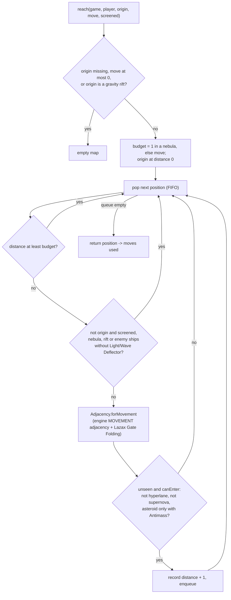
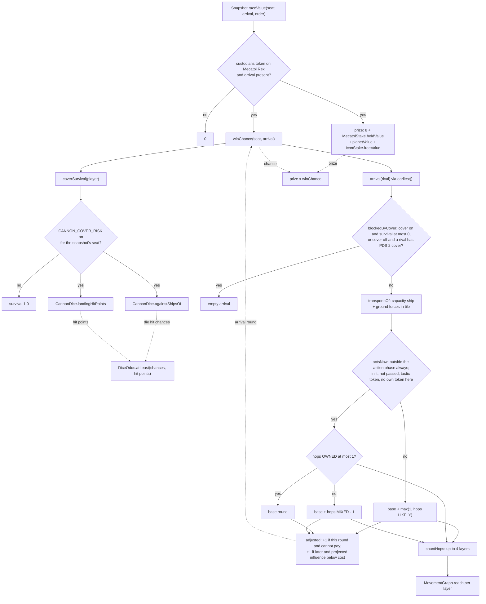

# Shared valuation and technology automation

Part of the [AI player architecture docs](/src/main/java/ti4/ai/README.md): a living document kept next to the code (packages: eval, tech). The code is the source of truth; when you change behavior here, update this file.

## Components and responsibilities

Scope: the 28 classes in [src/main/java/ti4/ai/eval](/src/main/java/ti4/ai/eval) (2,530 lines) and the two classes in
[src/main/java/ti4/ai/tech](/src/main/java/ti4/ai/tech) (586 lines). Every file in both packages is new on this branch;
`origin/master` has no `ti4.ai` package at all.

`ti4.ai.eval` holds no state across decisions, makes no Discord calls and presses no buttons. Almost every class in it
**evaluates** (returns a number in trade-good units for a decider elsewhere) or **informs** (returns facts: distances,
zones, hit probabilities, fleet limits). A few classes are **scopes**: a `ThreadLocal` switch that a caller turns on
around a computation so that the evaluators below behave differently inside it. `ti4.ai.tech` is different: its two
classes are brain rules that **decide** which button to press and **execute** by returning an `AiDecision.press`.

Unit convention: every value is in trade goods (TG). 1 trade good = 1.0, 1 resource = 1 influence = 1 commodity =
0.8 ([ValueScale](/src/main/java/ti4/ai/eval/ValueScale.java)), and 1 victory point = 8.0
(`ObjectiveValue.VICTORY_POINT_VALUE` in [ObjectiveValue](/src/main/java/ti4/ai/scoring/ObjectiveValue.java), outside
this scope but used by six classes here: five in `ti4.ai.eval` and `TechRules`). `ScoringStakes.scoreValue` uses its
own 6 to 12 per point instead ([hub section 6.1](/src/main/java/ti4/ai/README.md#61-common-to-all-subsystems)).

Caching: two classes memoize through `DecisionMemo.remember` ([DecisionMemo](/src/main/java/ti4/ai/brain/DecisionMemo.java)),
in three methods: `Adjacency.forMovement`, `Adjacency.withSystem` and `CombatModifiers.hitModifiers`. A `null` result
is not cached. `AiTickRunner.decide` ([AiTickRunner](/src/main/java/ti4/ai/runtime/AiTickRunner.java)) opens one `DecisionMemo` scope per brain decision and closes it afterwards, so a memoized value
lives for exactly one decision. Outside an open scope (unit tests, offline tools) `remember` recomputes every time.
`ImaginedTurn.of` opens a fresh nested scope so nothing computed for an imagined seat leaks into the real decision.

---

### Unit scale and board access

#### ValueScale

- **Role:** informs (constants).
- **Purpose:** the shared exchange rate that makes resources, influence, commodities and trade goods comparable.
- **Invoked when:** read as constants by 26 files outside this package (for example `ProductionPlanner`,
  `PaymentPlanner`, `ResearchPolicy`, `CardValueScale`, `AgendaValueMath`, `ComponentValues`, `PaymentValue`), and by
  `BoardView.planetValue` here.
- **Inputs / outputs:** `TRADE_GOOD = 1.0`, `RESOURCE = 0.8`, `INFLUENCE = 0.8`, `COMMODITY = 0.8`;
  `spendable(resources, influence) = 0.8 * resources + 0.8 * influence`.
- **Algorithm:** none beyond the formula. There is no conversion for victory points here; that constant (8.0) lives in
  `ObjectiveValue`.
- **Limitations:** the rate is flat. It does not depend on round, on what the seat needs to buy, or on Mirror Computing
  (which `Wallet.tradeGoodValue` handles separately for payments).

#### BoardView

- **Role:** informs.
- **Purpose:** the read-only facade over `Game`/`Tile`/`UnitHolder` that the AI uses for unit counts, unit models,
  movement values, capacity, enemy presence and planet value. Referenced from 144 production files.
- **Invoked when:** by nearly every AI evaluator and rule; within this scope by `Threats`, `CannonDice`, `CustodiansRace`,
  `IconStake`, `PlanetStake`, `ShardPrize`, `FracturePrize`, `FractureCampaign`, `TechRules`.
- **Inputs:** a `UnitHolder`/`Tile`/`Planet` and a `Player`.
- **Outputs:**
  - Counting: `count` (by colour), `ships` (an `EnumMap` of the player's ship types, using `UnitModel.getIsShip`),
    `nonFighterShips`, `shipCost` (sum of unit cost of non-fighter ships), `undamaged`, `damaged` (states `dmg` plus
    `dmg_glv`), `countInTile`, `groundForces` (infantry + mechs), `space(tile)` (the `"space"` holder).
  - Movement: `moveValue(player, type)` = the unit model's move, plus `MoveBoost.extra(player)` (0 or 1) when the base
    move is above 0. `moveValueWithGravityDrive` adds 1 for tech `gd`. `moveValueWithBoosts` adds `singleShipBoosts` =
    1 for Gravity Drive + 1 when the legendary planet Tempesta's ability is ready (`LegendaryPlanets.abilityReady`).
  - `capacity(player, type)` from the unit model.
  - Presence: `hasEnemyShips` / `hasEnemyUnits` / `hasOwnShips` delegate to `FoWHelper`;
    `enemyGroundForcesOn` and `enemyStructuresOn` iterate `game.getRealPlayersNNeutral()`, so neutral units count as
    enemies.
  - `controller(game, planet)` = `game.getPlayerThatControlsPlanet`; `hasCustodians(planet)` = the planet carries
    `Constants.CUSTODIAN_TOKEN_PNG`.
  - `planetValue(planet)` = `0.8 * resources + 0.8 * influence` (the planet object's printed values), plus
    `LegendaryPlanets.holdingValue(name)` for a legendary planet (Thunder's Edge 6, Ordinian 5.5, Mallice/Hope's
    End/Industrex/Emelpar 4.5, Faunus/Custodia Vigilia 4, Primor/Mecatol Rex 3.5, Tempesta 3, Mirage/Illusion/Phantasm
    2.5, Ordinian C4 5.5; any other official legendary planet and every non-official legendary planet
    `LEGENDARY_VALUE = 2`), plus `TECH_SPECIALTY_VALUE = 0.3` when the planet has any
    technology specialty.
  - `availableResources` = `Helper.getPlayerResourcesAvailable` + trade goods × `Wallet.tradeGoodValue` (2 with
    Mirror Computing, otherwise 1).
  - `planetResources` / `planetInfluence` delegate to `Helper.getPlanetResources/Influence` (current values with
    modifiers), unlike `planetValue`, which reads the planet object's own fields.
- **Constants:** `MOVING_SHIPS` = destroyer, cruiser, carrier, dreadnought, flagship, war sun; `GROUND_FORCES` =
  infantry, mech; `DOCK_FIGHTER_ALLOWANCE = 3` (used by `BoardCards`, `FreelancersRules`).
- **Limitations:** `moveValueWithBoosts` grants Gravity Drive and Tempesta to every ship it is asked about, although
  each applies to a single ship per action in the rules; callers that sum over a fleet (`Threats`) therefore
  over-estimate how many ships get the extra move.

---

### Movement and adjacency

#### Adjacency (AI helper)

- **Role:** informs.
- **Purpose:** the AI's two adjacency queries, memoized per decision. Not to be confused with the engine's
  `ti4.helpers.adjacency.Adjacency`; the AI reaches the engine class only through `FoWHelper`.
- **Invoked when:** `forMovement` by `MovementGraph.reach` for every BFS expansion; `withSystem` by `CannonDice.of`,
  `DirectiveValues`, `ExpertDirectiveValues` and `ForAgainstLawValues` (systems around Mecatol Rex or a tile).
- **Algorithm:**
  - `forMovement(game, player, position)` = `FoWHelper.getAdjacentTiles(game, position, player, toShow=false,
    includeTile=false, forDistance=true)`. That deprecated helper builds `Adjacency.of(game, player)` with
    `AdjacencyPurpose.fromLegacyFlags(false, true)` = `MOVEMENT` and returns `from(position)` without the system
    itself. To that set it adds `LazaxGateFolding.movementLinks`: when the player owns `lgf`, does not control Mecatol
    Rex, and the position is not Mecatol Rex but holds an alpha or beta wormhole, Mecatol Rex's position is added.
    The link is one way (into Mecatol Rex only).
  - `withSystem(game, player, position)` = `getAdjacentTiles(..., toShow=false, includeTile=true)` → purpose
    `EFFECTS`, including the system itself.
  - Both results are wrapped unmodifiable and memoized under keys `("adjacency.movement" | "adjacency.withSystem",
    player, position)`.
- **Limitations:** still routed through the `@Deprecated(forRemoval = true)` `FoWHelper.getAdjacentTiles` overloads
  rather than `Adjacency.of(game, player).forMovement().from(pos)`. Direction is always "from the position", which is
  correct for movement; `withSystem` is used for space cannon where AGENTS.md asks for `into(target)`.

#### MovementGraph

- **Role:** informs.
- **Purpose:** which systems a player's ships can reach from an origin with a given move value, and at what distance.
- **Invoked when:** 44 call sites in 23 files. In scope: `Threats`, `IconStake.freeTraitPlanetsInReach`,
  `FractureCampaign.distanceToIngress`, `CustodiansRace.Snapshot.reach`. Outside: `TacticalPlanner` (candidate moves,
  `canEnter` checks), `ProductionPlanner`, `IncomingForces`, `PresenceReach`, `SupplyLines`, `GroundCampaign`,
  `TraitRaid`, `RoundGoals`, `NeutralSetups`, `PrecisionRules`, `StrikeEvaluator`, `WarfareUses`, `ReachLever`,
  `OpeningOutlook`, `ActionSecretOdds`, `CeasefireRules`, `TempestaRules`, `ExpansionOutlook`, `SiteScore`.
- **Inputs:** game, player, origin position, move value, optional set of `screened` positions.
- **Outputs:** `Map<String, Integer>` position → number of moves used; the origin maps to 0.
- **Algorithm (breadth-first search):**
  1. Empty result when the origin tile is missing, `moveValue <= 0`, or the origin is a gravity rift for that player
     (`Tile.isGravityRift(game, player)`).
  2. Budget = `min(moveValue, 1)` when the origin is a nebula (`NEBULA_MOVE = 1`), otherwise `moveValue`.
  3. Pop positions in FIFO order. A position at distance ≥ budget is not expanded. A position other than the origin is
     not expanded when it is in `screened` or `blocksPassage` is true: the tile is missing, a nebula, a gravity rift,
     or holds another player's ships (`FoWHelper.otherPlayersHaveShipsInSystem`) while the player lacks Light/Wave
     Deflector (`lwd` or `absol_lwd`).
  4. For each neighbour from `Adjacency.forMovement` not yet seen, record distance + 1 if `canEnter`: the tile and its
     model exist, it is not a hyperlane tile, not a supernova, and not an asteroid field unless the player has
     Antimass Deflectors (`amd`, `absol_amd`) or the `withAntimassDeflectors` scope is on.
  So nebulae, gravity rifts and enemy-occupied systems can be entered but end the path.
- **Scope switch:** `withAntimassDeflectors(supplier)` sets a `ThreadLocal` flag so asteroid fields count as enterable
  inside it; `assumesAntimass()` reports the flag. Used by `ReachLever` (what researching Antimass Deflectors would
  open up). `IncomingForces.assumptions` puts the flag into its cache key.
- **Depends on:** `Adjacency.forMovement`, `Tile` anomaly predicates, `FoWHelper`.
- **Limitations:**
  - Gravity rifts never add movement and always stop a path; a fleet starting in one cannot move at all.
    `Tile.isGravityRift(game, player)` is also true for a system holding a Vuil'raith (`cabal_spacedock`) dock, a
    Dimensional Tear dock, and, for a player with Fractal Spike Drives, any wormhole system, so those origins return an
    empty map.
  - No command-token check: the origin or destination holding the player's own token is not considered here
    (callers such as `Threats.incomingFleetCost` skip such origins themselves).
  - Only ships' move value; no fleet capacity, no fleet pool, no per-ship differences. `reach` itself is not
    memoized; `CustodiansRace` keeps its own cache.
- **Tested:** `MovementGraphTest` checks that a system with another player's ships stops movement and that `lwd` lets
  it pass. `MovementGraphFractureTest` checks Fracture ingress/egress distances and screening.

##### Diagram: MovementGraph.reach

#### Territory

- **Role:** informs.
- **Purpose:** a per-seat classification of every board position into zones by hex distance only.
- **Invoked when:** `Territory.of(game, seat)` is built by `TacticalPlanner.territory` (zone bonuses for expansion and
  attacks), `RoundGoals.of`, `OffenseOutlook.angerSensitivity`, `Hostility.location/presence`, `Grievance.location`,
  `PeaceAccords.claims`, `PdsSites.territory`, `ReachLever.targets`, `ResearchPolicy.reachableFrontierTokens`,
  `ExpertLawValues.sliceWormholes`, `Extortion.isHome`, `ThroneTiming.sliceTaken`, `TraitReach.weightedCount`,
  `FractureCampaign.routeShare`.
- **Inputs:** the seat's home tile, the Mecatol Rex tile, every other real player's home tile.
- **Outputs:** `zone(tile)` ∈ `HOME, LANE, SLICE, BORDER, FOREIGN, OTHER_HOME, MECATOL, NEUTRAL`, cached per position in
  the instance.
- **Algorithm:** BFS on `MapPositionMapper.getAdjacentTilePositions` (pure hex geometry; wormholes, hyperlanes,
  anomalies and units ignored) from the seat's home, from Mecatol Rex, and from each other home, up to `RADIUS = 12`
  steps, skipping `"x"` and blank positions. Classification, in order:
  1. the seat's home → `HOME`; Mecatol Rex → `MECATOL`; another seat's home → `OTHER_HOME`;
  2. not reached from the seat's home (or the seat has no home) → `NEUTRAL`;
  3. let `own` = distance from the seat's home, `other` = smallest distance from any other home (∞ when none);
  4. `own <= other` and `own + distance(position, Mecatol) == distance(home, Mecatol)` → `LANE`;
  5. `own < other` → `SLICE`; `own == other` → `BORDER`; otherwise `FOREIGN`.
- **Effect on the game:** none directly. In `TacticalPlanner` a planet taken in a `LANE` adds 1.5, `SLICE` 1.0,
  `BORDER` 0.3, and `FOREIGN` costs 1.0 × `earlyGameWeight` (constants `LANE_PLANET_BONUS` etc. in
  [TacticalPlanner](/src/main/java/ti4/ai/tactical/TacticalPlanner.java)).
- **Example:** on the default six-player map with the seat at 301 and Mecatol Rex at 000, `TerritoryTest` asserts 201
  and 101 are `LANE`, 302 and 318 `SLICE`, 202 and 212 `BORDER`, 203 `FOREIGN`.
- **Limitations:** no Mecatol Rex → no lanes; distances are geometric, so a wormhole neighbour is still "far".
- **Tested:** `TerritoryTest` (six-player zones, sparse boards, no Mecatol Rex, no home, unknown position, no hidden
  information read).

---

### Combat probability

#### DiceOdds

- **Role:** informs.
- **Purpose:** the probability of at least `needed` hits from independent dice with individual hit chances.
- **Invoked when:** `CustodiansRace.Snapshot.coverSurvival`, `StrikeEvaluator.estimate`, `DefenseOutlook.undefendedChance`,
  `CannonExposure.of`, `CannonWipeRules.chanceToWipe/chanceToKillOneShip`, `BombardmentRules.chanceToDestroyAll`,
  `PrecisionRules.chanceToClear`, `SeatCover.seatShortfall`, `SupplyLines.survival`.
- **Algorithm:** dynamic programming over the Poisson-binomial distribution: start with `[1.0]`, for each die shift by
  `(1 - p, p)`; sum the entries from `max(0, needed)` upward. Exact, no sampling.

#### CannonDice

- **Role:** informs.
- **Purpose:** the space cannon dice that can fire at a system and the hit points a landing fleet has against them.
- **Invoked when:** `of` by `BattleMath.cannonDice`; `againstShipsOf` by `CustodiansRace.Snapshot.coverSurvival`,
  `StrikeEvaluator.estimate`, `CannonExposure.dieChances`; `fromShooter` by `DefenseOutlook.undefendedChance`;
  `landingHitPoints` by `CustodiansRace.Snapshot.hitPoints` and `TacticalPlanner.stagedHitPoints`; `hitChance` by
  `BattleMath.hitChance`.
- **Algorithm:**
  - `of(game, tile, shooter, leaving)`: for every position in `Adjacency.withSystem(tile)` (the system and its
    neighbours), every unit holder not in `leaving`, every unit key of the shooter: skip units with no model; skip
    units outside the system unless `getDeepSpaceCannon(shooter)` (PDS II and similar); skip the Xxcha mech
    (`xxcha_mech`) while the law _Articles of War_ (`articles_war`) is in play. Emit `(dieCount × unitCount,
    hitsOn)`.
  - `fromShooter(game, tile, shooter, target)`: empty when the tile is an Entropic Scar (`tile.isScar(game)`);
    otherwise every die of `of(...)` at `hitChance(hitsOn + penalty)`, penalty 1 when the target owns Antimass
    Deflectors (`amd` or `absol_amd`).
  - `againstShipsOf(game, target, tile)`: the dice of every real player except the target.
  - `hitChance(hitsOn) = max(0, 11 - hitsOn) / 10`. It is not capped at 1, so a `hitsOn` below 1 would give a chance
    above 1 (`CombatOdds` clamps its own copy of the formula; this one does not).
  - `landingHitPoints(owner, ships, damaged, groundForces)`: for each moving ship type, +1 per ship and +1 per
    undamaged ship whose model sustains damage; capacity = Σ capacity × count; carried fighters =
    `min(fighters, max(0, capacity - max(1, groundForces)))`; result `max(1, hitPoints + carriedFighters)`. Fighters
    without room do not soak hits.
- **Limitations:** no Plasma Scoring/Graviton/other roll-time effects beyond what `UnitModel.getSpaceCannonDieCount`
  and `getSpaceCannonHitsOn` already return; every shooter is assumed to fire.
- **Tested:** `CustodiansCoverTest` (one PDS II on 5 leaves a lone carrier 0.4 survival; an escort or a carried fighter
  soaks the single die; a fighter without room does not).

#### CombatOdds

- **Role:** evaluates (exact combat outcome probabilities and expected losses).
- **Purpose:** the space and ground combat model behind attack, defense, retreat and combat-card decisions.
- **Invoked when:** `StrikeEvaluator.spaceCombat/groundDetailed`, `CombatForecast.detailed/spaceOutlook/landingWin/swing`,
  `DefenseOutlook.computeSpace/bombardmentHits/expectedShipLoss/expectedAttackerLoss`,
  `CombatForces.win/garrisonHoldChance`; the `Combatant`/`Force` records are built by `CombatForces`, `BattleMath`,
  `Exposure`, `PresenceReach`, `ExtraDieTarget`, `LetnevSpaceCombat`, `VanHauge`.
- **Inputs:** two `Force`s (attacker, defender), optionally different first-round forces and hits already absorbed.
  A `Combatant` is `(hitsOn, dice, sustain, cost, type, retaliates)`. A `Force` is `(units, hitMultiplier, repairs,
  afterOpponentLoss, weaves, rerollRounds, detonates)`.
- **Outputs:** `Outcome(attackerWins, defenderWins, bothDestroyed)`; `Detailed` adds expected cost lost by each side,
  the attacker's expected cost lost conditional on winning, and the probability that each side loses at least one unit
  of non-zero cost.
- **Algorithm (exact Markov chain over hits absorbed):**
  1. Each side's units are sorted by cost ascending (loss order). Hit points = units + sustaining units. The first
     `sustains` hits a side takes are absorbed by sustain damage; every later hit destroys the cheapest surviving
     unit.
  2. State = (hits absorbed by A, hits absorbed by D) with a probability; start at `(absorbedA, absorbedD)` with 1.0.
  3. Each round, for each state, each side's hit distribution is computed from its surviving units: per die
     `p = clamp((11 - hitsOn) / 10, 0, 1)`, or `1 - (1 - p)^2` in rounds `< rerollRounds` (Munitions Reserves),
     combined by the same convolution as `DiceOdds`. Round 0 uses the first-round forces. When the opponent has
     already lost a unit and the force has `afterOpponentLoss`, the improved units roll instead (same loss order).
     Distributions are cached per side per absorbed count.
  4. For every pair (x hits by A, y hits by D): `weaves` adds 1 hit to a side when the opponent scored at least one
     hit that round; hits are multiplied by the shooter's `hitMultiplier` (2 for `doublingHits`); a side's
     `retaliates` sustaining units add one hit back to the opponent for each of their sustains absorbed this round;
     absorbed counts are capped at hit points.
  5. A side whose absorbed count reaches its hit points is destroyed. `detonates`: when that side is destroyed the
     opponent is destroyed too (Van Hauge). Both destroyed → `bothDestroyed`; only the defender → `attackerWins`;
     only the attacker → `defenderWins`; neither → continue, after `repairs` (Duranium Armor model) removes one
     absorbed hit when the side had taken sustain damage before this round and has not yet lost a unit.
  6. States below `NEGLIGIBLE = 1e-7` are dropped each round. After `MAX_ROUNDS = 60` rounds the remaining mass is
     added to `defenderWins`.
- **Example:** two cruisers that hit on 7 (p = 0.4): per round A-only 0.24, D-only 0.24, both 0.16, neither 0.36, so
  attacker wins 0.24 / 0.64 = 0.375 and both die 0.25. `CombatOddsTest.matchesTheClosedFormForASingleDuel` asserts
  this.
- **Limitations:** sustain is always used before any unit is lost and losses are always cheapest first; repair only
  happens before the first unit is lost; dropped states make the three outcomes sum to slightly less than 1; retreats
  are not modelled inside the chain (the callers model them).
- **Randomness:** none.
- **Tested:** `CombatOddsTest` (closed form, sustain, rerolls, doubling, repairs, weave, retaliation, upgrade after
  first kill), `CombatOddsDetailedTest` (expected losses), `CombatOddsFirstRoundTest` (first-round forces, starting
  from absorbed hits).

#### CombatModifiers

- **Role:** informs.
- **Purpose:** the bot's own standing combat modifiers per unit type, so the odds model rolls what the bot would roll.
- **Invoked when:** `CombatForces.combatants` (which builds the `Combatant`s for the planner and defense outlook).
- **Algorithm:** maps each side's `UnitType → count` to `UnitModel → count`; calls
  `CombatModHelper.getModifiers(..., CombatRollType.combatround, ..., Constants.COMBAT_MODIFIERS)` and keeps only
  modifiers whose persistence type is `ALWAYS` or `CONDITIONAL`; then for each own model
  `CombatModHelper.getCombinedModifierForUnit(...)`. Returns `UnitType → modifier`. Memoized per decision under the tile
  position, holder name, both players and both unit maps.
- **Fallbacks:** an empty side returns an empty map; any `RuntimeException` from the engine helper clears the map
  (no modifiers) instead of failing the decision.
- **Limitations:** one-shot modifiers (action cards, once-per-combat abilities) are excluded by the persistence filter.

---

### Threat and reach

#### Threats

- **Role:** informs.
- **Purpose:** whether and how much enemy fleet can reach a system next move.
- **Invoked when:** `incomingFleetCost` by `SiteScore.pressure`, `CeasefireValue.outgunned`; `reachableByEnemies` by
  `PlanInputs.assemble`, `ImperialDenial.securedMecatol`; `anyEnemyCanReach` by `ExploreOutlook.enemyCanReach`,
  `NanoforgeFlow.worth`, `ProductionPlanner.planIntegrated`, `RetreatRules.destinationValue`,
  `TroAgentRules.exposure`.
- **Algorithm:**
  - `incomingFleetCost(game, mover, target)`: over every tile except the target and except tiles holding the mover's
    command token, over every non-fighter ship type of the mover in space: move = `moveValueWithBoosts`; if
    `MovementGraph.reach(origin, move)` contains the target, add unit cost × count.
  - `reachableByEnemies(game, seat)`: for every other real player and every tile where they have non-fighter ships,
    the union of `MovementGraph.reach` with that tile's highest non-fighter move (with boosts). Origins holding the
    player's token are not skipped here.
  - `anyEnemyCanReach(game, seat, target)` = some other real player has `incomingFleetCost > 0`.
- **Limitations:** ignores tactic tokens left, passing, capacity (fighters and ground forces carried are not counted),
  fleet pool, and the target holding the mover's token; boosts are applied to every ship.
- **Tested:** `ThreatsTest` (an adjacent dreadnought threatens home and its own system; fighters and own ships threaten
  nothing).

#### FleetLimit

- **Role:** informs, plus a scope switch.
- **Purpose:** the per-system ship limit the AI plans with.
- **Invoked when:** 30+ call sites: `TacticalPlanner.legalMoves/followers/withEscort/exceedsFleetSupply/...`,
  `ProductionPlanner.fleetShipsWanted/oneShipBuilder/...`, `IncomingForces.withinFleetSupply`, `PresenceReach.search`,
  `SeatStrike`, `WarfareUses.doubleBuild`, `OpeningOutlook.produce`, `AvernusRules.destroyerRoom`,
  `SystemTargetCards.canHoldGhostShip`, `ActionCardValue.cruiserTiles`, `LegendaryOutlook.reinforcement`;
  `bonus` by `CommandTokenPolicy.fleetBonus` and `ExpertDirectiveValues.shipsOverLimitValue`.
- **Algorithm:** `bonus` = `max(0, effectiveFleetCC - fleetCC)` (Mahact Edict tokens) + 2 for ability `armada`.
  `ships` = `fleetCC + bonus`, or `UNLIMITED = 1000` when the Letnev hero (`letnevhero`) is active or the current thread
  is inside `assumingUnlimited(seat, ...)` for that seat (used by `DarktalonTreillaRules` to ask "what would the best
  plan be without the limit").
- **Limitations:** non-fighter ship counting and fighters beyond capacity are the callers' job.

#### MoveBoost

- **Role:** scope switch plus card lookup.
- **Purpose:** plan a tactical action as if every ship of one seat had +1 move (_Flank Speed_).
- **Invoked when:** `TacticalPlanner.flankSpeedPlans` checks `flankSpeedCard(seat)` and runs the ranking inside
  `withOneMore(seat, ...)`; `ActionCardRules.flankSpeed` uses `flankSpeedCard` to play the card;
  `BoardView.moveValue` adds `extra(player)`; `IncomingForces.assumptions` keys its cache with `boostedFaction()`.
- **Algorithm:** `flankSpeedCard` = the alphabetically first action card in the seat's hand (through
  `ImaginedTurn.actionCards`) whose model's automation id is `flank_speed`. `extra(player)` = 1 while the thread is
  inside `withOneMore` for that player, else 0.

---

### Planet, point and prize values

#### PlanetStake

- **Role:** evaluates.
- **Purpose:** what the seat loses if it loses a planet it controls; and the value of its structures there.
- **Invoked when:** `of` by `DefenseOutlook.stake`, `CombatForecast.planetStake`, `RetreatRules.evacuates/retreatBelow`,
  `ExploreOutlook.planetStake`, `ForesightRules.stake`, `SkilledRetreatCard.stakeLeftBehind`, `TroAgentRules.special`;
  `structures` by the same defense/retreat classes plus `StrikeEvaluator.ground`, `CardValue.of`,
  `StellarConverterFlow.worth`, `Extortion.groundLoss`; the constants by `Reclamation`.
- **Algorithm:** `of = planetValue(planet)` + (when the seat has not exhausted it: `max(current resources, current
  influence)`) + `FracturePrize.point` (8 for Styx) + `ShardPrize.stake` + `max(0, -objectives.gain(before without the
  planet))`, the last term being the objective value lost by no longer controlling it (from
  `ObjectiveValue`). `structures = 4.0 × own space docks + 3.0 × own PDS` on that planet (`SPACE_DOCK = 4.0`,
  `PDS = 3.0`).
- **Example:** a ready 3-resource 1-influence planet with no specialty, not legendary, no objective depending on it:
  `0.8×3 + 0.8×1 + max(3,1) = 6.2` TG, plus 4 if it holds the seat's dock.

#### ShardPrize

- **Role:** evaluates.
- **Purpose:** the victory point attached to _The Shard of the Throne_ relic, which changes hands with a legendary
  planet or a home-system planet of its holder.
- **Invoked when:** `stake` by `PlanetStake.of`; `gain` by `OffenseOutlook.evaluate`.
- **Algorithm:** a planet "carries the Shard" for holder H when H holds relic `shard`, controls the planet, and the
  planet is legendary (`LegendaryPlanets.isLegendary`) or lies in H's home system. `stake(seat, planet)` = 8 when it
  carries the seat's Shard. `gain(seat, planet)` = 8 when the planet's current controller is another player for whom
  it carries the Shard.
- **Tested:** `ShardPrizeTest`.

#### FracturePrize

- **Role:** evaluates / informs.
- **Purpose:** facts and values for the Thunder's Edge Fracture planets (Cocytus, Styx, Lethe, Phlegethon).
- **Invoked when:** by `TacticalPlanner`, `OffenseOutlook`, `DefenseOutlook.computeGuarded`, `ProductionPlanner.fractureInterest`,
  `StyxTake`, `FractureScreen`, `FreedPlays`, `ReachLever`, `StructurePolicy`, `DannelPlan`, `WinOdds`, `PlanetStake`,
  `FractureCampaign` (full list in section 7).
- **Algorithm:** `point(planet)` = 8 for Styx, else 0. `relic(seat, planet)` = `RelicValue.draw` when the planet has
  `token_relictoken.png`, else 0. `gain = relic + point`. `interest(seat)` = 1.0 as soon as a Styx not controlled by
  the seat exists; otherwise 0.5 when some Fracture planet not controlled by the seat has no controller; otherwise 0.
  `hasIngress(tile)` = the space area holds `Constants.TOKEN_INGRESS`. `tiles(game)` = tiles holding a Fracture planet.
  `holdsStyx(tile, owner)`.

#### FractureCampaign

- **Role:** informs / evaluates.
- **Purpose:** where to build the fleet for Styx and how much a Fracture march is worth to the seat.
- **Invoked when:** `dock` by `ProductionPlanner` (through `isDock` in `planFractureFleet/planFractureFighters`),
  `CommandTokenPolicy.fractureFleet`, `ResearchPolicy.fractureMarchValue`, `ThroneSale.styx`, `WinRace.styxPoint`;
  `routeShare` by `TacticalPlanner.routeShare`, `ProductionPlanner.fractureValuePerResource`, `CommandTokenPolicy`,
  `ResearchPolicy`; `styxToTake` by `StructurePolicy.onOwnIngress`; the fleet constants by `ProductionPlanner` and
  `TacticalPlanner`.
- **Algorithm:** `styxToTake` = some Styx on the board is not the seat's. `dock` (only while `styxToTake`): over the
  seat's space-dock tiles, `MovementGraph.reach(dock, DOCK_RANGE = 2)` and the smallest distance to a tile with an
  ingress token; the dock with the strictly smallest distance wins (ties: the first in tile-map iteration order); no
  dock within 2 → empty. `routeShare` = 1 when any ingress tile lies in the seat's `HOME`, `LANE` or `SLICE` zone
  (`Territory`), else `FOREIGN_ROUTE_SHARE = 0.5`. Fleet constants: `FLEET_SHIPS = 3`, `DREADNOUGHTS = 3`,
  `CARRIERS = 1`, `INFANTRY = 6`.
- **Tested:** `FractureTargetsTest`, `StyxWinThreatTest`, `ThroneSaleTest` use it (not read in detail for this
  fragment).

#### MecatolStake

- **Role:** evaluates.
- **Purpose:** what holding Mecatol Rex is worth beyond its planet value.
- **Invoked when:** `holdValue` by `CustodiansRace.Snapshot.prize`, `DefenseOutlook.mecatolHold`,
  `OffenseOutlook.evaluate`, `TacticalPlanner.stagePrize`, `SardakkHeroRules.stake`, `TroAgentRules.special`,
  `DannelPlan.mecatol`; `ownHoldValue` by `OffenseOutlook.evaluate/counterstrike`, `RoundGoals.mecatolValue`,
  `TacticalPlanner.mecatolTakeValue/stagePrize`; `redrawValue` by `TacticalPlanner.mecatolTakeValue`.
- **Algorithm:** `holdValue = 8 × 0.25 × clamp(GameHorizon.roundsLeft - 1, 0, 2)`, i.e. 0, 2 or 4 TG, the same for
  every player. `ownHoldValue = holdValue + redrawValue`, where `redrawValue = SecretDraws.redrawValue(game, seat)`
  only when the Mecatol tile holds unit holder `mrte` (Thunder's Edge Mecatol Rex) or `mc` (Mecatol City).
- **Example:** 10-point game, leader at 2 → roundsLeft 4 → 2 imperial rounds → 4.0. Leader at 6 → 2.0. Leader at 9
  → 0. Asserted by `MecatolStakeTest`, which also verifies no secret, action card or promissory note is read.

#### IconStake

- **Role:** evaluates / informs (and supplies a comparator to deciders).
- **Purpose:** _Seize an Icon_ (secret `sai`) and trait-objective pull on which planets to claim first.
- **Invoked when:** `claimOrder` by `TacticalPlanner.expand/landingTargets/enemyPlanets`, `StrikeEvaluator.freePlanets`;
  `freeValue` by `CustodiansRace.Snapshot.prize`, `RoundGoals.iconValue/mecatolValue`; `freeTiles` by
  `TacticalPlanner.iconTiles`; `marks` by `TacticalPlanner.stagePrize/worthStagingFor`; `behindCustodians` by
  `CustodiansRace.Snapshot.canPayNow`, `TacticalPlanner.canPayCustodians`.
- **Algorithm:**
  - `seeks` = the seat holds unscored `sai` (through `ImaginedTurn.unscoredSecrets`) and its progress on it is 0.
  - `behindCustodians` = seeks and some legendary planet still carries the custodians token.
  - `marks(tile)` = seeks and the tile has a legendary planet not the seat's. `freeValue(tile)` = 8 when seeks and the
    tile has such a planet with no controller. `freeTiles` = non-Mecatol tiles without enemy units that have one.
  - `claimOrder`: legendary planets first while seeking; then by `claimValue` descending, where `claimValue =
    planetValue + 2.0` (`TRAIT_CLAIM_PULL`) when the planet's trait is wanted by a `TraitNeeds` secret or equals the
    leading public trait.
  - `leadingPublicTrait`: only when the seat can score public objectives and _Corner the Market_ (`corner`) or _Unify
    the Colonies_ (`unify_colonies`) is revealed and unscored by it. Then the trait among cultural, hazardous,
    industrial with the most owned scoring planets, then the most uncontrolled, custodian-free scoring planets within 2
    moves of home (`MovementGraph.reach`, `CLAIM_REACH = 2`), then list order (cultural before hazardous before
    industrial).
- **Tested:** `IconStakeClaimOrderTest` (better planet first without a trait objective, leading trait for _Corner_,
  objective ignored once scored, trait with most planets).

#### TraitNeeds

- **Role:** informs.
- **Purpose:** the trait planets still missing for the seat's trait secrets.
- **Invoked when:** `IconStake.claimOrder/claimValue`; `TraitRaid.firstBlockingGate/firstUnclaimedGate/freeCount/heldBy/holdLoss/raidable`.
- **Algorithm:** for each unscored secret (through `ImaginedTurn.unscoredSecrets`) listed in
  `ObjectiveValue.TRAIT_SECRETS` (`mp` → industrial, `faa` → cultural, `mrm` → hazardous): threshold from
  `ListPlayerInfoService.getObjectiveThreshold`, owned = controlled planets of that trait that count for scoring (not a
  space station, not fake); emit `Need(secret, trait, owned, required)` while `owned < required`.

#### RelicValue

- **Role:** evaluates.
- **Purpose:** the TG value of drawing a relic.
- **Invoked when:** only `draw` is called from outside: `FracturePrize.relic`, `CardValue.of` (explore card `dw`),
  `FragmentRules.insteadOfTacticalAction` (× `EARLY_USE_SHARE`), `ElectionValues.ministerOfAntiquities`.
  `BASE = 3.5` is read by `FragmentValue.worth`. `of(relicId)` has no production caller outside this class.
- **Algorithm:** `draw` = the average of `of(card)` over `game.getAllRelics()` (the relic deck); a null deck uses every
  relic in the table; an empty deck gives 0. `of` = the table value clamped at 0, 0 for an id not in the table. Table
  (round r = `game.getRound()`, `decaying(b) = b - 0.5 r`):

  | Relic id | Value |
  | --- | --- |
  | `dominusorb` | 4 |
  | `mawofworlds` | 4 through round 4, then 0 |
  | `emelpar` | 6 - r |
  | `shard` | 6 - 2 × legendary planets the seat controls |
  | `stellarconverter` | 1 |
  | `codex` | 7 |
  | `emphidia` | decaying(5), +2 while any planet carries the Tomb of Emphidia attachment |
  | `thalnos` | 1 when the seat has a war sun on the board or is Naaz-Rokha, else 0 |
  | `obsidian` | 8 |
  | `prophetstears` | decaying(3) |
  | `dynamiscore`, `titanprototype`, `circletofthevoid` | decaying(5) |
  | `nanoforge` | decaying(5), −4 when the seat holds the Shard |
  | `bookoflatvinia` | 8 |
  | `neuraloop`, `quantumcore` | decaying(2) |
  | `metalivoidarmaments`, `metalivoidshielding` | 4 |
  | `thesilverflame`, `heartofixth` | 0 |
  | `lightrailordnance` | 2 |
  | `thetriad` | decaying(4) + number of fragment kinds (C, I, H, U) the seat holds |

- **Limitations:** relic ids outside the table (homebrew, `absol_` variants) are worth 0 and pull the average down.
- **Tested:** `RelicValueTest` (empty deck, average, fixed values, decay, Scepter floor, Maw, Nano-Forge with Shard,
  Thalnos, Triad).

#### GameHorizon

- **Role:** informs.
- **Purpose:** how many rounds the game has left, as used by every time-discounted value.
- **Invoked when:** 34 files, e.g. `MecatolStake`, `AgendaValueMath.lawRounds/endsSoon`, `ResearchPolicy`,
  `ActionSecretOdds`, `ActionSecretTiming.pursueNow/worriedAboutTheBoard`, `GroundCampaign.roundsLeft`,
  `ElectionValues`, `ThroneValue`, `BreakthroughValue`.
- **Algorithm:** `goal` = `game.getVp()` or 10 when not set. `leaderPoints` = highest total VP. `lateRound =
  ceil(goal / 2)`. `endInSight` = round ≥ lateRound or leader ≥ goal − 4. `roundsBeforeEnd = max(0, min(lateRound −
  round, ceil((goal − 4 − leader) / 2)))`. `roundsLeft = max(1, ceil(max(0, goal − leader) / 2))`, i.e. the leader is
  assumed to score 2 points a round (`LEADER_POINTS_PER_ROUND = 2.0`).
- **Tested:** `GameHorizonTest`.

---

### Faction ratings

#### FactionAggression

- **Role:** informs (a fixed temperament factor per faction).
- **Invoked when:** `DefenseOutlook.temper` (how likely an enemy attacks), `OffenseOutlook` (retaliation), `SiteScore.pressure`
  (Fracture ingress placement), `ThroneValue.fit/peace`, `ExpertLawValues.travelBanGain`.
- **Algorithm:** `AGGRESSIVE` 1.2 for sardakk, l1z1x, letnev, saar, mentak, muaat, nekro, cabal, nomad; `PASSIVE` 0.8 for
  hacan, xxcha, jolnar, empyrean, arborec, ghost, winnu, naaz, yssaril; every other faction id (including Franken and
  homebrew) `AVERAGE` 1.0. `DefenseOutlook.temper` raises it to at least 1.2 when the enemy hunts the seat
  (`SlayIntent.hunts`) and lowers it to at most 0.8 when it hunts someone else.
- **Tested:** `FactionAggressionTest` (ids resolve, no faction listed twice, ranking).
- **Not to confuse with:** the per-seat hidden aggression profile in the seat's stored values (outside this scope).

#### FactionStrength

- **Role:** informs.
- **Algorithm:** `bonus(player)` looks the faction up in `BONUS`, which is `Map.of()`. It always returns 0.
- **Invoked when:** `TacticalStrength.rate` adds it to a seat's tactical strength.

#### FlagshipRating

- **Role:** informs.
- **Purpose:** a tier per flagship that sets how much spare money the production planner wants before building it.
- **Invoked when:** `ProductionPlanner.planSurplusShips/presenceShip` (`spareResourcesNeeded`), `ProductionPlanner.shipWorth`
  and `AllianceValue.nomadBonus` (`of`).
- **Algorithm:** S 1.0 (nekro, ghost, nomad ×2, l1z1x, deepwrought, crimson, xxcha), A 0.8 (yin, sol, naalu, yssaril,
  empyrean, keleres, naaz, mahact), B 0.6 (jolnar, winnu, letnev, mentak, cabal), C 0.4 (muaat, saar, titans), D 0.2
  (argent, arborec, ralnel, sardakk, hacan); an unlisted flagship 0.5; no flagship 0. `spareResourcesNeeded =
  max(0, 1 − rating) / 0.2 × 1.5`: S 0, A 1.5, B 3, C 4.5, D 6, unlisted 3.75.

#### MechRating

- **Role:** informs.
- **Purpose:** per-mech quality, stake in _Articles of War_, on-board ability and worth at home.
- **Invoked when:** only `ExpertMechAgendaValues.articlesStake/homeMechGain/mechDowngrades`.
- **Algorithm:** a `Rating(quality, articlesStake, onBoardAbility, homeWorth)` per unit id (36 entries in the source:
  35 faction mech ids, including three Naaz-Rokha ids and two Firmament/Obsidian ids, plus the generic `mech`);
  unknown ids get `PRIOR (0.25, 0.6, 0, 2.0)`, a seat with no mech model `NO_MECH (0, 0, 0, 0)`, the generic `mech`
  `(0, 0, 0, 2.0)`. Quality levels 0/0.25/0.5/0.75/1.0; stake levels 0/0.25/0.6/1.0/1.5; on-board 0 or 0.3; home
  1.6/2.0/2.2/2.5. `abilityQuality = quality + onBoardAbility`.
- **Tested:** `MechRatingTest` (every official mech rated, homebrew prior, ordering checks).

---

### Information scopes

#### DecidingSeat

- **Role:** scope switch.
- **Purpose:** know which seat's brain is running, so that only that seat's own hidden cards are read and only while it
  is not being imagined.
- **Invoked when:** `NekroBrain.decide` wraps every decision in `DecidingSeat.of(context.seat(), ...)`. Read by
  `knowsHandOf` in `SecretOdds`, `WinOdds`, `WinRace.ownSecret`, `DenialMap.of`, `ImperialUses.secretChance`,
  `TacticalStrength.own`; `orSelf` in `ScoringPaths`, `ScoringStakes`, `ImperialUses.viewer`, `AttackLedger.remembers`,
  `PromiseBook.active`, `ExpertElectionValues`.
- **Algorithm:** a `ThreadLocal<String>` user id. `knowsHandOf(seat)` = the deciding id equals the seat's and
  `ImaginedTurn.imagines(seat)` is false. `orSelf(game, seat)` = the deciding player or `seat` when none.
  `of` restores the previous value in `finally`.

#### ImaginedTurn

- **Role:** scope switch (the AI's only opponent-prediction mechanism lives on top of it).
- **Purpose:** evaluate a turn for another seat using only what the deciding seat could know about it.
- **Invoked when:** `EnemyIntent.ranked` runs `TacticalPlanner.ranked(game, enemy)` inside `ImaginedTurn.of(enemy, ...)`;
  `EnemyIntent.attackWorth` runs a candidate-pool attack evaluation for the enemy the same way;
  `TradeValue.predictedFor` evaluates a deal from the partner's side inside it when experiment `WIN_THREAT_FEASIBLE` is
  on. `unscoredSecrets`/`actionCards` are read in place of `Player.getSecretsUnscored/getActionCards` by 24 call sites
  (`ObjectiveValue`, `TacticalPlanner`, `ProductionPlanner`, `TraitNeeds`, `IconStake`, `MoveBoost`, ...).
  `underway()` is also read by `Standings` (no grudge term inside an imagined turn) and `imagines(seat)` by
  `TacticalPlanner` (an imagined seat skips the check that a landing in another player's home is justified).
- **Algorithm:** `of(seat, supplier)` sets a `ThreadLocal<Player>`, opens a fresh `DecisionMemo` and `SearchMemo` scope,
  runs the supplier, closes both and restores the previous imagined seat. Inside, `unscoredSecrets(seat)` and
  `actionCards(seat)` return empty maps for the imagined seat only. `underway()` lets `EnemyIntent` refuse to imagine
  inside an imagined turn (no recursion).
- **What it is and is not:** a one-ply prediction: the enemy's move is the deciding AI's own `TacticalPlanner` run for
  the enemy with the enemy's hidden cards removed. There is no search over replies, no sampling of hidden cards and no
  learned model. The fresh memo scopes isolate only the current decision; `EnemyIntent` (outside this scope) keeps its
  own static cache of imagined results keyed by game name, enemy (and tile/defender for `attackWorth`) and the game's
  last-modified date, so the same prediction is reused across decisions until the game changes.
- **Tested:** `ImaginedTurnTest` (only the imagined seat's secrets and hand disappear; an imagined seat gets no
  objective value from its own secret _Control the Region_, `ctr`).

---

### The custodians race

#### CustodiansRace (and `CustodiansRace.Snapshot`)

- **Role:** evaluates.
- **Purpose:** for every seat, the earliest round a loaded transport could land on Mecatol Rex while it still has the
  custodians token, the chance the seat lands first, and the TG value of that race.
- **Invoked when:** `TacticalPlanner` (`approachGain` = race value of moving a transport to a destination minus idle,
  `hopsToMecatol`, `canPayCustodians`), `ScoringReserve` (`canLandThisRound`, `coverSurvival`, `winChance` to keep 6
  influence), `WinOdds` (a rival's chance to take the point this round), `InitiativeRace.gain` (strategy card pick:
  `raceValueActingAt` at two initiatives), `ResearchPolicy.custodiansRaceValue` (Gravity Drive: `arrivalWith(LIKELY)`
  vs `arrivalWith(OWNED)`), `WarfareUses`, `TokenPurchase`, `ImperialUses`, `DiplomacyUse`, `PoliticsUses`,
  `OffenseOutlook`, `Standings`, `TacticalRules`, `PlanInputs`.
- **Inputs:** public board state only: units, planets, trade goods, technologies, command tokens, passed state, strategy
  cards, the Naalu 0 token. For the deciding seat it also reads its own `ScoringReserve` plan.
- **Outputs and algorithm:**
  1. `open(game)` / `isOpen()`: the Mecatol tile has a planet with the custodians token. Otherwise every query returns
     empty/0/false.
  2. Transports of a player: every tile where it has a moving ship with capacity > 0 in space and at least one ground
     force anywhere in the tile; transport move = the highest `moveValue` among those ships.
  3. Hops from a tile: layered BFS of up to `MAX_HOPS = 4` layers; layer k is the union of `MovementGraph.reach` from
     every position of layer k−1 with move `baseMove + 1` when Gravity Drive applies to that hop. Mode `OWNED`:
     applies when the player has `gd`. Mode `LIKELY`: also when it owns any propulsion technology. Mode `MIXED`: owned
     on hop 1, likely afterwards.
  4. `actsNow(player, tile)`: outside the action phase always true; in it, not passed, at least one tactic token, and
     the tile does not hold its own command token.
  5. Arrival per transport (base round = current round, +1 during the status or agenda phase):
     - not acting now → `base + max(1, hops(LIKELY))`;
     - acting now and `hops(OWNED) ≤ 1` → `base`;
     - otherwise → `base + hops(MIXED) − 1`.
     `arrival(player)` = the earliest over transports, then `adjusted`: +1 when the arrival is this round and the player
     cannot pay the custodians now (for the deciding seat: a custodians plan in `ScoringReserve`, or behind-custodians
     _Seize an Icon_ and the wallet can pay; for others: `Wallet.canPay` 6 influence); +1 more when the arrival is later
     and projected influence (all controlled planets' influence + trade goods × TG value + uncontrolled custodian-free
     planets' influence within one likely move of its transports, in systems without enemy units) is below the cost.
     Cost = 6 (`COST`), 0 with Blood Ties (`BloodTies.waivesCustodiansInfluence`).
     `idleArrival` (no move this turn) and `arrivalFrom(player, tile)` (`base + max(1, hops(LIKELY))` from a staged
     tile) use the same adjustment.
  6. Cover: with experiment `CANNON_COVER_RISK` on for the snapshot's seat (default on), `coverSurvival(player)` =
     `1 − DiceOdds.atLeast(CannonDice.againstShipsOf(player, mecatol), hp)` where hp is the best
     `CannonDice.landingHitPoints` among its transports; an arrival is blocked only when survival ≤ 0. With the
     experiment off, an arrival is empty whenever another player has PDS 2 cover on Mecatol Rex
     (`ButtonHelper.getPlayersWithPds2Cover`) and survival is 1.
  7. `winChance(seat, arrival, order)` = seat survival × Π over rivals with arrival ≤ the seat's of
     `1 − survival(rival) × (1 − kept)`, kept = `BEATEN = 0.2` when the rival arrives earlier, else the same-round
     chance: seat holds the Naalu 0 token → 0.95; rival holds it → 0.2; `KNOWN` order → 0.2 if the rival's initiative is
     lower else 0.95; `SEAT_FIRST` → 0.95; `UNKNOWN` → 0.5.
  8. `raceValue = prize × winChance`, prize = 8 + `MecatolStake.holdValue` + `planetValue` of the custodians planet +
     `IconStake.freeValue(mecatol)`.
  9. `raceValueActingAt(seat, arrival, initiative)` (strategy phase): rivals arriving the same round are walked in pick
     order; a rival still picking is assumed to take its lowest held card if that is below the lowest open card,
     otherwise the lowest open card. Same-round chance is then 0.2 when that expected card (or a held initiative) is
     below the seat's, else 0.95; with no information, the share of open cards below the initiative mixes 0.2 and
     0.95; no open cards → 0.5.
- **Example:** a Nekro carrier with 2 infantry one system from Mecatol Rex, Gravity Drive not owned, in the action
  phase with tactic tokens: `hops(OWNED) = 1` → arrival this round. If Nekro's 6 influence of planets are exhausted
  and it has no trade goods, `canPayNow` fails → next round; the projection counts exhausted planets, so 6 ≥ 6 and no
  further delay (with only 4 influence projected it would move back one more round). If Sol also arrives next round and initiatives are unknown, the same-round factor is 0.5, and with no cannon
  cover `winChance = 1 × (1 − 1 × 0.5) = 0.5`. In a 10-point game whose leader has 2 points
  (`holdValue` 4) the prize for the base-game Mecatol Rex `mr` (1 resource, 6 influence, not legendary) is
  `8 + 4 + (0.8 + 4.8) = 17.6`, so the race value is 8.8. The Thunder's Edge Mecatol Rex `mrte` is legendary and adds
  its holding value 3.5 to the planet term.
- **Limitations:** the `TODO` in `countHops`: "intermediate layers may pass through systems holding enemy ships, where a
  real move would stop" (each layer restarts `MovementGraph.reach` from positions a real fleet could not have
  continued from). Only up to 4 rounds ahead. A seat with a propulsion technology is assumed to research Gravity
  Drive. Rivals are assumed to have their influence ready when they can pay now.
- **Tested:** `CustodiansRaceTest` (landing rounds, token in system, Gravity Drive likelihood, no ground forces, no
  custodians, payment push-back, order of play, Naalu 0, prize, default-map kits, no hidden information read);
  `CustodiansCoverTest` (cover experiment on/off, escorts, carried fighters, reserve).

---

##### Diagram: Custodians race: from board to race value

Solid arrows are calls or decisions in [CustodiansRace](/src/main/java/ti4/ai/eval/CustodiansRace.java); dotted arrows
carry values.

### Technology automation (`ti4.ai.tech`)

Neither class values technologies; research valuation is `ResearchPolicy.value` in `ti4.ai.strategy` (outside this
scope). Both classes are brain rules: they look at the prompts (`AiPrompt` messages with `PromptButton`s) visible to the
seat, pick a button and return `AiDecision.press`. Multi-step flows keep their step in `context.memory()` under a key
built from the turn key, the action key or the message id, so each step is pressed once.

#### TechRules

- **Role:** decides and executes.
- **Invoked when:** from [NekroBrain](/src/main/java/ti4/ai/nekro/NekroBrain.java), whose `firstRuleDecision` returns
  the first rule in its ordered list that yields a decision. In that list, in order: `reviveInfantry`,
  (`EntropicScarRules.next`), `placeSpinnerInfantry`, (`YinSpinnerRules.afterOtherProduction`), `placeSelfAssemblyMech`,
  (`IconoclastRules.deploy`), `placeMagenInfantry`, (`MatriarchRules.returnFighters`), `continueProductionBiomes`,
  (`DatahubRules.next`, `SlingRelayRules.next`, `TransitDiodesRules.next`), `nullificationField`, `neuralParasite`,
  `salvageOperations`. From `NekroBrain.takeTurn` (the active seat's action phase): `endOfTurn` after the second-action
  check and `ExpeditionRules.endOfTurn`, before `SecretRedrawRules`/`LegendaryRules` end-of-turn steps and the
  `turnEnd`/`endOfTurnAbilities` buttons; `insteadOfTacticalAction` after the action-card alternative and before
  Mathis Mathinus / Lazax Gate Folding / hero alternatives and the tactical action; `beforePassing` after the other
  before-passing alternatives (action cards, heroes, relics, expeditions, Convoys) and before `TacticalRules.stall`,
  the secret-redraw, legendary and Avernus steps and the pass buttons.
  `startYinSpinner` and `startSelfAssembly` from `TacticalRules.placeUnits` once the planned units are placed and
  before it presses "done building" on that production message (Yin Spinner first, then Self-Assembly, then done);
  `startYinSpinner` also from `YinSpinnerRules.afterOtherProduction`, on a prompt that mentions the seat, offers only
  the spinner button and has no open build of the seat's own. Neither start step weighs a value: both are free and
  pressed whenever offered.
- **Behaviour per technology:**
  - **Infantry II revival** (`reviveInfantry`): while the seat has stasis infantry, the owned button with prefix
    `statusInfRevival_` maximizing `amount × 10 + (1 if the planet has the seat's dock)`; amount from the second id
    segment, default 1.
  - **Yin Spinner** (`yso`): `startYinSpinner` presses unowned `startYinSpinner` on the production message once per
    action and message, then memory `placing`; `placeSpinnerInfantry` presses the owned `placeOneNDone_skipbuild_2gf_`
    target with the highest score: own dock planet 3; another own planet `2 + resources / 10`; a space area with an own
    carrier 1; else 0.
  - **Self-Assembly Routines** (`sar`, ready, a mech left in reinforcements): `startSelfAssembly` presses unowned
    `sarMechStep1_...`; `placeSelfAssemblyMech` presses `sarMechStep2_<planet>_...` maximizing `10 (own dock) +
    resources` (the step-2 buttons are unowned).
  - **Magen Defense Grid** (`placeMagenInfantry`): the newest owned visible `useMagenDefense_` button, no choice.
  - **Bio-Stims** (`bs`, `endOfTurn`): proceeds only if exhausting it is useful: Sling Relay (`sr`) owned and
    exhausted while the endurance race is contested (`Endurance.race(...).contested`), or some exhausted planet with a
    technology specialty exists. Then presses owned `exhaustTech_bs` (state `exhausted`) or, when that button is not
    shown yet, owned `endOfTurnAbilities`. Next step presses `biostimsReady_tech_sr` (Sling Relay refill), else
    `biostimsReady_planet_<best>`, else any `biostimsReady_` button. Best planet: max of `ReadyingValue.eachAlone`
    (rounded to 0.01), then "paid for an expedition this turn", then resources + influence.
  - **Production Biomes** (`pm`, ready, unused this turn): only with a spare strategy token: `strategicCC ≥ 1 +
    StrategyCardRules.strategyTokensWantedForFollows` and `strategicCC + tacticalCC − 1 ≥ ScoringReserve` tokens.
    `insteadOfTacticalAction` opens it (owned `componentAction`) when `productionBiomesValue + Stall.actionValue`
    exceeds the remembered or newly computed `TacticalPlanner.best` score; `beforePassing` opens it with no value
    check. `productionBiomesValue = (4 − 0.5 × 2) × ProductionPlanner.fillerValuePerResource + SpendUnlock.pointDelta(4)
    × 8 − 1.0`, where `fillerValuePerResource = 0.5 − 0.3 × earlyGameWeight`. `continueProductionBiomes` presses owned
    `exhaustTech_pm`, then the `productionBiomes_<player>` recipient chosen by `Beneficiary.leastThreatening`
    (excludes the points leader unless only the leader is offered; lowest VP + best scorable public VP; ties by fewest
    trade goods + commodities), else the first offered.
  - **Nullification Field** (`nullificationField`): on an owned `nullificationField_<pos>_<player>` button, nullifies
    when `StrategyTokenCost.toSpend` exists and `NullificationOutlook.endingTheTurn` reports scoring at stake or worth ≥
    `2.0 × token cost`; otherwise presses the owned `deleteButtons` decline.
  - **Neural Parasite** (`parasite-obs`, active player, prompts of this turn): the unowned `startNeuralParasite`
    (offered as mandatory by `StartTurnService` at the start of the turn) → the owned `neuralParasiteS2_<player>`
    victim with the most victory points → the unowned `resolveNeuralParasite_` target maximizing `(100 if on a planet)
    + (10 if exactly 1 infantry) − infantry count`, the count read from the label's parentheses.
  - **Salvage Operations** (`so`): presses unowned `salvageOps_<pos>` once per message, only when exactly one side
    has ships left in that system; presses the unowned `deleteButtons` "Decline" on a message containing "produce 1
    ship that was destroyed in the combat" that mentions the seat (it never pays for the rebuild).
  - **Psychoarchaeology** (`pa`, `beforePassing` after Production Biomes and Sling Relay): spare planets = readied
    planets with a technology specialty, not planned for an expedition (`ExpeditionUnlock.plannedPlanets`), and either
    `ProductionPlanner.reserve(...).isNone()` or `max(resources, influence) ≤ 1`. Opens with owned `getPsychoButtons`,
    then presses an unowned `psychoExhaust_<planet>` for a spare planet. The spare set is recomputed each call, so an
    exhausted planet drops out and the next call presses another one.
- **Fallbacks:** each method returns `Optional.empty()` when its tech, button or memory state is absent, so the next
  rule in `NekroBrain` runs.
- **Tested:** `TechRulesTest` (Bio-Stims with/without a spent tech-skip planet, expedition tie-breaks, Magen,
  Psychoarchaeology, Production Biomes before passing / instead of an action / keeping the token for a follow /
  never giving to the leader / private-thread menu, Nullification Field cases, Neural Parasite, Salvage Operations,
  Self-Assembly).

#### EntropicScarRules

- **Role:** decides and executes.
- **Invoked when:** `NekroBrain`'s rule list, right after `TechRules.reviveInfantry`.
- **Algorithm:** only in phase `statusscoring` or `statushomework` and only while the seat has ships in a scar
  (`tile.isScar()` or an Aurelion unit in the tile's space area). Newest prompt first; on a prompt offering owned
  `entropicScar_<tech>` buttons for technologies the seat lacks: among those not already pressed and worth it, press
  the one with the highest `ResearchPolicy.value`. Worth it = `ScarToken.canPay` (a strategy token, or the Scepter of
  Emelpar ready) and either `ScarToken.completesAdaptNewStrategies` or `ResearchPolicy.TECH_TEMPO × value ≥ 1.0`.
  `TECH_TEMPO = (0.8 × 4 + 1.0) / 3.0 = 1.4`, so the bar is a value of about 0.714. When nothing is worth it, press the
  unowned `deleteButtons` "No Thanks" on that prompt (once). Only the newest prompt that offers such a technology is
  examined; once its decline was pressed the rule returns empty instead of looking at older prompts.
- **Tested:** `EntropicScarRulesTest` (best tech, the other once the first is owned, _Adapt New Strategies_
  completion, no token → decline, both owned → decline, ignores outside the status phase or without ships, no double
  press).

## Scenarios

### Shared valuation and technology automation

The `ti4.ai.eval` classes never act on their own; a scenario here is either a technology button the AI presses
(`ti4.ai.tech`, which decides) or a question a decider elsewhere asks the valuation layer. For the latter the "Handled
by" column names the evaluator and the decider that uses it.

| Scenario | Trigger | Handled by | Choices considered | How it chooses | Outcome / fallback |
| --- | --- | --- | --- | --- | --- |
| Value of losing a planet | Defense, retreat, Foresight, Skilled Retreat, Tro agent ask what a planet is worth | `PlanetStake.of` (+ `structures`) for `DefenseOutlook`, `RetreatRules`, `CombatForecast`, `ForesightRules`, `SkilledRetreatCard` | n/a (a number) | `planetValue` + unspent max(R, I) + 8 for Styx + 8 for a Shard planet + objective value lost; structures 4 per dock, 3 per PDS | TG value; 0 terms when not applicable |
| Exact combat odds | The planner or defense outlook prices a fight | `CombatOdds.resolveDetailed` for `StrikeEvaluator`, `CombatForecast`, `DefenseOutlook`, `CombatForces` | n/a | Markov chain over hits absorbed, cheapest unit lost first after all sustains | Win/lose/both probabilities and expected cost lost; remaining mass after 60 rounds → defender |
| Landing under space cannon | A move ends in a system covered by PDS / deep space cannon | `CannonDice` + `DiceOdds` for `StrikeEvaluator`, `CannonExposure`, `CustodiansRace` | n/a | P(at least hit points hits) from each die's hit chance; Antimass Deflectors −1; scars block cannon | Survival probability |
| Who can reach a system | Production, retreats, exploration, Ceasefire, Imperial denial ask about enemy reach | `Threats` | n/a | `MovementGraph.reach` with each ship's move + Gravity Drive + Tempesta, cost of ships that reach | Reachable set / fleet cost / boolean |
| Race for the custodians | Tactical approach moves, influence reserve, Gravity Drive research, strategy card pick, Warfare, rival win odds | `CustodiansRace.Snapshot` | Every seat's transports | Earliest landing round, payment and cover adjustments, order-of-play factor | `raceValue = prize × winChance`; 0 once the custodians token is gone |
| Zone of a system | Expansion and attack scoring, anger, PDS sites, Peace Accords | `Territory.zone` | 8 zones | Hex BFS distances from homes and Mecatol Rex | Zone; `NEUTRAL` when unreachable from the seat's home |
| Value of a relic draw | Fracture relic token, explore "draw a relic", fragment purge, Minister of Antiquities | `RelicValue.draw` | Cards left in the relic deck | Average of the per-relic table | 0 for an empty deck |
| Order of planets to claim | Expansion or invasion with more planets than ground forces | `IconStake.claimOrder` for `TacticalPlanner`, `StrikeEvaluator` | The planets in the system | Legendary first while seeking _Seize an Icon_, then planet value + 2 for a wanted trait | Comparator |
| Fracture dock | Production and command-token policy while Styx is not the seat's | `FractureCampaign.dock` | The seat's docks | Fewest moves (≤ 2) to an ingress system | Empty when no dock within 2 |
| Ship limit | Any plan that stacks ships | `FleetLimit.ships` | n/a | Fleet pool + Mahact tokens + 2 for Armada; 1000 under Darktalon Treilla or the unlimited scope | Integer |
| Imagined enemy turn | Defense outlook asks what an enemy would do | `ImaginedTurn.of` inside `EnemyIntent` | The enemy's tactical plans | The AI's own `TacticalPlanner` for the enemy with its secrets and hand hidden | Ranked plans; empty when already inside an imagined turn |
| Infantry II revival | A revival prompt while infantry are in stasis | `TechRules.reviveInfantry` | Revival buttons | Most infantry, then a dock planet | Pressed; empty without stasis infantry |
| Yin Spinner | The seat's planned units are placed and the production message still shows "done building", seat has `yso`; or a spinner-only prompt naming the seat after another production | `TechRules.startYinSpinner`, `placeSpinnerInfantry` | Placement buttons | Dock planet 3 > own planet 2 + R/10 > carrier space 1 > other 0 | Two presses per production |
| Self-Assembly Routines | Planned units placed, before "done building", `sar` ready, mech in reinforcements | `TechRules.startSelfAssembly`, `placeSelfAssemblyMech` | Planet buttons | 10 for a dock planet + resources | Pressed |
| Magen Defense Grid | Its mandatory placement prompt | `TechRules.placeMagenInfantry` | The newest button | No choice | Pressed |
| Bio-Stims | End of the seat's turn | `TechRules.endOfTurn` | Sling Relay, spent tech-skip planets | Sling Relay refill when the endurance race is contested, else best `ReadyingValue` | Skipped when nothing useful to ready |
| Production Biomes | Instead of a tactical action, or before passing | `TechRules.insteadOfTacticalAction`, `beforePassing`, `continueProductionBiomes` | Use / not; recipient of the 2 TG | Spare strategy token required; as an action only when it beats the best tactical plan; recipient = least threatening non-leader | Not used when the token is needed |
| Nullification Field | Another player activates a system with the seat's ships | `TechRules.nullificationField` | Nullify / decline | Spare token, and scoring at stake or worth ≥ 2 × token cost | Decline |
| Neural Parasite | Start of the seat's turn | `TechRules.neuralParasite` | Victim, then target | Victim with most points; planet over space; a planet's last infantry | Three presses |
| Salvage Operations | A space combat in a system | `TechRules.salvageOperations` | Gain TG / rebuild | Always the TG once combat is decided; always declines the rebuild | Waits while both sides have ships |
| Psychoarchaeology | Before passing | `TechRules.beforePassing` → psychoarchaeology | Ready tech-skip planets | Spare planets only | Skipped when none is spare |
| Entropic Scar technology | Status phase with ships in a scar | `EntropicScarRules.next` | Offered faction technologies, "No Thanks" | Highest `ResearchPolicy.value` among those worth a token | "No Thanks" |

---

#### Race for the custodians

- **Trigger:** any decider that needs the value of landing on Mecatol Rex first while the custodians token is there:
  `TacticalPlanner.approachGain` (moving a transport closer), `ScoringReserve` (keeping 6 influence),
  `ResearchPolicy.custodiansRaceValue` (Gravity Drive), `InitiativeRace.gain` (a lower strategy card),
  `WarfareUses`, `WinOdds` (a rival taking the point this round).
- **Responsible component:** [CustodiansRace](/src/main/java/ti4/ai/eval/CustodiansRace.java), one `Snapshot` per
  question (or one per planner context).
- **Choices:** none inside the evaluator. It returns an arrival round per seat and a value; the caller compares two
  values (with/without a move, with/without Gravity Drive, acting at one initiative or the latest open one).
- **Selection logic:** arrival round per transport (see section 4), adjusted for payment; `winChance` multiplies
  the seat's cover survival by a factor per rival that arrives no later; `raceValue = prize × winChance`.
- **Constraints:** only systems that carry ground forces and a capacity ship are transports; a transport in a system
  with the seat's own command token, or after the seat passed, or without tactic tokens, cannot land this round.
- **Interactions:** `ScoringReserve` treats the seat as contending (and holds the 6 influence) only when
  `canLandThisRound`, cover survival is at least 0.5 (`CUSTODIANS_RACE_CHANCE`), and either the seat holds an unplayed
  Imperial or its `winChance` with `Order.KNOWN` is at least 0.5; `IconStake` adds 8 for _Seize an Icon_ and lets the seat count as able to pay when it
  chases that secret behind the custodians.
- **Why similar boards differ:** two seats one system away from Mecatol Rex differ when one holds its command token
  there (next round) or when one has exhausted all its influence (next round); a seat with a propulsion technology is
  assumed to get Gravity Drive for later hops, one without is not.
- **Fallback:** no custodians token on Mecatol Rex → every value is 0 and every arrival empty.
- **Limitations:** the multi-hop layers may pass through enemy-occupied systems (TODO in `countHops`); at most 4 hops.

#### Production Biomes: before passing versus instead of a tactical action

- **Trigger:** `NekroBrain.takeTurn` calls `TechRules.insteadOfTacticalAction` before the tactical action, and
  `TechRules.beforePassing` just before it passes.
- **Common gate:** `pm` ready, not used this turn, and a spare strategy token (`strategicCC ≥ 1 + tokens wanted for
  follows`, and `strategicCC + tacticalCC − 1 ≥` the tokens `ScoringReserve` keeps).
- **Instead of a tactical action:** used only when `productionBiomesValue + Stall.actionValue` is greater than the
  best tactical plan's score. Late in the game (`earlyGameWeight` 0) the 3 net trade goods are worth 1.5, minus 1.0 for
  the token: 0.5 plus 8 per point unlocked by 4 more trade goods (`SpendUnlock.pointDelta`). `TechRulesTest` checks the
  case where 4 trade goods complete _Negotiate Trade Routes_: it is used as the action.
- **Before passing:** no value comparison: the token would otherwise sit unused, so it is opened whenever the gate
  holds. `TechRulesTest.keepsItsStrategyTokenForASecondaryItWantsToFollow` shows the gate refusing when the only token
  is needed to follow Imperial.
- **Recipient:** `Beneficiary.leastThreatening` among the offered players: never the points leader unless the only
  option, then lowest victory points plus the best public objective it can score now, ties by fewest trade goods plus
  commodities; if none resolves, the first button.

#### Nullification Field: when the AI lets an activation stand

- **Trigger:** an owned `nullificationField_<pos>_<player>` button appears in a visible prompt.
- **Choices:** nullify (end the active player's turn) or the owned decline button.
- **Selection:** nullify only when `StrategyTokenCost.toSpend` is present (the token can be spared; cost 1.0 scaled by
  scarcity) and `NullificationOutlook.endingTheTurn` says a scoring objective is at stake or the turn's worth is at
  least twice the token cost (`NULLIFICATION_MARGIN = 2.0`).
- **Deliberate inaction:** a lone destroyer attack, an attack the seat would win, or nothing that can move in all
  decline (`TechRulesTest.letsAnAttackOnALoneDestroyerStand`, `letsAnAttackItWouldWinStand`,
  `keepsTheTokenWhenNothingCanMoveIn`); without a spare token it declines (`cannotNullifyWithoutAStrategyToken`).
  Invading its home, completing an objective by the move, or attacking ships that hold its presence objective all
  nullify.

#### Salvage Operations: waiting for a decided combat

- **Trigger:** an unowned `salvageOps_<pos>` button.
- **Selection:** pressed once per message, but only when exactly one of the seat and its enemies still has ships in
  that system. While both sides have ships the rule skips the prompt and the brain moves on; it is pressed on a later
  tick once the combat is over. The paid rebuild is always declined when the message names the seat.

#### Bio-Stims: when nothing is readied

- **Trigger:** end of the seat's turn in `NekroBrain.takeTurn`.
- **Deliberate inaction:** with Bio-Stims ready but no exhausted planet that has a technology specialty and no
  exhausted Sling Relay in a contested endurance race, the rule returns empty and the turn ends normally
  (`TechRulesTest.leavesBioStimsAloneWithoutASpentTechSkipPlanet`).
- **Choice when there is something:** Sling Relay first when it qualifies; otherwise the planet with the highest
  `ReadyingValue.eachAlone`, then the planet just paid for an expedition, then resources + influence
  (`readiesTheLargerSpentTechSkipPlanetWhenNeitherWasPaidForAnExpedition`,
  `readiesTheTechSkipPlanetTheExpeditionJustExhaustedWhenNothingElseNeedsReadying`).

#### Entropic Scar technology

- **Trigger:** status phase (`statusscoring` / `statushomework`) with the seat's ships in a scar.
- **Choices:** each offered faction technology the seat lacks, and "No Thanks".
- **Selection:** a strategy token or a ready Scepter of Emelpar is required; a technology qualifies when it completes
  _Adapt New Strategies_ or `1.4 × ResearchPolicy.value ≥ 1.0`; the qualifying technology with the highest value is
  pressed. Otherwise "No Thanks".
- **Why similar offers differ:** the same technology is bought by a seat that holds _Adapt New Strategies_ one faction
  technology short of its threshold, and declined by a seat without the secret when its research value is below 0.714.
- **Ignored:** outside those two phases, or with no ships in a scar, the rule returns empty even if the offer is visible
  (`EntropicScarRulesTest.ignoresAnOfferWithoutShipsInTheScarOrOutsideTheStatusPhase`).

#### Imagined enemy turn

- **Trigger:** `EnemyIntent.ranked(game, enemy)` or `attackWorth`, used by the defense outlook to estimate what an enemy
  will do with its next tactical action.
- **Responsible component:** `ImaginedTurn.of` (scope) plus `TacticalPlanner` (the decider being re-used).
- **Selection:** `TacticalPlanner.ranked` runs for the enemy as if it were deciding, with its unscored secrets and
  action cards replaced by empty maps for every evaluator that reads them through `ImaginedTurn`. Fresh decision and
  search memo scopes keep imagined results apart.
- **Constraint:** no imagination inside an imagination: `EnemyIntent` returns empty when `ImaginedTurn.underway()`.
- **Limitation:** a single deterministic prediction; the enemy is assumed to think like the AI.

#### Psychoarchaeology before passing

- **Trigger:** `TechRules.beforePassing`, after Production Biomes and Sling Relay had nothing to do.
- **Selection:** ready planets with a technology specialty that are not planned for an expedition; when
  `ProductionPlanner.reserve` keeps anything (the `ScoringReserve` cost plus the custodians influence, and, when
  affordable, the Gravity Drive opening hold and a Technology-follow reserve), only planets whose larger of resources
  and influence is 1 or less. Opens the menu,
  then exhausts one spare planet per press (each later tick presses the next one while the menu is open).
- **Deliberate inaction:** no spare planet → returns empty and the seat passes.

## Algorithms and priorities

### Value scale

| Quantity | TG value | Source |
| --- | --- | --- |
| 1 trade good | 1.0 | `ValueScale.TRADE_GOOD` |
| 1 resource, 1 influence, 1 commodity | 0.8 | `ValueScale.RESOURCE/INFLUENCE/COMMODITY` |
| 1 victory point | 8.0 | `ObjectiveValue.VICTORY_POINT_VALUE` (scoring package) |
| A planet held | 0.8 R + 0.8 I + legendary holding value (2 by default, 2.5–6 for listed official ones) + 0.3 with a technology specialty | `BoardView.planetValue` |
| A space dock / PDS on a planet at stake | 4.0 / 3.0 | `PlanetStake.SPACE_DOCK/PDS` |
| Holding Mecatol Rex, per later round (max 2) | 2.0 (0.25 VP) | `MecatolStake` |
| A relic draw | mean of the per-relic table over the deck | `RelicValue.draw` |
| Strategy token (Production Biomes, Entropic Scar) | 1.0 | `TechRules.STRATEGY_TOKEN_VALUE`, `EntropicScarRules.STRATEGY_TOKEN_VALUE` |

All values are additive linear terms. Nothing in these packages applies a utility curve, discount rate or risk
aversion. `CustodiansRace.raceValue` is an expected value (prize × win chance). Time enters through
`GameHorizon.roundsLeft` (`MecatolStake`), the round number (`RelicValue` decay, the Maw cut-off) and, in
`TechRules.productionBiomesValue`, `TacticalPlanner.earlyGameWeight` through `ProductionPlanner.fillerValuePerResource`.

### Formulas

- `ValueScale.spendable(r, i) = 0.8 r + 0.8 i`.
- `PlanetStake.of = planetValue + [ready] max(R, I) + 8·[Styx] + 8·[Shard planet] + max(0, objective value lost)`.
- `PlanetStake.structures = 4·docks + 3·PDS`.
- `MecatolStake.holdValue = 8 · 0.25 · clamp(roundsLeft − 1, 0, 2)`; `ownHoldValue = holdValue + SecretDraws.redrawValue`
  on a Thunder's Edge Mecatol Rex or Mecatol City.
- `GameHorizon.roundsLeft = max(1, ceil(max(0, goal − leaderVP) / 2))`; `lateRound = ceil(goal / 2)`;
  `endInSight = round ≥ lateRound ∨ leaderVP ≥ goal − 4`; `roundsBeforeEnd = max(0, min(lateRound − round,
  ceil((goal − 4 − leaderVP) / 2)))`.
- `FlagshipRating.spareResourcesNeeded = max(0, 1 − tier) / 0.2 · 1.5`.
- `CannonDice.hitChance(h) = max(0, 11 − h) / 10`; Antimass Deflectors raise `h` by 1.
- `CannonDice.landingHitPoints = max(1, ships + undamaged sustainers + min(fighters, max(0, capacity − max(1, ground
  forces))))`.
- `CustodiansRace` prize `= 8 + MecatolStake.holdValue + planetValue(custodians planet) + IconStake.freeValue`;
  `winChance = survival(seat) · Π_{rivals arriving no later} (1 − survival(rival) · (1 − kept))`, kept = 0.2 for an
  earlier rival, else the same-round factor (0.95 / 0.2 / 0.5 by order knowledge, Naalu 0 token overrides).
- `TechRules.productionBiomesValue = (4 − 0.5·2) · (0.5 − 0.3·earlyGameWeight) + 8 · SpendUnlock.pointDelta(4) − 1.0`.
- `TechRules` Nullification Field: nullify ⇔ token spare ∧ (scoringAtStake ∨ worth ≥ 2 · tokenCost).
- `EntropicScarRules`: buy ⇔ canPay ∧ (completes _Adapt New Strategies_ ∨ 1.4 · ResearchPolicy.value ≥ 1.0), with
  `TECH_TEMPO = (0.8 · 4 + 1.0) / 3.0 = 1.4`.

### Priority orderings and tie-breaks

- `Territory` zone: `HOME`, `MECATOL`, `OTHER_HOME`, `NEUTRAL`, then `LANE` (own ≤ other and on a shortest home–Mecatol
  path), `SLICE` (own < other), `BORDER` (equal), `FOREIGN`.
- `IconStake.claimOrder`: legendary first while seeking _Seize an Icon_, then `planetValue + 2·[wanted trait]`
  descending. `leadingPublicTrait`: owned count, then free count within 2 moves, then cultural > hazardous > industrial.
- `FractureCampaign.dock`: strictly smallest move distance to an ingress; first found wins ties.
- `MoveBoost.flankSpeedCard`: alphabetically first matching alias.
- `CombatOdds` loss order: all sustains first, then units by cost ascending (stable sort, so input order breaks ties).
- `TechRules`: revival `10·amount + [dock]`; Yin Spinner `3 / 2 + R/10 / 1 / 0`; Self-Assembly `10·[dock] + R`;
  Neural Parasite victim by VP, target `100·[planet] + 10·[last infantry] − count`; Bio-Stims Sling Relay refill, then
  `ReadyingValue` (×100 rounded), then expedition-paid, then R + I. All maxima use `Stream.max` (`BinaryOperator.maxBy`),
  which keeps the first of equal elements in encounter order (newest prompt first, then button order).
- `EntropicScarRules`: highest `ResearchPolicy.value` among qualifying offers on the newest prompt.

### Probability models

- `DiceOdds.atLeast`: exact Poisson-binomial dynamic programming.
- `CombatOdds`: exact forward Markov chain over (hits absorbed by attacker, hits absorbed by defender), with both sides
  rolling simultaneously each round, per-side hit distributions by convolution, states below 1e-7 pruned, 60 rounds at
  most (remainder counted as a defender win). Supports first-round forces, starting absorbed hits, hit multipliers,
  repair, weave (+1 hit when the opponent scored), retaliation on sustain, rerolled misses for the first N rounds,
  improved units after the opponent's first loss, and mutual destruction on detonation.
- `CustodiansRace`: closed-form products of fixed factors (0.2, 0.95, 0.5) and cover survival from `DiceOdds`. Not a
  simulation.

### Search, simulation, opponent prediction

- **Search:** breadth-first search over the movement graph (`MovementGraph.reach`, `Territory.distancesFrom`, the
  layered hop count in `CustodiansRace.countHops`). No game-tree search, no lookahead over moves, no rollouts.
- **Simulation:** none. No Monte Carlo; no random dice anywhere in these packages.
- **Opponent prediction:** two simple forms, both deterministic.
  1. `ImaginedTurn` lets `EnemyIntent` run the AI's own `TacticalPlanner` for an enemy with the enemy's secrets and
     hand hidden (one ply, the enemy assumed to plan as the AI does).
  2. `CustodiansRace.raceValueActingAt` assumes rivals still picking strategy cards take the lowest open card (or keep a
     lower card they hold); `sameRound` assumes fixed probabilities by order knowledge.
  `FactionAggression` is a fixed per-faction factor, not a learned model.
- **Machine learning:** none.

### Randomness

None. No class in `ti4.ai.eval` or `ti4.ai.tech` draws random numbers; ties resolve by iteration order (see above).
`Game.getTileMap()` iteration order therefore decides `FractureCampaign.dock` ties, and the order of
`Player.getExhaustedPlanets()` decides Bio-Stims ties that survive all three keys.

### Memoization

- Per decision (`DecisionMemo`): `Adjacency.forMovement/withSystem`, `CombatModifiers.hitModifiers`.
- Per instance: `Territory` zones; `CustodiansRace.Snapshot` reaches, hops, transports, arrivals, payability, cover,
  survival, projections.
- Per `CombatOdds.Side`: hit distributions per absorbed count.
- `ImaginedTurn.of` opens nested `DecisionMemo` and `SearchMemo` scopes so imagined values stay separate. Its caller
  `EnemyIntent` additionally caches the imagined result across decisions until the game's last-modified date changes.

## Edge cases and fallbacks

### Missing or degenerate board state

| Situation | Handling | Where |
| --- | --- | --- |
| Origin tile missing, move ≤ 0, origin is a gravity rift | Empty reach map | `MovementGraph.reach` |
| Neighbour tile or tile model missing, hyperlane tile, supernova, asteroid field without Antimass Deflectors | Not entered | `MovementGraph.canEnter` |
| A position on the path has no tile | Not expanded (`blocksPassage` treats a null tile as blocking) | `MovementGraph.blocksPassage` |
| Seat has no home system | Every position is `NEUTRAL` except other homes and Mecatol Rex | `Territory` |
| No Mecatol Rex tile | No `LANE` zones; `MECATOL` never assigned | `Territory` |
| Position unknown to `MapPositionMapper` | Distance map from it is empty → `NEUTRAL` | `Territory.distancesFrom` |
| Game goal not set (`getVp() <= 0`) | 10 points assumed | `GameHorizon.goal` |
| Leader already at the goal | `roundsLeft` is still 1 | `GameHorizon.roundsLeft` |
| No custodians token on Mecatol Rex (taken, or a map without it) | Race closed: arrivals empty, values 0, `canLandThisRound` false | `CustodiansRace` |
| A player has no transport | Arrival empty; `bestTransportMove` falls back to the carrier's move for `arrivalFrom`/`hopsToMecatol` | `CustodiansRace.Snapshot` |
| Mecatol Rex not reachable within 4 hops | `UNREACHABLE` → empty arrival | `CustodiansRace.countHops` |
| No space area on a tile | `BoardView.ships(null, …)` returns an empty map | `BoardView` |
| No flagship / mech model for the seat | Rating 0 / `NO_MECH` | `FlagshipRating`, `MechRating` |
| Flagship or mech id not in the table (homebrew, new content) | 0.5 tier (3.75 spare resources) / `PRIOR` | `FlagshipRating`, `MechRating` |
| Faction not listed | `AVERAGE` (1.0) | `FactionAggression` |
| Relic deck `null` | Average over the whole table | `RelicValue.draw` |
| Relic deck empty | 0 | `RelicValue.draw` |
| Relic id not in the table | 0 (counts in the average) | `RelicValue.of` |
| Table value negative (late-round decay, `emelpar` after round 6) | Clamped to 0 | `RelicValue.of` |

### Combat model degenerate inputs

- A side with no hit points loses at once: attacker empty → `Outcome(0, 1, 0)`, defender empty → `Outcome(1, 0, 0)`,
  with zero losses (`CombatOddsDetailedTest.anAttackerWithoutHitPointsLosesNothing`, `aDefenderWithoutHitPointsLosesNothing`).
- Units that never hit (`hitsOn ≥ 11`) contribute only misses; the chain then ends by the opponent's hits or after
  60 rounds, the remainder counted as defender wins.
- A zero-cost unit (a "phantom" used to pad hit points) is never counted as a lost unit
  (`CombatOddsDetailedTest.aZeroCostPhantomIsNeverALostUnit`).
- `afterOpponentLoss` with a different number of units than the base force is ignored for the loss order (falls back to
  the base order).
- Probability mass below 1e-7 per state is dropped, so `attackerWins + defenderWins + bothDestroyed` can be slightly
  below 1.
- `CombatModifiers` catches any `RuntimeException` from `CombatModHelper` and returns no modifiers rather than failing
  the decision.

### Scoped assumptions

- Every `ThreadLocal` scope (`DecidingSeat.of`, `ImaginedTurn.of`, `MoveBoost.withOneMore`, `FleetLimit.assumingUnlimited`,
  `MovementGraph.withAntimassDeflectors`) restores the previous value in `finally`, including on exceptions, and nests.
- `ImaginedTurn.of` additionally opens and closes fresh `DecisionMemo` / `SearchMemo` scopes with try-with-resources.
- Memoized adjacency (`DecisionMemo`) does not depend on the scoped flags: Antimass Deflectors is applied in
  `canEnter`, not in adjacency; `IncomingForces` (outside scope) puts `MoveBoost.boostedFaction`,
  `FleetLimit.unlimitedFaction` and `MovementGraph.assumesAntimass` into its own cache key.
- `EnemyIntent` refuses to imagine when `ImaginedTurn.underway()`, preventing recursive enemy planning.

### Button flows (`ti4.ai.tech`)

- **Repeated presses:** Yin Spinner and Self-Assembly record `started` per action and message id and `placing` per
  action; Neural Parasite and Bio-Stims and Production Biomes and Psychoarchaeology keep a per-turn state; Salvage
  Operations records each message id; `EntropicScarRules` and `openProductionBiomes` filter out buttons
  `context.alreadyPressed`. A second call after the step was recorded returns empty
  (`TechRulesTest.takesTheSalvageOperationsTradeGoodAndSkipsTheRebuild`, `EntropicScarRulesTest.doesNotPressTheSameButtonTwice`).
- **Expected button absent:** every method returns `Optional.empty()`, so `NekroBrain` tries the next rule; nothing is
  retried here. The memory state stays as it was, so the flow resumes when the button appears on a later tick (for
  example Production Biomes' `exhaustTech_pm` in the private thread, `TechRulesTest.findsTheProductionBiomesMenuInThePrivateThread`).
- **Unparseable button ids:** revival amount defaults to 1; a Neural Parasite label without a numeric count is scored with
  `Integer.MAX_VALUE` infantry, so it is picked last; a Nullification Field id
  whose tile or player cannot be resolved is declined.
- **Production Biomes recipient not resolvable:** falls back to the first offered `productionBiomes_` button.
- **Space combat still undecided:** `salvageOperations` skips the prompt until only one side has ships.
- **Bio-Stims fallback:** when neither the Sling Relay nor the chosen planet button exists, any `biostimsReady_`
  button is pressed.
- **Entropic Scar decline already pressed:** returns empty; no other prompt is examined after the first one that offers
  technologies.

### Timeouts and aborts

The only timing hook in scope is `Thinking.measure("combat.distribution")` in `CombatOdds`, a measuring span that
only records time when `TimingReport` is enabled and cannot abort (`Session.track` never throws). Decision time limits
and `ThinkingAborted` handling live in `AiTickRunner` (outside this scope).

## Known limitations

Each item cites the code evidence. "Inferred" marks a consequence read from the code that no test checks.

### Explicit TODOs and placeholders

- `CustodiansRace.Snapshot.countHops`: `// TODO: intermediate layers may pass through systems holding enemy ships, where
  a real move would stop`. Each hop layer restarts `MovementGraph.reach` from every position reached in the previous
  layer, including enemy-occupied ones.
- `FactionStrength.BONUS = Map.of()`: the per-faction strength bonus is an empty table, so `bonus` is always 0
  (AI_PLAYER.md: "empty until the user defines it").

### Approximations in movement and reach

- Gravity rifts are terminal: `MovementGraph.blocksPassage` stops at them and `reach` returns nothing from an origin
  that is a rift. The +1 move of a rift is never used. Because `Tile.isGravityRift(game, player)` is true for a system
  with a Vuil'raith space dock (`cabal_spacedock`) or a Dimensional Tear dock, and for any wormhole system when the
  player has Fractal Spike Drives, fleets in such systems are planned as unable to move (inferred).
- Nebulae end a path and cap a nebula origin's move at 1; no other anomaly rules (Ion Storm, etc.) are modelled here
  beyond what the engine's movement adjacency returns.
- Command tokens are not considered by `MovementGraph`; `Threats.incomingFleetCost` skips origins with the mover's token
  but `Threats.reachableByEnemies` does not.
- `BoardView.moveValueWithBoosts` and therefore `Threats` give Gravity Drive and Tempesta to every ship rather than one
  per action.
- `Threats` ignores tactic tokens, passed players, capacity and the cargo of a fleet; it measures ships only.
- `Territory` uses hex distance only; wormholes and hyperlanes do not make systems "near".
- The AI adjacency still calls the `@Deprecated(forRemoval = true)` `FoWHelper.getAdjacentTiles` overloads instead of
  `ti4.helpers.adjacency.Adjacency` directly.

### Approximations in combat and space cannon

- `CombatOdds` always spends every sustain before losing a unit and loses the cheapest unit first; it cannot model a
  player who keeps a damaged dreadnought alive by sacrificing a fighter later, or one who assigns hits to protect a
  carrier's cargo.
- Repairs only happen before the first unit is lost (`Side.afterRepair` requires `after <= sustains`).
- Probability below 1e-7 per state is dropped; after 60 rounds the rest is counted as a defender win.
- Retreats are not part of the chain.
- `CombatModifiers` excludes modifiers whose persistence is not `ALWAYS` or `CONDITIONAL` (one-shot cards and
  abilities), and silently returns none when the engine helper throws.
- `CannonDice` treats every eligible unit as firing and leans on the unit model for die counts and hit values;
  Entropic Scars suppress all space cannon against ships in them. `CannonDice.hitChance` is not capped at 1.

### Approximations in values

- Flat exchange rate (`ValueScale`): 0.8 for a resource, influence or commodity regardless of what the seat needs.
- `GameHorizon.roundsLeft` assumes the leader scores 2 points per round.
- `MecatolStake.holdValue` is the same for every player (the `player` parameter is unused) and stops at 2 rounds.
- `RelicValue` is a hand-set table (per-relic values set by hand); ids not in it (homebrew, `absol_` versions) count as
  0 in the deck average. Only `draw` is used in production; no decision values a specific held relic through `of`.
- `FlagshipRating`, `MechRating` and `FactionAggression` are fixed tables keyed by unit or faction id; unlisted entries
  fall back to 0.5 / `PRIOR` / 1.0.
- `ShardPrize` treats the Shard's point as moving with any legendary planet or any planet in the holder's home system;
  it does not check how control is lost.
- `CustodiansRace` assumes a seat with any propulsion technology will have Gravity Drive for later hops, looks at most
  4 hops ahead, prices a rival's same-round chance with fixed factors (0.2 / 0.95 / 0.5), and, when predicting card
  picks, assumes rivals take the lowest open initiative.
- `IconStake.leadingPublicTrait` only knows two trait public objectives (`corner`, `unify_colonies`) and three traits.

### Technology automation not covered here

- `ti4.ai.tech` has no technology valuation; research choice is `ResearchPolicy` in `ti4.ai.strategy`. The two classes
  only automate specific technology buttons.
- `TechRules.beforePassing` opens Production Biomes with no value check (only the spare-token gate).
- `TechRules.placeMagenInfantry` presses the newest Magen button without choosing among options.
- Bio-Stims' last fallback presses any `biostimsReady_` button, which may ready something other than the chosen
  planet when the chosen button is missing.
- `EntropicScarRules.inAScar` uses `tile.isScar()` without the game, so a wound token that `Tile.isScar(game)` would
  count as a scar (Nivyn breakthrough / Singularity Point) is not recognised here (inferred).
- Neural Parasite reads the infantry count from the button label's parentheses; a label format change makes every
  target score as `Integer.MAX_VALUE` infantry (picked last), not an error.
- No rule in `ti4.ai` presses a button for Chaos Mapping or Wormhole Generator (a search for their ids `cm` / `wg`
  finds only research priors and an unrelated explore card), nor for faction technologies with an action or choice
  not listed above. Some technologies do have rules outside this scope: Transit Diodes (`td`, `absol_td`,
  `TransitDiodesRules`), Quantum Datahub Node (`qdn`, `DatahubRules`), both in `NekroBrain`'s rule list, and
  Instinct Training (`it`, `ti4.ai.actioncards.InstinctTraining`, used by `SabotagePolicy`/`SabotageRules` to cancel
  an action card with a strategy token).

### Fog of War

`ti4.ai.eval` reads the full board and never checks `game.isFowMode()`. AI code is not made fog safe for now,
because AI seats are refused in Fog of War games. `CustodiansRaceTest.readsNoHiddenInformation`, `MecatolStakeTest.readsNoHiddenInformation` and
`TerritoryTest.readsNoHiddenInformation` check that secrets, action cards and promissory notes are not read; nothing
checks fog-hidden board state.

## Cross-references

### Callers outside the scope (class.method → entry point)

Found by grepping `Class.method` usages and mapping each to its enclosing method.

- **ValueScale** (constants): 26 files, e.g. `ProductionPlanner`, `PaymentPlanner`, `OffenseOutlook`, `AttackLedger`,
  `ResearchPolicy`, `PrerequisiteSkips`, `CardValueScale`, `AgendaValueMath`, `ElectionValues`, `CardElectionValues`,
  `DirectiveValues`, `ExpertDirectiveValues`, `ExpertCardValues`, `ExpertMechAgendaValues`, `ExpertPlanetValues`,
  `ForAgainstLawValues`, `PlanetElectionValues`, `DrawnCardValue`, `EarlyDeadlyPlot`, `CardValue`, `NanoforgeFlow`,
  `ComponentValues`, `PaymentValue`, `BrotherOmar`, `IndoctrinationRules`.
- **BoardView**: 144 production files (the AI's general board accessor).
- **Adjacency (ai.eval)**: `MovementGraph.reach` (`forMovement`); `CannonDice.of`, `DirectiveValues`,
  `ExpertDirectiveValues`, `ForAgainstLawValues` (`withSystem`).
- **MovementGraph**: `TacticalPlanner` (reach and `canEnter` in candidate generation), `ProductionPlanner`,
  `IncomingForces` (and `assumesAntimass` in `IncomingForces.assumptions`), `PresenceReach`, `SupplyLines`,
  `GroundCampaign`, `TraitRaid`, `RoundGoals`, `NeutralSetups`, `PrecisionRules`, `StrikeEvaluator.canEnter`,
  `WarfareUses`, `ReachLever` (`withAntimassDeflectors`), `OpeningOutlook`, `ActionSecretOdds`, `CeasefireRules`,
  `TempestaRules`, `ExpansionOutlook`, `SiteScore`.
- **Territory**: `TacticalPlanner.territory`, `RoundGoals.of`, `OffenseOutlook.angerSensitivity`,
  `Hostility.location/presence`, `Grievance.location`, `PeaceAccords.claims`, `PdsSites.territory`, `ReachLever.targets`,
  `ResearchPolicy.reachableFrontierTokens`, `ExpertLawValues.sliceWormholes`, `Extortion.isHome`,
  `ThroneTiming.sliceTaken`, `TraitReach.weightedCount`.
- **CombatOdds**: `StrikeEvaluator.spaceCombat/groundDetailed`, `CombatForecast.detailed/spaceOutlook/landingWin/swing`,
  `DefenseOutlook.computeSpace/bombardmentHits/expectedShipLoss/expectedAttackerLoss`,
  `CombatForces.win/garrisonHoldChance`; record builders in `BattleMath`, `Exposure`, `PresenceReach`, `ExtraDieTarget`,
  `LetnevSpaceCombat`, `VanHauge`.
- **CombatModifiers**: `CombatForces.combatants` (the `Side` record also in `BattleMath`, `CombatForecast`,
  `DefenseOutlook`, `Exposure`, `PresenceReach`, `StrikeEvaluator`, `TacticalPlanner`, `SalaiSaiCorian`).
- **CannonDice**: `BattleMath.cannonDice/hitChance`, `CannonExposure.dieChances`, `DefenseOutlook.undefendedChance`,
  `StrikeEvaluator.estimate`, `TacticalPlanner.stagedHitPoints`.
- **DiceOdds**: `StrikeEvaluator.estimate`, `DefenseOutlook.undefendedChance`, `CannonExposure.of`,
  `CannonWipeRules.chanceToWipe/chanceToKillOneShip`, `BombardmentRules.chanceToDestroyAll`,
  `PrecisionRules.chanceToClear`, `SeatCover.seatShortfall`, `SupplyLines.survival`.
- **Threats**: `SiteScore.pressure`, `CeasefireValue.outgunned`, `PlanInputs.assemble`, `ImperialDenial.securedMecatol`,
  `ExploreOutlook.enemyCanReach`, `NanoforgeFlow.worth`, `ProductionPlanner.planIntegrated`,
  `RetreatRules.destinationValue`, `TroAgentRules.exposure`.
- **FleetLimit**: `TacticalPlanner.legalMoves/followers/withEscort/forwardCargo/executedMoves/exceedsFleetSupply/rankingKey/sharedRanking/massedAtMecatol`,
  `ProductionPlanner.fleetShipsWanted/oneShipBuilder/planIntegrated/spendableResources/heroPlanWithRoom`,
  `IncomingForces.withinFleetSupply/assumptions`, `PresenceReach.search`, `SeatStrike.feasibility/overflowCost/shipsAfter`,
  `WarfareUses.doubleBuild`, `OpeningOutlook.produce`, `AvernusRules.destroyerRoom`, `SystemTargetCards.canHoldGhostShip`,
  `ActionCardValue.cruiserTiles`, `LegendaryOutlook.reinforcement`, `CommandTokenPolicy.fleetBonus`,
  `ExpertDirectiveValues.shipsOverLimitValue`, `DarktalonTreillaRules.assaultsMecatol/wantsToStackMoreThanTheFleetAllows/exceedsFleetSupply/ready`.
- **MoveBoost**: `TacticalPlanner.flankSpeedPlans/sharedRanking`, `ActionCardRules.flankSpeed`, `IncomingForces.assumptions`.
- **PlanetStake**: `DefenseOutlook.stake`, `CombatForecast.planetStake`, `RetreatRules.evacuates/retreatBelow`,
  `ExploreOutlook.planetStake`, `ForesightRules.stake`, `SkilledRetreatCard.stakeLeftBehind`, `TroAgentRules.special`,
  `StrikeEvaluator.ground`, `CardValue.of`, `StellarConverterFlow.worth`, `Extortion.groundLoss`; constants in
  `Reclamation`.
- **ShardPrize**: `OffenseOutlook.evaluate` (`gain`).
- **FracturePrize**: `TacticalPlanner.entersTheFractureToStrike/heldFractureStrike/stagePrize/styxToTake/worthStagingFor`,
  `OffenseOutlook.evaluate/counterstrike`, `DefenseOutlook.computeGuarded`, `ProductionPlanner.fractureInterest`,
  `StyxTake.compute/holderOf/styxTile`, `FractureScreen.contestedStyx`, `FreedPlays.styxPoint`, `ReachLever.targets`,
  `StructurePolicy.onOwnIngress`, `DannelPlan.fracture`, `WinOdds` (constant `STYX`).
- **FractureCampaign**: `ProductionPlanner.planFractureFleet/planFractureFighters/fractureValuePerResource`,
  `TacticalPlanner.routeShare`, `CommandTokenPolicy.fractureFleet`, `ResearchPolicy.fractureMarchValue`,
  `StructurePolicy.onOwnIngress`, `ThroneSale.styx`, `WinRace.styxPoint`.
- **MecatolStake**: `OffenseOutlook.evaluate/counterstrike`, `DefenseOutlook.mecatolHold`, `RoundGoals.mecatolValue`,
  `TacticalPlanner.mecatolTakeValue/stagePrize`, `SardakkHeroRules.stake`, `TroAgentRules.special`, `DannelPlan.mecatol`.
- **IconStake**: `TacticalPlanner.expand/landingTargets/enemyPlanets/iconTiles/stagePrize/worthStagingFor/canPayCustodians`,
  `StrikeEvaluator.freePlanets`, `RoundGoals.iconValue/mecatolValue`.
- **TraitNeeds**: `TraitRaid.firstBlockingGate/firstUnclaimedGate/freeCount/heldBy/holdLoss/raidable`.
- **RelicValue**: `CardValue.of`, `FragmentRules.insteadOfTacticalAction`, `ElectionValues.ministerOfAntiquities`;
  `BASE` in `FragmentValue.worth`.
- **GameHorizon**: 34 files (agenda values, secrets timing, research, trade, Yin, expedition, explore).
- **CustodiansRace**: `TacticalPlanner` (approach gain, hops, custodians payment), `TacticalRules`, `ScoringReserve`,
  `WinOdds`, `InitiativeRace.gain`, `ResearchPolicy.custodiansRaceValue`, `WarfareUses`, `TokenPurchase`,
  `ImperialUses`, `DiplomacyUse`, `PoliticsUses`, `OffenseOutlook`, `Standings`, `PlanInputs`.
- **FactionAggression**: `DefenseOutlook.temper`, `OffenseOutlook` (retaliation), `SiteScore.pressure`,
  `ThroneValue.fit/peace`, `ExpertLawValues.travelBanGain`.
- **FactionStrength**: `TacticalStrength.rate`.
- **FlagshipRating**: `ProductionPlanner.planSurplusShips/presenceShip/shipWorth`, `AllianceValue.nomadBonus`.
- **MechRating**: `ExpertMechAgendaValues.articlesStake/homeMechGain/mechDowngrades`.
- **DecidingSeat**: `NekroBrain.decide` (`of`); readers `SecretOdds`, `WinOdds`, `WinRace`, `DenialMap`, `ImperialUses`,
  `TacticalStrength`, `ScoringPaths`, `ScoringStakes`, `AttackLedger`, `PromiseBook`, `ExpertElectionValues`.
- **ImaginedTurn**: `EnemyIntent.ranked/attackWorth`, `TradeValue.predictedFor` (`of`); `Standings.ownGrudge`
  (`underway`); `TacticalPlanner.candidate` (`imagines`); 24 call sites of `unscoredSecrets` / `actionCards`.
- **TechRules**: `NekroBrain` rule list (`reviveInfantry`, `placeSpinnerInfantry`, `placeSelfAssemblyMech`,
  `placeMagenInfantry`, `continueProductionBiomes`, `nullificationField`, `neuralParasite`, `salvageOperations`),
  `NekroBrain.takeTurn` (`endOfTurn`, `insteadOfTacticalAction`, `beforePassing`), `TacticalRules.placeUnits` (planned units placed,
  before "done building": `startYinSpinner`, `startSelfAssembly`), `YinSpinnerRules` (`startYinSpinner`); `BIOMES_TARGET` in
  `NekroBrain.PUBLIC_WINDOW_PREFIXES` so unowned recipient buttons are visible to the AI.
- **EntropicScarRules**: `NekroBrain` rule list (`next`).

### Calls from the scope to outside classes

- Engine: `FoWHelper.getAdjacentTiles` (deprecated wrapper over `ti4.helpers.adjacency.Adjacency`),
  `FoWHelper.otherPlayersHaveShipsInSystem/otherPlayersHaveUnitsInSystem/playerHasActualShipsInSystem`,
  `CombatModHelper.getModifiers/getCombinedModifierForUnit`, `TileHelper.getTileById`, `ButtonHelper.isLawInPlay`,
  `ButtonHelper.getPlayersWithPds2Cover`, `ButtonHelper.getNumberOfUnitsOnTheBoard`, `ButtonHelper.checkForTechSkips`,
  `Helper.getPlayerResourcesAvailable/getPlanetResources/getPlanetInfluence/canPlayerScorePOs`,
  `ListPlayerInfoService.getObjectiveThreshold/getPlayerProgressOnObjective`, `MapPositionMapper.getAdjacentTilePositions`,
  `Mapper.getTech/getActionCard`, `PickStrategyCardService.getSCPickOrder`, `Tile` anomaly predicates.
- AI: `DecisionMemo.open/remember`, `SearchMemo.open`, `LazaxGateFolding.movementLinks`, `LegendaryPlanets.holdingValue/abilityReady/isLegendary`,
  `Wallet.of/canPay/tradeGoodValue`, `SpendCost.influence`, `ScoringReserve.of/planForCustodians`, `BloodTies.waivesCustodiansInfluence`,
  `AiExperiments.enabled`, `ObjectiveValue` (`VICTORY_POINT_VALUE`, `TRAIT_SECRETS`, `countsForScoring`, `gain`,
  `before().withoutPlanet`), `ObjectivePolicy.hasScored`, `SecretDraws.redrawValue`, `Thinking.measure`.
- `TechRules` also calls `Prompts.*`, `AiDecision.press`, `TacticalRules.actionKey/rememberedPlan/remember`,
  `TacticalPlanner.best`, `ReadyingValue.eachAlone`, `ExpeditionRules.paidThisTurn`, `ExpeditionUnlock.plannedPlanets`,
  `Endurance.race`, `SlingRelayRules.start`, `StrategyCardRules.strategyTokensWantedForFollows`,
  `ProductionPlanner.fillerValuePerResource/reserve`, `SpendUnlock.pointDelta`, `Stall.actionValue`,
  `Beneficiary.leastThreatening`, `StrategyTokenCost.toSpend`, `NullificationOutlook.endingTheTurn`.
- `EntropicScarRules` calls `ResearchPolicy.value`, `ResearchPolicy.TECH_TEMPO`, `ScarToken.canPay/completesAdaptNewStrategies`.
