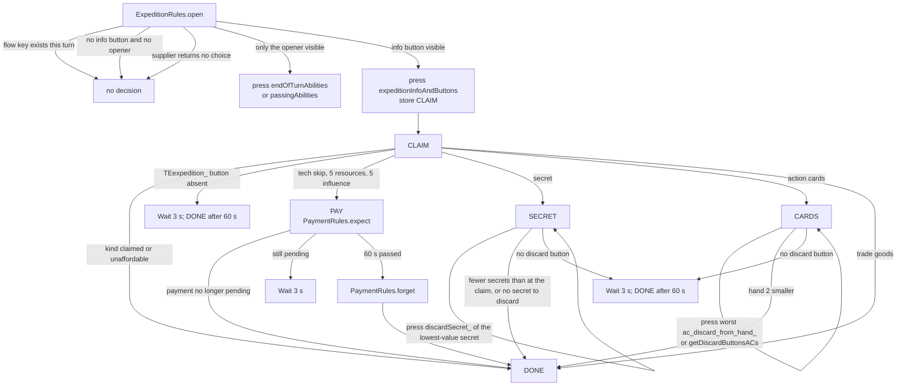

# Exploration, relics, expeditions and legendary planets

Part of the [AI player architecture docs](/src/main/java/ti4/ai/README.md): a living document kept next to the code (packages: explore, expedition, legendary). The code is the source of truth; when you change behavior here, update this file.

## Components and responsibilities

Scope: [ti4.ai.explore](/src/main/java/ti4/ai/explore), [ti4.ai.expedition](/src/main/java/ti4/ai/expedition),
[ti4.ai.legendary](/src/main/java/ti4/ai/legendary). All three packages are new in this branch (the merge base with
`master` has no `ti4/ai` directory). Every button they press is an existing engine handler.

All values are in the AI's trade-good currency: 1 trade good = 1.0, a victory point = 8.0
(`ObjectiveValue.VICTORY_POINT_VALUE`), a resource or influence = 0.8 (`ValueScale.spendable`), the AI's own commodity
0.6 with a trade partner that can receive it and 0.3 without (`ComponentValues.ownCommodity`).

Common mechanics used by every component below:

- Prompts are the Discord messages the AI can see (`AiPrompt`), newest first (`Prompts.newestFirst`). A button is
  "owned" when its custom id carries the seat's `FFCC_<faction>_` prefix and "unowned" otherwise.
- `context.alreadyPressed(prompt, button)` is the guard against pressing the same button twice; most rules filter on it.
- Multi-step flows keep their state in `context.memory()` under a key suffixed with `context.turnKey()`
  (active player id + time of the last active-player change), so the state expires when the turn passes.
- All entry points return `Optional<AiDecision>`. An empty result lets the next rule in `StandardBrain`'s list run.
  `AiDecision.press` presses a button; `AiDecision.Wait(until, reason)` holds the seat until a time.

---

### Diagram: Where the brain calls into these packages

Solid arrows are calls made in `StandardBrain` / `TacticalRules`; dotted arrows are values read by a decider.

```mermaid
flowchart TD
    BR["StandardBrain.firstRuleDecision<br/>(rules in list order)"] --> RAR["RelicActionRules.next"]
    BR --> CROWN["CrownOfEmphidiaRules.scorePoint"]
    BR --> MAW["MawOfWorldsRules.purge"]
    BR --> LRN["LegendaryRules.next"]
    BR --> AVN["AvernusRules.next"]
    BR --> EXN["ExpeditionRules.next"]
    BR --> EXPL["ExplorationRules.next"]
    BR --> TT["StandardBrain.takeTurn"]

    EXPL -->|"tactical action in progress"| SCAN["explore: Scanlink offers only"]
    EXPL -->|"otherwise"| ALL["explore: all offers"]
    EXPL --> CR["ExplorationRules.crown"]
    EXPL --> CARDS["CardRules.next"]
    EXPL --> FREE["FreelancersRules.next"]
    EXPL --> TOK["TokenGainRules.next"]

    TT --> TRC["TacticalRules.continueAction"]
    TRC -->|"after landing and ground combat"| ALL
    TRC -->|"movement step"| TEMP["TempestaRules.boost"]
    TT --> EXE["ExpeditionRules.endOfTurn"]
    TT --> LRE["LegendaryRules.endOfTurn"]
    TT -->|"no action taken"| RIT["RelicActionRules.insteadOfTacticalAction"]
    TT -->|"before passing"| RBP["RelicActionRules.beforePassing"]
    TT -->|"before passing"| EXB["ExpeditionRules.beforePassing"]
    TT -->|"before passing"| LRB["LegendaryRules.beforePassing"]
    TT -->|"before passing"| AVB["AvernusRules.beforePassing"]

    RIT --> FR["FragmentRules"]
    RIT --> ED["EnigmaticDeviceRules"]
    RIT --> RF["RelicFlows"]
    RBP --> FR
    RBP --> ED
    RBP --> RF

    DECK["ExploreDeck.expectedValue"] -.-> ALL
    DECK -.-> SCAN
    DECK -.-> CR
    OUT["ExpeditionOutlook.claimNow / best"] -.-> EXE
    OUT -.-> EXB
    LO["LegendaryOutlook.value"] -.-> LRE
    LO -.-> LRB
    TP["TacticalPlanner.best score"] -.-> RIT
```

### ti4.ai.explore

#### ExplorationRules

**Role:** decides.

**Purpose:** answers the engine's "explore planet X as trait T" offers, the Crown of Emphidia exploration offer, and
then delegates exploration-card follow-ups to `CardRules`, `FreelancersRules` and `TokenGainRules`.

**Invoked when:**
- `ExplorationRules.next` is a `BrainRule` in `StandardBrain.rules` (after `IntegratedEconomyRules::next`, before
  `StrategyCardRules::chooseTechnology`), so it runs on every decision tick of every AI seat until an earlier rule
  answers.
- `ExplorationRules.explore(context, prompts)` is called directly by `TacticalRules.continueAction` with
  `Prompts.thisTurn(context)`, after movement, space cannon, space combat, landing and ground combat have been handled
  and before the `drawRelic` press, payment, placement and build steps.

**Inputs:** for `next`, prompts from `ExploreWindow.prompts` (not hidden, created at or after the turn start); for the
`continueAction` call, `Prompts.thisTurn` (created at or after the turn start, hidden prompts not filtered out); the
game; the seat.

**Outputs / decisions:** one press of an explore button, of `crownofemphidiaexplore` or of its `deleteButtons` decline,
or whatever the delegated rules return.

**Algorithm:**
1. `next`: if `TacticalRules.inProgress(context)` it only considers Scanlink offers (`scanlink`); otherwise all offers
   (`explore`). Then, in order, `crown`, `CardRules.next`, `FreelancersRules.next`, `TokenGainRules.next`; the first
   non-empty result wins.
2. Offer parsing (`offersIn`): a button counts only when it is owned by the seat, its handler starts with
   `movedNExplored_`, the rest splits into exactly three parts `<source>_<planet>_<trait>`, the source is `filler` or
   `scanlink`, the trait is `cultural`, `industrial` or `hazardous`, and the planet exists on the board. Each offer is
   valued `ExploreDeck.expectedValue(ExploreSite.onBoard(...), trait)`.
3. Per prompt the highest-valued offer is kept; a Scanlink offer is dropped unless its value is `> SCANLINK_MIN_VALUE`
   (0). Prompts the seat already pressed anything in are skipped (`ExploreWindow.untouched`).
4. Across prompts the chosen offer is the one whose trait comes first in `hazardous, industrial, cultural`, ties broken
   by higher value.
5. `crown`: a prompt with unowned `crownofemphidiaexplore` and unowned `deleteButtons`, addressed to the seat
   (`ExploreWindow.isOwn`) and untouched. It presses explore when the best planet value is `> 0`, otherwise the decline.
   Best planet value = max over the seat's planets with at least one trait of `ExploreDeck.expectedValueOfPlanet`.

**Depends on:** `ExploreWindow`, `ExploreDeck`, `ExploreSite`, `ExploreOutlook`, `TacticalRules.inProgress`.

**Effect on the game:** draws an exploration card through the engine handler `movedNExplored_` (`ExploreButtonHandler`);
the Crown press exhausts the relic.

**Fallbacks:** a filler offer is always explored even when the deck average is negative (the rule has no decline path
for filler offers; `ExplorationRulesTest.exploresEvenWhenTheDeckIsBad`); an unparseable button is ignored.

**Limitations:** sources other than `filler`/`scanlink` are ignored: `dsdihmy_` (homebrew impressment), trait suffixes
such as `...hazardouskolleccbt` (Kollecc breakthrough) and the `frontier` trait offered by the Bentor breakthrough
(`bentorbt`) do not pass the three-part / trait check, so those buttons are never pressed by this rule.

**Example:** the seat lands on Tequran (hazardous) and Torkan (cultural) in one tactical action. Two offers appear in two
prompts. Tequran is explored first because hazardous comes first in `TRAIT_ORDER`; in the code the deck values only
break ties within one trait. `ExplorationRulesTest.exploresHazardousBeforeCultural` checks the order (through
`ExplorationRules.next`, with one shared test deck, so it does not vary the deck values);
`choosesTheTraitWhoseDeckIsWorthMore` checks the per-prompt choice between two traits of one planet.

The Crown follow-up offer is built by the engine with `ButtonHelper.getButtonsToExploreAllPlanets`, which uses the same
`movedNExplored_filler_` buttons, so it is answered by the offer logic above.

#### ExploreWindow

**Role:** informs.

**Purpose:** filters prompts and decides whether a prompt is addressed to the seat.

**Algorithm:** `prompts` = newest-first prompts that are not hidden and were created this turn
(`Prompts.createdThisTurn`). `isOwn` = the prompt text mentions the seat's representation, or the seat is the active
player and the prompt mentions no other real player. `untouched` = no button of the prompt was pressed by this seat.

**Invoked when:** by `ExplorationRules`, `CardRules`, `FreelancersRules`.

#### ExploreDeck

**Role:** evaluates.

**Purpose:** expected value of exploring a planet with a given trait.

**Invoked when:** `ExplorationRules` (offers and the Crown), `TacticalPlanner.Context.exploreValue` (called from four
planet-landing valuations in `TacticalPlanner`, through `ExploreSite.landing`, cached per planet / infantry / mech
count for one planning context).

**Algorithm:** `expectedValue(site, trait)` = average of `CardValue.of(card, site)` over the trait's draw pile
(`game.getExploreDeck(trait)`); when the pile is empty, over the discard pile (`getExploreDiscard`), since that is what
the engine would reshuffle; 0 when both are empty. Values are cached per card kind during one average. A thread-local
counter marks "estimating" so that `ExploreGains.commandToken` returns its flat value inside the average.
`expectedValueOfPlanet` = the best of `expectedValue` over the planet's traits (`best`).

**Outputs:** a double; no randomness, no sampling. It averages the public remaining deck exactly.

**Limitations:** card kinds not listed in `CardValue.of` count 0 but still count in the denominator.

**Evidence:** `ExploreDeckTest` (average over the remaining deck, empty deck 0, DMZ cost, research facility values, Lost
Crew and Derelict Vessel draws, a full PoK deck averaging between 0.4 and 1.6 per trait).

#### CardValue

**Role:** evaluates.

**Purpose:** value of one exploration card at one site.

**Algorithm:** `kind(cardId)` strips a trailing `extra<digit>` and trailing digits. Then by kind:

| Kind | Card | Value |
| --- | --- | --- |
| `crf`, `irf`, `hrf`, `urf` | relic fragment | `ComponentValues.gainedFragment` = rise of `FragmentValue.worth` (see below) |
| `vfs` | Volatile Fuel Source | `site.viaMechOrInfantry(ExploreGains.commandToken)` |
| `exp` | Expedition | `site.viaMechOrInfantry(readyValue(site))` |
| `cm` | Core Mine | `site.viaMechOrInfantry(ExploreGains.tradeGood)` |
| `frln` | Freelancers | 1.5 if `ExploreOutlook.canFundFreelancers` (a 2-cost payment exists), else 0 |
| `mo` | Mercenary Outfit | 0.75 |
| `lf` | Local Fabricators | max(`mechOption`, `gainedCommodity`) |
| `fb` | Functioning Base | max(`actionCardOption`, `gainedCommodity`) |
| `aw` | Abandoned Warehouses | max(convert 2, gain 2) |
| `ms` | Merchant Station | max(convert all, replenish to full) |
| `lc` | Lost Crew | `ExploreValues.actionCardsFromLostCrew` (2 cards within hand room) |
| `dv` | Derelict Vessel | `SecretDrawValue.of` |
| `dw` | (relic draw card) | `RelicValue.draw` (average relic value) |
| `ed` | Enigmatic Device | 1.0 |
| `mirage` | Mirage | `ValueScale.spendable(res, inf)` of the Mirage planet model + `LegendaryPlanets.holdingValue("mirage")` (2.5) |
| `dmz` | Demilitarized Zone | -1.5 - `PlanetStake.structures` (space dock 4, PDS 3 each) |
| `ds`, `pw`, `ls`, `mw`, `rw`, `toe` | attachments | `spendable(r, i)` + `ObjectiveValue.attachmentGain(planet)`, with (r, i) = Dyson Sphere (2,1), Paradise World (0,2), Lazax Survivors (1,2), Mining World (2,0), Rich World (1,0), Tomb of Emphidia (0,1) |
| `warfare`, `biotic`, `cybernetic`, `propulsion` | research facilities | planet without a specialty: 0.3 (`BoardView.TECH_SPECIALTY_VALUE`) + attachment and specialty objective gains; with a specialty: `spendable(1,1)` = 1.6 + attachment objective gain |
| anything else | | 0 |

Helper values: `readyValue` = 0 with Pre-Fab Arcologies (`pfa`) or when the planet is already the seat's and ready,
otherwise `ReadyingValue.bestSingle(...).value`. `mechOption` = 0 unless not base game, no DMZ on the planet, a mech in
reinforcements and a commodity or trade good to pay; then 2.0 + 0.5 when the planet has no ground forces - (own
commodity value if it has commodities, else 1.0). `actionCardOption` = `drawnActionCards(1)` - the same payment cost.
`gainedCommodity` = min(1, room) x commodity value. Convert n = min(n, commodities) x (1 - commodity value); gain n =
min(n, room) x commodity value.

**Limitations:** `dv` calls `SecretDrawValue.of(seat.getGame(), seat)` rather than `site.game()`; the frontier-card
valuation in `ExploreValues.frontierCard` gates the Derelict Vessel on `SecretDraws.worthDrawing`, this one does not.

#### ExploreSite

**Role:** informs / evaluates.

**Purpose:** the site of an exploration: game, seat, tile, planet, the seat's infantry and mechs on it, and the shared
`ExploreOutlook`.

**Algorithm:**
- `onBoard` counts units on the board; `landing` takes the counts a tactical plan would land.
- `lastGroundForce` = infantry <= 1 and no mech.
- `infantryCost` = 0.7 (`INFANTRY_UNIT`) + `outlook.expansionNeed(planet)` + (last ground force and an enemy can reach
  the tile ? 0.15 x `PlanetStake.of` : 0).
- `viaMechOrInfantry(benefit)`: 0 if benefit <= 0; the full benefit with a mech present (a mech is returned at no
  cost); benefit - infantry cost (floored at 0) with only infantry; 0 with neither.
- `mechIsWorthIt` = mechs > 0 and benefit > 0. `infantryIsWorthIt` = no mech, infantry > 0 and benefit > infantry cost.
- `isDemilitarized` = a planet token containing `Constants.DMZ` (also used by `PdsSites`, `StructurePolicy`,
  `FreelancersRules`).

#### ExploreOutlook and ExpansionOutlook

**Role:** informs (cached per decision).

**Purpose:** facts about the seat's position that several cards share.

**ExploreOutlook algorithm:**
- `canFundFreelancers` = `FreelancersPayment.cheapest(this, 2)` is present.
- `expansionNeed(planet)` delegates to `ExpansionOutlook.need`.
- `enemyCanReach(tile)` = `Threats.anyEnemyCanReach`, cached per position.
- `willSpendMore` = the seat has not passed and, at some space dock tile where it will produce (the active system while
  it is the active player, or any tile with a tactic token available and no own token on it),
  `ProductionPlanner.plan(..., 1 extra resource).totalCost() > plan(...).totalCost()`.
- `planetStake`, `attachmentObjectiveGain`, `specialtyObjectiveGain` delegate to `PlanetStake` and `ObjectiveValue`.

**ExpansionOutlook.need(holding):** what removing one infantry from `holding` would leave unclaimed.
1. Transports: every non-fighter ship of the seat with move > 0 (`moveValueWithGravityDrive`) and capacity > 0, one per
   ship.
2. Claims: every tile with planets that are worth having (a trait or resources > 0), uncontrolled, without custodians
   and without enemy ground forces; a claim's planet values (`BoardView.planetValue`) sorted descending; claims sorted
   by total value descending.
3. Launches: up to min(3, tactic tokens) claims, skipping a claim whose tile already holds the seat's ground forces
   (minus the infantry being removed when it is the same tile); each launch takes the first idle transport whose
   `MovementGraph.reach` contains the claim.
4. Pickup pool: the home system (when there is a launch) plus every position on each launch's out-and-back route
   (distance out + distance back <= the transport's move).
5. If the holding tile is not in the pool, the need is 0. Otherwise spare = ground forces in the pool - 1; walking the
   launches in order, the first claim with more planets than `spare` returns 0.5 x the sum of its planet values after
   the `spare` most valuable; if every claim is covered, 0.

**Limitations:** one transport per claim regardless of its capacity; the plan horizon is this round's tactic tokens
only.

**Evidence:** `ExploreOutlookTest` (need only for a reachable claim, none when others can take it, cost when it is the
last garrison under threat, none without tactic tokens, none outside the transport's reach).

#### ExploreGains

**Role:** evaluates.

**Algorithm:**
- `commandToken` = 0 when no token is left in reinforcements (`StrategyCardRules.reinforcements`); 2.0 during deck
  estimation; otherwise 2.0 + visible use, where visible use = 0.8 x 8 x `SpendUnlock.pointsUnlockedByTokens(1)` plus
  one of: +1.0 when `CommandTokenPolicy.poolToGrow` is the fleet pool; +1.0 when it is the strategy pool and
  `strategyTokensWantedForFollows` exceeds the strategy tokens held; otherwise max(0, `CommandTokenValue.tactic(1)` - 2).
- `tradeGood` = 1.0 + 0.8 x 8 x `SpendUnlock.pointDelta(1)`.

**Evidence:** `ExploreGainsTest`.

#### ExploreValues

**Role:** evaluates (constants and small formulas shared across packages).

Constants: trade good 1.0, command token 2.0, action card 1.0, mech 2.0, mech garrison bonus 0.5, infantry 0.7,
expansion share 0.5, last-force risk share 0.15, unspent-ready share 0.3, Mercenary Outfit 0.75, Freelancers 1.5
(typical cost 2), Enigmatic Device 1.0, frontier card 1.5, DMZ -1.5.

- `frontierCard` = 1.5 + (share of `dv` cards in the frontier draw pile) x (`SecretDrawValue.of` if
  `SecretDraws.worthDrawing`, else 0). Used by `CircletFlow`, `TacticalPlanner.frontierCardValue` (frontier tokens in a
  target system; also `RoundGoals`), `ResearchPolicy.frontierTapValue` (Dark Energy Tap).
- `tokenValue` = 2.0 when any token is in reinforcements, else 0.
- `drawnActionCards(n)` = `DrawnCardValue.of(game, seat, min(n, hand room), 1.0)`.
- `hasRoomForUnit` = the unit's cap is <= 0 (unlimited) or fewer of it are on the board than the cap.

#### CardRules

**Role:** decides.

**Purpose:** answers the follow-up buttons that individual exploration cards post.

**Invoked when:** from `ExplorationRules.next`, after the explore offers and the Crown (every tick when no earlier rule
answers), also during a tactical action.

**Inputs:** the same `ExploreWindow.prompts`; one shared `ExploreOutlook`.

**Algorithm (per untouched prompt, newest first, first decision wins):**
1. If the prompt has any button owned by the seat, only Merchant Station is considered: owned `mallice_convert_comm`
   and `resolveHarness` must both be present; convert when convert value > replenish value and > 0, else replenish.
2. Otherwise the prompt must be `ExploreWindow.isOwn`. Then, in order:
   - **Unit cards** (`resolveVolatile`, `resolveExpedition`, `resolveCoreMine` prefixes; buttons `<family>Mech_<planet>` /
     `<family>Inf_<planet>`): benefit is the command token, the readying value or the trade good; press the mech button
     when `mechIsWorthIt`, the infantry button when `infantryIsWorthIt`, otherwise `decline_explore`.
   - **Commodity cards:** Local Fabricators (`resolveLocalFab_<planet>`): mech when mech value > commodity value and > 0,
     else `gain_1_comms`. Functioning Base (`comm_for_AC`): the action card when its value > commodity value and > 0,
     else `gain_1_comms`. Abandoned Warehouses (`convert_2_comms` / `gain_2_comms`): convert when convert > gain and > 0,
     else gain.
   - **Ion Storm** (`addIonStorm_<side>_<position>`): `IonStormRules.sideFor`.
   - **Only decline left:** when every enabled button is `decline_explore` or `ultimateUndo_*`, press decline.

**Effect on the game:** removes or keeps ground forces, gains tokens / trade goods / commodities / action cards, places
mechs, places the Ion Storm.

**Fallbacks:** commodity cards always press one option (even when both are worth 0). A unit card without its site
returns empty.

**Evidence:** `CardRulesTest` (Volatile Fuel Source with and without expansion need, Core Mine, Expedition with Pre-Fab
Arcologies / ready planet / spend objective, Local Fabricators, Functioning Base, Warehouses, Merchant Station once, Ion
Storm, another player's card left alone, each card answered once).

#### IonStormRules

**Role:** evaluates.

**Algorithm:** for each side (alpha, beta), sum over every other tile that has that wormhole: 0.25 x the value of its
uncontrolled planets + 0.5 if the seat has ships there - (only when the seat holds a planet in or adjacent to the storm
tile) 0.1 x the cost of enemy ships there. Beta when beta > alpha, else alpha.

**Limitations:** adjacency uses the deprecated `FoWHelper.getAdjacentTiles` instead of `ti4.helpers.adjacency.Adjacency`.

#### FreelancersRules and FreelancersPayment

**Role:** decides (`FreelancersRules`), evaluates (`FreelancersPayment`).

**Purpose:** Freelancers exploration card: produce one unit in the system, paying with resources or influence.

**Invoked when:** from `ExplorationRules.next`, after `CardRules`. `FreelancersPayment.cheapest` is also used by
`ExploreOutlook.canFundFreelancers`.

**Algorithm:**
1. Offer: a prompt with unowned `freelancersBuild_<planet>` and `decline_explore`, addressed to the seat and untouched.
   It computes `best(tile)`; if empty presses decline; otherwise remembers the option handler under
   `freelancers|<turnKey>` and presses build.
2. Options for the tile: each `ProductionPlanner.oneShipOptions` ship (budget `FreelancersPayment.capacity`) at its
   planner value + 1.0 when the seat has no space dock in the tile; a fighter when ship capacity (+ 3 dock allowance only
   when the seat has a space dock in the tile) - fighters - ground forces in space > 0 and the fighter cap is not
   reached, valued filler x cost; on each own non-DMZ
   planet in the tile an infantry and (not base game, cost > 0, room) a mech, valued filler x cost + 0.5 when the planet
   has no own ground forces. Filler = `ProductionPlanner.fillerValuePerResource` = 0.5 - 0.3 x early-game weight.
   Need = ceil(cost).
3. Payment (`cheapest(outlook, need)`): per-resource opportunity = filler x (1 if `willSpendMore`, else 0.3); per
   influence 0.25. Planets with capacity max(resources, influence) > 0, sorted by opportunity / capacity, at most 12.
   For trade goods 0, 1, ... up to min(trade goods, need): exhaustive search over all subsets (up to 4096) for the
   cheapest set whose capacity covers the rest and whose removal still leaves `ProductionPlanner.reserve` payable. The
   first trade-good count with any valid subset is returned.
4. Choice: net = option value - quote cost; best net >= 0.25 (`MIN_NET_VALUE`).
5. Placement: on the owned `placeOneNDone_dontskipfreelancers_<unit>_<location>` buttons it recomputes the choices,
   prefers the remembered handler, else the best, registers the payment with `PaymentRules.expect(..., "Freelancers",
   payment, "deleteButtons_" + handler)` and presses the unit.

**Limitations:** the trade-good loop returns the fewest trade goods that work, not the cheapest total. If the planned
option has disappeared and nothing reaches 0.25 at placement, nothing is pressed.

**Evidence:** `FreelancersRulesTest` (forward ship, sparest influence planet, decline when broke, trade goods when every
planet is spent, decline a plain ship where a dock exists, no ground forces on a DMZ planet).

#### TokenGainRules

**Role:** decides / executes.

**Algorithm:** a prompt with an owned `deleteButtons` labelled "Done Gaining" and text matching `gain (\d+) command
tokens?`. The target = min(that number, `CommandTokenPolicy.gainWithinReinforcements`), remembered per message id.
While `CommandTokenPolicy.netGainSoFar` < target it presses the `poolToGrow` button; then it presses Done and forgets
the target. When the `poolToGrow` button is not in the prompt it presses Done at once, even below the target.

**Evidence:** `ExplorationRulesTest.placesTheCommandTokenAndFinishes`, `placesAsManyTokensAsTheCardGives`.

#### RelicActionRules and ComponentFlow

**Role:** decides (dispatcher); `ComponentFlow` informs (state and the tactical comparison).

**Invoked when:**
- `RelicActionRules.insteadOfTacticalAction` from `StandardBrain.takeTurn` after `SlingRelayRules.insteadOfTacticalAction`
  and before `ConvoysRules.insteadOfTacticalAction` (no action taken yet this turn).
- `RelicActionRules.beforePassing` from `StandardBrain.takeTurn` after `LazaxGateFolding.beforePassing`, before
  `ExpeditionRules.beforePassing`.
- `RelicActionRules.next` as a `BrainRule`, directly after the three payment rules (`PaymentRules::pay`,
  `SecretCostRules::pay`, `NekroLeaderRules::payAgentCost`).
- `RelicActionRules.stallsAvailable` from `StallCount` (Prove Endurance): 1 for a ready Enigmatic Device + 1 when
  `FragmentRules.canMakeRelic`.
- Its prefix constants (`codexCardPick_`, `nanoforgePlanet_`, `jrResolution_`, `jrStructure_`, `probeStep2_`) are in
  `StandardBrain.PUBLIC_WINDOW_PREFIXES` so the AI sees those unowned buttons.

**Algorithm:** `insteadOfTacticalAction` and `beforePassing` try `FragmentRules`, then `EnigmaticDeviceRules`, then
`RelicFlows`; the first that returns a decision wins (no value comparison between the three). `next` tries
`LatviniaFlow.freeTechnologies`, `FragmentRules.next`, `EnigmaticDeviceRules.next`, `RelicFlows.next`. Opening a flow
looks for the `componentAction` menu only in this turn's prompts; the follow-up steps in `next` read every visible
prompt (`Prompts.newestFirst(context.prompts())`), not only this turn's.

`ComponentFlow`: one state string per turn under `relicAction|<turnKey>` (fields joined by `~`); `taken` = that key
exists (one relic-family component action per turn); `menu` = the owned `componentAction` button in this turn's
prompts; `tacticalActionBeats(context, value)` = the remembered tactical plan (or `TacticalPlanner.best`, which it then
remembers through `TacticalRules.remember`) exists and its score >= value.

#### FragmentRules

**Role:** decides.

**Purpose:** purge three relic fragments for a relic.

**Algorithm:**
- `canMakeRelic`: a trait kind (CRF, IRF, HRF) with count + unknown (URF) >= 3 exists, and total fragments - 3 >= 2
  when the seat holds an unscored Destroy Heretical Works (`dhw`), else >= 0.
- `kindToPurge`: among trait kinds with count + unknown >= 3, the one with the most fragments of its own.
- `insteadOfTacticalAction`: skipped when `tacticalActionBeats(RelicValue.draw x 0.3 + Stall.value)`;
  `Stall.value` = 1.5 + `Endurance.stallBonus`.
- `beforePassing`: no threshold.
- Flow: press `componentAction` and store `fragments~menu~<fragment count>`; press owned
  `componentActionRes_getRelic_` and store `fragments~purge~<count>~<kind>`; then press owned
  `purge_Frags_<kind>_<n>` with n = min(remaining of 3, held of that kind), switching to `URF` when the kind runs out;
  when 3 are gone press owned `drawRelicFromFrag` and store `fragments~done`.

**Evidence:** `FragmentRulesTest` (purges three of one kind and draws, unknown only fills, never more than three, waits
for a full set, keeps two for Destroy Heretical Works, one per turn, defers to a better tactical plan, makes a relic
instead of a weak turn, finds the menu in the private thread).

#### EnigmaticDeviceRules

**Role:** decides.

**Algorithm:**
- `worthUsing`: holds the Enigmatic Device; for a seat with Propagation (`cannotResearch`, Nekro): at least 3 tokens in
  reinforcements, 3 x `tokenValue` (6) > 6 x filler, and a 6-resource payment exists after `ScoringReserve`; otherwise
  `StrategyCardRules.worthPayingForResearch(6, ResearchPolicy.WORTH_PAYING_FOR = 4.0)`: a 6-resource payment after the
  reserve exists and the best researchable technology's value >= 4 (lowered by `IDLE_WORTH_SHARE` when idle trade goods
  cover the cost).
- `insteadOfTacticalAction`: net = research value (or 6 for the tokens) - filler x 6; skipped when
  `tacticalActionBeats(net + Stall.value)`.
- Flow (`device~<stage>`): `menu` -> press owned `componentActionRes_relic_enigmaticdevice`; with Propagation go to
  `tokens`, else call `StrategyCardRules.expectResearch(context, 6)` and go to `research`. `tokens` -> press owned
  `nekroTechExhaust` with `PaymentRules.expect` for the planned 6-resource payment. `research` -> press unowned
  `acquireATech` in a prompt that mentions the seat. `type` -> in hidden prompts, the owned `getAllTechOfType_<type>` of
  the best researchable technology's first type, else the first offered.
- `continueWithFreeTechnology` puts the flow at `research`; `MawOfWorldsRules` reuses it.

**Evidence:** `EnigmaticDeviceRulesTest`.

#### RelicFlows, RelicFlow and the relic flows

**Role:** decides (dispatcher), each flow evaluates (`netValue`) and executes its steps.

**Algorithm:** candidates = flows whose relic is ready (`hasRelicReady`), net = `netValue`, kept when net >= 0.1;
the best net wins. `insteadOfTacticalAction` is skipped when `tacticalActionBeats(net + Stall.ACTION_VALUE)` (1.5,
without the endurance bonus). `beforePassing` has no further threshold. Opening stores `<flow name>~menu`; `next` then
presses owned `componentActionRes_relic_<relicId>` and moves to the flow's first stage; `step` handles the rest.

| Flow | Relic id | netValue | Steps |
| --- | --- | --- | --- |
| `DynamisCoreFlow` | `dynamiscore` | commodity value total (as trade goods) - 2 x min(3, rounds left) x own commodity value | none |
| `NanoforgeFlow` | `nanoforge` | max over eligible planets (own, not fake, not a space station, not legendary or home) of (3.2 + 2.0) x (0.6 if an enemy can reach the tile) | presses the unowned `nanoforgePlanet_` with the highest worth; ties keep the first |
| `CodexFlow` | `codex` | walk the 3 best retrievable discards by `ActionCardValue.keepValue`: while hand room remains add the value; otherwise add value - worst held when value > worst + 0.3 and swap | `codexCardPick_<n>` then `pickFromDiscard_<alias>` for the best visible card while room remains or it beats the worst by 0.3; up to 3 |
| `CircletFlow` | `circletofthevoid` | `ExploreValues.frontierCard` when `ButtonHelperActionCards.hasCircletTargets`, else 0 | the first unowned `probeStep2_` button |
| `JuniorFlow` | `titanprototype` | 1.0 | unowned `jrResolution_<seat's faction>` (choose itself), then unowned `jrStructure_tg` in a prompt mentioning the seat |
| `StellarConverterFlow` | `stellarconverter` | max over `ButtonHelper.getButtonsForStellar` targets of worth with worth >= 4 | owned `stellarConvert_` target with the highest worth >= 4 |
| `LatviniaFlow` | `bookoflatvinia` | 8 when the seat's planets cover all four technology specialties, else 0 | none |

Stellar Converter worth: 0 when the planet is uncontrolled or the seat's, or the seat has infantry, mechs, PDS or a
dock on it; otherwise (planet value + owner's structures + 0.5 per owner infantry + 2 per owner mech) x 0.9 when the
owner has strictly more points than every other player, else 0.6.

`LatviniaFlow.freeTechnologies` (runs first in `RelicActionRules.next` while the seat holds the book): the first time it
sees the book it stores the time under `latviniaSeen`; within 120 s of that and fewer than 2 picks it presses the owned
`getTech_<alias>__noPay__comp` button chosen by `ResearchPolicy.best` among technologies the seat lacks, counting picks
under `latviniaTechnologies`. It is not gated on whose turn it is or on any value threshold.

**Evidence:** `RelicFlowsTest` (Dynamis Core, no ready relic, JR on itself, another player's JR choice left alone,
Circlet, Nano-Forge on a non-home planet, Codex, Latvinia kept and the two free technologies, Crown purge, Maw, Stellar
Converter).

#### CrownOfEmphidiaRules and MawOfWorldsRules

**Role:** decides.

- `CrownOfEmphidiaRules.scorePoint` (`BrainRule`): while the seat holds `emphidia`, presses the first unpressed unowned
  `resolveCrownOfE` button. No value check.
- `MawOfWorldsRules.purge` (`BrainRule`): while the seat holds `mawofworlds` and an unowned `resolveMaw` is visible,
  net = best researchable technology value - per-influence vote value x ready influence
  (`Helper.getPlayerInfluenceAvailable`); per-influence = 0.25, or max(0.25, `AgendaPrior.phaseVoteValue`) under the
  `AGENDA_VALUE_TABLE` experiment. Presses when net >= 2.0, then calls `StrategyCardRules.expectResearch(context, 0)`
  and `EnigmaticDeviceRules.continueWithFreeTechnology`.

---

### ti4.ai.expedition

#### ExpeditionRules

**Role:** decides and executes the claim flow.

**Invoked when:**
- `ExpeditionRules.endOfTurn` from `StandardBrain.takeTurn` after the second-action checks and before `TechRules.endOfTurn`.
  If the newest unpressed owned `expeditionInfoAndButtons` sits in a prompt that also has `passForRound` (the passing
  menu, which the engine builds by appending the end-of-turn abilities), it delegates to `beforePassing`.
- `ExpeditionRules.beforePassing` from `StandardBrain.takeTurn` after `RelicActionRules.beforePassing`.
- `ExpeditionRules.next` as a `BrainRule`: `FractureRules.roll`, `FractureRules.placeIngress`, `ThundersEdgeRules.next`,
  then the claim flow.
- `ExpeditionRules.paidThisTurn` from `TechRules.bestTechSkipPlanet` (Bio-Stims tie-break).
- `TILE_PREFIX` (`placeThundersEdge_`) is in `StandardBrain.PUBLIC_WINDOW_PREFIXES`.

**Algorithm:**
1. `open`: nothing when a flow key exists this turn (one expedition per turn). The menu is the unpressed owned
   `expeditionInfoAndButtons` or, failing that, the opener (`endOfTurnAbilities` or `passingAbilities`). It asks the
   supplier for a choice (`ExpeditionOutlook.claimNow` at the end of a turn; `ExpeditionOutlook.best` with
   `Holdings.atPassing()` when passing); none -> empty. With the info button present it stores `CLAIM` and presses it;
   otherwise it presses the opener.
2. `CLAIM`: recompute `options` (non-passing holdings) for the stored kind; if the kind was claimed meanwhile or is no
   longer affordable -> `DONE`. The net value is not rechecked here: a kind chosen at passing rates is claimed even
   when its net at the non-passing rates is negative, and the payment registered is the one priced at those rates. Wait for the owned `TEexpedition_<kind>` button; press it and move to `PAY` (tech skip,
   5 resources, 5 influence; registers `PaymentRules.expect(..., "an expedition", payment, "deleteButtons_spitItOut")`
   and stores the paid planets under `expeditionPaid|<turnKey>`), `SECRET`, `CARDS` or `DONE` (trade goods, which the
   engine deducts).
3. `PAY`: done when `PaymentRules.isPending` is false; after 60 s forgets the payment and finishes; otherwise
   `Wait(now + 3 s)`.
4. `SECRET`: done when the seat holds fewer unscored secrets than at the claim; else press `discardSecret_<number>` of
   `SecretValue.lowestValueSecret`; else wait / give up after 60 s.
5. `CARDS`: done when the hand is 2 smaller than at the claim; else `ActionCardValue.worstDiscard` over
   `ac_discard_from_hand_` buttons; else the hidden `getDiscardButtonsACs` button; else wait / give up.

The 60 s timers run from the stage's start time: for `CLAIM` the press of `expeditionInfoAndButtons`, for `PAY`,
`SECRET` and `CARDS` the press of the `TEexpedition_` button.

**Evidence:** `ExpeditionRulesTest` (walks the menus and pays with the specialty planet, waits for the payment prompt
and gives up after a minute, trade goods without a prompt, one per turn, nothing when nothing is worth it, no empty
menu, slice claimed meanwhile, slices never appear, passing menu, secret discard in the private thread, two action
cards one at a time, no repeated press).

##### Diagram: Expedition claim flow (`ExpeditionRules`)

#### ExpeditionOutlook, ExpeditionKind, Holdings

**Role:** evaluates.

**Algorithm:**
- `isOpen`: Thunder's Edge game, not Twilight's Fall, real player, not passed, remaining slices > 0, Thunder's Edge not
  yet on the board.
- `options(holdings)`: for each unclaimed kind with a price (`KindPricing.of`): breakthrough =
  `BreakthroughValue.of` + `fractureRoll`; thundersEdge = `ThundersEdgeRace.gainFromClaiming`; nudge =
  `ExpeditionStats.kindNudge`; urgency = `RaceUrgency.of` only when breakthrough + thundersEdge + nudge - cost > 0.
  net = breakthrough + thundersEdge + nudge + urgency - cost. Sorted by net descending.
- `best` = the first option with net > 0.
- `claimNow`: when `BreakthroughValue.isPriority` (Hacan or Letnev with a locked breakthrough) or one slice remains,
  `best`; otherwise `best` filtered by net - urgency >= waiting value, where waiting value = max over
  `options(holdings.atPassing())` of (net - urgency) x `RaceUrgency.stillOpen`, positive only, 0 if the holdings are
  already passing.
- `value(holdings)` = max(the largest net x (`stillOpen` of that kind when the holdings are racing, else 1) over the
  options with net > 0, waiting value).
- `Holdings` = wallet, action card count, passing flag, racing flag; `withWallet`, `withActionCards`,
  `racingForTheSlice`, `atPassing` produce variants.
- `ExpeditionKind`: `techSkip`, `tradeGoods`, `fiveRes`, `fiveInf`, `secret`, `actionCards`; handler
  `TEexpedition_<id>`; `isClaimed` reads `game.getExpeditions().getExpeditionFactions()`.

**Evidence:** `ExpeditionOutlookTest`, `ExpeditionReserveTest`.

#### KindPricing and SpendHorizon

**Role:** evaluates.

**SpendHorizon:** `PASSING` (0.1 per resource, 0.1 per influence) when the holdings are passing; otherwise `AHEAD`
(1.0, 0.667) when `SpendOutlook.spendingAhead`, else `IDLE` (0.4, 0.267).

**KindPricing.of** (reserve = `ScoringReserve.of`):
- Tech skip: wallet planets with a technology specialty (`ButtonHelper.checkForTechSkips`), each kept only when its
  removal keeps the reserve (skipped with Bio-Stims ready). Cost = max(perResource x resources, perInfluence x
  influence) + 8 x `SpendUnlock.pointsLostByExhausting`; with Bio-Stims ready, min(that, the highest exhaust cost among
  already exhausted skip planets), and 0 when none is exhausted. Cheapest planet wins.
- Trade goods: needs >= 3 trade goods and the reserve still payable without them; cost 3.
- 5 resources / 5 influence: `ScoringReserve.planAfterReserve`; cost = sum over the planets of horizon rate x the
  planet's full resources (or influence) + trade goods used.
- Secret: needs an unscored secret; 0 when unscored secrets exceed max(0, secret limit - scored); else
  clamp(`SecretValue.keepValue` of the least promising, 0, 1) x 8 x 0.5.
- Action cards: needs >= 2 cards (in the holdings); cost = sum of the two lowest keep values, with hypothetical extra
  cards at `ActionCardPrior.AVERAGE_CARD` (1.2). Keep values are cached in a static map keyed by game name and seat user
  id, valid only for the same `Game` instance and last-modified date, and the whole map is cleared once it holds more
  than 64 entries; a re-entrant call for the same seat with a non-empty hand falls back to `ActionCardPrior.keepPrior`
  (recursion guard).

**Evidence:** `ExpeditionOutlookTest` (middle rate, two-thirds rate, specialty planet, Bio-Stims free, secret, action
cards), `KindPricingKeepValuesTest`.

#### BreakthroughValue and ExpeditionStats

**Role:** evaluates (`BreakthroughValue`), informs (`ExpeditionStats`, data loader).

**BreakthroughValue:**
- `isLocked` = the seat has breakthrough ids and one is not unlocked.
- `of` = 0 when not locked; else max(`YinAscendant.value` (1.5 x (1 + rounds left) while Yin's `yinbt` is locked),
  max(floor, max(0.75, 2.0 + 0.5 x lift)) x timing), floor = 8.0 for Hacan and Letnev, else 0; timing =
  min(1, rounds left / 4) with `GameHorizon.roundsLeft` = max(1, ceil((goal - leader points) / 2)).
- `fractureRoll` = 0.2 x 2.0 x timing while locked and `FractureService.canFractureEnterPlay`.

**ExpeditionStats** reads [expedition_stats.json](/src/main/resources/data/ai/expedition_stats.json) once (double-checked
lazy load). Only the `factions` map is read: per faction `[wins, games]` for `none`, `any` and each kind id. Firmament
uses Obsidian's entry.
- `breakthroughLiftPoints` = 100 x (rate(any) - (wins(none) + 200 x (rate(any) - 0.01)) / (games(none) + 200)); 1.0
  when the faction or its `none` / `any` entry is missing.
- `kindNudge` = clamp(0.2 x 100 x (shrunk - mean), -1, 1), mean = pooled win rate over the faction's kind entries,
  shrunk = (wins(kind) + 100 x mean) / (games(kind) + 100); 0 when the faction or kind is missing.

Example from the file: Mahact `none [7, 78]`, `any [259, 1044]`: rate(any) = 0.248, without = (7 + 200 x 0.238) / 278 =
0.197, lift = 5.2 points, breakthrough = 2.0 + 0.5 x 5.2 = 4.6 at full timing. Hacan `none [10, 59]`, `any [133, 944]`:
rate(any) = 0.141, without = (10 + 200 x 0.131) / 259 = 0.140, lift about 0.12, but the floor makes it 8.0 at full
timing.

**Evidence:** `ExpeditionStatsTest` (high-lift and negative-lift factions, small samples near 1.0, unknown faction,
Firmament = Obsidian, nudge cap, Hacan nudge sign).

#### ThundersEdgeRace and RaceUrgency

**Role:** evaluates.

**ThundersEdgeRace.gainFromClaiming:** with `mine` = the seat's claimed slices, `rivals` = the most slices of any other
faction, `remaining` slices and `players`: 8 x timing x (holdChance(mine + 1, rivals, remaining - 1, last claim) -
holdChance(mine, rivals, remaining) - (0.5 when this is the last slice and it would not hold)).
`holdChance`: with 0 remaining, 1 when mine > rivals or tied and the seat claimed last, else 0; 0.95 when mine >
rivals + remaining; else clamp(1 / players + 0.6 / (remaining + 2) x (mine - rivals), 0.03, 0.9). Timing as for the
breakthrough.

**RaceUrgency:** racing rivals = other real players that have a locked breakthrough, or (on the last slice) gain from
claiming, and could pay for the kind (`couldClaim`: a readied specialty planet; >= 3 trade goods; a wallet that can
pay 5 resources / 5 influence; an unscored secret; >= 2 action cards). `of` = min(1, 0.25 x racing rivals);
`stillOpen` = 0.75^(racing rivals).

#### ExpeditionUnlock

**Role:** evaluates (for other packages).

**Callers:** `TradeUses` (`afterTradeGoods`, 3 trade goods), `PoliticsUses` (`afterDrawing`), `DiplomacyUses`
(`afterReadying`, `refundOfFirstClaim`), `LeadershipUses` (`claimingFirst` x `EXPEDITION_FIRST_SHARE` 0.5),
`ReadyingValue` (`gainFromReadying`), `TokenPurchase` (`planWith`), `TechRules.psychoarchaeology` (`plannedPlanets`).

**Algorithm:** `worth` = `ExpeditionOutlook.value`; `gain(after)` = max(0, worth(after) - worth(now, same racing
flag)). `afterReadying` tries pairs of the 6 largest exhausted planets and keeps the pair with the largest positive gain
(ties: larger total size). `refundOfFirstClaim` = the claimNow cost x min(1, 2 / planets paid). `claimingFirst` =
worth(certain) - worth(racing), 0 when the best is the secret kind costing more than 1.0. `planWith` = the passing best
with net x `stillOpen` and a non-empty payment. `plannedPlanets` = the planets the passing best would pay with.

#### FractureRules and SiteScore

**Role:** decides (`FractureRules`), evaluates (`SiteScore`).

**FractureRules:** `roll` presses the first unpressed owned `rollFracture*` button. `placeIngress`: per prompt with owned
unpressed `addIngressToken_<position>_...` buttons; while the number already pressed in that message is below the
allowed count (the trailing number of the first option's id, default 1), press the option whose tile (without an ingress
token already) has the best `SiteScore.ingress`; otherwise press the unowned `deleteButtons` labelled "Done Resolving".

**SiteScore:** distances = min `MovementGraph.reach` distance (radius 4) from the seat's home, planet tiles and ship
tiles. closeness = 3 x (1 - min(4, d) / 4). presence = 1 when the seat holds a planet or ships in the tile. pressure =
sum over rivals of `FactionAggression.factor` x (min(1, `Threats.incomingFleetCost` / 12) + (1 if the rival's home is
within 2)). `ingress` = closeness + presence - pressure. `thundersEdge` = 1.5 x closeness - 1.5 x pressure + 0.5 x
clamp(nearest rival home distance - own distance, -2, 2), unknown distances = 5.

**Evidence:** `FractureRulesTest`.

#### ThundersEdgeRules

**Role:** decides.

**Algorithm:** in order: recipient (owned `placeThundersEdge_<pos>_<faction>`): itself when offered, else
`Beneficiary.leastThreatening` (not the points leader when possible, then lowest points + scorable public points, then
fewest trade goods + commodities), else the first; tile (unowned `placeThundersEdge_<pos>` in a prompt mentioning the
seat): best `SiteScore.thundersEdge`; start: owned `placeThundersEdge`.

**Evidence:** `ThundersEdgeRulesTest`.

---

### ti4.ai.legendary

#### LegendaryRules and LegendaryOutlook

**Role:** decides (`LegendaryRules`), evaluates (`LegendaryOutlook`).

**Invoked when:** `LegendaryRules.endOfTurn` from `StandardBrain.takeTurn` (after `SecretRedrawRules.endOfTurn`, before the
brain presses `turnEnd` / `endOfTurnAbilities`), `LegendaryRules.beforePassing` (late in the passing sequence, before
`AvernusRules.beforePassing`), `LegendaryRules.next` as a `BrainRule`. The ability buttons
`planetAbilityExhaust_<planet>` appear inside the engine's end-of-turn or passing menu, which the brain opens by
pressing `endOfTurnAbilities` / `passingAbilities`. `MALLICE_PREFIX` and `EMELPAR_PREFIX` are public-window prefixes.

**Algorithm:** `open` (active player only, no flow in progress): among the planets of the moment (`AT_END_OF_TURN`:
Thunder's Edge, Emelpar, Mallice, Hope's End, Primor, Mirage, Illusion, Phantasm; `WHEN_PASSING`: Ordinian, Ordinian C4,
Industrex, Faunus) that are not used this turn and `abilityReady` and have an unpressed owned ability button, value each
with `LegendaryOutlook.value`, keep the best with value >= 0.1, mark it used (`legendaryUsed|<turnKey>|<planet>`), store
the flow (or for Thunder's Edge call `TacticalRules.allowAnotherAction`) and press it.

`LegendaryOutlook.value` (NOT_USABLE = negative infinity):

| Planet | Value | Follow-up press (`LegendaryRules.resolve`) |
| --- | --- | --- |
| Mallice | max(2 x 1.0 + 8 x `SpendUnlock.pointDelta(2)`, convert all commodities + 8 x `pointDelta(commodities)`) | unowned `mallice_convert_comm` or `mallice_2_tg` |
| Hope's End | an action card (`drawnActionCards(1)`) or, when a mech is available with room, 2.0 + best `GroundDrops` mech drop value; the mech when >= the card | `draw_1_ACDelete`, or owned `placeOneNDone_skipbuild_mech_<planet>` with the best drop |
| Primor | best `GroundDrops.best(...).infantry` | owned `placeOneNDone_skipbuild_2gf_<planet>` with the best infantry drop |
| Mirage, Illusion, Phantasm | 2 x fighter cost x filler when a fighter is in reinforcements and some own-ship tile has capacity room >= 2 | owned `placeOneNDone_skipbuild_2ff_<tile>` matching the tile with the costliest fleet |
| Ordinian, Ordinian C4 | `drawnActionCards(1)` + `tokenValue` | on the "Done Gaining" prompt: the `poolToGrow` button once, then Done |
| Faunus | over the engine's `faunusTake_` targets without custodians: 0.7 x planet value + 0.3 x value when another player controls it + `ObjectiveValue` gain | owned `faunusTake_<planet>` |
| Industrex | over the engine's `industrexPickType_` types with room: filler x cost + objective gain of one more unit, at the own-ship tile (sorted by fleet cost, fleet limit checked for non-fighters) with the highest value | owned type button, then owned `placeOneNDone_skipbuild_<type>_<position>` |
| Emelpar | `ReadyingValue.bestSingle` over exhausted planets | unowned `emelparReady_planet_<faction>_<planet>` |
| Thunder's Edge | only when an action was taken, no second action started and `secondTacticalActionIsWorthIt`: `TacticalPlanner.best` score | none |

`next`: with a flow, only prompts created at or after (flow start - 5 s) are used; a resolved step clears the flow; with
no step it returns `Wait` until flow start + 45 s, then clears the flow.

Placement fallback (`bestOwned`): Hope's End (mech), Primor and the flight academies score each placement button, but a
button whose planet has no `GroundDrops` drop scores negative infinity (0 for a flight-academy tile other than the
planned one) and the first button is still taken when no button scores higher. So once a placement prompt appears,
some placement is always pressed, even when the planned drop or tile is not among the buttons. Faunus, Emelpar and
Industrex instead clear the flow without a press when their target has disappeared.

**Evidence:** `LegendaryRulesTest` (official vs homebrew, holding values, Primor drop, once per turn, exhausted ability,
Mallice both ways, Hope's End mech, Mirage capacity, Ordinian when passing, passing abilities not at end of turn,
Faunus, Emelpar, Thunder's Edge only when a second action is worth it).

#### LegendaryPlanets

**Role:** informs.

`holdingValue(planet)`: 2.0 (`BoardView.LEGENDARY_VALUE`) for a null, unofficial or unlisted planet; else Mallice 4.5,
Hope's End 4.5, Primor 3.5, Mirage / Illusion / Phantasm 2.5, Mecatol Rex (`mrte`) 3.5, Thunder's Edge 6.0, Emelpar 4.5,
Ordinian / Ordinian C4 5.5, Faunus 4.0, Industrex 4.5, Tempesta 3.0, Custodia Vigilia 4.0 (any planet not in the table,
Avernus included, gets 2.0). Used by `BoardView.planetValue`
(every legendary planet's value), `CardValue` (Mirage) and `NanoforgeFlow` (null: 2.0). `isOfficial` = legendary with an
official source. `abilityReady` = the seat has the planet and its ability is not exhausted.

#### AvernusRules

**Role:** decides.

**Invoked when:** `AvernusRules.beforePassing` is the last check before the brain presses pass; `AvernusRules.next` is a
`BrainRule`; `TILE_PREFIX` (`starforgeTileFree_`) is a public-window prefix.

**Algorithm:** starts only for the active player in the action phase with Avernus ready, no tactical action in progress
or taken, no flow, and a war sun tile where a destroyer fits (in reinforcements and non-fighter ships + 1 <= fleet limit)
or 2 fighters fit in capacity; the tile with the costliest fleet. Flow `MENU` -> press `componentAction`; `ABILITY` ->
owned `planetAbilityExhaust_avernus`; `TILE` -> unowned `starforgeTileFree_<position>`; then owned
`starforgeFree_destroyer_<position>` when a destroyer fits, else `starforgeFree_fighters_<position>`. Each stage waits up
to 45 s, then the flow is marked done. No value threshold.

**Evidence:** `LegendaryRulesTest.starForgesWithTheNucleusFromTheSystemOfItsWarSun`.

#### TempestaRules

**Role:** decides.

**Invoked when:** `TacticalRules.movement` calls `TempestaRules.boost` before the movement prompt is answered.

**Algorithm:** once per tactical action (`tempesta|<actionKey>`): when a plan exists, Tempesta's ability is ready and some
planned move from an origin other than the target cannot reach the target with `moveValueWithGravityDrive` alone, press
the unowned `planetAbilityExhaust_tempesta` in the movement prompt. The planner already counts the +1 through
`BoardView.moveValueWithBoosts`.

**Evidence:** `LegendaryRulesTest.addsTheTempestaMoveToWhatTheFleetCanReach` (the +1 in `BoardView`);
`exhaustsTempestaForAMoveThatReachesOneSystemTooFar` asserts the press only when `needsBoost` holds, so it does not prove
that the test map needs the boost.

## Scenarios

### Exploration, relics, expeditions and legendary planets

| Scenario | Trigger | Handled by | Choices considered | How it chooses | Outcome / fallback |
| --- | --- | --- | --- | --- | --- |
| Explore a planet just taken in a tactical action | owned `movedNExplored_filler_<planet>_<trait>` after landing | `TacticalRules.continueAction` -> `ExplorationRules.explore` | each trait offered per prompt; prompts of several planets | best deck average per prompt; across prompts hazardous, industrial, cultural, then value | always explores (no decline on the offer) |
| Explore outside a tactical action (card or ability offer) | same buttons, no tactical action in progress | `ExplorationRules.next` | as above | as above | as above |
| Scanlink Drone Network offer | owned `movedNExplored_scanlink_...` | `ExplorationRules.next` (also during the tactical action) | planets and traits in the prompt | best value; only when > 0 | left unanswered when the best value is <= 0 |
| Crown of Emphidia exploration | unowned `crownofemphidiaexplore` + `deleteButtons` | `ExplorationRules.crown` | explore or decline | best planet deck value of all own planets > 0 | decline otherwise; the follow-up offer (`movedNExplored_filler_` buttons from `ButtonHelper.getButtonsToExploreAllPlanets`) is answered like any filler offer |
| Volatile Fuel Source, Core Mine, Expedition card | `resolveVolatile*`, `resolveCoreMine*`, `resolveExpedition*` | `CardRules.unitCard` | mech, infantry, decline | mech when benefit > 0; infantry when benefit > infantry cost | `decline_explore` |
| Local Fabricators | `resolveLocalFab_<planet>` | `CardRules.localFabricators` | mech or 1 commodity | mech value > commodity value and > 0 | `gain_1_comms` |
| Functioning Base | `comm_for_AC` | `CardRules.functioningBase` | action card for a commodity / trade good, or 1 commodity | card value > commodity value and > 0 | `gain_1_comms` |
| Abandoned Warehouses | `convert_2_comms` / `gain_2_comms` | `CardRules.abandonedWarehouses` | convert or gain | convert > gain and > 0 | gain |
| Merchant Station | owned `mallice_convert_comm` + `resolveHarness` | `CardRules.merchantStation` | convert or replenish | convert > replenish and > 0 | replenish |
| Ion Storm | `addIonStorm_<side>_<pos>` | `CardRules.ionStorm` + `IonStormRules` | alpha, beta | wormhole-link score | alpha on a tie |
| Freelancers | `freelancersBuild_<planet>` + `decline_explore` | `FreelancersRules` | one ship, fighter, infantry, mech | net = value - cheapest payment >= 0.25 | decline |
| Exploration grants command tokens | owned "Done Gaining" prompt with "gain N command token(s)" | `TokenGainRules` | pool to grow, done | `CommandTokenPolicy.poolToGrow` until the target | Done (also at once when the pool button is missing) |
| Card it cannot use | only `decline_explore` / `ultimateUndo_*` enabled | `CardRules.onlyDeclineLeft` | decline | always | decline |
| Make a relic from fragments | own turn, no action yet; or before passing | `FragmentRules` | purge or not | three of a kind (unknown fills); keep 2 with Destroy Heretical Works; tactical plan comparison mid-turn | waits / does nothing |
| Enigmatic Device | own turn or before passing | `EnigmaticDeviceRules` | research or not | 6 resources after reserve and technology worth >= 4; Nekro: 3 tokens worth more than 6 resources | not used |
| Other relic actions | own turn or before passing | `RelicFlows` | Dynamis Core, Nano-Forge, Codex, Circlet, JR-XS455-O, Stellar Converter, Book of Latvinia | highest net >= 0.1; mid-turn net + 1.5 must exceed the tactical plan | not used |
| Book of Latvinia drawn | owned `getTech_*__noPay__comp` within 120 s | `LatviniaFlow.freeTechnologies` | offered technologies | `ResearchPolicy.best` | up to 2 picks |
| Crown of Emphidia point | unowned `resolveCrownOfE` | `CrownOfEmphidiaRules` | purge | always | |
| Maw of Worlds | unowned `resolveMaw` | `MawOfWorldsRules` | purge | technology value - 0.25 x ready influence >= 2 | left unanswered |
| Expedition at end of turn | own `endOfTurnAbilities` / `expeditionInfoAndButtons` | `ExpeditionRules.endOfTurn` | six kinds | `claimNow`: best net > 0 and not worse than waiting for the pass | no press; the brain ends the turn |
| Expedition at the pass | `passingAbilities` / info in the passing menu | `ExpeditionRules.beforePassing` | six kinds | `best` priced at the passing horizon | no press; the brain passes |
| Expedition payment / discard | after the slice press | `ExpeditionRules.continueFlow` | planned planets; worst secret; two worst action cards | stored plan | `Wait` 3 s polls, give up after 60 s |
| Fracture roll | owned `rollFracture*` | `FractureRules.roll` | press | always | |
| Ingress token placement | owned `addIngressToken_*` | `FractureRules.placeIngress` | systems offered | best `SiteScore.ingress` | "Done Resolving" |
| Thunder's Edge placement | `placeThundersEdge`, `placeThundersEdge_<pos>`, `placeThundersEdge_<pos>_<faction>` | `ThundersEdgeRules` | systems; tied recipients | best `SiteScore.thundersEdge`; itself, else least threatening | first recipient |
| End-of-turn legendary ability | `planetAbilityExhaust_<planet>` in the end-of-turn menu | `LegendaryRules.endOfTurn` | Thunder's Edge, Emelpar, Mallice, Hope's End, Primor, flight academies | best value >= 0.1 | brain presses `turnEnd` |
| Passing legendary ability | in the passing menu (opened by the brain's `passingAbilities` press) | `LegendaryRules.beforePassing` | Ordinian (both), Industrex, Faunus | best value >= 0.1 | brain presses `passForRound` |
| Avernus (Nucleus) | `componentAction` before passing | `AvernusRules` | destroyer or 2 fighters at a war sun | destroyer when it fits | flow abandoned after 45 s per stage |
| Tempesta | movement prompt during a tactical action | `TempestaRules.boost` | exhaust or not | a planned move needs the +1 | not used |
| Frontier token explored by Dark Energy Tap | ships enter a frontier-token system | engine (`ButtonHelper.resolveFullFrontierExplore`) | none for the AI | automatic | AI only values it in planning |
| Voidsailors frontier choice | `resFrontier_*` buttons | no rule in scope | | | unanswered by these packages |
| Hope's End / Primor / flight academy placement without a matching drop | placement buttons after the ability press | `LegendaryRules.bestOwned` | owned `placeOneNDone_skipbuild_` buttons | best drop or planned tile | first button when none matches |

#### Exploring several planets in one tactical action

- **Trigger.** The engine posts one `movedNExplored_filler_<planet>_<trait>` prompt per planet as units land.
- **Responsible component.** `TacticalRules.continueAction` handles movement, space cannon, space combat, landing and
  ground combat first, and only then calls `ExplorationRules.explore(context, Prompts.thisTurn(context))`. While ground
  combat continues it returns `waitForCombat`, so no exploration happens before every combat in the system is over.
- **Choices.** For each untouched prompt the best trait (deck average); then one prompt is chosen.
- **Selection logic.** Trait order hazardous, industrial, cultural decides between prompts; value only breaks ties
  within a trait. Within one prompt (a planet with two traits) the higher deck average wins.
- **Interactions.** Each exploration card's follow-up buttons appear as new prompts; on the next tick
  `ExplorationRules.next` runs earlier in the rule list than `TacticalRules`, so `CardRules` / `FreelancersRules` /
  `TokenGainRules` answer the card before the next exploration is pressed by `continueAction` (which only presses
  untouched explore prompts).
- **Why similar situations differ.** A `filler` offer is explored even with a negative deck average, a `scanlink`
  offer is not: the filler offer comes from taking the planet and has no decline, Scanlink is optional.
- **Limitation.** The trait order is fixed; it does not consider that resolving one card first might change the value
  of the other (for example a fragment that completes a set).

#### Volatile Fuel Source with one infantry

- **Trigger.** `resolveVolatileInf_<planet>` and `decline_explore` on a prompt addressed to the seat.
- **Selection logic.** benefit = `ExploreGains.commandToken` (0 if no token in reinforcements, else 2 + visible use).
  infantry cost = 0.7 + `ExpansionOutlook.need` + 0.15 x planet stake when it is the last ground force and an enemy can
  reach the tile.
- **Example.** One infantry on the explored planet, a carrier in the same system, a tactic token, and a free planet in
  the next system with no other ground force of the seat in the pickup pool: the system is on the carrier's route
  (distance 0 out, 1 back), spare = 1 - 1 = 0, so need = 0.5 x the free planet's `BoardView.planetValue`; when that
  makes the cost 0.7 + need exceed the token's 2.0 + visible use, it declines
  (`CardRulesTest.volatileFuelSourceKeepsTheInfantryNeededForExpansion`). With no claim in reach the cost is 0.7 and the
  token is taken (`volatileFuelSourceTakesTheTokenOnASafePlanet`), also with an enemy destroyer next door, where the
  last-force share 0.15 x planet stake stays below the token (`volatileFuelSourceTakesTheTokenEvenWithAnEnemyNextDoor`).
  With a mech on the planet the token is taken at no cost (`volatileFuelSourceUsesAMechWhenThereIsOne`); with no token
  in reinforcements it declines (`volatileFuelSourceDeclinesWithoutATokenInReinforcements`).

#### Relic component action mid-turn versus before passing

- **Trigger.** `StandardBrain.takeTurn` with no action taken; later in the same method the before-passing sequence.
- **Mid-turn** (`insteadOfTacticalAction`): fragments are used only when the tactical plan's score is below
  `RelicValue.draw` x 0.3 + `Stall.value`; the Enigmatic Device when below its net + `Stall.value`; other relics when
  below net + 1.5. If there is no tactical plan at all, the comparison passes and the component action is taken.
- **Before passing:** the same three groups run without the tactical comparison; fragments and the device with their
  own eligibility checks, other relics at net >= 0.1.
- **Why similar situations differ.** The same relic may be held through every turn of a round while tactical plans
  are better and used just before passing. One relic-family component action per turn (`ComponentFlow.taken`); the
  fixed order fragments -> device -> other relics means a usable fragment set is taken before a higher-valued relic.

#### Expedition: claim now or wait for the pass

- **Trigger.** The brain presses `endOfTurnAbilities` (or `ExpeditionRules` presses it when it has a choice) and the
  menu shows `expeditionInfoAndButtons`.
- **Choices.** Each unclaimed kind that `KindPricing` can price.
- **Selection logic.** `claimNow` returns the best positive-net kind if the seat's faction is a priority faction (Hacan,
  Letnev with a locked breakthrough) or one slice remains; otherwise only when that kind's net minus its urgency is at
  least the best passing-priced net minus urgency, times 0.75 per racing rival.
- **Example.** Mahact with 3 trade goods and 7 resources of planets, rounds left >= 4: 5 resources now cost about 7
  (AHEAD rates) and at the pass 0.7. If no rival could claim the resources slice, waiting is worth more and the seat
  does nothing at the end of its turn; at the pass `beforePassing` claims at the passing rates.
  `ExpeditionOutlookTest.theSeatWaitsForTheCheapPassWhenNoRivalCouldTakeTheSlice` and
  `theSeatClaimsAtOnceWhenRivalsCouldTakeTheCheapSlice` check both branches.
- **Constraint.** One expedition per turn (any stored flow key blocks `open`). A slice claimed by someone else
  meanwhile is dropped at `CLAIM`.
- **Fallback.** If the slice buttons never appear, the flow waits in 3 s steps and gives up after 60 s.

#### The last slice

- `ThundersEdgeRace.gainFromClaiming` for the last slice is exact: holding chance 1 after the claim when the seat then
  has the most slices or ties (the last claimer wins ties), else 0 with a further 0.5 penalty. A tied seat therefore
  rushes the last slice (`claimNow` skips the waiting comparison on the last slice), and a seat behind avoids it.
  `ExpeditionOutlookTest.theLastSliceIsRushedWhenItWinsThundersEdge` and `theLastSliceIsLeftAloneWhenItHandsARivalThundersEdge`.

#### Legendary abilities at the end of a turn and when passing

- **Trigger.** The engine menu opened from `endOfTurnAbilities` / `passingAbilities`.
- **Selection logic.** One ability per call, best value >= 0.1, each planet at most once per turn. End-of-turn planets
  are only considered by `endOfTurn` and passing planets only by `beforePassing`, so an Ordinian ability visible at the
  end of a turn is not used then (`LegendaryRulesTest.doesNotUsePassingAbilitiesAtTheEndOfTheTurn`).
- **Deliberate inaction.** Thunder's Edge is not used before an action was taken or when a second tactical action is
  not worth it; Primor, Faunus, Industrex and Emelpar are skipped when no target exists (negative infinity).
- **Waiting.** After pressing an ability, `LegendaryRules.next` waits up to 45 s for the follow-up buttons, then drops
  the flow.

#### Seat does nothing on purpose

- Scanlink with a deck worth <= 0; Crown exploration with no worthwhile planet (declines); a unit card whose benefit is
  below the infantry cost (declines); Freelancers net below 0.25 (declines); Maw net below 2 (leaves the button);
  relics with net < 0.1 or beaten by the tactical plan; expeditions with no positive net or better at the pass;
  legendary abilities below 0.1; Tempesta when no planned move needs it.

## Algorithms and priorities

### What kind of computation this is

Every decision in these packages is a deterministic hand-written rule: compute a value for each visible option with
closed-form formulas, filter by a threshold, take the maximum (or the first in a fixed order). There is:

- **no randomness**: no `Random`, no softmax, no temperature, no seeded sampling anywhere in the three packages;
- **no search, rollout or simulation**: nothing plays a move forward. The only enumerations are an exhaustive subset
  search over at most 12 planets for the Freelancers payment (`FreelancersPayment.cheapestPlanets`) and the pairs of
  the 6 largest exhausted planets in `ExpeditionUnlock.afterReadying`;
- **no learning**: `ExpeditionStats` reads fixed win-rate counts from a JSON file and applies shrinkage arithmetic; the
  numbers do not change at run time;
- **no opponent modeling beyond counts**: rivals enter only as "could this rival pay for this kind"
  (`RaceUrgency.couldClaim`), "can an enemy reach this tile" (`Threats`), fleet costs, aggression factors
  (`FactionAggression`) and point totals. No rival's choice is predicted.

Expected values are exact averages over the engine state: `ExploreDeck` averages the cards the game lists in the
trait's draw pile (`game.getExploreDeck`), or its discard pile when the draw pile is empty.

### Value scale

Unit: one trade good = 1.0. A victory point = 8.0. A resource = an influence = 0.8 when valued as "spendable"
(`ValueScale.spendable`). Own commodity = 0.6 with a trade outlet, 0.3 without (`ComponentValues.ownCommodity`).
Command token = 2.0 base (`ExploreValues.COMMAND_TOKEN`). Action card = 1.0 base before hand-room and
`DrawnCardValue` adjustments. Spend-objective unlocks are counted at 0.8 x 8 = 6.4 per point in `ExploreGains`
(`CardValueScale.SPEND_UNLOCK_SHARE`) but at the full 8 in `LegendaryOutlook.mallice`.

Relic fragments (`FragmentValue.worth`, called through `ComponentValues.gainedFragment`): with `RelicValue.BASE` = 3.5,
worth = 3.5 x (complete sets + 0.45 x pairs + 0.2 x singles), unknown fragments filling the largest leftovers first;
+2.0 per fragment for the first two while holding an unscored Destroy Heretical Works. Marginal values of a first,
second and third fragment of one kind: 0.7, 0.875, 1.925.

### Formulas

#### Exploration

- Deck value: `E[trait] = (1/|deck|) x sum CardValue.of(card)` over the draw pile, or the discard pile when the draw pile
  is empty.
- Infantry cost: `0.7 + ExpansionOutlook.need + [last force and reachable] x 0.15 x PlanetStake`.
- Unit cards: with a mech the benefit is free; with infantry only, benefit - infantry cost.
- Command token: `0 | 2.0 | 2.0 + 6.4 x pointsUnlockedByTokens(1) + {1.0 fleet | 1.0 extra follows | max(0, tactic(1) - 2)}`.
- Trade good: `1.0 + 6.4 x pointDelta(1)`.
- Frontier card: `1.5 + share(dv in frontier deck) x SecretDrawValue` (when a secret draw is wanted).
- Ion Storm side score: `sum over tiles with the wormhole of 0.25 x free planet value + 0.5 x [own ships] - [exposed] x 0.1 x enemy fleet cost`.
- Freelancers: option value - payment cost >= 0.25; payment cost per planet = filler x r x (1 or 0.3) + 0.25 x i, a
  trade good 1.0.

Priority orders: exploration prompts hazardous > industrial > cultural, then value. `ExplorationRules.next` sub-order:
offers, Crown, cards, Freelancers, token gain. `CardRules` per prompt: Merchant Station (owned buttons), unit cards,
commodity cards, Ion Storm, decline-only.

#### Relics

- Component action mid-turn is allowed when `TacticalPlan.score < threshold`, with threshold
  `RelicValue.draw x 0.3 + Stall.value` (fragments), `researchValue - 6 x filler + Stall.value` (device),
  `net + 1.5` (other relics). `Stall.value = 1.5 + Endurance.stallBonus`.
- Group order: fragments, Enigmatic Device, `RelicFlows` (best net >= 0.1 among ready relics).
- Dynamis Core: `commodities total - 2 x min(3, roundsLeft) x ownCommodity`.
- Nano-Forge: `(spendable(2,2) + 2.0) x (0.6 if reachable)` = 5.2 or 3.12.
- Codex: greedy over the 3 best discards with a 0.3 swap margin.
- Stellar Converter: `(planetValue + structures + 0.5 inf + 2 mech) x (0.9 leader | 0.6)` >= 4.
- Maw of Worlds: `researchValue - 0.25 x readyInfluence >= 2` (0.25 may be raised by the agenda experiment).

#### Expeditions

- `net = breakthrough + fractureRoll + thundersEdgeGain + kindNudge + urgency - cost`.
- `breakthrough = max(YinAscendant, max(floor, max(0.75, 2 + 0.5 x lift)) x min(1, roundsLeft/4))`, floor 8 for Hacan
  and Letnev.
- `lift = 100 x (r_any - (w_none + 200 x (r_any - 0.01)) / (g_none + 200))`.
- `kindNudge = clamp(20 x (shrunk_kind - mean), -1, 1)`, `shrunk = (w + 100 x mean) / (g + 100)`.
- `fractureRoll = 0.4 x timing`.
- `thundersEdgeGain = 8 x timing x (P_after - P_before - [last slice and P_after = 0] x 0.5)`,
  `P = clamp(1/players + 0.6/(remaining + 2) x (mine - rivals), 0.03, 0.9)`, 0.95 when uncatchable, exact at 0 remaining.
- `urgency = min(1, 0.25 x racingRivals)` (only when the claim is already positive without it);
  `stillOpen = 0.75 ^ racingRivals`.
- Costs: horizon rates per resource / influence AHEAD 1.0 / 0.667, IDLE 0.4 / 0.267, PASSING 0.1 / 0.1; trade goods 3;
  secret `clamp(keep, 0, 1) x 4` or 0 for an excess secret; action cards = two lowest keep values.
- Claim-now rule: priority faction or last slice -> best; else best only when `net - urgency >= max_pass((net - urgency) x stillOpen)`.

Worked example (6 players, rounds left >= 4, nothing claimed, Mahact with a locked breakthrough and 3 trade goods, no
rival could pay 3 trade goods): breakthrough 4.6; Thunder's Edge gain for the first slice: before = 1/6, after =
clamp(1/6 + 0.6/7, ...) = 0.252, gain = 8 x 0.0857 = 0.69; nudge for trade goods: Mahact's pooled kind mean is
376 / 1502 = 0.250, its `tradeGoods [33, 113]` shrinks to (33 + 25.0) / 213 = 0.272, nudge = 20 x 0.022 = 0.44; cost 3.
Net = 4.6 + 0.69 + 0.44 - 3 = 2.7 (urgency 0 with no racing rival; the Fracture roll adds 0.4 when it can enter play).
The claim-now comparison then decides whether a slice priced at the pass (5 resources at 0.1 per resource of the planets
paid) is worth more; if so the seat waits.

#### Fracture and Thunder's Edge placement

- `ingress = 3 x (1 - min(4, d)/4) + [presence] - sum_rivals aggression x (min(1, incomingFleetCost/12) + [rival home within 2])`.
- `thundersEdge = 1.5 x closeness - 1.5 x pressure + 0.5 x clamp(rivalHomeDist - ownDist, -2, 2)`.

#### Legendary planets

- Use when best value >= 0.1; values in the table in section 4. Ties: strict `>` in `LegendaryRules.open` keeps the
  first planet in list order (`AT_END_OF_TURN`: Thunder's Edge, Emelpar, Mallice, Hope's End, Primor, Mirage, Illusion,
  Phantasm; `WHEN_PASSING`: Ordinian, Ordinian C4, Industrex, Faunus).

### Tie-breaks

- `Stream.max` keeps the first of equal elements; prompts are newest first, so ties go to the newer prompt's button or
  the first button in a prompt (Nano-Forge planets, Stellar Converter targets, ingress sites, Thunder's Edge tiles).
- Ion Storm: alpha on a tie. Codex: keep value, then the alias that sorts last in natural order (`max` with
  `thenComparing(naturalOrder())`). `LegendaryRules.bestOwned` placements: strict `>`, so the first button wins ties and
  is pressed even when every button scores negative infinity. `ExpeditionUnlock.afterReadying`: gain,
  then larger total resources + influence. Bio-Stims in `TechRules`: readying value, then paid for the expedition this
  turn, then size.

## Edge cases and fallbacks

### Duplicate presses and stale prompts

- Every rule filters buttons with `context.alreadyPressed(prompt, button)`; `ExploreWindow.untouched` skips a whole
  prompt once any of its buttons was pressed, so an exploration card is answered once
  (`CardRulesTest.answersEachCardOnce`, `merchantStationIsAnsweredOnlyOnce`).
- `ExploreWindow.prompts` drops prompts created before the turn start (`ExplorationRulesTest.ignoresAnOfferFromAnEarlierTurn`).
- `LegendaryRules.next` and `AvernusRules.next` only read prompts created at or after the flow start minus 5 s
  (`CLOCK_SKEW_MILLIS`), so buttons of an earlier use are not reused.
- Flow state is keyed by `context.turnKey()`; when the active player changes, stale flows are no longer found.

### Unavailable or exhausted choices

- Unit cards: no mech and no infantry on the planet -> benefit 0 -> decline (`CardRulesTest.declinesACardItHasNoUnitsFor`).
- No command token in reinforcements: `ExploreGains.commandToken` = 0, so Volatile Fuel Source declines; `TokenGainRules`
  caps the target at `gainWithinReinforcements`.
- Hand at the limit: `ExploreValues.drawnActionCards` counts only room in hand, so Functioning Base gains a commodity
  and Hope's End prefers the mech.
- Mech cap reached, base game, DMZ planet, or nothing to pay with: `CardValue.canPlaceMech` false -> Local Fabricators
  gains a commodity (`CardRulesTest.localFabricatorsGainsACommodityWithoutMechsInReinforcements`,
  `localFabricatorsGainsACommodityOnADemilitarizedPlanet`).
- Freelancers with no affordable unit -> decline (`FreelancersRulesTest.declinesWhenBroke`); DMZ planets offer no ground
  forces (`offersNoGroundForcesOnADemilitarizedPlanet`).
- Empty exploration draw pile: the discard pile is averaged instead; both empty -> 0.
- Relic exhausted: `RelicFlows.best` requires `hasRelicReady` (`RelicFlowsTest.usesNothingWithoutAReadyRelic`).
- Expedition kind claimed by a rival between the decision and the press: `ExpeditionRules.claim` drops the flow.
- Expedition kind no longer affordable at `CLAIM` (the price disappeared): the flow is finished without pressing.
- Thunder's Edge on the board, all slices claimed, Twilight's Fall, a passed seat: `ExpeditionOutlook.isOpen` false, no
  options (`ExpeditionOutlookTest.nothingIsOfferedOnceEverySliceIsClaimed`).
- Ingress option tile already holding an ingress token: skipped (`FractureRulesTest.skipsASystemThatAlreadyHoldsAnIngressToken`);
  when all are skipped, the rule presses "Done Resolving".
- Legendary targets missing (no exhausted planet for Emelpar, no Faunus target, no Industrex type): value negative
  infinity, not opened; if the target disappears after opening, these three clear the flow without a press. Hope's End
  (mech), Primor and the flight academies do not: `LegendaryRules.bestOwned` presses the first owned placement button
  of the right prefix even when none matches a scored drop or the planned tile.
- `TokenGainRules` and the Ordinian flow press "Done Gaining" when the `poolToGrow` button is missing from the prompt,
  without gaining a token.
- Avernus with no war sun or no room: not started.

### Waits, timeouts and recovery

| Component | What it waits for | Poll | Give-up |
| --- | --- | --- | --- |
| `ExpeditionRules` `CLAIM` | the `TEexpedition_<kind>` button | `Wait(now + 3 s)` | 60 s after the `expeditionInfoAndButtons` press, flow -> `DONE` |
| `ExpeditionRules` `PAY` | `PaymentRules.isPending` to clear | 3 s | 60 s, then `PaymentRules.forget` and `DONE` |
| `ExpeditionRules` `SECRET` / `CARDS` | discard buttons; the hand to shrink | 3 s | 60 s after the slice press, `DONE` (`SECRET` also finishes at once when `SecretValue.lowestValueSecret` is empty) |
| `LegendaryRules.next` | the ability's follow-up buttons | `Wait(until flow start + 45 s)` | 45 s, flow cleared |
| `AvernusRules.next` | menu, ability, tile, unit buttons | `Wait(until stage start + 45 s)` | 45 s, flow `DONE` |
| `LatviniaFlow.freeTechnologies` | free technology buttons | none (returns empty) | 120 s after the first sighting of the relic |

Other flows (`FragmentRules`, `EnigmaticDeviceRules`, `RelicFlows`, `FreelancersRules`) do not wait: when the expected
button is absent they return empty and another rule (or the brain's idle) runs; the state stays in memory until the
turn key changes.

- Expedition: once any flow key exists this turn (including `DONE`), `ExpeditionRules.open` does nothing, so a failed
  expedition is not retried in the same turn.
- Relic component actions: `ComponentFlow.taken` blocks a second relic-family component action in the same turn, even
  when the first flow stalled.
- Codex: when the next card is not worth taking, the flow finishes even if picks remain.

### Unexpected states

- `ExpeditionRules.Flow.decode` returns empty only when the field count is not 4 or the kind id is unknown; a bad
  stage name or number throws (`Stage.valueOf`, `Long.parseLong`, `Integer.parseInt` are not guarded).
  `LegendaryRules.Flow.decode` and `AvernusRules.Flow.decode` check the numeric field and catch
  `IllegalArgumentException`, returning empty.
- `ExpeditionStats.read`: missing file -> warning and an empty snapshot; read error -> error log and an empty snapshot.
  Every faction then gets lift 1.0 and nudge 0.
- `KindPricing.keepValues` re-entrancy (pricing the action-card kind while valuing a card that itself prices the
  expedition): falls back to `ActionCardPrior.keepPrior` for that seat (`KindPricingKeepValuesTest`).
- `FreelancersRules.place`: a placement prompt whose tile cannot be resolved, or no matching button for the chosen
  option, returns empty.
- `ExplorationRules.offersIn` skips a planet name the board does not know.
- `LegendaryRules.name` calls `Mapper.getPlanet(planet).getName()` without a null check; only planets from the fixed
  lists reach it.

## Known limitations

There are no `TODO` / `FIXME` comments in the three packages. The only experiment flag is
`Experiment.AGENDA_VALUE_TABLE` in `MawOfWorldsRules.votesGivenUp`. The limitations below come from explicit guards,
missing handlers and approximations visible in the code.

### Unsupported buttons and situations (no handler in scope)

- **Frontier exploration choices.** `ExplorationRules.offersIn` accepts only `filler` / `scanlink` sources and the
  three planet traits. Not handled: the Bentor breakthrough's `frontier` trait offer, Kollecc breakthrough variants
  (`<trait>kolleccbt`), `dsdihmy_` impressment, `resFrontier_*` (the Voidsailors two-card choice built in
  `ButtonHelper.resolveFullFrontierExplore`) and `veldyrBTExplore` (offered in the engine's passing menu). Dark Energy
  Tap frontier explores go through `resolveFullFrontierExplore`, which needs no choice unless a Xyrix promissory note,
  the Oblivion breakthrough or Voidsailors applies; the AI only values them in planning (`ExploreValues.frontierCard`).
- **Relics without a flow.** `RelicFlows.FLOWS` lists Dynamis Core, Nano-Forge, Codex, Circlet of the Void,
  JR-XS455-O, Stellar Converter and Book of Latvinia; with `FragmentRules`, `EnigmaticDeviceRules`,
  `CrownOfEmphidiaRules` and `MawOfWorldsRules` that is the full set of relic actions this scope presses. Any other
  relic's action button is not pressed here.
- **Legendary planets.** `LegendaryRules` handles the planets in `AT_END_OF_TURN` and `WHEN_PASSING`. The engine's
  passing menu (`ButtonHelper.getPassingAbilities`) also offers Garbozia and Uikos, which are never chosen because they
  are not in `WHEN_PASSING` (`LegendaryOutlook.value` would return negative infinity for them anyway). Mecatol Rex
  (`mrte`) is not in `AT_END_OF_TURN` (`SecretRedrawRules`, outside this scope, refers to it). Custodia Vigilia has no
  ability flow, only a `holdingValue` entry; Styx has neither.
- **Legendary abilities need the menu open.** `LegendaryRules.endOfTurn` / `beforePassing` never press the opener;
  they only see `planetAbilityExhaust_` buttons once the brain (or `ExpeditionRules`) has pressed `endOfTurnAbilities` /
  `passingAbilities`. The engine's pass button is `passingAbilities` only when it has passing abilities to list
  (`ButtonHelper.getPassButton`), otherwise `passForRound`.
- **Thunder's Edge second action** is only valued as a tactical action (`LegendaryOutlook.anotherAction` uses
  `TacticalPlanner.best`); a strategic second action is not considered.
- **Ownership is strict.** `FractureRules.placeIngress` and `ThundersEdgeRules.chooseRecipient` only press buttons
  owned by the seat (`FFCC_<faction>_` prefix); an unowned variant of those buttons is not pressed by these rules.

### Approximations

- **Exploration order** is fixed (hazardous, industrial, cultural); it does not evaluate how one card changes the value
  of the next exploration.
- **Deck values** treat unknown card kinds as 0 while keeping them in the average.
- **Expansion need** (`ExpansionOutlook`): one transport per claim regardless of capacity, at most 3 activations, only
  this round; claims ranked by summed `BoardView.planetValue`.
- **Freelancers payment** returns the fewest trade goods that work rather than the cheapest mix
  (`FreelancersPayment.cheapest` stops at the first trade-good count with a valid subset), and considers at most 12
  planets.
- **Nano-Forge target**: every unexposed eligible planet has the same worth (5.2), so the first button wins; the
  planet's own value is not used.
- **Circlet of the Void**: presses the first `probeStep2_` target; targets are not compared.
- **Relic group order**: `RelicActionRules` tries fragments, then the device, then other relics, and takes the first
  that applies, not the best across groups.
- **Mid-turn thresholds differ**: fragments and the device add `Stall.value` (with the endurance bonus), other relics
  add the constant `Stall.ACTION_VALUE` 1.5.
- **Spend-unlock weighting differs**: `ExploreGains` counts an unlocked point at 0.8 x 8, `LegendaryOutlook.mallice` at
  the full 8.
- **Derelict Vessel**: `CardValue` values it with `SecretDrawValue.of` unconditionally, while
  `ExploreValues.frontierCard` counts it only when `SecretDraws.worthDrawing`.
- **Expedition statistics** (`expedition_stats.json`) are correlations from human games (the file's own `source`
  field says "win rate correlations"); the 0.5 factor on the lift, the 200 / 100 pseudo-game priors, the Hacan and
  Letnev floor of 8 and the 0.25 per-rival race factor are fixed constants with no measurement in code.
- **Thunder's Edge race** is a closed-form chance from current counts; it does not model the order in which rivals act.
- **Tech-skip pricing with Bio-Stims** skips the scoring-reserve check (`KindPricing.techSkip`), so the slice can use a
  planet the reserve wanted.
- **Claim payment vs evaluation**: when claiming from the passing menu, `ExpeditionRules.claim` re-prices with
  non-passing holdings, so the payment registered at the claim (for example the tech-skip planet) can differ from the
  one compared at the pass, and the net is not rechecked at `CLAIM` (only that the kind still has a price).
- **Placement fallback**: Hope's End, Primor and the flight academies press the first matching placement button when
  no button matches the planned drop or tile (`LegendaryRules.bestOwned`).
- **Ion Storm** adjacency uses the deprecated `FoWHelper.getAdjacentTiles`.
- **Book of Latvinia** window: `latviniaSeen` and `latviniaTechnologies` are not turn-keyed, so if the same seat holds
  the Book again later (for as long as the seat's AI memory keeps those keys) it gets no new window.
- **Avernus** has no value threshold: it star-forges before passing whenever a war sun system has room.
- **Crown of Emphidia** is purged whenever the button is visible, with no check of timing or alternatives.

## Cross-references

### Callers outside the scope

| Caller | Calls |
| --- | --- |
| `StandardBrain.rules` (`BrainRule` list) | `RelicActionRules.next`, `CrownOfEmphidiaRules.scorePoint`, `MawOfWorldsRules.purge`, `LegendaryRules.next`, `AvernusRules.next`, `ExpeditionRules.next`, `ExplorationRules.next` |
| `StandardBrain.takeTurn` | `ExpeditionRules.endOfTurn`, `LegendaryRules.endOfTurn`, `RelicActionRules.insteadOfTacticalAction`, `RelicActionRules.beforePassing`, `ExpeditionRules.beforePassing`, `LegendaryRules.beforePassing`, `AvernusRules.beforePassing` |
| `StandardBrain.PUBLIC_WINDOW_PREFIXES` | `RelicActionRules.CODEX_PICK / NANOFORGE_PLANET / JR_CHOICE / JR_STRUCTURE / CIRCLET_TARGET`, `ExpeditionRules.TILE_PREFIX`, `LegendaryRules.MALLICE_PREFIX / EMELPAR_PREFIX`, `AvernusRules.TILE_PREFIX`, plus literal exploration handlers (`resolveVolatile`, `freelancersBuild_`, `decline_explore`, `addIonStorm_`, `crownofemphidiaexplore`, ...) |
| `TacticalRules.continueAction` | `ExplorationRules.explore` |
| `TacticalRules.movement` | `TempestaRules.boost` |
| `TacticalPlanner.Context.exploreValue` | `ExploreDeck.expectedValueOfPlanet`, `ExploreSite.landing`, `new ExploreOutlook` |
| `TacticalPlanner.frontierCardValue` (also via `RoundGoals.frontierValue`) | `ExploreValues.frontierCard` |
| `TacticalPlanner.NEUTRAL_ATTACK_MIN_SCORE` | `ExploreValues.COMMAND_TOKEN` |
| `ResearchPolicy.frontierTapValue` | `ExploreValues.frontierCard` |
| `StrategyCardRules.rememberProphetsTears` | `ExploreValues.drawnActionCards` |
| `BoardCards`, `SystemTargetCards`, `ExpertLawValues`, `ForAgainstLawValues` | `ExploreValues` constants, `hasRoomForUnit` |
| `PlanetTargetCards` | `CardValue.kind` |
| `PdsSites`, `StructurePolicy` | `ExploreSite.isDemilitarized` |
| `StallCount` | `RelicActionRules.stallsAvailable` |
| `TradeUses`, `PoliticsUses`, `DiplomacyUses`, `LeadershipUses`, `ReadyingValue`, `TokenPurchase` | `ExpeditionUnlock.afterTradeGoods / afterDrawing / afterReadying / refundOfFirstClaim / claimingFirst / gainFromReadying / planWith` |
| `TechRules.bestTechSkipPlanet` | `ExpeditionRules.paidThisTurn` |
| `TechRules.psychoarchaeology` | `ExpeditionUnlock.plannedPlanets` |
| `BoardView.planetValue` | `LegendaryPlanets.holdingValue` |
| `BoardView` (move value with boosts) | `LegendaryPlanets.abilityReady(TEMPESTA)` |
| `ShardPrize` | `LegendaryPlanets.isLegendary` |
| `ExpertLawValues` | `LegendaryPlanets.MALLICE` |

### Calls out of the scope (main ones)

- Prompt and memory plumbing: `Prompts.newestFirst / thisTurn / owned / unowned / mentions / createdThisTurn`,
  `AiTurnContext.alreadyPressed / turnKey / memory / now`, `AiDecision.press / Wait`, `Match.press`.
- Tactical: `TacticalRules.inProgress / rememberedPlan / remember / actionTaken / secondActionStarted /
  secondTacticalActionIsWorthIt / allowAnotherAction / actionKey`, `TacticalPlanner.best`, `ProductionPlanner.plan /
  reserve / oneShipOptions / fillerValuePerResource`, `GroundDrops.drops / best / mechAvailable`, `Stall.value /
  ACTION_VALUE`.
- Values: `ValueScale.spendable`, `ComponentValues.gainedFragment / ownCommodity`, `FragmentValue`, `RelicValue.draw`,
  `SecretDrawValue.of`, `SecretDraws.worthDrawing`, `SecretValue.lowestValueSecret / keepValue`, `DrawnCardValue.of`,
  `ActionCardValue.keepValue / discardOrder / worstDiscard`, `ActionCardPrior`, `ReadyingValue.bestSingle`,
  `ResearchPolicy.best / bestResearchable / researchValue`, `ObjectiveValue`, `PlanetStake`, `SpendUnlock`,
  `CommandTokenValue.tactic`, `CommandTokenPolicy.poolToGrow / netGainSoFar / gainWithinReinforcements`,
  `StrategyCardRules.reinforcements / cannotResearch / expectResearch / worthPayingForResearch /
  strategyTokensWantedForFollows`, `AgendaPrior.phaseVoteValue`, `YinAscendant.value`, `GameHorizon.roundsLeft`,
  `SpendOutlook.spendingAhead`.
- Money: `Wallet`, `ScoringReserve.of / planAfterReserve`, `PaymentRules.expect / isPending / forget`.
- Board: `BoardView`, `MovementGraph.reach`, `Threats.anyEnemyCanReach / incomingFleetCost`, `FactionAggression`,
  `FleetLimit.ships`, `Beneficiary.leastThreatening`.
- Engine reads (no writes except through button presses): `ButtonHelperActionCards.hasCircletTargets`,
  `ButtonHelper.getButtonsForStellar / checkForTechSkips / getTilesOfPlayersSpecificUnits / getACLimit /
  isPlanetLegendaryOrHome`, `ButtonHelperExplore.getNormalFragmentCount`, `FaunusService.getFaunusButtons`,
  `IndustrexService.getIndustrexButtonsPart1`, `FractureService.canFractureEnterPlay`, `ActionCardHelper.isDiscardVisible`,
  `Helper.getPlayerInfluenceAvailable`, `FoWHelper.getAdjacentTiles`, `game.getExploreDeck / getExploreDiscard /
  getExpeditions`.
