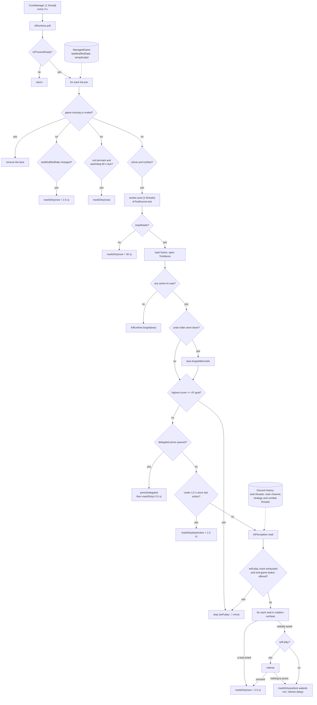
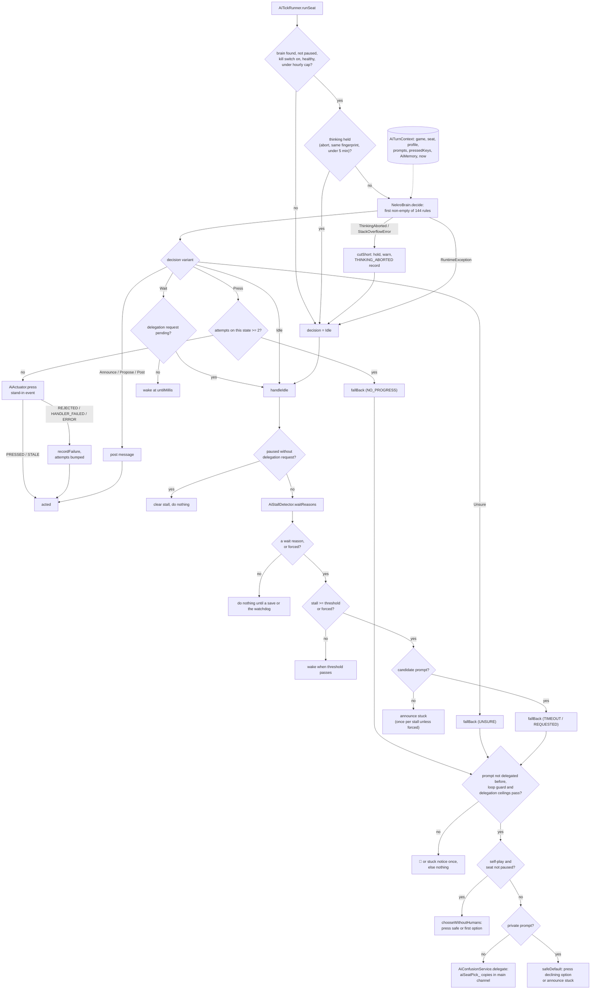

# Core runtime, brain, perception and actuation

Part of the [AI player architecture docs](/src/main/java/ti4/ai/README.md): a living document kept next to the code (packages: runtime, brain, perception, actuation, trace, root classes). The code is the source of truth; when you change behavior here, update this file.

## Components and responsibilities

Scope: `ti4.ai.runtime`, `ti4.ai.brain`, `ti4.ai.perception`, `ti4.ai.actuation`, `ti4.ai.trace` and the root classes
`AiSeats`, `AiSettings`, `AiGameWrites`, `AiExperiments`, `Hostility`, `AiPersonality`. Where behaviour depends on code
outside this scope (the fallback package, the self-play referee, the engine's button pipeline, the brain's rules) the
call is named and described only as far as it was read.

Role labels: **decides** (returns a choice), **evaluates** (scores options for a decider), **informs** (computes facts
or holds state), **executes** (presses, posts or writes).

Overall control: [AiTickRunner](/src/main/java/ti4/ai/runtime/AiTickRunner.java) owns every decision cycle. It is the
only caller of `FactionBrain.decide`, of `AiPerception.read` and (with the fallback code it calls) of
`AiActuator.press`. [AiRuntime](/src/main/java/ti4/ai/runtime/AiRuntime.java) only decides *when* a game is ticked.

Solid arrows are calls or branches seen in the code; dotted arrows are data flowing into a step.

### AiRuntimeLifecycle

- **Role:** executes.
- **Purpose:** Spring hook that starts and stops the AI runtime with the application.
- **Invoked when:** Spring creates the `@Component`; it is `@DependsOn("jdaLifecycleService")`, so it starts after the
  JDA lifecycle bean and (by Spring's reverse destruction order) is destroyed before it.
- **Inputs / outputs:** none.
- **Algorithm:** `@PostConstruct start()` calls `AiRuntime.start()`; `@PreDestroy stop()` calls `AiRuntime.shutdown()`.
- **Effect on the game:** none directly.
- **Limitations:** a package-private class in [AiRuntimeLifecycle](/src/main/java/ti4/ai/runtime/AiRuntimeLifecycle.java);
  it is the only production entry point that starts the poll.

### AiRuntime

- **Role:** decides (scheduling only) and informs (lane registry).
- **Purpose:** Keeps one `AiLane` per game with AI seats, polls those lanes from a cron task, and hands due lanes to a
  small worker pool.
- **Invoked when:**
  - `start()` from `AiRuntimeLifecycle.start`. It is guarded by an `AtomicBoolean`, creates a fixed pool of
    `WORKER_THREADS = 2` daemon threads named `ai-player-worker-N`, and registers `AiRuntime::poll` with
    `CronManager.schedulePeriodically(AiRuntime.class, …, 60, 3, SECONDS)` (initial delay
    `INITIAL_POLL_DELAY_SECONDS = 60`, period `AiSettings.POLL_PERIOD = 3 s`). `CronManager` runs every cron on one
    shared `ScheduledThreadPoolExecutor(1)` at fixed rate and wraps each run in a non-throwing task, so an exception
    ends that one poll early (lanes later in the iteration are not checked until the next poll). `poll` does no
    Discord I/O itself, but `GameManager.getManagedGame` can load a game file on the cron thread when the managed game
    is not cached, and throws `IllegalStateException` when that load fails.
  - `register(game)` from `AiSeatService.addSeat` (after an AI seat is added), `AiResume.execute` (`/ai resume`),
    `SelfPlaySetup` and `discover()`.
  - `forget(game)` from `AiSeatService.removeSeat` (when the last AI seat leaves) and `SelfPlaySetup`;
    `forget(lane)` from `AiTickRunner` when the game ended, vanished, or has no active AI seat.
  - `enqueueDelegatedPress` from `AiSeatPickButtonHandler.pick` (a player pressed an `aiSeatPick_` button).
  - `requestDelegation` from `AiDelegate.execute` (`/ai delegate`). Both this and `enqueueDelegatedPress` create the
    lane if it does not exist (`computeIfAbsent`) and mark it due now.
  - `clearStall` from `AiSeatService.setPaused` (`/ai pause`, `/ai resume`).
  - `isTracked`, `isCoolingDown` from `AiStatus`; `thinkingStats` from `AiThinkingProfile` (`/ai profile`).
- **Inputs:** `ManagedGame.getLastModifiedDate()` and `isHasEnded()` per lane; process state.
- **Outputs / decisions:** whether to submit `AiTickRunner.tick(lane)` to a worker now.
- **Algorithm (`poll`, every 3 s):**
  1. Return unless `isProcessReady()` and the worker pool exists: `JdaService.jda != null`, `JdaService.isReadyToReceiveCommands()`,
     `ActiveLeaseService.shouldHandleCurrentProcessInteraction()`, `!AsyncTI4DiscordBot.isUnstable()` and
     `!CircuitBreaker.isOpen()`. The kill switch (`AiSettings.isEnabled()`) is **not** checked here.
  2. If discovery has not succeeded and 60 s (`DISCOVERY_RETRY_MILLIS`) passed since the last attempt, submit
     `discover()`: register every non-ended managed game whose player ids include an AI seat id
     (`AiSeats.hasAiSeat(ManagedGame)`), then `AiLogStore.deleteLogsOfMissingGames(GameManager::isValid)`, then mark
     discovery done. A `RuntimeException` leaves it undone (retried after 60 s) and logs an info line.
  3. For each lane (ConcurrentHashMap iteration order, unspecified):
     - no managed game, or it has ended: remove the lane and continue;
     - `lane.observeModified(lastModifiedDate)` true (the value differs from the last one seen): `markDirty(now + 2.5 s)`
       (`AiSettings.DEBOUNCE`);
     - the game is not dormant (modified within `DORMANT_AFTER = 1 day`) and the lane's watchdog is due (60 s,
       `WATCHDOG_PERIOD`, since its last watchdog): `markDirty(now)`;
     - `lane.isDue(now) && lane.tryStart()`: submit `run(lane)`, which calls `AiTickRunner.tick(lane)`, logs any
       `Throwable` with `BotLogger.error`, and always calls `lane.finish()`.
  - `mayMutate()` = `isProcessReady()` and `ActiveLeaseService.shouldCurrentProcessRunScheduledWork()`; every press,
    post or announcement path checks it.
  - `shutdown()`: `ExecutorService.shutdown()`, wait up to 30 s (`SHUTDOWN_TIMEOUT_SECONDS`), then `shutdownNow()`.
    The cron task itself is not cancelled.
- **Depends on:** `CronManager`, `GameManager`, `ActiveLeaseService`, `CircuitBreaker`, `AiLane`, `AiTickRunner`,
  `AiGameState`.
- **Effect on the game:** none directly; it starts ticks.
- **Fallbacks:** a tick throwing anything is logged and the lane is released. `tryStart` cleared `dueAt`, so unless
  the tick re-armed the lane before throwing, it runs again only after the next seen save or watchdog (within about
  a minute for a non-dormant game). An exception from `AiStallDetector`, `AiPerception` or the fallback code ends
  up here, since only `brain.decide` is wrapped in its own `try`.
- **Limitations:**
  - "Debounce" is a minimum-time merge, not a trailing debounce: `markDirty` keeps the earliest wanted time
    (`min(current, wanted)` unless nothing is pending), so a burst of saves ticks 2.5 s after the first unseen change,
    not 2.5 s after the last.
  - Change detection reads `ManagedGame.lastModifiedDate`, a value copied when the managed game is built.
    `GameManager.save` writes the game (`GameSaveService.writeGame` sets `Game.setLastModifiedDate(now)`) and then
    replaces the `ManagedGame` with a fresh state; `GameManager.undo` and `GameManager.reload` replace it with the
    restored or reloaded game's state when it no longer matches (`ManagedGame.matches` compares name,
    `lastModifiedDate` and revision key). A change that is not saved is only seen by the 1-minute watchdog.
  - A lane whose game `GameManager.getManagedGame` keeps failing to load throws on every poll, so the lanes that the
    `ConcurrentHashMap` iteration reaches after it are not checked while that persists (they still tick if they
    were already queued).
  - The kill switch does not stop polling: with `AI_PLAYERS_ENABLED` off, due lanes still tick, and every tick still
    reads Discord history (perception) before each seat finds it may not choose.
  - At most two games tick at once across the whole bot; a lane's tick waits in the pool's unbounded queue while both
    workers are busy (`tryStart` keeps a lane from being queued twice).
  - `poll` removes a lane of an ended game without calling `AiGameState.forget`, so the static per-game maps of
    `SecondaryQueue`, `SlayIntent`, `FractureMarch` and `AttackLedger` keep that game's entries.

#### Diagram: Poll and tick

### AiLane

- **Role:** informs (per-game runtime state).
- **Purpose:** All in-memory state of one game's AI play: due time, running flag, queued delegated presses, per-seat
  `AiSeatState`, failure timestamps, thinking statistics, last action time and actor, referee dedupe, delegation
  counters and abort bookkeeping. Nothing here is persisted; a restart starts every lane empty.
- **Invoked when:** created by `AiRuntime.lane` (`computeIfAbsent`); used by `AiRuntime` and `AiTickRunner`.
- **Algorithm (methods and their rules):**
  - `markDirty(at)`: `dueAt = dueAt == 0 ? at : min(dueAt, at)`. `isDue(now)`: `dueAt != 0 && dueAt <= now`.
    `tryStart()`: CAS `running` false→true, then `dueAt = 0`. `finish()`: `running = false`.
  - `observeModified(m)`: true when `m` differs from the last value seen (also true on the first poll, since the
    initial value is 0).
  - `watchdogDue(now, period)`: true and resets when `now - lastWatchdog >= period`.
  - `observeUndoIndex(i)`: true when a previous index was known (>= 0) and the new one is smaller.
    `forgetAfterUndo()`: every seat's `AiSeatState.forgetAfterUndo()`, `SecondaryQueue.forget`, `AttackLedger.forget`,
    and clears referee attempts. It does not clear `SlayIntent` or `FractureMarch`.
  - `rotation(active)`: the active seats in `Game.getPlayers()` order (a `LinkedHashMap`, so insertion order), rotated
    to start just after `lastActorId`; if the last actor is not in the list, the original order.
  - `recordAction(seat, now)`: sets `lastActionAt` and `lastActorId`. Called by `AiTickRunner.pressAsSeat` before
    every press (including fallback and referee presses) and by `pressDelegated`.
  - `recordFailure(now)` / `recentFailures(now)`: a deque pruned to the last 600 s (`FAILURE_WINDOW_MILLIS`).
  - `recordGameDelegation(round, max)`: per-round counter, reset when the round changes; returns false at `max`.
  - `refereeMayPress(key, fingerprint)` / `recordRefereePress`: a referee press key may be pressed again only once
    `RefereeRules.stateFingerprint` differs from the one recorded for it; the map is cleared above 200 entries.
  - Abort bookkeeping: `noteAbort`, `recentAbort(now, window)`, `everySeatAborting(active, limit)` (every active seat
    has `consecutiveAborts >= limit`), `markAbortStormLogged` / `clearAbortStorm` (log the storm once until some seat
    decides normally), `slowWarningDue(now, gap)`.
  - `copy()`: deep copy of everything except the `ThinkingStats` (the copy starts with empty statistics); used only
    by the test harness (`SelfPlayGame` snapshots).
- **Depends on:** `AiSeatState`, `ThinkingStats`, `SecondaryQueue`, `AttackLedger`.
- **Effect on the game:** none.
- **Limitations:** `rotation` and `recordAction` use unsynchronised fields; correctness relies on `tryStart` keeping one
  tick per lane at a time.
- **Tested:** `AiLaneTest` checks rotation, per-seat isolation, delegation request upgrade, undo clearing, referee
  retry-on-change, seat retention, per-round ceilings, the repeated-fallback verdicts and recent decisions per prompt.

### AiSeatState

- **Role:** informs (per-seat runtime state).
- **Purpose:** One AI seat's attempt counts, press history, hourly action times, delegation state, stall timer, loop
  guard, thinking hold, abort counters and its `AiMemory`.
- **Invoked when:** `AiLane.seat(id)` creates it on first use; `AiTickRunner` reads and writes it every seat tick.
- **Algorithm:**
  - Attempts: `recordAttempt(key)` increments a counter per key; the whole map is cleared once it holds more than 200
    keys (`PRESSED_MEMORY`).
  - Presses: `recordPressed(pressKey, now)` appends `now` to the hourly action list, adds the key to a set kept to the
    newest 200 keys, and clears the stall timer and the "stuck announced" flag. `actionsInLastHour(now)` prunes
    entries older than 3,600,000 ms and returns the count. `pressedKeys()` returns a copy (fed into `AiTurnContext`).
  - Decisions: `recordDecision(promptKey, text)` keeps the last 60 decisions; `recentDecisionsOn(key, limit)` returns
    up to `limit` of them for that prompt, oldest first (used in fallback records).
  - Delegation request: `NONE`, `GAME_WIDE` or `EXPLICIT`. `requestDelegation(explicit)` never downgrades `EXPLICIT`.
    `consumeDelegationRequest()` returns and resets it.
  - Stall: `stallAge(reasons, now)`: with no reasons, reset and return 0; when the reason text changes or no stall is
    running, restart at `now`; otherwise `now - stallSince`. `restartStall(now)` restarts a running stall only.
  - Delegations: `canDelegate(round, max)` resets the per-round count on a new round; `recordDelegation(promptKey)`
    increments it and remembers the prompt so the same prompt is never delegated twice by this seat.
  - Loop guard: `recordFallback(loopKey, limit)` resets the count when the key changes, then increments (capped at
    `limit + 2`): `CHOOSE` while `<= limit`, `STOP_AND_ANNOUNCE` at `limit + 1`, `STOPPED` above.
    `clearFallbacks()` resets it.
  - Thinking hold: `holdThinking(now, fingerprint)`; `thinkingHeld(now, retry, fingerprint)` is true while
    `now - heldAt < retry` and the current `AiProgress` fingerprint equals the held one.
  - Aborts: `recordAbort()` / `recordDecided()` keep `consecutiveAborts`; `firstAbortInRound(round)` is true once per
    round.
  - `forgetAfterUndo()`: new `AiMemory`, clears pressed keys, decisions, thinking hold, attempts, delegated prompts,
    stall and loop guard. It keeps the hourly action times and delegation counters.
  - `replaceLastInputs` keeps the last `DecisionInputs` (timing instrumentation only).
- **Effect on the game:** none.

### AiTickRunner

- **Role:** decides (overall control of a cycle) and executes (through `AiActuator` and the fallback services).
- **Purpose:** Runs one tick of one game: load, guard, perceive once, let seats decide in rotation, carry out at most
  one action, schedule the next tick.
- **Invoked when:** `AiRuntime.run(lane)` on a worker thread (production) or `SelfPlayGame` with a virtual clock
  (tests); `tick(lane)` uses `System.currentTimeMillis()`.
- **Inputs:** the lane, the `Game` from `GameManager.getManagedGame(name).getGame()`, the perception snapshot, each
  seat's `AiProfile` and `AiSeatState`.
- **Outputs / decisions:** at most one of: a delegated press, one seat's action (press, fallback, announcement,
  proposal, post), or one referee press; plus the lane's next due time.
- **Algorithm (`tickOnce` then `tickGame`):**
  1. If `!AiRuntime.mayMutate()`: `markDirty(now + 30 s)` (`RETRY_DELAY_MILLIS`) and return.
  2. Managed game missing or ended: `AiRuntime.forget(lane)`, return.
  3. Load the game (timed as `ai.load`) and open a `TickMemo` scope for it for the rest of the tick.
  4. `seats = AiSeats.activeAiSeats(game)`; none: forget the lane, return. `lane.retainSeats(seats)`.
  5. Undo check: the newest number from `GameUndoNameService.getSortedUndoNumbers` (or -1 on error); if it is lower
     than the last seen, `lane.forgetAfterUndo()`.
  6. `selfPlay = AiSeats.isSelfPlay(game)` (every real player is an AI seat).
  7. Victory: if `game.getVp() > 0 && game.getHighestScore() >= game.getVp()`, return without acting. In self-play
     the 🏁 notice is posted once (`markGameOverAnnounced`). This stops AI seats in human games too, silently.
  8. A queued delegated press: `pressDelegated`, `markDirty(now + 2.5 s)`, return (one per tick).
  9. Pacing: if `now - lastActionAt < 1.5 s` (`MIN_GAP_BETWEEN_ACTIONS`), `markDirty(lastActionAt + 1.5 s)`, return.
  10. `AiPerception.read(game, seats)` once for all seats (timed as `ai.perceive`).
  11. Referee prompts: main-channel prompts with an enabled referee step button or the "most points" end-game button.
      In self-play, if the public objective track is exhausted (`RefereeRules.trackExhausted`) and an end-game button
      is offered, post the 🏁 notice once and return.
  12. For each seat in `lane.rotation(seats)`: `runSeat`. The first result with `acted == true` ends the tick with
      `markDirty(now + 2.5 s)`. Otherwise keep the smallest positive `wakeAt`.
  13. Self-play only: `referee(...)`; if it pressed, `markDirty(now + 2.5 s)` and return.
  14. Self-play and not dormant: `wakeAt = min(wakeAt, now + refereeDelay)` (20 s, or 10 s at fast pace).
  15. If any `wakeAt` was collected, `markDirty(wakeAt)`. Otherwise the lane waits for a save or the watchdog.
- **`runSeat`:**
  - `profile = AiProfile.of(seat)`; `brain = FactionBrainRegistry.forBrainId(profile.brainId())`;
    `prompts = snapshot.promptsFor(seat, brain.publicWindowHandlerPrefixes())`.
  - `canAct = brain present && !profile.isPaused() && AiSettings.isEnabled() && isHealthy(lane, now) &&
    actionsInLastHour < maxActionsPerHour(game)` (150, or 600 at fast pace).
  - `canAct`: `AiSeatService.ensureTradePreferences(seatId)` (turns off auto debt clearance once per process), then
    `decide(tick, brain, new AiTurnContext(game, seat, profile, prompts, pressedKeys, memory, now))`. Otherwise
    `AiDecision.idle()`.
  - The decision is recorded (`recordDecision` for `Press`/`Unsure`) and, when the game's debug mode is on, logged
    (`AiDebugLog.log`).
  - Dispatch: `Press` → `handlePress`; `Unsure` → `fallBack(…, UNSURE)`; `Wait` → `wakeAt(untilMillis)` unless a
    delegation request is pending, in which case `handleIdle` first; `Idle` → `handleIdle`; `Announce` →
    `AiConfusionService.notice` (actions channel) if `mayMutate`, acted; `Propose` → `HumanAiDealMessage.post` if
    `mayMutate`, acted; `Post` → `MessageHelper.sendMessageToChannelWithButtons` to `channelId` if `mayMutate`, acted.
- **`decide`:**
  - If `thinkingHeld` (a previous abort on the same `AiProgress` fingerprint less than 5 min ago, `THINKING_RETRY`):
    return `Idle` without calling the brain.
  - Otherwise reset `TimingReport`/`ShadowCheck`/`ClockReads`, open `Thinking.open(AiSettings.thinkingLimits())` and a
    `DecisionMemo` scope, call `brain.decide(context)`.
  - `ThinkingAborted` or `StackOverflowError` (converted by `ThinkingAborted.stackOverflow`): `cutShort`. Any other
    `RuntimeException`: `BotLogger.error`, the decision stays `Idle`.
  - Always close the memo and thinking scopes, record timing; `noteThinking` adds the profile to the lane's
    `ThinkingStats` and warns `AI thinking was slow …` when the decision took at least 2 s (`SLOW_DECISION`), at most
    once a minute per lane (`SLOW_WARNING_GAP`). A normal decision resets the seat's consecutive aborts and the
    lane's storm flag.
  - `cutShort`: hold thinking at the current fingerprint, build `AbortReport.line`, `lane.noteAbort`,
    `state.recordAbort`, warn once per round per seat, report an abort storm (an error once when every active seat has
    3 consecutive aborts, `ABORT_STORM_LIMIT`), and record a `THINKING_ABORTED` fallback with the last 4 spans
    (`TRAIL_SPANS_RECORDED`). The returned decision is still `Idle`, so the seat continues into `handleIdle` in the
    same tick.
- **`handlePress`:** see [AiProgress](#aiprogress) for the fingerprint.
  - `attemptKey = messageId|customId#fingerprint`. With `attempts >= 2` (`MAX_ATTEMPTS_PER_PROMPT`): on exactly 2,
    record a failure (in the lane and in the global deque, like a failed press) and bump to 3; then
    `fallBack(…, NO_PROGRESS, "its choice made no progress")`.
  - Otherwise record the attempt and `pressAsSeat`. Success clears the loop guard; failure adds 2 more attempts so the
    next tick on the same state falls back immediately. The seat counts as having acted either way.
- **`pressAsSeat`:** returns true without pressing when `!mayMutate()`. Otherwise `lane.recordAction` (with the
  tick's `now`, the time the tick started, not the time of the press),
  `AiActuator.press(identity, target)` (timed as `ai.actuate`). `PRESSED`: `recordPressed(messageId|customId)`, true.
  `STALE` (channel, message or button gone or disabled): true, nothing recorded. `REJECTED`, `HANDLER_FAILED`,
  `ERROR`: `recordFailure` (lane and global) and a warning, false.
- **`handleIdle`:** see [scenarios](#stall-timeout-and-hand-over) for the full path. Summary: a paused
  seat without a delegation request clears its stall and does nothing; otherwise `AiStallDetector.waitReasons` names
  what the game waits on, `stallAge` measures how long the same reasons have held, and after `stallThreshold`
  (3 min, 1 min at fast pace) or on a delegation request the newest unpressed, undelegated prompt tied to a reason is
  passed to `fallBack`. With no such prompt it announces "stuck" once per stall.
- **`fallBack`:** restart the stall; skip a prompt this seat already delegated; apply the loop guard (unless the hand
  over was requested, or a pending `/ai delegate` request exists, which this call consumes) keyed `reason@activePlayerID@lastActivePlayerChange`, limit 5 (`MAX_REPEATED_FALLBACKS`); apply
  the delegation ceilings (30 per seat, 60 per game per round); then:
  - self-play and not paused: `chooseWithoutHumans` (presses a fallback choice itself);
  - public prompt: `AiConfusionService.delegate` re-posts the enabled, non-form, offerable buttons in the actions channel
    as `aiSeatPick_…` buttons;
  - private prompt: `AiConfusionService.safeDefault` (a declining button), pressed only if the seat may act on its own.
  - Every outcome is written by `FallbackLog.record`.
- **`referee`** (self-play): requires the kill switch on, a healthy lane, `now - lastActionAt >= refereeDelay`, and no
  seat paused or over its hourly cap; picks `RefereeRules.next(...)` with the per-state dedupe and presses as the
  returned seat (the AI seat owning the button; for an unowned button the speaker seat, else the first seat; an owned
  button that no AI seat owns is skipped). The press key is recorded against the state fingerprint before pressing, and `referee` returns true
  whatever the press outcome, so a failed referee press re-arms the lane 2.5 s later but is not retried until the
  fingerprint changes.
- **`pressDelegated`:** the seat must still be an active AI seat (else the delegation message is resolved as failed);
  `recordAction`; re-read the original message, take the button at the stored index, and require its custom id to
  match the stored CRC32 prefix; press it through `AiActuator` if `mayMutate`; on success `recordPressed("delegated|"
  + delegationMessageId)` (so delegated presses count toward the seat's hourly cap); `AiConfusionService.resolve`
  edits the delegation message with the outcome. It does not check the kill switch, health or the hourly cap. It
  calls `AiActuator.press` directly, not `pressAsSeat`, so a `REJECTED`, `HANDLER_FAILED` or `ERROR` outcome records
  no failure for the health check and is reported with the same ⚠️ "that option is no longer available" text as a
  vanished button.
- **Health:** `isHealthy` = lane failures in the last 10 min `< 3` (`GAME_FAILURE_LIMIT`) and global failures in the last
  10 min `< 10` (`GLOBAL_FAILURE_LIMIT`, a static deque shared by all games). When the global count reaches exactly 10
  one warning is logged.
- **Depends on:** `AiPerception`, `FactionBrainRegistry`, `AiActuator`, `AiStallDetector`, `AiProgress`,
  `AiConfusionService`, `RedistributionGuard`, `FallbackLog`, `RefereeRules`, `CombatRules.isRollFor`,
  `HumanAiDealMessage`, `AiDebugLog`, `Thinking`, `TimingReport`, `ShadowCheck`.
- **Effect on the game:** every AI-originated button press and every runtime-posted message goes through here.
- **Limitations:** listed in limits (section 10).
- **Tested:** `AiTickRunnerThinkingTest` (aborts cut short and recorded, once-per-round logging, abort storm logged
  once, stuck record naming a recent abort, real stack overflow caught, no retry until the game changes or 5 min pass,
  ordinary decisions not counted as aborts, brain exceptions logged as idle); `AiTickRunnerPausedTest` (paused seats
  hand nothing over, paused time not counted, explicit requests still hand over, unpaused seats fall back after the
  threshold).

#### Diagram: One seat's decision and its handling

### AiProgress

- **Role:** informs.
- **Purpose:** A hash of everything a press could change, so the runtime can tell "pressed and nothing happened" from
  "pressed and the game moved".
- **Invoked when:** `AiTickRunner.handlePress` (attempt key) and `AiTickRunner.decide`/`cutShort` (thinking hold).
- **Algorithm:** `Objects.hash` of: round, phase, active player id, played strategy cards, the whole game stored-value
  map (sorted), the tactical action displacement (staged movement), the seat's unit positions (sorted
  `position|holder|unitKey=count` strings), and the seat's trade goods, commodities, tactic/fleet/strategy tokens,
  strategy cards, followed cards, passed flag, unscored secret ids, action card ids, promissory note ids, technologies,
  planets, exhausted planets, units produced this action and transaction items.
- **Limitations:** a hash collision or a change outside these fields (another player's units, a deck, a message) is not
  progress. Any game stored-value change counts as progress, including the AI's own memory-like stored values.
- **Tested:** `AiProgressTest` (stable while nothing changes; changes on staged movement, moves between holders and
  systems, transaction items; ignores other players' units).

### AiStallDetector

- **Role:** informs.
- **Purpose:** Names what the game is waiting on from a seat, each with a predicate that says which prompts belong to
  that wait.
- **Invoked when:** `AiTickRunner.handleIdle`.
- **Algorithm (`waitReasons`), in this order:**
  1. The seat is the active player: "its turn"; related prompts are public (not the seat's thread), created no earlier
     than `lastActivePlayerChange - 5 s`, and either a system picker (`TacticalRules.isSystemPicker`) or holding a
     button owned by the seat.
  2. Phase `statusScoring`: "public objective scoring" while stored value `<faction>round<N>PO` is empty (prompts with
     the `PO_NO_SCORING` handler); "secret objective scoring" while `<faction>round<N>SO` is empty (`SO_NO_SCORING`).
  3. Phase `statusHomework` and `statusHomeworkReactionFor<faction>Round<N>` empty: "status phase homework"
     (`redistributeCCButtons` prompts).
  4. Each played strategy card the seat neither holds nor has followed: "following strategy card N"
     (`sc_no_follow_N` prompts).
  5. Any prompt for which `CombatRules.awaitsSeat` holds: "a combat".
  6. Round <= 1, not extra-secret mode, more than one unscored secret, and only custom public objectives revealed
     (`NekroBrain.noRealObjectiveRevealed`): "discarding a starting secret objective" (private `discardSecret_` prompts).
  7. An agenda "when"/"after" decline button in the seat's thread while the seat has not passed on that window, unless
     it holds a queued when/after or a played Veto is pending (`AgendaQueue`, `AgendaCardRules`).
  - `describe` joins the descriptions with ", "; that string is the stall identity in `AiSeatState.stallAge`.
  - The related-prompt predicates of reasons 2, 3, 4, 6 and 7 use `AiPrompt.hasHandlerPrefix`, which also matches
    disabled buttons; `handleIdle` still requires a candidate prompt to have at least one enabled button.
  - Reason 6 checks `isExtraSecretMode`, a mode `AiGameSupport` refuses when a seat is added, so that branch only
    matters if the mode is switched on later.
- **Tested:** `AiStallDetectorTest` (turn reason scoping, unowned system picker only on the seat's turn, scoring reasons,
  combat reason, queued agenda entries, a passed seat).

### DecisionInputs

- **Role:** informs (instrumentation only).
- **Purpose:** Classifies, for the timing report, what changed since the seat's previous decision: `first`, `saved`
  (new `lastModifiedDate`), `same save` (same save but different prompts/pressed keys/memory) or `unchanged`.
- **Invoked when:** `AiTickRunner.decide` and `inputChange`, only when `TimingReport.enabled()` (`-Dai.timing=true`).
- **Algorithm:** `Objects.hash(prompts, Set.copyOf(pressedKeys), memory.snapshot())` plus the save time.
- **Tested:** `DecisionInputsTest`.

### AbortReport

- **Role:** informs.
- **Purpose:** Builds the one-line warning for a cut-short decision.
- **Algorithm:** `AI thinking aborted game=… round=… phase=… seat=… after=<ms> reason="…" path=[compact trail]
  calls=[span xN ms …] keys=[…] inputs=[cards …, tokens t/f/s, tg, commodities, explore <trait> deck/discard …,
  active system …]`.
- **Invoked when:** `AiTickRunner.cutShort`.

### AiGameState

- **Role:** informs.
- **Purpose:** Snapshot, restore and forget of the static per-game maps kept outside the lane: `SecondaryQueue` open
  follows, `SlayIntent`, `FractureMarch` and `AttackLedger` pictures.
- **Invoked when:** `forget` from `AiRuntime.forget(...)`. `snapshot`/`restore` only from test code
  (`SelfPlayGame`, `TrajectoryLog`, `TrajectoryReplay`, `AttackMemoryTest`).

### AiPerception, AiPrompt and PromptButton

- **Role:** informs.
- **Purpose:** Turn Discord message history into `AiPrompt`s (one per message kept) and filter them per seat. The brain
  never reads Discord itself; it only sees the prompts and the `Game` object.
- **Invoked when:** `AiPerception.read(game, seats)` once per tick from `AiTickRunner.tickGame`;
  `Snapshot.promptsFor(seat, prefixes)` once per seat from `runSeat`; `Snapshot.publicPrompts(predicate)` for the
  referee. Outside perception, `OfferRejections` uses `isRejectionNotice` and `OFFER_REJECTED`, `RiderPayouts` uses
  `LEADERSHIP_RIDER_PAYOUT`, and the delegation code uses `DELEGATION_PREFIX`. `AiPerception.collect(game, seat,
  prefixes)` (read plus filter for one seat) is called only from tests.
- **Inputs:** JDA channels. Message history is read with `channel.getHistory().retrievePast(n).complete()` (blocking):
  `HISTORY_SIZE = 50` messages for the seat's thread, the actions channel and strategy threads, `COMBAT_HISTORY_SIZE = 100`
  for combat threads. With `JdaService.jda == null` the snapshot is empty.
- **What is read (`read`):**
  1. For each active AI seat, its cards info thread (`seat.getCardsInfoThreadID()` from the JDA cache, else
     `getCardsInfoThread()`), as source `AI_THREAD`.
  2. The main actions channel (`PUBLIC`). If it is missing, nothing else is read.
  3. Strategy card threads of played cards (`ButtonHelper.getRightStratThread`), unarchived, whose latest message is
     at most 15 minutes old (`PUBLIC`).
  4. Combat threads of the actions channel: name starts with `<game>-round-` and contains `-vs-`, unarchived; per key
     (the name up to `-turn-`, which holds the round and system, plus the sorted factions of the participants parsed
     from `-turn-<n>-<a>-vs-<b>` and matched to players by faction or colour prefix; the whole name when no
     participant resolves) only the newest thread by id; only threads that involve some AI seat (`involves`: the name contains the seat's faction or
     colour and the combat is ongoing, or `NeutralCombat.watches`); newest latest message first; at most
     `2 × number of seats`.
  - "Ongoing" (`isOngoing`): the tile at the position in `-system-<pos>-turn-` holds the seat and an opposing party
    (one of the named participants, or anyone else when names cannot be resolved) together, as ships in space or units
    on one planet.
- **Which messages become prompts:** bot-authored messages, plus (combat threads only) human messages with empty
  content and no buttons. A message without buttons is kept only when: from a combat thread; in the seat's thread and
  containing "has been rejected" (an offer rejection notice); in a public channel and starting with `🤖 💬 ` (AI table
  talk) or containing " resolve _Leadership Rider_ by using the button".
- **Per-seat filter (`promptsFor`), in output order:**
  1. Seat thread prompts with any button, or a rejection notice.
  2. Actions channel prompts with a button owned by the seat, or an unowned button whose handler id starts with one of the
     brain's window prefixes, or AI table talk.
  3. Strategy thread prompts with a button owned by the seat (no window prefixes).
  4. The 2 newest combat threads (`COMBAT_THREADS_TO_READ`) that involve this seat: every prompt.
  - Any prompt with an `aiSeatPick_` (delegation) button is dropped everywhere.
- **AiPrompt:** `channelId`, `messageId`, `source`, `content`, `buttons`, `createdAtMillis`. `key()` is
  `channelId/messageId`. `isHidden()` is true only for `AI_THREAD`. Helpers `firstEnabled`, `enabledHandler`,
  `enabledHandlerPrefix`, `enabledButtons` skip disabled buttons.
- **PromptButton:** built from a JDA `Button` with `ComponentIdEnvelope.decode(customId)`: `handlerId` (the part the
  router dispatches on), `ownerFaction` (the `FFCC_<faction>_` owner, else the spoofed faction), `label`, `disabled`,
  and the index among the message's buttons with a custom id counted from all buttons. Link buttons (no custom id) are
  skipped but still advance the index.
- **Effect on the game:** none (read only).
- **Fallbacks:** a channel that cannot be read logs a warning and yields no prompts; a missing strategy thread lookup
  logs and yields none.
- **Limitations:** only the last 50 (or 100) messages of each channel are seen; select menus and modals are not
  perceived (only `Button` components); the seat never reads another player's private thread; Fog of War private
  channels are not read (AI seats cannot join Fog of War games, `AiGameSupport`).
- **Tested:** `AiPerceptionTest` (thread relevance, owned/window filtering, delegation messages ignored, combat thread
  messages without buttons kept, table talk, Leadership rider line, rejection notices) and
  `AiCombatThreadSelectionTest` (opponent gone, newest thread per matchup, simultaneous combats).

### FactionBrain, FactionBrainRegistry and NekroBrain

- **Role:** decides.
- **Purpose:** `FactionBrain` is the decision interface: `id()`, `publicWindowHandlerPrefixes()` (which unowned public
  buttons perception passes to the seat), and `decide(AiTurnContext) -> AiDecision`.
- **Registry:** [FactionBrainRegistry](/src/main/java/ti4/ai/brain/FactionBrainRegistry.java) maps `"nekro"` and
  `"standard"` to **the same** `NekroBrain` instance. `AiSettings.brainFor(faction)` writes `"nekro"` for the Nekro
  faction and `"standard"` for every other faction into the seat's `aiBrain` stored value when the seat is added
  (`AiSeatService.addSeat` via `AiProfile.createHidden`). A brain id not in the map (for example a blank stored value)
  gives no brain: the seat never decides and only reaches the stall/hand-over path.
- **Invoked when:** only from `AiTickRunner.decide`.
- **Algorithm (`NekroBrain.decide`):** `DecidingSeat.of(seat, …)` sets a thread-local "who is deciding" (used by
  evaluators to know whose hand is visible), then `firstRuleDecision` walks the rule list in order. Each rule is a
  `BrainRule` (`Function<AiTurnContext, Optional<AiDecision>>`), timed with `Thinking.measure("rule.<name>")`. The first
  rule that returns a present `Optional` decides; `TimingReport.decidedBy(name)` records it. If none does, `Idle`.
  There is no scoring across rules: order is the priority.
- **Rule names:** `BrainRule.named` names each rule by reflection on its serialized lambda: `<ImplClass simple
  name>.<impl method>`, for example `TradeRules.answerOffers`; the one lambda entry gets a synthetic `lambda$…` method
  name; a reflection failure gives `rule<index>`. `BrainRuleTest` checks the method-reference naming.
- **Observers:** rules 1 to 5 always return empty and exist for their side effects:
  `AttackLedger.observe` (records attack losses when `ATTACK_MEMORY` is on), `Hostility.observe` (see
  [Hostility](#hostility)), `ActionSecretRules.observe` (action phase, watches combats and results for held action-phase
  secrets), `PromissoryRules.observe` (remembers note play buttons, Ceasefire and play-area notes) and
  `TradeRules.observe` (when trading is on: trust refresh, offers, rejections, card terms, human deals, promises,
  discard bounties). They run whenever the brain is called: for every seat that the tick reaches and that may choose
  (not paused, kill switch on, healthy, under its hourly cap, thinking not held), whether or not it then acts. They do
  not run for seats after the one that acted, nor for seats that may not choose. Some of them save the game through
  `AiGameWrites.persist`.
- **Rules written in `NekroBrain` itself:**
  - `finishCommandTokenGain` (6): in `statusHomework`, on a private `increase_tactic_cc` prompt with a "Done
    Redistributing" button: press the pool from `CommandTokenPolicy.poolToGrow` while the net gain is below
    `statusPhaseGainWithinReinforcements`; otherwise move a surplus token (`poolToRedistributeFrom`); otherwise press
    Done.
  - `queueProveEndurance` (74): holding secret `pe`, press `autoProveEndurance_yes`.
  - `discardExcessSecret` (76): more unscored secrets than allowed (1 in round 1 before any real public objective is
    revealed outside extra-secret mode, else `maxSOCount - soScored`): press `discardSecret_<index>` of
    `SecretValue.lowestValueSecret` in its thread, else open the discard buttons (`get_so_discard_buttons`).
  - `discardExcessActionCards` (77): over the hand limit (`ButtonHelper.isPlayerOverLimit`): the
    `ActionCardValue.worstDiscard` button among `ac_discard_from_hand_` buttons not yet pressed.
  - `declineWhens` (111): unless already declined (`declinedWhens`) or holding a queued "when": offer a discard
    bounty; return nothing (leave it to later rules) while holding a played Veto (`AgendaCardRules.holdsPlayedVeto`);
    queue Veto, queue Quash, await a Veto/Quash bounty, else press `declineToQueueAWhen`.
  - `declineAfters` (114): unless declined (`declinedAfters`), holding a queued "after" or an unplaced rider: queue a
    rider, else `declineToQueueAnAfter`.
  - `abstainFromAgenda` (118): active player with an owned, unpressed `resolveAgendaVote_0` this turn: mark abstained
    and press it.
  - `breakAgendaTie` (119): speaker and active player, not `agendaEnd`: `AgendaPolicy.chooseOutcome` over tie outcome
    buttons, else `choosePlanetOwner` over tied planet owner buttons.
  - `pickStrategyCard` (124): active player in `strategy`: hand over a Checks and Balances card if planned; honour a
    speaker sale (`SpeakerSale.awaitSellerPick`); among owned unpressed `scPick_` buttons (minus a promised card):
    with Checks and Balances in play, `ChecksAndBalances.plan` if it returns a plan; otherwise the first of
    `StrategyCardRanking.ranked` (its plan is written to memory and the ranking to `StrategyCardPickLog`).
  - `takeTurn` (137): active player in `action`; an ordered chain described in
    [scenarios](#own-turn-in-the-action-phase).
  - `declineStrategyCardFollow` (139): a public `sc_no_follow_N` for a played card it neither holds nor followed, that
    `StrategyCardRules.waitsToFollow` does not hold, that has no `SecondaryQueue` blocker and was not pressed.
  - `scorePublicObjective` (140): `statusScoring`, `<faction>round<N>PO` empty, a public prompt with `PO_NO_SCORING`:
    `ObjectivePolicy.bestScorablePublic` among `PO_SCORING` buttons via `ScoringRules.scoreAndExpectPayment`, else
    press "no scoring".
  - `startStatusHomework` (142): `statusHomework`: press `redistributeCCButtons` on the newest public message that also
    has `pass_on_abilities`; once the reaction is stored and the gain target is met, press `pass_on_abilities`
    ("ready") unless either button was already pressed.
- **Window prefixes:** `NekroBrain.WINDOW_PREFIXES` = the `PUBLIC_WINDOW_PREFIXES` set (strategy card decline, public and
  secret scoring, status homework, when/after declines, `no_sabotage`, `combatRoll_`, system pickers, payment
  `spend_`/`reduceTG_`, `getTech_`, agenda outcome and vote prefixes, exploration and relic choices, several faction
  component prefixes) plus `ActionCardRules.targetPrefixes()`.
- **Effect on the game:** through the returned decision only, except the observers' and some rules' direct writes.
- **Limitations:** one rule list for every faction (faction rules key on abilities, leaders or units inside each rule);
  an exception inside any rule aborts the whole decision for that seat and tick (logged, treated as `Idle`).

The registered rule list, in priority order (`NekroBrain.rules`; `NekroBrain::x` is `this::x` in the source):

| # | Rule |
| --- | --- |
| 1 | `AttackLedger::observe` |
| 2 | `Hostility::observe` |
| 3 | `ActionSecretRules::observe` |
| 4 | `PromissoryRules::observe` |
| 5 | `TradeRules::observe` |
| 6 | `NekroBrain::finishCommandTokenGain` |
| 7 | `StrategyCardRules::exhaustAiDevelopmentForResearch` |
| 8 | `StrategyCardRules::exhaustProphetsTearsForResearch` |
| 9 | `BrotherOmarRules::returnInfantry` |
| 10 | `PaymentRules::pay` |
| 11 | `SecretCostRules::pay` |
| 12 | `NekroLeaderRules::payAgentCost` |
| 13 | `RelicActionRules::next` |
| 14 | `CrownOfEmphidiaRules::scorePoint` |
| 15 | `MawOfWorldsRules::purge` |
| 16 | `OracleRules::play` |
| 17 | `LegendaryRules::next` |
| 18 | `AvernusRules::next` |
| 19 | `ExpeditionRules::next` |
| 20 | `ConvoysRules::next` |
| 21 | `NekroRules::propagationTokens` |
| 22 | `RiderPayouts::technology` |
| 23 | `RiderPayouts::leadership` |
| 24 | `NekroRules::commanderDraw` |
| 25 | `NekroRules::dacxiveAnimators` |
| 26 | `TechRules::reviveInfantry` |
| 27 | `EntropicScarRules::next` |
| 28 | `TechRules::placeSpinnerInfantry` |
| 29 | `YinSpinnerRules::afterOtherProduction` |
| 30 | `TechRules::placeSelfAssemblyMech` |
| 31 | `IconoclastRules::deploy` |
| 32 | `TechRules::placeMagenInfantry` |
| 33 | `MatriarchRules::returnFighters` |
| 34 | `TechRules::continueProductionBiomes` |
| 35 | `DatahubRules::next` |
| 36 | `SlingRelayRules::next` |
| 37 | `TransitDiodesRules::next` |
| 38 | `TechRules::nullificationField` |
| 39 | `TechRules::neuralParasite` |
| 40 | `TechRules::salvageOperations` |
| 41 | `IntegratedEconomyRules::next` |
| 42 | `ExplorationRules::next` |
| 43 | `StrategyCardRules::chooseTechnology` |
| 44 | `StartingTechRules::choose` |
| 45 | `StrategyCardRules::gainTokens` |
| 46 | `StrategyCardRules::placeStructure` |
| 47 | `StrategyCardRules::readyPlanets` |
| 48 | `PeaceAccordsRules::resolve` |
| 49 | `FleetSupplyRules::removeExcessShips` |
| 50 | `StrategyCardRules::buildWithWarfare` |
| 51 | `StrategyCardRules::buildWithConstruction` |
| 52 | `BellumGloriosumRules::next` |
| 53 | `XxchaAgentRules::next` |
| 54 | `XxekirGromRules::next` |
| 55 | `NorrSupremacyRules::next` |
| 56 | `ReclaimerRules::next` |
| 57 | `DarktalonTreillaRules::next` |
| 58 | `RearAdmiralFarranRules::gainTradeGood` |
| 59 | `MathisMathinusRules::next` |
| 60 | `LazaxGateFolding::next` |
| 61 | `OrbitalDropRules::next` |
| 62 | `SolHeroRules::next` |
| 63 | `DannelRules::next` |
| 64 | `NekroLeaderRules::chooseAgentTarget` |
| 65 | `CarthAgentRules::chooseTarget` |
| 66 | `SolAgentRules::chooseTarget` |
| 67 | `ZeuAgentRules::next` |
| 68 | `NekroLeaderRules::continueHero` |
| 69 | `ActionCardRules::continuePlay` |
| 70 | `ActionCardRules::afterActivation` |
| 71 | `ActionCardRules::flankSpeed` |
| 72 | `ActionCardRules::presetSummit` |
| 73 | `PromissoryRules::continuePlay` |
| 74 | `NekroBrain::queueProveEndurance` |
| 75 | `SecretRedrawRules::discardForRedraw` |
| 76 | `NekroBrain::discardExcessSecret` |
| 77 | `NekroBrain::discardExcessActionCards` |
| 78 | `TradeRules::rescindStale` |
| 79 | `TradeRules::answerOffers` |
| 80 | `TradeRules::askWhatTheyWant` |
| 81 | `ActionCardResponses::respond` |
| 82 | `SabotageRules::answerWindowsAimedAtSeat` |
| 83 | `SabotageRules::followUp` |
| 84 | `SabotageRules::answerWindows` |
| 85 | `PromissoryRules::answerOffers` |
| 86 | `PromissoryRules::playCeasefire` |
| 87 | `PromissoryRules::playCombatNotes` |
| 88 | `SingularityRules::next` |
| 89 | `WrathOfKenaraRules::next` |
| 90 | `SardakkHeroRules::next` |
| 91 | `SardakkCommanderRules::next` |
| 92 | `ForesightRules::next` |
| 93 | `CombatCardRules::hold` |
| 94 | `CombatCardRules::afterSpaceCannon` |
| 95 | `CombatCardRules::cancelHits` |
| 96 | `SolCommanderRules::next` |
| 97 | `BrotherMilorRules::next` |
| 98 | `IndoctrinationRules::next` |
| 99 | `DevotionRules::next` |
| 100 | `ViscountUnlennSale::answer` |
| 101 | `SpeakerSale::answer` |
| 102 | `TradeRules::answerPromises` |
| 103 | `ViscountUnlennSale::holdRoll` |
| 104 | `ViscountUnlennSale::offer` |
| 105 | `MatriarchRules::continueHits` |
| 106 | `context -> CombatRules.next(context, NekroBrain::atRoundStart)` |
| 107 | `ActionSecretRules::next` |
| 108 | `SecretRules::scoreAgendaSecret` |
| 109 | `PromissoryRules::queueAgendaNote` |
| 110 | `BoatFloat::arrange` |
| 111 | `NekroBrain::declineWhens` |
| 112 | `GalacticThreatRules::next` |
| 113 | `AgendaCardRules::riders` |
| 114 | `NekroBrain::declineAfters` |
| 115 | `TradeRules::payTheAnswerer` |
| 116 | `TradeRules::holdVoteForDeals` |
| 117 | `AgendaVoting::next` |
| 118 | `NekroBrain::abstainFromAgenda` |
| 119 | `NekroBrain::breakAgendaTie` |
| 120 | `TradeRules::offerDeadlyPlotBounty` |
| 121 | `ShenanigansRules::react` |
| 122 | `TradeRules::payDebtInAgenda` |
| 123 | `SpeakerSale::declare` |
| 124 | `NekroBrain::pickStrategyCard` |
| 125 | `NekroLeaderRules::startAgent` |
| 126 | `CarthAgentRules::start` |
| 127 | `NekroLeaderRules::startHero` |
| 128 | `ActionCardRules::holdOwnTurn` |
| 129 | `PromissoryRules::holdForCeasefire` |
| 130 | `TradeRules::continueDraft` |
| 131 | `TradeRules::settleTrade` |
| 132 | `TradeRules::carthDeal` |
| 133 | `TradeRules::carthPreWash` |
| 134 | `TradeRules::startDeals` |
| 135 | `TradeRules::awaitExtortion` |
| 136 | `DannelRules::holdTurn` |
| 137 | `NekroBrain::takeTurn` |
| 138 | `StrategyCardRules::follow` |
| 139 | `NekroBrain::declineStrategyCardFollow` |
| 140 | `NekroBrain::scorePublicObjective` |
| 141 | `SecretRules::scoreStatusSecret` |
| 142 | `NekroBrain::startStatusHomework` |
| 143 | `StrategyCardRules::awaitSecondaries` |
| 144 | `StrategyCardRules::awaitFollowTurn` |

Rule 106 is the only lambda; it calls `CombatRules.next` with a round-start hook that tries
`SolAgentRules.atRoundStart`, then `CombatCardRules.atRoundStart`, then `LetnevCombatRules.atRoundStart`. Rule
descriptions for the classes outside `NekroBrain` belong to their own packages' documentation.

### BrainRule and AiDecision

- **Role:** informs (types).
- **AiDecision** (sealed) variants and what `AiTickRunner.runSeat` does with them:

| Variant | Fields | Runtime effect | Counts as acting |
| --- | --- | --- | --- |
| `Press` | prompt, button, reason | `handlePress`: attempt guard, then press as the seat (or `NO_PROGRESS` fallback) | yes |
| `Unsure` | prompt, reason | immediate `fallBack` with kind `UNSURE` (no stall wait) | depends on the fallback outcome |
| `Wait` | untilMillis, reason | wake the lane at `untilMillis`; the stall detector is skipped unless a delegation request is pending | no |
| `Idle` | none | `handleIdle` (stall detection, timeout hand-over) | only if it handed over, pressed a fallback choice or announced "stuck" |
| `Announce` | text | `AiConfusionService.notice` posts the text in the actions channel | yes |
| `Propose` | `HumanAiDeal` | `HumanAiDealMessage.post` | yes |
| `Post` | channelId, text, buttons | `MessageHelper.sendMessageToChannelWithButtons` | yes |

  "Acting" ends the tick for every seat and re-arms the lane 2.5 s later. Producers found in production code: `Wait`
  in 43 files, `Unsure` in `TacticalRules` and `SpaceCannonWait`, `Announce` in 5 files, `Propose` in `CarthDeals`,
  `Post` in 4 files.

### AiTurnContext and ClockReads

- **Role:** informs.
- **Purpose:** The only argument a rule gets: `game`, `seat`, `profile`, `prompts` (the seat's filtered prompts),
  `pressedKeys` (copy of the seat's last 200 pressed `messageId|customId` keys), `memory` (the seat's `AiMemory`) and
  `now`.
- **Algorithm:** `now()` also sets the thread-local `ClockReads` flag (used only to label timing samples);
  `turnKey()` = `activePlayerId@lastActivePlayerChange`; `pressKey(prompt, button)` = `messageId|customId`;
  `alreadyPressed`; `isActivePlayer`; `faction`.
- **Limitations:** `pressedKeys` covers this process lifetime only and is cleared on undo.

### Prompts, AgentPick and StrategyCard

- **Role:** informs (helpers used by rules; `Prompts` by about 110 files, `StrategyCard.of` by 35).
- **Prompts:** `newestFirst` (by `createdAtMillis` descending), `turnStart` (`lastActivePlayerChange - 5 s`),
  `thisTurn`, `owned(prompts, faction, handler)` and `unowned(prompts, handler)` (first enabled match in list order),
  `first`, `mentions` (content contains one of the seat's three representations), `createdThisTurn`, `in`,
  `newestWith`.
- **AgentPick.target:** the first enabled button owned by the seat whose handler id, with a trailing Yssaril `~cc`
  removed, equals `agentPick_<agent>_<target>` for one of the targets. Used by `NekroLeaderRules` and `CarthAgentRules`.
- **StrategyCard.of(game, initiative):** reads the card's `botSCAutomationID`; `base2` maps to `DIPLOMACY`; otherwise the
  first of `LEADERSHIP, DIPLOMACY, POLITICS, CONSTRUCTION, TRADE, WARFARE, TECHNOLOGY, IMPERIAL` whose lower-case name
  is contained in the id; else `OTHER`.

### AiMemory

- **Role:** informs (state).
- **Purpose:** A seat's free-form string key/value memory across ticks (plans, intents, "already did X this round").
- **Algorithm:** insertion-ordered `LinkedHashMap`, at most 500 entries (`MAX_ENTRIES`), evicting the oldest insertion;
  `put` on an existing key keeps its position, `refresh` re-inserts it as the newest; all methods synchronized.
- **Lifetime:** owned by `AiSeatState`; replaced by an empty memory on undo; lost on restart (never persisted). State that
  must survive restarts or roll back with undo is written to game or player stored values by the rules instead.
- **Tested:** `AiMemoryTest`.

### TickMemo, DecisionMemo and SearchMemo

- **Role:** informs (caches).
- **TickMemo:** opened by `AiTickRunner.tickOnce` around the whole tick for one `Game` instance (thread-local, nestable).
  `mapFor(game, name)` returns a map shared by every seat's decision in this tick when the scope's game is the same
  instance, else a fresh map. Used by `IncomingForces` and `TacticalStrength`. With `-Dai.tickmemo.verify=true`,
  `checked(name, key, shared, fresh)` recomputes outside the cache and counts mismatches (`verificationLines`).
- **DecisionMemo:** opened by `AiTickRunner.decide` around one seat decision; `remember(supplier, keys…)` caches non-null
  results by `Arrays.asList(keys)`; outside a scope it just computes. Used by 9 evaluator classes (`TacticalPlanner`,
  `WinOdds`, `WinRace`, `ScoringReserve`, `DenialMap`, `PlanetTake`, `StyxTake`, `Adjacency` in `ti4.ai.eval`,
  `CombatModifiers`).
- **SearchMemo:** like `DecisionMemo` but with its own scopes, opened by `ImaginedTurn.of` (evaluating an opponent's
  turn) and by `FragmentDeals`, `MilitarySupportDeals`, `NoteDeals`, `TechnologyRequest`; without a scope it delegates
  to `DecisionMemo`. `ImaginedTurn.of` also opens a fresh `DecisionMemo`, so an imagined opponent turn never reuses the
  deciding seat's cached values.
- **Limitations:** keys are caller-chosen; a key that omits an input that changed during the scope returns a stale value.
  Null results are never cached.
- **Tested:** `TickMemoTest`, `SearchMemoTest`.

### AiActuator, AiActor, Proxies and SyncMessage

- **Role:** executes.
- **Purpose:** Press a real button on a real message as the AI seat, through the bot's normal button pipeline.
- **Invoked when:** `AiTickRunner.pressAsSeat` (brain presses, fallback presses, referee presses) and
  `AiTickRunner.pressDelegated`. `AiActuator.retrieve` is also used by `AiConfusionService.delegate`.
- **Algorithm (`press`):**
  1. JDA missing: `ERROR`. Custom id contains `~MDL` (opens a modal): `REJECTED`.
  2. Channel missing, message not retrievable (`retrieveMessageById().complete()` failing), or no enabled button with
     that exact custom id: `STALE`.
  3. `AiActor.member`: a `java.lang.reflect.Proxy` of the bot's own guild `Member` whose `getId`, `getIdLong`,
     `getUser`, `getEffectiveName`, `getNickname`, `getAsMention` (`**<name>**`, so no ping) and `toString` report the
     seat; everything else delegates to the bot member. The `User` proxy does the same.
  4. `SyncMessage`: a proxy of the message that turns `edit*`/`delete` `RestAction.queue(...)` calls into tracked
     `submit()` futures, and swallows a `reply` whose text starts with "The button failed" (its own constant, matching
     the router's exception reply `AnnotationHandler.BUTTON_FAILURE_PREFIX`) as a handler failure.
  5. `TestBedPress.standInEvent(syncMessage, button, actor, recorder, repost)` builds a `ButtonInteractionEvent` backed by
     a proxy `ButtonInteraction`: it returns the button, message, channel, guild and the seat as user/member; records
     replies; records `replyModal` ids; edits the real message for `editOriginal*`/`editMessage*`/`editComponents*`; and
     re-posts any interaction reply or hook message that carries components (the stand-in interaction cannot send
     real replies, ephemeral or not) into the seat's cards info thread with the header
     `-# 🤖 private prompt for this AI seat` (that is how ephemeral prompts reach the seat as `AI_THREAD` prompts).
     With no cards info thread id, nothing is re-posted.
  6. `ButtonProcessor.processNow(event)` routes and runs the handler synchronously on the worker thread, holding the
     game's `ExecutionLockManager` lock (`WRITE` when the route saves, else `READ`) when the channel resolves to a
     game; `process` then calls `ButtonContext.save()` on the same thread before returning. An exception thrown by the
     handler method is caught in `AnnotationHandler.buildConsumer`, which replies "The button failed. …" on the
     message (the reply `SyncMessage` intercepts); other exceptions inside `process` are caught and logged there. A
     `ButtonContext` that is not valid makes `process` return without running anything, which the actuator reports
     as `PRESSED` unless a rejection reply was recorded.
  7. Wait up to 15 s (`PENDING_EDIT_TIMEOUT`) for the tracked edits.
  8. Handler failure: `HANDLER_FAILED`. A modal was opened: `REJECTED`. A reply containing "is not a player of the game"
     or "these buttons are for someone else" (the engine's owner checks; AI seats are created with
     `prefersWrongButtonEphemeral = true`): `REJECTED`. Otherwise `PRESSED`. An exception from the pipeline: `ERROR`.
- **Effect on the game:** exactly what the handler does for a human press, including saves, undo files and messages.
- **Fallbacks:** none here; the outcome is returned to `AiTickRunner`.
- **Limitations:** a timeout of the 15 s edit wait is not reported (the result is `PRESSED`); handler effects that do not
  produce a recognised reply are always `PRESSED`; select menus and modals cannot be operated.
- **Tested:** `AiActorTest` (identity and delegation), `SyncMessageTest` (failure reply captured, other replies pass,
  edits tracked and awaitable, failed edits reach the failure callback).

### Thinking, ThinkingLimits, ThinkingAborted, ThinkingProfile and ThinkingStats

- **Role:** informs (guard and profile around a decision).
- **Purpose:** Bound a decision's work and record where time went.
- **Invoked when:** `Thinking.open(AiSettings.thinkingLimits())` in `AiTickRunner.decide`; `Thinking.enter(name, key)`
  at 40 call sites in 16 planner/evaluator classes (for example `tactical.best`, `production.plan`,
  `strategy.bestPick`, `trade.observe`); `Thinking.measure(name)` around each brain rule and `ai.persist`.
- **Algorithm:** a thread-local session with a frame stack. `enter` throws `ThinkingAborted` (sticky for the rest of the
  decision) when entering would make: a span's call count exceed 200,000 (`THINKING_CALL_CAP`); a span re-enter itself
  8 deep (`THINKING_REENTRY_LIMIT`); the stack of non-measured spans 60 deep (`THINKING_DEPTH_LIMIT`); or the decision
  older than the budget (`AiSettings.thinkingBudget()`: 20 s `DECIDE_TIMEOUT`, or `-Dai.thinking.budget.seconds=N`,
  0 for none). `measure` spans never abort and are only recorded with `-Dai.timing=true`. `ThinkingAborted` carries the
  reason, the span trail and up to 12 span keys; `compactTrail` folds a repeating suffix into `(a > b) xN`;
  `stackOverflow` keeps `ti4.ai.` frames and finds a repeating cycle after skipping the innermost quarter.
  `ThinkingProfile` lists per-span calls, total, self, max re-entry and max call time; `ThinkingStats` (one per lane)
  sums them, keeps the 5 slowest decisions and serves `/ai profile`. `ai.perceive` and `ai.actuate` are added to the
  lane's `ThinkingStats` on every tick (`recordOutside`), with or without `-Dai.timing`; rule spans
  (`Thinking.measure`) appear only with it.
- **Limitations:** the budget is checked only when code enters a span. Code that loops without entering one is not
  stopped; there is no thread interrupt or hard timeout. A decision that exceeds 20 s between two spans finishes and is
  only logged as slow.
- **Tested:** `ThinkingTest` (recursion, keys, depth, call cap, budget at the next span, stickiness, nesting, measured
  spans never abort, stack overflow conversion), `ThinkingAbortedTest`, `ThinkingStatsTest`.

### TimingReport and ShadowCheck

- **Role:** informs (developer instrumentation, off by default).
- **TimingReport** (`-Dai.timing=true`): decision wall and CPU time percentiles and buckets, counts over the 20 s live
  limit, totals by outcome, by deciding rule, by input change, by span, and spans repeated on the same save; plus
  `ai.tick`, `ai.seat`, `ai.load`, `ai.perceive`, `ai.actuate` outside decisions. Printed by the self-play test report.
- **ShadowCheck** (`-Dai.shadow=true`): `choose(name, current, candidate)` returns the current answer and counts how
  often the candidate answer would differ; with the property off it returns the candidate answer without counting.
  No production code calls `choose`; only the decision start/end hooks run.

### AiDebugLog and AiLogStore

- **Role:** executes (logging) / informs (persistence of AI logs).
- **AiDebugLog:** per-game mode in stored value `aiDebugMode` (`off`, `log`, `public`, set by `/ai debug`). When on,
  `AiTickRunner.debugLog` writes each non-idle decision (`press <handler> "<label>" (<reason>) on "<prompt text>"`,
  `unsure (…)`, `wait (…)`, `announce …`, `propose a deal`, `post …`) to `BotLogger.info`; in `public` mode also to the
  `<game>-ai-debug` thread, with mentions defused and lines cut at 1900 characters. `AiDebug` refuses `public` in Fog of
  War games.
- **AiLogStore:** a per-game `.properties` file under `<storage>/ai_logs/`, cached in memory, rewritten on every `put`
  to a `.tmp` file that is then moved over the old one (`Files.move` with `REPLACE_EXISTING`, not `ATOMIC_MOVE`). Used by `FallbackLog` (fallback ring) and `StrategyCardPickLog`. `deleteLogsOfMissingGames` runs at
  discovery.
- **Tested:** `AiDebugLogTest`, `AiLogStoreTest`.

### AiSettings

- **Role:** informs (configuration).
- **Values:**

| Constant | Value | Used for |
| --- | --- | --- |
| `POLL_PERIOD` | 3 s | cron period of `AiRuntime.poll` |
| `DEBOUNCE` | 2.5 s | delay after a seen save or an action |
| `MIN_GAP_BETWEEN_ACTIONS` | 1.5 s | minimum time between two AI actions in a game |
| `WATCHDOG_PERIOD` | 1 min | forced tick of a non-dormant game |
| `DORMANT_AFTER` | 1 day | no watchdog or referee wake after this long without a save |
| `STALL_THRESHOLD` | 3 min (1 min fast pace) | stall before a hand-over |
| `REFEREE_DELAY` | 20 s (10 s fast pace) | idle time before the self-play referee presses |
| `DECIDE_TIMEOUT` | 20 s | thinking budget |
| `SLOW_DECISION` / `SLOW_WARNING_GAP` | 2 s / 1 min | slow-decision warning |
| `THINKING_RETRY` | 5 min | retry of an aborted decision on an unchanged game |
| `THINKING_REENTRY_LIMIT`, `THINKING_DEPTH_LIMIT`, `THINKING_CALL_CAP` | 8, 60, 200,000 | thinking guards |
| `ABORT_STORM_LIMIT` | 3 | consecutive aborts on every seat before one error |
| `RECENT_ABORT` | 10 min | window for naming a recent abort in a "stuck" record |
| `MAX_ATTEMPTS_PER_PROMPT` | 2 | presses of the same button on the same progress fingerprint |
| `MAX_ACTIONS_PER_HOUR` | 150 (600 fast pace) | per seat, counts presses only |
| `MAX_DELEGATIONS_PER_ROUND` / `MAX_GAME_DELEGATIONS_PER_ROUND` | 30 / 60 | hand-over ceilings |
| `MAX_REPEATED_FALLBACKS` | 5 | loop guard |
| `HISTORY_SIZE` / `COMBAT_HISTORY_SIZE` | 50 / 100 | messages read per channel |
| `MAX_SEATS` | 8 | `AiGameSupport` refuses another seat at 8 real players |

- **Switches:** `isEnabled()` reads the global setting `AI_PLAYERS_ENABLED` (default false). System properties:
  `ai.trading` (default on), `ai.combatcards` (on), `ai.actioncards.ab` (off), `ai.secrets.hold` (on),
  `ai.thinking.budget.seconds`. Fast pace: stored value `aiPace = fast` **and** self-play.
- **Factions:** `SUPPORTED_FACTIONS` (11: nekro, sardakk, hacan, letnev, l1z1x, naalu, sol, jolnar, xxcha, yin, winnu),
  `DEFAULT_FACTIONS` (nekro, sardakk, hacan, letnev, sol, xxcha), `WIP_FACTIONS` (naalu, winnu, yin). `seatName` is the
  faction short name plus " AI".
- **Tested:** `AiSettingsTest` (fast pace only in self-play, secret hold, trading, action card A/B switch).

### AiSeats

- **Role:** informs.
- **Algorithm:** an AI seat id is 16 digits starting `7100000` (9 random digits from `RandomHelper.current()`, up to 1000
  tries for a free id). `isActiveAiSeat` = AI id, `isRealPlayer()`, not eliminated. `isSelfPlay` = at least one real
  player and every real player is an AI seat (an unseated spectator owner does not count).
- **Tested:** `AiSeatsTest`.

### AiGameWrites

- **Role:** executes.
- **Purpose:** The one helper for AI code that writes game state outside a button press.
- **Algorithm:** `persist(game, reason, change)`: apply `change` to the given game; if the game name is valid, take the
  game's `WRITE` execution lock, apply `change` again to the managed instance if it is a different object, and
  `GameManager.save(latest, reason)`. Timed as `ai.persist`.
- **Invoked when:** from `Hostility` (2 sites), `AttackLedger`, `Relations`, `BoatFloat`, `DiscardBounties`,
  `HumanAiDealStore` (2), `PromiseBook`, `SpeakerPromise`, `Extortion`.
- **Effect on the game:** a save, which changes `lastModifiedDate` and therefore re-arms the lane on the next poll.
- **Limitations:** `change` must be idempotent per instance because it can run twice. For a game name that
  `GameManager.isValid` rejects (test games), only the given instance changes and nothing is saved. `GameManager.save`
  throws a `RuntimeException` when the write fails; from inside a rule that aborts the seat's whole decision, which
  `AiTickRunner.decide` logs and treats as `Idle`.

### AiExperiments

- **Role:** informs (feature flags).
- **Algorithm:** 29 experiments (`READY_PUBLIC_POINTS` … `STRENGTH_WEIGHTED_ANGER`). `enabled(seat, x)` is false when
  `-Dai.experiments.off` lists it (or `all`), or when the seat's stored value `aiExperimentsOff` lists it; a value of
  `-` marks a control seat with nothing listed. Everything is on by default. `disable` and `abExperiments`
  (`-Dai.selfplay.ab`) are called only from tests (`SelfPlayGame` and unit tests), for paired A/B self-play;
  `isControlSeat` has no caller. `-Dai.experiments.off` is parsed once in a static initializer with
  `Experiment.valueOf`, so a misspelled name fails class initialisation (an `Error`, which `AiTickRunner.decide` does
  not catch; `AiRuntime.run` logs it).
- **Users:** 49 production files call `enabled`.

### Hostility

- **Role:** informs (and writes its own ledger).
- **Purpose:** A per-pair ledger, in trade goods, of what one player has cost another. Read by `Relations`
  (relationship level) and `AttackLedger` (location factor); charged by `FriendlyTrade`.
- **Invoked when:** `Hostility.observe` is brain rule 2 (every seat decision); `add`/`charge` from `AttackLedger` and
  `FriendlyTrade`; `amount` from `Relations`; `location` from `AttackLedger`.
- **Storage:** game stored value `aiHostility` as `offender>victim=amount,…` (two decimals); `aiHostilityPresence`
  (keys already charged this round), `aiHostilityCards`, `aiHostilityTargets` (scan positions). Because they are game
  stored values they roll back with `/game undo`.
- **Algorithm (`record`):**
  - Presence, once per round per (offender, victim, tile): for each victim and tile, with `zone =
    Territory.of(game, victim).zone(tile)`: skip unless the victim has a space dock there or the zone is `HOME`, `SLICE`
    or `LANE`. `parked` = 3.0 in `HOME`, 1.0 in `SLICE`/`LANE`, else 0; `blockade` = dock and no victim ships there;
    `cost = max(parked, blockade ? 2.0 : 0)`. Every other real player with ships in that tile is charged `cost`.
  - Cards: each new `GameStats.ActionCardTarget` (a player aiming an action card at another) costs 2.0
    (`MEAN_CARD_COST`); each new Sabotage play costs 1.0 against the player of the most recent earlier cancelled play by
    someone else (a Sabotage that is the last play with no cancelled play found yet is left for the next scan).
  - Writes only when something new was found, through `AiGameWrites.persist`, re-checking the marks on the latest game.
  - `location(game, tile, victim)`: 3.0 home, 1.5 slice or lane, else 1.0 (multiplier used by `AttackLedger`).
- **Example:** in round 3, Sol parks a carrier in a system of Nekro's slice that holds a Nekro space dock while Nekro has
  no ships there: `cost = max(1.0, 2.0) = 2.0`, so `aiHostility` gains `sol>nekro=2.00`. `Relations` then lowers
  Nekro's level toward Sol by `floor(2.0 / 2.0) = 1`. The same carrier there next round charges another 2.0.
- **Tested:** `HostilityTest` (per-pair sums, blockade per round, dock owner's ships lift it, home ante, Sabotage,
  mean cards, combat cards not counted).

### AiPersonality

- **Role:** informs.
- **Algorithm:** `STOOGE +2`, `FLOATER +1`, `NEUTRAL 0`, `WARRIOR -1`, `WARLORD -2` starting relations. `of(seat)`:
  a non-blank stored value `aiPersonality` decides on its own (an unparseable one gives `NEUTRAL`, it does not fall
  back to the property); a blank one falls back to `-Dai.personality` (`NAME` for everyone or `faction=NAME,…`,
  first matching entry), else `NEUTRAL`. Only `Relations` reads it. `set` is called only from tests, so in production every
  seat is `NEUTRAL` unless the property is set.

## Scenarios

### Core runtime, brain, perception and actuation

All timings are production values from [AiSettings](/src/main/java/ti4/ai/AiSettings.java); "fast pace" applies only to
self-play games whose stored value `aiPace` is `fast`. "Tick" means one run of `AiTickRunner.tick` for one game; a tick
performs at most one action for the whole game.

| Scenario | Trigger | Handled by | Choices considered | How it chooses | Outcome / fallback |
| --- | --- | --- | --- | --- | --- |
| Someone saves the game (a human press, an AI press, an AI ledger write) | `ManagedGame.lastModifiedDate` differs from the lane's last seen value at a 3 s poll | `AiRuntime.poll` | tick now or later | `markDirty(now + 2.5 s)`, kept at the earliest pending time | a worker runs the tick when due and free |
| Nothing saved for a while | 60 s since the lane's last watchdog, game saved within 1 day | `AiRuntime.poll` | tick now | watchdog | tick; dormant games (no save for a day) get no watchdog tick |
| Process not allowed to act | JDA not ready, lease held elsewhere, bot unstable, circuit breaker open | `AiRuntime.isProcessReady` / `mayMutate` | none | guard | no poll work; a started tick re-arms itself 30 s later |
| Bot restarted | first poll with a ready process | `AiRuntime.discover` | which games to watch | every non-ended game with an AI seat id | lanes registered 2.5 s ahead; retried every 60 s on error; all lane memory starts empty |
| Several AI seats can act | one tick | `AiTickRunner.tickGame`, `AiLane.rotation` | each seat's decision | seats in seating order starting after the last actor; first seat that acts wins | seats after the acting one are not asked this tick; non-acting results of earlier seats only contribute a wake time |
| A seat is eliminated | `AiSeats.isActiveAiSeat` false (eliminated, or no longer a real player) | `AiTickRunner.tickGame` | | | the seat is no longer asked; `AiLane.retainSeats` drops its lane state; with no active AI seat left the lane is forgotten |
| A seat's own turn, action phase | the seat is the active player | `NekroBrain.takeTurn` (rule 137) | continue an action, end turn, component actions, tactical action, strategic action, pre-pass plays, pass | fixed order (below) | `Press`, `Wait`, `Unsure`, `Announce`, or no decision (later rules, then `Idle`) |
| Strategy phase pick | active player in `strategy` | `NekroBrain.pickStrategyCard` (rule 124) | owned `scPick_` buttons | Checks and Balances plan, else `StrategyCardRanking.ranked(...).getFirst()` | press the card |
| Another player's strategy card | a played card the seat neither holds nor followed | `StrategyCardRules.follow`, `NekroBrain.declineStrategyCardFollow`, `StrategyCardRules.awaitFollowTurn` (rules 138, 139, 144) | follow, decline, wait | rules in that order | press or `Wait` |
| Status phase scoring | phase `statusScoring` and the seat's PO/SO stored value empty | `NekroBrain.scorePublicObjective`, `SecretRules.scoreStatusSecret` (140, 141) | scorable public objectives, "no scoring" | `ObjectivePolicy.bestScorablePublic`, else no scoring | press |
| Status phase command tokens | phase `statusHomework` | `NekroBrain.finishCommandTokenGain` (6), `startStatusHomework` (142) | token pools, Done, ready | gain to `statusPhaseGainWithinReinforcements`, then redistribute surplus, then Done; then ready | press |
| Agenda "when"/"after" | decline buttons in the seat's thread | `NekroBrain.declineWhens` (111), `declineAfters` (114) and the agenda rules between them | bounty offer, Veto, Quash, rider, decline | first that applies | press, `Post` or `Wait` |
| A rule returns `Wait` | rule holds for a timing window | `AiTickRunner.runSeat` | none | the rule's `untilMillis` | lane woken at that time; no stall timer runs (see below) |
| No rule applies and nothing is waited on | `Idle`, `AiStallDetector` finds no reason | `AiTickRunner.handleIdle` | none | | seat does nothing; lane waits for a save or the watchdog |
| No rule applies but the game waits on the seat | `Idle` and at least one wait reason | `handleIdle` | the newest unpressed prompt tied to a reason | stall age >= 3 min (1 min fast) | hand-over (`TIMEOUT`); see [stall timeout](#stall-timeout-and-hand-over) |
| A rule is unsure | `AiDecision.Unsure` | `AiTickRunner.fallBack` | the prompt the rule named | immediately, no stall wait | hand-over (`UNSURE`) |
| The chosen button changes nothing | 3rd decision for the same button on the same `AiProgress` fingerprint | `AiTickRunner.handlePress` | the same prompt | `attempts >= 2` | one failure (counted for the lane and globally), then `NO_PROGRESS` hand-over |
| The press is refused or the handler fails | `REJECTED`, `HANDLER_FAILED` or `ERROR` from `AiActuator` | `pressAsSeat`, `handlePress` | | | failure recorded; next tick on the same state falls back with `NO_PROGRESS`; 3 failures in 10 min pause choosing in that game |
| The button is gone | `STALE` | `pressAsSeat` | | | treated as done, nothing recorded; next tick re-reads |
| A player presses an `aiSeatPick_` choice | button press on a delegation message | `AiSeatPickButtonHandler.pick` → `AiRuntime.enqueueDelegatedPress` → `AiTickRunner.pressDelegated` | the chosen original button | the chooser's pick | pressed as the seat on the next tick that passes the undo and victory checks, before any seat decides and without the 1.5 s gap; message edited with ✅, or ⚠️ when the button is gone or the press was not `PRESSED` (no retry, no failure counted) |
| `/ai delegate` with a seat named | command (`AiDelegate`, faction/colour option given) | `AiRuntime.requestDelegation(…, true)` → `AiSeatState.requestDelegation(true)` | | `EXPLICIT` | the seat still decides first; on its next `Idle` or `Wait` the newest relevant prompt is handed over even with no stall. A `Press` leaves the request pending; any `Unsure`/`NO_PROGRESS` fallback consumes it |
| `/ai delegate` without a seat | command | `requestDelegation(false)` per AI seat | | `GAME_WIDE` | as above, but hands over only for seats that the stall detector says the game waits on |
| Seat paused | `aiPaused` not `RUNNING` (`/ai pause` writes `MANUAL` through `AiSeatService.setPaused`, which also calls `AiRuntime.clearStall`) | `runSeat`, `handleIdle` | | | no decisions, stall cleared, no hand-over unless `/ai delegate`; also blocks the self-play referee for the whole game |
| `/ai resume` | command (`AiResume`) | `AiRuntime.register` | | | lane re-armed 2.5 s later |
| Kill switch off | `AI_PLAYERS_ENABLED` false | `mayActOnItsOwn` | | | no decisions and no referee; stall hand-over to the table still happens (see below) |
| Hourly cap reached | 150 presses in the last hour (600 fast) | `underActionCap` | | | as kill switch, for that seat |
| Thinking cut short | `ThinkingAborted` or `StackOverflowError` in `brain.decide` | `AiTickRunner.cutShort` | | | `THINKING_ABORTED` fallback record, warning once per round, held for 5 min or until the fingerprint changes; seat goes on to `handleIdle` |
| A rule throws | `RuntimeException` | `AiTickRunner.decide` | | | error logged, `Idle`; retried every tick |
| `/game undo` | newest undo number decreases | `AiLane.forgetAfterUndo` | | | seats forget pressed keys, attempts, memory, delegated prompts, stall and loop guard |
| Victory point goal reached | `highestScore >= vp` | `tickGame` | | | no AI acts any more; self-play posts 🏁 once |
| Self-play, objective track exhausted | `RefereeRules.trackExhausted` (stage II deck empty, stage I in Omega Phase mode) and an end-game "most points" button is offered in the actions channel | `tickGame` | | | 🏁 notice once; no AI acts |
| Self-play, nobody acts | no seat acted this tick | `AiTickRunner.referee`, `RefereeRules.next` | referee steps in fixed order | first step whose prompt is old enough and not yet pressed on this state | one press as the AI seat owning the button; an unowned button is pressed as the speaker seat, else the first seat |
| Self-play hand-over | any fallback in self-play | `chooseWithoutHumans` | the prompt's enabled buttons | `stalledChoice` / `selfPlayChoice` | presses a declining or first safe option, posts 🤖 notice |
| Private prompt hand-over | fallback on an `AI_THREAD` prompt, human table | `fallBack`, `AiConfusionService.safeDefault` | declining buttons | first `DECLINE_HINTS` match | presses it, or announces "stuck: a private choice" |
| Same fallback over and over | 6th fallback with the same reason in one turn | `AiSeatState.recordFallback` | | | 🔁 notice once, then silent; `/ai delegate` still hands over |
| Hand-over ceiling | 30 per seat or 60 per game this round | `fallBack` | | | "stuck: no delegations left this round" once, then silent |

#### Wake-up and tick cadence

- **Trigger:** `AiRuntime.poll` every 3 s on the shared cron thread.
- **Responsible component:** `AiRuntime`, `AiLane`.
- **Selection logic:** a lane is due when its `dueAt` is set and passed. `dueAt` is set by: a seen save (`now + 2.5 s`),
  the watchdog (`now`), `register` (`now + 2.5 s`), a delegated press or `/ai delegate` (`now`), the end of a tick that
  acted (`now + 2.5 s`), a pacing hold (`lastActionAt + 1.5 s`), a process-not-ready hold (`now + 30 s`), the earliest
  `Wait.untilMillis` or remaining stall time across seats, and in self-play the referee delay (`now + 20 s` or `10 s`).
  The earliest wanted time wins.
- **Interactions:** an AI press saves the game, so the next poll also sees a new `lastModifiedDate`; both arm the lane
  for about 2.5 s later. Both delays are measured from the tick's start time (the `now` passed to the tick and stored
  as `lastActionAt`), not from the press, so after a long decision the next tick can start at the next poll. When
  something re-arms the lane for `now` right after an action (the watchdog, `/ai delegate`, a newly chosen delegated
  press), only the 1.5 s gap holds the next seat action back; a queued delegated press is not held by it.
- **Limitations:** two worker threads serve every game; there is no per-game fairness beyond the queue.

#### Own turn in the action phase

- **Trigger:** rule 137 `NekroBrain.takeTurn`, reached only when none of rules 1 to 136 returned a decision.
- **Choices and order** (first present result wins; a step marked "return" returns its result even when empty):
  1. A tactical action in progress (`TacticalRules.inProgress`): `TacticalRules.continueAction` (return).
  2. Strategy card follows still pending (`StrategyCardRules.followsPending`): follow, decline or wait for the follow
     turn (return).
  3. `SlayIntent.announce`; `StrategyCardRules.resolvePrimary`; if secondaries are awaited, stop (empty).
  4. `TroAgentRules.afterTacticalAction`; `ActionCardRules.masterPlan` (told whether a second action is worth it);
     `TacticalRules.secondAction` or a second strategic action (only when `TacticalRules.mayTakeAnotherAction` allows
     another action, the first one has concluded, and the card is due by `StrategyCardTurn.dueNow` or is Imperial and
     `StrategyCardRanking.imperialScoresNow`).
  5. End-of-turn uses: Expedition, technologies, secret redraw, legendary planets; then an owned `turnEnd` or
     `endOfTurnAbilities` button this turn ("end the turn").
  6. A system picker is open (`TacticalRules.pickingSystem`): `TacticalRules.start` (return). An action was taken: stop.
  7. Alternatives to a tactical action in this fixed order: Transit Diodes, Darktalon Treilla, Thunder's Edge Warfare
     first when the seat has Fleet Logistics and the warfare plan is an attack, Sling Relay, relic actions, Convoys, a
     strategy card `StrategyCardTurn.playIfDue` says is due, an action card, a technology action, Mathis Mathinus,
     Lazax Gate Folding, Xxekir Grom, the Xxcha agent, the Sol hero, Dannel, Orbital Drop. Each class decides inside
     itself whether its option is worth it.
  8. `SardakkHeroRules.planTacticalAction` (side effect), then `TacticalRules.start`.
  9. An owned `strategicAction_` button for an unplayed card (skipping Imperial while `OverruleChoice` wants to overrule
     it first): `StrategyCardRules.play`.
  10. Before passing, in order: action cards, Mathis Mathinus, Lazax Gate Folding, relics, Expedition, Darktalon Treilla,
      Xxekir Grom, the Xxcha agent, the Sol hero, Dannel, Orbital Drop, Convoys, `TechRules.beforePassing`,
      `TacticalRules.stall`, secret redraw, legendary planets, Avernus.
  11. An owned `passForRound` or `passingAbilities` button: "pass for the round".
- **Why similar turns differ:** a tactical plan from `TacticalRules.start` (step 8) pre-empts playing a strategy card
  (step 9) unless step 7's `StrategyCardTurn.playIfDue` said the card is due first; with no tactical plan the card is
  played, and with neither the pre-pass plays run before passing.
- **Fallback:** `TacticalRules` returns `Unsure` when it has a system picker but no plan ("it found no system worth
  activating"), when it cannot navigate to its target ("it could not find system …"), and when its units share the
  active system with another player's units and no combat thread appeared within its own grace period ("its units
  share a system with another player's units"). `SpaceCannonWait` returns `Unsure` when players with space cannon
  cover neither fired nor declined within its grace period. Each `Unsure` is handed over immediately.

#### Stall timeout and hand-over

- **Trigger:** `AiTickRunner.handleIdle`, for an `Idle` decision (or a `Wait` with a pending delegation request).
- **Responsible component:** `AiTickRunner` with `AiStallDetector` and `AiSeatState`.
- **Selection logic:**
  1. Paused without a request: clear the stall, nothing else.
  2. `reasons = AiStallDetector.waitReasons(...)`, `described` = their joined names; `stallAge` restarts whenever the
     joined text changes.
  3. Consume the delegation request: `forced` = `EXPLICIT`, or `GAME_WIDE` with at least one reason.
  4. No reasons and not forced: nothing (wait for the next save).
  5. Not forced and `stallAge < threshold`: wake at `now + threshold - stallAge`.
  6. Candidate prompts: with enabled buttons, not delegated before by this seat, none of whose enabled buttons this seat
     already pressed, and related to some reason (or, when forced with no reason, public prompts with a button owned by
     the seat). The newest by creation time is chosen.
  7. Restart the stall timer. With a candidate: `fallBack` (`REQUESTED` if forced, else `TIMEOUT`). Without one:
     announce "stuck" (always when forced, otherwise once per stall) and record it; else wake at `now + threshold`.
- **`fallBack` order:** already delegated → nothing; loop guard (skipped and reset when requested); hand-over ceilings;
  record the delegation; then self-play choice, public re-post, or private safe default.
- **Public re-post:** `AiConfusionService.delegate` copies up to 25 enabled buttons of the original message that do not
  open a form and are offerable (unowned or owned by the seat; `combatRoll_` only when `CombatRules.isRollFor` says the
  roll is the seat's; with `EXPLOIT_GUARDS` on never a pass-for-round while the seat still has tactic tokens or an
  unplayed strategy card, never `turnEnd`, never a vote) into the actions channel as `aiSeatPick_<seat>_<channel>_<message>_<index>_<crc>`
  buttons, with a link to the original. With `EXPLOIT_GUARDS` on, only the game owner or a bot developer may press them
  (`AiConfusionService.mayChooseFor`); the first press claims the message (in-memory set).
- **Private safe default:** among enabled buttons that do not open a form, do not cancel hits and are not an early pass,
  the first whose handler id or label contains, in priority order, `decline`, `pass`, `no_`, `not follow`,
  `deletebuttons`, `done`, `skip`, `cancel`. A `deleteButtons` choice labelled "Done Redistributing" or "Done Gaining
  Command Tokens" (`RedistributionGuard.finishesRedistribution`) first presses token buttons until the
  seat's tokens match its stored starting allocation (`RedistributionGuard`, at most 20 presses) and is not pressed if
  that fails.
- **Self-play choice:** `TIMEOUT`/`REQUESTED` on a system picker: a `ringTile_` system holding only the seat's units
  (no enemies), else as below; otherwise the safe default, else the first enabled button that does not open a form,
  is not `ultimateUndo`, does not cancel hits and is not an early pass, filtered to offerable buttons.
- **Why similar stalls differ:** the same waiting prompt is re-posted to humans in a mixed game, pressed with a safe
  default if it is private, and pressed by the AI itself in self-play. A `Wait` never reaches this path, so a rule that
  keeps waiting is never timed out by the runtime; its own code must stop waiting.
- **Limitations:** a candidate prompt must be among the last 50 messages of its channel; prompts whose buttons the seat
  already pressed are never handed over, even if they are the blocking ones.

#### Kill switch off, paused, unhealthy, or over the cap

- **Trigger:** `mayActOnItsOwn` false (kill switch off, 3 lane failures or 10 global failures in 10 min, hourly cap
  reached) or the profile paused.
- **Behaviour:** the seat's decision is `Idle`. A paused seat stops there. A seat stopped by the kill switch, health or
  cap continues into `handleIdle`: after the stall threshold its blocking public prompt is still re-posted for the table
  (posting does not check `mayActOnItsOwn`), a private prompt is announced as stuck, and in self-play it announces
  "stuck: no choice it may make for itself". Delegated presses chosen by players are still carried out
  (`pressDelegated` checks only `mayMutate`).
- **Referee:** off when the kill switch is off, the lane is unhealthy, any seat is paused or any seat is over its cap.

#### Delegated press round trip

1. `fallBack` → `AiConfusionService.delegate` posts the copy in the actions channel and the seat records the prompt as
   delegated.
2. A permitted player presses a copy: `AiSeatPickButtonHandler.pick` (route `aiSeatPick_`, `save = false`) checks the
   permission and the claim, edits the message to "⏳ … chose …" without components, and calls
   `AiRuntime.enqueueDelegatedPress` (lane due now).
3. Next tick (unless the victory goal is reached): `pressDelegated` re-fetches the original message, takes the button at
   the stored index and checks its custom id against the 6-hex CRC32 prefix, then presses it as the seat.
4. `AiConfusionService.resolve` appends "✅ … chose … for …" or "⚠️ … that option is no longer available". The ⚠️
   text is also used when the seat is no longer an active AI seat, when the process may not mutate, and when the
   actuator returned `REJECTED`, `HANDLER_FAILED` or `ERROR`.
5. The queue of chosen presses is in memory: a restart, or the victory check returning early, leaves the delegation
   message at "⏳ … chose …" with no buttons, and the choice is never carried out.

#### Self-play referee

- **Trigger:** self-play, no seat acted this tick, kill switch on, lane healthy, no seat paused or capped, and at least
  20 s (10 s fast) since the last AI action.
- **Choices:** buttons on main-channel prompts matching, in priority order: `deal2SOToAll` (only once every map seat is
  filled), `startOfGameObjReveal`, `reveal_stage_1position_*`, `reveal_stage_2position_*`, `reveal_stage_1`,
  `reveal_stage_2` (reveals skipped once the track is exhausted), `startStrategyPhase`, `flip_agenda`,
  `agendaResolution_*` labelled "Resolve with Current Winner" (prompt at least 60 s old), `resolveAgendaVote_outcomeTie*`
  (at least 10 min old), `proceed_to_strategy`. Every prompt must be at least the referee delay old.
- **Selection:** first step with a match, newest prompt first; a press key already pressed on the same
  `RefereeRules.stateFingerprint` (round, phase, speaker, secrets per player, stored values) is skipped.
- **Presser:** for an owned button, the AI seat that owns it (if none does, that prompt is skipped); for an unowned
  button, the speaker seat, else the first seat.
- **Limitation:** never ends the game; the 🏁 notice asks for `/game end`.

### Seats, commands, fallback and self-play setup

| Scenario | Trigger | Handled by | Choices considered | How it chooses | Outcome / fallback |
| --- | --- | --- | --- | --- | --- |
| Add a seat | `/ai add hs_tile_position:<pos>` | `AiAdd.execute` -> `AiSeatService.addSeat` | requested faction or first free of `DEFAULT_FACTIONS` | `AiGameSupport.refusalReason`, position checks, engine setup check | Seat added, profile written, game set homebrew + new transaction method, notice posted, help pinned (first seat); else refusal text, nothing changed |
| Add refused | switch off, faction taken/unsupported, 8 real players, draft running, game started, unsupported mode, invalid or occupied position | `AiGameSupport.refusalReason`, `AiSeatService.addSeat` | — | first matching check | Reply with the reason |
| Engine setup fails | `PlayerSetupService.setupPlayer` leaves no real player / home / planets | `AiSeatService.addSeat` | — | post-setup checks | `AiSetupRestore.restore` + `removePlayer`, "could not be set up" |
| Remove before start | `/ai remove` | `AiRemove` -> `AiSeatService.removeSeat` | one target seat | refuse if several seats and none named; refuse if `hasStarted` | Units of its color removed, tile/speaker restored, flags restored when last AI seat; lane forgotten when no AI seat left |
| Remove after start | `/ai remove` once `hasStarted` | `AiSeatService.removeSeat` | — | `hasStarted` | Refused; points to `/game replace` |
| Pause | `/ai pause` | `AiSeatService.setPaused(true)` | all or one seat | — | `aiPaused = MANUAL`; stall timer cleared; seat decides nothing |
| Paused seat waiting | any tick while paused, no request | `AiTickRunner.handleIdle` | — | paused and no delegation request | Nothing posted, nothing recorded, stall timer cleared every tick |
| Resume | `/ai resume` | `AiSeatService.setPaused(false)`, `AiRuntime.register` | — | — | `RUNNING`; stall timer cleared; lane marked due |
| Delegate, seat named | `/ai delegate faction_or_color:x` | `AiRuntime.requestDelegation(explicit=true)` -> `handleIdle` | newest blocking prompt (or public prompt addressed to the seat) | forced regardless of wait reasons or threshold, but only on a tick where the seat's decision is idle, wait or unsure; a press decision leaves the request pending | Public prompt posted / private safe default / stuck notice |
| Delegate, no seat named | `/ai delegate` | `requestDelegation(explicit=false)` | same | forced only if the seat has a wait reason | Seats not waiting on anything are left alone (request consumed) |
| Brain unsure, public prompt, human game | `AiDecision.Unsure` | `AiTickRunner.fallBack` -> `AiConfusionService.delegate` | the live message's enabled, non-modal, delegable buttons (max 25) | filter only; the table picks | Delegation message in the actions channel; "asked the table to choose" recorded |
| Brain unsure, private prompt, human game | `Unsure` on a cards info thread prompt | `fallBack` -> `safeDefault` | enabled buttons without modals, hit cancels, early passes | first button matching hints in order decline, pass, no_, not follow, deletebuttons, done, skip, cancel | Pressed (via `RedistributionGuard`), "picked a safe option" notice; none -> stuck notice |
| Unsure / stalled in self-play | any fallback when every real player is an AI and the seat is not paused | `chooseWithoutHumans` | `stalledChoice` (TIMEOUT/REQUESTED) or `selfPlayChoice` | safe default, else first non-modal, non-undo, non-hit-cancel, non-early-pass button | Pressed and named in a notice; else stuck notice |
| Stall timeout | wait reason unchanged for 3 min (1 min fast self-play) | `handleIdle` | newest related prompt | `AiStallDetector.waitReasons` | `fallBack` with kind TIMEOUT |
| Stalled system picker in self-play | TIMEOUT/REQUESTED on a tactical system picker | `AiConfusionService.stalledChoice` | `ringTile_` buttons | first tile holding the seat's units and no enemy units | Activates a harmless system instead of paging the picker |
| Press makes no progress | same button decided 3rd time in the same state (or a failed press) | `AiTickRunner.handlePress` | — | attempt count per press key and progress fingerprint ≥ 2 | `fallBack` with kind NO_PROGRESS; failure counted for health |
| Same fallback repeats | 6th fallback with the same reason in the same active-player turn without an own successful press | `AiSeatState.recordFallback` | — | counter limit 5 | 🔁 notice once, then silence until a press, request or undo |
| Delegation caps exhausted | 30 per seat or 60 per game in one round (self-chosen fallbacks in self-play count too) | `fallBack` | — | in-memory counters per round | One stuck notice per stall; other fallbacks this round return without action |
| No prompt to hand over | wait reason present but no matching unhandled prompt | `handleIdle` | — | — | One stuck notice per stall (or on every forced request) |
| Delegation button pressed | someone presses an `aiSeatPick_` button | `AiSeatPickButtonHandler.pick` | — | `mayChooseFor`, then `claim` | Message edited "⏳ … chose", press queued |
| Delegation by a non-owner | non-owner, non-developer player presses, guard on | `AiSeatPickButtonHandler.pick` | — | `mayChooseFor` | Ephemeral refusal; buttons stay |
| Delegation by a non-player | someone with no `Player` in the game presses (developers included) | engine `ListenerContext` | — | routing context | Ephemeral "is not a player of the game"; handler not called |
| Second presser | another press on a claimed message | `AiConfusionService.claim` | — | in-memory set | Ephemeral "Another player already chose" |
| Queued delegated press | lane tick with a queued press | `AiTickRunner.pressDelegated` | the original button at the stored index | CRC checksum match | Seat presses it; ✅ or ⚠️ appended to the delegation message |
| Fallback "Done Redistributing" short of tokens | fallback choice is a finishing Done | `RedistributionGuard.pressRestoringTokens` | `increase_<pool>_cc` buttons | first pool below its starting count, else tactic | Tokens restored then Done; Done withheld if restoring fails |
| Kill switch off | `ai_players_enabled` false | several (see detail) | — | — | No own decisions, no referee, no private safe default, no self-play choice; public delegations still posted and executed |
| Button failures | 3 failed presses in 10 min in a game, or 10 across all games | `AiTickRunner.isHealthy` | — | sliding window | Seats stop acting on their own; table delegation continues; `/ai status` says "holding back" |
| Thinking cut short | `ThinkingAborted` or `StackOverflowError` in a decision | `AiTickRunner.cutShort` | — | — | Recorded THINKING_ABORTED; same decision not retried for 5 min unless the game changes; stall timeout later hands it over |
| Referee step | self-play, all seats idle, delay passed | `AiTickRunner.referee` -> `RefereeRules.next` | 11 steps in fixed order | first eligible step × prompt × button | Owner or speaker seat presses it |
| Referee blocked | any seat paused or at its action cap | `AiTickRunner.referee` | — | gate | No referee press |
| Victory point goal reached | highest score ≥ goal | `AiTickRunner.tickGame` | — | — | All AI seats stop; self-play posts 🏁 once |
| Objectives exhausted (self-play) | stage-2 (stage-1 in Omega) deck empty and end-game button offered | `tickGame` | — | `trackExhausted && offersGameEnd` | All AI seats and the referee stop (a delegated press already queued is still executed); 🏁 notice; never presses end game |
| Prove Endurance contested | seat holds `pe`, action phase, chance ≥ 0.3 | `Endurance.stallBonus` (read by `Stall` etc.) | — | logistic lead formula | Stall actions gain a bonus |
| Prove Endurance not winnable | holds `pe`, chance < 0.3 | `Endurance.savesCardsForLater` | — | — | Component action cards valued 0 as stalls |
| `/ai watch` | developer command | `AiWatch` -> `AiGameLauncher` -> `SelfPlaySetup` | factions shuffled from `DEFAULT_FACTIONS` | random | New all-AI game; developer added to each AI thread |
| `/ai play` | developer command | `AiPlay` -> `AiGameLauncher` -> `SelfPlaySetup` | human faction (given or random of 11), AI factions shuffled | random chairs and speaker | New game with one human; referee inactive (not self-play) |
| `/ai fallbacks` | command | `AiFallbacks` | up to 10 stored records | faction filter | Summary lines; details only for developers, or open games and public prompts |

#### Unsure on a public prompt in a game with humans

- **Trigger:** `NekroBrain.decide` (via `FactionBrainRegistry`) returns `AiDecision.Unsure(prompt, reason)`.
- **Responsible component:** `AiTickRunner.runSeat` -> `fallBack` -> `AiConfusionService.delegate`.
- **Choices:** the buttons of the **live** message (re-fetched), not the perceived copy: enabled, with a custom id, not
  opening a modal, and passing `delegable`: unowned or owned by this seat's faction, `combatRoll_` only when it is this
  seat's roll, and with `EXPLOIT_GUARDS` on never a round pass while the seat still has a tactic token or unplayed
  strategy card, never `turnEnd…`, never a vote button. At most 25.
- **Selection logic:** none by the AI; the table picks. Only the game owner or a developer may press while
  `EXPLOIT_GUARDS` is on (default), anyone otherwise.
- **Constraints:** loop counter (6th repeat stops), per-seat 30 and per-game 60 delegations per round, a prompt is
  delegated at most once (`AiSeatState.delegatedPrompts`, cleared on undo).
- **Interactions:** the chosen press is executed in a later tick by `pressDelegated` and bypasses the kill switch,
  pause, health and action caps.
- **Outcome:** delegation message in the main actions channel; record "asked the table to choose".
- **Fallback:** if the channel, message or every option is missing, `announceStuck` and record
  "stuck: could not post the choices".
- **Limitations:** a guarded button the AI was unsure about (for example a vote) may leave no option at all, giving a
  stuck notice; the AI does not then choose it itself.

#### Unsure on a private prompt

- **Trigger:** `Unsure` on a prompt read from the seat's own cards info thread (`PromptSource.AI_THREAD`,
  `AiPrompt.isHidden`).
- **Responsible component:** `fallBack` -> `AiConfusionService.safeDefault`.
- **Choices / selection:** see the hint order above. The hints match handler id or label, so "Done" or a
  `deleteButtons` handler counts as safe as well as "Decline"/"Pass".
- **Constraints:** not taken while paused, with the switch off, while cooling down or over the action cap.
- **Outcome:** press through `RedistributionGuard`; public notice "was unsure about a private choice and picked a safe
  option" (option not named), plus "It first put N command tokens back." when restoring happened.
- **Fallback:** no safe option -> stuck notice naming only "a private choice".
- **What is never posted:** the private prompt's text and buttons are never reposted publicly in a human game. The
  fallback record stores "(private prompt)" and handler ids only; `/ai fallbacks` shows prompt details for private
  prompts only to developers. The bot log line still contains those handler ids.

#### Why similar situations lead to different decisions

- **Same unsure prompt, human vs self-play game:** in a game with any human real player, a public prompt is posted for
  the table; in self-play (and not paused) the seat chooses itself with `selfPlayChoice`. A private prompt is
  safe-defaulted in a human game, but in self-play goes through `selfPlayChoice`, which can fall back to the first
  non-modal button when no hint matches, and its label is posted publicly.
- **TIMEOUT vs UNSURE in self-play:** a TIMEOUT or REQUESTED fallback uses `stalledChoice`, which on a system picker
  prefers activating a system with only its own units; an UNSURE fallback on the same picker uses `selfPlayChoice`
  (first non-modal button, typically "Get Tiles N Spaces Away").
- **Paused seat in self-play:** `fallBack` sends a paused self-play seat to the public-delegation branch (and private
  prompts to "stuck"), because `chooseWithoutHumans` requires not paused.
- **`/ai delegate` with and without a seat:** named seat -> forced even with no wait reason (then any public prompt with
  a button owned by the seat); no seat -> only seats with a wait reason.
- **Round pass:** `passForRound` is a "pass" hint, but `passesEarly` removes it while the seat has a tactic token or
  an unplayed strategy card, so the fallback waits; once both are spent, the same prompt's pass is taken.

#### Deliberately doing nothing or waiting

- Paused seat with no request: no decisions and no hand-over, however long the game waits (`AiTickRunner.handleIdle`;
  checked by `AiTickRunnerPausedTest.aPausedSeatHandsNothingToTheTableHoweverLongTheGameHasWaited`).
- Waiting under the stall threshold: wakes when the threshold would be reached.
- After the loop stop (`STOPPED`): returns without action until the seat's own press succeeds, a request arrives or an
  undo resets state.
- Prompt already delegated: never handed over again.
- Delegation caps reached: one stuck notice per stall (a new one when the wait reasons change or after a successful
  press or an undo), otherwise no action for the rest of the round.
- Referee: waits `refereeDelay` after the lane's last action and requires each prompt to be at least that old (60 s for
  agenda resolution, 10 min for a tie break), so seats answer first.
- Victory goal reached or (self-play) objectives exhausted: every seat stops for good; `/game end` is left to a human.

#### Kill switch off in a running game

- **Trigger:** developer setting `ai_players_enabled` false while games with AI seats exist.
- **Handled by:** `AiTickRunner.mayActOnItsOwn` (false), `AiTickRunner.referee` (false), `AiGameSupport` and
  `AiGameLauncher` (refuse new seats/games).
- **Outcome:** each seat's decision is `Idle`; `handleIdle` still runs the stall detector; after the threshold, public
  prompts are posted for the table (and those choices are executed), private prompts and self-play fallbacks produce
  stuck notices. `/ai status` reports "disabled on this bot, so the table chooses for it". The runtime itself keeps
  polling.

## Algorithms and priorities

### What kind of decision procedure this is

The core is a polling, single-action-per-tick rule engine. `NekroBrain.decide` evaluates an ordered list of 144
`BrainRule`s and returns the first non-empty result ([components](#factionbrain-factionbrainregistry-and-nekrobrain)).
There is no scoring between rules, no search over sequences of presses, no simulation of the game, and no learning in
the core packages. Valuation (trade-good scales, win odds, plan scores) happens inside individual rules and evaluators
outside this scope.

Two places outside the core reuse the AI's own planners to predict another player, and the core supplies the scoping
for them: `EnemyIntent` runs `TacticalPlanner.ranked(game, enemy)` and `TradeValue` evaluates a deal from the partner's
side, both inside `ImaginedTurn.of(seat, …)`, which marks the imagined seat (so `ImaginedTurn.unscoredSecrets` and
`actionCards` return empty maps for it, hiding its hand) and opens fresh `DecisionMemo` and `SearchMemo` scopes. This is
one-ply prediction with the same heuristics, not a game-tree search.

A determinized rollout exists only as a test (`RolloutExperimentTest`, with `Determinizer` resampling hidden cards);
no production code runs rollouts.

### Priority orderings

- **Rule order:** `NekroBrain.rules` list order (table in components). Rules 1 to 5 are observers that never decide.
- **Within `takeTurn`:** the fixed chain in [scenarios](#own-turn-in-the-action-phase).
- **Seat order:** `AiLane.rotation`: `Game.getPlayers()` insertion order, starting after the seat that acted last;
  first seat whose result is "acted" ends the tick.
- **Per tick:** victory check, delegated press, pacing gap, perception, game-end check, seats, referee.
- **Prompt order seen by rules:** `promptsFor` concatenates the seat thread, the actions channel, strategy threads and
  combat threads; within each channel Discord's `retrievePast` order (newest message first). `Prompts.first`,
  `owned`, `unowned` therefore return the first match in that concatenation. Rules that need the newest across sources
  sort with `Prompts.newestFirst` (by `createdAtMillis` descending).
- **Stall hand-over candidate:** the newest (`max createdAtMillis`) qualifying prompt.
- **Private safe default:** first button matching `decline`, `pass`, `no_`, `not follow`, `deletebuttons`, `done`,
  `skip`, `cancel`, in that hint order (hint priority beats button order).
- **Referee:** step order in `RefereeRules.STEPS`, then newest prompt; a prompt whose matching button is owned by no
  AI seat is skipped.

### Fingerprints and counters

- **Progress fingerprint** (`AiProgress.fingerprint`): `Objects.hash` over round, phase, active player, played cards,
  sorted game stored values, staged movement, the seat's sorted unit positions and its resources, tokens, cards, notes,
  technologies, planets, produced units and transaction items. Same fingerprint after a press means "no progress".
- **Attempt rule:** key `messageId|customId#fingerprint`; at most 2 presses per key (`MAX_ATTEMPTS_PER_PROMPT`). A failed
  press adds 2 extra attempts so the next decision on the same key falls back.
- **Loop guard:** key `reason@activePlayerID@lastActivePlayerChange`; count `c` capped at 7: `c <= 5` choose,
  `c = 6` stop and announce, `c >= 7` stay stopped. Reset by a brain `Press` that `pressAsSeat` reports as done (`PRESSED`, `STALE`, or
  skipped because the process may not mutate; fallback presses do not reset it), a
  requested hand-over or pending `/ai delegate` request, an undo, or a new key. Any fallback kind counts, not only
  `UNSURE`.
- **Health:** lane failures in the last 600 s `< 3` and global failures in the last 600 s `< 10`. A failure is a seat
  or referee press that was not `PRESSED`/`STALE`, or the first `NO_PROGRESS` fallback on an attempt key; delegated
  presses never count.
- **Hourly cap:** presses (`recordPressed`) in the last 3,600,000 ms `< 150` (600 fast pace), including delegated
  presses. Announcements, posts, proposals and `STALE` presses are not counted.
- **Delegation ceilings:** per seat per round 30; per game per round 60 (round from `Game.getRound()`).
- **Referee dedupe:** `RefereeRules.stateFingerprint` = hash of round, phase, speaker, per-player unscored secret counts
  and sorted stored values; a press key is retried only on a different fingerprint.
- **Thinking hold:** after an abort, skip `brain.decide` while `now - heldAt < 300,000 ms` and the progress fingerprint
  equals the held one.

### Thinking limits

On every `Thinking.enter(name)` inside an open decision, in this order:

1. `calls(name) > 200,000` → abort "`name` was called more than 200000 times".
2. `active(name) >= 8` → abort "`name` re-entered itself N deep".
3. `stack depth excluding measured spans >= 60` → abort "it nested N spans deep".
4. budget > 0 and `now - start > budget` (20 s) → abort "it thought for more than 20000 ms".

The abort is stored in the session and rethrown at every later `enter`. Measured spans (`Thinking.measure`) never check
limits. A `StackOverflowError` becomes an abort whose trail is the shortest period `p` (up to a third of the frames after
skipping the innermost quarter) such that the first `3p` `ti4.ai.` frames repeat with period `p`; else the 8 innermost
distinct frames.

`ThinkingAborted.compactTrail` picks the period `p` (up to half the trail) maximising `repeats × p` among suffixes that
repeat at least twice, and prints `prefix > (unit) xN`.

### Time constants

| Purpose | Value |
| --- | --- |
| Poll | every 3 s, first after 60 s |
| Delay after a seen save or an action | 2.5 s |
| Minimum gap between AI actions | 1.5 s |
| Watchdog | 60 s, only for games saved within 1 day |
| Process-not-ready retry | 30 s |
| Discovery retry | 60 s |
| Stall threshold | 180 s (60 s fast pace) |
| Referee delay | 20 s (10 s fast pace); agenda resolution 60 s; tie break 600 s |
| Thinking budget | 20 s, checked at span entry |
| Thinking retry after abort | 300 s |
| Strategy thread freshness | 15 min |
| Actuator edit wait | 15 s |
| Shutdown wait | 30 s |

There are no deliberate "thinking" delays to imitate a human. The only pacing is the poll, the 2.5 s re-arm, the 1.5 s
gap and the hourly cap; individual rules add their own `Wait`s (for example Sabotage windows, which use a delay seeded
from `profile.seed()` in `SabotageRules`).

### Value scales in scope

- **Hostility:** trade goods. Presence in a victim's home 3.0, slice or lane 1.0, blockade of a dock 2.0 (the larger of
  the presence and blockade cost, per offender per tile per round); an action card aimed at the victim 2.0; a Sabotage
  that cancelled the victim's card 1.0. `location` multipliers for attack losses: home 3.0, slice/lane 1.5, else 1.0.
  `Relations` (outside scope) converts the pair total into `floor(total / 2.0)` relation points lost.
- **Personality:** integer starting relation offsets +2 (STOOGE) to -2 (WARLORD).

### Randomness

- **In the core:** none in decisions. `AiSeats.newSeatId` draws 9 digits from `RandomHelper.current()`. The seat's
  profile (aggression level and a `seed`) is drawn once at seat creation in `AiProfile.createHidden`, outside this scope.
- **Seeded behaviour outside the core:** timing delays XOR a hash with `profile.seed()`: `SabotageRules`
  (`prompt.messageId().hashCode()`), `ShenanigansRules` (`(messageId + handlerId).hashCode()`) and `ReadyForDice`
  (`Objects.hash(game name, position, holder, combat round, faction)`).
- **Softmax:** none in the core; `AgendaForecast` (agenda package) has `TEMPERATURE = 3.0` and an `exp((u - best) / T)`
  sum, documented there. Its sampled draws come from a `SplittableRandom` seeded with
  `Objects.hash(game name, current agenda info, viewer faction)`, so they repeat for the same agenda and seat. (AI_PLAYER.md's limitation text speaks of a temperature of 4 trade goods.)
- **Determinism:** given the same game, prompts, pressed keys, memory and clock, a decision is deterministic. Lane
  iteration order in `AiRuntime.poll` (a `ConcurrentHashMap`) and worker scheduling are not, but each game's ticks are
  serialised by its lane.

## Edge cases and fallbacks

### Invalid or unavailable actions

| Situation | Detected by | Result | Retry / recovery |
| --- | --- | --- | --- |
| Discord not connected | `AiActuator.press` (`JdaService.jda == null`) | `ERROR` | counted as a press failure; also `isProcessReady` stops polls |
| Button opens a modal (`~MDL` in the id) | `AiActuator.opensModal` before pressing | `REJECTED` | failure; fallbacks and delegation copies also exclude such buttons |
| Handler opened a modal anyway | `TestBedPress.Recorder.modalId()` | `REJECTED` | failure |
| Channel deleted, message deleted, button removed or disabled | `AiActuator.press` | `STALE` | treated as success without recording; the next tick re-reads Discord |
| Engine refuses the presser ("is not a player of the game", "these buttons are for someone else") | replies captured by the recorder | `REJECTED` | failure; the attempt key is bumped past the limit so the next decision on the same state falls back with `NO_PROGRESS` |
| Handler throws | the router's "The button failed." reply intercepted by `SyncMessage` | `HANDLER_FAILED` (reply not sent) | failure, as above |
| Pipeline throws in `ButtonProcessor.processNow` | `AiActuator.pressFound` catch | `ERROR`, logged | failure, as above |
| Press accepted but nothing changed | `AiProgress` fingerprint equal on the 3rd decision for the same button | `NO_PROGRESS` fallback, one failure counted for the lane and globally | hand-over or self-play choice |
| Handler returned without doing anything (for example an invalid `ButtonContext`) and sent no recognised reply | nothing | `PRESSED` | the progress guard catches it on the next decisions |
| Edits still pending after 15 s | `SyncMessage.awaitPendingEdits` returns false | ignored; result is decided from the recorder | none |
| Delegated choice no longer available (message gone, index out of range, custom id changed, seat no longer an active AI seat, process may not mutate) | `AiTickRunner.pressDelegated` / `originalCustomId` | not pressed | delegation message edited with ⚠️; not re-posted |
| Two players press copies of one delegation | `AiConfusionService.claim` (in-memory set of delegation message ids) | second presser gets an ephemeral "Another player already chose" | the set is lost on restart |
| Delegation copy cannot be posted (no actions channel, original gone, no offerable button) | `AiConfusionService.delegate` returns false | "stuck" notice, `FallbackLog` record | stall timer restarted; the prompt is already marked delegated for this seat and is not offered again |
| Private prompt with no declining button | `AiConfusionService.safeDefault` empty | "stuck (a private choice)" | the prompt is already recorded as delegated for this seat, so this seat never hands it over again (until an undo or a restart clears the set); a human must act |
| Delegated press refused or failing (`REJECTED`, `HANDLER_FAILED`, `ERROR`) | `AiTickRunner.pressDelegated` (calls `AiActuator.press` directly) | delegation message edited with the ⚠️ "no longer available" text | no failure recorded for the health check; not retried or re-posted |
| "Done Redistributing" fallback while tokens are short | `RedistributionGuard.pressRestoringTokens` | presses token buttons until the stored starting allocation is met (at most 20) | Done is not pressed if a restore press fails or no restore button exists |

### Exhausted choices

- **No rule matched:** `Idle`; nothing happens unless `AiStallDetector` names a wait reason, then the stall timer runs.
- **All candidate prompts already pressed or delegated:** the stall path finds no candidate and announces "stuck: no
  prompt it can hand over" once per stall (with "after thinking was cut short: …" when an abort happened in the last
  10 min, `RECENT_ABORT`).
- **Delegation ceilings reached** (30 per seat, 60 per game per round): one "stuck: no delegations left this round"
  notice, then silence until the round changes.
- **Loop guard tripped** (6th fallback with the same reason in one turn): one 🔁 notice; further fallbacks with that key
  do nothing. A new turn (active player or turn start changes), a different reason, a successful press or a requested
  hand-over resets it.

### Unexpected states

- **Game vanished or ended:** `poll` drops the lane; a running tick calls `AiRuntime.forget(lane)`, which only removes
  the lane if it is still the registered one (`AiRuntimeTest` checks a stale tick does not drop a re-registered lane).
- **No active AI seat left** (eliminated, replaced, removed): the tick forgets the lane.
- **A seat left the game:** `AiLane.retainSeats` drops its state.
- **Undo:** detected by the newest undo file number going down; seats forget memory, pressed keys, attempts,
  delegations, stall and loop guard; `SecondaryQueue` and `AttackLedger` are cleared. Stored-value state (hostility,
  profile, promises, relations) rolls back with the game file itself.
- **Undo detection failure:** `GameUndoNameService.getSortedUndoNumbers` throwing (or returning no undo files) yields
  -1. After a real index was seen, -1 is lower than the previous index, so `observeUndoIndex` reports an undo and the
  seats forget their turn memory once although nothing was undone; the next real index is compared against -1, which
  counts as "no previous index", so it does not trigger a second forget.
- **Victory goal reached while delegations are queued:** the victory check returns before `pollDelegatedPress`, so
  queued delegated presses are never carried out and their delegation messages keep the "⏳ … chose …" line with no
  buttons.
- **A managed game that cannot be loaded:** `GameManager.getManagedGame` throws `IllegalStateException` inside
  `AiRuntime.poll`; `CronManager` swallows it, and the rest of that poll is skipped. If the load keeps failing, the
  lanes iterated after it are never marked due ([limits](#weaknesses-in-control-and-timing)).
- **Brain id unknown:** no brain, so no decisions; the stall path still hands prompts over.
- **Perception failures:** a channel whose history cannot be read contributes no prompts (warning logged); a missing
  actions channel skips strategy and combat threads too.

### Retries and timeouts

| Mechanism | Value | Behaviour |
| --- | --- | --- |
| Process not ready / lease elsewhere | 30 s | tick re-armed; no state change |
| Discovery error | 60 s | retried on later polls until it succeeds |
| Same button, same state | 2 presses | then `NO_PROGRESS` fallback |
| Thinking budget | 20 s, at the next span entry | `ThinkingAborted`, decision becomes `Idle` |
| Aborted decision | held 5 min or until the progress fingerprint changes | `decide` returns `Idle` without running the brain |
| Brain exception | none | logged every tick it happens; `Idle` |
| Stall threshold | 3 min (1 min fast pace) | hand-over; timer restarted after each hand-over |
| Health cool-down | 3 lane / 10 global failures in 10 min | seats stop choosing; table hand-overs continue; recovers as failures age out |
| Hourly cap | 150 presses (600 fast) | seat stops choosing until older presses age out |
| Shutdown | 30 s | workers drained, then interrupted |

### Recovery after restart

Every lane, seat state, `AiMemory`, pressed-key set, attempt counter, delegation claim, queued delegated press and
thinking statistic is in memory and starts empty (a delegated choice made just before the restart is lost and its
message keeps the "⏳" line). `discover()` re-registers games; the first tick sees `observeModified` true and the undo index
as new. What survives is what lives in the game file (profile, hostility, relations, promises, deals), the per-game
`AiLogStore` file under `<storage>/ai_logs/` (fallback log ring of 10, strategy card pick log) and the Discord messages
themselves, which perception re-reads. Because pressed keys are lost, a seat
may consider pressing a button it pressed before the restart if the message still shows it enabled; the progress
guard then limits it to 2 presses on an unchanged state.

## Known limitations

No `TODO`, `FIXME` or `XXX` comment exists in `ti4.ai.runtime`, `brain`, `perception`, `actuation`, `trace`, the root AI
classes, `ti4.ai.nekro` or `ti4.ai.fallback`. The items below come from guards, constants and missing handlers in the
code.

### Unsupported situations (explicit guards)

- **Game modes and factions:** `AiGameSupport` refuses unsupported modes and factions, and every new seat while the
  kill switch (`AI_PLAYERS_ENABLED`) is off; the full list is in section 10.2.
- **Brains:** one implementation. `FactionBrainRegistry` maps both `nekro` and `standard` to the same `NekroBrain`;
  faction behaviour lives inside individual rules.
- **Inputs the AI cannot operate:** buttons that open a modal (`~MDL`), select menus and modals in general (perception
  reads only `Button` components), slash commands, and anything not offered as a button in the last 50 messages of a
  channel it reads (100 for combat threads). Strategy threads are read only while their newest message is under
  15 minutes old.
- **Seats per game:** `AiSettings.MAX_SEATS = 8` real players.
- **Modes refused at seat creation but still branched on:** `AiGameSupport` refuses Extra secret and Omega Phase
  games, yet `AiStallDetector`, `NekroBrain.discardExcessSecret` and `RefereeRules.trackExhausted` still read
  `isExtraSecretMode` / `isOmegaPhaseMode`; those branches only matter if the mode is switched on after the seats were
  added.

### Approximations

- **Progress detection** is a hash of selected fields (`AiProgress`). A press whose only effect is outside them (another
  player's state, decks, messages) looks like "no progress" and is retried once, then handed over. Conversely any
  stored-value change, including AI bookkeeping written by observer rules, counts as progress and resets the 2-attempt
  guard.
- **Stall identity** is the joined text of the wait reasons. Any change in the set of reasons restarts the 3-minute timer.
- **Turn boundaries** are inferred from `Game.getActivePlayerID()` and `getLastActivePlayerChange()` with a 5 s tolerance
  (`Prompts.turnStart`, `AiStallDetector`). Prompts posted just before a turn change can be attributed to the new turn.
- **Undo** is inferred from the undo file numbering; a transient lookup failure causes one spurious forget
  ([edge](#unexpected-states)).
- **Victory** is `highestScore >= vp`; reaching it silently stops every AI seat in a mixed game (the notice is posted
  only in self-play), and queued delegated presses are then never carried out.

### Weaknesses in control and timing

- **Thinking budget is cooperative.** `Thinking` checks the 20 s budget only at `Thinking.enter`; there is no interrupt.
  A rule that does heavy work without entering a span cannot be stopped, and it blocks one of the two worker threads
  for every game.
- **Two workers for the whole bot** (`WORKER_THREADS = 2`). A slow decision in one game delays all other AI games once
  both workers are busy.
- **One unloadable game can stall polling for others.** `AiRuntime.poll` iterates the lanes without a per-lane
  `try`; a `GameManager.getManagedGame` that throws ends the poll, so while the load keeps failing the lanes after it
  in iteration order are never marked due or submitted.
- **Pacing is measured from the tick's start.** `lastActionAt` and the 2.5 s re-arm use the `now` taken when the tick
  began, so after a decision that took longer than 2.5 s the next tick of that game can start at the next poll.
- **Delegated presses are outside the health check.** A delegated press that is `REJECTED`, `HANDLER_FAILED` or
  `ERROR` records no failure and is reported to the chooser with the same ⚠️ text as a vanished button.
- **Blocking Discord I/O per tick.** Each tick calls `retrievePast(...).complete()` for every AI seat's thread, the main
  channel, recent strategy threads and up to `2 × seats` combat threads, and every press re-fetches its message.
- **One action per tick.** Seats that did not act have their decisions discarded and recomputed on the next tick, so
  observer rules (1 to 5) and expensive evaluations run again for every seat that may choose on every tick that
  reaches it. Conversely, observers do not run for seats that are paused, capped, unhealthy or held after an abort,
  nor for seats after the one that acted.
- **`Wait` disables the stall timer.** A seat returning `Wait` is never timed out by `handleIdle` unless a delegation
  request is pending; each waiting rule must bound its own wait.
- **Announcements, posts and proposals are not rate-limited by the runtime.** They end the tick as an action but do not
  update `lastActionAt`, the hourly cap or the attempt guard; a rule that returned the same `Announce` every tick would
  post every 2.5 to 5.5 s. De-duplication is left to the rules (usually via `AiMemory`).
- **STALE presses count as success.** A button that disappeared between perception and pressing clears the loop guard
  and records nothing.
- **Edit wait timeout is silent.** `SyncMessage.awaitPendingEdits`' false result is ignored.
- **Kill switch scope.** `AI_PLAYERS_ENABLED = false` stops decisions and the referee, but stall hand-overs still post
  public prompts to the table and chosen delegated presses are still carried out.
- **Health counters are coarse.** The global limit (10 failures in 10 minutes) pauses AI choosing in every game because
  of failures in any game.
- **Delegation claims, queued delegated presses and pressed keys are in memory.** After a restart a delegation message
  can be claimed again, a choice that was queued but not yet pressed is lost, and a seat no longer knows what it
  pressed.
- **`AiGameState` is not cleared for games dropped by `poll`** (ended or vanished), and `forgetAfterUndo` does not clear
  `SlayIntent` or `FractureMarch`.
- **`FallbackLog.record`** logs every fallback but stores a new ring entry only when no recent entry has the same round,
  faction, phase, kind, reason and prompt; repeated identical stalls appear once in `/ai fallbacks`.

### Instrumentation present but unused in production

- `ShadowCheck.choose` has no production caller; only its start/end hooks run.
- `TimingReport`, `DecisionInputs`, `TickMemo` verification and `ShadowCheck` reports are produced only with
  `-Dai.timing`, `-Dai.tickmemo.verify`, `-Dai.shadow` and are printed by the self-play test (`AiSelfPlayTest`).
- `AiExperiments.disable`, `abExperiments`, `AiPersonality.set`, `AiLane.copy` and `AiGameState.snapshot/restore`
  are called only from tests.

### Fog of War

The core never branches on Fog of War. Fog safety rests on `AiGameSupport` refusing such games; `/ai debug public`,
`/ai profile` and `/ai fallbacks` add their own FoW checks.

## Cross-references

### Callers from outside the scope into it

| Caller | Calls |
| --- | --- |
| Spring | `AiRuntimeLifecycle.start` / `stop` → `AiRuntime.start` / `shutdown` |
| `CronManager` (shared single-thread scheduler) | `AiRuntime.poll` every 3 s |
| `AiSeatService.addSeat` | `AiRuntime.register`; `AiSettings.brainFor`, `AiSettings.seatName`, `AiSeats.newSeatId` |
| `AiSeatService.removeSeat` | `AiRuntime.forget` when no AI seat is left |
| `AiSeatService.setPaused` (`/ai pause`, `/ai resume`) | `AiRuntime.clearStall` |
| `AiResume.execute` | `AiRuntime.register` |
| `AiDelegate.execute` | `AiRuntime.requestDelegation(game, seat, explicit)` |
| `AiSeatPickButtonHandler.pick` (`aiSeatPick_` buttons) | `AiRuntime.enqueueDelegatedPress`; `AiPerception.DELEGATION_PREFIX` |
| `AiStatus` | `AiRuntime.isTracked`, `AiRuntime.isCoolingDown` |
| `AiThinkingProfile` (`/ai profile`) | `AiRuntime.thinkingStats` |
| `AiDebug` (`/ai debug`) | `AiDebugLog.setMode` |
| `SelfPlaySetup` | `AiRuntime.forget`, `AiRuntime.register` |
| `AiGameSupport` | `AiSettings.MAX_SEATS`, `AiSeats.hasAiSeat` |
| `TestBedService` (engine) | `AiSeats.isAiSeat` (skips AI seats when choosing a non-developer) |
| `SlashCommandManager` (engine) | registers the `/ai` command (the only other engine file importing `ti4.ai`) |
| `NekroBrain` (rules list) | `Hostility.observe` (rule 2); `FactionBrain`, `BrainRule`, `AiDecision`, `AiTurnContext`, `StrategyCard` |
| 197 other files in `ti4.ai` | `AiTurnContext`; 110 use `Prompts`, 114 call `.memory()` |
| `TacticalPlanner`, `WinOdds`, `WinRace`, `ScoringReserve`, `DenialMap`, `PlanetTake`, `StyxTake`, `eval.Adjacency`, `CombatModifiers` | `DecisionMemo.remember` |
| `ImaginedTurn.of`, `FragmentDeals`, `MilitarySupportDeals`, `NoteDeals`, `TechnologyRequest` | `SearchMemo.open`; 9 more classes call `SearchMemo.remember` |
| `IncomingForces`, `TacticalStrength` | `TickMemo.mapFor`, `TickMemo.checked` |
| 16 planner/evaluator classes (40 sites) | `Thinking.enter` |
| 49 files | `AiExperiments.enabled` |
| `AttackLedger`, `Relations`, `BoatFloat`, `DiscardBounties`, `HumanAiDealStore`, `PromiseBook`, `SpeakerPromise`, `Extortion` | `AiGameWrites.persist` |
| `AttackLedger` | `Hostility.add`, `Hostility.location` |
| `FriendlyTrade` | `Hostility.charge` |
| `Relations` | `Hostility.amount`, `AiPersonality.of` |
| `FallbackLog`, `StrategyCardPickLog` | `AiLogStore.get` / `put` |
| `AiConfusionService.delegate` | `AiActuator.retrieve`, `AiActuator.opensModal` |
| `NekroLeaderRules`, `CarthAgentRules` | `AgentPick.target` |
| `RiderPayouts`, `OfferRejections` | `AiPerception` constants / `isRejectionNotice` |
| Test harness (`SelfPlayGame`, `TrajectoryReplay`, …) | `AiTickRunner.tick(lane, now)`, `AiLane.copy`, `AiGameState.snapshot` / `restore`, `AiExperiments.disable`, `AiPersonality.set` |

### Calls from the scope to outside it

| From | To |
| --- | --- |
| `AiRuntime` | `CronManager.schedulePeriodically`; `GameManager.getManagedGames`, `getManagedGame`, `isValid`; `ActiveLeaseService.shouldHandleCurrentProcessInteraction`, `shouldCurrentProcessRunScheduledWork`; `CircuitBreaker.isOpen`; `AsyncTI4DiscordBot.isUnstable`; `JdaService.isReadyToReceiveCommands` |
| `AiTickRunner` | `AiProfile.of`; `AiSeatService.ensureTradePreferences`; `GameUndoNameService.getSortedUndoNumbers`; `AiConfusionService.notice`, `delegate`, `safeDefault`, `selfPlayChoice`, `stalledChoice`, `neverDelegated`, `announceStuck`, `announceLoop`, `announcePrivateChoice`, `announceSelfPlayChoice`, `resolve`; `RedistributionGuard.pressRestoringTokens`; `FallbackLog.capture`, `record`; `RefereeRules.anyStep`, `endsGame`, `trackExhausted`, `offersGameEnd`, `stateFingerprint`, `next`; `CombatRules.isRollFor`; `HumanAiDealMessage.post`; `MessageHelper.sendMessageToChannelWithButtons` |
| `AiStallDetector` | `TacticalRules.isSystemPicker`; `CombatRules.awaitsSeat`; `NekroBrain.noRealObjectiveRevealed`; `AgendaQueue.passedOnWhens`, `passedOnAfters`, `holdsQueuedWhen`, `holdsQueuedAfter`; `AgendaCardRules.vetoPlayedAndPending` |
| `AiLane`, `AiGameState` | `SecondaryQueue`, `AttackLedger`, `SlayIntent`, `FractureMarch` (forget / snapshot / restore) |
| `AiPerception` | `ButtonHelper.getRightStratThread`, `getStratName`, `getPlayersWithShipsInTheSystem`, `getPlayersWithUnitsOnAPlanet`; `NeutralCombat.watches`; `ComponentIdEnvelope.decode` (via `PromptButton.of`) |
| `AiActuator` | `TestBedPress.standInEvent`, `TestBedPress.Recorder`, `TestBedPress.Repost`; `ButtonProcessor.processNow` |
| `FactionBrainRegistry` | `NekroBrain` |
| `NekroBrain.decide` | `DecidingSeat.of` and the 144 rules |
| `Hostility` | `Territory.of`, `BoardView.count`, `FoWHelper.playerHasActualShipsInSystem`, `GameStats.getActionCardTargets`, `getActionCardPlays`, `getTrackedPlayerId`; `AiGameWrites.persist` |
| `AiGameWrites` | `ExecutionLockManager.lock` / `unlock`, `GameManager.save` |
| `AiDebugLog` | `ThreadGetter.getThreadInChannel`, `DiscordThreadUtility.fitThreadName`, `MessageHelper.sendMessageToChannel` |
| `AiLogStore` | `Storage.getStoragePath` |
