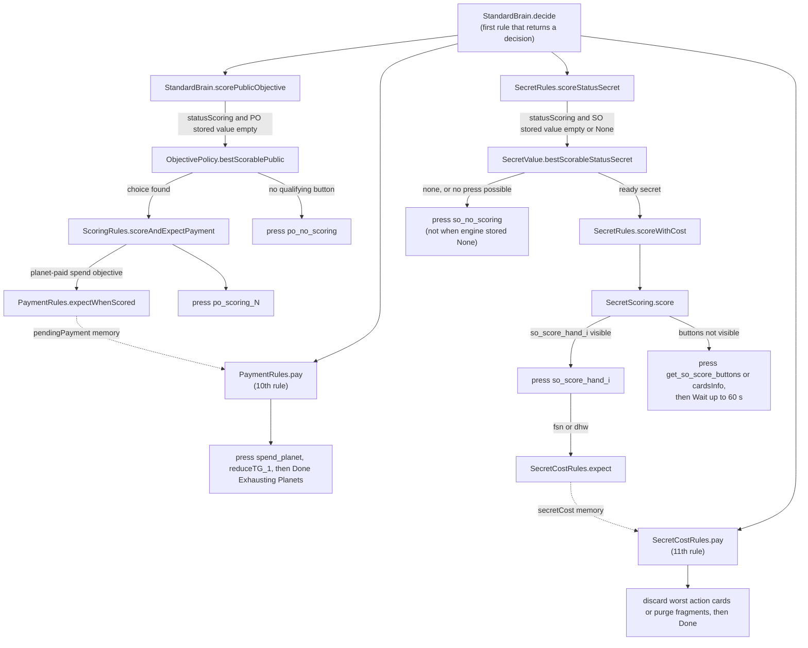
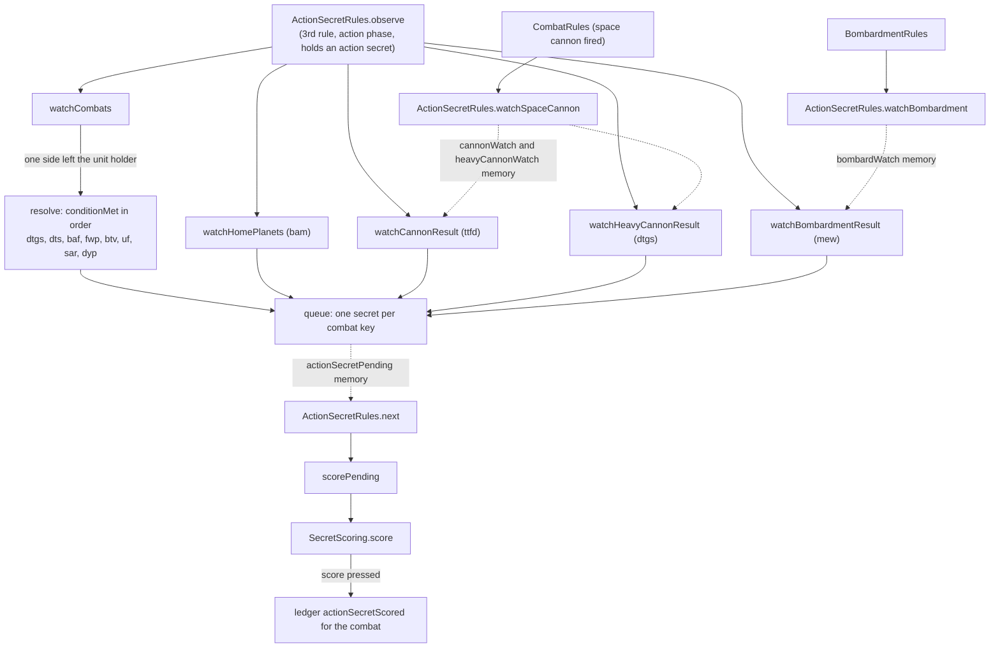

# Scoring and secret objectives

Part of the [AI player architecture docs](/src/main/java/ti4/ai/README.md): a living document kept next to the code (packages: scoring, secrets). The code is the source of truth; when you change behavior here, update this file.

## Components and responsibilities

Scope: [ti4.ai.scoring](/src/main/java/ti4/ai/scoring) (23 classes) and [ti4.ai.secrets](/src/main/java/ti4/ai/secrets) (16 classes).
Most of these classes are static utilities that other packages call. Only a few decide or press buttons directly from
the brain's rule list in [StandardBrain](/src/main/java/ti4/ai/brain/StandardBrain.java):
`PaymentRules::pay`, `SecretCostRules::pay`, `ActionSecretRules::observe`, `SecretRedrawRules::discardForRedraw`,
`ActionSecretRules::next`, `SecretRules::scoreAgendaSecret` and `SecretRules::scoreStatusSecret`. Public objective scoring
is decided in `StandardBrain.scorePublicObjective` and in the Imperial primary (`StrategyCardRules.imperial`), both of which
call into this scope. `StandardBrain.decide` runs the rules in list order and returns the first decision (`firstRuleDecision`),
so the list order is the priority order.

Unit conventions used throughout: "points" are victory points; "TG units" are trade goods. `ObjectiveValue` prices a flat
point at 8.0; `ScoringStakes` prices a point at 6 to 12 and a game-winning score at 30 (details below and in
section 6).

---

Solid arrows are calls or decisions; dotted arrows are data handed over through seat memory.

### Public objective choice: `ObjectivePolicy` and `ScoringRules`

**Role:** decides (`ObjectivePolicy.bestScorablePublic`), informs (`scorablePublics`, `qualifies`, `hasScored`,
`victoryPoints`), executes (`ScoringRules.scoreAndExpectPayment` returns the press).

**Purpose:** pick which revealed public objective to score from the scoring buttons on screen, and register the planet
payment that some spend objectives require.

**Invoked when:**
- Status phase: `StandardBrain.scorePublicObjective`, when the phase is `statusScoring` and the engine stored value
  `<faction>round<N>PO` is empty. It looks at the newest non-hidden prompt that has an enabled `po_no_scoring` button and
  passes that prompt's enabled `po_scoring_*` buttons.
- Action phase, Imperial primary: `StrategyCardRules.imperial`, on this turn's prompt with the seat's own `po_scoring_*`
  buttons (opened first by pressing `scoreAnObjective` on the Imperial card message when `scorablePublics` is non-empty).
- `scorablePublics`, `qualifies`, `hasScored`, `victoryPoints` are called from about 25 classes outside this scope
  (see section 7) and from `ScoringReserve`, `WinRace`, `ObjectiveOdds`, `PublicScoringPlan`, `SpendUnlock` and
  `ScoringStakes` inside it.

**Inputs:** game, seat, list of `PromptButton`s; `Wallet.of(game, seat)` (readied planets, trade goods, tokens);
`game.getRevealedPublicObjectives()` (id to number map); engine progress and thresholds from
`ListPlayerInfoService.getObjectiveThreshold` / `getPlayerProgressOnObjective`.

**Outputs / decisions:** `Optional<ScoringChoice>` = (button, objective id, optional `Wallet.Payment`). Empty when the seat
cannot score publics (`Helper.canPlayerScorePOs` false) or no button maps to an objective that qualifies.

**Algorithm:**
1. Map each button to an objective: the text after the last `_` of the handler id must be numeric; it is matched against
   the revealed-objective numbers (`objectiveFor`). Unmatched buttons are dropped.
2. `qualifies(id)`: not already scored by this seat; `Mapper.getPublicObjective(id)` exists; engine threshold > 0 and
   engine progress >= threshold; and, for a spend objective (`ObjectiveCatalog.spendCost` present),
   `wallet.canPay(cost)`.
3. Among qualifying choices take the maximum by, in order:
   1. victory points of the objective (stage II = 2 beats stage I = 1);
   2. lower "real cost" = trade goods + command tokens of the planned payment (planets exhausted do not count; a
      non-spend objective costs 0);
   3. phase preference: `statusPhase == choice.isSpend()`, where `statusPhase` is true whenever the game phase is not
      `action`. In the status phase a spend objective wins this tie; during the action phase (Imperial) a free one wins.
   No further tie-break: `Stream.max` (`BinaryOperator.maxBy`) keeps the first maximal element in button order.
4. `ScoringRules.scoreAndExpectPayment`: when the choice has a payment and the objective is one of `monument`,
   `sway_council`, `golden_age`, `manipulate_law`, `amass_wealth`, `vast_reserves`, it calls
   `PaymentRules.expectWhenScored(context, "an objective", payment, "deleteButtons")`; it then returns a press of the
   chosen button. `trade_routes`, `centralize_trade`, `lead` and `galvanize` register no planet payment: the engine
   (`ScorePublicObjectiveService`) deducts their trade goods or command tokens itself when the score is pressed
   (tokens from the strategy pool first), and opens the planet prompt only for the six planet-paid objectives.

**Depends on:** `Wallet`, `ObjectiveCatalog`, `PaymentRules`, `Helper.canPlayerScorePOs`, `ListPlayerInfoService`,
`Mapper`.

**Effect on the game:** presses `po_scoring_<n>` (scores the objective in the engine); for planet-paid objectives, the
following ticks exhaust exactly the planned planets via `PaymentRules.pay`.

**Fallbacks:** `StandardBrain.scorePublicObjective` presses `po_no_scoring` when no choice is returned. The Imperial path
marks the step done and moves on to the Imperial point or secret draw.

**Limitations:**
- An objective the engine has no threshold for (`getObjectiveThreshold` <= 0) never qualifies, even if the engine shows
  a button for it; in the status phase the AI then presses `po_no_scoring`.
- The tie-break ignores what the exhausted planets would otherwise be used for; only trade goods and tokens count as cost.
- Only one public is chosen per call; the status phase allows one, Imperial adds one.

**Example:** status phase, revealed `expand_borders` (1 VP, met), `sway_council` (1 VP, 8 influence payable from planets
only) and `centralize_trade` (2 VP, needs 10 trade goods, seat has 6). `centralize_trade` fails `qualifies`. The two 1-VP
choices tie on points and on real cost (0 trade goods, 0 tokens), and the status-phase preference picks `sway_council`;
`PaymentRules.expectWhenScored` records the influence planets to exhaust. In the action phase (Imperial) the same state
picks `expand_borders`.

---

#### Diagram: Status phase scoring



### Spend objective catalogue: `ObjectiveCatalog` and `SpendCost`

**Role:** informs.

**Purpose:** the fixed costs of the ten official spend objectives.

**Algorithm:** a constant map. `SpendCost(resources, influence, tradeGoods, tokens)`; `SpendCost.each(n)` means n of each of
resources, influence and trade goods; `plus` adds costs; `NONE` is zero.

| id | cost |
| --- | --- |
| `monument` | 8 resources |
| `sway_council` | 8 influence |
| `trade_routes` | 5 trade goods |
| `amass_wealth` | 3 resources + 3 influence + 3 trade goods |
| `lead` | 3 command tokens |
| `golden_age` | 16 resources |
| `manipulate_law` | 16 influence |
| `centralize_trade` | 10 trade goods |
| `galvanize` | 6 command tokens |
| `vast_reserves` | 6 resources + 6 influence + 6 trade goods |

**Limitations:** homebrew spend objectives (for example the Black Spectrum `bsp_*` versions and the Oplusplus
`steer_market_forces` / `shatter_markets`) are not in the map, so they are treated as free (their only gate is the engine
progress check). The costs are fixed: the engine lowers `lead` to 2 and `galvanize` to 5 tokens while the seat holds a
readied Scepter of Emelpar (`emelpar`), which the catalogue does not model.

---

### Payment planner: `Wallet` and `Pooling`

**Role:** evaluates (plans the cheapest payment for a cost).

**Purpose:** answer "can this seat pay cost X now, and with which planets and how many trade goods".

**Invoked when:** `Wallet.of` is called from about 50 sites; inside scope by `ObjectivePolicy`, `ScoringReserve`,
`PublicScoringPlan`, `WinRace`, `WinOdds`, `ObjectiveOdds`, `SpendUnlock`.

**Inputs:** readied planets (`seat.getReadiedPlanets()`), trade goods, tactic and strategy tokens, trade good value
(2 with Mirror Computing `mc`, else 1), `Pooling.of(seat)`.

**Outputs:** `plan(cost)` returns `Optional<Payment>(forResources, forInfluence, tradeGoods, tokens)`; `canPay`,
`shortfall(cost, limit)`, `without(payment)`, `withPlanets`, `withTradeGoods`.

**Algorithm (`plan`):**
1. Reject at once if tokens or trade goods alone are short.
2. Dynamic programme over planets: state = (resources covered capped at need, influence covered capped at need). Each
   planet is skipped, paid as resources, paid as influence, or (only with `Pooling.COMBINED`) paid as both. The DP value
   is "waste": the whole planet's value counted once (resources + influence; with `COMBINED` the pooled value, which
   `Wallet` already stores as the planet's resources). Planets worth 0 in both kinds are left out of the wallet.
3. For every reachable end state compute trade goods needed = cost trade goods + ceil(missing resources / tgValue) +
   ceil(missing influence / tgValue). Keep the state needing the fewest trade goods, then the least waste.
4. Backtrack the planet choices.
- `shortfall(cost, limit)`: missing tokens + the smallest number of extra trade goods (0..limit-1) that makes the cost
  payable; returns limit + missing tokens if none does.
- `Pooling`: `COMBINED` with the Xxcha hero (`xxchahero`) unlocked: a planet counts resources + influence for either kind
  and can pay both; `EITHER_AT_BEST` with the Xxcha breakthrough (`xxchabt`): each kind counts max(resources, influence);
  `SEPARATE` otherwise.

**Effect on the game:** none directly; `PaymentRules` later exhausts the planets named in the payment.

**Limitations:** only readied planets count; technology or ability discounts and other spend sources (for example
commodities) are not modelled. Tested by [WalletTest](/src/test/java/ti4/ai/scoring/WalletTest.java) (planets before
trade goods, least valuable covering planets, a planet never paying twice, Mirror Computing) and
[XxchaPoolingTest](/src/test/java/ti4/ai/scoring/XxchaPoolingTest.java).

---

### Payment execution: `PaymentRules`

**Role:** executes.

**Purpose:** after a press that opens an engine payment prompt (exhaust buttons plus "Done Exhausting Planets"), press
the planned planets, then single trade goods, then Done.

**Invoked when:** `PaymentRules::pay` is the 10th rule in `StandardBrain.rules`, so it runs on every tick before almost every
other decision. Payments are registered by `ScoringRules` (`expectWhenScored`); 17 other files use `PaymentRules`
(13 of them call `PaymentRules.expect`; they cover strategy cards, tactical actions, action cards, explorations,
expeditions, trade, and Yin, Sol and Letnev abilities).

**Inputs:** a pending payment stored in seat memory under `pendingPayment|<round>|<phase>`: purpose, planets, trade goods
left afterwards, timestamp, done handler id, and a "lasts the phase" flag. Done handlers in use are `deleteButtons`
(objectives), `deleteButtons_technology` and `deleteButtons_leadership`; `expectNothing` registers an empty payment so
the rule only presses Done. Pressed planets are tracked under `paymentPressed|<since>`.

**Algorithm:**
1. Drop the pending payment if it is older than 10 minutes, unless it was registered with `expectWhenScored`
   (lasts the phase). The key includes round and phase, so a phase change also forgets it.
2. Find the newest prompt created no earlier than 5 s before the registration that has an unowned enabled button with the
   done handler and label "Done Exhausting Planets" and is the seat's own (a hidden prompt; or every `spend_<planet>`
   button names one of the seat's planets; or the prompt text names the seat).
3. Press `spend_<planet>` for the first planned planet that is not yet exhausted and has an enabled button on that
   prompt (a planned planet without a button is skipped); else press `reduceTG_1_*` while the seat's trade goods exceed
   the planned remainder; else forget the payment, record `paidPayment|<since>` when every planet was pressed and
   exhausted and the trade goods are at the target, and press Done.

**Fallbacks:** no matching prompt: does nothing this tick (the payment stays pending). A planned planet or trade good
that the prompt does not offer is not retried: the AI presses Done and forgets the payment without recording it as paid
(callers can check `wasPaid`).

**Limitations:** relies on the button label text "Done Exhausting Planets" and the `spend_` / `reduceTG_1_` handler
prefixes. Tested by [PaymentRulesTest](/src/test/java/ti4/ai/scoring/PaymentRulesTest.java) (pays planets and trade goods
then finishes; ignores another seat's prompt; forgets on phase change; ignores a production prompt while an objective
payment is pending).

---

### Action-phase reserve: `ScoringReserve`

**Role:** decides (what to hold back) and informs (`scoringChances`, custodians checks).

**Purpose:** during the action phase, keep enough planets, trade goods and tokens unspent to (a) pay one spend objective
at the next status phase, (b) pay the custodians' 6 influence when the seat contends for them, (c) cover trade goods it
has promised in open transactions.

**Invoked when:** `ScoringReserve.of` and `planAfterReserve` are called by 27 files when they plan a spend (production,
research, token purchases, action cards, Diplomacy, Indoctrination, and so on, see section 7). `reservedWorth` is used by
`TacticalPlanner.outweighingTheReserve` (a plan must score more than the reserved objective is worth).

**Inputs:** game phase, `WinRace.winnersBefore`, `Wallet`, revealed spend objectives, `ExpectedTradeGoods.beforeStatus`,
`ExpectedReadying.beforeStatus`, `CustodiansRace` snapshot, `PromisedTradeGoods.of`.

**Outputs:** `of` returns a `SpendCost` = custodians influence + reserved objective net cost + promised trade goods;
`reserved` returns `Optional<Reserved(objectiveId, cost, expectedTradeGoods)>`; `planAfterReserve(wallet, reserve, cost)`
returns a payment for `cost` that leaves `reserve` payable.

**Algorithm (`reserved`):**
1. Only in the `action` phase and only when the seat can score publics.
2. `outrun` = some rival is listed by `WinRace.winnersBefore`. If outrun and the experiment `WIN_THREAT_FEASIBLE` is
   disabled for the seat, reserve nothing.
3. Start from the wallet, minus the planned custodians payment when `custodiansClaim` exists.
4. `bestAffordableSpend`: unscored revealed spend objectives the wallet can pay now; the maximum by victory points, then by
   fewer trade goods + tokens in the cost.
5. If none: `bestProjectedSpend` adds the trade goods expected before the status phase and up to 2 planets Diplomacy is
   expected to ready, picks the best affordable spend objective on that projected wallet, and nets the expected income off
   its cost (`ExpectedReadying.netOf`, then `ExpectedTradeGoods.netOf`), so only the part the current planets must cover is
   held.
6. If outrun (with the experiment on) and `WinRace.winsWithReserve` is false, reserve nothing.
7. If the count of qualifying free (non-spend) publics worth at least as many points is >= `scoringChances`, reserve
   nothing (the free objectives already fill the scoring slots).
- `scoringChances` = 2 while the seat holds an unplayed Imperial, else 1.
- `planAfterReserve`: first try paying `cost` directly such that the rest still covers the reserve; otherwise plan the
  reserve first and pay `cost` from what is left.

**Custodians part:**
- `contendsForCustodians`: the custodians token is still on Mecatol Rex (`CustodiansRace.open`); the seat can land this
  round (`canLandThisRound`: a transport acting now within 1 hop, `Mode.OWNED`); its survival under space cannon
  (`coverSurvival`) is at least 0.5; and either it holds an unplayed Imperial or at some arrival round its
  `winChance(..., Order.KNOWN)` is at least 0.5.
- `custodiansClaim` = `planForCustodians` (6 influence, or 0 with Blood Ties, planned after promised trade goods) when
  contending; memoised per (game, seat, trade goods, tactic tokens, passed, planets, exhausted planets).
- `custodiansReserve` = `custodiansInfluenceHeld` as influence when a claim exists, else none; `custodiansInfluenceHeld`
  = `CustodiansRace.cost` (6, or 0 with Blood Ties), or 0 when cover survival is below 0.5.
- `canLandThisRound` is also false when the seat is blocked by space cannon cover (`blockedByCover`).

**Effect on the game:** spend decisions elsewhere refuse payments that would break the reserve, so planets stay
unexhausted for the status phase.

**Fallbacks:** returns `SpendCost.NONE` outside the action phase.

**Limitations:** reserves at most one spend objective (Imperial's second slot is not reserved for). Tested by
[CustodiansReserveTest](/src/test/java/ti4/ai/scoring/CustodiansReserveTest.java) and
[ScoringReserveProjectionTest](/src/test/java/ti4/ai/scoring/ScoringReserveProjectionTest.java).

**Example:** action phase, `monument` revealed, the seat has 9 readied resources and no Trade card; no free public
qualifies. The reserve is 8 resources. A production that would exhaust 4 of those resources gets no payment from
`planAfterReserve` (paying 4 leaves too little for 8, and planning the 8 first leaves too little for 4 unless trade goods
cover it), so the caller refuses or re-plans it. If the seat also contends for the custodians, the custodians payment is
taken out of the wallet first; the reserve becomes 6 influence + 8 resources only if the remaining planets still pay
`monument`.

---

### Expected income: `ExpectedTradeGoods`, `ExpectedReadying`, `PromisedTradeGoods`

**Role:** informs.

**Algorithm:**
- `ExpectedTradeGoods.beforeStatus` = 3 if the seat holds an unplayed Trade card, plus washable commodities: when trading
  is enabled (`AiSettings.isTradingEnabled`) and there are 2+ real players: holder of unplayed Trade or Masters of Trade
  = max(held commodities not promised away, commodity limit); else if any unplayed Trade exists = commodity limit - 1;
  else, if another player has a commodity = held commodities not promised away - 1; else 0. `ifHoldingTrade` and `ifFollowingTrade` are used by
  `TradeUses`.
- `ExpectedTradeGoods.netOf` uses spare expected trade goods (beyond the cost's own trade goods part) to replace
  resources/influence, trying 0..spare goods and every split, returning the first net cost the planets can pay.
- `ExpectedReadying.beforeStatus`: the seat readies 2 planets if an unplayed Diplomacy card exists and either the seat
  holds it or has a strategy token to follow, plus 1 for an unexhausted Ggrocuto Rinn (`xxchaagent`) and 4 for an
  unlocked Xxekir Grom (`xxchahero-te`) while it has not passed; that many of its exhausted planets with the highest resources + influence (name order on ties). `netOf` subtracts
  them from a cost, largest first (by the larger of the two values), each paying resources when resources are still
  needed and either no influence is needed or it is at least as rich in resources, otherwise influence (both kinds with
  `COMBINED`).
- `PromisedTradeGoods.sent` sums the seat's open transaction items `sending<faction>_receiving<receiver>_<type>_<amount>`
  (type `TGs` or `Comms`, amount up to 6 digits).

---

### Points unlocked by spending: `SpendUnlock`

**Role:** evaluates.

**Purpose:** how many points a gain (trade goods, readied planets, tokens) unlocks, or a loss (trade goods, exhausting a
planet) costs, through spend objectives.

**Invoked when:** `pointDelta` has 24 call sites (trade valuation, action cards, debt rules, `ti4.ai.trade.Desperation`);
`pointsLostByExhausting`, `pointsUnlocked`, `unlocks`, `pointsUnlockedByTokens` from tech, explore and trade code.

**Algorithm:**
- `unlockedPoints(now, after)`: spend objectives not payable now but payable after; for each, count the currently
  scorable publics worth at least as many points; the objective counts only if that count is below `scoringChances`. The
  result is the largest such point value (not a sum).
- `pointDelta(+n)` = points unlocked by n more trade goods; `pointDelta(-n)` = minus the reserved objective's points if
  losing n trade goods makes the reserved cost unpayable.
- `pointsLostByExhausting(planet)` = drop in the best `scoringChances` publics scorable after removing that planet.

**Limitations:** at most one objective's points per call. Tested by
[SpendUnlockTest](/src/test/java/ti4/ai/scoring/SpendUnlockTest.java).

---

### Scoring slots: `PublicScoringPlan` and `ScoringPaths`

**Role:** informs.

**Algorithm:**
- `PublicScoringPlan.slots` = `scoringChances` (1, or 2 with unplayed Imperial) + 1 when the Winnu hero (`winnuhero`) is
  unlocked and Imperial is among the game's strategy cards.
- `PublicScoringPlan.points(slots)`: one slot = best single scorable public; more slots: exhaustive recursion that tries
  each payable spend objective (removing its payment from the wallet so spends share one wallet), filling the other slots
  with the best free objectives. Memoised per (player, slots) in `SearchMemo`.
- `ScoringPaths.readyPoints`: from the website score breakdown (`WebScoreBreakdown.fromPlayer`), the points of entries in
  state `QUALIFIES`. With the experiment `READY_PUBLIC_POINTS` (enabled by default) public entries are replaced by
  `PublicScoringPlan.points` and the other qualifying entries (custodians, Imperial, Crown, Latvinia, ...) are added.
- `ScoringPaths.imperialAwaitsMecatol`: the breakdown has an `IMPERIAL` entry in state `POTENTIAL` (Imperial held, Mecatol
  Rex not).

**Tested by:** [PublicScoringPlanTest](/src/test/java/ti4/ai/scoring/PublicScoringPlanTest.java) (tokens spent once
across windows, resources and influence compete for trade goods, Winnu hero window),
[ScoringPathsTest](/src/test/java/ti4/ai/scoring/ScoringPathsTest.java).

---

### Point value scale: `ScoringStakes`

**Role:** evaluates (the shared price of points used across the AI).

**Invoked when:** `scoreValue` has 40 call sites, `contender` 19, `rivalStake` 12; see section 7.

**Algorithm:**
- `vpWorth(player)` = min(12, 6 + 2 x max(0, VP - (goal - 4)) + (2 if any non-eliminated player is within 2 of the
  goal)). In a 10-point game: 6 at 0-6 VP, 8 at 7, 10 at 8, 12 at 9 (before the contender bonus).
- `scoreValue(player, p)` = 30 (`WIN_VALUE`) when p > 0 and VP + p >= goal; else p x `vpWorth`.
- `rivalStake` = `scoreValue` for the rival, x1 if it reaches the goal, else x0.25. `rivalPointStake` is also x1 when
  the rival reaches the goal; otherwise x0.75 unless the rival is far behind (leader minus rival >=
  max(3, round(0.3 x goal))), then x0.25.
- `pointsInReach(viewer, player)` = public points (with `READY_PUBLIC_POINTS`: `PublicScoringPlan.points` over its slots;
  else the best `scoringChances` qualifying publics) + 1 if it holds an unplayed Imperial and controls Mecatol Rex +
  `SecretOdds.chanceReady(viewer, player)`.
- `contender(viewer, player)`: goal - VP <= 2, or VP + `pointsInReach` >= goal.
- `tempoLead` = projected points (VP + `ScoringPaths.readyPoints` + secret chance) minus the average of the others.
- `overrulePlay`: only while an Imperial is unplayed. Publics = qualifying free publics plus the single best qualifying
  spend public, sorted descending; extra public = sum of the top `chances + 1` minus the top `chances`; + 1 for Mecatol Rex
  held. It "wins" if best public + Mecatol reaches the goal, and then counts at least the points missing.
- `lateGame`: someone within 4 of the goal.

**Tested by:** [ScoringStakesTest](/src/test/java/ti4/ai/scoring/ScoringStakesTest.java) (win worth 30, rival points
share, points in reach limited by scoring chances, unplayed Imperial with Mecatol adds a point, Overrule cases, never reads
another hand, contender within 2).

---

### Support for the Throne point value: `ThronePoint`

**Role:** evaluates.

**Invoked when:** from `ThroneValue` and `PlayAreaNotes` (trade and promissory code).

**Algorithm:** `gained(holder, giver)` = 30 if the point wins (VP + 1 >= `GameHorizon.goal`), else `vpWorth(holder)` x
`share(VP)`; `kept` = `vpWorth(holder)` x `share(VP - 1)` for a point the holder already has (no win check); `lost` =
`vpWorth`. `share(pointsWithout)`: if the holder with the point is within 2 of the goal
or reaches it with `pointsInReach`: 0.5 if it would reach the goal without the point anyway, else 1.0. Otherwise 0.15 if
the giver is a contender. Otherwise max(0.1, 0.5 x (1 - min(1, behind/5))) where behind is the highest other score minus
the holder's points with the point.

---

### Win race: `WinRace`

**Role:** informs (who finishes first) and evaluates (`winsWithReserve`).

**Invoked when:** `ScoringReserve.reserved`, `DenialMap.build`, `Extortion`, `ExtortionPlans`, `SlayIntent`, `Standings`,
`ThroneSale`, `DarktalonTreillaRules`.

**Algorithm:**
- `finish(player, boost)` returns an `OptionalInt`: -1 (`IMMEDIATELY`) when immediate points reach the goal; 0
  (`DURING_ACTION_PHASE`) when the goal is already reached, or when the action-phase points cover the missing points
  (`boost.actionPoints`, plus, only while holding an unplayed Imperial, the best ready public + 1 for Mecatol Rex if held
  or `boost.takesMecatol`); `1 + initiative` when the status phase would get there (next ready public, the second one if
  Imperial already used the first, + 1 if a status secret is ready); empty otherwise.
- `winsWithReserve(seat, reservedId)`: the seat's finish with the reserved spend objective counted as ready (other spend
  objectives ignored); true when no rival already in `winnersBefore` is still likely to finish before that.
- `readyPublics`: unscored revealed publics that qualify on a projected wallet (+3 strategy tokens when holding an unplayed
  Leadership); token-only spends (`lead`, `galvanize`) only check the token count; only the best spend objective is kept;
  sorted descending.
- `winnersBefore(seat)`: only in the action phase, not in Fog of War, with a goal. With `WIN_THREAT_FEASIBLE` (default
  on) a rival is listed when `WinOdds.finishesBefore(seat, rival, seatFinish) >= 0.5`; otherwise when its deterministic
  `finish` is earlier than the seat's.
- `seatFinish` (with `WIN_THREAT_FEASIBLE`) adds 1 status secret when the deciding seat knows its own hand and
  `SecretValue.bestScorableStatusSecret` exists. `winnersBefore` is memoised per seat and round.
- `feared(viewer, rival, immediate)`: with the experiment, action points = 1 if `StyxTake.thisRound >= 0.5`; without,
  round(`SecretOdds.chanceReady`) + 1 if the rival has a Fracture dock; `takesMecatol` = `ScoringPaths.imperialAwaitsMecatol`.
- `canWinThisRound`: with the experiment, `WinOdds.reachesGoal >= 0.5`; else `finish(feared)` present.

**Tested by:** [WinRaceTest](/src/test/java/ti4/ai/scoring/WinRaceTest.java),
[WinRaceSecretsTest](/src/test/java/ti4/ai/scoring/WinRaceSecretsTest.java).

---

### Win probabilities: `WinOdds`

**Role:** informs.

**Purpose:** the probability that a rival reaches the goal during this action phase, by status scoring, and by the end of
the status phase, optionally after the rival loses some planets or ships (`Loss`).

**Invoked when:** `WinRace`, `DenialMap`, `DannelPlan`, `Extortion`, `OffenseOutlook`, `Standings`, `ThroneSale`.

**Algorithm:** a probability grid over (action-phase points, status-phase points), each capped at the missing points,
built by convolving independent components:
1. Publics (none if the loss takes a home planet, unless nomadic): candidates are unscored revealed non-spend publics
   (chance 1 if they qualify and the loss does not drop their progress; else `SecretOdds.readinessAt(progress, threshold)`:
   0.5 one step short, 0 otherwise) plus the best qualifying spend objective at chance 1. Candidates are sorted by points
   then chance, and processed with 1 pick (2 with unplayed Imperial); with Imperial the first pick lands in the action
   phase.
2. Secrets: per card from `SecretOdds.readyByCard` (status chance, action chance); at most 1 status secret; action
   secrets count only if the rival has not passed.
3. Imperial and Mecatol Rex (held, not lost, or taken in the blended branch): 1 certain action point.
4. If not passed: custodians (1 point, 2 with Imperial and no Mecatol) at `CustodiansRace.winChance` when it can land this
   round and its arrival is this round; Styx at `StyxTake.thisRound`.
5. Book of Latvinia with 4 specialty colours: 1 certain point (if not passed). Crown of Emphidia with the tomb: 1 point
   counted only in `byStatusEnd`. A `Loss` that takes the Styx planet from a rival who holds it adds 1 to the missing
   points.
6. With `WIN_THREAT_FEASIBLE`, when Mecatol Rex is contested (`PlanetTake.contestedMecatol`), the odds are blended:
   take x odds-with-Mecatol + (1 - take) x odds-without, where take = `PlanetTake.mecatolThisRound`; a thread-local flag
   prevents nested pricing.
- `finishesBefore(odds, rival, mine)`: mine empty: `byStatusEnd`; mine <= 0: 0; otherwise `duringAction` plus the
  status-scoring part when the rival's status position (1 + initiative) is earlier.
- `outrunsEveryRival(seat, mine, given)`: true when the seat has a finish and every other non-eliminated player's
  `finishesBefore` (with the given immediate points added) is below 0.5. Used by `Extortion` and `ThroneSale`.

**Tested by:** [WinOddsTest](/src/test/java/ti4/ai/scoring/WinOddsTest.java),
[MecatolTakeWinOddsTest](/src/test/java/ti4/ai/scoring/MecatolTakeWinOddsTest.java).

---

### Win-breaking value: `DenialMap`

**Role:** evaluates.

**Invoked when:** `OffenseOutlook`, `TokenCards` (only with experiment `WIN_BREAK_DENIAL`, enabled by default).

**Algorithm:** rivals with `reachesGoal >= 8/30` (`MATERIAL_CHANCE` = 0.267) and `finishesBefore > 0` are covered; stake =
30 x product over other rivals of (1 - their finish-first chance). `value(rival, loss)` = max(0, finishesBefore now -
finishesBefore after the loss) x stake. `removals` ranks each of the rival's planets and each system with its non-fighter
ships by that value. Tested by [DenialMapTest](/src/test/java/ti4/ai/scoring/DenialMapTest.java).

---

### Imperial value: `ObjectiveOdds`

**Role:** evaluates.

**Invoked when:** `ImperialUses.pointsSplit`, `ImperialUses.gainsPointTempo`, `ImperialDenial.rivalStake` (strategy card
ranking).

**Algorithm:** per unscored revealed public a by-status chance: non-spend: 0.9 when met now, 0.44 / 0.25 / 0.12 when
short by 1 / 2 / 3+ (engine progress); all spend objectives collapse into one entry with the best spend chance: 0.72 met,
0.6 / 0.6 / 0.45 short by 1 / 2 / 3+ trade goods (`Wallet.shortfall`, limit 3). "Within reach" = short by <= 1.
- `extraPoints`: if some objective is met now, Imperial can lock it in: max over met objectives of (its points +
  E[best of the rest]) minus E[best of all]; else E[second best]. E[best] = sum over k >= 1 of P(at least one objective
  worth >= k scores).
- `winSwing(mecatolPoints, secretChance)`: P(reach goal with Imperial) - P(without), mixing a secret with
  `secretChance`; without Imperial only the best single public counts; with Imperial either a locked objective plus the
  best other, or (no met objective) the best two (a DP over best/second-best values).
- `imperialScoresAnExtraPublic`: at least 2 objectives within reach. `extraScoreWithImperial` (used when experiment
  `IMPERIAL_POINTS` is off): P(at least one of the rest) after locking the met objective with the lowest chance, or
  P(at least two) if none is met.
- `atLeastTwoByStatus`, `extraPointsWithImperial` and `imperialWinSwing` are public but have no production caller (only
  `ObjectiveOddsTest` uses them).

**Tested by:** [ObjectiveOddsTest](/src/test/java/ti4/ai/scoring/ObjectiveOddsTest.java).

---

### Objective progress model: `ObjectiveValue` and `Footprint`

**Role:** evaluates (prices a board change in objective progress).

**Purpose:** the board-based measure tactical and card planners use: given a hypothetical `Footprint` (where the seat's
units and planets would be after a move), how much is gained or lost on revealed publics and (for the seat's own view)
held secrets.

**Invoked when:** constructed by `TacticalPlanner`, `DefenseOutlook`, `FreedPlays`, `PeaceAccords`, `PresenceReach`,
`RetreatRules`, `SystemTargetCards`, `ShipCards`, `PlanetStake`, `ExploreOutlook`, `LegendaryOutlook`,
`SardakkHeroRules`, `DannelPlan`, `TroAgentRules` and `SystemStake`; `publicOnly` by `SecretOdds`, `SecretDrawValue`,
`WinOdds`, `NeutralUnitCards`, `CardElectionValues`, `ExpertCardValues`, `SardakkHeroRules`, `DefenseOutlook`,
`OffenseOutlook` and `DannelPlan`.

**Inputs:** `Footprint.of(game, seat)`: units per system, ships, non-fighter ships, heavy ships (flagship, war sun),
dreadnought count, planets, ground forces, mechs and docks per planet. `Footprint.after(target, moves, gainedPlanets)`,
`withoutShipsIn`, `withPlanet`, `withoutPlanet`, `withBuilt` derive hypotheticals.

**Algorithm:**
- Targets: unscored revealed publics (only if the seat can score publics), points = max(1, VP); with secrets (default
  constructor), every unscored secret at 1 point (`ImaginedTurn.unscoredSecrets` hides them while imagining another seat's
  turn). Only ids with a positive engine threshold and a modelled progress (`progress` switch) become targets.
- `progress(id, footprint)`: an AI re-implementation of the counts for about 40 objectives (planets outside home systems,
  trait counts, specialty planets, legendary, attachments, ships next to other homes, anomalies, wormholes, fleets,
  Mecatol occupation, mechs on planets, ground forces without a dock, and so on). Unlisted ids return `NOT_MODELLED` (-1).
- Flat mode (`targetGain`): completing = +8 x points; breaking a completed one = -8 x points; partial progress =
  8 x points x share x (steps gained / steps still needed), share 0.9 when "within reach" (stage II within 3 steps;
  trait secrets `mp`/`faa`/`mrm` within 2; ground secrets `mtm`/`otf` within 3), else 0.6.
- Win-aware mode (experiment `WIN_AWARE_POINTS`, enabled by default, needs a goal): completions are priced through the
  scoring slots of the coming status phase: ready free publics sorted by points (already-ready before freshly completed)
  fill `scoringChances` slots; the rest are "leftover" at 8 x 0.6 per point; free slots take ready spend publics; at most
  1 secret per status phase is counted. The price of the newly scored points is max(8 x flat points,
  `scoreValue(base + delta) - scoreValue(base)`), so a completion that wins is worth up to 30. A completion that only
  replaces a point the seat returns (`pointsReturned`, for example a Support for the Throne going back) is worth nothing.
- Helpers: `completedPoints`, `brokenReady`, `progressLoss`, `oneStepShort`, `attachmentGain` (lost outposts / ancient
  monuments), `specialtyGain` (research outposts / brain trust), `caresAboutPresence`.

**Limitations:** progress for unlisted objectives is not modelled and contributes nothing; the re-implementation can drift
from the engine's own counting.

**Tested by:** [ObjectiveValueTest](/src/test/java/ti4/ai/scoring/ObjectiveValueTest.java),
[WinAwareObjectiveValueTest](/src/test/java/ti4/ai/scoring/WinAwareObjectiveValueTest.java),
[GroundSecretsTest](/src/test/java/ti4/ai/scoring/GroundSecretsTest.java).

---

### Points at stake in the active system: `SystemStake`

**Role:** evaluates.

**Invoked when:** `CardScoring`, `CombatForecast`.

**Algorithm:** for the active system: lost = objective value lost if the seat's ships there vanish plus each held planet
there is lost; gained = value of taking the planets where it has ground forces. Returns floor(max(lost, gained) / 8) whole
points.

---

### Status and agenda secret scoring: `SecretRules`

**Role:** decides.

**Invoked when:** `SecretRules::scoreStatusSecret` is the fourth rule from the end of `StandardBrain.rules`, directly after
`this::scorePublicObjective`; `SecretRules::scoreAgendaSecret` follows `ActionSecretRules::next` in the middle of the list.

**Algorithm (`scoreStatusSecret`):**
1. Only in phase `statusScoring`.
2. Read the engine stored value `<faction>round<N>SO`. If it holds anything other than `None` (for example the scored
   secret, or `Queued` while the engine holds the score behind slower players), do nothing. If it is `None` (opted out; `StatusHelper` sets this automatically when it
   finds no scorable secret and the player holds no secrets, is an NPC, or has the "bot" sandbag preference), still try
   to score.
3. `SecretValue.bestScorableStatusSecret`: unscored status-phase secrets whose engine progress meets a positive threshold,
   minimum by scoring order (0 = could be lost by the board changing: `te`, `ctr`, `btgk`, `lsc`, `ose`, `syc`, `csl`,
   `dfat`; 2 = has a cost: `fsn`, `dhw`; 1 = everything else), then by id.
4. `scoreWithCost` -> `SecretScoring.score`; when that returns a press of `so_score_hand_*`,
   `SecretCostRules.expect(secret)` records the cost.
5. If nothing scored and not opted out: press `so_no_scoring` on the newest public prompt that has it.

**Algorithm (`scoreAgendaSecret`):** phase name starting with `agenda`; for each unscored agenda-phase secret: `dp`
(Dictate Policy) when 3+ laws are in play; `dtd` (Drive the Debate) only in phase `agendaEnd` when the stored
`resolvedAgendaOutcome` equals the seat's faction, colour or one of its planets. One press per tick (the first met
secret in hand order that `SecretScoring` can act on); no limit on how many over the phase.

**Tested by:** [SecretRulesTest](/src/test/java/ti4/ai/secrets/SecretRulesTest.java) (no agenda secret in the status
phase; Dictate Policy in the agenda phase; Drive the Debate only at `agendaEnd`; asks for score buttons when none are
visible) and `StandardBrainTest.declinesPublicThenSecretScoringWhenNothingQualifies`.

---

### Pressing a secret's score button: `SecretScoring`

**Role:** executes.

**Invoked when:** from `SecretRules.scoreWithCost`, `SecretRules.scoreAgendaSecret`, `ActionSecretRules.scorePending`.

**Algorithm:** find the secret's hand index; on hidden prompts (the seat's cards info thread), newest first, press
`so_score_hand_<index>` if enabled (and clear the request memory). Otherwise, if a request was made within the last 60 s
for this (secret, round, phase), return `AiDecision.Wait` until 60 s after it. Otherwise press `get_so_score_buttons`, or
`cardsInfo` if that was already pressed, on a hidden prompt, and store the request time. Returns empty when the secret is
no longer in hand or no such button exists.

**Effect on the brain:** the `Wait` is a decision, so `StandardBrain.decide` stops at the rule that returned it. When it
comes from `ActionSecretRules::next` in the action phase, every later rule (including `this::takeTurn`) is skipped until
the buttons appear or 60 s pass; from `SecretRules::scoreAgendaSecret`, agenda voting and the other later agenda rules
are held the same way.

---

### Secret costs: `SecretCostRules` and `SpyNetwork`

**Role:** executes (`SecretCostRules`), informs (`SpyNetwork`).

**Invoked when:** `SecretCostRules::pay` is the 11th rule (right after `PaymentRules::pay`). `SpyNetwork.needsCards` /
`withinReach` / `holds` are used by `StrategyCardRules`, `ActionCardRules`, `PoliticsUses`, `NekroLeaderRules`.

**Algorithm:** `expect` stores a timestamp for `fsn` (Form a Spy Network) or `dhw` (Destroy Heretical Works). `pay`:
- While the secret is still unscored (score queued by the engine) nothing happens; if it is neither scored nor unscored the
  record is dropped.
- On first use after scoring, the target is computed and stored: action cards - 5, or relic fragments - 2.
- Spy Network: while the hand is above the target, on hidden prompts created since the score (minus 5 s) press the worst
  `ac_discard_from_hand_*` button by `ActionCardValue.worstDiscard`.
- Heretical Works: on a prompt created since the score (minus 5 s) with an own "Done Purging" `deleteButtons` button,
  press an own `purge_Frags_*` or `purgeSupermassiveFrag_*` button while fragments are above the target; once at the
  target, or when that prompt has no purge button left, press Done and drop the record (so it can stop short of the
  target).
- `SpyNetwork.needsCards`: holds `fsn`, hand limit >= 5, fewer than 5 cards; `withinReach(draw)`: also cards + draw >= 5.

**Tested by:** [SecretCostRulesTest](/src/test/java/ti4/ai/secrets/SecretCostRulesTest.java),
[SpyNetworkTest](/src/test/java/ti4/ai/secrets/SpyNetworkTest.java).

---

### Secret keep value: `SecretValue`, `SecretStatistics`, `TraitReach`, `SecretPhase`

**Role:** evaluates.

**Purpose:** a number per held secret used to choose which secret to discard (setup, over-limit draws, Mecatol redraw,
expeditions, `KindPricing`) and whether a hand is weak. The same class picks which status secret to score
(`bestScorableStatusSecret`), but that choice does not use the keep value.

**Invoked when:** `lowestValueSecret` by `StandardBrain.discardExcessSecret`, `SecretRedrawRules.discardForRedraw`,
`ExpeditionRules`, `KindPricing`; `keepValue` by `SecretDraws`, `ExpertCardValues`,
`ExpertElectionValues`, `KindPricing`; `bestScorableStatusSecret` by `SecretRules` and `WinRace`.

**Algorithm (`keepValue`):**
1. ready = status secret meeting its engine threshold, or `dp` with 3+ laws. congested = status secret and the number of
   other ready status secrets >= `GameHorizon.roundsLeft`.
2. ready and not congested: 2.0.
3. Otherwise chance = 1 if ready, else completionChance x boardFeasibility; value = chance x phaseValue (1.2 for an
   action-phase secret, else 1.0) + openingTempo; halved when congested.
4. completionChance = priorShare x prior + (1 - priorShare) x situational. priorShare = 0.5 in rounds 1-2, 0.35 in
   rounds 3-4, 0.2 later. prior = `SecretStatistics.completion(id)` (a table of how often players finished each secret,
   0.25 to 0.86; 0.5 for unknown ids) x achievability (0.1 `sb`, 0.3 `csl` (0.6 when `SupplyLines.targetInReach`),
   0.3 `dfat`, 0.6 `fc`, 0.6 `pem`, else 1).
5. situational: status: share = progress / threshold (capped at 1); for a `TechPath` secret whose route is not reachable,
   1 if complete else 0; otherwise share + (1 - share) x prior x min(1, roundsLeft / 3). Action:
   `ActionSecretOdds.beforeGameEnds`. Agenda: `dp` = min(1, laws / 3); `dtd` = 0.02 with the Galactic Threat ability,
   else `DriveTheDebateOdds.chance`. Unknown phase: prior.
6. boardFeasibility: `sai` 1.0 if a legendary planet is unowned or the seat's, 0.4 if all are rivals', 0.1 if none on the
   map; `dfat` 1.0 if the nexus is unlocked or can be opened (Ghost Ship in hand, a Creuss player, an official gamma
   wormhole token elsewhere), 0.12 if locked, 0.1 if absent; `ose` `SeatStrike.feasibility`; `otf`/`mtm`
   `GroundCampaign.eta(...).feasibility()`; trait secrets `mp`/`faa`/`mrm` `TraitReach.feasibility` with floor 0.1; else 1.
7. openingTempo (round <= 1 only) = `SecretStatistics.openingCompletion(id)` (0.01 to 0.66, 0.15 unknown) x
   boardFeasibility.
- `TraitReach.weightedCount`: every scoring planet of the trait outside other players' home systems, weight 1.0 if the seat
  owns it, 0.3 if a rival does, 1.0 if unowned in the seat's home / lane / slice zone, 0.5 if unowned elsewhere;
  feasibility 1.0 at >= 5, the floor at <= 2, linear between.

**Example:** round 3, 10-point game, leader on 4 (roundsLeft = 3). Held: `te` (Threaten Enemies, threshold 1, progress 0)
and `mlp` (Master the Laws of Physics) with an unreachable tech route and progress below 4. `te`: prior 0.77; situational
= 0 + 1 x 0.77 x 1 = 0.77; chance 0.77; value 0.77. `mlp`: situational 0 (route unreachable); prior 0.68; chance =
0.35 x 0.68 = 0.238; value 0.238. `mlp` is the lowest and is discarded first.

**Tested by:** [SecretValueTest](/src/test/java/ti4/ai/secrets/SecretValueTest.java) (ready over prior, congestion,
Drive the Debate, Betray a Friend notes, opening tempo, Seize an Icon, Defy Space and Time nexus cases incl. homebrew gamma
token ignored, trait secrets), [SecretStatisticsTest](/src/test/java/ti4/ai/secrets/SecretStatisticsTest.java).

---

### Card-counted secret chances: `SecretOdds`

**Role:** informs.

**Invoked when:** `ScoringStakes.pointsInReach`, `WinRace.feared`, `WinOdds.secrets`, `SecretDrawValue`, `ImperialUses`,
`ExpertCardValues`, `ExpertElectionValues`, `Standings`, `ThroneSale`.

**Algorithm:**
- Unseen pool = the game's secret deck (`Mapper.getDeck(game.getSoDeckID())`) minus every scored secret of every player
  minus the viewer's own hand. On the legacy path (experiment off) the viewer's hand is always removed; on the measured
  path only when the deciding seat is the viewer (`DecidingSeat.knowsHandOf`).
- readinessAt(progress, threshold) = 1 if met, 0.5 if one short, else 0. Threshold <= 0: 0.15 (`BASE_RATE`). A secret
  whose progress `ObjectiveValue` does not model: 0.15 on the legacy path (experiment off); on the measured path
  (default) the engine's progress count for that player is used instead.
- `chanceReady(viewer, player)`: with `WIN_THREAT_FEASIBLE` (default) for another player: 1 - (1 - mean readiness of
  the pool on that player's public board)^(number of secrets it holds); for the deciding seat itself, 1 - product of
  (1 - readiness) over its own secrets, a met secret counting 1. Only the secret count of another player is read.
- `readyByCard` splits each card's chance into status and action parts (agenda secrets contribute 0) for `WinOdds`.

**Tested by:** [SecretOddsTest](/src/test/java/ti4/ai/secrets/SecretOddsTest.java) (pool, scored secrets leave the pool,
more secrets more chances, never reads another hand), [SecretOddsMeasuredTest](/src/test/java/ti4/ai/secrets/SecretOddsMeasuredTest.java).

---

### Drawing secrets: `SecretDraws` and `SecretDrawValue`

**Role:** decides (`worthDrawing`, `worthRedrawing`) and evaluates (`SecretDrawValue.of`, `redrawValue`).

**Invoked when:** `worthDrawing`: `StrategyCardRules.wantsToFollow` (Imperial), `followImperial`, `secondaryValue`
(Imperial), `startSecondary` (Strategize), `ImperialUses.benefits`, `OverruleChoice`, `ExploreValues`. `SecretDrawValue.of`
by `SecretCards` (Impersonation), `AgendaValueMath`, `CardValue` (Derelict Vessel `dv`), `ExploreValues`, `ImperialUses`,
`OverruleChoice`, `StrategyCardRules`. `redrawValue` by `MecatolStake`.

**Algorithm:**
- `hasRoom`: unscored secrets < max(0, max secrets - scored secrets).
- `weakHand`: hand non-empty and the lowest `keepValue` < 0.75.
- `worthDrawing`: not all scored, and (room or weak hand).
- `SecretDrawValue.of`: with room, `pointValue(expectedPoints)`; full and not weak, min(that, 0.3); full and weak,
  max(0.3, `pointValue(swapPoints - weakestKeep)`). `pointValue(p)` = p x `ScoringStakes.scoreValue(seat, 1)`.
- expectedPoints(competing) = eventually x scoringTurns; eventually = r + (1 - r) x min(1, roundsLeft x 0.25), r = mean
  readiness of the unseen pool on the seat's public board; scoringTurns = min(1, max(0, roundsLeft - competing));
  roundsLeft = max(1, ceil((goal - leader VP) / 2)). competing = hand size (swap: hand size - 1).
- `worthRedrawing`: weak hand and swapPoints - weakestKeep > 0. `redrawValue` = that gain x a point's value.

**Tested by:** [SecretDrawsTest](/src/test/java/ti4/ai/secrets/SecretDrawsTest.java),
[SecretDrawValueTest](/src/test/java/ti4/ai/secrets/SecretDrawValueTest.java).

---

### Mecatol Rex redraw: `SecretRedrawRules`

**Role:** decides and executes.

**Invoked when:** `SecretRedrawRules.endOfTurn` from `StandardBrain.takeTurn` (after the turn's action, before ending the
turn, and again before passing); `SecretRedrawRules::discardForRedraw` is a rule.

**Algorithm:** once per round (memory `secretRedraw|<round>`): if `SecretDraws.worthRedrawing` and this turn shows an owned
`planetAbilityExhaust_mrte` or `planetAbilityExhaust_mc` button (the engine's Mecatol Rex planet ability that discards a
secret and draws a replacement), press it and mark pending. `discardForRedraw` then presses
`discardSecret_<index>redraw` for `SecretValue.lowestValueSecret` (on a hidden prompt, not already pressed) and marks
done. If that button never appears the round's record stays `pending`: `discardForRedraw` keeps looking and
`endOfTurn` does not exhaust Mecatol Rex again that round.

---

### Action-phase secrets: `ActionSecretRules`

**Role:** informs (watches), decides (which secret a combat earned) and executes (via `SecretScoring`).

**Invoked when:** `ActionSecretRules::observe` is the 3rd rule (every tick); `ActionSecretRules::next` follows
`CombatRules.next`; `watchSpaceCannon` from `CombatRules` when space cannon is fired; `watchBombardment` from
`BombardmentRules`.

**Algorithm:**
- Active only in the `action` phase while the seat holds at least one action-phase secret.
- `watchCombats`: for every tile and unit holder (space or planet) where the seat and another player (or neutral) are both
  present, or both have a combat round counter (`combatRoundTracker<faction><pos><holder>` stored value), open a `Watch`
  keyed by turn, position and holder, recording: opponent leads on points (not neutral and its VP equal the highest
  score, so a tie with the seat counts), own flagship there, enemy flagships + war suns
  there and on the board, enemy fighters, anomaly, another player's home, active system, betrayable (seat is active and
  holds the opponent's note in its play area or held one at action start), fighters cleared. While both stay present it
  checks whether anti-fighter barrage cleared all enemy fighters before any round. When one side is gone it resolves.
- `resolve`: fought = both rolled at least one round; won = fought and only the seat remains. Conditions, checked in the
  order `dtgs, dts, baf, fwp, btv, uf, sar, dyp` (ascending `SecretStatistics.completion`, so the rarest first):
  `sar` won vs the points leader (not neutral); `btv` won in an anomaly; `dts` won in another player's home; `baf` won and
  betrayable; `uf` space, won, flagship at start and end; `dyp` space, fought, active system, 3+ own non-fighter ships left;
  `dtgs` opponent not neutral, space, enemy heavy ships present at start and fewer on the board now; `fwp` space, active
  system, fighters cleared before a round.
- `queue`: one secret per combat key; skip if the combat already scored (ledger) or is queued; the first met secret not
  already queued is appended to `actionSecretPending|<round>`.
- Other watches: `ttfd` (armed by `watchSpaceCannon` when the seat fires space cannon: the target is the active player,
  or, when the seat is the active player, another player with ships in that system; the watch is skipped when, on
  another player's activation, a third player also has space cannon cover there; queued when the target's last
  non-fighter ships are gone and the target rolled no combat round there); `dtgs` under space cannon (target's heavy-ship board count dropped); `mew` (after bombardment the
  defender has no ground forces left and the seat did not fight a ground round there); `bam` (a planet the seat held in any
  home system is no longer held).
- `next` runs the watches again, then `scorePending`: for the first pending entry still held and not in the ledger,
  `SecretScoring.score`; on a score press, ledger `actionSecretScored|<combat>`; other entries stay queued. Because
  `observe` is an early rule and `next` a later one, a secret queued on a tick can be scored on that same tick when no
  rule in between returns a decision.

**Limitations:** cannon, heavy-cannon and bombardment watches are tied to the turn key they were armed on and are
dropped on a later turn; combat watches stay open until one side leaves, but their open list is kept per round
(`combatWatchOpen|<round>`), so a combat still open when the round changes is forgotten. Prove Endurance is not
handled here (`StandardBrain.queueProveEndurance` presses `autoProveEndurance_yes`). The `bam` list
(`homePlanetsHeld|<faction>`) is written only on action-phase ticks while the seat holds `bam` and has no round in its
key, so a home-system planet lost between two such ticks (for example in the agenda phase) is queued as
`bam` at the next action-phase tick; the first tick only stores the list.

**Tested by:** [ActionSecretRulesTest](/src/test/java/ti4/ai/secrets/ActionSecretRulesTest.java) (31 tests incl. at most one
per combat, rarer of two, retreating flagship not destroyed, Fight with Precision barrage cases, Darken the Skies, Turn
Their Fleets to Dust with third-party PDS, Become a Martyr).

---

#### Diagram: Action-phase secret watches



### Action-secret odds and patience: `ActionSecretOdds` and `ActionSecretTiming`

**Role:** evaluates.

**Invoked when:** `ActionSecretTiming.pursueNow` by `TacticalPlanner.secretShare` (a pursued secret counts 1.0 point, a
patient one 0.25); `ActionSecretOdds.beforeGameEnds` by `SecretValue`; `afterThisRound` by `TradedSecretPoint`;
`perRound` by `ThroneSale`; `lastingPerRound` and `atLeastOnce` by `ActionSecretTiming`.

**Algorithm:** per-round chance of meeting the condition:

| secret | per round |
| --- | --- |
| `dyp` | 0.60 if a 3+ ship stack reaches an enemy within 1 move; 0.30 with such a stack; 0.21 without |
| `btv` | 0.60 if a fleet reaches an anomaly holding enemy ships; 0.18 if a fleet is in or beside an anomaly; 0.09 |
| `uf` | 0.60 if the flagship reaches enemy ships (gravity drive counted); 0.19 with a flagship; 0.10 without |
| `sar` | 0.08 when sole leader, else 0.21 |
| `pe` | 0.17 |
| `mew` | 0.155 with bombardment ships on the board, else 0.08 |
| `fwp` | 0.13 with destroyers on the board, else 0.06 |
| `baf` | 0.125 holding another player's note, else 0.05 |
| `dts` | 0.11 with ships beside another home, else 0.05 |
| `dtgs` | 0.10 if an enemy flagship or war sun exists, else 0.03 |
| `ttfd` | 0.30 with a covered target (`CannonWipeRules.hasCoveredTarget`); 0.085 with PDS; 0.03 |
| `bam` | 0.30 holding a planet in another home; 0.20 own home outmatched by an adjacent enemy fleet; 0.03 |
| other | 0.05 |

`lastingPerRound` caps `dyp` at 0.30, `btv` at 0.18, `uf` at 0.19 (the "engineerable" 0.6 is not assumed to last).
`beforeGameEnds` = 1 - (1 - perRound)^roundsLeft.

`pursueNow` is true when any of: the secret is `mew` or `dtgs`; patience is disabled (`-Dai.secrets.hold=false`);
`GameHorizon.endInSight` (round >= ceil(goal/2) or leader >= goal - 4); `ttfd` with a covered target; or the chance of
meeting it later, 1 - (1 - lasting x 0.85^(other combat secrets held))^(roundsBeforeEnd + 1), is below 0.4.

**Tested by:** [ActionSecretOddsTest](/src/test/java/ti4/ai/secrets/ActionSecretOddsTest.java),
[ActionSecretTimingTest](/src/test/java/ti4/ai/secrets/ActionSecretTimingTest.java).

---

### Drive the Debate odds: `DriveTheDebateOdds`

**Role:** informs.

**Invoked when:** only from `SecretValue` (situational chance of `dtd`, Drive the Debate, without the Galactic Threat
ability).

**Algorithm:** per agenda = share of election agendas (target starting with `elect` and naming player or planet) in the
remaining deck (0.3 if the deck is empty) x the seat's squared-influence share; agendas left = 2 x agenda rounds left
(rounds left, minus 1 while the custodians are unscored); chance = min(0.5, 1 - (1 - perAgenda)^agendasLeft).

## Scenarios

### Scoring and secret objectives

| Scenario | Trigger | Handled by | Choices considered | How it chooses | Outcome / fallback |
| --- | --- | --- | --- | --- | --- |
| Status phase, one or more publics qualify | phase `statusScoring`, `<faction>round<N>PO` empty, a public prompt with `po_no_scoring` | `StandardBrain.scorePublicObjective` -> `ObjectivePolicy.bestScorablePublic` | the prompt's enabled `po_scoring_*` buttons whose objective qualifies | most VP, then fewest trade goods + tokens, then (status phase) a spend objective | presses the button; planet-paid spend objectives register a payment |
| Status phase, no public qualifies | same | `StandardBrain.scorePublicObjective` | none | n/a | presses `po_no_scoring` |
| Engine already marked the public step | `<faction>round<N>PO` non-empty (scored, or "None" set by the engine) | `StandardBrain.scorePublicObjective` | none | n/a | does nothing (rule returns empty) |
| Spend objective payment | after `ScoringRules.scoreAndExpectPayment` for `monument`, `sway_council`, `golden_age`, `manipulate_law`, `amass_wealth`, `vast_reserves` | `PaymentRules.pay` | the planned planets, then single trade goods | planets in planned order, then `reduceTG_1_*` until the planned remainder | presses "Done Exhausting Planets"; waits while no matching prompt |
| Status phase, one status secret qualifies | phase `statusScoring`, `<faction>round<N>SO` empty or `None` | `SecretRules.scoreStatusSecret` | unscored status secrets meeting the engine threshold | scoring order losable < ordinary < costly, then id | presses `so_score_hand_<i>` |
| Status phase, several status secrets qualify | same | `SecretValue.bestScorableStatusSecret` | all ready status secrets | the one whose board condition can be lost first; costly ones last | the others wait for later status phases (and are valued lower by congestion) |
| Status phase, no status secret qualifies | same | `SecretRules.scoreStatusSecret` | none | n/a | presses `so_no_scoring` unless the engine already stored `None` |
| Engine auto-opted the seat out of secrets | `<faction>round<N>SO` = `None` but a secret is ready | `SecretRules.scoreStatusSecret` | ready status secrets | as above | still scores; never presses `so_no_scoring` again |
| Score buttons not on screen | no hidden prompt with `so_score_hand_<i>` | `SecretScoring.score` | `get_so_score_buttons`, `cardsInfo` | first not already pressed | presses it, then `Wait` up to 60 s; after both were pressed and 60 s passed, returns empty (status: falls back to `so_no_scoring`) |
| Form a Spy Network / Destroy Heretical Works cost | a `so_score_hand_*` press for `fsn` / `dhw` | `SecretCostRules.pay` | action card discards / fragment purges | `ActionCardValue.worstDiscard`; first purge button | discards to 5 fewer cards / purges to 2 fewer fragments, then Done |
| Agenda phase secrets | phase name starts with `agenda` | `SecretRules.scoreAgendaSecret` | held `dp`, `dtd` | `dp`: 3+ laws; `dtd`: phase `agendaEnd` and the resolved outcome is the seat, its colour or planet | presses each that is met (no per-phase limit) |
| Combat earns an action secret | a watched combat ends | `ActionSecretRules.observe` / `next` | met secrets in order `dtgs, dts, baf, fwp, btv, uf, sar, dyp` | first met one not already queued (rarest first) | one secret per combat queued; scored when `ActionSecretRules.next` is reached (same tick or later) |
| Space cannon kills an invader's last ships | `CombatRules` calls `watchSpaceCannon`; seat holds `ttfd` | `ActionSecretRules.watchCannonResult` | `ttfd` | watch armed only if, on another player's activation, no third player also has cover; queued when the target has no non-fighter ships left there and rolled no combat round | queues `ttfd` |
| Enemy flagship / war sun destroyed | heavy-ship board count of the opponent drops (combat or cannon) | `ActionSecretRules.resolve` / `watchHeavyCannonResult` | `dtgs` | count compared with the watch start | queues `dtgs` |
| Bombardment wipes a planet | `BombardmentRules` calls `watchBombardment`; seat holds `mew` | `ActionSecretRules.watchBombardmentResult` | `mew` | defender has no ground forces left and no ground round was fought by the seat | queues `mew` |
| Lost a home-system planet | seat held `bam` and a planet in any home system left its planets | `ActionSecretRules.watchHomePlanets` | `bam` | set difference against the stored list | queues `bam` |
| Imperial primary | own Imperial played, `StrategyCardRules.imperial` | `ObjectivePolicy.bestScorablePublic`, then the card's Mecatol / secret buttons | own `po_scoring_*` buttons | most VP, fewest trade goods + tokens, then a free objective | scores; then `score_imperial` if Mecatol Rex held, else `sc_draw_so` if not all secrets scored |
| Imperial secondary | another seat plays Imperial | `StrategyCardRules.followImperial` | follow or not | spare strategy token and `SecretDraws.worthDrawing` | presses `sc_draw_so`, else does not follow |
| Starting secrets | round <= 1, no real public revealed, not extra-secret mode, 2 secrets held | `StandardBrain.discardExcessSecret` | the held secrets | lowest `SecretValue.keepValue` (with opening tempo), then id | presses `discardSecret_<i>`; opens `get_so_discard_buttons` if no discard button is shown |
| Draw leaves the hand over the limit | unscored > max - scored | `StandardBrain.discardExcessSecret` | held secrets | lowest keep value | discards it |
| Full hand of strong secrets | weakest keep value >= 0.75 | `SecretDraws.worthDrawing` false | follow Imperial, Strategize, exploration value | n/a | does not follow Imperial for a secret; draw value capped at 0.3 |
| Mecatol Rex redraw | end of own turn or before passing; owned `planetAbilityExhaust_mrte`/`_mc` button this turn | `SecretRedrawRules.endOfTurn` / `discardForRedraw` | exhaust or not; which secret to discard | `worthRedrawing` (weak hand and positive swap gain); lowest keep value | once per round |
| Action phase reserve for a spend objective | any spend decision calling `ScoringReserve.of` / `planAfterReserve` | `ScoringReserve.reserved` | revealed unscored spend objectives | affordable now: most VP then fewest trade goods + tokens; else projected with expected trade goods / Diplomacy | spends that break the reserve are re-planned or refused |
| Reserve dropped | free publics fill the slots, or a rival is expected to win first | `ScoringReserve.reserved` | n/a | free publics worth as much >= scoring chances; or outrun and (experiment off, or `winsWithReserve` false) | no reserve: the seat spends freely |
| Custodians reserve | seat contends for the custodians | `ScoringReserve.custodiansReserve` | hold 6 influence or not | open, can land this round, cover survival >= 0.5, and Imperial held or race win chance >= 0.5 | 6 influence held back (0 with Blood Ties) |
| Action secret: pursue or be patient | `TacticalPlanner` prices a plan that could meet an action secret | `ActionSecretTiming.pursueNow` | full point or 0.25 of a point | see the detail below | plan priced at 1.0 or 0.25 of the secret's point |
| Rival might win | many valuations | `WinOdds`, `WinRace`, `ScoringStakes.contender` | n/a | probability grid / deterministic finish | feeds reserve, denial and trade decisions |
| Desperation | none in this scope | none | n/a | no multiplier exists in `ti4.ai.scoring` or `ti4.ai.secrets` on this branch | see the detail below |

#### Status phase: which public objective is scored

- **Trigger:** `StandardBrain.decide` reaches `this::scorePublicObjective` while the phase is `statusScoring` and
  `<faction>round<N>PO` is empty. Earlier rules (payments, secret costs, combat, agenda...) take priority; in the status
  phase they normally return nothing.
- **Responsible component:** `StandardBrain.scorePublicObjective` (outside scope) selects the prompt: the newest non-hidden
  prompt with an enabled `po_no_scoring` button. `ObjectivePolicy.bestScorablePublic` chooses.
- **Choices:** only buttons on that prompt whose handler id ends in the number of a revealed public objective. The engine
  decides which buttons exist.
- **Selection logic:** filter by `ObjectivePolicy.qualifies` (unscored, engine progress >= engine threshold > 0, spend cost
  payable from readied planets, trade goods and tokens). Then maximise VP; then minimise the trade goods + tokens the
  planned payment would use; then in the status phase prefer a spend objective (in the action phase, a free one).
- **Why similar states differ:** with a free 1-VP objective and a planet-paid 1-VP spend objective both met, the status
  phase scores the spend objective (its planets would ready at the end of the status phase anyway), while Imperial in the
  action phase scores the free one. A trade-good spend (`trade_routes`) loses the cost tie-break to a free objective of
  the same value in both phases, because its 5 trade goods count as real cost.
- **Interactions:** `ScoringRules` registers the payment so `PaymentRules::pay` (an earlier rule) exhausts exactly the
  planned planets on the next ticks. `ScoringReserve` held those planets during the action phase.
- **Outcome / fallback:** press of the scoring button; or `po_no_scoring`.
- **Limitations:** a public objective unknown to `ListPlayerInfoService.getObjectiveThreshold` (threshold <= 0) is never
  scored. Only one public per status phase (game rule); `PublicScoringPlan.slots` counts the Winnu hero's extra window for
  valuation, but scoring through the Winnu hero is done by `MathisMathinusRules` (outside scope).

#### Status phase: which secret objective is scored

- **Trigger:** `SecretRules::scoreStatusSecret` in phase `statusScoring`, after the public rule.
- **Selection logic:** `SecretValue.bestScorableStatusSecret` takes the ready status secrets (engine threshold > 0 and met)
  and picks the minimum by scoring order: 0 for secrets whose condition depends on ship or planet positions that can be
  lost before the next status phase (`te` Threaten Enemies, `ctr` Control the Region, `btgk` Become the Gatekeeper, `lsc`
  Learn the Secrets of the Cosmos, `ose` Occupy the Seat of the Empire, `syc` Stake Your Claim, `csl` Cut Supply Lines,
  `dfat` Defy Space and Time), 2 for secrets with a cost (`fsn` Form a Spy Network: discard 5 action cards; `dhw` Destroy
  Heretical Works: purge 2 fragments), 1 for the rest; ties by id. Keep value is not consulted.
- **Constraints:** one secret per status phase, enforced by the check of the engine's stored value (once a secret name is
  stored the rule stops); `ObjectiveValue.SECRETS_PER_STATUS_PHASE` only mirrors that limit when pricing board changes. Agenda secrets are never scored here (tested by `SecretRulesTest.neverScoresAnAgendaSecretInTheStatusPhase`).
- **Interactions:** while two status secrets are ready and the rounds left do not cover both, each is "congested" and its
  keep value is halved (`SecretValue.keepValue`), so a later over-limit draw discards one of them before a fresh one.
- **Outcome / fallback:** press `so_score_hand_<i>`; if the buttons are missing, ask for them and wait up to 60 s
  (`SecretScoring`); if nothing could be pressed and the engine has not stored `None`, press `so_no_scoring`.

#### Secret objectives at setup and at each draw

- **Setup:** `StandardBrain.allowedUnscoredSecrets` returns 1 in round <= 1 while no real public objective is revealed (the
  custodians custom objective does not count, per `StandardBrainTest.stillDiscardsAStartingSecretWhenCustodiansIsRevealed`)
  and the game is not in extra-secret mode. `discardExcessSecret` discards `SecretValue.lowestValueSecret`. In round 1
  `keepValue` adds `openingTempo` (the observed share of players who completed the secret in the opening, x board
  feasibility), so `te` (Threaten Enemies, opening 0.66) is kept over `dyp` (Demonstrate Your Power, opening 0.03) in round 1,
  while from round 2 on the same two can rank the other way. Tested by
  `SecretValueTest.keepsASecretThatIsScoredEarlyWhenChoosingAtTheStart` and `StandardBrainTest.discardsDownToOneSecretAtTheStartOfTheGame`.
- **Draw decisions:** Imperial secondary, Strategize's Imperial secondary, and the valuation of Imperial, Overrule and
  explorations call `SecretDraws.worthDrawing`: draw while there is room, or with a full hand whose weakest keep value is
  below 0.75. The Imperial primary (`StrategyCardRules.imperial`) draws whenever the seat does not hold Mecatol Rex and has
  not scored all its secrets, without that check.
- **After the draw:** if the hand exceeds max - scored, `discardExcessSecret` discards the lowest keep value; a ready
  secret (keep 2.0) is never the lowest unless every secret is ready.
- **Why a full hand sometimes draws and sometimes not:** the 0.75 threshold. A hand of {ready `te`, unscorable `mlp` at
  0.24} is weak, so following Imperial draws and the new secret replaces `mlp` if it values higher. A hand of {ready `te`,
  `ctr` at 0.8} is not weak, so the AI declines to follow Imperial for a secret.

#### Holding action-phase secrets (patience)

- **Trigger:** `TacticalPlanner.secretShare` prices a plan that could meet an action secret.
- **Choices:** count the secret at a full point (pursue now) or at 0.25 (`PATIENT_SHARE`, patient).
- **Selection logic (`ActionSecretTiming.pursueNow`):** pursue when the secret is `mew` or `dtgs`; when
  `-Dai.secrets.hold=false`; when `GameHorizon.endInSight` (round >= ceil(goal / 2), or the leader is within 4 of the
  goal); when `ttfd` has a target under its cannon now; or when the chance of meeting it later is below 0.4, where the
  chance uses the capped per-round rate (`lastingPerRound`), x0.85 per other held combat secret, over `roundsBeforeEnd + 1`
  rounds.
- **Example:** round 2 of a 10-point game, leader on 2 VP: `roundsBeforeEnd` = min(5 - 2, ceil((10 - 4 - 2) / 2)) = 2, so
  3 opportunities. `sar` (0.21, not leader) alone: 1 - 0.79^3 = 0.51 >= 0.4, patient. `dts` with ships beside another
  home (0.11): 1 - 0.89^3 = 0.30 < 0.4, pursue now. The same `sar` with two other combat secrets held: 0.21 x 0.85^2 =
  0.152, 1 - 0.848^3 = 0.39 < 0.4, pursue now.
- **Interactions:** `TacticalPlanner` overrides this for `dts`, `dtgs`, `btv` (`WHOLE_POINT_SECRETS`, always 1.0) and for
  `btv`, `uf`, `dyp`, `fwp` against a neutral opponent. A combat that meets a secret is always scored regardless of
  patience (`ActionSecretRulesTest.scoresASecretACombatHasMetEvenWhenItWouldNotHaveHurriedToMeetIt`).

#### Imperial

- **Scoring slots:** `ScoringReserve.scoringChances` = 2 while the seat holds an unplayed Imperial. This is read by
  `ObjectiveValue` (win-aware slots), `ScoringStakes.publicPoints` and `overrulePlay`, `SpendUnlock` and
  `PublicScoringPlan.slots`. `WinRace` and `WinOdds` test the same condition through
  `ScoringStakes.holdsUnplayedImperial` (an extra public pick, which `WinOdds` counts in the action phase).
- **Primary:** score the best public (`ObjectivePolicy.bestScorablePublic` with the action-phase preference for free
  objectives), then the Mecatol Rex point when held, else draw a secret if not all are scored.
- **Valuing the card (outside scope):** `ImperialUses.pointsSplit` uses `ObjectiveOdds.imperial` (extra points and win
  swing) when experiment `IMPERIAL_POINTS` is on, else `ObjectiveOdds.extraScoreWithImperial`. `ImperialDenial.rivalStake`
  values taking the card away from a rival with the same odds.
- **Overrule:** `ScoringStakes.overrulePlay` counts one more public than the seat's scoring chances (only the best spend
  objective counted once) plus the Mecatol Rex point.

#### Custodians

- **Reserve:** `ScoringReserve.contendsForCustodians` decides whether to hold 6 influence: the token is still there, a
  transport of the seat acting now is within 1 hop, the seat's cover survival against space cannon is >= 0.5, and either
  it holds an unplayed Imperial (taking Mecatol Rex then also scores the Imperial point) or its `CustodiansRace.winChance`
  is >= 0.5. Tested by `CustodiansReserveTest.reservesForTheCustodiansWhenTheSeatHoldsTheUnplayedImperialEvenIfBehind`
  and `reservesNothingWhenAnotherSeatLandsFirstAndTheSeatHoldsNoImperial`.
- **Rival threat:** `WinOdds.custodians` adds a chance of 1 point (2 with Imperial and no Mecatol Rex) for a rival who has
  not passed, can land this round and whose arrival round is the current round.
- **Landing and paying:** decided in tactical code (`TacticalPlanner`, `TacticalRules`) through
  `ScoringReserve.planForCustodians`; outside this scope.

#### Deliberately doing nothing or waiting

- `scorePublicObjective` returns empty once the engine stored value for the round's public is set.
- `scoreStatusSecret` returns empty once a secret name is stored, and never presses `so_no_scoring` after the engine stored
  `None`.
- `SecretScoring.score` returns `Wait` for up to 60 s after asking for the score buttons. Because a `Wait` is a decision,
  no later rule runs meanwhile: from `ActionSecretRules::next` that holds the seat's own turn (`this::takeTurn` comes
  later in the list); from `SecretRules::scoreAgendaSecret` it holds agenda voting.
- `SecretCostRules.pay` waits while the scored secret is still in the unscored list (the engine queued the score behind
  slower players), then pays.
- `PaymentRules.pay` waits while no matching payment prompt exists.
- `ActionSecretRules.next` scores only queued entries; a secret whose condition is met in a way the watches did not see is
  not scored.
- `ScoringReserve` keeps resources idle in the action phase; spending decisions elsewhere can therefore pass on
  affordable plays.

#### Desperation multipliers

No class in `ti4.ai.scoring` or `ti4.ai.secrets` multiplies the value of unlikely point moves. The only class named
`Desperation` on this branch is [ti4.ai.trade.Desperation](/src/main/java/ti4/ai/trade/Desperation.java) (package-private,
outside scope): in the action phase it finds the smallest shortfall of 1 to 3 trade goods for which
`SpendUnlock.pointDelta` unlocks a point, values net trade goods at `ScoringStakes.scoreValue` of the unlocked points x
1.0 in the action phase and x0.5 in the strategy or agenda phase, and caps what may be spent at 0.75 of that value
(`OwnTurnDeals.desperation`, at most 2 such purchases per round). Commit 19ff969444 (subject ends "add desperation")
adds `src/main/java/ti4/ai/scoring/Desperation.java` behind an experiment `DESPERATION`, but that commit is not an
ancestor of this branch's HEAD, and `AiExperiments.Experiment` here has no `DESPERATION` entry.

## Algorithms and priorities

### What kind of computation this is

- Rule-based selection plus closed-form probability estimates. There is no search over move sequences, no rollout, no
  simulation of future turns and no learning. The only exhaustive enumerations are small: the payment DP in
  `Wallet.plan`, the recursion over spend objectives in `PublicScoringPlan.best`, and the trade-good splits in
  `ExpectedTradeGoods.netOf`.
- No randomness: no class in `ti4.ai.scoring` or `ti4.ai.secrets` uses a random source; ties are broken by comparator order
  (first element on ties for `Stream.max`/`min`) or by id.
- Opponent prediction is limited to: (a) card counting of unseen secrets (`SecretOdds`), using only the number of secrets a
  rival holds and that rival's public board; (b) the rival's public objective progress and wallet; (c) the custodians race,
  Styx and Mecatol take chances computed in `ti4.ai.eval` / `ti4.ai.tactical` and combined in `WinOdds`. The rival's choices
  are not modelled beyond "takes the best ready public".
- Several branches are A/B experiments (`AiExperiments.Experiment`), enabled by default and disabled per seat through the
  stored value `aiExperimentsOff` or globally with `-Dai.experiments.off`: `READY_PUBLIC_POINTS`, `WIN_THREAT_FEASIBLE`,
  `WIN_AWARE_POINTS`, `WIN_BREAK_DENIAL`, `IMPERIAL_POINTS` (read outside scope), `CANNON_COVER_RISK` (in `CustodiansRace`).
- Results are memoised per decision or search scope (`DecisionMemo.remember`, `SearchMemo.remember`), keyed by the listed
  arguments; `SearchMemo` falls back to the decision scope when no search scope is open, and with no open scope at all
  they are recomputed.

### Value scales

| Scale | Where | Value |
| --- | --- | --- |
| Flat victory point | `ObjectiveValue.VICTORY_POINT_VALUE` | 8.0 |
| Partial progress share | `ObjectiveValue` | 0.6, or 0.9 "within reach" |
| Leftover ready public beyond the scoring slots | `ObjectiveValue.winAwareGain` | 8 x 0.6 = 4.8 per point |
| Point worth | `ScoringStakes.vpWorth` | min(12, 6 + 2 x max(0, VP - (goal - 4)) + 2 if a contender exists) |
| Score that reaches the goal | `ScoringStakes.WIN_VALUE` | 30 |
| Rival's points | `ScoringStakes.rivalStake` | x0.25 (x1 when it wins) |
| Rival's points, contested | `ScoringStakes.rivalPointStake` | x0.75, x0.25 when far behind (gap >= max(3, round(0.3 x goal))) |
| Material win chance | `DenialMap.MATERIAL_CHANCE` | 8 / 30 = 0.267 |
| Majority | `WinOdds.MAJORITY` | 0.5 |
| Secret keep value, ready | `SecretValue.READY_VALUE` | 2.0 |
| Action-phase secret multiplier | `SecretValue.ACTION_PHASE_VALUE` | 1.2 |
| Weak-hand threshold | `SecretDraws.EASY_KEEP` | 0.75 |
| Draw value with a strong full hand | `SecretDrawValue.SWAP_VALUE` | 0.3 |
| Patient action secret | `TacticalPlanner.PATIENT_SHARE` | 0.25 of a point |
| Patience confidence | `ActionSecretTiming.PATIENCE_CONFIDENCE` | 0.4 |

The two point scales coexist: `ObjectiveValue` uses 8 per point in flat mode; in win-aware mode it uses
max(8 x points, `ScoringStakes` price), which is 6 to 12 per point and 30 for a win. `SecretValue.keepValue` is in
"expected points x phase weight" units (0 to 2.0), not trade goods.

### Public objective choice (status phase and Imperial)

```
candidates = buttons -> objective id (handler suffix = revealed number)
             filter qualifies: unscored, engine progress >= threshold > 0, spend cost payable now
choice     = argmax by (VP, -(planned trade goods + tokens), statusPhase == isSpend)
```

### Payment DP (`Wallet.plan`)

State (r, i) = resources and influence covered, each capped at the need. For each planet: skip; pay as resources; pay as
influence; with Xxcha hero pooling, pay both. Cost of using a planet = its whole value counted once (resources +
influence; with combined pooling the pooled value, stored as the planet's resources). Final state cost: trade goods = cost.tradeGoods + ceil((R - r) / v) + ceil((I - i) / v), v = 2 with Mirror
Computing else 1; choose minimum trade goods, then minimum planet cost.

### Reserve selection (`ScoringReserve.reserved`)

```
if not action phase or cannot score publics: none
outrun = WinRace.winnersBefore(seat) non-empty
if outrun and not WIN_THREAT_FEASIBLE: none
wallet = Wallet.of(seat) without custodians payment (if contending)
spend  = argmax over affordable unscored spend objectives by (VP, -(tradeGoods + tokens))
         else same on wallet + expected trade goods + 2 Diplomacy-readied planets, then net the income off
if outrun and not WinRace.winsWithReserve(spend): none
if #(qualifying free publics with VP >= spend VP) >= scoringChances: none
reserve total = custodians 6 influence (if claimed) + spend net cost + promised trade goods
```

### Objective progress pricing (`ObjectiveValue`)

Flat mode per target:
- complete -> +8 x points; break a complete one -> -8 x points;
- partial: 8 x points x share x (then - now) / (threshold - min(now, then)), share 0.9 when the fewest steps still needed
  is within reach (stage II <= 3; `mp`/`faa`/`mrm` <= 2; `mtm`/`otf` <= 3), else 0.6.

Win-aware mode (`WIN_AWARE_POINTS`): see section 4. Points that actually get scored at the next status phase (one
public per scoring chance, sorted by points, spend publics only in free slots, one secret) are priced with
max(8 x flat, `scoreValue(base + delta) - scoreValue(base)`); points that would sit unscored beyond the slots get 4.8 per
point; completions that only offset returned points get 0.

### Win probability grid (`WinOdds.compute`)

Distribution over (a, s) = points by the end of the action phase and points from status scoring, each capped at `missing`.
Components are independent and combined by 2-D convolution (`Grid.with`):
- publics: DP over candidates in descending (points, chance) order with 1 pick (2 with Imperial; first pick lands in a);
- secrets: DP over cards, each with P(status ready), P(action ready, only if not passed), at most 1 status secret;
- certain points: Imperial + Mecatol Rex (a); Book of Latvinia (a, if not passed);
- chance points: custodians (1, or 2 with Imperial and no Mecatol), Styx;
- Crown of Emphidia counted only in `byStatusEnd`.
Outputs `duringAction` = P(a >= missing), `byStatusScoring` = P(a + s >= missing), `byStatusEnd` = P(a + s + crown >= missing).
With a contested Mecatol Rex the odds are blended linearly by the take chance.

Readiness per objective or unseen secret is a step function: `readinessAt` = 1 met, 0.5 one short, 0 otherwise; 0.15 for
an unmeasurable secret.

### Imperial odds (`ObjectiveOdds`)

Per objective by-status chance: board 0.9 met / 0.44 / 0.25 / 0.12 (short by 1 / 2 / 3+); best spend 0.72 met / 0.6 /
0.6 / 0.45. Expected best score = sum over k of P(some objective worth >= k scores). Extra points from Imperial =
max over met objectives of (locked points + E[best of the rest]) - E[best of all]; with none met, E[second best].
Win swing = P(reach goal with Imperial) - P(without), each mixed with the secret chance.

### Secret keep value (`SecretValue.keepValue`)

```
ready, not congested        -> 2.0
chance  = ready ? 1 : (pS x prior + (1 - pS) x situational) x feasibility
          pS = 0.5 (rounds 1-2), 0.35 (3-4), 0.2 (5+)
          prior = completion rate (table) x achievability (sb 0.1, csl 0.3/0.6, dfat 0.3, fc 0.6, pem 0.6, else 1)
          situational (status) = share + (1 - share) x prior x min(1, roundsLeft / 3), share = progress / threshold
          situational (action) = 1 - (1 - perRound)^roundsLeft
          situational (agenda) = dp: laws / 3; dtd: DriveTheDebateOdds or 0.02 under Galactic Threat
value   = chance x (1.2 action | 1.0) + (round 1 ? openingRate x feasibility : 0)
congested -> value x 0.5
```

### Secret draw value (`SecretDrawValue.of`)

```
roundsLeft = max(1, ceil((goal - leaderVP) / 2))
r          = mean readiness of unseen secrets on own public board
expected(k)= (r + (1 - r) x min(1, 0.25 x roundsLeft)) x min(1, max(0, roundsLeft - k))
room       -> expected(hand) x scoreValue(1)
full,strong-> min(that, 0.3)
full,weak  -> max(0.3, (expected(hand - 1) - weakestKeep) x scoreValue(1))
```

### Action secret patience (`ActionSecretTiming.pursueNow`)

```
pursue if secret in {mew, dtgs} or patience off or endInSight or (ttfd and covered target)
        or 1 - (1 - min(perRound, cap) x 0.85^otherCombatSecrets)^(roundsBeforeEnd + 1) < 0.4
roundsBeforeEnd = max(0, min(ceil(goal/2) - round, ceil((goal - 4 - leaderVP) / 2)))
```

### Priority orderings

- Brain rules (first match wins): `ActionSecretRules::observe` (3rd), `PaymentRules::pay` (10th), `SecretCostRules::pay`
  (11th), `SecretRedrawRules::discardForRedraw`, `ActionSecretRules::next`, `SecretRules::scoreAgendaSecret`, ...,
  `this::scorePublicObjective`, `SecretRules::scoreStatusSecret`.
- Status secret: losable-board secrets, then ordinary, then costly; then id.
- Combat secret when several are met: `dtgs, dts, baf, fwp, btv, uf, sar, dyp` (ascending completion rate).
- Discard: lowest keep value, then id.

## Edge cases and fallbacks

### Unavailable or invalid buttons

- **Scoring button for an objective the AI does not recognise.** `ObjectivePolicy.objectiveFor` drops a `po_scoring_*`
  button whose suffix is not numeric or matches no revealed objective number; `qualifies` drops ids without a
  `PublicObjectiveModel` or with an engine threshold <= 0. If nothing is left, `StandardBrain.scorePublicObjective` presses
  `po_no_scoring`, even when the engine would have accepted the score.
- **Seat cannot score publics.** `Helper.canPlayerScorePOs` false (for example not controlling its home planets, NPC, the
  `incomprehensible` ability, a Deep seat off the board, Mobile Command without its flagship on the board):
  `bestScorablePublic` and `scorablePublics` return nothing, `ObjectiveValue` builds no public targets, `ScoringReserve`
  reserves nothing, `WinOdds` gives no public candidates.
- **Secret score buttons missing.** `SecretScoring.score` presses `get_so_score_buttons`, or `cardsInfo` once that one is
  already pressed, stores the request time and returns `Wait` until 60 s after it. When both buttons were already pressed
  on the visible prompts and the wait is over, it returns empty; in the status phase `scoreStatusSecret` then presses
  `so_no_scoring` (unless the engine stored `None`), giving up the secret for this round.
- **Discard buttons missing after a draw.** `StandardBrain.discardExcessSecret` presses `get_so_discard_buttons` once to open
  them.
- **Secret left the hand.** `SecretScoring.score` returns empty when the secret id has no hand index;
  `ActionSecretRules.scorePending` skips queue entries for secrets no longer held.

### State tracking and duplicate protection

- **Double scoring of the round's public or secret.** Prevented by the engine stored values `<faction>round<N>PO` / `SO`,
  which both rules check before acting.
- **Same combat counted twice.** `ActionSecretRules` keeps per-round `combatWatchOpen|<round>`, a
  `combatWatchResolved|<key>` marker per combat and a ledger `actionSecretScored|<combat>`; `queue` refuses a second entry
  for the same combat key.
- **Watch encoding damaged.** `Watch.decode` returns empty for a wrong field count or a non-numeric number; the watch is
  ignored. Cannon, heavy-cannon and bombardment watches with unreadable parts, a missing target or a different turn key are
  removed.
- **Redraw only once per round.** `secretRedraw|<round>` is set to `pending` before the exhaust press and to `done` after the
  discard.
- **Payment prompt of another seat or purpose.** `PaymentRules.isOwnPaymentPrompt` requires the done button with the
  registered handler id and label, and the prompt being the seat's own (hidden, own planets, or naming the seat); prompts
  older than the registration minus 5 s are ignored.

### Timeouts and expiry

- **Stale payment.** A pending payment older than 10 minutes is forgotten, except an objective payment registered with
  `expectWhenScored`, which lasts the phase. The memory key includes round and phase, so a phase change also discards it
  (tested by `PaymentRulesTest.forgetsThePaymentWhenThePhaseChanges`).
- **Queued secret scores.** When the engine queues a secret score behind slower players, the secret stays in the unscored
  list; `SecretCostRules.cost` returns empty until it moves to the scored list, and only then computes the payment target
  (tested by `SecretCostRulesTest.paysForAQueuedSecretWhenItIsFinallyScored`).
- **Cost record without a scored secret.** If the cost memory exists but the secret is neither scored nor unscored, or the
  stored timestamp is not numeric, the record is removed.
- **Clock skew.** Payment and cost prompts created up to 5 s before the registration are still accepted
  (`CLOCK_SKEW_MILLIS`).

### Unexpected states

- **No secret deck.** `SecretOdds.unseenPool` returns an empty list when `Mapper.getDeck(game.getSoDeckID())` is null;
  another player's secret chance (`chanceReady`, `readyByCard`) is then 0, and `SecretDrawValue` uses a mean readiness
  of 0, so a draw is valued only through the rounds-left term (min(1, 0.25 x rounds left)).
- **Engine exhausts the planets itself.** For the six planet-paid objectives `ScorePublicObjectiveService` exhausts every
  readied planet as spent outside the action phase when the player has no unfollowed strategy card 1, 6 or 7. The
  planned planets are then already exhausted, so `PaymentRules.pay` skips them, presses single trade goods down to the
  planned remainder and presses Done; more planets than planned end up exhausted.
- **No goal set.** `game.getVp() <= 0`: `WinOdds` returns 0 for reaches and finishes; `DenialMap.of` returns the empty map;
  `ObjectiveValue` win-aware mode is off; `GameHorizon.goal` and `SecretDrawValue.roundsLeft` default to 10.
- **Fog of War.** `WinRace.winnersBefore` returns an empty list in Fog of War games, so the reserve is never dropped for
  being outrun there.
- **Eliminated or neutral rivals.** Excluded from `WinOdds`, `DenialMap`, `WinRace.winnersBefore`; `sar` and `dtgs` do not
  count a neutral opponent.
- **Nested Mecatol pricing.** `WinOdds.outsideAnotherTake` uses a thread-local flag so a Mecatol take priced inside another
  take's pricing returns 0 instead of recursing.
- **Missing tiles or players in watches.** A combat watch whose tile, unit holder or opponent no longer resolves is dropped
  without scoring.
- **Spy Network already short.** If the action card count is at or below the target, the cost record is removed and
  nothing is discarded.

### Retries

- `SecretScoring` retries via a second request button after 60 s.
- `PaymentRules.pay` re-checks each tick: planets already exhausted are skipped; it keeps pressing single trade goods while
  the seat's trade goods exceed the planned remainder.
- `ActionSecretRules.scorePending` keeps unscored entries in the queue for later ticks within the round; the queue key
  includes the round, so entries do not carry into the next round.

## Known limitations

No `TODO`, `FIXME` or work-in-progress flag appears in `ti4.ai.scoring` or `ti4.ai.secrets`. The limitations below follow
from explicit guards, hard-coded sets and missing handlers in the code.

### Coverage

- **Objectives without an engine threshold are never scored or valued.** `ObjectivePolicy.qualifies`,
  `SecretValue.meetsThreshold` and `ObjectiveValue.addTarget` all require `ListPlayerInfoService.getObjectiveThreshold`
  > 0. Homebrew objectives go through `homebrewSecretThreshold` and may return 0.
- **Progress is re-implemented for about 40 ids.** `ObjectiveValue.progress` returns `NOT_MODELLED` for every other id, so
  such objectives get no partial-progress or completion value in tactical planning, and `SecretOdds` uses the 0.15 base
  rate (legacy path) or the engine count (measured path) for them.
- **Spend costs are a fixed list of ten official objectives** (`ObjectiveCatalog.SPEND_COSTS`). Other spend objectives
  (homebrew: the Black Spectrum `bsp_*` versions, Oplusplus `steer_market_forces` / `shatter_markets`) are treated as
  free and only need the engine progress check; no payment is planned or reserved for them.
- **Only six spend objectives get a planet payment** (`ScoringRules.PLANET_PROMPT_OBJECTIVES`). For `trade_routes`,
  `centralize_trade`, `lead` and `galvanize` the AI registers nothing; the engine (`ScorePublicObjectiveService`)
  deducts the trade goods and command tokens itself when the score is pressed. The engine charges 1 token less for
  `lead` and `galvanize` with a readied Scepter of Emelpar; `ObjectiveCatalog` does not, so the AI can reserve or
  require one token too many.
- **Action secrets are scored only from watched events.** `ActionSecretRules` covers combat secrets (`dtgs`, `dts`,
  `baf`, `fwp`, `btv`, `uf`, `sar`, `dyp`), `ttfd` via space cannon watches, `dtgs` via space cannon, `mew` via bombardment,
  `bam` via home planet loss. `pe` (Prove Endurance) relies on the engine's auto-score button (`StandardBrain.queueProveEndurance`).
  Any other way of meeting these conditions (for example a ship destroyed by an action card outside a watched combat) is
  missed unless it changes the watched counts within the same turn key.
- **Watches are per turn.** Cannon, heavy-cannon and bombardment watches are dropped when the turn key changes, so a result
  that becomes visible only on a later turn is not scored. Only one watch of each of these kinds is kept per round
  (one memory key per round), so a second space cannon shot or bombardment in the same round replaces the first watch.
- **Payment and cost gaps.** `PaymentRules.pay` presses Done when the prompt does not offer a planned planet, and
  `SecretCostRules` presses "Done Purging" when no purge button is left; neither retries the shortfall.
- **Agenda secrets:** only `dp` and `dtd` are recognised in `SecretRules.agendaSecretMet`.
- **Become a Martyr outside the action phase.** The `bam` watch compares against a home-planet list kept across phases
  and rounds, so a loss outside the action phase is queued at the next action-phase tick (see section 4).
- **Waiting blocks later rules.** A `Wait` from `SecretScoring` (up to 60 s per request) stops `StandardBrain.decide` at
  that rule, so an action secret waiting for its buttons holds the seat's own turn.
- **Unused public methods.** `ObjectiveOdds.atLeastTwoByStatus`, `extraPointsWithImperial` and `imperialWinSwing` are
  called only from tests.

### Approximations

- **Independence.** `WinOdds`, `ObjectiveOdds` and `SecretOdds` multiply chances as if objectives and secrets were
  independent; board objectives that share a requirement are not correlated.
- **Readiness step function.** `SecretOdds.readinessAt` is 1 / 0.5 / 0 by distance to the threshold; distance 2+ is 0 even
  early in a round.
- **Fixed priors.** `SecretStatistics` completion and opening tables, `STATUS_ACHIEVABILITY`, `ActionSecretOdds` per-round
  rates, `ObjectiveOdds` chances (0.9, 0.44, 0.25, 0.12; 0.72, 0.6, 0.6, 0.45) and `TraitReach` weights are constants, not
  fitted per game.
- **Rounds left.** `GameHorizon.roundsLeft` and `SecretDrawValue.roundsLeft` assume the leader gains 2 points a round.
- **One spend objective reserved.** `ScoringReserve.reserved` keeps back at most one spend objective, even with two
  scoring chances.
- **Status secret choice ignores value.** `SecretValue.bestScorableStatusSecret` orders by a hard-coded losable/costly
  classification and id, not by keep value or by which secret a later round could still score.
- **Rival public picks.** `WinOdds.publics` lets a rival take candidates in descending (points, chance) order; it does not
  model a rival choosing a cheaper or safer objective.
- **Unseen secret pool.** For another player, every unseen secret is weighted equally; agenda secrets stay in the
  denominator but add no chance in `readyByCard`.
- **Wallet scope.** Only readied planets, trade goods and tokens; no abilities or technologies that change spend costs.
- **Memo keys.** `PublicScoringPlan.points` is memoised by (player, slots) within a `SearchMemo` scope, or the
  `DecisionMemo` scope when no search scope is open; the key holds no wallet state, so a wallet change inside the same
  scope would not be seen.

### Mixed scales

- `SecretDrawValue.of` subtracts `SecretDraws.weakestKeep` (keep-value units, 0 to 2.0) from expected points (0 to 1). A
  ready secret's 2.0 always exceeds any swap, which keeps it; the subtraction is otherwise approximate.

### Things that are not implemented here

- No desperation multiplier for long-shot point moves in this scope on this branch (see section 5).
- No Fog of War handling in `WinRace.winnersBefore` beyond returning an empty list.
- No search or simulation of future turns.
- Imperial primary does not check `SecretDraws.worthDrawing` before `sc_draw_so` (`StrategyCardRules.imperial`, outside
  scope), unlike the secondary.

## Cross-references

### Entry points called from the brain and rule code (outside scope -> scope)

| Caller | Calls |
| --- | --- |
| `StandardBrain.rules` (rule list) | `ActionSecretRules.observe`, `PaymentRules.pay`, `SecretCostRules.pay`, `SecretRedrawRules.discardForRedraw`, `ActionSecretRules.next`, `SecretRules.scoreAgendaSecret`, `SecretRules.scoreStatusSecret` |
| `StandardBrain.scorePublicObjective` | `ObjectivePolicy.bestScorablePublic`, `ScoringRules.scoreAndExpectPayment` |
| `StandardBrain.takeTurn` | `SecretRedrawRules.endOfTurn` (after the action and again before passing) |
| `StandardBrain.discardExcessSecret` | `SecretValue.lowestValueSecret` |
| `StrategyCardRules.imperial` | `ObjectivePolicy.bestScorablePublic`, `ObjectivePolicy.scorablePublics`, `ScoringRules.scoreAndExpectPayment` |
| `StrategyCardRules.wantsToFollow`, `followImperial`, `secondaryValue`, `startSecondary` | `SecretDraws.worthDrawing`, `SecretDrawValue.of` |
| `CombatRules` | `ActionSecretRules.watchSpaceCannon` |
| `BombardmentRules` | `ActionSecretRules.watchBombardment` |
| `TacticalPlanner.secretShare` | `ActionSecretTiming.pursueNow` |
| `TacticalPlanner.outweighingTheReserve` | `ScoringReserve.reservedWorth` |
| 17 files (production, research, action cards, leaders, trade) | `PaymentRules.expect` / `isPending` / `pendingSince` / `forget` / `wasPaid` / `expectNothing` |

### Valuation helpers used outside scope (by file)

- `ObjectivePolicy` (`victoryPoints`, `hasScored`, `scorablePublics`, `qualifies`): AllianceValue, Beneficiary,
  CardScoring, CardTiming, CommandTokenPolicy, DiplomacyUses, GilaVotes, IconStake, ImperialDenial, ImperialUses,
  MathisMathinusRules, OwnTurnDeals, PoliticsUses, ProductionPlanner, ResearchPlan, ResearchPolicy, Standings,
  StrategyCardRanking, StructurePolicy, TacticalPlanner, ThroneSale, XxchaAgentRules.
- `ScoringReserve` (`of`, `planAfterReserve`, `planForCustodians`, `scoringChances`, `custodiansReserve`, ...):
  CustodiansRace, DannelPlan, DannelRules, DatahubRules, DiplomacyUse, DunlainReaperRules, EnigmaticDeviceRules,
  FreedPlays, IdleTradeGoods, IndoctrinationBudget, IndoctrinationRules, InfluencePayments, KindPricing,
  MathisMathinusRules, MunitionsReservesRules, NeutralUnitCards, OpeningHold, OpeningNeeds, OrbitalDropRules,
  PaymentPlanner, ProductionPlanner, ResearchCards, SardakkHeroRules, SlingRelayRules, StallCount, StrategyCardRules,
  StrategyTokenCost, TacticalPlanner, TacticalRules, TechRules, TechnologyTiming, TokenPlan, TokenPurchase, TradeBudget,
  WarfareUses, WrathOfKenaraRules.
- `ScoringStakes` (`scoreValue`, `contender`, `rivalStake`, `vpWorth`, `rivalPointStake`, ...): 41 files across
  actioncards, agenda, trade, strategy, tactical (for example ActionCardValue, AgendaValueMath, CombatForecast,
  Desperation, Extortion, OverruleChoice, SabotagePolicy, SpeakerSale, TacticalPlanner, ThroneValue).
- `ObjectiveValue`: about 45 files, mainly tactical planners and outlooks (TacticalPlanner, DefenseOutlook, OffenseOutlook,
  PresenceReach, SeatCover, SeatStrike, GroundCampaign, SupplyLines, TraitNeeds, TraitRaid, ...).
- `SpendUnlock`: ActionCardValue, CardScoring, DebtRules, Desperation, DiplomacyUse, ExploreGains, Extortion,
  FriendlyTrade, KindPricing, LegendaryOutlook, OwnTurnDeals, PlanetTargetCards, RiderPayoff, ShipCards, Stinginess,
  TechRules, ThroneSale, TradeTerms, TradeUses, XxekirGromRules.
- `WinRace`: DarktalonTreillaRules, Extortion, ExtortionPlans, SlayIntent, Standings, ThroneSale.
- `WinOdds`: DannelPlan, Extortion, OffenseOutlook, Standings, ThroneSale. `DenialMap`: OffenseOutlook, TokenCards.
- `ObjectiveOdds`: ImperialDenial, ImperialUses. `ScoringPaths`: Extortion, MilitarySupport, ThroneSale.
- `ThronePoint`: PlayAreaNotes, ThroneValue. `SystemStake`: CardScoring, CombatForecast.
- `ExpectedTradeGoods`: TradeUses. `ExpectedReadying`: TokenPurchase. `PromisedTradeGoods`: TradeBudget.
- `Footprint`: FreedPlays, IncomingForces, LegendaryOutlook, NeutralUnitCards, PresenceReach, ProductionPlanner, SeatCover,
  SystemTargetCards, TacticalPlanner.
- `SecretOdds`: ExpertCardValues, ExpertElectionValues, ImperialUses, Standings, ThroneSale.
- `SecretValue`: ExpeditionRules, ExpertCardValues, ExpertElectionValues, KindPricing, StandardBrain, ScarToken, TechPath,
  TechRoutes.
- `SecretDraws`: ExploreValues, ImperialUses, MecatolStake, OverruleChoice, StrategyCardRules. `SecretDrawValue`:
  AgendaValueMath, CardValue, ElectionValues, ExploreValues, ImperialUses, OverruleChoice, SecretCards, StrategyCardRules.
- `ActionSecretOdds`: ThroneSale, TradedSecretPoint. `SpyNetwork`: ActionCardRules, NekroLeaderRules, PoliticsUses,
  StrategyCardRules.

### What the scope calls outside itself

- Engine: `ListPlayerInfoService.getObjectiveThreshold` / `getPlayerProgressOnObjective` /
  `countAdaptNewStrategiesTechnologies`, `Helper.canPlayerScorePOs`, `Helper.getPlayerInfluenceTotal`,
  `ButtonHelper.getACLimit` / `getNumberOfUnitsOnTheBoard` / `getPlayersWithPds2Cover` / `isTileLegendary`,
  `ButtonHelperModifyUnits.doesPlayerHaveGfOnPlanet`, `FoWHelper.getAdjacentTiles*` / `playerHasActualShipsInSystem` /
  `doesTileHaveAlpha` / `doesTileHaveBeta`, `Mapper` (objectives, decks, tokens, agendas),
  `WebScoreBreakdown.fromPlayer`, `WebObjectives.fromGame`, game stored values (`<faction>round<N>PO/SO`,
  `combatRoundTracker...`, `resolvedAgendaOutcome`).
- AI eval: `GameHorizon`, `CustodiansRace`, `BoardView`, `Territory`, `MovementGraph`, `DecidingSeat`, `ImaginedTurn`,
  `FractureCampaign`, `FracturePrize`.
- AI tactical / other: `PlanetTake.contestedMecatol` / `mecatolThisRound`, `StyxTake.thisRound`,
  `CannonWipeRules.possibleTargets` / `hasCoveredTarget`, `PrecisionRules.hasBarrage`, `SupplyLines.targetInReach`,
  `SeatStrike.feasibility`, `GroundCampaign.eta`, `TechPath.follows` / `reachable`, `PlayAreaNotes.heldAtActionStart`,
  `ActionCardValue.worstDiscard`, `StrategyCard.of`.
- Infrastructure: `Prompts`, `AiDecision`, `AiTurnContext.memory`, `AiExperiments`, `AiSettings`, `DecisionMemo`,
  `SearchMemo`, `Thinking`.

- **Spending planets that come back** (`ExpectedReadying.ownReadies / spareReadies / afterPaying`): readies the seat makes
  itself (its own unplayed Diplomacy, Ggrocuto Rinn, Xxekir Grom) beyond its already exhausted planets. A payment's
  largest planets count as readied again, so `ScoringReserve.planAfterReserve(game, seat, ...)` and the Leadership
  purchase keep the reserve only from what will be ready later. Leadership still keeps what a Technology follow needs
  unspent (that follow comes before any readying). A second Technology research paid with planets that come back
  needs the idle-goods worth share (`StrategyCardRules.readiedAgainCovers`). The planning sites use the `planned*`
  variants, which drop the Diplomacy readies when `DIPLOMACY_READIED_PLANNING` is off; the Leadership purchase uses
  `afterPaying`, which always counts them. Leader readies need `XXCHA_LEADER_READIES`.
