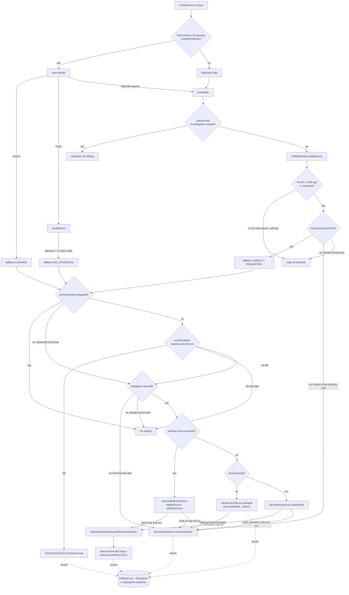
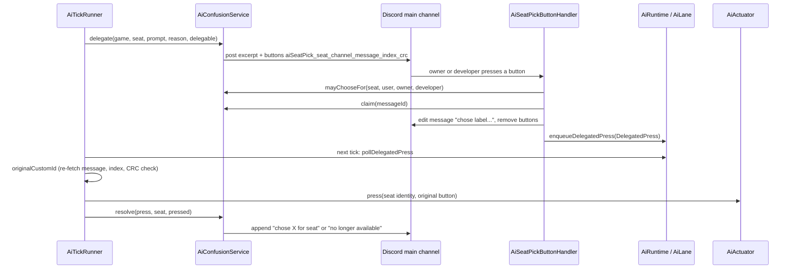

# Seats, commands, fallback and self-play setup

Part of the [AI player architecture docs](/src/main/java/ti4/ai/README.md): a living document kept next to the code (packages: seat, profile, discord, fallback, endurance, selfplay). The code is the source of truth; when you change behavior here, update this file.

## Components and responsibilities

Scope: `ti4.ai.seat`, `ti4.ai.profile`, `ti4.ai.discord`, `ti4.ai.fallback`, `ti4.ai.endurance`, `ti4.ai.selfplay`.
Where a behaviour lives outside these packages but is needed to explain them (the synthetic id in `AiSeats`, the kill
switch and faction lists in `AiSettings`, the fallback pipeline in `AiTickRunner`), it is traced and marked "outside
scope".

"Tests read" lines summarise the test methods of each class. Bodies were read for `AiSeatServiceTest`,
`AiConfusionServiceTest` (pass, owner, system-picker cases), `FallbackLogTest` (storage and ring cases),
`RedistributionGuardTest` ("Done Losing" case) and `AiTickRunnerPausedTest`; the other entries are taken from the test
method names and scenario comments and are weaker evidence.

### Synthetic seat ids (`AiSeats`, outside scope)

**Role:** informs.

**Purpose:** Identifies AI seats. An AI seat is an ordinary `Player` whose user id is synthetic.

**Invoked when:** `AiSeatService.addSeat` calls `AiSeats.newSeatId`; `AiSeats.isAiSeat` / `aiSeats` / `activeAiSeats` /
`isSelfPlay` are read by every `/ai` subcommand, by `AiRuntime.discover` (finding games with AI seats on startup), by
`AiTickRunner.tickGame` and by `RefereeRules.next`; `isAiSeat` is also read by many brain rule classes (trade, combat,
agenda, promises) that treat AI partners differently from humans. Outside `ti4.ai`, only
`TestBedService.findNonDeveloper` calls `AiSeats.isAiSeat`.

**Algorithm:**
- `ID_PREFIX = "7100000"`, total length 16, so 9 random decimal digits follow. `isAiSeatId` requires exactly 16 chars,
  the prefix, and all digits.
- `newSeatId` draws 9 digits from `RandomHelper.current()` up to 1000 times until the id is neither a player of this
  game nor a managed player anywhere (`GameManager.getManagedPlayer`), else throws `IllegalStateException`.
- `isActiveAiSeat` = AI id and `isRealPlayer()` and not eliminated.
- `isSelfPlay(game)` = at least one real player and every real player is an AI seat. The game owner added by
  `CreateGameService.createNewGame` is a `Player` but not a real player until set up, so an all-AI table with an
  unseated owner counts as self-play.

**Effect on the game:** none by itself; the id is what lets the button actuator impersonate the seat (`AiActuator`
builds a stand-in member with this id, so the engine's normal owner checks apply).

**Limitations:** A 16-digit number sits below current Discord snowflakes (17+ digits), but nothing checks that a real
user id can never take this form; the uniqueness check is only against known players.

### Kill switch and faction lists (`AiSettings`, outside scope)

**Role:** informs.

**Purpose:** Global on/off and the lists of factions AI seats may play.

**Algorithm / constants:**
- `AiSettings.isEnabled` reads `GlobalSettings.ImplementedSettings.AI_PLAYERS_ENABLED` (default `false`), accepting a
  `Boolean` or a string parsed with `Boolean.parseBoolean`.
- `FACTION_NAMES` (ordered): nekro, sardakk, hacan, letnev, l1z1x, naalu, sol, jolnar, xxcha, yin, winnu.
  `SUPPORTED_FACTIONS` = its keys (11).
- `DEFAULT_FACTIONS` = nekro, sardakk, hacan, letnev, sol, xxcha (6).
- `WIP_FACTIONS` = naalu, winnu, yin. This constant is read by no production code; only `AiGameSupportTest` reads it.
  WIP factions are kept out of default picks only because `DEFAULT_FACTIONS` does not list them.
- `MAX_SEATS = 8` real players.
- `brainFor(faction)` returns `"standard"` for every faction; `FactionBrainRegistry` maps it, and `"nekro"` from
  seats saved before the rename, to the same `StandardBrain` instance.
- `seatName(faction)` = the faction model's short name (or the alias) + `" AI"`.

**Where the kill switch is checked:** `AiGameSupport.refusalReason` (no new seats), `AiGameLauncher.launch` (no
`/ai watch` / `/ai play`), `AiTickRunner.mayActOnItsOwn` (no own decisions, no self-chosen fallback, no private safe
default), `AiTickRunner.referee` (no referee presses) and `AiStatus.state` (reports "disabled on this bot, so the table
chooses for it"). It is **not** checked by `AiRuntime.poll`, `AiTickRunner.handleIdle`, the public delegation post in
`AiTickRunner.fallBack`, or `AiTickRunner.pressDelegated`. So with the switch off the runtime keeps ticking AI games,
still detects stalls and still posts public choices for the table, and still executes a choice someone picks.

### `AiSeatService`

[AiSeatService](/src/main/java/ti4/ai/seat/AiSeatService.java)

**Role:** executes (seat creation/removal, pause flag, user preferences).

**Purpose:** Create and remove AI seats and change their pause state.

**Invoked when:**
- `addSeat`: `AiAdd.execute` (`/ai add`) and `SelfPlaySetup.setUp` (for every AI chair of `/ai watch` and `/ai play`).
- `removeSeat`: `AiRemove.execute` (`/ai remove`).
- `setPaused`: `AiPause.execute` (true) and `AiResume.execute` (false).
- `findSeats`: `AiCommandSupport.targetSeats`, used by every seat-targeting subcommand.
- `ensureTradePreferences`: `AiTickRunner.runSeat`, on each tick where the seat may act.

**Inputs:** game, requested faction (nullable), color (nullable), home position, speaker flag, the interaction event.

**Outputs / decisions:** `AddResult(seat|null, message)`; `removeSeat` returns a refusal string or null.

**Algorithm — `addSeat`, in order:**
1. Faction = requested, else `AiGameSupport.firstFreeFaction` (first of `DEFAULT_FACTIONS` not held by any player);
   none free -> "Every faction the AI can play is already taken."
2. `AiGameSupport.refusalReason(game, faction)`; any non-null reason is returned.
3. `MapPositionMapper.isTilePositionValid(position)`, else refused.
4. Refused if any real player's home system tile is at that position.
5. `firstSeat = !AiSeats.hasAiSeat(game)`; `seatId = AiSeats.newSeatId(game)`;
   `game.addPlayer(seatId, AiSettings.seatName(faction))`.
6. `AiSetupRestore.remember(game, seat, position)` (before setup, see below).
7. `PlayerSetupService.setupPlayer(new PlayerSetupState(color, faction, position, speaker), seat, game, event)` — the
   same engine setup a human gets (home tile, units, planets, starting technologies, color; it also posts setup
   information to the seat's cards info thread via `Player.getCardsInfoThread`; a null, taken or reserved color is
   replaced by the engine). A `RuntimeException` is logged and swallowed.
8. If the seat is not a real player, has no home tile, or has no planets: `AiSetupRestore.restore`, `game.removePlayer`,
   refusal "could not be set up".
9. `writeSeatPreferences(seatId)`: the seat's persisted `UserSettings` get sandbag pref `"bot"`, distance-based
   tactical actions on, wrong-button ephemeral on, survey answered, stat preferences indicated, activity tracking off,
   auto debt clearance off; saved with `UserSettingsManager.save`.
10. `AiProfile.createHidden(AiSettings.brainFor(faction), RandomHelper.current()).writeTo(seat)`.
11. `game.setNewTransactionMethod(true)` and `game.setHomebrew(true)`.
12. `AiRuntime.register(gameName)` (a lane is created and marked due after the 2.5 s debounce).
13. `announce`: posts "🤖 <seat> has joined as an **AI player**." to the main actions channel; for the first AI seat only,
    sends the "How to deal with the AI players" text to table talk and pins it.

**Algorithm — `removeSeat`:** refused if the player is not an AI seat, or if `AiGameSupport.hasStarted` (message
points to `/game replace`). Otherwise `AiSetupRestore.restore`, `game.removePlayer(userId)`, and
`AiRuntime.forget(gameName)` when no AI seat remains.

**Algorithm — `setPaused`:** reads the profile, writes it back with `PauseState.MANUAL` (pause) or `RUNNING` (resume),
then `AiRuntime.clearStall(game, seatId)` resets the in-memory stall timer so paused time never counts toward the stall
threshold.

**Algorithm — `ensureTradePreferences`:** once per seat id per process (`TRADE_PREFERENCES_CHECKED` set), turns off
`prefersAutoDebtClearance` if it is on and saves. It repairs seats created before that preference was written.

**Effect on the game:** adds a `Player` with a full engine setup, marks the game homebrew and switches it to the new
transaction method, writes five profile stored values on the seat plus setup-restore values, posts and pins messages.
Removal deletes the player and undoes the tile, units of its color, speaker and game flags (see `AiSetupRestore`).

**Fallbacks:** a failed engine setup is rolled back before any profile or preference is written.

**Limitations:**
- `removeSeat` does not delete the seat's persisted `UserSettings`, its cards info thread, its fallback records in the
  game's AI log file (`ai_logs/<game>.properties`), or its in-memory trade-preference marker.
- `game.setHomebrew(true)` is applied to every game with an AI seat; `AiGameSupport.unsupportedModes` therefore skips the
  Homebrew check once a game has an AI seat, so homebrew content added after the first AI seat is not refused for
  later seats.
- The pinned help text says "**any player** may choose for it", while the default `EXPLOIT_GUARDS` experiment limits
  delegated choices to the owner or a developer (see `AiConfusionService.mayChooseFor`).

**Tests read:** `AiSeatServiceTest` checks `writeSeatPreferences` turns auto debt clearance off, the help text contains
the trade sections and is under 2000 chars, and `ensureTradePreferences` saves only once.

### `AiGameSupport`

[AiGameSupport](/src/main/java/ti4/ai/seat/AiGameSupport.java)

**Role:** decides (whether a seat may be added) and informs (`hasStarted`).

**Invoked when:** `AiSeatService.addSeat` (refusal, default faction) and `AiSeatService.removeSeat` (`hasStarted`).

**Algorithm — `refusalReason`, first match wins:**
1. `!AiSettings.isEnabled()` -> explains the developer setting.
2. Faction not in `SUPPORTED_FACTIONS`.
3. Faction already held by any player (`isTaken` scans all players, real or not).
4. `getRealPlayers().size() >= 8`.
5. Phase is `miltydraft` -> "can't be added while a draft is running".
6. `hasStarted(game)`.
7. Any `unsupportedModes` entry true.

**`hasStarted`** is true if any of: round > 1; phase not in {"", "miltydraft", "playerSetup", "strategy"} (null is
treated as ""); any strategy card played; stored value `revealedFlop<round>` non-empty; any real player has a strategy
card, a secret objective in hand (`getSo() > 0`) or a scored secret.

**`unsupportedModes`** lists, in this order: TIGL, Fog of War (`isFowMode` or `isLightFogMode`), Community, Alliance,
Twilight's Fall, Franken, Homebrew (only when the game has no AI seat yet), Discordant Stars, Absol, MiltyMod, Homebrew
strategy cards, Omega Phase, Extra secret, Galactic events (any of 29 event-mode flags), Scenario (Liberation C4,
Ordinian C1, Erwan's Gambit).

**Limitations:** Only these mode flags are checked; any game option not represented by a flag here is not refused.

**Tests read:** `AiGameSupportTest` covers taken/unsupported factions, disabled switch, started game, first-round status
phase, running draft, the homebrew exemption with an existing AI seat, and that the default faction lists are as stated.

### `AiSetupRestore`

[AiSetupRestore](/src/main/java/ti4/ai/seat/AiSetupRestore.java)

**Role:** executes.

**Purpose:** Remember what adding a seat changed, so a failed setup or `/ai remove` can undo it.

**Invoked when:** `remember` from `AiSeatService.addSeat` before engine setup; `restore` from `addSeat` (failed setup)
and `removeSeat`.

**Algorithm — `remember`:**
- Game stored value `aiSetupRestore` = `"<isHomebrew>|<isNewTransactionMethod>"`, written only if not already present
  (so it holds the flags from before the first AI seat).
- If the game has a non-blank speaker id, seat stored value `aiSetupSpeaker` = that id.
- Seat stored value `aiSetupTile` = `"<position>|<tileId of the tile at that position, or empty>"`.

**Algorithm — `restore`:**
1. Removes every unit of the seat's color from every tile.
2. Tile: if no tile was there before, `game.removeTile(position)`; else `game.setTile(new Tile(oldTileId, position))`.
   Removes `aiSetupTile`.
3. `lastSeat` = every AI seat in the game is this seat. If `lastSeat` and the flags parse into 2 parts, restores
   `homebrew` and `newTransactionMethod`.
4. If this seat is the speaker: the previous speaker (from `aiSetupSpeaker`) gets it back if that player still exists,
   is not this seat and is a real player; else the speaker is cleared to `""`. Removes `aiSetupSpeaker`.
5. If `lastSeat`, removes `aiSetupRestore`.

**Limitations:** Only the tile, units of its color, speaker and the two game flags are restored. Anything else the
engine setup changed (for example map tokens placed by faction setup, or messages posted) is not undone.

**Tests read:** `AiSetupRestoreTest` checks tile, speaker and flags restore, no blank/unsafe stored values, removal of a
home tile placed on an empty position, and that flags survive until the last AI seat leaves.

### `AiProfile` and `AggressionLevel` (the hidden profile)

[AiProfile](/src/main/java/ti4/ai/profile/AiProfile.java), [AggressionLevel](/src/main/java/ti4/ai/profile/AggressionLevel.java)

**Role:** informs (stored per-seat state).

**Purpose:** Per-seat brain id, aggression level and mode, pause state and seed.

**Storage:** five **player stored values** on the seat (saved in the game file, so `/game undo` rolls them back):

| Key | Content | Default when missing/invalid |
| --- | --- | --- |
| `aiBrain` | brain id (`standard`; `nekro` on older saves) | `""` (no brain found -> seat never decides) |
| `aiAggBase` | ordinal of `AggressionLevel` | 2 (`OPPORTUNIST`); out-of-range ordinals are clamped to 0..4 |
| `aiAggMode` | `DYNAMIC` or `LOCKED` | `DYNAMIC` |
| `aiPaused` | `RUNNING`, `MANUAL` or `AUTO` | `RUNNING` |
| `aiSeed` | non-negative long | 0 |

**Algorithm — `createHidden(brainId, random)`:** level drawn by `AggressionLevel.drawHidden` with weights
PEACEFUL 1, CAUTIOUS 3, OPPORTUNIST 4, AGGRESSIVE 3, WARLORD 1 (out of 12); mode `DYNAMIC`; pause `RUNNING`;
seed `random.nextLong() & Long.MAX_VALUE`. The `random` is `RandomHelper.current()`: thread-local
`ThreadLocalRandom` in production, a seeded `Random` when test code has seeded the thread.

**Who reads which field (verified by grep):**
- `brainId`: `AiTickRunner.runSeat` -> `FactionBrainRegistry.forBrainId`.
- `pause` via `isPaused()` (true for `MANUAL` and `AUTO`): `AiTickRunner.runSeat`, `handleIdle`, `fallBack`,
  `referee`, and `AiStatus`.
- `seed`: only as a delay offset in `SabotageRules.passDelayMillis`, `ShenanigansRules.delayMillis` and
  `ReadyForDice.delayMillis` (hashes of the message/game data XORed with the seed, `floorMod` into a spread).
- `baseLevel` and `mode`: **no production reader.** They are written and parsed but no decision code consults them.
- `PauseState.AUTO`: never written by production code.
- `AiProfile.clear`: called only from `AiProfileTest`.

**Effect on the game:** stored values only.

**Limitations:** The aggression level is hidden (never shown by `/ai status`) but has no effect on play in this branch.
Attack appetite elsewhere comes from per-faction `FactionAggression` and `AiPersonality` (`aiPersonality` stored value,
default `NEUTRAL`), not from this profile.

**Tests read:** `AiProfileTest` checks the stored-value round trip, the defaults (`OPPORTUNIST`, `DYNAMIC`, running),
`clear`, and that 12,000 draws favour `OPPORTUNIST` over the extremes.

### `/ai` command tree (`AiCommand`, `AiCommandSupport`)

[AiCommand](/src/main/java/ti4/ai/discord/AiCommand.java), [AiCommandSupport](/src/main/java/ti4/ai/discord/AiCommandSupport.java)

**Role:** executes (Discord entry points).

**Invoked when:** `SlashCommandManager` registers `new AiCommand()` as `/ai` with 11 subcommands: add, status, pause,
resume, delegate, remove, watch, play, fallbacks, profile, debug.

**Permission (`AiCommandSupport.mayManage`):** the caller is a `Player` of the game (any player object, seated or not),
or the game owner, or has a developer role (`TestBedService.isDeveloper`). Checked by add, pause, resume, delegate,
remove, fallbacks, profile, debug. **Not** checked by status. `watch` and `play` instead require developer roles in
`accept`.

**Seat targeting:** `faction_or_color` (autocomplete) on status, pause, resume, delegate, remove, fallbacks.
`AiSeatService.findSeats` returns all AI seats when blank, else the one AI seat that
`game.getPlayerFromColorOrFaction` names (empty if that player is not an AI seat).

**Save semantics** (`GameStateSubcommand(name, desc, saveGame, playerCommand)`): add, pause, resume, remove and debug
save the game; status, delegate, fallbacks and profile do not.

| Subcommand | Class | Behaviour |
| --- | --- | --- |
| `add` | [AiAdd](/src/main/java/ti4/ai/discord/AiAdd.java) | Required `hs_tile_position` (text before the first space is used); optional `faction` (choices = the 11 `FACTION_NAMES`), `color` (resolved via `AliasHandler.resolveColor`, refused if `Mapper.isValidColor` fails), `speaker` (default false). Calls `AiSeatService.addSeat` and replies with its message. |
| `remove` | [AiRemove](/src/main/java/ti4/ai/discord/AiRemove.java) | Needs exactly one target seat (asks for `faction_or_color` when several). Calls `removeSeat`. |
| `pause` | [AiPause](/src/main/java/ti4/ai/discord/AiPause.java) | `setPaused(seat, true)` on each target. |
| `resume` | [AiResume](/src/main/java/ti4/ai/discord/AiResume.java) | `setPaused(seat, false)` on each target, then `AiRuntime.register`. |
| `delegate` | [AiDelegate](/src/main/java/ti4/ai/discord/AiDelegate.java) | `AiRuntime.requestDelegation(game, seatId, explicit)` per target; `explicit` = option given. |
| `status` | [AiStatus](/src/main/java/ti4/ai/discord/AiStatus.java) | Per seat, first match: "disabled on this bot…" (switch off), "not playing" (not an active AI seat), "paused…", "holding back… after repeated button failures" (`AiRuntime.isCoolingDown`), else "running". Adds a self-play line, and "They are not being watched yet." when the game has no runtime lane. Never prints aggression. |
| `fallbacks` | [AiFallbacks](/src/main/java/ti4/ai/discord/AiFallbacks.java) | Lists `FallbackLog.recent(game)` (newest first, up to 10) for the targeted factions. Detail lines (prompt text and buttons, last decisions, pending decision) only when the caller is a developer, or the game is not Fog of War (`isFowMode` only; light fog is not checked here) and the record is not a private prompt. |
| `profile` | [AiThinkingProfile](/src/main/java/ti4/ai/discord/AiThinkingProfile.java) | `AiRuntime.thinkingStats(game)` rendered with 8 span rows and 3 slow-decision rows, abbreviated to 1900 chars; hidden in Fog of War unless developer; "not made a decision… since the bot started" when empty. In-memory only. |
| `debug` | [AiDebug](/src/main/java/ti4/ai/discord/AiDebug.java) | Required `mode`: Off / Bot log only / Public thread. Public is refused in Fog of War. Stores the mode via `AiDebugLog.setMode` (game stored value `aiDebugMode`); Public also posts a notice into the `<game>-ai-debug` thread that it includes the AI's own hand and secrets. |
| `watch` | [AiWatch](/src/main/java/ti4/ai/discord/AiWatch.java) | Developer only. `seats` 3..6 (default 6), `game_name`, `pace` Fast (default) / Normal. Picks `SelfPlaySetup.pickFactions(seats)`, launches via `AiGameLauncher` with `Table.allAi`, adds the developer to every AI seat's cards info thread. |
| `play` | [AiPlay](/src/main/java/ti4/ai/discord/AiPlay.java) | Developer only. `opponents` 2..5 (default 5), `faction` (default `randomFaction()` = uniform over the 11 `SUPPORTED_FACTIONS`), `color`, `game_name`. Refuses an unknown faction or one whose source is not base/PoK/codex1-4/Thunder's Edge (`Source.isTe`). AI factions = `pickOpponentFactions` (shuffled `DEFAULT_FACTIONS` without the human's). Human seat and speaker seat are random. Not paced fast. |

**Limitations:**
- `AiStatus` has no permission check; anyone who can run commands in the channel sees pause/cooling state.
- `AiThinkingProfile` and `/ai fallbacks` data are per process (profile) or per log file (fallbacks); see `FallbackLog`.

**Tests read:** `AiCommandTest` (builds without game data, faction choices equal `SUPPORTED_FACTIONS`, seat/opponent
ranges), `AiPlayTest` (faction refusal and random default from `SUPPORTED_FACTIONS`), `AiThinkingProfileTest` (FoW
hiding, empty case, length limit).

### `AiGameLauncher` (`/ai watch`, `/ai play` channel and name setup)

[AiGameLauncher](/src/main/java/ti4/ai/discord/AiGameLauncher.java)

**Role:** executes.

**Invoked when:** `AiWatch.execute` and `AiPlay.execute`.

**Algorithm — `launch`, in order:**
1. Kill switch off -> refused.
2. Must run in a guild with a member.
3. `CreateGameService.serverCanHostNewGame(guild)`, else refused.
4. The channel (or a thread's parent) must be in a category with at most 48 channels.
5. Name: requested name must pass `SelfPlaySetup.isValidName` (`^[a-z][a-z0-9]{2,19}$`, not starting with `pbd` or
   `fow`) and be free; without one, the first free `<prefix><N>` for N = 1..999 (`aiwatch` / `aiplay`). Free = no valid
   game, no game or role of that name (`CreateGameService.gameOrRoleAlreadyExists`), no text channel starting with
   `<name>-`, and no undo history (an error reading undo history counts as none).
6. The name choice and creation run inside `synchronized (AiGameLauncher.class)`.
7. `start`: `ThreadArchiveHelper.checkThreadLimitAndArchive`; creates `<name>-table-talk` and `<name>-actions`
   text channels (category permissions synced, the caller granted view/send/history) and a `<name>-bot-map-updates`
   thread (suffix from `Constants.BOT_CHANNEL_SUFFIX`) with one-week auto-archive; calls the setup lambda
   (`SelfPlaySetup.setUp`).
8. On `SetupFailed`: deletes the two channels (the thread goes with the actions channel) and replies with the reason.

**Effect on the game:** a new game with its own channels.

### `SelfPlaySetup`

[SelfPlaySetup](/src/main/java/ti4/ai/selfplay/SelfPlaySetup.java)

**Role:** executes (game creation) and informs (layout helpers).

**Invoked when:** `AiWatch` / `AiPlay` through `AiGameLauncher`; the self-play test harness also uses it.

**Algorithm — `setUp(name, owner, channels, table, fast, event)`:**
1. `CreateGameService.createNewGame(name, owner)` (the owner becomes an unseated `Player`).
2. Sets actions channel, table talk, bot map updates thread, custom name `"AI self-play"`, auto ping off,
   `playerCountForMap = seats`, strategy cards per player = 2 for 4 or fewer seats, else 1; if `fast`, game stored
   value `aiPace = fast`.
3. Map: `THUNDER_DREAMING_MAP_STRING` mapped to positions, plus `"-1"` (unused) at every default home position not used
   for this seat count; `AddTileListService.addTileMapToGame`.
4. Home positions from `TestBedPresetService.DEFAULT_HOME_POSITIONS` (301, 304, 307, 310, 313, 316): 6 seats all;
   5 the first five; 4 -> 301, 304, 310, 313; 3 -> 301, 307, 313.
5. For each chair i: speaker iff `i == table.speakerSeat()`. The human chair runs
   `PlayerSetupService.setupPlayer` on the owner's player (refused if not real / no home / no planets); every other
   chair calls `AiSeatService.addSeat(game, faction, null, home, speaker, event)`, and any refusal aborts setup.
6. `AddTileListService.finishSetup(game, null)`; `AiRuntime.forget(name)` (drops lane state from the adds);
   `GameManager.save`; `AiRuntime.register(name)`.
7. On any exception: `discard` = `AiRuntime.forget`, `AiLogStore.delete`, `GameManager.delete`, then rethrow as
   `SetupFailed`.

**`Table`:** `allAi(factions)` -> no human, speaker chair 0. `withHuman(faction, color, aiFactions, random)` -> human
chair = `random.nextInt(seats)`, inserted into the AI list at that index, speaker chair = `random.nextInt(seats)`.

**Faction picks:** `pickFactions` shuffles `DEFAULT_FACTIONS` with the given random and takes the first `seats`;
`pickOpponentFactions` removes the human's faction first. WIP factions are never picked.

**Tests read:** `SelfPlaySetupTest` checks home positions per seat count, no placeholder home for empty chairs, the
Thunder Dreaming layout, strategy cards per player, distinct default factions, name validation, human placement, no
duplicate faction, and the all-AI table.

### `RefereeRules` (self-play game advancement)

[RefereeRules](/src/main/java/ti4/ai/selfplay/RefereeRules.java)

**Role:** decides (which public "any player may press" button to press, and which seat presses it); also informs
(`trackExhausted`, `offersGameEnd`, `stateFingerprint`).

**Invoked when:** `AiTickRunner.tickGame` -> `AiTickRunner.referee`, only when the game is self-play and no seat acted
in this tick. `trackExhausted` / `offersGameEnd` are read at the start of `tickGame` for the game-over check.

**Gate in `AiTickRunner.referee`:** kill switch on; lane healthy (fewer than 3 failed presses in 10 min in this game and
fewer than 10 across all games); at least `refereeDelay` since the lane's last action (20 s, 10 s at fast pace); **no
seat paused and no seat at its hourly action cap**.

**Steps, tried in this order** (handler predicate on `PromptButton.handlerId`):

| # | Handler | Reason | Extra condition |
| --- | --- | --- | --- |
| 1 | `deal2SOToAll` | deal the starting secret objectives | only once `realPlayers >= playerCountForMap` |
| 2 | `startOfGameObjReveal` | reveal the first objectives | |
| 3 | starts with `reveal_stage_1position_` | reveal a stage 1 objective | skipped when the track is exhausted |
| 4 | starts with `reveal_stage_2position_` | reveal a stage 2 objective | skipped when exhausted |
| 5 | `reveal_stage_1` | reveal a stage 1 objective | skipped when exhausted |
| 6 | `reveal_stage_2` | reveal a stage 2 objective | skipped when exhausted |
| 7 | `startStrategyPhase` | start the strategy phase | |
| 8 | `flip_agenda` | flip the agenda | |
| 9 | starts with `agendaResolution_` | resolve the agenda | label must equal "Resolve with Current Winner"; prompt at least 60 s old |
| 10 | starts with `resolveAgendaVote_outcomeTie` | break the agenda tie | prompt at least 10 min old |
| 11 | `proceed_to_strategy` | move on to the strategy phase | |

**Algorithm — `next`:** returns empty unless seats exist and the game is self-play. For each step in order, for each
public prompt in snapshot order whose `createdAtMillis <= now - max(refereeDelay, step.minAge)`, the first enabled
button that matches the step and whose press key the lane has not pressed at the current state fingerprint
(`AiLane.refereeMayPress`). Presser: for an owned button, the seat whose faction owns it (if none, the next prompt is
tried); for an unowned button, the speaker seat, else the first seat. First hit wins.

**`trackExhausted`:** stage 1 peekable deck empty in Omega Phase mode, else stage 2 peekable deck empty.

**`stateFingerprint`:** `Objects.hash(round, phase, speakerId, list of each real player's unscored-secret count,
sorted copy of the game stored-value map)`. The lane records `(pressKey -> fingerprint)` before pressing, so the same
button is not pressed twice in the same state.

**Never pressed:** the end-game button (`EndGameService.MOST_POINTS_END_GAME_BUTTON_ID`) is only detected
(`endsGame`, `offersGameEnd`), never in `STEPS`.

**Effect on the game:** the chosen seat presses the button through `AiTickRunner.pressAsSeat` (counts as that seat's
action and against its action cap).

**Tests read:** `RefereeRulesTest` checks self-play only, delay, secret deal only when every seat is filled, owner
pressing, no reveals once exhausted, end-game detection, steps owned by non-AI factions left alone, speaker / first seat
pressing, never ending the game, skipping pressed buttons, step order, the 1-minute agenda delay, only "Resolve with
Current Winner", and the 10-minute tie delay.

### Fallback pipeline in `AiTickRunner` (outside scope, traced)

`AiTickRunner.runSeat` turns each seat's decision into one of: press, unsure, wait, idle, announce, propose, post. The
fallback code is in `handlePress`, `handleIdle`, `fallBack`, `chooseWithoutHumans`, `pressDelegated` and `recorded`.
It is described here because every class in `ti4.ai.fallback` is called only from these methods.

**Role:** decides (what to do when the brain cannot) and executes (posts, presses, records).

**When a seat may act on its own (`mayActOnItsOwn`):** kill switch on, lane healthy, seat under its hourly action cap
(150, or 600 at fast pace in self-play). The cap counts only presses whose actuator outcome was PRESSED
(`AiSeatState.recordPressed`), including referee and delegated presses made as that seat; stale or failed presses and
Announce/Propose/Post decisions do not count. A seat decides only if it also has a brain and is not paused; otherwise
the decision is `Idle`.

**Entry causes and their `kind`:**
- `UNSURE`: the brain returned `AiDecision.Unsure(prompt, reason)` -> `fallBack(prompt)`.
- `NO_PROGRESS`: `handlePress` counts attempts per `pressKey#AiProgress.fingerprint`; at `MAX_ATTEMPTS_PER_PROMPT = 2`
  attempts the third decision for the same button in the same state goes to `fallBack` with "its choice made no
  progress" (and records one failure for the health check). A failed press (actuator outcome other than PRESSED/STALE)
  sets the attempt count to the limit at once.
- `TIMEOUT`: `handleIdle` when `AiStallDetector.waitReasons` has been unchanged for `stallThreshold` (3 min; 1 min at fast
  pace in self-play).
- `REQUESTED`: `handleIdle` when `/ai delegate` set a request: `EXPLICIT` (seat named) always forces; `GAME_WIDE` forces
  only if the seat has a wait reason.
- `THINKING_ABORTED`: recorded only (no hand-over) by `cutShort` when a decision exceeded its thinking limits.

**`handleIdle`:**
1. Paused and no delegation request -> `clearStall`, nothing else (no post, no record).
2. Compute wait reasons; `stallAge` restarts whenever the reason text changes.
3. Consume the delegation request. No reasons and not forced -> nothing. Under threshold and not forced -> wake at the
   threshold.
4. Blocking prompt = newest prompt with enabled buttons, not yet delegated, none of whose buttons this seat already
   pressed, and related to a wait reason (or, if forced with no reasons, a public prompt with a button owned by the
   seat).
5. Found -> `fallBack`. Not found -> if forced or first time for this stall: `announceStuck` and record
   "stuck: no prompt it can hand over" (plus the last thinking abort within 10 min, if any); else wake after another
   threshold.

**`fallBack(prompt, cause, requested)`:**
1. Prompt already delegated -> nothing.
2. Requested (or a pending request is consumed) -> reset the loop counter. Otherwise `AiSeatState.recordFallback(reason@turnKey, 5)`:
   the 1st to 5th consecutive fallback with the same reason in the same active-player turn -> continue; the 6th ->
   `announceLoop` (🔁 notice) and record "stopped choosing on its own"; later ones -> nothing. The counter resets when
   the seat's own press succeeds, on a requested hand-over, or after an undo.
3. Caps: per seat 30 delegations per round, per game 60 per round (in-memory counters; the game counter is only
   checked and incremented once the seat counter passes). Over -> `announceStuck` once per stall (`markStuckAnnounced`,
   reset when the wait reasons change, on a successful press or after an undo) and record "stuck: no delegations left
   this round"; otherwise return without action. The caps count self-play fallbacks too, because `recordDelegation`
   runs before the self-play branch.
4. Mark the prompt delegated.
5. Self-play and not paused -> `chooseWithoutHumans`.
6. Public prompt -> `AiConfusionService.delegate` with the `delegable` filter; record "asked the table to choose" or, if
   nothing could be posted, `announceStuck` and "stuck: could not post the choices".
7. Private prompt -> `AiConfusionService.safeDefault`. None, paused, or may not act -> `announceStuck(…, "a private
   choice")`, record "stuck: private choice with no safe option". Otherwise press it through
   `RedistributionGuard.pressRestoringTokens`; on success `announcePrivateChoice` (does not name the option); record
   "picked <label>" or "could not press <label>".

**`delegable` filter for table posts:** button unowned or owned by the seat; a `combatRoll_` button only if
`CombatRules.isRollFor` the seat; and, with `EXPLOIT_GUARDS` on, not `AiConfusionService.neverDelegated` (early
round pass, `turnEnd…`, vote buttons).

**`chooseWithoutHumans` (self-play):** `stalledChoice` for TIMEOUT/REQUESTED, else `selfPlayChoice`, filtered by the
ownership/combat-roll rule; none or may-not-act -> `announceStuck` and "stuck: no choice it may make for itself"; else
press through `RedistributionGuard`; success -> `announceSelfPlayChoice` (names the label); tokens restored but Done
not pressed -> `announceStuck("it could not put its command tokens back")`.

**`pressDelegated`:** processed first in a tick (before the action gap and perception), one per tick. Seat no longer an
active AI seat -> resolve as failed. Re-reads the original message, takes the button at the stored index, checks the
CRC checksum, presses it as the seat (`AiActuator.press`), records the press, and `AiConfusionService.resolve` edits
the delegation message. Not gated by the kill switch, pause, health or action cap; it only needs `AiRuntime.mayMutate`
(the process may run scheduled work). A STALE actuator outcome counts as not pressed here, so the message gets the ⚠️
line.

**Game over:** `tickGame` stops all AI decisions once any player has `game.getVp()` points (all games; the 🏁 notice
only in self-play), and in self-play also once the objective track is exhausted and a public prompt offers the
end-game button. The victory-point check runs before queued delegated presses are processed; the exhausted-track check
runs after them (it needs the perception snapshot), so a queued delegated press is still executed in that case.

**Thinking aborted:** `cutShort` returns `SeatResult.act()`, so a cut-short decision ends the tick like a press: the
remaining seats and the referee wait for the next tick (after the 2.5 s debounce).

**Pending `/ai delegate` request:** the request (`AiSeatState.delegationRequest`, in memory only, lost on restart) is
consumed only by `handleIdle` or `fallBack`. If the seat's brain decides to press something, the request stays pending
and is consumed on a later idle or wait tick, where an `EXPLICIT` request still forces a hand-over.

#### Diagram: Fallback decision in `AiTickRunner` (calls into `ti4.ai.fallback`)



### `AiConfusionService`

[AiConfusionService](/src/main/java/ti4/ai/fallback/AiConfusionService.java)

**Role:** decides (`safeDefault`, `selfPlayChoice`, `stalledChoice`, `neverDelegated`, `passesEarly`, `mayChooseFor`)
and executes (posting delegations and notices, editing the delegation message, `claim`).

**Invoked when:** only from `AiTickRunner` (see the pipeline above) and `AiSeatPickButtonHandler` (`mayChooseFor`,
`claim`).

**`delegate(game, seat, prompt, reason, offerable)`:** needs the main actions channel, the prompt's channel and the
original message (re-fetched via `AiActuator.retrieve`). Options: every button of the live message, in component
order, that has a custom id, is enabled, does not open a modal (`~MDL` in the id), passes `offerable`, up to 25. Each
is cloned with custom id `DelegationChoice.customId()` and label abbreviated to 80 chars; the index is the button's
position among **all** buttons of the message. The message text: "🤖 <seat> isn't sure what to do here (<reason>)."
plus "**The game owner or a bot developer** may choose for it." with `EXPLOIT_GUARDS` on, else "**Any player** may
choose for it.", a jump link and the original content abbreviated to 300 chars. Posted with
`sendMessageToChannelWithButtonsAndNoUndo`. Returns false when anything is missing or no option remains.

**`mayChooseFor(seat, userId, ownerId, developer)`:** `EXPLOIT_GUARDS` off -> anyone; on -> developer or the game
owner.

**`safeDefault(game, seat, prompt)`:** enabled buttons minus modal openers, minus hit cancels (`cancelSpaceHits_`,
`cancelPdsOffenseHits_`, `cancelGroundHits_`, `cancelAFBHits_`), minus `passesEarly` buttons. Then for each hint in
priority order `decline`, `pass`, `no_`, `not follow`, `deletebuttons`, `done`, `skip`, `cancel`, the first remaining
button whose lower-cased handler id **or** label contains the hint. Empty if none.

**`passesEarly`:** with `EXPLOIT_GUARDS` on, a `passForRound…` button while the seat has a tactic token or an unplayed
strategy card.

**`neverDelegated`:** with `EXPLOIT_GUARDS` on, `passesEarly`, or handler starting `turnEnd`, or a vote button
(`vote`, or starting `outcome_`, `planetOutcomes_`, `exhaustForVotes_`, `resolveAgendaVote_`,
`proceedToFinalizingVote`).

**`selfPlayChoice`:** `safeDefault`, else the first enabled button that does not open a modal, is not `ultimateUndo…`,
does not cancel hits and does not pass early.

**`stalledChoice`:** for a tactical system picker (`TacticalRules.isSystemPicker`), the first `ringTile_<pos>` button
that is unowned or owned by the seat, where the tile holds the seat's units and no enemy units
(`BoardView.hasEnemyUnits`); else `selfPlayChoice`.

**Notices** (all to the main actions channel, `notice` skips if missing): `announceLoop` (🔁, with self-play advice to pause
and `/ai delegate` or `/game end`), `announcePrivateChoice` ("picked a safe option", option not named),
`announceSelfPlayChoice` (names the option), `announceStuck`, and the "It first put N command tokens back." suffix.

**`resolve(press, seatName, succeeded)`:** appends "✅ <chooser> chose **<label>** for <seat>." or "⚠️ … no longer
available." to the delegation message and removes its buttons.

**`claim(messageId)`:** adds to an in-memory set; true only the first time per process.

**Example:** a public "Follow Leadership?" prompt for the Hacan AI that the brain returns `Unsure` on. In a human game,
the bot posts in the actions channel "🤖 Hacan AI isn't sure what to do here (…). **The game owner or a bot developer**
may choose for it." with copies of the prompt's own follow / no-follow buttons (same labels, abbreviated to 80 chars,
custom ids replaced by `aiSeatPick_…` ids). On a private "discard an action card" prompt in the Hacan AI's cards-info
thread, the prompt is never reposted: if a button matching one of the hints exists it is pressed and only "picked a
safe option" is posted; otherwise the stuck notice names "a private choice".

**Tests read:** `AiConfusionServiceTest` covers decline preference, no-hint empty, modal skip, hit cancels never
chosen, no early pass (and pass allowed once the cards are played), End Turn before an end-of-turn ability, guard-off
behaviour, never-delegated buttons, owner/developer rule, the stalled system picker, and single claim.

### `DelegationChoice`, `DelegatedPress`, `AiSeatPickButtonHandler`

[DelegationChoice](/src/main/java/ti4/ai/fallback/DelegationChoice.java), [DelegatedPress](/src/main/java/ti4/ai/fallback/DelegatedPress.java), [AiSeatPickButtonHandler](/src/main/java/ti4/ai/discord/AiSeatPickButtonHandler.java)

**Role:** `DelegationChoice` informs (encodes/decodes), the handler executes.

**Custom id:** `aiSeatPick_<seatId>_<channelId>_<messageId>_<index>_<checksum>`, checksum = first 6 hex chars of the
CRC32 of the original button's custom id (left-padded to 8). `parse` requires the prefix, exactly 5 parts and a numeric
index. `matches` compares checksums. With 16-digit seat ids and 19-digit snowflakes the id is about 77 chars.

**Handler (`@ButtonHandler("aiSeatPick_", save = false)`):**
0. Before the handler runs, the engine's routing context (`ListenerContext`) rejects a presser who is not a `Player`
   of the game with an ephemeral "<mention> is not a player of the game"; the handler is never called. This includes a
   developer who has no player object in that game.
1. No game, no player, or unparsable id -> ephemeral "This choice is no longer valid."
2. If the seat still exists and `mayChooseFor` fails -> ephemeral "Only the game owner or a bot developer may choose".
3. `claim(messageId)` fails -> ephemeral "Another player already chose".
4. Edits the delegation message: appends "⏳ <chooser> chose **<label>**…" and removes all buttons.
5. `AiRuntime.enqueueDelegatedPress(DelegatedPress(...))`, which marks the lane due now.

**Perception guard:** `AiPerception.isRelevant` drops any prompt that has an `aiSeatPick_` button, so AI seats never act
on delegation messages.

**Private prompt:** a prompt read from the seat's own cards info thread (`AiPerception.privateThread` resolves
`getCardsInfoThreadID`, source `PromptSource.AI_THREAD`, `AiPrompt.isHidden()`). Prompts from the main actions channel,
recent strategy-card threads (`PUBLIC`) and ongoing combat threads (`COMBAT_THREAD`) are not private and go to the
table-delegation branch.

**Tests read:** `DelegationChoiceTest` (round trip, under 100 chars for long ids, rejection of foreign ids).

#### Diagram: Table choosing for an AI seat



### `FallbackLog` and `FallbackRecord`

[FallbackLog](/src/main/java/ti4/ai/fallback/FallbackLog.java), [FallbackRecord](/src/main/java/ti4/ai/fallback/FallbackRecord.java)

**Role:** executes (recording) and informs (`recent`).

**Invoked when:** `AiTickRunner.recorded` (every fallback outcome: unsure, no progress, timeout, requested, loop stop,
stuck notices, thinking aborted); read by `AiFallbacks` and the self-play report harness.

**`capture`:** builds a record of time, game, round, phase, faction, color, kind, reason, prompt message id,
`privatePrompt` (= prompt is from the seat's own AI thread), prompt text, button ids, up to 5 recent decisions on that
prompt (each abbreviated to 100 chars), pending decision (100 chars), outcome. Prompt text: `""` without a prompt,
`"(private prompt)"` for private prompts, else the content with newlines removed, abbreviated to 200. Button ids: up to
12, then `"+N more"`; full custom ids for public prompts, handler ids (custom id without the `FFCC_<faction>_` envelope)
for private ones; each abbreviated to 60 and suffixed " (disabled)" when disabled.

**`record`:** always writes one `BotLogger.info` line starting `AI fallback game=…` (the full record, including private
handler ids). It then skips storage if any of the stored recent records has the same round, faction, phase, kind,
reason and prompt message id. Otherwise stores the record in slot `next` and advances `next = (next + 1) % 10`.

**Storage:** `AiLogStore` keys `slot0`..`slot9` and `next` for the game, kept in memory and written to
`<storage>/ai_logs/<game>.properties` (a temp file then replaced), **not** in the game save. Records are base64url
(no padding) of the 15 fields joined by char 31, list items by char 30; those characters and newlines are replaced by
spaces before encoding. `decode` returns empty for blank, wrong field count or bad numbers.

**`recent`:** reads all 10 slots newest first, skipping empty or undecodable ones.

**Effect on the game:** none (separate file). `AiRuntime.discover` deletes log files of games that no longer exist;
`SelfPlaySetup.discard` deletes the file of a failed setup.

**Tests read:** `FallbackLogTest` checks the captured fields, the log line, de-duplication of a repeated stall,
private prompts keeping no text and only handler names, records without a prompt, storage in its own `.properties` file
with the game stored-value map empty, and the 10-record ring.

### `RedistributionGuard`

[RedistributionGuard](/src/main/java/ti4/ai/fallback/RedistributionGuard.java)

**Role:** executes (wraps a fallback press).

**Purpose:** Stop a fallback "Done" press from confirming a command-token redistribution that loses tokens.

**Invoked when:** `AiTickRunner.pressFallbackChoice`, used by both the private safe default and the self-play choice.
Not used for the brain's own presses or delegated presses.

**Algorithm:**
- `finishesRedistribution(button)`: handler id equals `deleteButtons` and the label starts with "Done Redistributing"
  or "Done Gaining Command Tokens" (so "Done Losing Command Tokens" is not intercepted).
- Starting allocation: game stored value `originalCCsFor<faction>` = `"t/f/s"` (three numbers), else none.
- `missingTokens` = t + f + s - (tactic + fleet + strategy held), floored at 0; 0 without a stored allocation.
- `pressRestoringTokens`: non-finishing buttons are pressed directly. For a finishing button, while tokens are missing
  (re-read from the live game each loop): pick a restore button — for pools in order TACTIC, FLEET, STRATEGY, the first
  pool below its starting count whose `increase_<pool>_cc` button is enabled on the prompt; else the tactic grow button.
  If none, 20 restores reached, or the press fails -> `Finish(false, restored)` without pressing Done. Once nothing is
  missing, press Done and return `Finish(pressed, restored)`.

**Tests read:** `RedistributionGuardTest` covers restoring one or several tokens to their pools, tactic fallback,
not finishing when tokens cannot be restored, pressing Done at once when nothing is missing, other buttons untouched,
and "Done Losing" being treated as intended.

### `Endurance` and `StallCount` (Prove Endurance)

[Endurance](/src/main/java/ti4/ai/endurance/Endurance.java), [StallCount](/src/main/java/ti4/ai/endurance/StallCount.java)

**Role:** evaluates (values for deciders elsewhere) and informs (stall estimates).

**Purpose:** Value stalling actions for a seat holding the secret _Prove Endurance_ (alias `pe`, "Be the last player to
pass during a game round").

**Invoked when (verified callers):**
- `Endurance.stallBonus`: `Stall.value` (adds it to `Stall.ACTION_VALUE = 1.5`), `SlingRelayRules` (adds it to its
  own stall value 0.5) and `StallPlans.enduranceStall` (uses the bonus alone as the value of a stall activation, and
  offers no such plan when the bonus is 0).
- `Endurance.savesCardsForLater`: `Stall.cardActionValue`.
- `Endurance.race(...).filter(contested)`: `TechRules.refillsSlingRelay` (Bio-Stims readying Sling Relay).
- `Endurance.leadershipValue`: `LeadershipUses` (`CardUse.LEADERSHIP_ENDURANCE`).
- `Endurance.researchValue`: `ResearchPolicy`.
- `StallCount.of` / `besidesTokens`: `Endurance.race` and `CommandTokenPolicy.fearsAStall` (the latter regardless of
  holding the secret).

**Algorithm — `StallCount.of(game, player, viewer)`** = `tokens` + `besidesTokens`:
- `tokens`: for another player, `max(0, tactic tokens)`. For the viewer itself,
  `max(0, min(tactic, tactic + strategy - 1 - reserved))`, where `reserved = ScoringReserve.of(game, seat).tokens()`
  (tokens set aside for scoring; 0 outside the action phase). Tactic tokens are counted in full while the strategy
  pool covers the reserve plus one token; below that the count drops by the shortfall.
- `besidesTokens` = unplayed strategy cards + components + hand.
- Own components: ready Sling Relay (`sr`) and Production Biomes (`pm`), minus 1 if Sling Relay is ready but the seat
  has no space dock; +1 if Bio-Stims (`bs`) is ready and the seat owns `sr` or `pm`; + `RelicActionRules.stallsAvailable`
  (ready Enigmatic Device, +1 if it can make a relic from fragments).
- Another player's public components: ready technologies whose text contains `ACTION`, except `tf-fabrication`,
  `tf-orbitaldrop`, `tf-mantlecracking`, `tf-stalltactics`, `lgf`, `vtx`; +1 if Bio-Stims is ready and any action
  technology is ready or exhausted; + ready relics whose text contains `ACTION`; + leaders that are not exhausted,
  locked or active and whose ability window is `ACTION:`.
- Own hand: 0.8 × own action cards that `AiActionCards.isComponentCard`.
- Hidden hand: 0.8 × `componentShare` × action-card count, where `componentShare` = fraction of the game's action-card
  deck whose window is `Action` (0.25 if the deck is unknown or empty).

**Algorithm — `Endurance`:**
- `holds(seat)`: `pe` in unscored secrets.
- `race`: only when holding it and phase is `action`; rivals = other real players not passed and not eliminated (none
  -> empty). `mine = StallCount.of(seat, seat)`, `rival = max StallCount.of(other, seat)`,
  `chance = 1 / (1 + exp(-(mine - rival) / 1.5))`. `contested` iff `chance >= 0.3`.
- `stallBonus = chance × ScoringStakes.scoreValue(game, seat, 1) / (rival + 1)` when contested, else 0.
  `scoreValue(1)` = 30 if the point wins the game, else `min(12, 6 + 2 × max(0, VP - (goal - 4)) + (2 if a contender
  exists))`.
- `savesCardsForLater`: a race exists and is not contested.
- `leadershipValue = 0.5 × tokens` while holding, else 0.
- `researchValue = 0.75` for `sr` or `bs` while holding, else 0.

**Example:** goal 10, seat at 5 VP holding _Prove Endurance_, no contender. Own count 4 (2 usable tactic tokens, an
unplayed strategy card, a ready Sling Relay with a dock), strongest rival 2. Lead 2 -> chance 0.79 (contested);
`scoreValue(1) = 6`; bonus = 0.79 × 6 / 3 = 1.58, so `Stall.value` = 1.5 + 1.58 = 3.08. With own 1 against rival 3, chance
0.21 < 0.3: bonus 0 and `savesCardsForLater` makes `Stall.cardActionValue` 0, so component action cards are not spent as
stalls this round.

**Limitations:** an estimate from public cards and a deck-share guess for hidden hands; the viewer's own count
excludes leaders and promissory notes with actions and counts only two action technologies. 1.5 (spread), 0.3
(contest line), 0.8 (card reliability) and 0.25 (fallback share) are constants without a tuning test.

**Tests read:** `EnduranceTest` (token and card counts, public action techs, Bio-Stims, own Sling Relay needs a dock,
hidden-hand guess, bonus rising with the lead and with a rival near passing, no bonus when it cannot outlast, saving
cards, no race without the secret / after everyone passed / outside the action phase, values only while holding);
`EnduranceBrainTest` (read by method names only; brain-level: acts instead of passing while it can outlast, passes when it cannot, stops once
everyone else passed, where it stalls, tech and Leadership values, Bio-Stims on Sling Relay).

## Algorithms and priorities

There is **no search, rollout, simulation, learning or opponent modelling** in these packages. The only estimate of
other players is `StallCount`, a count of their public stall resources plus a deck-share guess for their hidden hand.
Everything else is fixed rule order, string matching on button ids/labels, counters and constants.

### Randomness

| Draw | Source | Distribution |
| --- | --- | --- |
| Synthetic seat id (9 digits) | `RandomHelper.current()` in `AiSeats.newSeatId` | uniform digits, retried up to 1000 times on collision |
| Hidden aggression level | `AggressionLevel.drawHidden(RandomHelper.current())` | weights 1/3/4/3/1 of 12 (PEACEFUL..WARLORD) |
| Profile seed | `random.nextLong() & Long.MAX_VALUE` | uniform non-negative long |
| `/ai watch` factions | `Collections.shuffle(DEFAULT_FACTIONS, random)`, first N | uniform subset order |
| `/ai play` human faction | `AiPlay.randomFaction` | uniform over the 11 `SUPPORTED_FACTIONS` |
| `/ai play` AI factions | shuffle of `DEFAULT_FACTIONS` minus the human's | uniform |
| `/ai play` human chair and speaker chair | `random.nextInt(seats)` each | uniform, independent |

`RandomHelper.current()` returns a thread-seeded `Random` when a test thread called `seedThisThread` /
`useForThisThread` (only test code does: the self-play harness, `DeterminizerTest`, `RolloutExperimentTest`), else
`ThreadLocalRandom.current()`. In production these draws are unseeded.

The profile seed is not used to draw anything in these packages; outside them it offsets three delays
(`SabotageRules.passDelayMillis`, `ShenanigansRules.delayMillis`, `ReadyForDice.delayMillis`) as
`floorMod(hash ^ seed, spread)`. No softmax or temperature anywhere in scope.

### Value formulas (`Endurance`, `StallCount`)

Values are in the AI's trade-good scale (the same scale `ScoringStakes.scoreValue` returns).

```
StallCount.of(p, viewer) = tokens(p) + unplayedSCs(p) + components(p) + hand(p)
tokens(own)   = max(0, min(T, T + S - 1 - reservedTokens))     T = tactic, S = strategy
tokens(other) = max(0, T)
hand(own)     = 0.8 * #componentActionCardsInHand
hand(other)   = 0.8 * share * #actionCards,  share = #deck cards with window "Action" / #deck cards (0.25 if unknown)

chance   = 1 / (1 + exp(-(mine - maxRival) / 1.5))
contested  <=>  chance >= 0.3
stallBonus = contested ? chance * scoreValue(seat, 1) / (maxRival + 1) : 0
scoreValue(seat, 1) = 30 if 1 VP reaches the goal, else min(12, 6 + 2*max(0, VP - (goal - 4)) + (contender ? 2 : 0))
leadershipValue = holdsPE ? 0.5 * tokens : 0
researchValue(sr|bs) = holdsPE ? 0.75 : 0
```

`Stall.value` adds `stallBonus` to `Stall.ACTION_VALUE = 1.5`; `SlingRelayRules` adds it to its own stall value 0.5;
`StallPlans.enduranceStall` uses the bonus alone as the plan value. The `/ (maxRival + 1)` term spreads the point over
the stalls the rival still has, so each stall is worth more when the rival is close to passing.

### Priority orderings

**Seat refusal (`AiGameSupport.refusalReason`):** switch -> faction supported -> faction free -> fewer than 8 real
players -> no draft running -> not started -> no unsupported mode. Then in `addSeat`: valid position -> position not a
home system.

**Safe default hints (`AiConfusionService.safeDefault`):** `decline`, `pass`, `no_`, `not follow`, `deletebuttons`,
`done`, `skip`, `cancel`; for each hint, buttons in message order; handler id or label, case-insensitive. Pre-filters:
no modal, no hit cancel, no early round pass.

**Self-play choice:** safe default, else first button (message order) that is not a modal, `ultimateUndo…`, hit cancel
or early pass. **Stalled choice:** on a system picker, first `ringTile_` that holds only own units; else self-play choice.

**Referee steps:** the 11-step list in `RefereeRules.STEPS` (deal secrets, first reveal, positional stage 1, positional
stage 2, stage 1, stage 2, start strategy phase, flip agenda, resolve with current winner, break tie, proceed to
strategy). Within a step, prompts in snapshot order and the first enabled matching button. Presser: owning seat, else
speaker seat, else first seat.

**Restore pools (`RedistributionGuard.restoreButton`):** TACTIC, FLEET, STRATEGY, the first pool below its starting
count whose grow button is enabled; else the tactic grow button.

**Fallback outcome order (`AiTickRunner.fallBack`):** already delegated -> loop counter (skipped for a requested
hand-over) -> caps -> self-play own choice -> public delegation -> private safe default -> stuck. The caps are counted
before the self-play branch, so they limit self-chosen fallbacks in self-play too.

**Blocking prompt (`AiTickRunner.handleIdle`):** the newest by `createdAtMillis` among eligible prompts.

**Seat rotation:** `AiLane.rotation` starts each tick with the seat after the last one that pressed a button
(`recordAction`, set by own, referee and delegated presses), so seats take turns when several could act; one action
per tick.

### Counters, thresholds and windows

| Name | Value | Used by |
| --- | --- | --- |
| `STALL_THRESHOLD` | 3 min (1 min at fast pace in self-play) | `handleIdle` |
| `MAX_ATTEMPTS_PER_PROMPT` | 2 per press key and progress fingerprint | `handlePress` |
| `MAX_REPEATED_FALLBACKS` | 5 (stop on the 6th) per `reason@activePlayer@turnStart` | `fallBack` |
| `MAX_DELEGATIONS_PER_ROUND` | 30 per seat | `fallBack` |
| `MAX_GAME_DELEGATIONS_PER_ROUND` | 60 per game | `fallBack` |
| `RUNAWAY_PRESS_CAP_PER_HOUR` | 150 successful presses per seat in a sliding hour (600 at fast pace in self-play) | `mayActOnItsOwn`, referee gate |
| Health | 3 failures / 10 min per game; 10 / 10 min across games | `isHealthy` |
| `CHANNEL_FLOOD_GAP` | 1.5 s per game (0 at fast pace in self-play, via `channelFloodGap`) | `tickGame` |
| `REFEREE_DELAY` | 20 s (10 s fast) | `RefereeRules.next`, referee gate |
| Agenda resolution age | 60 s | `RefereeRules` |
| Tie-break age | 10 min | `RefereeRules` |
| Fallback ring | 10 records | `FallbackLog` |
| Delegation options | 25 buttons, labels 80 chars, excerpt 300 chars | `AiConfusionService.delegate` |
| Restore loop | 20 presses | `RedistributionGuard` |

### Identity and integrity

- Delegation button ids carry seat, channel, message and the index of the original button, plus a 6-hex CRC32 of its
  custom id; the press is refused if the button at that index has a different checksum.
- `claim` is a per-process set of delegation message ids, so the first accepted press wins.
- Referee repeats are prevented with `RefereeRules.stateFingerprint` (hash of round, phase, speaker, unscored-secret
  counts and the sorted stored-value map) per press key.

## Edge cases and fallbacks

### Seat creation and removal
- **No free default faction:** `addSeat` refuses ("Every faction the AI can play is already taken") even if a
  non-default supported faction (L1Z1X, Jol-Nar, Naalu, Yin, Winnu) is free; that one must be named.
- **Requested faction already at the table** (any player object, seated or not): refused.
- **Invalid or occupied home position:** refused before any player is added.
- **Engine setup throws:** the exception is logged; the post-setup checks then fail and `AiSetupRestore.restore` +
  `game.removePlayer` undo the attempt. Profile and preferences are written only after setup succeeded.
- **Speaker restored to a player who left:** `restore` clears the speaker to `""` when the remembered speaker no longer
  exists, is the seat itself or is not a real player.
- **Flags restored only once:** `aiSetupRestore` is written by the first AI seat and restored only when the last AI seat
  is removed; removing one of several seats keeps the game homebrew and on the new transaction method.
- **`/ai remove` with several seats and no target:** refused with a request for `faction_or_color`.
- **Removal after start:** refused by `hasStarted`; there is no in-game path to drop an AI seat other than the engine's
  `/game replace`.
- **Seat id collision:** 1000 retries, then `IllegalStateException` (propagates out of `addSeat`).

### Profile parsing
- Missing or non-numeric `aiAggBase` -> `OPPORTUNIST`; out-of-range ordinals are clamped.
- Unknown `aiAggMode` / `aiPaused` names -> `DYNAMIC` / `RUNNING`.
- Missing `aiSeed` -> 0. Missing `aiBrain` -> `""`, no brain is found and the seat never decides; its prompts still go
  through stall detection and hand-over.
- `/game undo` restores the stored values, so a pause can be undone by an undo of the save that wrote it.

### Fallback flow
- **Prompt already delegated:** never handed over again until an undo clears `delegatedPrompts`
  (`AiSeatState.forgetAfterUndo`); later stalls on it find no blocking prompt and give one stuck notice per stall.
- **Original message gone or button changed** when a delegated choice is executed: `originalCustomId` returns empty
  (channel or message missing, index out of range, checksum mismatch) and the delegation message gets
  "⚠️ … no longer available."
- **Seat no longer an active AI seat** when the delegated press runs: resolved as failed ("the AI").
- **Seat removed between post and press:** the handler skips the permission check (`seat == null`), claims and
  enqueues; `pressDelegated` then resolves it as failed.
- **Presser not a player of the game:** the engine's routing context (`ListenerContext`) replies ephemerally
  "<mention> is not a player of the game" and never calls the handler. This applies to a developer who is not a
  player in that game, even though `mayChooseFor` would allow a developer.
- **`/ai delegate` while the brain still decides to press:** the request is consumed only on an idle, wait or unsure
  tick. A seat that keeps pressing leaves it pending; the next idle tick then hands over (an `EXPLICIT` request even
  with no wait reason). Requests live in memory and are lost on a restart.
- **Press made no progress:** attempts are keyed by press key and `AiProgress.fingerprint`, so the same button in a
  changed state is retried; in the same state the third decision becomes a NO_PROGRESS fallback. A failed actuator press
  fills the attempt count at once.
- **Actuator outcomes:** PRESSED and STALE count as done (a stale button is not retried as a failure); ERROR,
  REJECTED (modal or rejection reply) and HANDLER_FAILED record a failure for the health window.
- **Cooling down:** 3 failures in 10 min in a game (or 10 across games) stops own decisions, private safe defaults,
  self-play choices and the referee for that window; the table delegation path keeps working.
- **Thinking aborted:** recorded as THINKING_ABORTED; the seat is held from re-deciding until the progress fingerprint
  changes or 5 minutes pass; a later stall timeout hands the prompt over. The aborted decision ends the tick as if the
  seat had acted, so other seats wait for the next tick. When every AI seat aborts 3 times in a row an error is logged
  once (again only after some seat decides normally).
- **Delegation caps exhausted:** one stuck notice per stall; further fallbacks this round return silently.
- **Redistribution:** if restoring command tokens fails part-way, Done is not pressed; in self-play a
  "could not put its command tokens back" stuck notice follows. A missing `originalCCsFor<faction>` value means nothing
  is considered missing and Done is pressed.
- **Duplicate fallback records:** a record matching a stored one on round, faction, phase, kind, reason and prompt id is
  logged but not stored again.
- **Corrupt fallback slot:** `FallbackRecord.decode` returns empty and the slot is skipped.
- **Undo:** when the latest undo index drops below the last one seen (`AiLane.observeUndoIndex`), the lane clears seat
  memories, pressed keys, recent decisions, attempts, thinking holds, delegated prompts, stall and loop state, the
  secondary queue, the attack ledger and referee attempts. The per-round delegation counters and the action-cap
  history are kept.

### Self-play
- **Setup failure:** any exception in `SelfPlaySetup.setUp` deletes the game (`GameManager.delete`), its AI log and the
  lane; `AiGameLauncher` deletes the two created channels and replies with the reason.
- **Name races:** name choice and creation are serialised on `AiGameLauncher.class`.
- **No room:** refused when the server cannot host a new game, when the command's channel (or a thread's parent) is
  not in a category, or when that category has more than 48 channels.
- **Referee loops:** a press key is not pressed twice at the same state fingerprint; owned steps whose faction has no AI
  seat are left alone.
- **Game end:** AI seats stop at the victory point goal (any game) or, in self-play, when the objective track is
  exhausted and the end-game button is offered; the 🏁 notice is posted once per lane. Once the victory point goal is
  reached, queued delegated presses are not processed (that check runs first in `tickGame`). The exhausted-track check
  runs after the delegated-press step, so a press queued then is still executed.
- **Paused seat in self-play:** stops the referee entirely, and its explicit hand-overs go to the table instead of
  being self-chosen.

## Known limitations

No `TODO` comments exist in these six packages (grep for `TODO` and `WIP` found none). The limitations below come from
explicit guards, unused fields and missing handlers.

- **Aggression has no effect.** `AiProfile.baseLevel` and `mode` are drawn and stored but no production code reads
  them (grep for `baseLevel`, `AggressionLevel`, `AggressionMode` outside `ti4.ai.profile` finds only tests).
  `PauseState.AUTO` is never written. `AiProfile.clear` is unused in production.
- **One brain for every faction.** `AiSettings.brainFor` returns `standard`, and `FactionBrainRegistry` maps it and the
  older `nekro` id to the same `StandardBrain`; the brain id does not select different code.
- **WIP factions are only a list.** `AiSettings.WIP_FACTIONS` (naalu, winnu, yin) is read only by a test. They are
  offered as `/ai add` choices without any warning, and `/ai play` may give one to the human. They are excluded from
  defaults, `/ai watch` and `/ai play` opponents only because `DEFAULT_FACTIONS` omits them. L1Z1X and Jol-Nar are also
  supported but not default and not in the WIP list.
- **Supported game types.** Refused: TIGL, Fog of War (including light fog), Community, Alliance, Twilight's Fall,
  Franken, Homebrew (only before the first AI seat), Discordant Stars, Absol, MiltyMod, homebrew strategy cards, Omega
  Phase, extra secret, 29 galactic-event modes, three scenarios; also while a Milty draft runs and after the game
  started. Anything else is not checked.
- **Adding a seat marks the game homebrew** (`game.setHomebrew(true)`) and switches on the new transaction method
  until the last AI seat is removed.
- **No mid-game removal.** `removeSeat` refuses after `hasStarted`; handing a seat to a human relies on `/game replace`,
  which knows nothing about the AI profile (the stored values remain on the player).
- **Removal is partial.** Tile, units of the seat's color, speaker and two game flags are restored. The seat's
  persisted `UserSettings`, cards info thread and anything else engine setup changed are not.
- **Delegation permission vs text.** With `EXPLOIT_GUARDS` on (the default unless the `aiExperimentsOff` stored value
  or `-Dai.experiments.off` disables it), only the game owner or a developer may choose for an AI. The pinned help
  text (`AiSeatService.howToDealWithTheAi`) still says "**any player** may choose for it", and the `/ai delegate`
  reply says the options "will be posted for any player to choose". The presser must also be a player of the game for
  the button routing to accept the press, so a developer without a player object in that game cannot choose.
- **Delegation caps also bind self-play.** The 30-per-seat and 60-per-game round caps are counted before the
  self-play branch, so a self-play seat that falls back more than 30 times in a round stops choosing for itself and
  posts one stuck notice per stall until the round changes.
- **A delegated prompt is never re-offered** within the same undo epoch, even when the table's choice failed.
- **Guarded buttons are never offered.** Round passes while the seat can still act, `turnEnd…` and vote buttons are
  filtered from delegation posts; if the AI was unsure about only those, the result is a stuck notice and a human must
  resolve it another way (buttons owned by the seat's faction in the original prompt are refused for other users by
the engine's ownership check).
- **Private prompts in human games:** only a hint-matching button can be pressed; otherwise the seat is stuck. The
  hint list is plain substring matching, so a "Done" or `deleteButtons` button counts as safe whatever it confirms
  (`RedistributionGuard` covers only the command-token redistribution case).
- **Self-play hidden information.** `announceSelfPlayChoice` names the chosen button's label publicly even for a
  private prompt; acceptable only because no human plays.
- **Fallback log privacy is partial.** Private prompts keep no text, but their handler ids are stored and logged to the
  bot log; handler ids can encode card or target ids.
- **`/ai status`** is not permission-checked; **`/ai profile`** data is in memory only and resets with the process;
  **`/ai fallbacks`** shows only the last 10 distinct records.
- **Kill switch scope.** `AI_PLAYERS_ENABLED = false` stops own decisions, the referee, private safe defaults, self-play
  choices and new seats/games, but not the runtime poll, stall detection, public delegation posts or the execution of
  delegated choices.
- **Endurance estimate.** Own stall count includes only Sling Relay and Production Biomes as action technologies,
  Enigmatic Device and relic-fragment crafting, and leaves out leaders and promissory notes; rivals' hands are a
  deck-share guess (0.8 × share × card count). Constants 1.5, 0.3, 0.8, 0.25, 0.5 and 0.75 are not fitted to data.
  `CommandTokenPolicy.fearsAStall` uses the same counts for every seat, holding the secret or not.
- **Referee scope.** It presses only the 11 listed step buttons; any other public "anyone may press" button in a
  self-play game waits for a stall fallback. It only confirms the current agenda winner, never a manual resolution, and
  never ends the game.
- **`/ai play` is not self-play:** with a human real player, the referee never runs, so the human advances phases.
- **Self-play map is fixed:** always the Thunder Dreaming layout on the default home positions; no draft.

## Cross-references

**Callers from outside the scope into it:**
- `SlashCommandManager` -> `new AiCommand()` (registers `/ai`).
- `AiTickRunner.runSeat` -> `AiSeatService.ensureTradePreferences`, `AiProfile.of`; `AiTickRunner.handleIdle` ->
  `AiConfusionService.announceStuck`; `AiTickRunner.fallBack` -> `AiConfusionService.announceLoop`, `delegate`,
  `safeDefault`, `announcePrivateChoice`, `announceStuck`; `AiTickRunner.chooseWithoutHumans` ->
  `AiConfusionService.stalledChoice`, `selfPlayChoice`, `announceSelfPlayChoice`; `AiTickRunner.delegable` ->
  `AiConfusionService.neverDelegated`; `AiTickRunner.pressFallbackChoice` -> `RedistributionGuard.pressRestoringTokens`;
  `AiTickRunner.recorded` -> `FallbackLog.capture`, `FallbackLog.record`; `AiTickRunner.pressDelegated` ->
  `AiConfusionService.resolve`, `DelegationChoice.matches`; `AiTickRunner.runSeat` (Announce) and `announceGameOver`
  -> `AiConfusionService.notice`; `AiTickRunner.tickGame` -> `RefereeRules.anyStep`, `endsGame`, `trackExhausted`,
  `offersGameEnd`; `AiTickRunner.referee` -> `RefereeRules.stateFingerprint`, `RefereeRules.next`.
- `AiRuntime.enqueueDelegatedPress` <- `AiSeatPickButtonHandler.pick`; `AiRuntime.requestDelegation` <-
  `AiDelegate.execute`; `AiRuntime.clearStall` <- `AiSeatService.setPaused`; `AiRuntime.register` <-
  `AiSeatService.addSeat`, `AiResume.execute`, `SelfPlaySetup.setUp`; `AiRuntime.forget` <- `AiSeatService.removeSeat`,
  `SelfPlaySetup.setUp` / `discard`.
- `AiPerception.isRelevant` filters out prompts with `AiPerception.DELEGATION_PREFIX` buttons (the prefix used by
  `DelegationChoice` and the `AiSeatPickButtonHandler` route).
- `Stall.value` / `Stall.cardActionValue`, `SlingRelayRules`, `StallPlans` -> `Endurance.stallBonus`,
  `savesCardsForLater`; `TechRules.refillsSlingRelay` -> `Endurance.race`; `LeadershipUses` ->
  `Endurance.leadershipValue`; `ResearchPolicy` -> `Endurance.researchValue`; `CommandTokenPolicy.fearsAStall` ->
  `StallCount.of`, `StallCount.besidesTokens`.
- `SabotageRules`, `ShenanigansRules`, `ReadyForDice` -> `AiProfile.seed` (via `AiTurnContext.profile()`).

**Calls from the scope outward:**
- Engine: `Game.addPlayer`, `Game.removePlayer`, `PlayerSetupService.setupPlayer`, `MapPositionMapper.isTilePositionValid`,
  `UserSettingsManager.get/save`, `MessageHelper.*`, `Game.setHomebrew`, `Game.setNewTransactionMethod`,
  `Game.setTile` / `removeTile`, `Tile.removeAllUnits`, `CreateGameService.createNewGame` /
  `serverCanHostNewGame` / `gameOrRoleAlreadyExists`, `AddTileListService.addTileMapToGame` / `finishSetup`,
  `MapStringMapper.getMappedTilesToPosition`, `GameManager.save` / `delete` / `isValid`,
  `GameUndoNameService.getSortedUndoNumbers`, `ThreadArchiveHelper.checkThreadLimitAndArchive`,
  `TestBedService.isDeveloper`, `TestBedPresetService.DEFAULT_HOME_POSITIONS`, `EndGameService.MOST_POINTS_END_GAME_BUTTON_ID`,
  `Mapper.getTech/getRelic/getLeader/getDeck/getActionCard`, `ButtonHelper.getTilesOfPlayersSpecificUnits`.
- Other `ti4.ai` packages: `AiSeats`, `AiSettings`, `AiExperiments.enabled(EXPLOIT_GUARDS)`, `AiRuntime`,
  `AiActuator.retrieve` / `opensModal`, `AiPerception.DELEGATION_PREFIX`, `TacticalRules.isSystemPicker`,
  `BoardView.hasEnemyUnits`, `AiTurnContext.pressKey`, `AiLogStore`, `AiDebugLog`, `ThinkingStats`,
  `ScoringStakes.scoreValue`, `ScoringReserve.of`, `RelicActionRules.stallsAvailable`, `AiActionCards.isComponentCard`,
  `CommandTokenPolicy.Pool`.

**Component roles:** `AiSeatService`, `AiSetupRestore`, `AiGameLauncher`, `SelfPlaySetup`, the `/ai` subcommands and
`AiSeatPickButtonHandler` execute; `AiGameSupport.refusalReason`, `AiConfusionService` choice methods and
`RefereeRules.next` decide; `Endurance` evaluates; `StallCount`, `AiProfile`, `FallbackLog.recent`, `AiGameSupport.hasStarted`
inform; `RedistributionGuard` executes a guarded press sequence.
