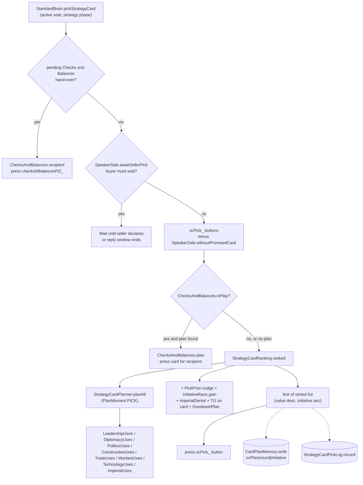
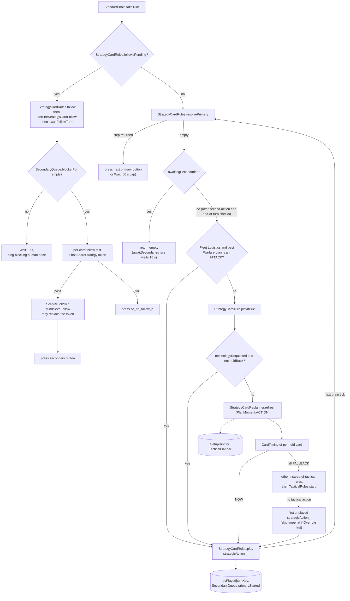

# Strategy cards and technology research

Part of the [AI player architecture docs](/src/main/java/ti4/ai/README.md): a living document kept next to the code (packages: strategy). The code is the source of truth; when you change behavior here, update this file.

## Components and responsibilities

The package holds 66 files (9,399 lines, 8,364 non-blank). Every file is new in this branch: `origin/master` has no `src/main/java/ti4/ai` directory. All values are in trade-good units (TG). The base constants come from outside the package: [ValueScale](/src/main/java/ti4/ai/eval/ValueScale.java) (`TRADE_GOOD` 1.0, `RESOURCE` 0.8, `INFLUENCE` 0.8, `COMMODITY` 0.8) and `ObjectiveValue.VICTORY_POINT_VALUE` 8.0.

The only brain that drives this package is [StandardBrain](/src/main/java/ti4/ai/brain/StandardBrain.java), the single `FactionBrain` implementation. It runs for every AI seat, not only for Nekro. Its rule list calls the package at these points, in this order:

- `StrategyCardRules::exhaustAiDevelopmentForResearch` and `StrategyCardRules::exhaustProphetsTearsForResearch`, early in the list.
- `StrategyCardRules::chooseTechnology`, `::gainTokens`, `::placeStructure`, `::readyPlanets`, `::buildWithWarfare` and `::buildWithConstruction`. These are the follow-up steps.
- `SpeakerSale::answer` and `SpeakerSale::declare`.
- `StandardBrain.pickStrategyCard`, for the strategy phase.
- `StandardBrain.takeTurn`, for the action phase. It calls `StrategyCardRules.followsPending`, `resolvePrimary`, `awaitingSecondaries` and `StrategyCardTurn.playIfDue`, and has its own fallback play. Before `playIfDue` it also runs `StandardBrain.warfareBeforeFollowUp`: a seat with Fleet Logistics whose `TacticalPlanner.bestForWarfare` plan is an ATTACK plays its unplayed Thunder's Edge Warfare at once, without asking `CardTiming`.
- `StrategyCardRules::follow`, `StandardBrain.declineStrategyCardFollow`, `StrategyCardRules::awaitSecondaries` and `::awaitFollowTurn`.

Role key: **decides** = returns a choice or button press; **evaluates** = scores options for a decider; **informs** = computes facts; **executes** = presses the buttons of a multi-step engine flow.

---

Both diagrams use the same arrows. Solid arrows are calls or decisions. Dotted arrows are data stored or read.

### StrategyCardRanking (pick ranking)

- **Role:** evaluates and decides. It ranks the offered `scPick_` buttons, and the caller takes the first.
- **Purpose:** to value each strategy card the seat could pick in the strategy phase.
- **Invoked when:** `StandardBrain.pickStrategyCard`, while the seat is active and the phase is `strategy`. That calls `StrategyCardRanking.ranked(game, seat, picks)`, takes `ranked.getFirst()`, writes `CardPlanMemory.write(best.plan())`, records `StrategyCardPickLog.record` and presses the button. Other callers:
  - `CardScoring` uses `StrategyCardRanking.value`.
  - `DatahubRules` (Hacan) uses `baseValue` and `pickPlan`.
  - `SpeakerSale.wantedCard` uses `pickValue`.
  - `ChecksAndBalances` uses `baseValue`.
- **Inputs:** the offered pick buttons (the initiative is parsed from the text after the last `_`), `Game`, `Player`, and `game.getScTradeGoods()`.
- **Outputs:** `List<Pick(button, plan, value, race)>`, sorted by value descending. Ties go to the lower initiative.
- **Algorithm:** `value = plan.value() + PickPrior.nudge(faction, card, round) + GravleashPlan.cardBonus(card) + imperialDenial (Imperial only) + 1.0 × trade goods on the card + InitiativeRace.gain(initiative)`. `plan` comes from `StrategyCardPlanner.planAll(..., PlanMoment.PICK)`.
  - `imperialDenial` takes the later pickers: players after the seat in `PickStrategyCardService.getSCPickOrder` who still have card slots.
    - With the `IMPERIAL_POINTS` experiment on (the default, see `AiExperiments.enabled`), it is the maximum over later pickers of `ImperialDenial.rivalStake`. It applies only when the seat itself gains point tempo from Imperial (`ImperialUses.gainsPointTempo`). Otherwise it is 0.
    - With the experiment off, it is `0.5 × 8 × (1 if the rival has ≥ goal − 2 VP, else 0.5)` for the best later picker holding Mecatol Rex.
  - `imperialScoresNow` (used by `StandardBrain.worthPlayingNow`) is true when the seat holds Mecatol Rex or has any scorable public.
- **Depends on:** `StrategyCardPlanner`, `PickPrior`, `InitiativeRace`, `ImperialUses`, `ImperialDenial`, `GravleashPlan` (`ti4.ai.tactical` or elsewhere), and `PickStrategyCardService` (engine).
- **Effect on the game:** chooses which strategy card the AI presses.
- **Fallbacks:** buttons whose initiative cannot be parsed are dropped. An empty list leads `pickStrategyCard` to look at the next prompt, or to return empty.
- **Limitations:** the pick is greedy. It values one card at a time, does not plan a pair of cards in 3–4 player games, and does not model which cards later pickers will take, except through Imperial denial and the Politics first-pick term.
- **Evidence:** [StrategyCardRankingTest](/src/test/java/ti4/ai/strategy/StrategyCardRankingTest.java) asserts that Imperial is left alone when only one objective is scorable, and taken with two scorable objectives or while the seat holds Mecatol Rex.

#### Diagram: Strategy phase pick

### StrategyCardPlanner, CardPlan, CardUse, PlanMoment

- **Role:** evaluates.
- **Purpose:** to turn a card into a `CardPlan`, a list of `Benefit(CardUse use, double value, String target)`.
- **Invoked when:**
  - `StrategyCardRanking` calls it at `PICK`.
  - `StrategyCardReplanner.refresh` and `StrategyCardTurn.dueNow` call it at `ACTION`.
  - `PlannedPrimaries.productionTarget`, `OverruleChoice.option` and `PoliticsUses.firstPickValue` call it for the other cards.
- **Algorithm:** a switch on `StrategyCard.of(game, initiative)`. Each card has a `*Uses.benefits` method, described below. A non-official card (`OTHER`) gets a flat `OTHER_CARD` of 3.0. Zero-valued benefits are dropped. `CardPlan.value()` is the sum of the benefits, and `CardPlan.main()` is the largest one.
  - Plans are cached per `PlanInputs` instance in `PlanInputs.plans`.
  - `CardPlan.encode`/`decode` serialize the plan as `USE:value:target;…` for AI memory. A malformed string decodes to empty.
- **Limitations:** the benefits of a card are summed even when they compete for the same resource. For example, Diplomacy's ready and expedition terms are de-duplicated by subtracting one from the other, but the other cards do not do this.

### PlanInputs

- **Role:** informs.
- **Purpose:** a snapshot record shared by all card valuations. It holds:
  - the ranked tactical plans (`TacticalPlanner.ranked`) and the systems enemies can reach (`Threats.reachableByEnemies`);
  - reinforcements, calculated as `max(0, commandTokenLimit − Helper.getCCCount)`. `getCCCount` counts the seat's tokens on the board and in its tactic, fleet and strategy pools (plus Twilight's Fall and Keleres monument tokens);
  - a `CustodiansRace.Snapshot`;
  - memo maps for freed-system rankings, card plans and lock exposures (`DefenseOutlook.lockCost`).
- **Algorithm:** a static LRU cache of 32 entries. The key is game name, user id, moment and (when Imperial points are on) the deciding viewer. An entry stays valid while the cached entry refers to the same `Game` instance and `game.getLastModifiedDate()` is unchanged.
  - Re-entry is guarded by a thread-local `COMPUTING` set. A nested request for the same key gets a "planless" snapshot with an empty ranked list.
  - `rankedFreeing` has a second thread-local guard (`RANKING_FREED`), and returns an empty list when nested.
  - `unblockGain(pos)` is `bestScore(rankedFreeing(pos)) − bestScore(ranked)`.
  - `nearWin()` is true when the seat has ≥ goal − 3 VP.
- **Limitations:** a nested valuation sees no tactical plans, so its token and Warfare values fall to their floors.

### Per-card valuation (`*Uses` classes)

Every `*Uses` class is an evaluator called from `StrategyCardPlanner.evaluate`. Constants are in [CardValueScale](/src/main/java/ti4/ai/strategy/CardValueScale.java).

#### LeadershipUses
- `LEADERSHIP_TOKENS` = `TokenValue.carriedTokens(in, 3)`. For each of up to `min(3, reinforcements)` tokens, the token at index `tacticalCC + i` is worth `max(HELD_TOKEN, rankedPlan[index].score × 0.6)`. `HELD_TOKEN` = 3 influence × 0.8 = 2.4.
- `LEADERSHIP_EXPEDITION` = 0.5 × `ExpeditionUnlock.claimingFirst`.
- `LEADERSHIP_ENDURANCE` = `Endurance.leadershipValue(seat, min(3, reinforcements))`.
- `fundsWantedFollows` / `fundedFollowsValue` are used by `CardTiming`. They count the missing tokens: `min(strategyTokensWantedForFollows − (strategicCC − ScarToken.kept), min(3, reinforcements))`. The value is that count × 2.4.

#### DiplomacyUses
- A base-game Diplomacy card (automation id `base2`) returns no benefits.
- `DIPLOMACY_PROTECT`: the lockable tiles are the systems of the seat's own planets, except Mecatol Rex. A threatened tile with `lockExposure ≥ 1.0` gets `0.5 × (sum of owned planet values in the tile) + exposure`, × 1.5 when `nearWin`. The best tile is kept, with its target.
- `DIPLOMACY_READY`:
  - At `ACTION`, it is `DiplomacyUse.best(exhausted planets)`. That is 6.4 (0.8 × 8) if the readying unlocks a score, else `0.5 × use`.
  - At `PICK`, it is `0.5 × min(sum of max(R,I) over the seat's top 2 planets, 6)`, × 1.5 if an unscored spend objective is revealed.
- `DIPLOMACY_EXPEDITION` = `max(0, ExpeditionUnlock gain − ready value)`. At `ACTION` the gain comes from `afterReadying`; at `PICK` it comes from `refundOfFirstClaim`.
- `DIPLOMACY_PEACE_ACCORDS` = 1.0 × `PeaceAccords.bestValue`, when that is > 0.
- `readyingChoice` takes the expedition readying when its gain beats the generic choice's value, else the generic `DiplomacyUse.best`.

#### PoliticsUses
- `POLITICS_SPEAKER`:
  - When the seat is already speaker: −0.5 × 1.5 = −0.75, because the card hands the token away.
  - Otherwise, `holdingValue` plus `speakerRaceValue`. `holdingValue` = 1.5, + 1.5 if the seat "wants Imperial next round", + 0.5 once custodians are scored. The seat wants Imperial next round if it controls Mecatol Rex, or ≥ 2 revealed unscored publics are within one step of their threshold.
  - `speakerRaceValue` = `0.2 × 8 × 0.2^n` when the custodians race is open, the seat lacks the Zero token, and the seat and at least one rival arrive at Mecatol Rex next round. `n` is the number of rivals arriving this round.
- `POLITICS_FIRST_PICK` applies only at `PICK` and when not speaker. With k = the seat's index in the current pick order, it is `best other card value − expectedBestLeft(values, k)`.
  - `expectedBestLeft` assumes the k earlier pickers take cards uniformly at random. It computes the hypergeometric expectation of the best card left: rank `r` survives with probability `∏ P(ranks above taken) × (1 − (k−r)/(n−r))`.
  - [TradeAndPoliticsPickValueTest](/src/test/java/ti4/ai/strategy/TradeAndPoliticsPickValueTest.java) asserts that 1 random pick from {9, 5, 1} leaves 2/3·9 + 1/3·5.
- `POLITICS_ACTION_CARDS` = `DrawnCardValue.of(cards)`, about 1.2 per card, with cards = `clamp(hand limit − hand, 0, 2)`. It adds 6.4 if `SpyNetwork.withinReach(2)`, and is 0 with *Hold No Action Cards* (`dont_fsn` secret).
- `POLITICS_EXPEDITION` = `ExpeditionUnlock.afterDrawing`.
- `POLITICS_AGENDA` = 0.5 once custodians are scored.

#### ConstructionUses
- The structures list comes from `StructurePolicy.primaryFirst`:
  - If the first structure is a dock: `CONSTRUCTION_DOCK` is 4.0 in rounds ≤ 3, else 2.0, with the target planet from `StructurePolicy.planetFor`.
  - If it is a PDS: +1.0 to the PDS benefit.
  - +1.0 if a second PDS is under cap.
  - +1.0 if a seat tile is threatened (home counts as threatened when `DefenseOutlook.homeCost > 0`).
  - `CONSTRUCTION_OBJECTIVE` = 0.8 × 8 × `objectiveScale`, when `nearsStructureObjective` holds.
- The Thunder's Edge card (automation `te4construction`) also builds a production list:
  - It uses `bestProduction` over own docks without enemy ships. In Fog of War it returns nothing.
  - `built` = 0.8 × `ProductionPlanner.plan(...).value`. The move-out bonus is 0.5 × min(built, best plan moving out of that dock).
  - If a tactical build there is possible (a tactic token, and no own command token in the system), the value is `min(built, savedTacticToken) + max(moveOut, max(0, doubleBuild − token))`. Otherwise it is `built + moveOut`.
  - It adds `OPENING_EXPANSION` (from `OpeningOutlook`, `HOME_PRODUCTION`), the first structure, and the objective term when the shortfall is ≤ 1 or the seat is near the perimeter.
  - The list with the larger total wins.

#### TradeUses
- `TRADE_GOODS` = 3 × 1.0.
- `TRADE_COMMODITIES` = missing commodities × 0.8.
- `TRADE_SPEND_OBJECTIVE` = `max(0, pointDelta(holding Trade) − pointDelta(following Trade))` × 6.4.
- `TRADE_WASHES` = 1.0 per other seat without *Masters of Trade* that has a commodity value > 0. It applies only when `AiSettings.isTradingEnabled()`. This is the deal value of the card.
- `TRADE_EXPEDITION` = `ExpeditionUnlock.afterTradeGoods(3)`, unless a spend objective already claims those goods.
- `OPENING_EXPANSION` = `OpeningOutlook.gravityDriveGainFromTrade`. It is the round-1 value of becoming able to pay for a Technology follow (Gravity Drive) with Trade's 3 goods.

#### WarfareUses
- The options are:
  - `WARFARE_DOUBLE_BUILD`: the second home build, `ProductionPlanner.plan(home, −spent).value × 0.8`, halved when fleet room ≤ 0.
  - `WARFARE_BUILD_THEN_MOVE`: on PoK it is `0.5 × min(built, best plan moving out of home)`. On Thunder's Edge it is `0.8 × built × 0.5 + 0.5 × planFromHome`.
  - `WARFARE_FAR_REACH`: systems reachable only with double movement by ships that carry ground forces, valued at 0.5 × the uncontrolled planet value. For Mecatol Rex before custodians, it is the custodians race gain.
  - `WARFARE_UNBLOCK` (only at `ACTION`): the best `unblockGain` over systems holding own tokens.
  - `WARFARE_EXTRA_ACTION` (Thunder's Edge only): `max(1.5, ranked[tacticalCC].score)`, or 1.5 when every plan is already affordable.
  - `OPENING_EXPANSION`: `OpeningOutlook`, `EXTRA_ACTION`.
- Only the best option is kept. PoK also adds `WARFARE_TOKEN` = `TokenValue.tacticTokens(in, 1)`.
- `bestTokenToRemove`: the offered position with the largest `unblockGain`. Ties go to the home system, otherwise to the first offered.

#### TechnologyUses
- Nekro, or any seat with the `propagation` ability, gets `TECHNOLOGY_PROPAGATION` = `carriedTokens(3)`.
- Other seats get `TECHNOLOGY_RESEARCH`:
  - At `PICK`, it is `ResearchPolicy.bestValueAsTechnologyHolder`.
  - At `ACTION`, it is `ResearchPolicy.value(bestResearchable)`.
  - It is × 1.5 when a second research for 6 resources passes `worthPayingForResearch(6, 4.0)`.

#### ImperialUses and ImperialDenial
- `IMPERIAL_MECATOL`:
  - Holding Mecatol Rex: 8, or 6 while it is threatened.
  - Not holding it: 4 when the seat takes it this round, either through a ranked EXPAND/ATTACK plan that targets Mecatol Rex or by affording the custodians in reach.
- `IMPERIAL_SCORE`:
  - Without points awareness: 8 × `ObjectiveOdds.extraScoreWithImperial`.
  - With `IMPERIAL_POINTS` on: `worth = max(mecatol + 8 × odds.extraPoints, ScoringStakes.scoreValue(points), 30 × odds.winSwing)`.
  - The whole worth goes to the Mecatol benefit when Mecatol Rex is held and threatened, or when the Mecatol value is > 0 and Imperial scores no extra public (`ObjectiveOdds.imperialScoresAnExtraPublic`). Otherwise it is split as `worth − mecatol` and `mecatol`.
- `IMPERIAL_SECRET` applies only without Mecatol Rex and when `SecretDraws.worthDrawing`. It is `SecretDrawValue`, capped at the 1.0 strategy token a follow would cost. The cap does not apply when the seat has no strategy token, or is the last to pick in round ≥ 2.
- `ImperialDenial.rivalStake`:
  - 30 if the rival wins before anyone can stop it (secured Mecatol Rex plus its best scorable public reaches the goal).
  - Otherwise `max(0.5 × 8 × (mecatol + extraPoints) × distance, 0.5 × 30 × winSwing)`, where distance is 1 within 2 VP of the goal, else 0.5.
- **Evidence:** [ImperialPointsTest](/src/test/java/ti4/ai/strategy/ImperialPointsTest.java) exists. Only its test names were reviewed.

### PickPrior

- **Role:** evaluates (an additive nudge).
- **Algorithm:** a per-faction table of pick counts per card for rounds 1–6. The tables cover Hacan, Xxcha, Sardakk, Letnev and Sol. Every other faction uses the table named `NEKRO_PICKS_BY_ROUND`. Rounds are clamped to 1..6.
  - `share` = count / sum over cards for that round.
  - `nudge` = `1.0 × clamp(8 × share − 1, −1, 1)`. An even share (1/8) gives 0, and the maximum magnitude is 1 TG.
- **Evidence:** [PickPriorTest](/src/test/java/ti4/ai/strategy/PickPriorTest.java) asserts values such as Imperial in round 1 ≈ −0.95 and Warfare in round 1 ≈ 0.96 for the Nekro table, the clamping, and the per-faction tables.
- **Limitations:** the counts are static data. Where they came from is not stated in code.

### InitiativeRace

- **Role:** evaluates.
- **Algorithm:** non-zero only when all of these hold:
  - the custodians race is open;
  - the seat lacks the Zero token and is still picking;
  - its projected arrival at Mecatol Rex is this round.

  `actingAt` = `min(lowest held card, initiative)`. The gain is `raceValueActingAt(actingAt) − raceValueActingAt(latest open initiative)`, floored at 0. Every card gets this term, so lower initiatives win the race tiebreak.

### StrategyCardReplanner and CardPlanMemory

- **Role:** informs. It also writes hints for the tactical planner.
- **Invoked when:** `StrategyCardTurn.playIfDue`, on each action-phase turn tick.
- **Algorithm:**
  - It re-plans every held, unplayed card at `ACTION`. If the main use changed from the stored plan, it records `scPlanWas|round|initiative`. It then stores the new plan (`scPlan|round|initiative`).
  - It writes `SetupHint`s:
    - Warfare whose main use is double build (both versions) or build-then-move (PoK), while home holds no own token: a `PRODUCE` hint at home with value 0.5 × main.
    - A Gravity Drive hold: when home holds no token, the seat has a strategy token, `OpeningNeeds.wantsTechnologySoon`, and some other plan ≥ `TacticalPlanner.MIN_SCORE` (1.0) exists: `PRODUCE` and `DEFEND` hints at home with value −gain. This discourages activating home before Gravity Drive.
  - `CardPlanMemory.write` is also called by `StandardBrain` at the pick and by `DatahubRules`.

### CardTiming and StrategyCardTurn (when to play a held card)

- **Role:** decides between `NOW` and `FALLBACK`.
- **Invoked when:** `StandardBrain.takeTurn` → `StrategyCardTurn.playIfDue`. That is after the tactical-in-progress, follows-pending, primary-resolution, second-action, end-of-turn and several faction "instead of tactical action" checks (Transit Diodes, Darktalon Treilla, the Fleet Logistics Warfare attack, Sling Relay, relic actions, Convoys), and before the action-card, technology and hero "instead of tactical action" rules and `TacticalRules.start`. `StrategyCardTurn.dueNow` is also used by `StandardBrain.worthPlayingNow`, for second strategic actions and for Master Plan.
- **Algorithm (`StrategyCardTurn.playIfDue`):**
  1. It acts only in the `action` phase.
  2. If memory holds `technologyRequested|round` (another seat paid for an early Technology through the trade package's `TechnologyRequest`) and no hold is active, it plays Technology now.
  3. Otherwise it refreshes the plans and plays the first card, in initiative order, whose timing is `NOW`. Technology is forced to `FALLBACK` while `TechnologyTiming.heldBack` is true.
- **Algorithm (`CardTiming.of`), checked in order:**
  1. Construction with an opening-expansion benefit, when the home fleet should move out first (`!OpeningOutlook.producesBeforeMoving`, tactic tokens > 0, a plan moving out of home): `FALLBACK`.
  2. An opening-expansion benefit > 0, or Technology when Gravity Drive is the best research and has an opening gain: `NOW`.
  3. A Peace Accords benefit ≥ max(2.0, best tactical score): `NOW`.
  4. Leadership when it funds wanted follows and `plan.value + funded × 2.4 ≥` the best takeable tactical score (0 with no tactic tokens): `NOW`.
  5. Warfare: on PoK, `NOW` when the best unblock gain is ≥ 2.0. On Thunder's Edge:
     - no `bestForWarfare` plan: `FALLBACK`;
     - no tactic tokens, or round 1: `NOW`;
     - a reactivation: `NOW` if its score is ≥ 2.0;
     - score < 1.0: `FALLBACK`;
     - the main use is double build or build-then-move while home is unlocked: `FALLBACK`;
     - otherwise `NOW`.
  6. Imperial with points awareness and `winsAtOnce`: `NOW`.
  7. Imperial while `OverruleChoice.overrulesOwnImperialFirst`: `FALLBACK`.
  8. By main use:
     - Leadership tokens or Propagation: `NOW` when the seat has 0 tactic tokens and a ranked plan exists.
     - `DIPLOMACY_PROTECT`: `NOW` when the target is threatened and the plan value is ≥ the best takeable move elsewhere.
     - `DIPLOMACY_READY`: `NOW` when the value is ≥ 1.5, it does not ready before spending (a revealed spend objective with spending still ahead and no protect), and the value is ≥ the best takeable move.
     - `CONSTRUCTION_PRODUCE`: `NOW` when the value is ≥ the best score.
     - `TECHNOLOGY_RESEARCH`: `TechnologyTiming.playsNow`.
     - `CONSTRUCTION_PDS`: `NOW` with a threatened target in round ≥ 2.
     - `CONSTRUCTION_DOCK`: `NOW` in round ≤ 3.
     - `IMPERIAL_MECATOL`: `NOW` when Mecatol Rex is held and threatened.
     - `IMPERIAL_SCORE`: `NOW` with ≥ 2 scorable publics, unless the best tactical plan takes Mecatol Rex first and scoring does not win.
     - A plan with no benefits at all: `FALLBACK`.
     - Otherwise `NOW` also when any expedition benefit in the plan (Trade, Politics or Diplomacy), main or not, is ≥ 0.5 (`claimsExpedition`). This check is never reached for Warfare or for Imperial yielding to Overrule.
     - Every other main use is `FALLBACK`. That covers Politics speaker or cards, all Trade uses except expedition, the Imperial secret, the Construction objective and Leadership expedition or endurance.
- **Fallback path:** `StandardBrain.takeTurn` plays any unplayed held card (except Imperial yielding to Overrule) only after `TacticalRules.start` returns nothing. It picks the first matching `strategicAction_` button in prompt order.
- **Evidence:**
  - [LeadershipTimingTest](/src/test/java/ti4/ai/strategy/LeadershipTimingTest.java) asserts that Leadership becomes due when the wanted follows outnumber the strategy tokens, and not due with enough tokens.
  - [TechnologyTimingTest](/src/test/java/ti4/ai/strategy/TechnologyTimingTest.java) asserts that Technology is played once no planet is left, held while one is, played early to deny a rival who cannot follow yet, and held for a payer.

### TechnologyTiming

- **Role:** evaluates and informs. It is also used by trade deals.
- **Algorithm:**
  - `earlyPlayCost` = 0.2 × the best EXPAND plan score.
  - `denialGain` = `0.5 × Σ followSurplus(deniable opponents) / #opponents`.
    - `followSurplus` = `max(0, TECH_TEMPO × researchValue − 4 − 1)`.
    - An opponent is deniable when it cannot follow now (no strategy token, or cannot afford 4 resources after its reserve), could follow later (it has a token or an unplayed Leadership, and can afford `4 − expectedIncome`), and wants to research.
  - `playsNow` (rounds ≤ 2 only) holds when there is no delay cost or the denial exceeds it.
  - `holdCost` is +∞ with no tactic tokens or a Gravity Drive opening. Otherwise it is `max(0.5, denial − delay)` if the seat would play early, else 0, plus 0.5 when the payer is waiting on a trade wash.
  - `holdPayment` is 1, or 2 when waiting on a wash.
  - `heldBack` reads `technologyHeld|round = faction|turnCount`. It ends when the payer passes, can follow now, two seats have passed, the payer's next turn is over, or the holder itself now plays Technology for a Gravity Drive opening. It holds past the payer's next turn while the payer still waits on a wash.
- **Callers outside:** [TechnologyRequest](/src/main/java/ti4/ai/trade/TechnologyRequest.java) uses `deniable`, `earlyCost`, `holdCost`, `holdPayment`, `grantHold`, `followsNow`, `followsLaterAfterPaying` and `followSurplus`. This is deal logic: seats pay trade goods to have Technology held, or played early.

### StrategyCardRules (primary and secondary execution)

- **Role:** executes, with deciding sub-steps.
- **Purpose:** to drive each card's primary and follow through engine buttons, and to remember multi-step requests in `AiMemory`.
- **Invoked when:**
  - `StrategyCardRules.play` is called from `StandardBrain`, `ActionCardResponses` and `SabotageRules`. It records `scPlayed|turnKey`, marks the primary open in `SecondaryQueue` and, for Trade, calls `TradeCardRules.recordPlay`.
  - `beginOverruledPrimary` is called from `OverruleCard` and `MathisMathinusRules`.
  - `resolvePrimary` is called from `StandardBrain.takeTurn` and dispatches per card.
- **Shared mechanics:**
  - A pending step is a payment (`PaymentRules.pendingSince`) or a research, structure, readying or token-gain request. A pending step makes the primary wait up to 60 s (`PRIMARY_WAIT_MILLIS`), after which `giveUpPendingSteps` forgets them.
  - Requests are stored as `prefix + round = since|value` and expire after 15 min.
  - Follow-ups search hidden prompts created since `request − 5 s`, allowing for clock skew.
- **Primaries:**
  - **Imperial:** scores the best scorable public with `ObjectivePolicy.bestScorablePublic`, opening `scoreAnObjective` first if needed. Then it presses `score_imperial` if it controls Mecatol Rex, else `sc_draw_so` if `soScored < maxSO`.
  - **Technology:** the first research is free (`acquireATechWithSC_first`). The second costs 6 and is taken only if `worthPayingForResearch(6, 4.0)`. A seat with Propagation instead gains `min(3, reinforcements)` tokens (`nekroFollowTech`).
  - **Leadership:** free tokens = `min(3, reinforcements)`. The purchase is `TokenPurchase.best(reinforcements − free)`. It presses `leadershipGenerateCCButtons` and expects the influence payment.
  - **Politics:**
    1. The speaker step. It tries `SpeakerSale.sell` first. Otherwise it presses the seat's own `sc_3_assign_speaker_to_<faction>` if offered. If its own button is not offered and `SPEAKER_SALE` is on without full priority-track mode, it names a speaker by pick position (`SpeakerSale.speakerByPickPosition`). Otherwise it names the lowest-VP seat. With no speaker prompt this turn the step is not marked done, so the agenda peek (step 3) never runs.
    2. It draws with `sc_ac_draw`.
    3. Once custodians are scored (and not in Twilight's Fall mode), it peeks at agendas with `PlannedPrimaries.peekAgendas`.
  - **Construction:** `PlannedPrimaries.produceWithConstruction` comes first (Thunder's Edge only). While that production is open (stored less than 60 s ago and its "done producing" button not yet pressed), the primary returns `Wait`. Then two structure steps: `StructurePolicy.primaryFirst`, then the second structure. The second is `StructurePolicy.pds` on PoK, and `bestSecondary` or a PDS on Thunder's Edge.
  - **Diplomacy:** `PlannedPrimaries.lockWithDiplomacy` (PoK card only). Then `diploRefresh2` with the readying plan from `DiplomacyUses.readyingChoice`. It skips the press when nothing is exhausted and Peace Accords offers no claim.
  - **Warfare:**
    - PoK: presses `primaryOfWarfare`, then takes back the token chosen by `WarfareUses.bestTokenToRemove` (through `PlannedPrimaries.tokenToRemove`). The engine only moves that token to reinforcements and posts a "Redistribute & Gain Command Tokens" button (`redistributeCCButtons_deleteThisMessage`); the AI presses it and `WarfareTokens.gainAndRebalance` gains the token (LRR 99.1) into `CommandTokenPolicy.poolToGrow`, moves any mid-round surplus, presses Done and marks Warfare finished.
    - Thunder's Edge: `PlannedPrimaries.warfareTarget`. With no target it announces `WarfareIdle` and finishes. Otherwise it presses `primaryOfTeWarfare`, runs `WarfareTokens.rebalance`, presses `beginTacticalTeWarfare` and hands the action to `TacticalRules`.
  - **Trade:** the engine resolves the primary itself when the card is played (`PlayStrategyCardService` calls `TradeStrategyCardService.doPrimary` for the `pok5trade` automation), so the AI only announces, once. With trading enabled, `TradeCardRules.announce` sends the X−k terms (deal logic in `ti4.ai.trade`). Otherwise it announces free follows.
- **Follows (`follow`):**
  - Candidates are played cards that the seat does not hold and has not followed, or whose Scepter or Mindsieve follow is pending, and that have no `SecondaryQueue` blocker.
  - They are sorted by `followRank`: Imperial, Technology, Diplomacy, Warfare, Construction, Politics, Trade. When `chasesSpyNetwork` applies (no `dont_fsn`, and *Form a Spy Network* is within reach with 2 cards), the order is Imperial, Politics, Technology, Diplomacy, Warfare, Construction, Trade.
  - `ScepterFollow.exhaustFirst` can replace a strategy token with Acquiescence or the Scepter of Emelpar. `MindsieveFollow.giveNoteFirst` (`ti4.ai.naalu`) can replace it with a promissory note.
  - `busyPaying` (a payment, token gain or research request in the last 90 s) postpones the Technology, Diplomacy, Warfare and Leadership follows.
  - Per card:
    - **Imperial:** `sc_draw_so` if there is a spare token and `SecretDraws.worthDrawing`.
    - **Technology:** `acquireATechWithSC_first` if there is a spare token and `worthPayingForResearch(4, 3.0)`. The worth is reduced to 3.0 × 0.6 = 1.8 when idle trade goods cover the cost. A Propagation seat follows only when the gain is ≥ 3 tokens and it can pay 4 resources after its reserve.
    - **Diplomacy:** `diploRefresh2` if there is a spare token, `DiplomacyUse.worthFollowing`, and no open readying request.
    - **Warfare:** `warfareBuild`/`warfareTeBuild` if there is a spare token and `homeBuild` (home worth producing at, and a non-empty `ProductionPlanner` plan).
    - **Construction:** if there is a spare token and `bestSecondary.value − StrategyTokenCost.toSpend ≥ 0.5`, it presses `construction_<unit>`.
    - **Politics:** `sc_ac_draw` per `wantsPoliticsCards`. That never happens with `dont_fsn`, with 0 strategy tokens and no Scepter or Mindsieve cover, or with no hand room.
      - When chasing the spy network, it needs strategic + tactic − 1 ≥ the reserve's tokens.
      - When `SpyNetwork.needsCards`, it needs room ≥ 2 and a spare token.
      - Otherwise it needs room ≥ 2, a spare token and `strategicCC − tokens wanted by other cards (+ scar) ≥ 1`.
    - **Trade:** with trading off, it follows only for free (an AI holder, or Masters of Trade) and when commodities are below max. With trading on, it follows `TradeCardRules.followChoice` FREE/TOKEN/DECLINE.
    - **Leadership:** `TokenPurchase.best(reinforcements)` must buy ≥ 1 token.
- **`hasSpareStrategyToken`:**
  - `saved` = other seats' cards that are better ranked, not yet played (or played while the seat still waits), and wanted by the seat.
  - It requires `strategicCC − saved − scar ≥ 1` and `strategicCC + tacticalCC − 1 − saved − scar ≥ ScoringReserve.tokens`.
  - With Scepter or Mindsieve cover, the "− 1" is dropped and the first test is ≥ 0.
- **Follow-up steps (rules in `StandardBrain`):**
  - `chooseTechnology`: reads the `getTech_<alias>` buttons and picks `ResearchPolicy.best`.
    - It applies `PrerequisiteSkips` (it may arm AI Development or Prophet's Tears, or expect Brother Omar).
    - It plans the payment after the reserve, falling back to any payment.
    - With no `getTech_` buttons it presses the `getAllTechOfType_` button of the best tech's first type, or the first offered.
  - `placeStructure`: `StructurePolicy.planetFor` over the `place_<unit>_<planet>` buttons.
  - `readyPlanets`: readies the planned planets in order, re-plans with `DiplomacyUse.best` if the plan is lost, and presses `deleteButtons_diplomacy` when done.
  - `gainTokens`: presses `CommandTokenPolicy.poolToGrow` until `netGainSoFar ≥ free + (paid ? purchased : 0)`, then "Done Gaining". While a payment for purchased tokens is still pending it does nothing except press an unpressed `nekroTechExhaust` button (the Propagation payment) if one is offered; for Leadership it simply waits for `PaymentRules` to pay.
  - `buildWithWarfare` / `buildWithConstruction`: `TacticalRules.payForUnits` / `placeUnits` with the stored `BuildPlan`.
- **Strategize hooks:** `secondaryValue`, `startSecondary` and `startLeadershipSecondary` are used by [StrategizeCard](/src/main/java/ti4/ai/actioncards/StrategizeCard.java).
  - Values: Imperial = `SecretDrawValue`; Diplomacy = readying (6.4 or 0.5 × use) + Peace Accords; Construction = `bestSecondary.value`; Warfare = 0.8 × home build value; Politics = `DrawnCardValue(min(2, room))`; Trade = missing commodities × 0.8. Technology and Leadership have none.
- **Evidence:** [StrategyCardRulesTest](/src/test/java/ti4/ai/strategy/StrategyCardRulesTest.java) (read in part). With nothing worth activating, the Thunder's Edge Warfare primary still presses `primaryOfTeWarfare` when a destroyer can step to an adjacent system. With every ship locked and no money, it announces `WarfareIdle` with both reasons and then returns empty.

#### Diagram: Action phase: play, primary, follows

### SecondaryQueue

- **Role:** informs and gates the follow order.
- **Algorithm:** static in-memory maps keyed by game name.
  - The open primary key is `round|primary|initiative`. Open follow keys are `round|follow|initiative|faction`.
  - An entry is stale after 10 min.
  - `blockerFor(seat, card)` returns "the primary ability" while the primary is open. Otherwise it returns the first player before the seat in `PlayStrategyCardService.getPlayersInFollowOrder(holder)` who has not followed, or whose follow is still open.
  - `unfinished` checks every follower and makes an AI holder wait.
  - `humanToPing` pings the first human blocking the seat, once per card per round, and only when no earlier AI seat stands between them.
  - `awaitSecondaries` and `awaitFollowTurn` return `Wait(now + 10 s)`.
  - `AiGameState` snapshots and restores the open-step map (not the ping set), and `AiLane`/`AiGameState` call `forget`, which clears both.
- **Evidence:** [SecondaryQueueTest](/src/test/java/ti4/ai/strategy/SecondaryQueueTest.java) asserts follow-after-primary, waiting on an earlier non-follower, the first follower never waiting, a single ping, the 10-minute staleness, and the holder waiting until all followed.

### PlannedPrimaries

- **Role:** executes and decides (plan-driven primaries).
- **Algorithm:**
  - `warfareTarget`: takes the remembered plan's main target via `TacticalPlanner.forWarfareTarget`. That target must have a score ≥ 1.0 and be activatable (or hold the seat's token), and is kept unless it is more than `REPLAN_DELTA` (1.0) below `TacticalPlanner.bestForWarfare`.
  - `lockWithDiplomacy`: PoK only. The target is the planned protect target if it is still protectable, else `bestProtection`, else `bestLockTarget` (max lock exposure, then owned planet value). The last case means it locks even with no threat. It presses `diploSystem`, then the `diplo_<planet>_diploP` button in the target tile, waiting up to 60 s.
  - `peekAgendas`: presses `drawAgenda_2`. Then, for each `topAgenda_<id>`, `AgendaPeek.keepOnTop` decides top or bottom. Bottom placements are handled first, and `AgendaKnowledge` is updated.
  - `produceWithConstruction`: Thunder's Edge only, when the plan's main use is `CONSTRUCTION_PRODUCE` or `OPENING_EXPANSION` and the dock can produce. It presses `constructionPrimary_produce`, then `constructionBuild_<dock>`. It stores a `BuildPlan` that includes `OpeningOutlook.overSupplyCarriers`, and skips the first structure step.

### OpeningOutlook (round-1 opening)

- **Role:** evaluates, using a deterministic simulation.
- **Purpose:** to value what Construction (home production), Warfare (an extra action) or Gravity Drive adds to the planets the seat can claim in round 1.
- **Algorithm:**
  - Active only in round 1.
  - Goals come from `RoundGoals.of(seat).goals()` that need transport and whose system has no own token.
  - `Round.play()` simulates up to `tacticalCC` actions (+1 for `EXTRA_ACTION`), using greedy choices:
    1. Each action picks the carrier and goal hop with the highest `goal.value × min(load, planets)/planets`, using `MovementGraph.reach`.
    2. Production (`HOME_PRODUCTION`) happens before action 0 (`PRODUCE_FIRST`) or before action 1 (`MOVE_FIRST`). It buys carriers while goals exceed carriers, fleet room or over-supply allows, budget ≥ carrier cost + 1, and production ≥ 3. The rest of the budget becomes infantry, 2 per resource.
    3. Gravity Drive adds +1 move from action `driveFrom`. That is action 1 by default, or action 0 when the seat holds another unplayed card to stall with.
  - The result is the claimed value + 0.4 × a greedy next-round claim from forward carriers − scrapped-ship losses.
  - `gain` = boosted − base, floored at 0.
  - `holdsCarriersForHomeBuild` compares produce-first with one fewer action against move-first, with a 0.5 margin.
- **Evidence:** [OpeningOutlookTest](/src/test/java/ti4/ai/strategy/OpeningOutlookTest.java) asserts these cases:
  - Construction gains when the seat is short of carriers and infantry, and nothing when the units are already there.
  - Warfare reaches past the only system in reach, and Gravity Drive reaches a second system.
  - The outlook counts only in round 1.
  - Move-first is chosen with two systems in reach, and produce-first with one.
  - It over-supplies a carrier, and never without a cheaper ship.
  - The carriers are held for the Warfare build only with one system in reach.
- **Limitations:** it models only ground-force transport to round goals. It ignores combat, enemy movement and command-token placement beyond the action count.

### OpeningHold and OpeningNeeds

- **Role:** informs (opening constraints read by the tactical, production and trade packages).
- `OpeningHold.awaitsWarfareBuild` (round 1, first turn) is true when:
  - the seat has a strategy token and does not hold Warfare;
  - a rival's Thunder's Edge Warfare is still to be followed;
  - the seat has a spare token and wants to follow;
  - and `holdsCarriersForHomeBuild` holds.
- `OpeningHold.awaitsGravityDrive` (round 1) is true when the seat lacks Gravity Drive, home is unlocked and `wantsTechnologySoon` holds.
- `gravityDriveReserve` (only while `awaitsGravityDrive`) keeps `max(0, 4 − t)` resources, where t is the trade goods it expects to raise (washes, its own Trade, a rival's Trade) beyond those the scoring reserve already counts.
- `OpeningNeeds.wantsTechnologySoon` is true when the seat has a strategy token, another seat holds unplayed Technology, and Gravity Drive is the best research with an opening gain. The other helpers feed `TechnologyRequest`.

### ResearchPolicy (technology valuation)

- **Role:** evaluates and decides (`best`).
- **Invoked when:** `StrategyCardRules.chooseTechnology` and the follow tests. Many callers outside the package also use it: action cards, agendas, explore, Norr Supremacy, Winnu starting technology and Latvinia.
- **Algorithm:**
  - `best(candidates)` maximizes `researchValue + ResearchPlan.bonuses`. On a tie, the alphabetically last alias wins (`thenComparing(naturalOrder())` inside `max`).
  - `researchValue` = `value − PrerequisiteSkips.valueLost + ResearchPrior.nudge`.
  - `value` is the sum of:
    - `baseValue × statusPhaseShare`, where `hm`/`nm` are scaled by `min(1, roundsLeft/5)`;
    - `OBJECTIVE_WEIGHT` (8 × 4 / 6 ≈ 5.33) × `objectiveGain`;
    - `steppingStone` (0.3 × the best base value of a tech that this one makes exactly researchable);
    - `custodiansRaceValue` (Gravity Drive: 0.5 × race gain);
    - `openingReachValue` (Gravity Drive: `OpeningOutlook`);
    - `fractureMarchValue` (Carrier II: 1.5 × route share, with ≥ 3 rounds left and a fracture dock);
    - `frontierTapValue` (Dark Energy Tap);
    - `groundSecretValue` (Transit Diodes or Carrier II for *Mechanize the Military* / *Occupy the Fringe*: 0.4 × speed-up × `scoreValue(1)`);
    - `barrageSecretValue` (Destroyer II with *Fight with Precision*: 0.3 × `scoreValue(1)`);
    - `Endurance.researchValue` and `GravleashPlan.driveBonus`.
  - Base values are hand-set tables. `GENERIC_VALUE` covers 34 aliases: `hm` 5.5, `gd` 5.0, `cv2` 4.5, … `dxa` 0.5, with a default of 1.5. `FACTION_VALUE` covers 56 faction techs: `ac2` 4.5, `nes` 4.0, …, with a default of 2.0.
  - `objectiveGain` only models a few objectives: *Adapt New Strategies* and *Master the Laws of Physics* (through `TechPath.gain`), *Produce en Masse*, *Develop*/*Revolutionize* and *Diversify*/*Master the Science*. A completing tech counts the full points. Partial progress counts `points × 0.4 × after/threshold`, only if the remaining techs fit in `researchesLeft − 1`, where `researchesLeft` = `max(1, floor(roundsLeft × 1.5))`.
  - Thresholds: `WORTH_PAYING_FOR` 4.0, `WORTH_FOLLOWING_FOR` 3.0, `IDLE_WORTH_SHARE` 0.6. `TECH_TEMPO` = (0.8 × 4 + 1.0)/3 = 1.4 TG per research-value point.
- **Evidence:** [ResearchPolicyTest](/src/test/java/ti4/ai/strategy/ResearchPolicyTest.java) exists. Only its test names were reviewed.

### ResearchPlan, TechPath, TechRoutes, TechColours

- **Role:** informs and evaluates. It supplies the bonus used by `ResearchPolicy.best`.
- **ResearchPlan.of:**
  - It is cached in a Caffeine cache (2,000 entries, 1 h idle). The key is `identityHashCode(game)`, the game name, the faction, and a signature of round, researches left, research ability, techs, purged techs, secrets, publics (marked when scored), specialty planets, scar purchase and synergies.
  - `build`:
    - Every routed objective in play gets a `TechPath.route`. Its status is `READY`, `SCAR_PURCHASE`, `FEASIBLE` (researches ≤ left, where left = `max(1, floor(roundsLeft × 1.0))`), `TOO_LONG` or `UNREACHABLE`. A feasible route becomes a valued candidate worth points × 5.33.
    - An Antimass Deflectors candidate (3.0) is added when an asteroid field makes Mecatol Rex, an ingress or slice planets reachable sooner within range 4 (`ReachLever`).
    - "Reach" candidates come from Gravity Drive (custodians race, opening), Carrier II (fracture march, ground secret), Transit Diodes (ground secret) and Destroyer II (barrage secret). Their value orders the sequence, but they are marked unvalued, so they earn no bonus.
    - `sequence` sorts the candidates by value/researches, then by reason, and collects the route techs up to `min(left, 4)` steps.
  - `bonuses` gives the first valued step among the candidates 1.0 and later valued steps 0.5.
- **TechRoutes.route** handles *Adapt New Strategies* (faction techs), unit-upgrade objectives, *Master the Laws of Physics* and colour pairs.
  - It uses a bounded exhaustive enumeration (`search`) over orderings or combinations of the candidate techs. It picks the fewest researches, with ties broken by the higher score (`baseValue + ResearchPrior`).
  - Prerequisites are filled greedily (`filler`: smallest remaining gap, then score) up to depth 4, with at most 12 fills.
  - With *Adapt New Strategies* and an Entropic Scar purchase available, the last tech may be marked as supplied by the scar.
- **TechColours** maps requirement letters B/G/R/Y to colours. It supports breakthrough synergy pools (≥ 2 colours act as one pool) and the Laws of Physics progress.
- **Evidence:** [ResearchPlanTest](/src/test/java/ti4/ai/strategy/ResearchPlanTest.java) exists. Only its test names were reviewed.

### ResearchPrior

- **Role:** evaluates (a nudge).
- **Algorithm:** for Sol, Hacan, Xxcha, Sardakk and Letnev, `clamp(2 × (count/games − 0.25), −1, 1)`, using static per-tech research counts. Every other faction, Nekro included, gets 0.

### PrerequisiteSkips, CopiedTechPolicy, TechnologyFollowReserve, ReadyingValue, ScarToken, MassProduction, ReachLever

- `PrerequisiteSkips.of` decides which readied specialty planets to exhaust for missing prerequisites. It takes the cheapest by `max(R,I)`.
  - Psychoarchaeology means no planets.
  - With Brother Omar, an infantry is returned instead.
  - With AI Development Algorithm (unit upgrades only), it replaces the dearest planet when that planet costs more than the AIDA discount, or covers a shortfall.
  - With Prophet's Tears ready, it drops the dearest planet.
  - `valueLost` = 0.56 × the resources/influence lost, plus the infantry value.
- `CopiedTechPolicy` values copied techs (Nekro, Galactic Threat). It caps copied faction techs at 2 (the Valefar Assimilators).
- `TechnologyFollowReserve` reserves 4 resources in the action phase when a rival holds unplayed Technology, the seat has a strategy token and wants to follow, and is not awaiting Gravity Drive.
- `ReadyingValue` values readying single planets for other packages (Xxcha agent, Bio-Stims, exploration). It adds a tech-skip value: `TECH_TEMPO × (best tech unlocked by the planet's specialty − skip cost − current best)`, counted only when a Technology play or follow is still coming.
- `ScarToken.kept` is 1 when the seat holds *Adapt New Strategies*, still needs faction techs, and has ships in or adjacent to an Entropic Scar. That token is withheld from every spare-token test.
- `MassProduction` counts the docks needed to reach production 8 in one system for *Produce en Masse*.

### StructurePolicy and PdsSites (structures)

- **Role:** decides (unit and planet) and evaluates (`bestSecondary`).
- **Algorithm:**
  - `next` chooses a space dock when the seat is under the dock cap and either `MassProduction.drives` (1–2 docks needed) or a dock site exists. With *Fuel the War Machine*, any owned planet counts as a site. Otherwise it chooses a PDS when under the PDS cap.
  - `primaryFirst` chooses a PDS when the seat builds toward *Establish a Perimeter* (and no dock objective is closer) and either the perimeter is ≤ 2 short or the round is > 3. Otherwise it uses `next`.
  - Dock sites: a forward planet with ≥ 2 resources, its own ingress while Styx is open, or `SeatStrike.wantsDockOn`. A second home planet counts when the seat holds ≥ 2 planets there and either mass production drives or home production is the limit.
  - Dock planet order (`USUAL_DOCK`, compared field by field):
    1. site;
    2. fresh outside home (when *Infrastructure* or *Protect the Border* is short);
    3. preference: +1 for ≥ 3 resources, +1 for Styx or in-slice, +2 for its own ingress, +2 for a seat-strike dock, +2 for a mech-spreading site under *Mechanize the Military*;
    4. resources;
    5. outside home;
    6. system resources;
    7. influence.

    With mass production, `canHost` and the production value come first.
  - PDS order (`PdsSites.BEST`, compared field by field):
    1. fresh outside home (when spreading);
    2. defends a threatened home;
    3. outside home;
    4. no own structures;
    5. frontier (lane, border, foreign, other home or Mecatol zone, enemy ships or planets adjacent, or covering a forward dock);
    6. no PDS in the system;
    7. R + I.

    Illegal sites are those with 2 PDS, space stations, demilitarized planets, or enemy forces without own ground forces.
  - Docks are never chosen by `bestSecondary` or `cheapDockWorthFollowing` for a seat with the Saar floating factory (`saar_spacedock`, `saar_spacedock2`), or at the dock cap.
  - `bestSecondary` takes the larger of two placements:
    - a dock (when not building the perimeter): `base/(1 + extra docks)`, where base is 4 in rounds ≤ 3, else 2, counted only if the planet is a site, plus the objective gain;
    - a PDS: 1 + 1 if threatened + 0.2 if frontier + the objective gain.

    The objective gain is `closeness × 0.8 × 8`, with closeness = 1 when ≤ 2 short, 2/missing when 3 short, else 0.
  - Structure objectives: `build_defenses`, `infrastructure`, `massive_cities`, `protect_border`, `eap`, `fwm`.
- **Evidence:** [StructurePolicyTest](/src/test/java/ti4/ai/strategy/StructurePolicyTest.java) exists. Only its test names were reviewed.
- **Limitations:** it has a TODO: "could use ti4.ai.eval.Territory instead of its own slice search". `inSlice` is a breadth-first search to depth 6 that treats a tile as in the slice when it is adjacent to home or on a shortest home-to-Mecatol path.

### DiplomacyUse (readying choice)

- **Role:** evaluates and decides.
- **Algorithm:**
  - Candidates are the top 8 exhausted planets by `max(R,I)`. It enumerates all pairs, or singles.
  - It ranks them by `unlocksScore` (`SpendUnlock.unlocks`), then by `use`, then by the total R + I.
  - `use` is the best split into resources and influence (both, with pooling) of spending the seat would really do this round:
    - production at activatable docks (with a tactic token);
    - research (a Technology follow it keeps a token for, at 4, or its own second tech at 6, only if it cannot already afford it and wants to);
    - Leadership tokens bought (3 influence each, beyond what it can already buy);
    - the custodians (6 influence), when within reach and not affordable now.
  - `worthFollowing` holds when `unlocksScore` is true or use is ≥ 3, or Peace Accords value is > 1.0. It is cached by the game's last-modified date.
  - `spendingAhead` (used for the Diplomacy timing, and by `SpendHorizon` and the Xxekir Grom rules through `SpendOutlook`) is true when the seat has funds beyond its reserve and either a tactical spend, research ahead, or Leadership tokens to buy.

### TokenPurchase, TokenValue, TokenPlan, CommandTokenValue, StrategyTokenCost, LeadershipStall

- **TokenPurchase.best:**
  - It tries the most tokens first, from `min(3, or 4 when holding a playable Strategize with no strategy token, reinforcements)` down to 1.
  - The payment is 3 influence per token, from influence-leaning planets (influence ≥ resources when pooling is separate) and trade goods.
  - After paying, the wallet must still cover what it keeps: the scoring reserve, the custodians reserve, and the first it can afford of {build + research, build, research}. "Build" is the largest `ProductionPlanner` plan cost at any of its docks without its token; "research" is the 6-resource second technology (when it holds unplayed Technology worth ≥ 4.0) plus `TechnologyFollowReserve`. If the seat holds unplayed Diplomacy, up to `2 − already exhausted planets` of the spent planets (dearest by R + I) count as readied again. The wallet must also cover the custodians claim now.
  - If an expedition plan exists, the purchase that keeps the expedition's payment is preferred when `tokens given up × 2.4 < expedition worth`.
  - `influenceToKeep` and `custodiansToKeep` are used by `IdleTradeGoods` and `ProductionPlanner`.
- **TokenValue:** `tacticTokens` uses a 1.5 floor and `carriedTokens` a 2.4 floor. The per-token value is `max(floor, rankedPlan[tacticalCC + i].score × 0.6)`. `lockedOut` is the drop in the value of the next `max(1, tacticalCC)` distinct-target actions when a position becomes unavailable. `CommandTokenValue.lockLoss` exposes it for retreat rules.
- **TokenPlan.of** (only used by `CommandTokenPolicy.priorities` in the action phase):
  - strategy = the other seats' cards (initiative > 0) the seat has not followed and wants to follow, + 1 if a Strategize secondary is worth a token;
  - tactic = distinct targets among the top ranked tactical plans (at most 4) + the scoring reserve's tokens.
- **Status-phase allocation is not in this package.** [CommandTokenPolicy](/src/main/java/ti4/ai/nekro/CommandTokenPolicy.java) holds a status-phase priority list. It reads `TechPath` and `ActionCardRules` for the strategy target: 2, +1 on an *Adapt New Strategies* route, +1 when Strategize is held.
- **StrategyTokenCost.toSpend:** 1.0 × 0.75 with ≥ 3 strategy tokens, 1.0 with 2, 1.5 with ≤ 1. It is empty when no token can be spared after the reserve and the scar. `UNSPARED` = 2.0 (used by `ti4.ai.naalu`).
- **Evidence:** [StrategyTokenCostTest](/src/test/java/ti4/ai/strategy/StrategyTokenCostTest.java) asserts 1.5/1.0/0.75/0.75 for 1/2/3/5 tokens, and empty with no tokens.
- **LeadershipStall.value:** when the seat has no tactic tokens and a rival's Leadership is still to come, it is the planned-action value of the tokens it could buy. Strategize uses it through `CardFacade`.

### SpeakerSale, SpeakerPromise, SpeakerSaleButtons (deal logic)

- **Role:** decides and executes. This is trade/deal logic that lives in the strategy package.
- **Purpose:** while resolving Politics, an AI may sell the speaker token to its right neighbour for trade goods. The buyer gets the token and picks first next round, but must leave the seller one card that the seller names.
- **Gating:** the `SPEAKER_SALE` experiment (on by default), and no priority-track mode (`game.hasAnyPriorityTrackMode()`).
- **Algorithm:**
  - `offerFor`:
    - The buyer is `rightNeighbour`, the last seat in speaker order from the seller. It must not be a scoring contender (`ScoringStakes.contender`).
    - `buyerGain` = `(buyer's position after the fallback speaker − 1) × pickPositionValue + max(0, buyer's speaker value − 1.5)`. `pickPositionValue` = 1.5 / ((seats − 1)/2).
    - The price is 2, or `floor(gain)` when the buyer leads late in the game. A late leader is refused at a price ≤ 2. The buyer must have TG ≥ price and gain ≥ price.
    - A seller that is not speaker also requires `price > agenda perks` (0.5 after custodians, 0 before, so before the custodians any price passes this test).
  - `offer` posts only when the buyer has a speaker button in the prompt and `TradeRules.canTransact(seller, buyer)` holds.
  - The offer is posted with `speakerBuy_`/`speakerNo_` buttons and persisted in the game's stored value `aiSpeakerSale`. It expires at `now + TradeRules.ownTurnReplyMillis(buyer)`, and the seller waits for the answer until then.
  - On `ACCEPTED`, the seller presses the buyer's speaker button. If that button is missing, it logs `BotLogger.error` ("refund it by hand").
  - An AI buyer answers through `SpeakerSale.answer`: it presses the buy button when `buyerAccepts`, else the decline button.
  - The buy button's handler, `SpeakerSaleButtons.buy`, runs for whoever presses it. It runs `HumanAiDealRunner.validate`/`run` to transfer the trade goods, and sets `ACCEPTED`.
  - Next strategy phase:
    - `declare` posts the seller's wanted card in its own channel: the unpicked card with the highest `pickValue`, ties to the lower initiative.
    - `awaitSellerPick` makes the buyer wait until the seller declares or its reply window ends.
    - `withoutPromisedCard` removes that card from the buyer's options.
    - `brokenPick` feeds `AttackLedger` when the buyer takes it anyway.
- **Evidence:** [SpeakerSaleTest](/src/test/java/ti4/ai/strategy/SpeakerSaleTest.java) asserts:
  - the offer to the right neighbour at 2 TG;
  - waiting while the offer stands, and naming the buyer once paid;
  - a lapsed offer falling back to another seat;
  - selling even when the seller could take the token itself;
  - refusing a late leader, and charging a leader 4;
  - the AI buyer's acceptance at 2 but not 3 (gain 2.9).

### ChecksAndBalances

- **Role:** decides. With the *Checks and Balances* law in play, the picker gives its pick to another player.
- **Algorithm:**
  - The recipients are the other seats with open slots, or the picker itself if nobody else has one.
  - If the strongest recipient (by VP, then planets) is ahead of the picker or is the leader, the picker gives it the card that minimizes `recipient baseValue − 0.5 × TG on the card`.
  - Otherwise it gives the trailing player the card that maximizes `baseValue + 0.5 × TG`.
  - `recipient` resolves the `checksNBalancesPt2_` button to the planned recipient. Failing that, it chooses the strongest if ahead, else the lowest VP.
- **Evidence:** [ChecksAndBalancesTest](/src/test/java/ti4/ai/strategy/ChecksAndBalancesTest.java) exists. Only its test names were reviewed.

### OverruleChoice and MecatolCash

- `OverruleChoice.option` values playing *Overrule* on an unplayed Imperial or Technology card.
  - Imperial: `scoreValue(overrulePlay.points) + secret + 0.5`.
  - Technology: `plan.value + 0.16`.
- `overrulesOwnImperialFirst` is true in the late game when the seat holds Overrule (not in Fog of War), may play it now, holds unplayed Imperial, and overrule points are ≥ 1. It makes Imperial `FALLBACK`, and `StandardBrain` skips Imperial in its fallback plays.
- `MecatolCash.points` = 0 when the seat already holds Mecatol Rex. Otherwise it is 1 for the seat's own unplayed Imperial + 1 when it could play Overrule late in the game while any Imperial card is still unplayed. It is used by `TacticalPlanner`, `FreedPlays` and `OffenseOutlook`.

### WarfareTokens and WarfareIdle

- `WarfareTokens.rebalance` (Thunder's Edge Warfare only, before the tactical action):
  - If `CommandTokenPolicy.midRoundSurplus` names a pool above its fleet-preserving ideal, it opens `redistributeCCButtons`.
  - It moves surplus tokens out, within a budget of `2 × (total tokens − net gain)` moves.
  - It refills a pool when the net gain is < 0, then presses "Done Redistributing".
  - It waits up to 60 s for a prompt.
- `WarfareIdle.announcement` explains a skipped Thunder's Edge Warfare action: all ships are locked, or there is nothing to spend.
- **Evidence:** [WarfareTokensTest](/src/test/java/ti4/ai/strategy/WarfareTokensTest.java) exists. Only its test names were reviewed (for example `neverEndsWithFewerTokensThanItStartedWith`).

### CardMessages, ScepterFollow, StrategyCardPickLog, CardFacade, CardVariant, SpendOutlook

- `CardMessages`:
  - It locates the card's public message, the prompt with the unowned `sc_no_follow_<n>`, matched against `StrategyCardMessageService` when that has a recorded id. An overruled card is found by message text.
  - `pressOnce`, `done`/`markDone` keep step flags (`scStep|turnKey|step`).
  - `hiddenSince` lists prompts since a time.
- `ScepterFollow` uses Acquiescence or the Scepter of Emelpar (`scepterE_follow_<n>`) in place of a strategy token.
- `StrategyCardPickLog` writes the ranked list to `AiLogStore` and `AiDebugLog`.
- `CardFacade` is a public facade for other packages:
  - `returnedTacticToken`, the dock value, `strategyToken()` = 1.0;
  - `tokenUnlockGain` and `bestTokenToLift`;
  - `stalledLeadershipValue`.
- `SpeakerTokenValue` is a public facade over `PoliticsUses`: `of` is the speaker value (0 when already speaker) and `ofHolding` the `holdingValue`. `SpeakerSale.buyerGain` and the agenda package use it.
- `CardVariant` maps the automation id: `te6warfare`/`te4construction` → Thunder's Edge, `base2` → base game, everything else → PoK.

## Scenarios

### Strategy cards and technology research

| Scenario | Trigger | Handled by | Choices considered | How it chooses | Outcome / fallback |
| --- | --- | --- | --- | --- | --- |
| Pick a strategy card | Strategy phase, AI active, its own `scPick_` buttons | `StandardBrain.pickStrategyCard` → `StrategyCardRanking.ranked` | Every offered card | Highest of plan value + pick prior + Gravleash bonus + Imperial denial + TG on card + initiative race; ties go to the lower initiative | Presses the best card and stores its `CardPlan`; with no parseable buttons it does nothing |
| Pick under *Checks and Balances* | The `checks`/`absol_checks` law is in play | `ChecksAndBalances.plan`, then `recipient` | Offered cards × eligible recipients | Leader ahead: give the card it values least. Otherwise give the trailer the card it values most (± 0.5 × TG) | Presses the card, then the `checksNBalancesPt2_` recipient button |
| Buyer of a speaker sale picks | Next strategy phase, accepted promise | `SpeakerSale.awaitSellerPick`, `withoutPromisedCard` | All picks except the seller's declared card | Waits for the declaration (up to the seller's reply window), then ranks the rest | The promised card is removed; if that removes every option, the full list is kept |
| Seller declares its card | Accepted promise, strategy phase, not yet declared | `SpeakerSale.declare` | Unpicked cards | Max `StrategyCardRanking.pickValue`; ties go to the lower initiative (`max` with a reversed initiative comparator) | Posts the declaration in the seller's channel |
| Play a card now or later | Action phase turn, card held and unplayed | `StrategyCardTurn.playIfDue` → `CardTiming.of` | Each held card's re-planned main benefit | Ordered checks (see the CardTiming entry in section 4) | `NOW` presses `strategicAction_<n>`; `FALLBACK` waits for the end of the turn's tactical options |
| Thunder's Edge Warfare for an attack | Action turn, seat has Fleet Logistics, unplayed Thunder's Edge Warfare, and `TacticalPlanner.bestForWarfare` is an ATTACK plan | `StandardBrain.warfareBeforeFollowUp` (before `playIfDue`) | — | No `CardTiming` check | Plays Warfare at once |
| Fallback card play | `TacticalRules.start` returned nothing this turn | `StandardBrain.takeTurn` loop | Every unplayed owned `strategicAction_` button | The first one found in prompt order, skipping Imperial when Overrule goes first | Plays it; with none left it passes |
| Second strategic action | A "Do another action" option, first action concluded | `StandardBrain.secondStrategicAction` | Unplayed cards | `worthPlayingNow` = `dueNow`, or Imperial with a scorable public / Mecatol Rex | Plays the card or does nothing |
| Imperial primary | Imperial played | `StrategyCardRules.imperial` | Scorable publics; Mecatol point; secret | `ObjectivePolicy.bestScorablePublic`, then the point if it controls Mecatol Rex, else a secret while secrets scored < max | Score, then point or secret |
| Technology primary | Technology played | `StrategyCardRules.technology` → `chooseTechnology` | Researchable techs offered as `getTech_` | `ResearchPolicy.best` (value + plan bonus); the second tech only if the best researchable is worth ≥ 4.0 (≥ 2.4 when idle trade goods cover the 6) and 6 resources are affordable after the reserve | Researches 1 or 2 techs; a Propagation seat gains tokens |
| Leadership primary | Leadership played | `StrategyCardRules.leadership`, `gainTokens` | 3 free tokens + 0–3 bought | `TokenPurchase.best` (most tokens affordable while keeping the reserves) | Gains into the pools from `CommandTokenPolicy.poolToGrow` |
| Politics primary | Politics played | `StrategyCardRules.politics` | Sell the speaker token, take it, or name someone | Sale if `offerFor` qualifies; else itself; as speaker, by pick position (or lowest VP) | Then draws 2 cards and, after the custodians, peeks at agendas |
| Construction primary (PoK) | Construction played | `construction`, `placeStructure` | Dock or PDS; planets | `StructurePolicy.primaryFirst`, then a PDS; planet from `planetFor` | Two structures, or fewer when the unit caps are reached |
| Construction primary (Thunder's Edge) | `te4construction` played | `PlannedPrimaries.produceWithConstruction` | Produce at the planned dock vs. structures | Production when the plan's main use is produce or opening | Produces without a token, then one structure (the first-structure step is marked done) |
| Diplomacy primary | Diplomacy played | `PlannedPrimaries.lockWithDiplomacy`, then `readyPlanets` | Lock targets; pairs of exhausted planets | Planned threatened tile → best protection → highest lock exposure; readying by unlock/use/value | Locks (PoK only), then readies 2 planets; skips readying with nothing exhausted and no Peace Accords |
| Warfare primary (PoK) | Warfare played | `removeTokenWithWarfare` | The offered tokens on the board | Largest `unblockGain`; ties go to home | Takes back one token; the engine's follow-up "Redistribute & Gain Command Tokens" button is not pressed by any strategy rule |
| Warfare primary (Thunder's Edge) | `te6warfare` played | `PlannedPrimaries.warfareTarget`, `WarfareTokens`, `TacticalRules` | Planned target vs. the best Warfare plan | Planned target kept unless > 1.0 below the best | Free tactical action, or an `WarfareIdle` announcement |
| Trade primary | Trade played | Engine (`TradeStrategyCardService.doPrimary` runs on play), then `StrategyCardRules.trade` | — | — | Announces the terms (trading on) or free follows (trading off) |
| Follow a played card | Another seat's card played, the seat's turn in the follow order | `StrategyCardRules.follow` | All unfollowed played cards | Follow rank order; per-card value tests; spare-token test | Presses the secondary; otherwise `declineStrategyCardFollow` presses `sc_no_follow_` |
| Wait to follow | An earlier follower or the primary is still open | `awaitFollowTurn`, `SecondaryQueue.blockerFor` | — | — | `Wait(now + 10 s)`; pings the blocking human once |
| Holder waits for secondaries | The AI played the card | `awaitSecondaries` / `StandardBrain.takeTurn` | — | — | Does not end its turn until all followers have answered (stale after 10 min) |
| Busy paying | A payment, token gain or research request within 90 s | `busyPaying`, `waitsToFollow` | — | — | Leadership/Technology/Warfare/Diplomacy follows are not decided yet; not declined either |
| Round-1 Gravity Drive opening | Round 1, Gravity Drive best and has an opening gain | `CardTiming.opensTheRound`, `OpeningHold`, `StrategyCardReplanner` | Play Technology now; hold home unactivated | The `OpeningOutlook` gain > 0 | Technology `NOW`; home `PRODUCE`/`DEFEND` hints negative |
| Round-1 Construction vs. moving out | Thunder's Edge Construction with an opening gain | `CardTiming.movesOutBeforeConstruction` | Produce first vs. move first | The `OpeningOutlook.bestProduction` order | Move first → Construction `FALLBACK` |
| Wait for a rival's Warfare build | Round 1, first turn, rival Thunder's Edge Warfare to follow | `OpeningHold.awaitsWarfareBuild` (read by `TacticalPlanner`) | — | `holdsCarriersForHomeBuild` margin 0.5 | The tactical planner keeps the carriers home |
| Technology held for a payer | Hold granted via a `TechnologyRequest` deal | `TechnologyTiming.heldBack` | — | Ends on pass, follow-able, 2 passes, or the payer's next turn over | Technology forced to `FALLBACK` |
| Technology requested early | `technologyRequested\|round` set | `StrategyCardTurn.playRequestedTechnology` | — | Not held back | Plays Technology at once |
| Imperial vs. Overrule | Late game, Overrule in hand, own Imperial unplayed, ≥ 1 overrule point | `OverruleChoice.overrulesOwnImperialFirst` | — | — | Imperial `FALLBACK`, and skipped in the fallback loop |
| Strategize secondary | The Strategize action card | `StrategizeCard` → `secondaryValue`/`startSecondary` | Secondaries of the unchosen and own cards | Value per card (Technology and Leadership give no value) | Presses that card's secondary button |
| Research with AI Development Algorithm or Prophet's Tears | `chooseTechnology` picked a technology whose `PrerequisiteSkips` plan uses AI Development, or Prophet's Tears is ready | `StrategyCardRules.exhaustAiDevelopmentForResearch` / `exhaustProphetsTearsForResearch` (rules 7-8) | `exhaustTech_aida`; Tears `prophetsTears_TechSkip` or `prophetsTears_AC` | AI Development when the plan skips a prerequisite with it; Tears skip when the plan needs it, else the action card when the seat can draw one | presses on the research payment prompt (the one with the technology Done button); the plan is dropped when the technology or relic is no longer ready |

#### Picking a strategy card

- **Trigger:** `StandardBrain.pickStrategyCard`, in the `strategy` phase while the AI is the active player.
- **Order of checks:**
  1. A pending *Checks and Balances* hand-over (`giveAwayStrategyCard`).
  2. A pending speaker-sale wait (`awaitSellerPick`).
  3. The pick buttons, minus a promised card.
  4. The *Checks and Balances* plan, when the law is in play.
  5. `StrategyCardRanking.ranked`.
- **Constraints:** only the seat's own enabled `scPick_` buttons that it has not pressed yet.
- **Interactions:**
  - The pick plan is stored with `CardPlanMemory.write` and later compared by `StrategyCardReplanner` to log a "replanned from" reason.
  - The Imperial denial term looks at later pickers.
  - Politics' first-pick term assumes the earlier pickers take cards uniformly at random.
- **Example:** in round 1, Sol (not speaker, third in pick order) with 3 tactic tokens is offered Leadership, Warfare and Imperial.
  - Leadership = `carriedTokens(3)`, at least 3 × 2.4 = 7.2, + the Sol prior for round 1 (`clamp(8 × 168/1194 − 1, −1, 1)` ≈ +0.13).
  - Imperial with nothing scorable and no Mecatol Rex gets its secret term capped at 1.0 (Sol has strategy tokens and round 1 has no last-picker exemption), plus a prior of about −0.98. Its score term comes from `ObjectiveOdds`, which was not traced; with no point odds Imperial is worth little.
  - Under those assumptions Leadership outranks Imperial (with at least 3 reinforcements). Warfare's value depends on the version: PoK adds the 1-token value to its best option; Thunder's Edge keeps only its best option.
- **Why similar states differ:** the same card is worth more in a 3–4 player game only through the token and plan values, not through pairing. A seat already holding a low-initiative card gains nothing from `InitiativeRace` (`actingAt` uses `min(lowest held, initiative)`).

#### Deciding when to play a held card

- **Responsible:** `StrategyCardTurn.playIfDue` (before `TacticalRules.start`), and the `StandardBrain.takeTurn` fallback loop (after it).
- **Deliberate waiting:**
  - Politics, Trade and the Imperial secret are never `NOW` by main use. They wait until no tactical action is worth taking, unless Trade or Politics has an expedition use ≥ 0.5, or Trade has a round-1 `OPENING_EXPANSION` benefit (its 3 trade goods fund a Gravity Drive follow).
  - For a researching seat, Technology after round 2 is always `FALLBACK`, except for the Gravity Drive opening (round 1 only) or a paid request. A Propagation seat's Technology is `NOW` only with 0 tactic tokens and a ranked plan.
  - PoK Warfare waits until the best unblock gain is ≥ 2.0.
  - Thunder's Edge Warfare waits while its main use is a home double build or build-then-move and home is not yet locked, so the seat can build at home with a tactic token first. The `SetupHint` steers the tactical planner toward that home build.
- **Why similar states differ:**
  - Diplomacy readying plays at once when no spend objective is revealed, but defers while an unscored spend objective is revealed and `DiplomacyUse.spendingAhead` is true. The seat spends first and readies afterwards.
  - Leadership plays at once only when the wanted follows outnumber the spare strategy tokens and the card beats the best affordable tactical action. With 0 tactic tokens it plays whenever any ranked plan exists.

#### Following a card

- **Responsible:** `StrategyCardRules.follow`.
- **Choices:**
  - Imperial: draw a secret.
  - Technology: research for 4 resources (or Propagation).
  - Diplomacy: ready 2 planets.
  - Warfare: produce at home.
  - Construction: place 1 structure.
  - Politics: draw 2 cards.
  - Trade: replenish commodities.
  - Leadership: buy tokens with influence.
- **Selection:** cards are tried in follow-rank order. The first card whose test passes is followed in this tick. The others are handled on later ticks.
- **Constraints:** `hasSpareStrategyToken` keeps one token per better-ranked card that another seat still holds and the seat wants to follow. It also keeps the scoring reserve's tokens and the Entropic Scar token.
- **Outcome:** a press, recorded with `SecondaryQueue.followStarted`. If no test passes, `StandardBrain.declineStrategyCardFollow` presses `sc_no_follow_<n>`, but only when the seat is not blocked and not `waitsToFollow`.
- **Fallback:** the Scepter of Emelpar or Acquiescence is used in place of the token when it is ready. The Mindsieve note is used for Naalu.

#### Speaker sale during Politics

- **Trigger:** the Politics primary's speaker prompt (`sc_3_assign_speaker_to_`).
- **Choices:** sell to the right neighbour; take the token itself; name another seat.
- **Selection:** see SpeakerSale in section 4. The sale is tried before taking the token.
- **Outcome:** a posted offer, then a `Wait` until it is answered or expires. If declined or expired, it falls back to the normal choice. When the seller is speaker, a refused buyer is excluded through `refusedBuyer`.
- **Limitations:** when the seller is not speaker, the only comparison is the price against the agenda perks (0.5 once the custodians are taken, 0 before). Its own speaker value (1.5, + 1.5 if it wants Imperial next round) is not weighed.

## Algorithms and priorities

### Value scale

All values are trade goods. They come from [ValueScale](/src/main/java/ti4/ai/eval/ValueScale.java) and [CardValueScale](/src/main/java/ti4/ai/strategy/CardValueScale.java):

| Constant | Value |
| --- | --- |
| Trade good | 1.0 |
| Resource, influence, commodity | 0.8 each |
| Victory point | 8.0 |
| Win (`ScoringStakes.WIN_VALUE`) | 30 |
| Held command token (`HELD_TOKEN`) | 3 influence × 0.8 = 2.4 |
| Tactic token floor (`TOKEN_FLOOR`) | 1.5 |
| Strategy token (`STRATEGY_TOKEN`) | 1.0 |
| Speaker | 1.5 |
| Action card (`ActionCardPrior.AVERAGE_CARD`) | 1.2 |
| Agenda peek | 0.5 |
| Dock, rounds ≤ 3 | 4.0 |
| Dock, later | 2.0 |
| PDS | 1.0 |
| Threatened PDS | +1.0 |
| Frontier PDS | +0.2 |
| Unlocking a spend objective (`SPEND_UNLOCK_SHARE`) | 0.8 × VP = 6.4 |
| Structure objective share | 0.8 |
| Production share | 0.8 |
| Ready share | 0.5 |
| Protect share | 0.5 |
| Near-win multiplier | 1.5 (within 3 VP of the goal) |
| Pick prior weight | 1.0 |
| Re-plan tolerance | 1.0 |
| Non-official card | 3.0 |

Tactical plan scores (`TacticalPlan.score`) are on the same scale. A token's value is taken from the plan it would fund: `TOKEN_ACTION_SHARE` = 0.6 × score.

### Card value at pick time

`pick value = Σ benefits(card, PICK) + PickPrior + GravleashPlan.cardBonus + ImperialDenial + 1.0 × TG on card + InitiativeRace`

The per-card benefit formulas are in section 4. Ties are broken by the lower initiative. There is no randomness.

**PickPrior:**

`nudge = clamp(8 × picks[card][round]/Σ picks[*][round] − 1, −1, 1)`

There are tables for Hacan, Xxcha, Sardakk, Letnev and Sol. Every other faction uses the `NEKRO_PICKS_BY_ROUND` table. Rounds are clamped to 1..6.

**InitiativeRace:**

`max(0, raceValueActingAt(actingAt(initiative)) − raceValueActingAt(actingAt(latest)))`, with `actingAt(i) = min(lowest held card, i)` (or `i` with no card held) and `latest` the highest initiative in `race.openCards(initiative)`. It is 0 when `actingAt(latest) ≤ actingAt(initiative)`.

It applies only when the custodians race is open, the seat lacks the Zero token, is still picking, and its projected arrival at Mecatol Rex is this round.

**Politics first pick** is an opponent model with uniform random picks:

`gain = v₁ − E[best left]`

`E[best left] = Σ_{r=0..k} (∏_{j<r} (k−j)/(n−j)) × (1 − (k−r)/(n−r)) × v_r`

Here k is the number of seats picking before the seat, and the values are sorted best first. This is the only prediction of other players' picks. It treats the rivals' choices as uniform, not as their own valuations.

### Token values

- `tacticTokens(g)` = `Σ_{i<min(g, reinforcements)} max(1.5, 0.6 × ranked[tacticalCC + i].score)`.
- `carriedTokens(g)` is the same with a 2.4 floor.
- `plannedActions(g)` is the same with a floor of 0.
- `lockedOut(pos)` = the value of the next `max(1, tacticalCC)` distinct-target plans (score × 0.6), minus the same with every plan that targets or moves out of `pos` removed.

`StrategyTokenCost` = 1.0 × {0.75 with ≥ 3 tokens, 1.0 with 2, 1.5 with ≤ 1}.

### Research

`researchValue(t) = value(t) − 0.56 × resourcesLostToSkips(t) + ResearchPrior(t)`

`value(t)` adds:

- `base(t) × statusShare`;
- `5.33 × objectiveGain(t)`;
- 0.3 × the best base value of a tech that `t` makes exactly researchable;
- the Gravity Drive, Carrier II, Transit Diodes, Destroyer II and Dark Energy Tap specials (see section 4).

`best(candidates) = argmax(researchValue + plan bonus)`. The plan bonus is 1.0 for the first valued plan step among the candidates and 0.5 for later ones. On a tie the alphabetically last alias wins.

`TECH_TEMPO = (0.8 × 4 + 1)/3 = 1.4` converts research value into trade goods. It is used in `TechnologyTiming.followSurplus`, `worthWithPoints`, `publicResearchWorth`, `copiedWorth` and the readying tech-skip value.

**ResearchPrior:** `clamp(2 × (count/games − 0.25), −1, 1)`, for 5 factions only.

**Research horizons.** These differ by caller:

- `ResearchPolicy.researchesLeft` = `max(1, floor(roundsLeft × 1.5))`.
- `TechPath.researchesLeft` = `max(1, floor(roundsLeft × 1.0))`.
- `GameHorizon.roundsLeft` = `max(1, ceil((goal − leader VP)/2))`.

### Search and enumeration (bounded, exhaustive)

- **`TechRoutes.search`** enumerates subsets of the candidate techs. It enumerates orderings instead when order matters: when an Entropic Scar purchase supplies the last tech, or when any candidate gives one of the four main colours. The subset size is the number of techs still needed for *Adapt New Strategies* or the unit-upgrade objectives.
  - The cost of each subset is computed by `TechPath.researches`: each missing prerequisite colour adds one research.
  - The minimum cost wins, with ties going to the higher score (base value + prior).
  - Prerequisite fillers are chosen greedily: smallest remaining gap, then highest score, recursion depth ≤ 4, at most 12 fills.
- **`TechPath.cheapest`** is a recursive enumeration over orderings, with the same cost function. It is used by `researchesNeeded`.
- **`DiplomacyUse.best`** enumerates every pair of the top 8 exhausted planets (at most 28 pairs). For each pair it enumerates every resource/influence split (2ⁿ, or 3ⁿ with pooling). It takes the best by (unlocks a score, use, total R+I).
- **`ResearchPlan.sequence`** is greedy: candidates are sorted by value/researches, and the steps are capped at `min(left, 4)`.

None of these is a game-tree search. No opponent replies are considered.

### Simulation (`OpeningOutlook`, round 1 only)

This is a deterministic, single-seat, greedy forward simulation of the seat's own round-1 transport actions under four boosts: `NONE`, `EXTRA_ACTION`, `GRAVITY_DRIVE` and `HOME_PRODUCTION`. For production it also compares the orders produce-first and move-first, with and without over-supply.

1. Each action takes the carrier-to-goal hop with the highest gain. The gain is the goal value × min(load, planets)/planets.
2. Production buys carriers, then infantry at 2 per resource.
3. The total is the claimed value + 0.4 × a greedy next-round claim − the value of scrapped ships.

The simulation has no randomness and no opponents. Results feed `OPENING_EXPANSION` benefits, `ResearchPolicy.openingReachValue`, `CardTiming` and `OpeningHold`.

### Priority orderings

- **Follow rank:** Imperial > Technology > Diplomacy > Warfare > Construction > Politics > Trade. While *Form a Spy Network* is within reach with 2 cards (and *Hold No Action Cards* is not held), Politics moves to second.
- **`CardTiming`:** the order of checks is listed in section 4.
- **Dock planet comparator, `USUAL_DOCK`:** site → fresh → preference → resources → outside home → system resources → influence. With mass production, `canHost` and production come first.
- **PDS planet comparator:** fresh → defends a threatened home → outside home → no own structures → frontier → no PDS in the system → R+I.
- **Status-phase command token pools:** decided outside the package by `CommandTokenPolicy.priorities` (a fixed level list). `TokenPlan` provides only the action-phase strategy and tactic levels.

### Randomness

There is none. The package contains no `Random`, shuffle, softmax or sampling. Every tie-break is deterministic: lower initiative, the natural order of aliases, list order, or prompt order.

### Opponent modelling

There is no learned opponent model. Rivals are modelled explicitly in these places:

- `ImperialDenial.rivalStake` (`ObjectiveOdds` and `SecretOdds` for a rival's Imperial points).
- `TechnologyTiming.deniable`/`followSurplus`. These use the rival's own `ResearchPolicy` valuation, computed with the AI's formulas on the rival's state.
- `PoliticsUses.expectedBestLeft`, which assumes uniform random picks.
- `SpeakerSale.buyerGain`/`buyerAccepts`, which price the buyer's gain with the same formulas.
- `ChecksAndBalances`, which uses the recipient's `baseValue`.
- `InitiativeRace` and `speakerRaceValue`, which take rival arrival rounds from `CustodiansRace`.

### Caching

| What | Cache |
| --- | --- |
| `PlanInputs` | LRU of 32, keyed by game name, user, moment and viewer; valid while the same `Game` instance has an unchanged last-modified date |
| `ResearchPlan` | Caffeine, 2,000 entries, 1 h idle, keyed by a state signature |
| `DiplomacyUse.readyingWorthFollowing`, `SpendOutlook` | up to 64 entries, cleared when full |
| `ResearchPolicy.bestResearchable` | `SearchMemo` |

## Edge cases and fallbacks

### Timeouts and windows

| Constant | Where | Effect |
| --- | --- | --- |
| `PRIMARY_WAIT_MILLIS` 60 s | `StrategyCardRules.resolvePrimaryStep` | While a payment or a research, structure, readying or token-gain request is pending, the primary returns `Wait(until)`. After 60 s, `giveUpPendingSteps` clears the payment and every request key, and the primary goes on. |
| `PRIMARY_WAIT_MILLIS` 60 s | `waitForWarfare` | Waits for the `beginTacticalTeWarfare` prompt or the system picker. After that it marks `warfareFinished` and returns empty. |
| `STEP_WAIT_MILLIS` 60 s | `PlannedPrimaries.waitOrFinish` | Waits for the Diplomacy system choice or the Construction dock choice, then marks the step finished. |
| `WAIT_MILLIS` 60 s | `WarfareTokens.waitOrFinish` | Waits for the redistribute prompt, then finishes without rebalancing. |
| `REQUEST_WINDOW_MILLIS` 15 min | `StrategyCardRules.request`, `tokenGain` | Older request keys are removed when read. |
| `PRODUCTION_WINDOW_MILLIS` 15 min | `PlannedPrimaries.constructionBuild` | A stored Construction build older than this is dropped. |
| `STEP_WAIT_MILLIS` 60 s | `PlannedPrimaries.productionOpen` | After the Thunder's Edge Construction production is chosen, the primary returns `Wait` until the "done producing" button for that dock is pressed or 60 s pass; then the structure step runs. |
| `FOLLOW_WAIT_MILLIS` 90 s | `busyPaying` | Leadership, Technology, Warfare and Diplomacy follows are postponed (neither followed nor declined) while a payment or request is younger than 90 s. |
| `STALE_MILLIS` 10 min | `SecondaryQueue.isOpen` | An open primary or follow stops blocking others after 10 min. |
| `RECHECK_MILLIS` 10 s | `awaitSecondaries`, `awaitFollowTurn` | Re-check interval of the `Wait`. |
| `CLOCK_SKEW_MILLIS` 5 s | Follow-up prompt searches | Prompts created up to 5 s before the request are accepted. |
| Speaker offer expiry | `SpeakerSale` | `TradeRules.ownTurnReplyMillis(buyer)`. When it expires, the promise is set to `EXPIRED` and the normal speaker choice follows. |
| Seller declaration | `SpeakerSale.awaitSellerPick` | The buyer waits until `turnStart + ownTurnReplyMillis(seller)`, then picks freely. |

### Invalid or unavailable actions

- **The button is missing or already pressed.** `CardMessages.pressOnce` and `context.alreadyPressed` return empty. The step is usually marked done first (`markDone`), so a missing button skips that step instead of retrying forever.
- **No card message.** `resolvePrimary` gets `card` empty, and most per-card methods return empty. The primary is then treated as resolved (`SecondaryQueue.primaryResolved`). `CardMessages.playedWithoutFollowers` accepts a played message with no follow buttons, for cards nobody can follow.
- **Overruled card.** `beginOverruledPrimary` sets the `scOverruled|` flag. The card is found by the "overruled" message text. Secondaries are not awaited and the follow queue is not touched (`unfinishedSecondary` returns empty).
- **Research:**
  - No `getTech_` buttons: it falls back to `getAllTechOfType_`, choosing the type of the best tech or the first offered.
  - `ResearchPolicy.best` empty, or no payment possible: the research request is already removed and nothing is pressed. The engine prompt stays open. See section 10.
  - The excluded tech (`expectResearchOtherThan`) is filtered out.
- **Prophet's Tears or AI Development** no longer ready when the payment prompt appears: the memory key is removed and the item is not exhausted.
- **Leadership purchase not paid.** `gainTokens` counts the bought tokens only when `PaymentRules.wasPaid(since)`. Otherwise it gains only the free tokens and presses "Done Gaining".
- **Structure placement.** With no matching `place_<unit>_` buttons it returns empty and the request expires. `StructurePolicy.planetFor` ignores planets the seat does not own.
- **Readying plan lost** (memory cleared, or the planned planets not offered): `nextPlanetToReady` re-plans with `DiplomacyUse.best` over the offered planets. Once it has readied `remaining` planets, or no planet fits, it presses the Diplomacy done button. `readyPlanets` does nothing until a `deleteButtons_diplomacy` button (owned or unowned) is visible among the hidden or public prompts since the request.
- **Thunder's Edge Warfare with nothing to activate.** It does not press the primary. It announces `WarfareIdle` (with the locked-ships and no-funds reasons) and finishes.
- **Speaker sale:**
  - Accepted, but the buyer has no speaker button: `BotLogger.error` asks for a manual refund and the step returns empty.
  - A stale buy button (no open offer for that buyer, round and seller): an ephemeral "This speaker sale is no longer open." reply. A stale decline button only deletes the buttons.
  - `HumanAiDealRunner.validate` fails: "The speaker sale is off: …".
- **`CardPlan.decode` of a malformed memory string** returns empty. `StrategyCardTurn.playReason` then says "play a strategy card".

### Recursion guards

- `PlanInputs.of` re-entered for the same key on one thread returns a planless snapshot (no tactical plans) instead of recursing.
- `PlanInputs.rememberedFreeing` returns an empty list when nested (`RANKING_FREED`).
- `TokenPurchase.kept` skips the plan-based reserve when re-entered (`ESTIMATING_PLANS`).

### Deliberate waiting and doing nothing

- The holder does not end its turn while any follower has not answered. A human is pinged once per card (`SecondaryQueue.humanToPing`).
- A follower does not act before the players ahead of it in follow order. The first follower never waits for later ones.
- In `StandardBrain.takeTurn`, a pending follow (`followsPending`) is resolved before the seat's own action.
- Construction, Politics, Trade and the other `FALLBACK` cards are held until no tactical action is left.
- The buyer of a speaker sale waits for the seller's declaration.

### Concurrency and persistence

- `SecondaryQueue` and the static caches are JVM memory only. `AiGameState` snapshots and restores the `SecondaryQueue` open-step map (the once-per-card ping set is not snapshotted), and `forget` clears both per game.
- `SpeakerPromise` is persisted in the game's stored values (`aiSpeakerSale`) through `AiGameWrites.persist`, so it survives restarts.
- Step flags and requests live in the seat's `AiMemory`. Whether `AiMemory` persists is decided outside this package.

## Known limitations

Each item cites the code that shows it.

### Explicit markers

- **TODO.** `StructurePolicy.inSlice` carries the comment "TODO: could use ti4.ai.eval.Territory instead of its own slice search". The slice test is a separate breadth-first search to depth 6 (`SLICE_SEARCH_DEPTH`). It can disagree with `Territory` zones, which `PdsSites` and `ResearchPolicy` use.
- **Manual refund.** `SpeakerSale.progress` logs `BotLogger.error(... "refund it by hand.")` when a buyer has paid but its speaker button is gone. There is no automatic refund.
- **Experiment flags.** `SPEAKER_SALE` and `IMPERIAL_POINTS` are behind `AiExperiments`. They are on by default and can be turned off per seat (control seats) or globally (`-Dai.experiments.off`). With `IMPERIAL_POINTS` off, Imperial uses the older flat formula (`8 × extraScoreWithImperial`) and Mecatol-holder denial.

### Unsupported or reduced cases (explicit guards)

- **Base-game Diplomacy** (automation `base2`): `DiplomacyUses.benefits` returns no benefits, so the card is worth only its trade goods and prior.
- **The Diplomacy lock** is pressed only for the PoK card (`PlannedPrimaries.lockWithDiplomacy` checks `CardVariant.POK`).
- **Fog of War:**
  - `ConstructionUses.bestProduction` returns empty in Fog of War, so Thunder's Edge Construction loses its production option there.
  - `OverruleChoice.canOverrule` is false in Fog of War.
  - Other strategy code has no Fog of War handling. `ResearchPolicy.reachableFrontierTokens` restricts itself to visible tiles.
- **Twilight's Fall:** `ResearchPlan`, `TechPath` and `TechRoutes` return empty plans and routes, and `peekAgendas` is skipped.
- **Homebrew or other strategy cards** (`StrategyCard.OTHER`): a flat 3.0 plan. `resolvePrimaryStep` and `follow` fall to `default → Optional.empty()`, so the AI presses no primary or secondary steps for them.
- **Priority-track modes:**
  - The speaker sale is off under any priority-track mode (`game.hasAnyPriorityTrackMode()`).
  - The pick-position speaker choice is off only under full priority-track mode, which falls back to naming the lowest-VP seat.
- **Seats with the `propagation` ability** never research. Technology always means Propagation tokens for them (`StrategyCardRules.cannotResearch`).

### Approximations

- **Card picks are evaluated one card at a time.** There is no joint valuation of two-card hands in 3–4 player games. Only the Imperial denial and Politics first-pick terms predict other seats' choices.
- **The Politics first-pick model** assumes earlier pickers choose uniformly at random among the remaining cards (`PoliticsUses.expectedBestLeft`). It also uses the seat's own card values for next round, computed on the current board.
- **Pick and research priors** are static tables:
  - `PickPrior` has tables for Hacan, Xxcha, Sardakk, Letnev and Sol. All other factions use the table named `NEKRO_PICKS_BY_ROUND`.
  - `ResearchPrior` covers the same five factions and is 0 for all others, Nekro included.
  - Neither file records where its counts came from.
- **Hand-set base values.** `ResearchPolicy.GENERIC_VALUE` (34 entries) and `FACTION_VALUE` (56 entries) are hand-set. Unlisted techs get 1.5 (generic) or 2.0 (faction).
- **Objective progress in research** is modelled only for:
  - *Produce en Masse*;
  - *Develop* / *Revolutionize*;
  - *Diversify* / *Master the Science*;
  - *Adapt New Strategies* and *Master the Laws of Physics* (via `TechPath`).

  Other objectives' progress is 0 in `ResearchPolicy.progress`, so research gets no objective value for them.
- **Two research horizons.** `ResearchPolicy.researchesLeft` uses 1.5 researches per round and `TechPath`/`ResearchPlan` use 1.0. The same objective can count as reachable in one and not the other.
- **Pick-time Technology value** uses `ResearchPolicy.value` (`TechnologyUses`, `bestValueAsTechnologyHolder`). That leaves out the prerequisite-skip cost and the research prior that `researchValue` includes.
- **Token value** is taken from the ranked tactical plans (`TokenValue`). It assumes each extra token funds the next ranked plan in list order. Plans are not re-ranked after one is taken.
- **The `OpeningOutlook` simulation** covers only round 1, only the seat's own ground-force transport to `RoundGoals`, and greedy hops. Combat, enemy reaction and the actual tactical planner are not modelled.
- **`TokenPlan`** counts at most 4 distinct tactical targets (`MAX_PLANNED_ACTIVATIONS`).

### Behavioural gaps visible in the code

- **The fallback play order is not valued.** When no tactical action is left, `StandardBrain.takeTurn` plays the first unplayed `strategicAction_` button in prompt order, not the best-valued card.
- **Politics and Trade are never `NOW` by their main use.** `CardTiming.dueNow` returns false for every Politics and Trade use. They are `NOW` only through an expedition benefit ≥ 0.5 or, for Trade in round 1, an `OPENING_EXPANSION` benefit > 0 (`OpeningOutlook.gravityDriveGainFromTrade`). Otherwise they are played only after tactical actions run out.
- **Technology after round 2** is always `FALLBACK` (`TechnologyTiming.playsNow` returns false for round > 2), unless another seat paid for an early Technology through `technologyRequested`.
- **A research request can be lost.** `StrategyCardRules.chooseTechnology` removes the research request before checking that `ResearchPolicy.best` and a payment exist. If either is missing it presses nothing, and nothing re-arms the request. The engine's research prompt then stays unanswered by the AI.
- **The Politics agenda peek** runs only after the speaker step is marked done. That needs a speaker prompt to be seen this turn (`if (!CardMessages.done(context, "speaker")) return Optional.empty();`).
- **The speaker sale when the seller is not speaker** compares only `price` with the agenda perks (0.5 once the custodians are taken, 0 before). The seller's own `holdingValue` of the token (1.5, + 1.5 when it wants Imperial next round) is not weighed (`SpeakerSale.offerFor`).
- **The Imperial primary** draws a secret whenever `getSoScored() < getMaxSOCount()`, without the `SecretDraws.worthDrawing` test that the follow and the plan use.
- **The Diplomacy lock** is pressed even when no system is threatened. It falls back to `DiplomacyUses.bestLockTarget`, the highest lock exposure.
- **`ChecksAndBalances`** values cards for the recipient with the AI's own `baseValue` formulas applied to the recipient's state.
- **Fleet Logistics Warfare bypasses `CardTiming`.** `StandardBrain.warfareBeforeFollowUp` plays Thunder's Edge Warfare whenever the seat has Fleet Logistics and its best Warfare plan is an ATTACK, before `StrategyCardTurn.playIfDue` is consulted.

## Cross-references

### Inbound: calls into `ti4.ai.strategy` from outside

| Caller | Strategy methods it calls |
| --- | --- |
| `StandardBrain` (rule list and `takeTurn`/`pickStrategyCard`) | `StrategyCardRules.exhaustAiDevelopmentForResearch`, `exhaustProphetsTearsForResearch`, `chooseTechnology`, `gainTokens`, `placeStructure`, `readyPlanets`, `buildWithWarfare`, `buildWithConstruction`, `follow`, `awaitSecondaries`, `awaitFollowTurn`, `followsPending`, `resolvePrimary`, `awaitingSecondaries`, `play`, `waitsToFollow`, `isThundersEdgeWarfare`; `StrategyCardTurn.playIfDue`, `dueNow`; `StrategyCardRanking.ranked`, `initiative`, `imperialScoresNow`; `CardPlanMemory.write`; `StrategyCardPickLog.record`; `SpeakerSale.answer`, `declare`, `awaitSellerPick`, `withoutPromisedCard`; `ChecksAndBalances.inPlay`, `plan`, `recipient`; `SecondaryQueue.blockerFor`; `OverruleChoice.overrulesOwnImperialFirst` |
| `ti4.ai.nekro.NekroLeaderRules` | `CopiedTechPolicy.best`, `CopiedTechPolicy.value` |
| `ti4.ai.nekro.CommandTokenPolicy` | `TokenPlan.of` (action phase only), `TechPath.researchesNeeded`, `TechPath.reachable`, `TechPath.ADAPT_NEW_STRATEGIES` |
| `ti4.ai.trade.TechnologyRequest` | `TechnologyTiming.deniable`, `earlyCost`, `holdCost`, `holdPayment`, `grantHold`, `heldKey`, `followsNow`, `followsLaterAfterPaying`, `followSurplus`, `holdsUnplayed`, `LAST_DEAL_ROUND`; `OpeningNeeds.wantsTechnologySoon`, `technologyHolder`, `canFollowTechnologyAfterPaying`, `technologyRequestedKey` |
| `ti4.ai.trade.TradeBudget` | `OpeningHold.gravityDriveReserve`, `TechnologyFollowReserve.of` |
| `ti4.ai.trade.NotesForTrade` | `CardFacade.strategyToken` |
| `ti4.ai.trade.OwnTurnDeals` | `StrategyCardRules.playedThisTurn` |
| `ti4.ai.tactical.TacticalPlanner` | `OpeningHold.awaitsGravityDrive`, `awaitsWarfareBuild`; `MecatolCash.points`; `TechPath.factionTechsNeeded`; `CardValueScale.TOKEN_FLOOR` |
| `ti4.ai.tactical.ProductionPlanner` | `OpeningHold.gravityDriveReserve`, `TechnologyFollowReserve.of`, `TokenPurchase.custodiansToKeep`, `StrategyCardRules.cannotResearch` |
| `ti4.ai.tactical.IdleTradeGoods` | `TokenPurchase.influenceToKeep` |
| `ti4.ai.tactical.RetreatRules` | `CommandTokenValue.lockLoss` |
| `ti4.ai.tactical.OffenseOutlook` | `MecatolCash.overrulePoint`, `CopiedTechPolicy.value` |
| `ti4.ai.tactical.FreedPlays` | `MecatolCash.points` |
| `ti4.ai.tactical.CombatForces`, `ti4.ai.tactical.SingularityRules` | `CopiedTechPolicy.value` |
| `ti4.ai.tactical.AttackLedger` | `SpeakerSale.brokenPick` |
| `ti4.ai.tactical.ProductionTrigger` | `CardValueScale.HELD_TOKEN` |
| `ti4.ai.actioncards.StrategizeCard` | `StrategyCardRules.secondaryValue`, `startSecondary`, `startLeadershipSecondary`, `hasSpareStrategyToken`; `CardFacade.stalledLeadershipValue`, `strategyToken` |
| `ti4.ai.actioncards.OverruleCard` | `OverruleChoice.option`, `takesMecatolFirst`; `StrategyCardRules.beginOverruledPrimary` |
| `ti4.ai.actioncards.ResearchCards` | `ResearchPolicy.*`; `StrategyCardRules.expectResearch`, `expectResearchOtherThan`, `cannotResearch` |
| `ti4.ai.actioncards.ActionCardResponses`, `ti4.ai.actioncards.SabotageRules` | `StrategyCardRules.play`, `StrategyCardRanking.initiative` |
| `ti4.ai.actioncards.CardScoring` | `StrategyCardRanking.value`, `ResearchPolicy.publicPointsOneTechShort` |
| `ti4.ai.actioncards.TokenCards`, `ti4.ai.actioncards.ExtraActionCard`, `ti4.ai.actioncards.StrikeCards` | `CardFacade.tokenUnlockGain`, `bestTokenToLift`, `returnedTacticToken`, `dockValue` |
| `ti4.ai.actioncards.ActionCardValue`, `ti4.ai.actioncards.TableCards` | `ReadyingValue.of` |
| `ti4.ai.actioncards.InstinctTraining` | `StrategyTokenCost.toSpend` |
| `ti4.ai.actioncards.SkilledRetreatCard` | `CommandTokenValue.lockLoss` |
| `ti4.ai.actioncards.DustTarget` | `CardValueScale.TOKEN_FLOOR` |
| `ti4.ai.agenda.*` (ElectionValues, DirectiveValues, ExpertDirectiveValues, CardElectionValues, ExpertCardValues, RiderPayoff, RiderPayouts, ExpertElectionValues, GalacticThreatRules, GalacticThreatCost) | `CommandTokenValue.tactic`, `ResearchPolicy.freeResearchWorth`/`bestResearchable`/`publicBestResearchable`/`bestFreeTech`, `SpeakerTokenValue.of`, `CardValueScale.HELD_TOKEN`/`TOKEN_FLOOR`, `CopiedTechPolicy.best`/`publicValue`, `StrategyCardRules.expectResearch`/`cannotResearch` |
| `ti4.ai.explore.*` (ExploreGains, ExploreValues, EnigmaticDeviceRules, MawOfWorldsRules, CardValue, LatviniaFlow) | `StrategyCardRules.reinforcements`, `strategyTokensWantedForFollows`, `expectResearch`, `worthPayingForResearch`, `cannotResearch`; `ResearchPolicy.*`; `ReadyingValue.bestSingle`; `CommandTokenValue.tactic`; `CardValueScale.VICTORY_POINT`/`SPEND_UNLOCK_SHARE` |
| `ti4.ai.tech.TechRules` | `ReadyingValue.eachAlone`, `StrategyCardRules.strategyTokensWantedForFollows`, `StrategyTokenCost.toSpend` |
| `ti4.ai.tech.EntropicScarRules` | `ScarToken.canPay`, `completesAdaptNewStrategies`; `ResearchPolicy.TECH_TEMPO`, `value` |
| `ti4.ai.xxcha.XxchaAgentRules`, `ti4.ai.xxcha.XxekirGromRules` | `ReadyingValue`; `StructurePolicy.nearsStructureObjective`, `pds`, `planetFor` (Xxekir Grom); `SpendOutlook.spendingAhead` (Xxekir Grom) |
| `ti4.ai.xxcha.QuashRules` | `CardFacade.strategyToken` |
| `ti4.ai.hacan.DatahubRules` | `StrategyCardRanking.baseValue`, `pickPlan`; `CardPlanMemory.write`; `strategyTokensWantedForFollows` |
| `ti4.ai.sol.OrbitalDropRules` | `StrategyTokenCost.canSpare`; `strategyTokensWantedForFollows` |
| `ti4.ai.naalu.ForesightRules`, `ti4.ai.naalu.MindsieveFollow`, `ti4.ai.naalu.ZeuAgentRules` | `StrategyTokenCost.toSpend`/`UNSPARED`; `CommandTokenValue.lockLoss`; `CardFacade.tokenUnlockGain` |
| `ti4.ai.winnu.MathisMathinusRules` | `StrategyCardRules.beginOverruledPrimary` |
| `ti4.ai.winnu.StartingTechRules` | `ResearchPolicy.best` |
| `ti4.ai.sardakk.NorrSupremacyRules` | `ResearchPolicy.*`, `StrategyCardRules.expectResearch`/`cannotResearch`, `CommandTokenValue.tactic` |
| `ti4.ai.secrets.SecretValue` | `TechPath.follows`, `reachable` |
| `ti4.ai.expedition.SpendHorizon` | `SpendOutlook.spendingAhead` |
| `ti4.ai.promissory.NoteOffers` | `ResearchPolicy.value` |
| `ti4.ai.legendary.LegendaryOutlook`, `ti4.ai.legendary.LegendaryRules` | `ReadyingValue` |
| `ti4.ai.letnev.DunlainReaperRules`, `ti4.ai.letnev.MunitionsReservesRules` | `CardValueScale.TRADE_GOOD` |
| `ti4.ai.runtime.AiGameState`, `ti4.ai.runtime.AiLane` | `SecondaryQueue.snapshot`, `restore`, `forget` |
| Engine button dispatch | `SpeakerSaleButtons.buy`/`decline`, registered with `@ButtonHandler` on `speakerBuy_`/`speakerNo_` |

### Outbound: what the package calls

Other `ti4.ai` packages:

- **Tactical:** `TacticalPlanner` (`ranked`, `rankedFreeing`, `bestForWarfare`, `forWarfareTarget`, `worthProducingAt`, `bestScore`, `hasTokensForAnAction`, `groundKeptHomeWhileTransportsLeave`), `ProductionPlanner` (`plan`, `cheapestShipToScrap`, `aidaDiscount`), `TacticalRules` (`remember`, `describe`, `start`, `pickingSystem`, `activatedThisTurn`, `payForUnits`, `placeUnits`), `PeaceAccords.bestValue`, `IdleTradeGoods.surplus`, `SetupHint`, `MovementGraph`, `FleetLimit`.
- **Scoring:** `ObjectivePolicy`, `ObjectiveOdds`, `ScoringStakes`, `ScoringReserve`, `PaymentRules`, `ScoringRules.scoreAndExpectPayment`, `Wallet`, `SpendCost`, `SpendUnlock`, `ExpectedTradeGoods`, `ExpectedReadying`, `CustodiansRace`.
- **Secrets:** `SecretDraws`, `SecretDrawValue`, `SpyNetwork`, `SecretOdds`, `SecretValue`.
- **Action cards:** `DrawnCardValue`, `ActionCardPrior`, `ActionCardRules`.
- **Expedition:** `ExpeditionUnlock`.
- **Trade:** `TradeCardRules` (`recordPlay`, `announce`, `followChoice`, `followPressed`), `TradeTerms.mastersOfTrade`, `TradeRules` (`canTransact`, `ownTurnReplyMillis`), `HumanAiDealRunner`, `HumanAiDeal`.
- **Nekro:** `CommandTokenPolicy` (`netGainSoFar`, `poolToGrow`, `poolToRefill`, `midRoundSurplus`).
- **Naalu:** `MindsieveFollow`.
- **Yin:** `BrotherOmarRules`, `BrotherOmar`.
- **Agenda:** `AgendaPeek.keepOnTop`, `AgendaKnowledge`.
- **Eval and board:** `Threats`, `DefenseOutlook`, `BoardView`, `Territory`, `GameHorizon`, `ValueScale`, `RoundGoals`.
- **Other helpers:** `Endurance`, `GravleashPlan`, `FractureCampaign`, `FracturePrize`, `SeatStrike`, `ExploreValues`, `ExploreSite`, `Acquiescence`, `AiExperiments`, `AiSettings`, `AiSeats`, `DecidingSeat`, `Thinking`, `SearchMemo`, `AiLogStore`, `AiDebugLog`, `AiGameWrites`.

Engine:

- **Services:** `PickStrategyCardService.getSCPickOrder`, `PlayStrategyCardService.getPlayersInFollowOrder`, `StrategyCardMessageService.getStrategyCardMessage`, `ListTechService`, `ListPlayerInfoService` (objective thresholds and progress).
- **Helpers:** `ButtonHelper`, `Helper`, `Mapper`, `FoWHelper`, `MessageHelper`, `Buttons`, `BotLogger`.
- **Model:** `Game` and `Player` accessors.
