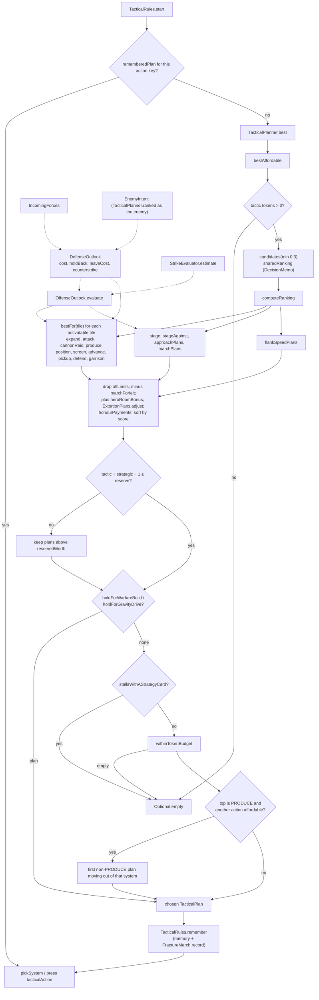
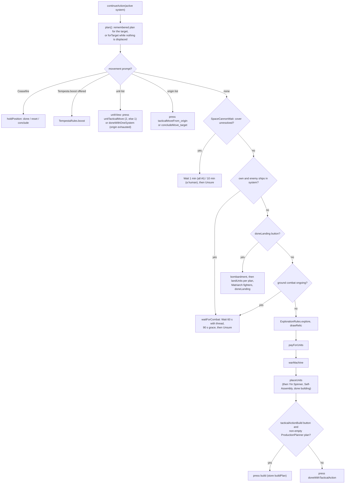
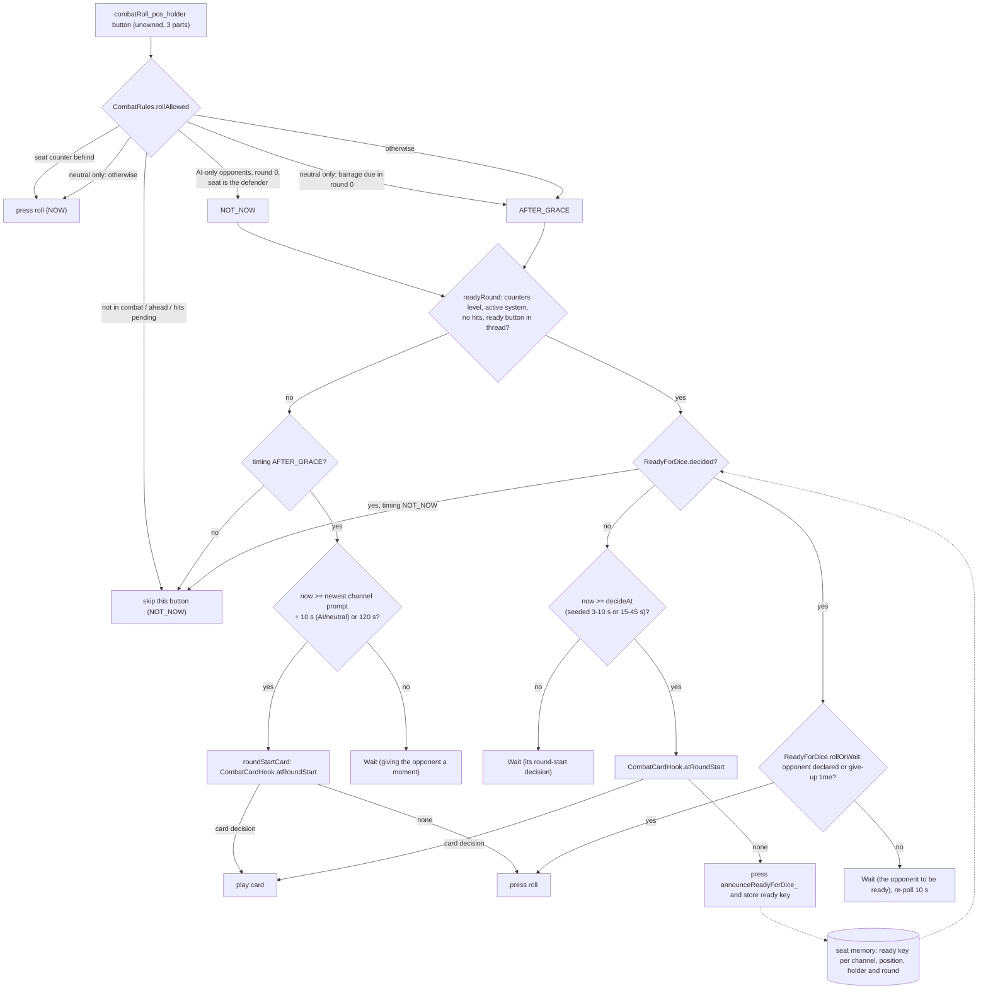
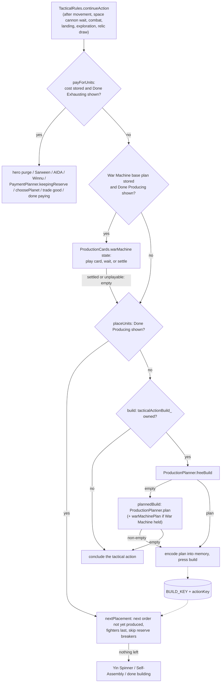

# Tactical planning, combat and production

Part of the [AI player architecture docs](/src/main/java/ti4/ai/README.md): a living document kept next to the code (packages: tactical). The code is the source of truth; when you change behavior here, update this file.

## Components and responsibilities

### Tactical planning

Value scale used throughout: one victory point is `ObjectiveValue.VICTORY_POINT_VALUE` = 8.0; one resource is
`ValueScale.RESOURCE` = 0.8; a command token is `ExploreValues.COMMAND_TOKEN` = 2.0; a won game is
`ScoringStakes.WIN_VALUE` = 30. Unit costs come from the unit model (`UnitModel.getCost`). Every plan score below is
in this unit ("trade-good units"). All experiment flags named below (`AiExperiments.Experiment`) are **on** unless the
seat's stored value `aiExperimentsOff` lists them (a control seat; `-` alone turns none off) or the JVM property
`ai.experiments.off` names them. Where a section says "control seats", it means the path taken with that flag off.

Size of the files in scope (lines): [TacticalPlanner](/src/main/java/ti4/ai/tactical/TacticalPlanner.java) 4272,
[DefenseOutlook](/src/main/java/ti4/ai/tactical/DefenseOutlook.java) 1238,
[TacticalRules](/src/main/java/ti4/ai/tactical/TacticalRules.java) 850,
[OffenseOutlook](/src/main/java/ti4/ai/tactical/OffenseOutlook.java) 696,
[StrikeEvaluator](/src/main/java/ti4/ai/tactical/StrikeEvaluator.java) 590,
[SharedSystemAttack](/src/main/java/ti4/ai/tactical/SharedSystemAttack.java) 379,
[PresenceReach](/src/main/java/ti4/ai/tactical/PresenceReach.java) 361,
[IncomingForces](/src/main/java/ti4/ai/tactical/IncomingForces.java) 351,
[AttackLedger](/src/main/java/ti4/ai/tactical/AttackLedger.java) 299,
[Standings](/src/main/java/ti4/ai/tactical/Standings.java) 213,
[Exposure](/src/main/java/ti4/ai/tactical/Exposure.java) 203,
[TraitRaid](/src/main/java/ti4/ai/tactical/TraitRaid.java) 196,
[FreedPlays](/src/main/java/ti4/ai/tactical/FreedPlays.java) 158,
[SeatStrike](/src/main/java/ti4/ai/tactical/SeatStrike.java) 154,
[ExtortionPlans](/src/main/java/ti4/ai/tactical/ExtortionPlans.java) 149,
[FractureScreen](/src/main/java/ti4/ai/tactical/FractureScreen.java) 138,
[CannonExposure](/src/main/java/ti4/ai/tactical/CannonExposure.java) 119,
[RoundGoals](/src/main/java/ti4/ai/tactical/RoundGoals.java) 116,
[SupplyLines](/src/main/java/ti4/ai/tactical/SupplyLines.java) 114,
[TacticalStrength](/src/main/java/ti4/ai/tactical/TacticalStrength.java) 113,
[FringeStack](/src/main/java/ti4/ai/tactical/FringeStack.java) 105,
[PlanetTake](/src/main/java/ti4/ai/tactical/PlanetTake.java) 99,
[SeatCover](/src/main/java/ti4/ai/tactical/SeatCover.java) 97,
[Strike](/src/main/java/ti4/ai/tactical/Strike.java) 85,
[EnemyIntent](/src/main/java/ti4/ai/tactical/EnemyIntent.java) 85,
[SlayIntent](/src/main/java/ti4/ai/tactical/SlayIntent.java) 83,
[PeaceAccords](/src/main/java/ti4/ai/tactical/PeaceAccords.java) 76,
[TacticalPlan](/src/main/java/ti4/ai/tactical/TacticalPlan.java) 73,
[FractureMarch](/src/main/java/ti4/ai/tactical/FractureMarch.java) 66,
[StyxTake](/src/main/java/ti4/ai/tactical/StyxTake.java) 59,
[SetupHint](/src/main/java/ti4/ai/tactical/SetupHint.java) 55,
[NullificationOutlook](/src/main/java/ti4/ai/tactical/NullificationOutlook.java) 52,
[StallPlans](/src/main/java/ti4/ai/tactical/StallPlans.java) 48,
[Grievance](/src/main/java/ti4/ai/tactical/Grievance.java) 41,
[TradedSecretPoint](/src/main/java/ti4/ai/tactical/TradedSecretPoint.java) 41,
[Stall](/src/main/java/ti4/ai/tactical/Stall.java) 29,
[StrikeValue](/src/main/java/ti4/ai/tactical/StrikeValue.java) 27,
[IdleTradeGoods](/src/main/java/ti4/ai/tactical/IdleTradeGoods.java) 24,
[StrikeEstimate](/src/main/java/ti4/ai/tactical/StrikeEstimate.java) 20,
[ContextTerms](/src/main/java/ti4/ai/tactical/ContextTerms.java) 20,
[StrikeRules](/src/main/java/ti4/ai/tactical/StrikeRules.java) 3.
Helpers outside the list but used heavily and described where they matter: `Defenders` (207),
`CapacityUse` (50), `SpaceCannonWait` (68), `SkippedSpaceCombat` (35).

---

#### TacticalPlan

**Role:** informs (data record).

**Purpose:** The unit of decision. `TacticalPlan(kind, target, moves, landings, score)`; `Kind` is one of
`EXPAND, ATTACK, RAID, PRODUCE, POSITION, DEFEND, STAGE, PICKUP, GARRISON`. `UnitMove(origin, holder, type, count)`
names a unit holder (`"space"` or a planet name) in an origin system. `landings` maps planet name to the **total**
number of the seat's ground forces wanted on that planet after landing (not the number to land).

**Invoked when:** created by every planner method; persisted by `TacticalRules.remember` as a string under
`tacticalPlan|<actionKey>` in the seat's AI memory (`TacticalPlan.encode`, separators `|`, `;`, `~`). That memory
(`AiMemory`) is an in-process map capped at 500 entries, held by the runtime seat state and replaced by an empty one
after an undo (`AiSeatState.forgetAfterUndo`); it is not written to the game save.

**Outputs / decisions:** `TacticalPlan.decode` returns empty on any parse error, so a corrupt memory entry makes
`TacticalRules.rememberedPlan` empty and the plan is recomputed.

**Limitations:** the record carries no build orders; a PRODUCE plan's actual build is recomputed at the build step
(see TacticalRules).

---

#### TacticalPlanner (entry points and ranking pipeline)

**Role:** decides (returns the plan to execute) and evaluates (ranks plans for other deciders).

**Purpose:** Generate one best plan per activatable system for every plan kind, add multi-system staging and
Flank Speed plans, adjust them for promises, extortion and Fracture marches, and pick the plan to execute under the
command-token budget.

**Invoked when (verified callers):**
- `TacticalPlanner.best(game, seat, hints)` ← `TacticalRules.start` ← `NekroBrain.takeTurn` (own turn, action
  phase, after the "instead of a tactical action" options). `StrategyCardRules` (Thunder's Edge Warfare primary) also
  calls `TacticalRules.start` for the system picker, but it has remembered the plan from
  `PlannedPrimaries.warfareTarget` first, so `start` reuses that plan instead of calling `best`.
  `TacticalPlanner.best(game, seat)` is also called by `TacticalRules.secondAction`,
  `TacticalRules.secondTacticalActionIsWorthIt`, and by other rules that compare a component or card
  action against the best tactical plan (`ActionCardRules`, `ComponentFlow`, `ConvoysRules`, `OrbitalDropRules`,
  `DannelRules`, `XxchaAgentRules`, `LazaxGateFolding`, `TechRules`, `SardakkHeroRules`, `DarktalonTreillaRules`,
  `SlingRelayRules`, `LegendaryOutlook`).
- `TacticalPlanner.ranked` (no reserve, no hold rules, min score 1.0) ← `EnemyIntent.ranked` (imagining another seat),
  `PlanInputs`, `TokenPlan.expectedActivations`, `Extortion`, `PromiseDeals`, `PromiseValue`,
  `DarktalonTreillaRules`, `FreedPlays.gain`.
- `TacticalPlanner.rankedFreeing(position)` ← `PlanInputs` (PoK Warfare / Unexpected Action token return);
  `rankedFreeingEveryToken` ← `FreedPlays.gain`.
- `TacticalPlanner.forTarget` ← `TacticalRules.plan` (system already active but no remembered plan) and
  `TacticalRules.bestOffered` (picker fallback).
- `TacticalPlanner.bestForWarfare` ← `NekroBrain.warfareBeforeFollowUp` (with Fleet Logistics, plays Thunder's Edge
  Warfare first when its best token-free plan is an ATTACK), `CardTiming`, `PlannedPrimaries`; `forWarfareTarget` ←
  `PlannedPrimaries`. `StrategyCardRules` reaches both through `PlannedPrimaries.warfareTarget` (Thunder's Edge
  Warfare: a tactical action without placing a token; with no plan it announces `WarfareIdle` and finishes).
- `TacticalPlanner.scores` ← `ExtortionPlans.honourPayments`, `Extortion`.

**Inputs:** the live `Game`, the deciding `Player`, optional `SetupHint`s (read from memory key `setupHint|<round>`,
written by `StrategyCardReplanner`), a set of "freed" positions (token assumed removed), and the token-free flag
(Warfare).

**Outputs / decisions:** `Optional<TacticalPlan>` from `best`; ranked lists sorted by score descending from the
others.

**Algorithm (`TacticalPlanner.bestAffordable`), in order:**
1. If tactic tokens ≤ 0: empty.
2. `reservedTokens = ScoringReserve.of(game, seat).tokens()` (tokens kept for a spend-tokens objective).
3. Rank candidates with minimum score `STALL_MIN_SCORE` = 0.3 over every tile for which
   `activatable` holds (`!tile.hasPlayerCC(seat) && ButtonHelper.canActivateTile`).
4. `keepsReserve = tactic + strategic − 1 ≥ reservedTokens`. If false the reserve is dropped (set to 0) and only
   plans whose score exceeds `ScoringReserve.reservedWorth` (the scoring value of the reserved objective) survive
   (`outweighingTheReserve`).
5. Opening holds: `holdForWarfareBuild` then `holdForGravityDrive` (see "Opening holds" below) may return a plan.
6. `stallsWithAStrategyCard`: when a Gravity Drive is expected (`OpeningHold.awaitsGravityDrive`), the top plan does
   not keep a transport at home, and the seat holds an unplayed strategy card, return empty so that
   `NekroBrain.takeTurn` falls through to playing the strategy card.
7. `withinTokenBudget(all, tactic − reservedTokens)`: keep plans with score ≥ `MIN_SCORE` = 1.0; also keep
   non-PRODUCE plans below 1.0 when the spare tokens exceed the number of distinct targets that have a plan ≥ 1.0.
   Effect: a 0.3–1.0 plan is executed only when no plan reaches 1.0 and at least one tactic token beyond the reserve
   remains.
8. Take the first (highest) plan. If it is PRODUCE and another action is affordable afterwards
   (tactic ≥ 2 and tactic + strategic − 2 ≥ reserve), take instead the highest non-PRODUCE plan that moves units
   **out of** the produce target ("move out before producing there"); otherwise the PRODUCE plan.

**Ranking pipeline (`computeRanking`):**
1. For every activatable tile: `bestFor(context, tile)` (one plan per tile, the best kind, see below).
2. Add `stage(context, activatable)` (staging, Mecatol approach and icon marches) and `flankSpeedPlans`.
3. Drop `offLimits` plans (`ExtortionPlans.honoured` for a spared system whose payer paid, or
   `PromiseBook.forbidsActivating`).
4. Subtract `marchForfeit` (Styx march and held Fracture strike given up), add `heroRoomBonus` (Hacan hero:
   `ProductionPlanner.heroGainFromRoom` when ships leave the home dock), add extortion credibility
   (`ExtortionPlans.adjust`).
5. `ExtortionPlans.honourPayments`: halve (`PAID_PAYOFF` = 0.5) any positive plan against a player who paid this
   round, unless the plan scores ≥ half a point (`TacticalPlanner.scores`: `scoringValue ≥ 0.5 × 8`) and no other plan
   scores.
6. Sort by score descending.

The ranking is memoised per decision (`DecisionMemo.remember`, key: seat, freed set, hints, token-free flag,
fleet limit, move boost, skipped-space-combat assumption), so repeated `best`/`ranked` calls inside one AI tick reuse
it.

**`bestFor(context, tile)` per-tile generation.** Skipped if `MovementGraph.canEnter` is false. Each generator below
runs; "moving" generators are skipped when `Context.unreachable` (no own ship in the tile, no Sardakk commander
pull, and no own ship anywhere reaching it with boosts) and are dropped when the plan needs more one-ship move boosts
(Gravity Drive, Tempesta) than the seat has (`withinMoveBoosts`):
`expansionPlan` (EXPAND), `attack` (ATTACK), `cannonRaid` (RAID), `produce` (PRODUCE), `position` (POSITION),
`screen` (POSITION in the Fracture), `advance` (POSITION with cargo), `pickup` (PICKUP), `defend` (DEFEND),
`garrison` (GARRISON). Each candidate's score is adjusted by `PlayAreaNotes.adjustedScore` (promissory notes returned
on activating, Ceasefire block chance) plus `SetupHint.bonusFor`; the maximum is kept, then `withFighters` (spare
capacity filled with escort fighters, kept only if it raises the score) and `massedAtMecatol` (Darktalon Treilla
lifting the fleet limit: every spare ship that reaches joins an EXPAND/ATTACK on Mecatol Rex, except the moves of the
best scoring plan elsewhere).

**Depends on:** `Context` (lazy caches: `DefenseOutlook`, `OffenseOutlook`, `Exposure`, `ObjectiveValue`,
`RoundGoals`, `Territory`, `CustodiansRace`, `FractureScreen`, reach maps, cannon dice), `MovementGraph`,
`BoardView`, `FleetLimit`, `MoveBoost`, `ProductionPlanner`, `ExploreDeck`, `IconStake`, `MecatolStake`,
`ScoringReserve`, `PlayAreaNotes`, `PromiseBook`.

**Effect on the game:** none directly; the plan is executed by `TacticalRules`.

**Fallbacks:** every generator returns `Optional.empty()` on any illegal step (`legalMoves` fails, transports missing,
fleet pool exceeded); a tile then contributes nothing.

**Limitations:** see section 10. Notably: one origin per DEFEND plan; origins exclude systems holding the seat's
command token (unless "freed") and gravity rifts (`Context.origins`).

---

##### Diagram: Choosing the plan (`TacticalRules.start` → `TacticalPlanner.best`)

Solid arrows are calls or decisions; dotted arrows are data consumed by a scorer.



#### TacticalPlanner.Context

**Role:** informs (per-decision cache and shared measurements).

**Purpose:** holds everything a ranking reuses. Key methods:
- `origins()`: tiles without the seat's token (or freed), with own ships, not a gravity rift.
- `distance(origin, target, type)`: BFS distance from `MovementGraph.reach` with the boosted move
  (`moveValueWithBoosts` = move + Gravity Drive + ready Tempesta); `reaches` compares against the plain move,
  `reachesWithGravityDrive` against the boosted one; `moveBoostsNeeded` counts the extra moves (per ship, or per
  group when the Gravleash breakthrough lets the fastest ship carry the group).
- `objectiveGain(target, moves, planets)`: `ObjectiveValue.gain(footprint after the move, pointsReturned)`; with
  `WIN_AWARE_POINTS`, points returned on activating (promissory notes) are passed in.
- `departureLoss(target, base, extra, landings)`: `min(0, gain with extra − gain without)`; negative when the
  extra units break objective progress where they leave.
- `forwardNeed(tile, transport)`: claimable planets (no enemy units, unowned, no custodians) in all systems within the
  boosted move of `tile` (excluding `tile`).
- `reservedForOtherTransports` / `otherExpansionNeed`: ground forces staying transports need for the best other system
  they can reach this round (with one extra move when Gravity Drive is expected).
- `exploreValue`: `ExploreDeck.expectedValueOfPlanet(ExploreSite.landing(...))`.
- `custodiansValue`: 8 (1 VP) without `WIN_AWARE_POINTS`; with it 0 when activating returns at least one point,
  otherwise `max(8, ScoringStakes.scoreValue(1 point))`.
- `mecatolTakeValue`: `MecatolStake.ownHoldValue` if the seat can cash Mecatol points (`MecatolCash.points > 0`)
  else `MecatolStake.redrawValue`, plus `Reclamation.captureBonus`; `mecatolCash` = 0.75 × score value of the
  cashable Mecatol points.
- `offers(tile)`: whether the system picker can offer the tile
  (`CheckDistanceHelper.getTileDistancesRelativeToAllYourUnlockedTiles`), used only by `cannonRaid`.
- `lockShare()`: 1.0 for token-free (Warfare) planning, `LOCKED_FORWARD_SHARE` = 0.5 otherwise (a ship that moves
  stays locked under the token).

---

#### Expansion (`TacticalPlanner.expand`, `expandFrom`, `landInPlace`)

**Role:** evaluates (candidate generator, kind EXPAND).

**Purpose:** take unowned planets in a system with no enemy units.

**Invoked when:** from `bestFor` via `Context.expansionPlan` (cached per tile); also used by `approachPlans` (skip
when Mecatol is directly expandable) and `TraitRaid.claimGate`.

**Inputs:** free planets of the tile (no controller, and no custodians token unless `canPayCustodians`: a custodians
payment plan from `ScoringReserve.planForCustodians`, or `IconStake.behindCustodians` and the wallet can pay the
influence `CustodiansRace.cost` asks), ordered by `IconStake.claimOrder`. No enemy units may be in the tile.

**Algorithm:**
- `landInPlace`: ground forces already in the tile's space plus Sardakk commander pulls land on up to one planet each.
- `expandFrom` per origin (two passes via `secondPass`: if the origin is guarded and the first plan's leave cost
  exceeds `GARRISON_TOLERANCE` = 0.5, recompute ground forces available given the departing ships and keep the
  better plan):
  1. `availableGroundForces` minus garrison (home: `DefenseOutlook.groundToKeep`; Mecatol Rex: 1; Occupy the Fringe
     anchor: `GroundCampaign.kept`). Mechs stay first; with *Mechanize the Military* infantry stay first.
  2. `transports` in order Carrier, Flagship, Dreadnought, War Sun (only undamaged ships of types with capacity,
     reaching with boosts and within the held move boosts), adding ships until capacity ≥ min(available, free
     planets + hazardous planets).
  3. `landed = min(capacity, available, free planets)`; load `max(landed, min(capacity, available − reserved))`, where
     `reserved` is the ground forces the staying transports need for another expansion
     (`reservedForOtherTransports`); one more unit (up to the same cap) when approaching Mecatol (custodians race open
     and the tile is not Mecatol).
  4. `mechsFirstForHazardousPlanets` orders mechs to hazardous planets (all planets under *Mechanize the Military*),
     `distribute` spreads every loaded unit over the target planets: a mech per hazardous planet, then one unit per
     empty planet, then an infantry onto hazardous planets with no mech, then round-robin.
  5. Score = Σ per planet (`BoardView.planetValue` + `planetTempo` + explore value + custodians value if custodians +
     Mecatol take value + zone bonus) + approach (0.5 × custodians-race gain when a spare unit exists) +
     `OffenseOutlook.expansionImperial` + 0.5 × min(spare units, forwardNeed) + 0.15 × fighters + objective gain
     − 0.2 × distance − 0.3 × (transports − 1) − leave cost − 0.5 × added exposure + forward position gain
     (0.15 × lockShare × `RoundGoals.forwardGain`).
  6. `withFollowers` adds idle ships from any origin, the main one included (see Followers), `withCommanderLandings`
     adds Sardakk commander landings, `afterCannon` prices enemy space cannon.
- `planetTempo` = 0.8 × `earlyGameWeight`, `earlyGameWeight` = max(0, 1 − 0.25 × max(0, round − 4)) (1.0 to round 4,
  0 from round 8). Zone bonus (`Territory`): lane 1.5, slice 1.0, border 0.3, foreign −1.0 × earlyGameWeight.

**Example:** round 2, carrier + 2 infantry at home, neighbour system with two unowned planets (2/0 and 1/1) on the
seat's lane, no cannon. One carrier suffices (capacity 4 ≥ 2), `landed` = 2, value = (planet values) + 2 × 0.8 tempo
+ 2 × 1.5 lane bonus + explore values − 0.2 × 1 distance, minus any home leave cost.

**Fallbacks:** if the loaded cargo cannot move legally, retries with exactly `landed` units.

**Limitations:** planets with custodians are skipped unless the payment plan exists; fighters left behind when
cargo fills capacity.

---

#### Attack candidates (`TacticalPlanner.bestAttack`, `candidatePool`, `variants`, `departure`, `evaluated`, `finalPlan`, `fullPlan`)

**Role:** evaluates (kind ATTACK).

**Purpose:** build strikes against a system that holds units or planets of exactly one other player or of the
neutral player (`singleOpponent`); otherwise hand to `SharedSystemAttack`.

**Invoked when:** `Context.attackPlan(tile)` (cached) from `bestFor`, `stageTargets` (a target with an attack now is
not staged for), `EnemyIntent.attackWorth`, `TraitRaid.gateFor`.

**Algorithm:**
1. Per origin, `candidatesFrom`: `withGarrisonPasses` builds `variants` without fighters and, if enemy ships are
   present and the origin has fighters, with fighters. Second garrison pass as in expansion.
2. `variants`: an **all-in** departure (every ship type that reaches, plus one Gravity Drive ship — the most expensive
   when enemy ships are present, otherwise the most capacity — fighters up to capacity, cargo up to remaining capacity
   if the tile has enemy or free planets) and, at a guarded origin, a **held-back** departure (`DefenseOutlook.holdBack`
   with a `Blend` whose weight w0 is the all-in space-win chance: home cost is mixed between the current world and one
   where the target's enemy fleet is gone).
3. `combinations`: from the best candidate per origin, add other origins in descending fleet cost while the quick score
   improves, up to `MAX_ORIGINS` = 3 parts and within move boosts.
4. `commanderOnly`: a Sardakk commander landing with no ships when no enemy ships are present.
5. `evaluated`: builds a `Strike` (ships, damaged ships, cargo, commander pulls, `StrikeRules`), runs
   `StrikeEvaluator.estimate`; rejects spaceWin ≤ 0, rejects if the executed moves are illegal (fleet pool unless
   the Occupy-the-Seat overflow applies), builds `ContextTerms` (objective gain, explore values of free planets, combat
   secret terms, home defense 6.0 when it fights in its own home, retake value = public scoring lock in own home,
   *Make an Example* slot, territory bonus, `TraitRaid.exposedObjective`, `SeatStrike` stake), and computes the quick
   `OffenseOutlook.evaluate(…, full=false)`.
6. Home raid rule (`candidate`): a landing in another player's home is kept only if the seat is being imagined
   (`ImaginedTurn.imagines`), holds *Darken the Skies* / *Become a Martyr* with ground combat, or
   `homeLandingJustified` (target's win threat ≥ 0.25, or the home block or own objective term ≥ 0.5 × 8 = 4.0);
   otherwise the strike is re-evaluated with `homeLandings=false` (ships only).
7. `finalPlan`: sort by quick score; finalists = top `FINALISTS` = 2 plus the best held-back and best all-in candidate;
   each gets `fullPlan`.
8. `fullPlan`: reject spaceWin < `landMinWin`; full evaluation with floor = `attackMinScore` (4.0, or 2.0 against the
   neutral player); subtract `CapacityUse.loneHaulerPenalty`; reject below the floor.

**`StrikeRules`:** `landMinWin` = 0.5, or 0.3 when the opponent's win threat ≥ 0.5; `homeLandings` as above;
`canPayCustodians`; `conquering` (computed, never read).

**Depends on:** `StrikeEvaluator`, `OffenseOutlook`, `DefenseOutlook`, `SeatStrike`, `TraitRaid`,
`BombardmentRules`, `CannonWipeRules`, `PrecisionRules`, `TradedSecretPoint`.

---

#### Combat secret terms (`TacticalPlanner.secretSlots`, `allocatedSecrets`, `secretTerms`, `actionSecretBonus`)

**Role:** evaluates.

**Purpose:** credit unscored action-phase secrets a combat would score, at most one secret per combat (space, ground).

**Algorithm:** generic secrets (`sar` vs the leader, *Brave the Void* in an anomaly, *Darken the Skies* in another home,
`baf` vs the owner of a promissory note in play), space-only secrets (`uf` with own flagship, `dyp` with ≥ 3 ships,
*Destroy Their Greatest Ship* vs a flagship or war sun), a *Fight with Precision* barrage slot, and a
*Turn Their Fleets to Dust* cannon-wipe slot. Each slot is worth 8 × share × chance (chance 1.0 for the generic and
space-only secrets, the clear/wipe chance for the barrage and cannon slots); share is 1.0 for
*Destroy Their Greatest Ship*, *Darken the Skies*, *Brave the Void*, and for `btv`/`uf`/`dyp`/`fwp` against the
neutral; otherwise 1.0 if `ActionSecretTiming.pursueNow`, else `PATIENT_SHARE` = 0.25. When activating the target
returns promissory-note points, `TradedSecretPoint.share` caps the share at the value of scoring now, or raises it to
30 / 8 when one point after the return would win; the slots count only if they gain more points than are returned
(`gainsPoints`), and when several secrets win only together the joint chance times 30 (win value) replaces them. The
chosen allocation is whichever of "fought" vs "wiped by cannon" totals more (*Darken the Skies* only in "fought").

---

#### Cannon raid (`TacticalPlanner.cannonRaid`)

**Role:** evaluates (kind RAID, no moves).

**Purpose:** activate a system holding another player's (or the neutral's) ship that the seat's own space cannon
covers, without moving in, to fire space cannon offense for *Turn Their Fleets to Dust* (`ttfd`).

**Algorithm:** requires no own ships in the tile, `CannonWipeRules.coversAShip` (the seat holds `ttfd` unscored and
is among `ButtonHelper.getPlayersWithPds2Cover` for the tile), and `Context.offers(tile)`. Without `ttfd` there is no
RAID plan at all. Score = `TradedSecretPoint.share(ttfd)` × 8 × wipe chance (when `TradedSecretPoint.gainsPoints`) +
wipe chance × target ship cost (0 against the neutral). Rejected below max(1.0, `CardValueScale.TOKEN_FLOOR` = 1.5).

---

#### Production (`TacticalPlanner.produce`, `groundShift`)

**Role:** evaluates (kind PRODUCE; build content is `ProductionPlanner`, out of this scope).

**Algorithm:** requires an own dock in the tile. Build = `ProductionPlanner.freeBuild` (Hacan hero) or
`ProductionPlanner.plan`. Worth building if units ≥ `MIN_UNITS` = 4, or cost ≥ `MIN_BUILD_RESOURCES` = 6, or it scores
(build flag or objective gain > 0), or it is a defense build; otherwise only if a ground shift exists. Score = build
value + objective gain of the built units. A `GroundShift` (a spare mech onto a planet without one under
*Mechanize the Military*, or spare dock ground forces onto the *Occupy the Fringe* anchor) is prepended as moves and a
landing, adding its objective gain minus the hauler's distance and leave cost.

**Example:** test `TacticalPlannerTest.doesNotActivateADockToBuildFewerThanFourUnits` (read): a 3-unit build is not
worth the token; `buildsALoneFlagshipThatScoresAnObjective` checks a scoring 1-unit build exceeds 8.

---

#### Position, screen, advance, pickup, garrison

**Role:** evaluates (kinds POSITION, PICKUP, GARRISON).

- **`position`**: only when `ObjectiveValue.caresAboutPresence`, or *Dark Energy Tap* with a frontier token (frontier
  card value + 1.0), or *Fight with Precision* held, or a Scar with *Adapt New Strategies* (8 × 0.6 / faction techs
  needed). No enemy ships in the tile. For each origin and each type in Destroyer, Cruiser, Carrier, Dreadnought,
  Flagship, War Sun: move one ship; gain = objective gain + frontier + barrage gain + scar; score = gain − barrage
  exposure − 0.2 × distance − 0.05 × fleet cost − leave cost − empty-hauler penalty (`CapacityUse.emptyHaulerPenalty`:
  0.5 × capacity for each hauler, capacity ≥ 3 and no sustain, that carries nothing); then `withLandings` lets a
  hauler land on free planets. `groupPosition` moves every undamaged ship that reaches (held back by defense), at
  least 2 non-fighter ships, at −0.3 per ship. Contested tiles (enemy cannon or `SeatCover.contests`) go through
  `underCannon` (see Cannon pricing).
- **`screen`**: Fracture tile without own ships, `FractureScreen.valueOf(tile) > 0`; one undamaged destroyer or
  cruiser; score = value −
  0.2 distance − 0.05 cost − leave cost + departure loss − exposure; then `afterCannon`.
- **`advance`**: non-home tile with no enemy units; one transport + cargo up to min(capacity, forwardNeed);
  base = 0.5 × lockShare × `RoundGoals.forwardGain` − 0.2 distance; `withEscorts` adds up to 3 single escorts
  (destroyer, cruiser, fighter) while exposure > 0 and the score improves.
- **`pickup`**: a tile where available ground forces plus fighters beyond the 3-fighter dock allowance exceed the
  capacity of ships present; a hauler from an origin with no movable ground forces; score = 0.5 × picked up + secret
  cargo credit (`GroundCampaign.cargoCredit`) − distance − group cost − leave cost + departure loss − exposure.
- **`garrison`**: `occupy` (send ground forces to the *Occupy the Fringe* anchor, plus `GroundCampaign.ferryPull`) and
  `mechanize` (one spare mech onto each bare planet for *Mechanize the Military*); score = objective gain − distance −
  group cost − leave cost; only when objective gain > 0.

---

#### Defend (`TacticalPlanner.defend`, `defendFrom`, `ferriedDefence`, `defensePlan`)

**Role:** evaluates (kind DEFEND).

**Purpose:** bring ships (and ground forces) into a guarded system whose defense cost is positive.

**Algorithm:** requires `isGuarded(tile)` and no enemy ships there; `costNow = DefenseOutlook.cost(tile, now) > 0`.
Per origin: candidate ships that reach (after the origin's own hold-back); greedily add the
`bestReinforcement` — for each type and count 1..`REINFORCEMENT_BUNDLE`=3, gain = cost reduction, ranked by gain per
resource (count × cost, floor 0.5), ties to lower capacity then cheaper — while gain ≥ `HOLD_MIN_GAIN` = 0.3. If no
ship helps, `ferriedDefence` sends haulers carrying ground forces (accepted only if score − build bonus ≥ 0.3). Ground
forces carried land one at a time on `mostExposedPlanet`. Score = costNow − cost after − leave cost + departure loss −
0.2 × farthest distance − 0.3 × (ships − 1) − lone-hauler penalty + build bonus (the dock's non-defense build value).

**Tested:** `TacticalDefenseTest.bringsADreadnoughtHomeWhenHomeIsExposedAndNothingCanBeBuilt` (read by name only;
not relied on for numbers).

**Limitations:** one origin per plan (`TODO`: arriving ships assumed undamaged).

---

#### Followers (`TacticalPlanner.withFollowers`, `followers`, `idleShips`)

**Role:** evaluates.

**Purpose:** add idle ships from other origins that move toward next-round goals along with an EXPAND.

**Algorithm:** idle ships = present − moving − ships reserved for another expansion, after hold-back. Gain per ship =
lockShare × `RoundGoals.forwardGain(origin, target, move, hasCapacity)`. Greedy marginal per extra ship:
`0.25 × gain / (joined + 1) − 0.3 − unloaded-hauler penalty + Δ departure loss`; stop when ≤ 0 or fleet pool is full.

---

#### Staging, approaches and marches (`TacticalPlanner.stage`, `stageTargets`, `stageAgainst`, `gather`, `stagePlan`, `futureScore`, `approachPlans`, `marchPlans`)

**Role:** evaluates (kind STAGE).

**Purpose:** two-step plans: move now to a system from which a strike (or a Mecatol landing, or an icon claim) is
possible next round.

**Algorithm (staging against a player or the neutral):**
1. `stageTargets`: every tile with a single opponent that `worthStagingFor` (neutral: a Fracture planet; holds Styx;
   opponent's denial weight ≥ 0.5; the opponent's home; Mecatol; an icon tile; or a planet whose loss denies the
   opponent objectives), with no attack available now, and `stageFeasibility` ≥ 0.5. Feasibility = min(1, cost of own
   ships whose move × (lead + 1) reaches the target / max(1, opponent's NEXT_ROUND fleet cost) + PDS count). Lead is 1
   for players, `FRACTURE_STAGE_LEAD` = 3 for the neutral. Rank by `stagePrize` × feasibility; keep 3.
2. For each target, every staging tile (not target, not own home, activatable, enterable, no enemy ships):
   `gather` up to 3 origins whose ships reach the staging tile now and the target within `lead` moves from it but not
   directly now (for lead > 1 each step must get closer), within fleet pool; cargo only if there are planets to take
   (capped at 6 infantry for Fracture marches); fighters ride along for marches.
3. Keep the 4 gatherings with the highest ship cost, compute `counterAt` (DefenseOutlook.counterstrike on the staged
   ships at a stake of 0.5 × cost), keep the 2 with the lowest counter.
4. `stagePlan`: `futureScore` = a full `OffenseOutlook.evaluate` of the strike from the staging tile next round
   against the opponent's resident units plus NEXT_ROUND reinforcements (home landings tried first, then ships only if
   unjustified); reject below `attackMinScore`. Score = stageShare × future × (0.5 if the opponent holds an unplayed
   Diplomacy and the target has a non-Mecatol planet of theirs) − counter − leave costs + departure loss − 0.2 ×
   farthest − 0.3 × (ships − 1) (not vs neutral) − empty-hauler penalty; then promissory/hint adjustment and
   `afterCannon`. stageShare = `STAGE_SHARE` 0.35 for players; for the neutral
   `FractureCampaign.routeShare` (1.0, or 0.5 without an own ingress) × 0.85^(steps − 1).
- **Approach plans** (custodians race open and Mecatol not expandable now): cheapest transport + up to 2 ground forces
  to a tile with fewer hops to Mecatol; gain = 0.5 × `approachGain` (difference in `CustodiansRace.raceValue` between
  the moved arrival and the idle arrival; under `CANNON_COVER_RISK` weighted by cover survival).
- **Icon marches** (`IconStake.freeTiles` non-empty): cheapest transport + up to 2 ground forces to a tile closer to the
  nearest free icon tile (within 8); gain = 0.6 × 8 × fraction of distance closed.
- Common pricing in `stagingPlan`: − counterstrike (stake 0.5 × transport cost) − leave cost + departure loss −
  0.2 × distance.

**Tested:** `StagingTest` (read by name): staging into range of a winning neighbour's home, refusing a strong
counterstrike, gathering two weak fleets, fleet pool cap.

---

#### Fracture march bookkeeping (`marchForfeit`, `isMarchStep`, `FractureMarch`)

**Role:** evaluates (penalty) and informs (memory).

**Algorithm:** `styxMarchForfeit`: for each origin of departing ships that is a Fracture tile or the remembered march
position, unless the plan targets Styx or is a STAGE that gets closer to Styx, subtract `marchValue(origin, styx)` ×
share of the origin's stage group leaving. `fractureStrikeForfeit`: for plans not targeting a Fracture tile, subtract
the best held Fracture strike from a Fracture origin × departing share. `marchValue` = routeShare × 0.85^(steps−1) ×
future strike score (0 if below the attack floor).
`FractureMarch.record` (from `TacticalRules.remember`) stores `(round, position)` in a static map per game and faction
when the plan is a march step (STAGE within 3 moves of Styx, every origin farther than the target); it forgets it when a
plan moves ships out of that position elsewhere; the entry expires after 2 rounds or when no own ships remain there.

---

#### Cannon pricing (`afterCannon`, `priced`, `riskedUnderCannon`, `underCannon`, `CannonExposure`)

**Role:** evaluates.

**Purpose:** price enemy space cannon offense (PDS and deep-space cannon) at the target.

**Algorithm (`CannonExposure.of`):** list own ships at the target (present + arriving), cheapest first; the kill order
spends a fresh sustain first (loss 0.25 × cost), then destroys the cheapest ship. For each number of hits h (dice from
`CannonDice.againstShipsOf`, exact via `DiceOdds.atLeast`) it accumulates expected loss and `delivery` = expected
fraction of cargo the surviving capacity still carries. `viable` iff delivery ≥ 0.5.
- With `CANNON_COVER_RISK` (on by default; `afterCannon` → `riskedUnderCannon`): never drops; score = score ×
  delivery − expected loss (negative scores are not scaled); adds up to 3 cheapest escorts only while that risked score
  improves (escort charged 0.05 × cost + extra leave cost).
- Control seats (`CANNON_COVER_RISK` off, `priced`): if not viable, add up to 3 cheapest escorts (`withCheapestEscort`)
  until viable; else drop the plan. Viable plan score = score × delivery − expected loss.
- `underCannon` (POSITION in contested tiles): when the move chases *Occupy the Seat* or *Cut Supply Lines*
  (`SeatCover.chases`) and would not complete through the cannon, drop it; subtract `SeatCover.shortfall` (and
  `seatShortfall` under cover risk); chasing plans are charged expected loss only; others go through `afterCannon`.
  A plan with a positive shortfall is dropped unless its priced score stays above 0.

**Tested:** `CannonExposureTest`, `CannonCoverRiskTest` (read: `aLoneCarrierExpandsUnderCoverAtItsDeliveryOdds`,
`aControlSeatStillRefusesTheLoneCarrierUnderCover`, `theSeatIsChargedTheChanceTheCannonBreaksIt` comments match the
code above).

---

#### Opening holds (`holdForWarfareBuild`, `holdForGravityDrive`, `stepTowardNeighbour`)

**Role:** decides (overrides the top plan).

**Algorithm:**
- `holdForWarfareBuild`: if the top plan takes a carrier or ground forces out of home (or targets home) and
  `OpeningHold.awaitsWarfareBuild` (round 1, first turn, a strategy token, no own Warfare, a rival's Warfare still to
  follow, the seat wants to follow it, carriers held for a home build), pick the best plan that does not, and whose
  target is not a transport goal of `RoundGoals`; else `stepTowardNeighbour`.
- `holdForGravityDrive`: if Gravity Drive is expected (`OpeningHold.awaitsGravityDrive`: round 1, no Gravity Drive,
  home not locked, technology wanted soon) and the top plan leaves no transport at home, pick the best plan ≥ 1.0 that
  keeps one; else `stepTowardNeighbour`.
- `stepTowardNeighbour`: cheapest non-carrier ship at home moves one step to an activatable, enterable, enemy-free tile
  (not a goal), with no ground forces and no leave cost, minimising the distance to the nearest other home (search 6);
  a POSITION plan at score 0.3 after `afterCannon`.

**Tested:** `TacticalPlannerTest.holdsTheCarrierHomeForARivalsWarfareBuild` (read): with Sol holding initiative 6 the
plan moves the destroyer to the empty neighbour and the carrier stays.

---

#### Warfare (token-free) planning (`bestForWarfare`, `bestTokenFree`, `freeStep`, `forWarfareTarget`)

**Role:** decides.

**Algorithm:** a `Context.tokenFree` context (lockShare 1.0, `offers` always true); tiles holding the seat's token are
activatable. Max over `bestFor` plans plus Fracture-tile stage plans with score ≥ 0 and not off limits; else
`freeStep` (a `stepTowardNeighbour` from any origin). No reserve, holds or budget apply.

---

#### Flank Speed plans (`flankSpeedPlans`, `needsFlankSpeed`)

**Role:** evaluates.

**Algorithm:** if the seat holds *Flank Speed* and it is not active, re-plan every tile and Fracture stage with
`MoveBoost.withOneMore` (+1 move all ships); keep plans in which some departing ship could not reach otherwise, at
−`FLANK_SPEED_COST` = 1.5. The card itself is played by `ActionCardRules` after activation.

---

#### DefenseOutlook

**Role:** evaluates (defense cost of a board state) and informs (guarded systems, chances).

**Purpose:** a number in TG units expressing how much the seat expects to lose at a system to the most dangerous
enemy if it leaves `Defenders` there, used to price every departure and to drive DEFEND plans and production.

**Invoked when:** created lazily by `Context.defense()` (one per ranking), by `TacticalRules.build`, by
`ProductionPlanner`, `PlanInputs`, `PlannedPrimaries`, `GroundDrops`, `TransitDiodesRules`, `BellumGloriosumRules`,
`NullificationOutlook`, `FreedPlays`; `DefenseOutlook.homeCost` ← `ConstructionUses`, `PdsSites`.

**Algorithm:**
- **Guarded** (`computeGuarded`): home, a system with own dock, own Mecatol, own Styx, `scoringLoss ≥ SCORING_CRITICAL`
  = 4.0 (objective progress lost if its ships or planets go, or `TraitRaid.holdLoss` = 4.0 when one planet short of a
  trait secret), or contested (an enemy NEXT_ROUND force carrying ground whose public-objective gain from taking the
  seat's planets ≥ 4.0). Unguarded systems cost 0.
- **Cost** (`cost(tile, defenders)`): max over enemies of `threat` at IMMEDIATE and NEXT_ROUND:
  `weight × fear × [max(0, take − target) × stake + max(0, space − target) × spaceStake]`, with
  `target = 0.5 + 0.5 × (1 − fear)²`; space and take chances from exact combat odds (see section 6).
- **Weight:** 1.0 for IMMEDIATE; NEXT_ROUND 0.5, or 1.0 if the enemy holds an unplayed PoK Warfare or the seat has
  passed or has < 2 tactic tokens.
- **Stake:** max over own planets of `PlanetStake.of` + structures, + public scoring lock at home (8.0, or 12.0 within
  3 VP of the goal), + Mecatol hand-over (Imperial holder's denial weight × 8) + `MecatolStake.holdValue`.
  `spaceStake` = 0.5 × max(0, enemy's objective gain from its ships there) + own ship-objective loss.
- **Fear** = clamp(roundFactor × aggression × commitment × motiveFactor × appetiteShare × ceasefire × boughtOff ×
  anger, 0, 1); details in section 6. Threat is 0 when the fear ceiling (appetite share 1.0) < 0.05.
- **Home posture** (`departureCost` at home = max(threat cost, posture)): `homeDefenseLevel` = enemyReach ×
  homePressure; posture = level × stake × worst exposure where exposure = max(0, space − tolerated) (+ ground share ×
  max(0, take − tolerated) on the anchor planet), tolerated = 1 − level × 0.8; ignored when level < 0.2.
- **`holdBack(origin, leavingRegardless, candidates, blend)`**: while the cost increase from leaving > 0.5, keep the
  bundle (type × 1, 2, 3 or all) with the best cost reduction per resource (tie: lower capacity, then cheaper); stop
  when the best bundle saves < 0.3. Returns the units allowed to leave.
- **`groundToKeep`**: the smallest number of ground forces on a home planet that keeps the cost increase ≤ 0.5.
- **`leaveCost(origin, moves, blend)`**: max(0, cost after − cost now) at a guarded origin.
- **`counterstrike(tile, after, planets, shipStake, planetStake, immediateStake, struck)`**: 0 for a guarded tile;
  otherwise max over enemies and horizons of weight × min(1, fearCeiling × (1.2 for the struck player)) ×
  (space × shipStake + take × (planetStake + immediate seat stake)).
- **`excluding(Exclusion)`**: a child outlook whose `IncomingForces` treat one enemy's units at one tile as gone
  (shared caches with the root).

**Depends on:** `IncomingForces`, `Standings`, `EnemyIntent`, `CombatOdds`, `CombatForces`, `BattleMath`,
`ObjectiveValue`, `PlanetStake`, `MecatolStake`, `FactionAggression`, `SlayIntent`, `ExtortionPlans`, `AttackLedger`,
`TraitRaid`, `GroundCampaign`.

**Tested:** `HomeDefenseTest` (read by name and comments: round 1 holds nothing back, posture grows with rounds, a
multi-planet home is held in space), `DefenseOutlookTest`, `TacticalDefenseTest`
(`aPassiveEarlyNeighbourKeepsNothingHome`, `anAggressiveNeighbourKeepsExactlyOneDreadnoughtHome`).

**Limitations:** worst single enemy only (no coalition), enemy assumed to commit everything that reaches.

---

#### IncomingForces

**Role:** informs (opponent force projection).

**Purpose:** the largest force a given enemy could bring into a target system in one tactical action.

**Algorithm (`scan` / `gather` / `assemble`):**
- IMMEDIATE is empty when the enemy has passed, or (without an unplayed Thunder's Edge Warfare) has no tactic token or
  already has a token in the target. NEXT_ROUND ignores tokens and passing.
- For every origin other than the target (IMMEDIATE skips origins under the enemy's token): each non-fighter ship type
  whose move × moves (1 for `of`, 2 for `approaching`) reaches the target on `MovementGraph.reach` from the enemy's
  perspective (the seat's ships block); ships starting in a gravity rift try every neighbour; with Gravity Drive the one
  most expensive ship reaching with +1 per move joins.
- Fleet pool: keep the most expensive ships up to `FleetLimit.ships(enemy)` − resident ships.
- Add resident ships, damaged counts, ground forces in the target's space; per origin, carried ground (mechs first, then
  infantry) up to the arriving ships' capacity, then fighters.
- The neutral player only counts resident units.
- Results are memoised per tick (`TickMemo`) for the plain variant.

**Tested:** `IncomingForcesTest` (read by name: capacity limits, fleet pool keeps the most expensive, token-locked
fleet only next round, passed enemy only next round, TE Warfare unlocks without tokens, own ships block, Gravity Drive
one ship, gravity-rift start).

---

#### EnemyIntent

**Role:** informs (opponent prediction).

**Purpose:** what another seat would do on its own turn.

**Algorithm:** `ranked(game, enemy)` = `ImaginedTurn.of(enemy, () -> TacticalPlanner.ranked(game, enemy))`. Inside an
imagined turn, `ImaginedTurn.unscoredSecrets(enemy)` and `actionCards(enemy)` return empty maps, so the enemy's plans
use only public information; nested imagining is refused (`ImaginedTurn.underway()` returns empty), so the enemy's own
`DefenseOutlook` falls back to `reachablePlanets` (sum of free planet values plus public objective gain over tiles its
loaded carriers reach). `attackWorth(enemy, tile, defender)` runs the attack candidate pool for the enemy and scores
finalists by full `OffenseOutlook.evaluate` **without** the 4.0 floor and lone-hauler penalty. Results are cached in a
static map (max 256, cleared when full) keyed by game name and key, valid while the `Game` instance and its last
modified date match.

**Invoked when:** `DefenseOutlook.attackValue` and `alternative` (every threat computation).

---

#### Standings

**Role:** informs.

**Algorithm:** `projected(player)` = VP + public points ready to score this round (`ObjectivePolicy.scorablePublics`,
best `1 + Imperial held` objectives) + Imperial point (Imperial held and Mecatol controlled) + custodians 0.5 (if an
IMMEDIATE force with ground reaches Mecatol and it can pay) + secret point (`SecretOdds.chanceReady` under
`WIN_THREAT_FEASIBLE`, else 0.35 if it holds a secret). `winThreat` = 1 if `WinRace.winnersBefore` lists it; else
`WinOdds.reachesGoal` (feasibility experiment) or clamp((projected − (goal − 1.5)) / 1.5, 0, 1). `hurtWeight` =
clamp(1 + 0.25 × (points − mean of others) + 0.25 if sole leader + 0.25 × grudge / 8, 0.5, 1.5); neutral 0.
`denialWeight` = 0.4 × hurtWeight × (1 − threat) + 2.0 × threat.

---

#### StrikeEvaluator, Strike, StrikeEstimate, StrikeRules

**Role:** evaluates (combat physics, no economics).

**Algorithm:** see section 6 "Strike physics". Output `StrikeEstimate`: spaceWin, escaped (Naalu Foresight),
spaceCombat, groundCombat, landings (planet → total after), groundWins, groundSent, our and their expected losses (in
resource cost), loss if win, kill chances, survivors.

**Tested:** `StrikeEvaluatorTest`, `TacticalPlannerTest` (`countsItsOwnSpaceCannonWhenAttacking`,
`countsAntiFighterBarrageBeforeTheSpaceCombat`, `countsAssaultCannonBeforeTheSpaceCombat`,
`refusesAttacksWithPoorOdds` — read by name; `refusesAttacksWithPoorOdds` body read: 1 infantry vs 3 defenders yields no
ATTACK).

---

#### OffenseOutlook, StrikeValue, ContextTerms

**Role:** evaluates (economics of a strike).

**Algorithm:** `evaluate(strike, estimate, terms, full, floor)`; full formula in section 6. `StrikeValue` keeps
every term for tracing (`explainAttack`). `ContextTerms` carries the seat-specific inputs from `TacticalPlanner.terms`.

---

#### SharedSystemAttack

**Role:** evaluates (ATTACK when two or more other parties share the target).

**Algorithm:** only if every other party is a real or neutral player and at most 2 have ships. With two fleets:
order by seating, plan the opening fight against the first without cargo (`withoutCargo`), then `secondFight` against
the second with the survivors (`StrikeEvaluator.laterSpaceCombat`, no opening fire), choosing carrying vs space-only by
worth; `sharedCounter` avoids double-counting counterstrike. With 0–1 fleets: lead with each party, then
`followOns` greedily add landings on the other parties' planets (`StrikeEvaluator.afterSpaceWon`) while worth > 0.
`finish` re-legalises moves; requires total ≥ 4.0 (also against the neutral).

---

#### SeatStrike, SeatCover, SupplyLines

**Role:** evaluates (secret-specific terms).

- **SeatStrike** (*Occupy the Seat* `ose`): when the target is Mecatol and the secret is held, `gain` =
  `ObjectiveValue.gainAt(ose, ships after within fleet supply + carried fighters)` if Mecatol is controlled after;
  `survivorAdjustment` replaces the departing-fleet gain by the survivors' gain minus the cost of ships over fleet
  supply; `landsOnSeat` lets an attack exceed fleet pool; `prize` = 8 for staging when Mecatol is not controlled;
  `feasibility` (for `SecretValue`) 1.0 if controlled or empty, 0.2 crowded, else stage feasibility, 0.1 without ships.
- **SeatCover**: `chases` (Seat or *Cut Supply Lines*), `completesThroughCannon`, `shortfall` = 8 × (1 − survival ×
  hold), `seatShortfall` = 8 × P(cannon removes more than the spare hits).
- **SupplyLines** (`csl`): `chases` when held, unmet and the tile has another player's dock; `survival` = P(cannon
  hits < hits to kill all arriving); `hold` = 0.5 if a dock owner who has not passed has ships within reach.

---

#### Exposure

**Role:** evaluates.

**Purpose:** added expected loss of a ship group parked at a tile (used by expansion, advance, pickup, screen,
position barrage).

**Algorithm:** `added = max(0, expectedLoss(after) − expectedLoss(now))`; expectedLoss = max over enemies × horizons
of weight × `attackLikelihood(net gain)` × lossIfAttacked, where lossIfAttacked = space win × value at risk, capped by
the expected first-round loss when a safe retreat exists (an adjacent system the seat can retreat to where a pursuit
wins < 0.5).

---

#### RoundGoals

**Role:** informs.

**Algorithm:** goals per tile: claim value (free planets in own lane/slice/border + zone bonus, plus free icon value;
needs a transport) and presence value (Mecatol hold + icon value when not held; frontier with *Dark Energy Tap*).
`forwardGain(from, to, move, transports)` = max(0, potential(to) − potential(from)); potential = Σ goal values
reachable within `move` (×1) or `2 × move` (×0.4), excluding the tile itself and the claimed tile.

---

#### Stall, StallPlans

**Role:** evaluates (`Stall`), decides (`StallPlans`).

- `Stall.value` = `ACTION_VALUE` 1.5 + `Endurance.stallBonus` (non-zero only with *Prove Endurance* `pe` in a
  contested race). `actionValue` and `cardActionValue` return 0 when no other player is still acting;
  `cardActionValue` also returns 0 when `Endurance.savesCardsForLater` (the seat holds the Endurance race uncontested).
  Used by 15 files outside this class to add the stall worth of a non-tactical action (see section 7).
- `StallPlans.enduranceStall` ← `TacticalRules.stall` ← `NekroBrain.takeTurn` just before passing: when the stall bonus
  > 0 and `hasTokensForAnAction`, activate the best enemy-free activatable tile the picker offers, preferring home
  (rank 3) over a system with own planets or ships (rank 2); never a system with neither; ties go to the lexically
  smallest position string (`max` over `thenComparing(position, reverseOrder())`). Plan: POSITION, no moves,
  score = bonus.

---

#### SetupHint

**Role:** informs.

**Purpose:** bonuses or maluses from the strategy card plan to specific (kind, position) plans this round.

**Algorithm:** `StrategyCardReplanner` writes `PRODUCE@home` with bonus 0.5 × Warfare main-use value (when the Warfare
use needs a home build first), and `PRODUCE@home` / `DEFEND@home` with −(Gravity Drive opening gain) while waiting for
Gravity Drive. `bonusFor` sums matching hints; added in `bestFor` and `stagePlan`.

---

#### ExtortionPlans, PeaceAccords, Grievance, AttackLedger, TacticalStrength, SlayIntent

**Role:** informs/evaluates (social terms).

- **ExtortionPlans**: per-seat stored values per round: `aiExtortionSpared` (positions spared), `aiExtortionCommitted`
  (credibility added to plan scores), `aiExtortionPayers` (with whether the payer could win this round). `honoured`
  makes a plan off limits; `fearOf` lowers enemy fear (0 for a spared tile, 0.5 after payment; AI promisers 0, human
  promisers 0.5).
- **AttackLedger** (`ATTACK_MEMORY`): `observe` (in `NekroBrain` observers) diffs a board snapshot each tick (unit cost
  per tile per faction, planet owners) and records losses as attacks (damage × `Grievance.location`), persisted in
  `aiAttackLedger` (a game stored value, written through `AiGameWrites.persist`, which also adds each fresh loss to
  `Hostility`); unit losses are converted at 0.8 per resource; grudge decays ×0.5 per round, forgotten after 3; plus
  betrayal grudges from `PromiseBook` and `SpeakerSale`. The board snapshot itself (`PICTURES`) is per JVM, so the first
  tick after a restart records no diff.
- **Grievance**: location factor home 3, lane/slice 2, else 1; scoring-denial factor 3.0 falling to 0.5 at a 3-point
  lead; relief = 1 − clamp(max(victim threat, seat threat, own objective share)).
- **TacticalStrength** (`STRENGTH_WEIGHTED_ANGER`): strength = plastic cost + action cards (0.2 each unseen, 0.5 per
  harsh card when the hand is visible) + Assault Cannon 1, X-89 2, PDS II 1 + `FactionStrength.bonus`; anger weight =
  clamp((other + 1) / (own + 1), 0.25, 2).
- **SlayIntent**: `announce` (in `NekroBrain.takeTurn`, after continuing an in-progress action and finishing pending
  strategy-card follows) posts "We must slay …" when `WinRace.winnersBefore` is non-empty and that set of factions
  differs from the one already declared this round (not in Fog of War); `DefenseOutlook.temper` treats an AI that
  declared it hunts the seat as aggressive (1.2) and one hunting others as passive (0.8).
- **PeaceAccords**: Xxcha ability valuation for strategy-card rules (planet value + 0.5 × value if a rival holds it +
  objective gain + claimed planet bonus).

---

#### FractureScreen, StyxTake, PlanetTake, FringeStack, TraitRaid, FreedPlays, NullificationOutlook, TradedSecretPoint, IdleTradeGoods

- **FractureScreen** (evaluates): for a Styx the seat does not hold, for each rival with NEXT_ROUND take chance ≥ 0.3,
  each empty enemy-free Fracture tile is worth 0.5 × rival denial weight × 8 × (chance drop alone + 0.5 × the best
  drop that needs a partner screen). Chances re-run `IncomingForces.screened` with the screened tiles blocking.
- **StyxTake / PlanetTake** (inform): chance a player takes Styx / a contested Mecatol this round
  (IMMEDIATE force, `StrikeEvaluator` with `RULES` min win 0.5, home landings and custodians allowed); used by
  `WinOdds` and `WinRace`.
- **FringeStack** (informs): the *Occupy the Fringe* anchor planet (dockless, ground ≥ largest − 2, nearest a dock).
- **PresenceReach** (evaluates, for production): built by `DefenseOutlook.presenceReach` (cached per dock) and read
  by `ProductionPlanner`. Only when `ObjectiveValue.caresAboutPresence`: a greedy search, up to the fleet limit, over
  systems where one more ship advances a presence objective; systems existing ships can cover are filled first, the rest
  become `Opening`s. `credit(opening, type)` = 0.5 × the opening's gain if a ship of that type built at the dock reaches
  it, scaled by the space-win gain against an occupant when the system is held by another player.
- **TraitRaid** (evaluates): `holdLoss` (4.0 for a planet one short of a trait secret), `exposedObjective` (trait gain
  of landing on the opponent's planet, used for retake risk), `infantryToBuild` for `ProductionPlanner`, and debug gates.
- **FreedPlays** (evaluates): compares the best 8 plans with every token freed vs blocked: points (objectives completed
  capped by scoring chances + 1, Mecatol, Styx) plus denial points; `Gain(points, winsGame, stopsLeader)` ←
  `SolHeroRules`.
- **NullificationOutlook** (evaluates) ← `TechRules`: whether ending another player's tactical action with
  Nullification Field is worth it (harm avoided + 0.5 × denial of their gain; scoring at stake flag).
- **TradedSecretPoint** (evaluates): secret share when activating returns promissory-note points.
- **IdleTradeGoods** (informs) ← `StrategyCardRules`: trade goods beyond the scoring reserve, token-purchase
  influence and 3 kept.

---

#### TacticalRules (execution)

**Role:** executes (presses buttons) and decides small step choices.

**Purpose:** turn the remembered plan into button presses on the bot's own prompts, one press per tick.

**Invoked when:** `NekroBrain.takeTurn`: `TacticalRules.inProgress(context)` → `continueAction`; otherwise
`secondAction`, `pickingSystem` → `start`, the main `start` call, and `stall` before passing. Also
`StrategyCardRules` (Warfare), `BellumGloriosumRules`, `PlannedPrimaries`, `IntegratedEconomyRules`
(`placeUnits`/`payForUnits`).

**Algorithm (start):** reuse `rememberedPlan` (memory `tacticalPlan|<actionKey>`) or compute and `remember` it (also
records the Fracture march). If a system picker is visible (buttons `ringTile_`, `getTilesThisFarAway_`, `ring_`
created after the second-action mark): press `ringTile_<target>` if present in any picker part; otherwise press a ring
button (`ringButtons`: `ring_<n>`, or `ring_<n>_right/_left` for rings ≥ 5, `ring_corners` for non-numeric positions)
or the distance band closest to the target's distance, at most 4 navigation presses; once 4 are spent, or when no
navigation button fits, `bestOffered` (re-plan every offered `ringTile_` with `forTarget`, take the best ≥ 1.0 and
remember it); else `Unsure`. Without a picker: press the
own `tacticalAction` button. No plan: `Unsure` on the picker if one is shown, else nothing (the caller moves on).

**Algorithm (`continueAction`) in priority order:** movement (Ceasefire hold first, then `TempestaRules.boost` on the
movement prompt, then the unit or origin list) → space cannon wait (`SpaceCannonWait`) → wait for space
combat if own and enemy ships share the active system → landing → wait for ground combat → exploration
(`ExplorationRules.explore`) → `drawRelic` → `payForUnits` → War Machine → `placeUnits` (planned orders, then
`TechRules.startYinSpinner` and `TechRules.startSelfAssembly` before "done building") → `build` (press
`tacticalActionBuild_<pos>` if `ProductionPlanner` (or the free Hacan hero build) is non-empty, else press
`doneWithTacticalAction`). Details in section 5 and section 8.

**Second action:** with Fleet Logistics (`fl`) or an extra-action grant, after the first action concluded, if
`TacticalPlanner.best` is urgent (ATTACK, or score ≥ 0.75 × 8 = 6.0) press `tacticalAction` again (or the
`doAnotherAction` / `confirmSecondAction` button first).

**Tested:** `TacticalRulesTest` (read: starts from turn buttons, activates the planned system and remembers the plan,
split picker, best offered fallback after 4 presses, moves planned units one at a time then concludes, waits for space
combat before landing, waits for the ground combat thread then becomes `Unsure`, second action only when urgent and
only with Fleet Logistics).

##### Diagram: Executing the plan (`TacticalRules.continueAction`, one press per tick)

Each step returns its decision as soon as it has one; an arrow to the next step is the fall-through when it has none.



### Combat and production

Scope: the combat and production half of [ti4.ai.tactical](/src/main/java/ti4/ai/tactical). Every AI seat runs the
same brain, [NekroBrain](/src/main/java/ti4/ai/nekro/NekroBrain.java) (`FactionBrainRegistry` maps both the `nekro`
and `standard` brain ids to one `NekroBrain` instance). `NekroBrain.decide` walks an ordered list of rules and returns
the first `AiDecision` any rule produces (`Press`, `Wait`, `Unsure`, `Idle`, ...). The combat and production
components below are either such rules (they return `Optional<AiDecision>`) or helpers those rules and the tactical
planner call.

Win chances are computed exactly, not simulated: [CombatOdds](/src/main/java/ti4/ai/eval/CombatOdds.java) (in
`ti4.ai.eval`, outside this scope but the core of every combat estimate) runs a Markov chain over hit counts. It is
described under [CombatForces and CombatOdds](#combatforces-and-combatodds-ti4aievalcombatodds).

---

#### CombatRules

**Role:** decides and executes (it is the combat dispatcher; it returns presses and waits).

**Purpose:** answer every combat-thread prompt that belongs to the seat: space cannon defense and offense, Assault
Cannon (both sides), single hits, hit assignment, structure loss, hits the seat may aim at opposing ground forces,
Magen Defense Grid, ground-combat automation, combat technologies, anti-fighter barrage, retreats, neutral-unit
stand-in, and the round roll with its timing.

**Invoked when:** every tick of an AI seat, through the rule
`context -> CombatRules.next(context, NekroBrain::atRoundStart)` in `NekroBrain.rules`. Earlier rules in that list
that also touch combat run first: `SardakkHeroRules::next`, `SardakkCommanderRules::next`, `ForesightRules::next`,
`CombatCardRules::hold`, `CombatCardRules::afterSpaceCannon`, `CombatCardRules::cancelHits`, `SolCommanderRules::next`,
`BrotherMilorRules::next`, `IndoctrinationRules::next`, `DevotionRules::next`, `ViscountUnlennSale::answer` /
`holdRoll` / `offer`, `MatriarchRules::continueHits`. Other callers: `AiStallDetector` uses `CombatRules.awaitsSeat`
to list "a combat" as a wait reason; `AiTickRunner.offerable` uses `CombatRules.isRollFor` to decide whether an
unowned `combatRoll_` button may be offered to the seat by the fallback path (only a three-part round roll whose
timing is not `NOT_NOW` passes, so space cannon, anti-fighter barrage and bombardment rolls are never offered there);
`CombatRules.tracker` is read by many
faction and card rules.

**Inputs:** `AiTurnContext` (game, seat, prompts it can see, seat memory, `now`), a `CombatCardHook`
(`NekroBrain.atRoundStart` = `SolAgentRules.atRoundStart`, then `CombatCardRules.atRoundStart`, then
`LetnevCombatRules.atRoundStart`), the engine's stored round counter `combatRoundTracker<faction><position><holder>`.

**Outputs / decisions:** one `AiDecision` or empty. Hidden prompts are skipped; prompts are processed newest first
(`Prompts.newestFirst`).

**Algorithm (fixed priority order in `CombatRules.next`, first match wins):**

1. `spaceCannonDefence` - only when the seat is not the active player. For each unowned `combatRoll_<pos>_<planet>_spacecannondefence`
   button (exactly 4 `_` parts) in a combat thread, press it once per message and planet (memory key
   `scd|<messageId>|<planet>`) when the seat has a unit on that planet with space cannon dice or controls the planet
   and the planet itself has space cannon dice. No odds are computed: it always fires.
2. `destroyShipForAssaultCannon` - only when the engine stored value `<faction>latestAssignHits` equals
   `assaultcannoncombat`. Among the seat's single-unit loss buttons (`assignHits_` with a numeric count and at least 5
   parts) it presses the one with the lowest `CombatRules.lossCost` (unit cost, minus `DAMAGED_DISCOUNT` = 0.1 when the
   button names a damaged unit, `Double.MAX_VALUE` for an unknown unit), remembers `assaultCannonLoss|<messageId>`,
   then on the next tick presses the unowned `deleteButtons` to close the prompt. The engine builds these buttons in
   `ButtonHelper.getButtonsForRemovingAllUnitsInSystem` with type `assaultcannoncombat`, which leaves out fighters,
   space docks, mechs and infantry and offers no sustain buttons, so the choice is among non-fighter ships.
3. `takeSingleHit` - a prompt with the seat's single-unit loss (`assignHits_`) or sustain (`assignDamage_`) buttons and an
   unowned `deleteButtons` labelled "Cancel The Hit". It presses the first sustain button if any, otherwise the
   first loss button in the prompt's order (not the cheapest), remembers `singleHit|<messageId>`, then presses the
   close button.
4. `assignHits` - the first owned `autoAssign*` button that does not end in `_0`. If it is a round hit
   (`autoAssignSpaceHits_`, `autoAssignSpaceCannonOffenceHits_`, `autoAssignGroundHits_`) and the seat still has an
   unrolled round roll for the same combat while it is behind the opponent's round counter, it rolls first
   ("roll its dice before taking hits"). Otherwise `MatriarchRules.assignHitsByHand` may take over (Naalu), else it
   presses the auto-assign button. The actual choice of which units die is the engine's auto-assign routine
   (`ButtonHelperModifyUnits.autoAssignSpaceCombatHits`, pre-existing; it uses sustain damage first).
5. Owned `removeAllStructures_` - pressed at once.
6. `hitOpposingGroundForce` - among the seat's `hitOpponentGround_` buttons, the highest `groundHitValue`: damaged mech
   3, infantry 2, undamaged mech 1, anything else 0.
7. `magenDefenseGrid` - presses the first owned `magenHit_` button once per message and handler id. The engine handler
   (`ButtonHelperModifyUnits.magenHit`) answers with `hitOpponentGround_` buttons, so the target is then chosen by step 6.
8. `confirmAutomation` - when the opponent asked to automate a ground combat (owned `automateGroundCombat_..._confirmed`),
   it first runs the round-0 decision through `ReadyForDice.forAutomation` / `ReadyForDice.decide` (seeded pause and
   the combat card hook), then presses the confirmation. When no round roll for that planet is at the start of a round
   (`startsRound` fails), or the decision for this round is already stored, it confirms at once
   ([ReadyForDiceTest](/src/test/java/ti4/ai/tactical/ReadyForDiceTest.java)
   `confirmsAtOnceWhenTheCombatIsNotAtTheStartOfARound`). No AI code presses a button that starts an automation.
9. `spaceCannonOffence` - only prompts created since the turn started (`Prompts.turnStart`). For each unowned
   `combatRoll_<pos>_..._spacecannonoffence`: skip when already handled in this window (memory key
   `spaceCannon|<round>|<activeFaction>|<turnStart>|<pos>`); when the seat is the active player only the active
   system counts; the seat must be in `ButtonHelper.getPlayersWithPds2Cover(active, game, pos)`. A defender declines
   (`declinePDS_`) when the active player has no ships there. With Graviton Laser System ready and some other player
   having both fighters and non-fighter ships in that space area, it first presses `exhaustTech_gls`. Then it fires,
   after registering watches for action secrets and combat cards (`ActionSecretRules.watchSpaceCannon`,
   `CombatCardRules.watchSpaceCannon`). No odds are computed: covered seats always fire unless there is nothing to hit.
10. `assaultCannon` - with technology `asc`: press the unowned `assCannonNDihmohn_asc_<pos>` once per message when
    the seat's round counter for space is 0, it has 3 or more non-fighter ships or the Nekro flagship there, and an
    enemy has non-fighter ships there.
11. `CombatTechRules.next` - see [CombatTechRules](#combattechrules).
12. `antiFighterBarrage` - press the unowned `combatRoll_<pos>_..._afb` once per message when the space round counter
    is 0, the seat has a ship with anti-fighter barrage dice there and an enemy has fighters there.
13. `RetreatRules.next` - see [RetreatRules](#retreatrules).
14. `NeutralCombat.next` - see [NeutralCombat](#neutralcombat).
15. `combatRound` - the round roll (`combatRoll_<pos>_<holder>`, exactly 3 parts, unowned). For each candidate:
    `rollAllowed` returns
    - `NOT_NOW` if the seat is not in that combat (no opponent on the holder, or the seat has no ships/ground forces
      there), if its counter is ahead of the opponents' highest counter, or if hits are pending for that combat
      (round-hit or `autoAssignAFBHits_` buttons in any combat-thread prompt for the same combat);
    - `NOW` if its counter is behind (the opponent already rolled the round);
    - for neutral-only opponents, `NOW`, or `AFTER_GRACE` when it is round 0 and the neutral side will fire anti-fighter
      barrage at the seat's fighters (`NeutralCombat.barrages`);
    - `NOT_NOW` when all opponents are AI seats, the seat's counter is 0, the seat is not the active player and the
      active player is one of the opponents (an AI defender never rolls the first round before the AI attacker);
    - otherwise `AFTER_GRACE`.

    `NOW` presses immediately. Otherwise, when the round can start (`startsRound`: counters level, the roll is in the
    active system, no hits pending, and for a ground combat no automation confirmation in play) and a
    `announceReadyForDice_` button for this pair of colours is in the thread, [ReadyForDice](#readyfordice-combatmoment-combatcardhook)
    drives it. Without that button and with `AFTER_GRACE`, it waits until the newest prompt in the channel plus a grace
    of `AI_ROLL_GRACE_MILLIS` = 10 s (all opponents AI or neutral) or `ROLL_GRACE_MILLIS` = 120 s (otherwise), then
    offers the round-start hook (`roundStartCard`), then rolls. A `Wait` is returned only if no roll could be pressed;
    the first wait found is kept.

**Depends on:** `ReadyForDice`, `CombatTechRules`, `RetreatRules`, `NeutralCombat`, `MatriarchRules`,
`ActionSecretRules`, `CombatCardRules`, `ButtonHelper.getPlayersWithPds2Cover`, `BoardView`, `AiSeats`.

**Effect on the game:** button presses in the combat thread (rolls, declarations, hit assignment, declines).

**Fallbacks:** memory keys make each single-shot press happen once per message; when nothing applies it returns empty
and later rules run.

**Limitations:** space cannon (offense and defense), Supercharge, anti-fighter barrage and Assault Cannon are used whenever legal and
useful in the trivial sense (a target exists); no expected-value test. `takeSingleHit` takes the first offered loss
rather than the cheapest. The choice of losses inside an auto-assign is the engine's.

Example: a human Sol seat attacks the AI (Nekro) with a cruiser against a dreadnought in a non-home system. Both counters are 0,
the "Declare Ready" button is in the thread, so `combatRound` hands the round to `ReadyForDice`; after the seat's
seeded pause it declares ready, then rolls once the human's declaration naming the seat appears, or 120 s after the
thread's newest non-declaration message.

---

#### ReadyForDice, CombatMoment, CombatCardHook

**Role:** decides (timing) and executes (declaration press); `CombatMoment` and `CombatCardHook` are data and a
callback interface.

**Purpose:** reproduce the table etiquette of "Declare Ready To Throw Dice": one round-start decision per round after a
pause that does not depend on the seat's hand, then wait for the opponent's declaration before rolling.

**Invoked when:** from `CombatRules.combatRound` (via `readyRound` / `readyStep`) and `CombatRules.confirmAutomation`
(via `automationRound`).

**Inputs:** the roll prompt, the `announceReadyForDice_<colourA>_<colourB>` button (unowned, must name the seat's
colour and one opponent's colour), the thread's prompts, the seat profile seed.

**Outputs / decisions:** `Round(memoryKey, moment, declaration, reason, channelId, startedAt, decideAt, onlyAiOpponents)`;
`decide` returns `Wait(decideAt)` before the moment, then the hook's decision (a combat card) if any, otherwise the
declaration press (and stores `memoryKey` = `ready|<channel>|<pos>@<holder>#<round>` or
`automation|<channel>|...`). `rollOrWait` presses the roll when the opponent is ready or the give-up time is reached,
else `Wait(min(giveUpAt, now + 10 s))`.

**Algorithm:**
- `startedAt` = newest prompt in the channel that is not a declaration and has content or buttons (for automation: the
  confirmation prompt's creation time).
- `delayMillis`: `seed = Objects.hash(gameName, position, holder, round, faction) ^ profile.seed()`;
  delay = `AI_DELAY_MIN` 3 s + `floorMod(seed, 7 001 ms)` when all opponents are AI seats, otherwise
  `HUMAN_DELAY_MIN` 15 s + `floorMod(seed, 30 001 ms)`. So 3-10 s or 15-45 s. `decideAt = startedAt + delay`.
- Opponent ready = a declaration ("no more abilities to resolve") in the channel that mentions the seat and is newer than
  the newest message containing "Start of Combat Round #".
- `giveUpAt` = `decideAt + 3 min` (`AI_CEILING_MILLIS`) against AI only; otherwise the newest non-declaration message
  in the channel + 120 s (`CombatRules.ROLL_GRACE_MILLIS`).
- The hook is consulted only after `decideAt`, so holding a card does not change the timing. When the hook returns a
  card play, the round key is not stored, so on later ticks the hook is asked again; the declaration is pressed on the
  first tick at which the hook returns nothing.
- `onlyAiOpponents` here counts only AI seats (`AiSeats::isAiSeat`); a neutral opponent makes it false, unlike
  `CombatRules.onlyAiOpponents`, which also accepts neutral units for the 10 s grace.

**Randomness:** deterministic per (game, combat, round, seat, profile); no RNG call.

**Effect on the game:** a "ready" declaration message per round; rolls delayed until both sides are ready.

**Fallbacks:** no ready button in the thread (fog of war, or scrolled out of history) -> `CombatRules` grace path.
`decided` + `NOT_NOW` -> no action (an AI defender waits for the attacker's roll, then `NOW`).

**Evidence:** [ReadyForDiceTest](/src/test/java/ti4/ai/tactical/ReadyForDiceTest.java) checks the 15 s-45 s and 3 s-10 s
windows, that the moment is the same whether or not the hook would play a card, one declaration per round, the 3-minute
AI ceiling, and confirmation of automation after the round-0 decision.
[CombatCardHookTest](/src/test/java/ti4/ai/tactical/CombatCardHookTest.java) checks when the hook is offered: with
counters level after the opponent's pause, not while that pause runs, not once the opponent has rolled, not outside
the active system, not before the seat's own anti-fighter barrage or space cannon, and for a ground combat only while
an automation offer has not been accepted.

---

##### Diagram: Round roll timing (`CombatRules.combatRound` with `ReadyForDice`)



#### SpaceCannonWait

**Role:** decides (wait / ask for help).

**Purpose:** during the seat's own tactical action, after movement, hold the action while players who can fire space
cannon offense at the seat's ships in the active system have neither fired nor declined.

**Invoked when:** `TacticalRules.continueAction`, right after `movement` and before combat/landing.

**Inputs:** this turn's prompts, the active tile, `SpaceCannonOffenceWindow.resolvedBy` (engine stored value
`spaceCannonOffenceResolved`, new in this branch; it is reset in `ButtonHelperTacticalAction` when a system is
activated and filled by `declinePDS_` and by `combatRoll_..._spacecannonoffence` presses).

**Algorithm:** applies only once movement is finished (an owned `landUnits_`, `doneLanding_`, `tacticalActionBuild_`
or `doneWithTacticalAction` exists). Pending = players with PDS cover of the tile (`getPlayersWithPds2Cover`) other
than the seat and its alliance members, not yet resolved, and not when `game.isL1Hero()`, the tile is an Entropic
Scar, or the seat has no ships there. The first tick stores `spaceCannonExpectedSince|<actionKey>`; it waits
`AI_GRACE_MILLIS` = 60 s if every pending player is an AI seat, `HUMAN_GRACE_MILLIS` = 10 min otherwise; after that it
returns `Unsure` ("... never fired or declined space cannon offense at its ships") on the first prompt with the seat's
buttons. If no prompt of this turn carries a button the seat owns, it returns nothing and `continueAction` moves on.

**Evidence:** [SpaceCannonWaitTest](/src/test/java/ti4/ai/tactical/SpaceCannonWaitTest.java).

---

#### RetreatRules

**Role:** decides (announce, retreat destination, ground-force evacuation) and executes the presses.

**Purpose:** announce a retreat from a space combat the seat is likely to lose, retreat at the next round, pick the
destination, and carry ground forces away from a planet that would fall.

**Invoked when:** `CombatRules.next` step 13 (`RetreatRules.next`). Public helpers are used by
`SkilledRetreatCard` (`skilledRetreatDestinations`, `skilledDestinationValue`, `retreatBelow`), `ForesightRules`
(`skilledRetreatDestinations`, `skilledDestinationValue`) and `Exposure` (`canRetreatTo`).

**Algorithm:** `next` = `chooseDestination` or `groundForces` or `announceOrRetreat`.
- `announceOrRetreat`: for every space round roll the seat may press now (`CombatRules.isRollFor`), memory key
  `retreatAnnounced|<round>|<pos>`. If announced, it waits until the seat's round counter exceeds the counter stored
  at the announcement (so the announced round is still fought), then presses unowned `retreat_<pos>` and stores
  `retreating`. If not announced and `shouldRetreat`, it presses unowned `announceARetreat` and stores the current
  counter.
- `shouldRetreat`: false in the seat's home system, without non-fighter ships, without an opponent with ships, or
  without a legal destination (`hasDestination`: an adjacent tile, via the deprecated
  `FoWHelper.getAdjacentTiles`, that `Tile.playerCanRetreatHere` allows, or with Dark Energy Tap one with no enemy
  units; never an asteroid field without Antimass Deflectors, a supernova without Magmus Reactor, or a tile with
  enemy ships). Otherwise retreat when `CombatForces.spaceWinChance < retreatBelow`.
- `retreatBelow`: stake = sum over the seat's planets in the tile of `PlanetStake.of + PlanetStake.structures`, plus
  the objective value lost if the seat's ships left (`ObjectiveValue.gain(before().withoutShipsIn(pos))`, negative
  part). `criticality = min(1, stake / 8.0)` (8.0 = `ObjectiveValue.VICTORY_POINT_VALUE`); threshold
  `= 0.35 - 0.15 * criticality` (from `SPARE_SYSTEM_RETREAT` 0.35 to `CRITICAL_SYSTEM_RETREAT` 0.20).
- `chooseDestination`: among owned `retreatUnitsFrom_` buttons, the max of `destinationValue`: +10 for the home system,
  +2 per seat planet there, +1 per non-fighter ship of the seat there, -3 if any enemy can reach it
  (`Threats.anyEnemyCanReach`).
- `groundForces`: with owned `retreatGroundUnits_` buttons, an `evacuation` is chosen when an invader has ships in the
  origin and the destination has spare capacity (`capacity - fighters - ground forces in space`). A button qualifies
  when its count fits that room, it moves mechs or infantry from a planet, and
  `garrisonHoldChance < garrison / (garrison + PlanetStake)` (garrison = cost of the seat's ground forces on the
  planet; hold chance = defender-win probability against the invader's ground forces in space, from `CombatOdds`).
  Mechs first, then the larger count. Otherwise it presses "Done Retreating ground forces".
- `skilledDestinationValue` = `0.1 * destinationValue - CommandTokenValue.lockLoss`; Skilled Retreat destinations are
  frontier tiles, tiles with planets or tiles with exactly 2 unit holders, not nebulae, and retreat-legal.

**Example:** the seat has one planet in the contested tile with `PlanetStake` 3 and no structures, and its ships hold
no objective progress there: criticality 3/8 = 0.375, threshold 0.35 - 0.15 x 0.375 = 0.294. A computed space win
chance of 0.25 announces a retreat; 0.30 fights on.

**Limitations:** single opponent assumed (the first other real player with ships). Only space combats are
retreated from. The win chance uses the forces now present, not reinforcements.

**Evidence:** [RetreatRulesTest](/src/test/java/ti4/ai/tactical/RetreatRulesTest.java) (retreats from a losing fight
to home, stays in a winning fight, never retreats from home, holds out longer for a valued system or a structure,
evacuates a garrison that would fall).

---

#### CombatTechRules

**Role:** decides and executes.

**Purpose:** combat technologies and the enemy-ship target choice.

**Invoked when:** `CombatRules.next` step 11.

**Algorithm (first that applies):**
1. `hitOpposingShip`: among owned `hitOpponent_` buttons, max value: label starting "Sustain" = 1.0, otherwise the
   target unit's cost (owner from the button, type from the id).
2. `takeImpulseCoreHit`: a prompt whose content contains "_Impulse Core_" with the seat's single-unit loss/sustain
   buttons: non-fighters preferred; the first sustain, else the cheapest loss by `lossCost`; then closes it.
3. `dimensionalSplicer` (tech `ds`): unowned `assCannonNDihmohn_ds_<pos>` before round 1 (counter 0), once per message,
   when both sides have ships there.
4. `impulseCore`: owned `resolveImpulseCore_` -> sacrifice order destroyer, then cruiser, then anything. Owned
   `startImpulseCore_<pos>` before round 1 when `impulseCoreTrade`: the first other real player with non-fighter ships
   cannot sustain (no undamaged sustaining ship) and its cheapest non-fighter ship costs at least the seat's cheapest
   destroyer/cruiser present.
5. `supercharge` (tech `sc` ready): presses `applytempcombatmod__tech__sc` once per message whenever offered. No value
   test.
6. `exotrireme` (tech `exo2`, a dreadnought present): after a finished round (counter > 0 and every other real player's
   counter at least as high), once per round, when the two most expensive enemy ships cost at least
   `2.0 x dreadnought cost`.

**Evidence:** [CombatTechRulesTest](/src/test/java/ti4/ai/tactical/CombatTechRulesTest.java).

---

#### NeutralCombat

**Role:** decides and executes on behalf of the Fracture's neutral units.

**Purpose:** someone other than the active player must roll for neutral units; the next AI seat does it.

**Invoked when:** `CombatRules.next` step 14; `AiPerception.involves` calls `NeutralCombat.watches` to show that seat the
combat thread; `CombatRules.rollAllowed` calls `NeutralCombat.barrages`.

**Algorithm:**
- `roller`: the first active AI seat after the active player in `game.getRealPlayers()` order.
- `watches`: not in fog of war, the thread name contains "neutral" and the active faction, the active player is an
  active AI seat, the seat is the roller, and the thread names the current round and a tile where the neutral player has
  units.
- `next`: only while the active player is an active AI seat; the seat must be the roller or the active player itself
  (stand-in). For each neutral-owned button not yet pressed:
  - hit assignment (`autoAssignSpaceHits_`, `autoAssignAFBHits_`, `autoAssignSpaceCannonOffenceHits_`,
    `autoAssignGroundHits_`): pressed, except a round hit while the neutral counter is behind the attacker's, neutral
    units remain and the prompt is younger than 120 s (it waits for the neutral roll first);
  - anti-fighter barrage roll: once per message when the attacker has fighters and a neutral ship has anti-fighter barrage dice, before round 1;
  - round roll: when neutral units remain and the neutral counter is behind the attacker's.
- A stand-in (the active seat) presses only after `prompt + 10 s` when no roller exists, otherwise after `prompt + 120 s`.
  The roller itself presses without a grace. `next` does not check fog of war; only `watches` does, so in fog the roller
  is not shown the thread but the active seat can still stand in on prompts it sees.
- From the code (no test covers it): the neutral anti-fighter barrage memory key `neutralBarrage|<messageId>|<pos>` is written while
  the reason is computed, before the stand-in grace check. A stand-in that first sees the anti-fighter barrage button inside its grace
  stores the key without pressing, and on later ticks the key blocks the press.

**Evidence:** [NeutralUnitsTest](/src/test/java/ti4/ai/tactical/NeutralUnitsTest.java) checks neutral unit values
(not the rule's presses); [FractureSelfPlayTest](/src/test/java/ti4/ai/runtime/FractureSelfPlayTest.java) plays a
self-play game against neutral units end to end (assertions not read in detail).

---

#### BombardmentRules

**Role:** decides (target, timing) and executes; also evaluates (expected hits, chance to clear a planet) for the
planner.

**Purpose:** bombard before landing and wait for the hits to be assigned.

**Invoked when:** `TacticalRules.landing` (once an owned `doneLanding_<pos>` exists) calls `beforeLanding` with the
plan's planned landings. Evaluators: `TacticalPlanner` (`target`, `chanceToDestroyAll`), `StrikeEvaluator`
(`target`, `expectedHits`), `DefenseOutlook` (`shielded`, `expectedHits`).

**Algorithm:**
- `target`: no bombardment dice -> none. For each planet of `BombardmentService.getBombardablePlanets` (engine order),
  the first one with another real player's ground forces that is not `shielded`. `shielded`: no ship of the seat in the
  fleet disables planetary shields and some other player has a unit with planetary shield on the planet.
- `landingTarget`: if two or more other players (neutral included) have ground forces on planets in the tile, only a
  planet in the plan's landings.
- `beforeLanding`: memory key `bombarded|<actionKey>|<pos>` holds a state string `stage|since|planet|defender|health`.
  First press: unowned `combatRoll_<pos>_space_bombardment` (stage `rolled`) or `bombardConfirm_...` (stage
  `confirming`). `confirming`: press `combatRoll_<pos>_space_bombardment_deleteTheseButtons` when it appears; otherwise
  wait up to 30 s then continue as `rolled`. `rolled`: while a `getDamageButtons_<pos>_bombardment` prompt newer than
  the roll exists and the defender's health (ground forces + undamaged mechs) is unchanged, wait until
  `since + 20 s` (AI defender) or `since + 120 s` (human).
- `expectedHits`: `floor(sum of per-die hit chances) x (2 with X-89, else 1)`. Dice per unit from
  `getCombatDieCountForAbility(bombardment)`; Plasma Scoring (`ps`) adds one die at the best chance.
- `chanceToDestroyAll`: `DiceOdds.atLeast(dice, ceil((groundForces + undamagedMechs) / multiplier))`.

**Effect on the game:** bombardment rolls; `ActionSecretRules.watchBombardment` is registered (Make an Example of Their
World).

**Limitations:** one planet per tile per action; always bombards a valid target; bombardment is not split across
planets.

**Evidence:** [BombardmentRulesTest](/src/test/java/ti4/ai/tactical/BombardmentRulesTest.java) (bombards before landing,
waits for hits, skips a shielded planet, Arc Secundus, confirm step with several planets, chance to destroy every
defender, planned-planet rule with two defenders).

---

#### CombatForces and CombatOdds (`ti4.ai.eval.CombatOdds`)

**Role:** informs (builds the force model) and evaluates (win probability, expected losses).

**Purpose:** turn units on a holder into the `CombatOdds.Force` model and compute outcomes.

**Invoked when:** `CombatForecast` (all its functions), `StrikeEvaluator` and `DefenseOutlook` (tactical planner side),
`PresenceReach`, `Exposure`, `RetreatRules` (`spaceWinChance`, `garrisonHoldChance`), `SingularityRules`
(`copySwingValue`).

**CombatForces algorithm:**
- `combatants(game, tile, holder, side, opponent, damaged)`: per unit type, hit value from the engine
  (`CombatStatsService.getCombatRoundProfile`) minus standing modifiers (`CombatModifiers.hitModifiers`, memoised per
  decision; only modifiers with persistence `ALWAYS` or `CONDITIONAL`; on any exception the modifiers are dropped);
  dice from the profile, adjusted by `SalaiSaiCorian.dice` (Winnu). One `Combatant(hitsOn, dice, sustain, cost, type)` per
  unit; sustain only for undamaged units of a sustaining type. The Sardakk mech (`sardakk_mech`) retaliates on sustain
  unless Articles of War is in play. Non-Euclidean Shielding (`nes`) appends one never-hitting zero-cost phantom
  (`hitsOn` 11, no dice) per sustaining unit. The phantoms add one hit point per sustain and, costing 0, are the first
  units the model loses once sustains are used up; this approximates each sustain absorbing two hits.
- `force(player, units, ground)`: Duranium Armor (`da`) -> `repairing`; on the ground X-89 (`x89c4`) -> hits doubled,
  Particle Weave (`vpw`) -> `weaving`; in space `LetnevSpaceCombat.applyTo` and `VanHauge.applyTo`.
- `withExpectedCopy` (Technological Singularity holders): for each technology the seat could copy from the opponent
  (`ButtonHelperAbilities.getPossibleTechForNekroToGainFromPlayer`) with positive `CopiedTechPolicy.value`, score =
  value + win-swing x stake x 1.0; the best one is applied as `improvingAfterOpponentLoss` (the improved force takes
  effect after the opponent first loses a unit).
- `win(own, enemy, seatAttacks)`: attacker or defender win from `CombatOdds.resolve`. `stake` = sum of all units' cost
  on both sides.
- `spaceWinChance`, `garrisonHoldChance` (invader's ground forces in space against the garrison; 1.0 with no invaders).

**CombatOdds algorithm (exact):** a Markov chain over states (hits absorbed by A, hits absorbed by D), starting with
probability 1. Each round, each side's hit count distribution is the convolution of independent Bernoulli dice
(`p = clamp((11 - hitsOn) / 10, 0, 1)`; with `rerollRounds` active a die hits with `1 - (1-p)^2`) of the units still
alive. Losses follow a fixed order: sustains absorb first, then units die cheapest first (units sorted by cost).
Hit points = units + sustains. The chain applies hit multipliers (X-89), Particle Weave (+1 hit when the opponent
scored), retaliation, Duranium repair (one hit undone per round when a sustained unit was damaged earlier and no unit
has died), detonation (Van Hauge), the after-opponent-loss force. States below `1e-7` are pruned; at most 60 rounds;
mass still alive after 60 rounds counts as a defender win. A separate first-round force can be passed
(`resolveFirstRound`, `resolveDetailed(..., firstAttacker, firstDefender, ...)`) for one-round effects. Outputs:
`Outcome(attackerWins, defenderWins, bothDestroyed)` and `Detailed` (expected cost lost by each side, cost lost by the
attacker given an attacker win, probability each side loses a unit).

**Example:** cruiser (hits on 7, p = 0.4) against cruiser: attacker wins when it hits and the defender misses before
the reverse: 0.4 x 0.6 / (1 - 0.6 x 0.6) = 0.375; both destroyed 0.25.
[CombatOddsTest](/src/test/java/ti4/ai/eval/CombatOddsTest.java) `matchesTheClosedFormForASingleDuel` checks these
values; the same class checks rerolls, sustain, doubling, Duranium, after-loss upgrades, Particle Weave and
retaliation. [CombatOddsDetailedTest](/src/test/java/ti4/ai/eval/CombatOddsDetailedTest.java) checks the expected-loss
outputs.

**Limitations:** hit assignment in the model is cheapest-first after sustains, whatever the real assignment; the
opponent is a single player; modifiers that are not standing (one-round cards) are only modelled where a caller passes
a first-round force; retreats are not modelled inside the chain.

---

#### BattleMath

**Role:** informs (pre-combat expected effects).

**Purpose:** expected effects that happen before the combat rounds, applied as deterministic rounded adjustments.

**Invoked when:** `StrikeEvaluator`, `DefenseOutlook`, `CombatForecast`, `CannonWipeRules`, `Defenders`,
`IncomingForces`, `Exposure`, `PrecisionRules`.

**Algorithm:**
- `expectedCannonFire` = `CannonExposure.expectedHits` = sum of hit chances of every other player's space cannon dice
  against the seat's ships at the tile (`CannonDice.againstShipsOf`: shooters' units in the tile, plus deep space cannon
  in adjacent tiles via `Adjacency.withSystem`; +1 to the needed roll when the target has Antimass Deflectors; none in an
  Entropic Scar; Xxcha mech skipped under Articles of War). `expectedCannonHits` rounds it.
- `ownCannonHits` / `cannonFireLeaving`: the shooter's expected space cannon hits on a tile, excluding holders whose
  units leave.
- `spaceCannonHits(owner, holder)`: expected hits of the space cannon units on one holder (a planet's PDS firing at a
  landing).
- `afterBarrage(target, shooter)`: removes `round(expected AFB hits)` fighters.
- `afterAssaultCannon(target, shooter)`: if the shooter has `asc` and 3 or more non-fighter ships, the target loses one
  unit of its cheapest non-fighter type. Unlike `CombatRules.firesAssaultCannon`, this model does not count the Nekro
  flagship case.
- `afterCannonFire(ships, hits)`: applies `hits` to a combatant list cheapest-first, a sustain absorbing a hit before any
  loss.
- `hitChance(hitsOn)` = `max(0, 11 - hitsOn) / 10`.

**Limitations:** pre-combat fire is rounded to an integer number of hits (expected value), not a distribution.

---

#### CombatForecast and ExtraDieTarget

**Role:** evaluates (for card, agent and ability rules elsewhere).

**Purpose:** public what-if functions on the current combat in a system: loss chance, swing of a first-round
modifier, of a repair, of an extra die, of a reroll, of a mech swap, of converting an infantry, of a ship trade, of
reinforcements, of an enemy ship's loss; space outlook; landing win chance.

**Invoked when (verified callers):** `CombatCards` (`firstRoundSwing`, `repairSwing`, `lossChance`), `HitCancelCards`
(`lossChance`, `landingFacesSpaceCannon`), `SkilledRetreatCard` (`lossChance`), `DirectHitCards` (`enemyShipLoss`),
`MunitionsReservesRules` (`rerollGain`), `SolAgentRules` (`extraDie`), `DunlainReaperRules` (`mechSwapGain`),
`IndoctrinationRules` (`conversionGain`), `DevotionRules` (`shipTradeGain`), `BrotherMilorRules`
(`reinforcementGain`), `SardakkCommanderRules` / `SardakkHeroRules` (`landingWin`, `spaceOutlook`), `DannelPlan`
(`landingWinWithConversion`), `ForesightRules` / `ViscountUnlennSale` (`spaceOutlook`).

**Algorithm:** `Duel` = the seat against the first other real player present on the holder (ships for space, ground
forces for a planet); `attacks()` = the seat is the active player. Swing functions compute
`(win after - win before) x stake`, where the Duel stake = cost of all units in the fight +
`ScoringStakes.scoreValue(game, seat, SystemStake.points(game, seat))`; the `FirstRoundGain` variants add the drop in
expected net cost lost (`netLoss` = own expected cost lost - enemy's) and, for ground variants, the planet's
`PlanetStake`. `landingWin`: subtracts `round(BattleMath.spaceCannonHits)` from the landing (infantry before mechs)
when it faces space cannon, adds ground forces already on the planet, applies an optional conversion (one defending
infantry becomes an attacker of the given type), returns 1.0 when the planet has no defenders. `landingWin` looks for
the defender among real players only; `landingWinWithConversion` also counts neutral units. `ExtraDie.worthSpending`
= `winWithout < 0.95 && winWith >= 0.05`.
`ExtraDieTarget.choose`: the unit with the lowest `hitsOn`, then most dice, then lowest cost; on the ground a mech is
preferred when its `hitsOn` is within 1 of the best.

**Evidence:** [CombatForecastTest](/src/test/java/ti4/ai/tactical/CombatForecastTest.java),
[ExtraDieTargetTest](/src/test/java/ti4/ai/tactical/ExtraDieTargetTest.java).

---

#### CannonWipeRules, PrecisionRules, MagenDefenseGrid, SkippedSpaceCombat

**Role:** informs / evaluates for the tactical planner and secret rules.

- [CannonWipeRules](/src/main/java/ti4/ai/tactical/CannonWipeRules.java) - _Turn Their Fleets to Dust_ (`ttfd`).
  `chanceToWipe` = `DiceOdds.atLeast(dice, hitsToWipe)` where dice are the seat's covering space cannon (if it covers
  the tile) plus the space cannon of arriving units (not in a scar), each +1 needed against Antimass Deflectors; hits to
  wipe = all ships plus undamaged sustains, 0 when the opponent has no non-fighter ships; 0 against the Argent
  flagship. Neutral ships count as targets (`NEUTRAL_SHIPS_COUNT = true`). Callers: `TacticalPlanner`, `DustTarget`,
  `ActionSecretTiming`, `ActionSecretOdds`, `ActionSecretRules`.
- [PrecisionRules](/src/main/java/ti4/ai/tactical/PrecisionRules.java) - _Fight with Precision_ (`fwp`).
  `chanceToClear` = `DiceOdds.atLeast(AFB dice, fighters)`; `bestChance` over reachable tiles; `facesFighters` when a
  destroyer move from the dock reaches enemy fighters. Callers: `TacticalPlanner`, `ProductionPlanner`,
  `NeutralSetups`, `ResearchPolicy`, `ActionSecretRules`.
- [MagenDefenseGrid](/src/main/java/ti4/ai/tactical/MagenDefenseGrid.java) - `startOfCombatHits` = 1 when the owner has
  `md_c1` or `md` and a PDS or space dock on the planet; `placedInfantry` = structures on the planet with `md`. Used
  only by `StrikeEvaluator`.
- [SkippedSpaceCombat](/src/main/java/ti4/ai/tactical/SkippedSpaceCombat.java) - a thread-local "assume this seat skips
  space combat" flag set by `SardakkHeroRules` around `TacticalPlanner.best`; `StrikeEvaluator.estimate` then uses its
  `skippingSpaceCombat` path for targets with planets; `TacticalPlanner` includes the assumed faction in its cache key.

---

#### Defenders

**Role:** informs (immutable state record).

**Purpose:** the seat's ships, ground forces in space and per-planet ground forces in one tile, with damaged counts,
and operations to subtract departures, add arrivals or planned builds, and produce cache keys.

**Invoked when:** `Defenders.of` from `DefenseOutlook`, `TacticalPlanner`, `ProductionPlanner.Builder.plannedDefenders`;
`Stack` used by `DefenseOutlook`.

**Limitations (TODO in code):** `Stack.minus` removes damaged units first: "departing ships are assumed to be the
damaged ones first (the less defensive reading)".

**Evidence:** [DefendersTest](/src/test/java/ti4/ai/tactical/DefendersTest.java).

---

#### GroundCampaign

**Role:** evaluates and informs (secret campaigns), used by deciders.

**Purpose:** plan and pace _Occupy the Fringe_ (`otf`, 9 ground forces on a planet without the seat's space dock) and
_Mechanize the Military_ (`mtm`, mechs on 4 planets).

**Invoked when:** `DefenseOutlook.campaign()` creates it (`GroundCampaign.of`), so `ProductionPlanner`, `GroundDrops`,
`TransitDiodesRules` and `TacticalPlanner` use it through the defense outlook; also `SecretValue`, `ResearchPolicy`,
`FringeStack`.

**Algorithm:**
- `anchor()`: `FringeStack.best` or `FringeStack.fallback` (outside this scope).
- `Eta(rounds, roundsLeft)`: `slack = roundsLeft - rounds`; `feasible` = `rounds <= roundsLeft + 1`; feasibility 1.0,
  0.7 when one round short, 0.3 otherwise. `roundsLeft` from `GameHorizon.roundsLeft`.
- Active campaign = not done, feasible and `slack <= ACTIVE_SLACK` (2).
- Fringe ETA: best over docks of `max(supply rounds, transport rounds) + (1 if supply needed)` (+1 when no anchor
  exists yet). Supply: infantry beyond the stock at the dock, at `min(dock production, total planet resources x 2)`
  per round. Transport: hauling (`legs + 2 x legs x (trips - 1) + build`, where a new carrier is built when nearby
  capacity is under 3) or Transit Diodes (`ceil(need / 4)`).
- Mechanize ETA: `max(supply, placements) + (1 if supply) + claims` (claims = `ceil((4 - owned planets) / 2)`),
  `UNREACHABLE` (99) without mechs, in base game, or without docks.
- Values: `fringeDropValue` = 0.8 x 8 when the drop completes the stack, else `nearness x 0.6 x 8 / (9 - stacked) x
  infantry` (nearness 1.0 near home, 0.8 otherwise); `mechDropValue` = 0.8 x 8 for the fourth mech planet, else 0.1 x 8;
  `cargoCredit` 0.5 x 8 when the carried cargo completes the secret, else 0.3 x 8 x carried / to go; `ferryPull`
  0.55 per arriving unit when it completes the stack, 0.4 when active, else 0.
- `infantryToBuild(dock, spare)`: 0 without an anchor, when done or infeasible, or when the dock is out of reach
  (`distance > 2 x haul move` without diodes); one carrier trip while idle; all missing at the anchor's own system;
  otherwise up to 2 trips (plus 4 per trip with diodes) while active.
- `mtmTargets`: planets already holding a mech first, then by not exposed to enemy ships (in or adjacent), fewest moves
  from docks, without a dock, more owned planets in the same system, name.
- `protects(planet)`: the anchor with at least 3 ground forces, protected when at least 5 or the campaign is active.

**Evidence:** [GroundCampaignTest](/src/test/java/ti4/ai/tactical/GroundCampaignTest.java) (ETA cases, slack-2 start,
protected stack of five, infeasible campaign, ferrying pull, Transit Diodes, mechanize targets, Carrier II value).

---

#### GroundDrops

**Role:** evaluates (where to place ground forces that appear outside production).

**Purpose:** value 2 infantry (and 1 mech) dropped on each controllable planet, for abilities and cards that place
ground forces.

**Invoked when:** `OrbitalDropRules`, `XxekirGromRules`, `IconoclastRules`, `LegendaryRules`, `LegendaryOutlook`,
`NoteOffers`, `MilitarySupport` (`need`, `spareShortfall`), `BellumGloriosumRules` (`bestPlanetIn`),
`IndoctrinationBudget` (`mechAvailable`).

**Algorithm:** per planet in `getPlanetsAllianceMode` that is not demilitarized (`dmz` token) or a space station:
`infantry = best + 0.25 x (sum of the others) + 0.3 x 2`, where the three components are holding (drop in
`DefenseOutlook.cost` when the tile is guarded), staging (min(2, capacity shortfall) x 1.0 if the current plan
invades from this tile, else 0.5, and 0 with enemy ships there) and `fringeDropValue`. `mech` = holding value for one
more mech (after 2 infantry) + `mechDropValue`, if a mech is available. Availability respects reinforcement caps;
mechs are unavailable in base game.

**Evidence:** [GroundDropsTest](/src/test/java/ti4/ai/tactical/GroundDropsTest.java).

---

#### NeutralSetups

**Role:** evaluates.

**Purpose:** value of placing pirate neutral units (Thunder's Edge cards handled by `NeutralUnitCards`) in a system
that the seat would then attack to score a secret.

**Invoked when:** `NeutralUnitCards` (`value`, `Pirates`).

**Algorithm:** pirates `CONTRACT` = 1 destroyer for _Brave the Void_ / _Unveil Flagship_ / _Demonstrate Your Power_;
`FLEET` = carrier, cruiser, destroyer, 2 fighters for _Fight with Precision_. Requires a matching unscored secret, a
token for an action, and an attackable tile (no own token, not Mecatol, activatable, enterable, no other player's units
or planets). Builds a `Strike` of every ship whose move reaches the tile from tiles without the seat's token, adds the
pirate ships as extra defenders, and estimates it with `StrikeEvaluator`. Chance per secret: space win (anomaly for
Brave the Void; flagship present and surviving for Unveil Flagship; 3 non-fighter survivors for Demonstrate Your
Power), or anti-fighter barrage clearing chance (only if at least 0.6) for Fight with Precision. Value =
`max(0, 8 x 0.6 x chance - 0.75 - expected own loss)`.

**Evidence:** [NeutralSetupsTest](/src/test/java/ti4/ai/tactical/NeutralSetupsTest.java).

---

#### ProductionPlanner

**Role:** decides (what to build and where) by greedy construction with local swaps; also evaluates (plan value) for
other deciders.

**Purpose:** produce a `BuildPlan` (list of `BuildOrder(unitId, location, type, units, cost, value, scoring, defense,
bonus)`) for one space dock tile.

**Invoked when:** `TacticalRules.build` (press the build button, store the plan), `TacticalRules.plannedBuild`
(`plan`, `warMachinePlan`), `ProductionPlanner.freeBuild` for the Hacan hero; also as an evaluator by
`TacticalPlanner` (`plan`, `freeBuild`, `heroGainFromRoom`, `MIN_UNITS` = 4, `MIN_BUILD_RESOURCES` = 6),
`StrategyCardRules`, `WarfareUses`, `ConstructionUses`, `DiplomacyUse`, `PlannedPrimaries`, `TokenPurchase`,
`ExploreOutlook`; `planIntegrated` by `IntegratedEconomyRules`; `oneShipOptions` by `SlingRelayRules` and
`FreelancersRules`; `bellumGloriosum` by `BellumGloriosumRules`; `reserve`, `spendableResources`, `aidaDiscount`,
`fillerValuePerResource` by several payment and card rules.

**Inputs:** game, seat, dock tile, extra resources, a `DefenseOutlook` (threat model), carriers allowed beyond fleet
supply (`overSupplyCarriers`), extra production (War Machine).

**Budget (`Budget`):**
- units = `Helper.getProductionValue(seat, game, tile)` + extra production;
- resources = `spendableResources` + extra + 1 for Sarween Tools (`st`) + `aidaDiscount` (number of unit upgrades when
  AI Development Algorithm is ready and the seat has 2 or more upgrades or cannot research) +
  `WinnuProduction.plannedDiscount`;
- fleet room = `FleetLimit.ships(seat)` - non-fighter ships already in the dock's space area + the trigger's extra room;
- bonus slots (Bellum Gloriosum `solbt`): each ship built adds its capacity as free ground/fighter slots.
- `spendableResources` = the largest spend `s <= availableResources` for which `ScoringReserve.planAfterReserve(wallet,
  reserve, s)` succeeds. `reserve` = `ScoringReserve.of` + custodians influence to keep (`TokenPurchase`) + the
  Gravity Drive opening reserve and `TechnologyFollowReserve` if the wallet can pay all of them, else without those two.

**Values:** `scoringValue` = 0.5 x cost; `fillerValue` = `fillerValuePerResource` x cost, where
`fillerValuePerResource = 0.5 - 0.3 x earlyGameWeight` and `earlyGameWeight = max(0, 1 - 0.25 x max(0, round - 4))`
(0.2 per resource through round 4, 0.275 in round 5, 0.35 in 6, 0.425 in 7, 0.5 from round 8); `ENABLER_VALUE` = 0.3 x 8 =
2.4; carriers `carrierWorth` = filler + `cargoWorth` (0.5 per cargo slot it would fill now, plus 0.5 x 0.5 for cargo
still to be built) + 0.5 if the carrier can sustain.

**Algorithm (`buildPlan`, phases in this order):**
0. Enemy ships in the tile: `blockadedPlan` (only with experiment `BLOCKADE_GROUND`, on unless switched off for the
   seat or the run): ground-only defensive bundles that pay at least `ValueScale.RESOURCE` (0.8) per resource, and only
   when `DefenseOutlook.isGuarded(tile)` holds; otherwise an empty plan. No phase below runs for a blockaded dock.
1. Trigger seed (only in the `aimedAt` variant): the trigger's needed ships, cheapest counted type.
2. `planScoringUnits`: a carrier for the ground campaign (`haulerWanted`, value scoring + 2.4); the first heavy ship that
   fits from `heavyShipsWanted` (flagship for unscored _Unveil Flagship_ without a flagship on board; else, with no
   flagship or war sun on board, flagship/war sun cheapest first for _Engineer a Marvel_, or those that can reach
   Mecatol Rex or another home for _Achieve Supremacy_; these two are revealed public objectives); destroyers to
   complete a _Raise a Fleet_ (5) or _Command an Armada_ (8) stack at this dock (both public objectives; when both are
   revealed and unscored and the largest fleet is under 5, the target is 5) (`fleetShipsWanted`: capped by fleet
   supply; 0 when the target is under 5 or the largest fleet already meets it,
   or when this dock's stack is smaller than the largest and the missing ships exceed production); dreadnoughts up to 5
   for _Gather a Mighty Fleet_; 2 bombardment ships for _Make an Example of Their World_ (cheapest first, each worth
   scoring + 2.4/2); anti-fighter barrage ships for _Fight with Precision_ (2 anywhere, or 3 at this dock when `facesFighters`); fringe
   infantry; `TraitRaid.infantryToBuild`; presence ships for each `PresenceReach` opening when no fleet ships were
   wanted (best `credit - filler per resource x cost`, ties to the cheaper; cheapest with positive credit if none
   leaves room to fill).
3. `planDefensiveUnits` (only if `DefenseOutlook.isGuarded(tile)`): up to 6 rounds; each round tries every affordable
   bundle (infantry 1-3, mech 1-2, fighter 1-3 within fighter room, destroyer/cruiser/dreadnought 1-3) and takes the one
   with the highest `gain / max(0.5, cost) x bias` where gain = drop of `DefenseOutlook.cost` and bias = 1.2 for a ground
   bundle when the seat owns exactly one planet in the tile or for a ship bundle when it owns two or more. Stops when the
   best biased gain per resource is below 0.5 (blockaded: unbiased below 0.8) or the cost reaches 0.
4. `planCoreShips`: expansion carriers (one if none on the board; more while carriers < claimable systems within two
   carrier moves and ground forces available for expansion > carriers); carriers beyond fleet pool when the caller
   allowed it and a cheaper ship can be scrapped (`overSuppliedCarriers`); cargo carriers while on-hand cargo exceeds
   capacity by 2 or more, or waiting cargo fills a carrier; infantry to 2 spare (`MIN_SPARE_INFANTRY`); mechs to
   `campaign.mechsWanted(2)` (4 while Mechanize is active), +1 when the mech has deep space cannon and a rival is within
   2 moves (`frontlineInterest > 0`), each only while the rest of the production can still be filled.
5. `planShipVariety` (Gravleash breakthrough only): one of each missing destroyer/cruiser/carrier/dreadnought type at
   filler + `GravleashPlan.SHIP_TYPE_VALUE`.
6. `planFractureFleet` (Fracture dock only): up to 1 carrier (locked), 3 dreadnoughts and 6 infantry in that system at
   `0.75 x FractureCampaign.routeShare` per resource.
7. `planSurplusShips`: `frontline = 1 + 0.5 x max(frontlineInterest, fractureInterest)`; flagship up to 1 (needs
   `FlagshipRating.spareResourcesNeeded` on top), war sun up to 1, dreadnoughts up to 4 (5 with fracture interest), each
   upgraded cruiser/destroyer type up to 4, plain cruisers up to 2 at 0.6 x frontline. Counts are board-wide
   (`count` = on the board + planned). Value `shipWorth = share x filler x (1 + FlagshipRating for a flagship) +
   cargoWorth`. Each requires `leavesRoomToFill`.
8. `planCoreGround`: infantry to 4 spare (`WANTED_SPARE_INFANTRY`).
9. `planFractureFighters` (Fracture dock only).
10. Trigger top-up (in the aimed variant).
11. `fillProduction`: round 1 - infantry then fighters; later rounds - fighters then infantry; each in pairs where
    possible.

`leavesRoomToFill(cost)` = `resources - cost >= 0.5 x (slots - 1)`. Fighter room = 3 (dock allowance, if a dock planet)
+ max(0, ship capacity - room kept for ground forces) - fighters, where the room kept is
`max(min(2 x carriers, ground forces on the tile's planets + planned ground forces), ground forces already in space)`.
Ground units go to the dock planet: the first planet in the tile that the seat controls and that holds its space dock
(or the planet the caller names, as for Integrated Economy and Bellum Gloriosum). With no such planet the builder plans
no ground forces and gets no 3-fighter allowance. Reinforcement caps are respected
except for fighters and infantry (`ff`, `gf` uncapped). Mechs are never built in base game.

**Swaps (`Builder.swapIn`):** when a ship does not fit, it may evict a previously planned evictable order of another
type. A claim that is short only of resources (production slots and fleet room left) swaps only if it is a ranked claim
(`rankedShip`, used for cargo carriers and surplus ships). Each candidate victim is priced as
`new value - victim value - filler per resource x extra cash`; it must be positive and fit the budget with room to
fill, and must keep the dock: fighter room may not drop below `min(0, fighter room before)`, ground forces may not be
stranded (capacity here dropping to 0 while ground forces wait), and the guarded defense cost may not rise. The
highest-gain swap that keeps the dock is applied; evicted orders are kept in `displaced` (used by `oneShipOptions`).
Locked orders (`lockedShip`, `ship(...)`) are never victims.

**Plan choice (`plan`):** base plan credited with `ProductionTrigger` rewards; for each trigger, `aimedAt` (top-up
plan, else seeded plan) replaces it if it meets the trigger and its value is higher.

**Other entry points:**
- `freeBuild` (Hacan hero `hacanhero` unlocked, no enemy ships): a plan with 1000 resources, heavy types most expensive
  first, then fill; used only when its cost is at least 10 (6 from round 5) and it uses the whole production.
  `heroGainFromRoom`, `heroFleetTarget` (fleet pool to prepare, at most 6).
- `warMachinePlan`: +4 production and +1 discount; used when it builds beyond the normal production and is worth more.
- `planIntegrated` (Integrated Economy): resources = min(spendable, planet resources), units = 2 x resources; scoring
  units; mechs for Mechanize; fighters and infantry only if an enemy can reach the tile or
  `spendable - (highest production + 4) >= resources`.
- `oneShipOptions` (production 1): the planned ships, the displaced ones and a filler destroyer, one per type.
- `bellumGloriosum`: bonus-slot build (defensive units, infantry to 4 spare, fighters).

**Effect on the game:** none directly; the plan is executed by `TacticalRules.placeUnits` (below).

**Evidence:** [ProductionPlannerTest](/src/test/java/ti4/ai/tactical/ProductionPlannerTest.java),
[CarrierCargoProductionTest](/src/test/java/ti4/ai/tactical/CarrierCargoProductionTest.java),
[ProductionDefenseTest](/src/test/java/ti4/ai/tactical/ProductionDefenseTest.java),
[ProductionFleetSlotTest](/src/test/java/ti4/ai/tactical/ProductionFleetSlotTest.java),
[HacanProductionTest](/src/test/java/ti4/ai/tactical/HacanProductionTest.java),
[BlockadedProductionTest](/src/test/java/ti4/ai/tactical/BlockadedProductionTest.java),
[FrontlineProductionTest](/src/test/java/ti4/ai/tactical/FrontlineProductionTest.java),
[ProductionPresenceTest](/src/test/java/ti4/ai/tactical/ProductionPresenceTest.java). Examples of checked behaviour by
test name: `usesTheWholeProductionOfTheDock`, `leavesEachCarrierRoomForInfantry`, `buildsAFlagshipToEngineerAMarvel`,
`buildsBarrageShipsAtADockFacingFighters`, `fillsWithInfantryBeforeFightersInRoundOne`,
`wantsAnExtraCannonMechWhenARivalIsNearby`, `aLoadedCarrierBeatsADreadnoughtForTheLastSlot`,
`buildsInfantryUntilTheLandingIsAFairFight`, `doesNotThrowResourcesAtAnOverwhelmingFleet`,
`aSwapNeverDisplacesALockedScoringShip`, `plansAFullFreeBuildWorthPurgingTheHeroFor`,
`topsUpToThreeShipsForTheAutoFactoriesFleetToken`, `blockadedDockBuildsNoShipsOrFighters` (names read, bodies not all
read).

---

#### ProductionTrigger

**Role:** evaluates.

**Purpose:** credit a build that triggers a reward. Only one trigger exists: Hacan's Auto-Factories breakthrough
(`hacanbt`) - producing 3 or more ships grants a fleet token, unless _Fleet Regulations_ is in play and the effective
fleet pool is already 4.

**Algorithm:** `credited` adds `reward / counted units` (reward `CardValueScale.HELD_TOKEN` = 3 x 0.8 = 2.4) to each
counted order when the plan has at least 3 ships; `fleetRoomGained` = 1 extra fleet room in aimed plans.

**Evidence:** [HacanProductionTest](/src/test/java/ti4/ai/tactical/HacanProductionTest.java).

---

#### Production execution and PaymentPlanner

**Role:** `TacticalRules.build` / `placeUnits` / `payForUnits` (outside the scope list, in the same package) decide and
execute; [PaymentPlanner](/src/main/java/ti4/ai/tactical/PaymentPlanner.java) decides which planet or trade good pays.

**Invoked when:** `TacticalRules.continueAction` (the seat's own tactical action), in this order after combat and
landing: exploration, relic draw, `payForUnits`, War Machine, `placeUnits`, `build`. `IntegratedEconomyRules` and
`BellumGloriosumRules` reuse `placeUnits` / `payForUnits` with their own source.

**Algorithm:**
- `build`: with the owned `tacticalActionBuild_<pos>` button, the plan is the free build if available, else
  `plannedBuild` (War Machine variant only when the seat holds War Machine and the boosted plan wins); a non-empty
  plan is encoded into memory (`BUILD_KEY + actionKey`) and the build button is pressed; otherwise it concludes the
  tactical action.
- `placeUnits`: with the owned "Done Producing" button, `nextPlacement` presses `place_<unitId>_<location>` for each
  order (fighters last), falling back to the single-unit handler; it skips units already produced, limits fighters to
  the engine's capacity slack plus unused dock allowance (`ButtonHelper.fleetCheck`), and skips any order whose cost
  would break the reserve (`breaksReserve`, not for a free build). Then Yin Spinner / Self-Assembly Routines, then
  "done building".
- `payForUnits`: with the stored `producedUnitCostFor<faction>` and an unowned "Done Exhausting" button: purge the
  Hacan hero for a planned free build; otherwise, while owed > 0 (cost - already spent, counting Sarween, AIDA, War
  Machine, Winnu agent, trade goods and planets): Sarween Tools, AI Development Algorithm, Winnu discount,
  `PaymentPlanner.keepingReserve`, `PaymentPlanner.choosePlanet` (ignores the reserve), one trade good (only when the
  seat has one), then "done paying". Each call presses one button, so a bill is paid over several ticks.
- `PaymentPlanner.keepingReserve`: plan the owed resources with `ScoringReserve.planAfterReserve`; press the first
  offered planet of that plan, or a trade good if the plan uses trade goods; otherwise among offered planets whose
  exhaustion still leaves the reserve payable, `choose`; otherwise a trade good if the wallet minus one trade good still
  pays the reserve.
- `PaymentPlanner.choose`: among offered `spend_<planet>_res` buttons with resources > 0, the planet covering the owed
  amount with the least waste (`resources - owed + forgone influence`, forgone influence = 1.0 x influence when
  resources and influence are pooled separately, 0 otherwise); if none covers it, the planet with the most resources,
  ties to the least forgone influence.

**Example:** owed 2 with Lirta IV (2 resources, 3 influence) and Abyz (3 resources, 0 influence) offered: waste 0 + 3 =
3 against 1 + 0 = 1, so Abyz pays. [InfluenceWastePaymentTest](/src/test/java/ti4/ai/tactical/InfluenceWastePaymentTest.java)
`overpaysWithAResourcePlanetRatherThanSpendLirtaIv` checks this case through the `choosePlanet(game, payment, owed)`
overload, which assumes separate pools (the production path calls the `Pooling.of(seat)` overload); [ReservePaymentTest](/src/test/java/ti4/ai/tactical/ReservePaymentTest.java)
checks the reserve-keeping choice, a spare trade good, and that placement stops before breaking the reserve.

**Fallbacks:** if no planet or trade good can be pressed, it presses "done paying" with the remainder unpaid (the
engine decides what follows).

---

##### Diagram: Production on a tactical action (`TacticalRules.continueAction`)



#### FleetSupplyRules

**Role:** decides and executes.

**Purpose:** get back within fleet pool and capacity when the engine offers the removal buttons.

**Invoked when:** `NekroBrain` rule `FleetSupplyRules::removeExcessShips`; `OPEN_PREFIX` is in the brain's public
window prefixes.

**Algorithm:** (1) While the engine's `latestAssignHits` type is `remove`, press the cheapest owned single-unit
`assignHits_` removal that helps (`ButtonHelper.fleetCheck`): a cargo unit (fighter, infantry, mech) in space when
capacity is violated, or a Fighter II overflow when fleet pool is violated; a ship when fleet pool is violated and
removing it keeps cargo aboard (capacity slack at least its capacity). Ties prefer fighters. (2) Open the unowned
`getDamageButtons_<pos>_remove` in a prompt mentioning the seat when `fleetCheck` reports a violation, and remember
`fleetSupplyRemoval|<pos>`. (3) While the type is still `remove`, the tile is legal again and that key is stored, press
the unowned `deleteButtons` and forget the key. Only buttons removing exactly one unit (`assignHits_<pos>_1_...`) are
used, and buttons `context.alreadyPressed` reports are skipped.

**Evidence:** [FleetSupplyRulesTest](/src/test/java/ti4/ai/tactical/FleetSupplyRulesTest.java).

---

#### CapacityUse

**Role:** evaluates (penalties for the tactical planner).

**Purpose:** a hauler (capacity 3 or more, no sustain damage) moved with empty slots costs `0.5 x capacity` per empty
ship (`emptyHaulerPenalty`); `loneHaulerPenalty` applies it only when every moving ship is a hauler. `EMPTY_SLOT_VALUE`
(0.5) is also the per-slot value in `ProductionPlanner.cargoWorth`. Callers: `TacticalPlanner`, `SharedSystemAttack`,
`ProductionPlanner`. Evidence: [CapacityUseTest](/src/test/java/ti4/ai/tactical/CapacityUseTest.java).

---

#### IntegratedEconomyRules

**Role:** decides and executes.

**Purpose:** Integrated Economy (`ie`): after gaining control of a planet, build up to its resources there.

**Invoked when:** `NekroBrain` rule `IntegratedEconomyRules::next`.

**Algorithm:** only with the technology. A remembered plan is continued first. For an unowned `integratedBuild_<planet>`
offer in a visible prompt mentioning the seat, for a planet the seat controls, once per message (`integratedOffer|<messageId>`
is stored before planning): plan with `ProductionPlanner.planIntegrated`; empty -> press `deleteButtons` to skip (if no
such button exists, nothing is pressed and the offer is not answered again); otherwise store the plan
(`integratedEconomy|<actionKey>`) and press the offer. Later ticks continue with `TacticalRules.placeUnits` /
`payForUnits` using source `integrated<planet>`.

**Evidence:** [IntegratedEconomyRulesTest](/src/test/java/ti4/ai/tactical/IntegratedEconomyRulesTest.java).

---

#### SlingRelayRules

**Role:** decides and executes.

**Purpose:** Sling Relay (`sr`): produce one ship at a space dock as an action.

**Invoked when:** `NekroBrain.takeTurn` -> `SlingRelayRules.insteadOfTacticalAction` (before the tactical action);
`TechRules.beforePassing` -> `SlingRelayRules.start`; `NekroBrain` rule `SlingRelayRules::next` for the button steps.

**Algorithm:** options = `ProductionPlanner.oneShipOptions` at every tile with the seat's space dock (resources =
`spendableResources`).
- Instead of a tactical action: `actionValue = value - fillerPerResource x cost + Stall.value (1.5 + Endurance bonus) +
  1.0 if the ship is for an objective`; used only when it beats the remembered or freshly computed best tactical plan's
  score.
- Before passing (`start` -> `best`): `netValue = value + 0.5 + Endurance bonus - 0.6 x trade goods needed` (trade goods
  needed = ship cost beyond planet resources), only if positive.
- Steps (memory `slingRelay|<turnKey>`): `componentAction` -> `exhaustTech_sr` -> `produceOneUnitInTile_<pos>_sling` ->
  `placeOneNDone_dontskip_<unit>_<pos>`, registering the expected payment with `PaymentRules.expect`. Both entry points
  need Sling Relay ready, no `slingRelay|<turnKey>` yet (once per turn), and an owned `componentAction` button in this
  turn's prompts; otherwise they return nothing. Each step waits, with no timeout, until its button is visible.

**Evidence:** [SlingRelayRulesTest](/src/test/java/ti4/ai/tactical/SlingRelayRulesTest.java).

---

#### TransitDiodesRules

**Role:** decides and executes.

**Purpose:** Transit Diodes (`td`, `absol_td`): move up to 4 ground forces to planets for _Mechanize the Military_ or
_Occupy the Fringe_.

**Invoked when:** `NekroBrain.takeTurn` -> `TransitDiodesRules.start` (when no action has been taken this turn);
`NekroBrain` rule `TransitDiodesRules::next` for the steps; `GroundCampaign` reads `readyDiodes` and `MOVED_UNITS`.

**Algorithm:** `plan`: mechanize transfers (spare mechs from `TacticalPlanner.spareMechs` to bare `mtmTargets`, at most
min(4, bare targets)) and occupy transfers (spare infantry from `TacticalPlanner.spareGround`, leaving one on each
source planet, to the anchor, at most min(4, demand)). Prefer the list that completes its secret (mechanize first),
else mechanize if non-empty, else occupy. Unplaceable planets: names containing custodia, ghoti, ocean, bannerhall, or
space stations. Steps: exhaust -> `transitDiodes_<planet>` -> `mercerMove_<planet>_<pos>_<holder>_<unit>` per unit ->
`deleteButtons`. `start` runs once per turn (`transitDiodes|<turnKey>`) and only when the owned `exhaustTech_<alias>`
button is in this turn's prompts.

**Limitations:** no value comparison against other uses of the action; it starts whenever a transfer list exists.

**Evidence:** [TransitDiodesRulesTest](/src/test/java/ti4/ai/tactical/TransitDiodesRulesTest.java).

---

#### SingularityRules

**Role:** decides and executes.

**Purpose:** Nekro's Technological Singularity: copy a technology after destroying an enemy unit.

**Invoked when:** `NekroBrain` rule `SingularityRules::next`.

**Algorithm:** a hidden `nekroStealTech_<victim>` reminder created this turn: the first sight records the victim's
units on the board (`singularityBaseline|<messageId>`); when the count drops below it (a unit destroyed, not one that
retreated), press the reminder and remember the victim for 120 s. Then among unowned `getTech_<alias>__noPay` buttons in
a visible prompt naming the seat (at most 5 s older than the press) that are copyable and have positive
`CopiedTechPolicy.value`, choose the max of `CopiedTechPolicy.value + CombatForces.copySwingValue` (the win-chance swing
in the current combat at the active system x stake).

**Evidence:** [SingularityRulesTest](/src/test/java/ti4/ai/tactical/SingularityRulesTest.java).

## Scenarios

### Action phase: tactical actions

#### Tactical planning

| Scenario | Trigger | Handled by | Choices considered | How it chooses | Outcome / fallback |
| --- | --- | --- | --- | --- | --- |
| Start of own action turn | `NekroBrain.takeTurn`, no action in progress, no "instead of a tactical action" option fired | `TacticalRules.start` → `TacticalPlanner.best` | one best plan per activatable system and kind, stage and Flank Speed plans | highest score after reserve, holds and token budget | presses `tacticalAction`; empty plan → nothing, the brain plays a strategy card or later passes |
| No tactic token | tactic CC = 0 | `TacticalPlanner.bestAffordable` | none | early return | empty; brain moves on |
| Token reserve for a spend objective | `ScoringReserve.of(...).tokens() > 0` | `bestAffordable`, `withinTokenBudget` | all plans | if the reserve still fits, budget = tactic − reserve; else only plans worth more than the reserved objective | may return empty to keep tokens (test `dropsTheTokenReserveWhenAnotherSeatWinsFirst`) |
| Best plan is PRODUCE at a system that still has ships to move out | top is PRODUCE and a second action is affordable | `bestAffordable` | non-PRODUCE plans moving out of that system | first such plan by score | moves out first, produces on a later action |
| Expand to free planets | free planets, no enemy units | `TacticalPlanner.expand` | per origin, transport set and cargo; in-place landing | score formula (section 4) | EXPAND plan; dropped by cannon if delivery < 0.5 |
| Attack a single opponent | target holds exactly one other party | `bestAttack` → `candidatePool` → `finalPlan` | all-in / held-back per origin, with/without fighters, up to 3 origins | quick score ranking, 2+2 finalists, full score ≥ 4.0 (2.0 vs neutral) | ATTACK; nothing if win < 0.5 (0.3 vs a near-winner) or score below floor |
| Raid into another player's home | target is another home and the strike lands | `TacticalPlanner.candidate` | land vs ships-only | land only if owner's win threat ≥ 0.25, block or own objective ≥ 4.0, or a held *Darken the Skies*/*Become a Martyr* with ground combat | ships-only strike otherwise |
| Two or more other parties share the target | `singleOpponent` is null | `SharedSystemAttack.best` | lead opponent, second fleet, follow-on landings | sequential evaluation, total ≥ 4.0 | empty with > 2 fleets or a non-player party |
| Space-cannon raid | enemy ship under own space cannon, no own ships there | `cannonRaid` | the activation alone | expected wipe value ≥ 1.5 | RAID plan, no moves |
| Home under threat | home guarded, cost > 0 | `defend`, `holdBack`, `groundToKeep`, production | reinforce from one origin; keep ships/ground at home | cost reduction per resource ≥ 0.3; leave cost ≤ 0.5 | DEFEND plan or departures trimmed |
| Fleet cannot reach a worthwhile target this round | target worth staging, feasibility ≥ 0.5, no attack now | `stage`, `stageAgainst`, `stagePlan` | up to 3 targets × 2 safest staging systems | 0.35 × future strike − counterstrike − costs | STAGE plan; none if the future strike < floor |
| March on Styx (Fracture) | neutral-held Fracture planet | `stage` with lead 3, `marchForfeit`, `FractureMarch` | step to a tile closer to Styx | routeShare × 0.85^(steps−1) × future strike | STAGE step; other plans that pull the fleet back are charged |
| Custodians race | race open, Mecatol not expandable now | `approachPlans` | cheapest loaded transport to a tile nearer Mecatol | 0.5 × race value gain | STAGE plan |
| Free icon tile out of reach | `IconStake.freeTiles` non-empty | `marchPlans` | cheapest loaded transport to a nearer tile | 0.6 × 8 × distance closed | STAGE plan |
| Presence objectives | `ObjectiveValue.caresAboutPresence` or frontier/barrage/scar terms | `position`, `groupPosition` | one ship of each type per origin, or a group | objective gain minus costs; cannon via `underCannon` | POSITION plan |
| Fracture screen | rival can take Styx next round with ≥ 0.3 | `screen`, `FractureScreen` | destroyer/cruiser into an empty Fracture tile | drop in rival take chance × denial × 8 × 0.5 | POSITION plan |
| Units waiting at a dock without transport | ground + extra fighters > capacity present | `pickup` | haulers from origins with nothing to carry | 0.5 per unit picked up (+ secret cargo credit) minus distance, group, leave and exposure costs | PICKUP; a small pickup scores below 1.0 and then runs only under the spare-token rule, a pickup of 3+ units can reach 1.0 |
| Round-1 rival Warfare to follow | `OpeningHold.awaitsWarfareBuild` | `holdForWarfareBuild` | plans that keep carriers and ground at home, then a one-step move | first such plan by score | carrier waits at home (test `holdsTheCarrierHomeForARivalsWarfareBuild`) |
| Round-1 Gravity Drive expected | `OpeningHold.awaitsGravityDrive` | `holdForGravityDrive`, `stallsWithAStrategyCard` | plans keeping a transport home; stalling with a strategy card | keep a transport; else play the strategy card | may return empty so the card is played first |
| Nothing ≥ 1.0 but tokens to spare | best plan in [0.3, 1.0) | `withinTokenBudget` | non-PRODUCE low plans | highest | low plan executed (PICKUP, step, small position) |
| Endurance stall before passing | *Prove Endurance* held, race contested | `TacticalRules.stall` → `StallPlans.enduranceStall` | home or held enemy-free systems in the picker | rank then position | activates with no moves |
| Second action (Fleet Logistics) | first action concluded, `fl` or extra action | `TacticalRules.secondAction` | `TacticalPlanner.best` | only if ATTACK or score ≥ 6.0 | presses `tacticalAction` again; otherwise ends turn |
| Warfare (Thunder's Edge) token-free action | strategy rules play Warfare | `bestForWarfare` | every plan incl. token-locked systems, Fracture marches | max score ≥ 0 | plan or a free step toward a neighbour |
| Picker does not show the planned system | ringTile button absent | `TacticalRules.pickSystem`, `bestOffered` | ring/distance navigation (≤ 4), then offered systems | best `forTarget` ≥ 1.0 | `Unsure` → runtime fallback |
| Planned unit button missing | `unitTacticalMove_…` not offered | `TacticalRules.unitView` | — | marks the origin exhausted | presses `doneWithOneSystem_…`; partial move |
| Ceasefire blocks movement | `CeasefireRules.blocksMovement` | `TacticalRules.holdPosition` | done / reset / conclude | first available | moves nothing into the system |
| Space combat in active system | own and enemy ships present | `TacticalRules.waitForCombat` | wait | combat thread open → wait 60 s; else up to 90 s grace | `Unsure` after grace |
| Pending space cannon offense from others | movement over, own ships in the system, another (non-allied) player's PDS II cover not yet resolved | `SpaceCannonWait.next` | wait | 1 min if all pending are AI, 10 min if a human | `Unsure` after grace |
| Landing | `doneLanding_` button present | `TacticalRules.landing` | plan landings, bombardment first | first planet missing ground forces; 2 then 1 per press | `doneLanding` when nothing to land |
| Build after moving | `tacticalActionBuild_` present | `TacticalRules.build` | Hacan free build, `ProductionPlanner.plan` (+War Machine) | non-empty plan | builds, places, pays; else concludes |

##### Choosing a tactical action at the start of a turn

- **Trigger:** `NekroBrain.takeTurn` when the seat is active in the action phase and no tactical action is in progress,
  after strategy-card follow-ups, `SlayIntent.announce`, primaries, Master Plan, second actions, end-of-turn handlers,
  and a list of "instead of a tactical action" options (Transit Diodes, heroes, Sling Relay, relics, Convoys, a
  planned strategy card, action cards, technologies, …). Each of those options compares itself against
  `TacticalPlanner.best` (often plus `Stall.value`) before firing.
- **Responsible component:** `TacticalRules.start` → `TacticalPlanner.best`.
- **Choices:** for each system the seat may activate, the best of EXPAND / ATTACK / RAID / PRODUCE / POSITION (incl.
  screen and advance) / PICKUP / DEFEND / GARRISON, plus STAGE plans per staging system and Flank Speed variants.
- **Selection logic:** sort by score, then reserve, holds and budget (section 6). A remembered plan for this action
  key is reused without re-ranking.
- **Constraints:** move values with boosts, fleet pool at the target, capacity and stranded cargo
  (`legalMoves` refuses moves that leave ground forces or fighters without capacity, auto-loads stranded ones),
  promises and extortion, enemy space cannon delivery.
- **Interactions:** the stored `SetupHint`s from `StrategyCardReplanner`; `PlayAreaNotes.adjustedScore` for
  promissory notes returned on activation and Ceasefire.
- **Outcome:** a `TacticalPlan` stored in memory, and a press of `tacticalAction`.
- **Fallback:** an empty plan lets the brain play an unplayed strategy card, then the "before passing" options, then
  the Endurance stall, then pass.
- **Why similar boards differ:** the same expansion can win in round 3 and lose in round 6 because `planetTempo` and
  the foreign-zone penalty fade from round 5; the same carrier leaves home early and stays late because the home
  posture pressure grows 0.2 per round and with the VP lead; a token reserve can suppress any plan below the reserved
  objective's value; a rival's unplayed Warfare in round 1 changes the top plan.

##### Deliberately doing nothing or waiting

- `bestAffordable` returns empty when no plan reaches 0.3, when the reserve cannot be covered and nothing beats the
  reserved objective, when the best plan is below 1.0 and no spare token remains after the reserve, or when
  `stallsWithAStrategyCard` defers to the strategy card. `TacticalPlannerTest.doesNotActivateADockToBuildFewerThanFourUnits`
  (read) shows a 3-unit build leaves the seat with no plan at all.
- `TacticalRules.continueAction` returns `Wait` decisions for combat (60 s with the combat thread open, 90 s grace
  otherwise), space cannon (1 or 10 minutes) and War Machine (10 s).
- `TacticalRules.secondAction` declines a second action that is not urgent, so the seat ends its turn instead
  (`TacticalRulesTest.playsSlowlyWithoutAnUrgentSecondAction`, read).
- Attacks are refused when the space win is below 0.5 (0.3 against a likely winner) or the full score is below 4.0;
  in another player's home the seat lands only under the justification rule, otherwise it strikes ships only.
- A stage is refused when the strike it prepares would score below the floor, or the feasibility of reaching the
  target is under 0.5.

##### Attack against one opponent

- **Trigger:** `Context.attackPlan(tile)` for every activatable tile with exactly one other party.
- **Component:** `TacticalPlanner.bestAttack`, `StrikeEvaluator.estimate`, `OffenseOutlook.evaluate`.
- **Choices:** per origin an all-in departure and, at a guarded origin, a held-back departure (fighters optional);
  combinations of up to 3 origins; a Sardakk commander-only landing.
- **Selection:** quick score (no anger, counterstrike or cancellation); finalists = top 2 + best held-back + best
  all-in; each gets the full score; best full score ≥ floor wins. The plan's landings are the estimate's
  (`StrikeEstimate.landings`).
- **Constraints:** fleet pool at the target unless *Occupy the Seat* overflow; move boosts; ground odds per planet
  ≥ `landMinWin`; another player's home rule.
- **Interactions:** home defense through `leaveCost` and the `Blend` world; counterstrike, anger and retaliation;
  combat secrets; Nekro copy; Nullification Field cancel chance.
- **Fallback:** empty when every candidate fails; the tile may still yield another kind.
- **Limitations:** opponents are assumed not to retreat except via Naalu Foresight; no combat action cards; damaged
  ships counted.

##### Home defense

- **Trigger:** every plan that moves units out of a guarded system (home, own dock, own Mecatol, own Styx, scoring
  critical, contested).
- **Component:** `DefenseOutlook.holdBack`, `groundToKeep`, `leaveCost`, the DEFEND generator.
- **Choices:** which ships, fighters and ground forces may leave; which reinforcements to bring.
- **Selection:** greedy keep-bundle by cost reduction per resource until the increase is ≤ 0.5; DEFEND adds
  reinforcements while each saves ≥ 0.3.
- **Why similar situations differ:** round 1 with nobody in reach holds nothing back
  (`HomeDefenseTest.roundOneWithNobodyInReachHoldsNothingBack`, read by name/comment); an aggressive faction in round 4
  next door holds one dreadnought (`TacticalDefenseTest.anAggressiveNeighbourKeepsExactlyOneDreadnoughtHome`); an
  enemy with a better target elsewhere (higher `alternative`) lowers the appetite share and the fear.

##### Opponent prediction

- **IncomingForces** answers "what can reach": the union of every enemy ship that can move into the system this action
  (IMMEDIATE) or next round (NEXT_ROUND), within fleet pool, with the cargo its capacity carries.
- **EnemyIntent** answers "what would they rather do": the enemy's own ranked plans from public information; the
  defense fear compares the enemy's plan against this system with its best plan elsewhere.
- **Not modelled:** cooperation between enemies, the enemy's hidden action cards and secrets (hidden on purpose),
  sequences of enemy actions, and enemy retreat.

##### Turning a plan into presses

1. `start`: press `tacticalAction`; next tick press `ringTile_<target>` in the picker (navigating ring or distance
   buttons if needed).
2. `continueAction` → `movement`: on the "move from" list press `tacticalMoveFrom_<origin>` for the first planned
   origin with units remaining; on the unit list press `unitTacticalMove_<origin>_<2|1>_<unit>_…` for each planned
   move (remaining = planned − already displaced, read from `game.getTacticalActionDisplacement()`), then
   `doneWithOneSystem_<origin>`; finally `concludeMove_<target>`.
3. Space cannon wait, then space combat wait (combat itself is handled by combat rules outside this scope).
4. `landing`: bombardment first (`BombardmentRules.beforeLanding`), then `landUnits_<target>_<n><type>_<planet>_<color>`
   until each planned planet has its total; custodians payment expectation is registered; Naalu Matriarch fighters;
   `doneLanding_<target>`.
5. Ground combat wait, exploration, relic draw.
6. Build: `tacticalActionBuild_<target>` with the free Hacan build or `ProductionPlanner.plan`, placement buttons
   (fighters last, within capacity, skipping units that would break the scoring reserve), payment (Hacan hero purge,
   Sarween Tools, AI Development Algorithm, Winnu discount, planets keeping the reserve, trade goods, done).
7. `doneWithTacticalAction`.

### Action phase: combat and production

#### Combat and production

| Scenario | Trigger | Handled by | Choices considered | How it chooses | Outcome / fallback |
| --- | --- | --- | --- | --- | --- |
| Opponent already rolled this round | Seat's round counter < opponent's highest | `CombatRules.combatRound` (`rollAllowed` = `NOW`) | Roll | Immediate | Roll pressed; no card window |
| Start of a round, "Declare Ready" button present | Counters level, active system, no hits pending | `CombatRules` -> `ReadyForDice` | Play a combat card (hook), declare ready, wait, roll | Seeded pause, then hook, then declare; roll when the opponent's declaration is seen or at the give-up time | Roll after 3 min (AI opponent) or 120 s after the newest non-declaration message (human) |
| Start of a round, no ready button | Fog of war or button out of history | `CombatRules.combatRound` (`AFTER_GRACE`) | Hook card, roll, wait | Wait 10 s (AI/neutral opponents) or 120 s after newest channel prompt | Hook decision or roll |
| AI defender against AI attacker, round 1 | All opponents AI, seat counter 0, seat not active | `CombatRules.rollAllowed` = `NOT_NOW` + `ReadyForDice.decide` | Declare / card | Makes its round-start decision, never rolls first | Rolls when the attacker has rolled (`NOW`) |
| Hits pending for this combat | Round-hit or anti-fighter barrage-hit buttons for the same combat | `CombatRules.hitsPending` | none | `NOT_NOW` | Waits (other rules or ticks assign) |
| Seat must take hits but has not rolled while behind | Own auto-assign and own unrolled roll, seat behind | `CombatRules.assignHits` | Roll or assign | Roll first | Then assigns via engine auto-assign |
| Seat must take hits | Owned `autoAssign*` button with a non-zero count | `CombatRules.assignHits` | Auto-assign, Naalu Matriarch by hand | Matriarch rule if it applies | Engine assigns (sustain first) |
| Opponent's ability assigns one hit to a chosen unit | Single-unit loss/sustain buttons + "Cancel The Hit" | `CombatRules.takeSingleHit` | Sustain, losses | First sustain, else first offered loss | Then closes the prompt |
| Opponent fires Assault Cannon | `latestAssignHits` = `assaultcannoncombat` | `CombatRules.destroyShipForAssaultCannon` | Each own ship | Lowest cost (damaged -0.1) | Closes the prompt next tick |
| Seat may choose which enemy ship to hit | Owned `hitOpponent_` buttons | `CombatTechRules.hitOpposingShip` | Each enemy ship | Highest cost; a "Sustain" target counts 1.0 | Pressed |
| Seat may choose which enemy ground force to hit | Owned `hitOpponentGround_` | `CombatRules.hitOpposingGroundForce` | Each unit | Damaged mech 3 > infantry 2 > mech 1 | Pressed |
| Space cannon offense, seat covers someone else's activation | Unowned `..._spacecannonoffence` roll this turn, seat in PDS cover | `CombatRules.spaceCannonOffence` | Fire, decline, Graviton first | Decline only if the active player has no ships there; Graviton when fighters screen ships | Fires once per window |
| Space cannon offense on own activation | Seat active, roll for the active system | `CombatRules.spaceCannonOffence` | Fire | Always (if covering) | "fire space cannon at the defenders" |
| Waiting for others' space cannon on own ships | Movement finished, covering players unresolved | `SpaceCannonWait.next` | Wait, ask for help | 60 s if all covering seats are AI, else 10 min | `Unsure` afterwards |
| Space cannon defense | Seat not active, `..._spacecannondefence` roll for its planet | `CombatRules.spaceCannonDefence` | Fire | Always when it holds space cannon there | Pressed once per message and planet |
| Assault Cannon (own) | `assCannonNDihmohn_asc_` before round 1 | `CombatRules.assaultCannon` | Fire | 3+ non-fighter ships (or Nekro flagship) and an enemy non-fighter ship | Pressed once |
| Anti-fighter barrage | `..._afb` roll before round 1 | `CombatRules.antiFighterBarrage` | Fire | Own anti-fighter barrage ship and enemy fighters present | Pressed once |
| Combat technologies | Start-of-combat or after-round buttons | `CombatTechRules` | Splicer, Impulse Core, Supercharge, Exotrireme II | Conditions in section 4 | Pressed or skipped |
| Losing space combat | Seat may roll a space round now | `RetreatRules.announceOrRetreat` | Announce, keep fighting | `spaceWinChance < 0.35 - 0.15 x criticality` | Announce; retreat after the next round's roll |
| Retreat destination | Owned `retreatUnitsFrom_` buttons | `RetreatRules.chooseDestination` | Each offered tile | +10 home, +2 per own planet, +1 per own ship, -3 if enemy can reach | Pressed |
| Ground forces during a retreat | Owned `retreatGroundUnits_` buttons | `RetreatRules.groundForces` | Evacuate a stack, leave the rest | Evacuate when hold chance < garrison/(garrison + planet stake) and room exists; mechs first | "Done Retreating ground forces" |
| Neutral units in the Fracture | Active AI seat fights neutral units | `NeutralCombat.next` (next AI seat) | Neutral anti-fighter barrage, roll, assign | Counter comparisons | Stand-in by the active seat after 10 s / 120 s |
| Bombardment before landing | `doneLanding_` exists, a bombardable unshielded defended planet | `BombardmentRules.beforeLanding` | Bombard, confirm, wait | First valid planet (planned one when two players defend) | Waits up to 30 s for confirm, 20 s/120 s for hits |
| Ground combat automation offered by opponent | Owned `automateGroundCombat_..._confirmed` | `CombatRules.confirmAutomation` | Round-0 card, confirm | Seeded pause, hook, then confirm; at once when the combat is not at the start of a round | Confirmed |
| Building on a tactical action | Owned `tacticalActionBuild_` | `TacticalRules.build` + `ProductionPlanner.plan` | Free build, War Machine plan, base plan | Free build first; War Machine only if it builds more and is worth more | Empty plan -> conclude the action |
| Placing planned units | "Done Producing" button | `TacticalRules.placeUnits` | Each order | Plan order, fighters last, skip reserve breakers | "done building" |
| Paying for units | `producedUnitCostFor<faction>` and "Done Exhausting" | `TacticalRules.payForUnits` + `PaymentPlanner` | Hero purge, Sarween, AIDA, Winnu, planets, trade good | In that order; planets by least waste keeping the reserve | "done paying" |
| Blockaded dock | Enemy ships in the dock's system | `ProductionPlanner.blockadedPlan` | Ground defensive bundles | >= 0.8 value per resource, only when `DefenseOutlook` guards the tile and experiment `BLOCKADE_GROUND` is on | Otherwise nothing built |
| Over fleet pool or capacity | Engine removal buttons | `FleetSupplyRules.removeExcessShips` | Each removable unit | Cheapest that helps fit; fighters on ties | Close when legal |
| Integrated Economy offer | `integratedBuild_<planet>` | `IntegratedEconomyRules` | Build plan or skip | `planIntegrated` empty -> skip | Places and pays |
| Sling Relay | Seat's turn, tech ready | `SlingRelayRules` | One ship at any dock, tactical action | Value vs best tactical plan; before passing, positive net value | Builds one ship |
| Transit Diodes | Seat's turn, tech ready, a mechanize or fringe transfer list | `TransitDiodesRules.start` | Mechanize or occupy transfers | The list that completes its secret | Moves up to 4 units |
| Technological Singularity | Hidden steal reminder this turn | `SingularityRules` | Each copyable technology | `CopiedTechPolicy.value + copySwingValue` | Copies after a confirmed kill |

##### Round start against a human

- **Trigger:** both round counters equal, the roll button in the active system's combat thread, no pending hits, the
  `announceReadyForDice_<a>_<b>` button in the thread.
- **Responsible:** `CombatRules.combatRound` -> `readyRound` -> `readyStep` -> `ReadyForDice.decide` / `rollOrWait`.
- **Choices:** play a combat card (`SolAgentRules`, `CombatCardRules`, `LetnevCombatRules` through the hook), declare
  ready, wait, roll.
- **Selection:** before `decideAt` (= newest non-declaration message with content or buttons + 15 s + seeded 0-30 s)
  it returns `Wait`. At `decideAt` the hook is asked; a card play is returned as the decision; otherwise it presses
  the declaration and stores the round key. After that it presses the roll as soon as a declaration that mentions the
  seat appears after the newest "Start of Combat Round #" message, or at 120 s after the newest non-declaration
  message; meanwhile it re-checks every 10 s.
- **Interactions:** when the human rolls first, the seat's counter is behind and `rollAllowed` returns `NOW`, which is
  checked before the ready path: the seat rolls at once and plays no card that round.
- **Why similar cases differ:** against AI seats only the pause is 3-10 s and the ceiling is 3 minutes after the
  decision; the AI defender returns `NOT_NOW` in round 1 and therefore never rolls first, even after declaring.

##### Retreat sequence

- **Trigger:** a space round roll the seat may press now (`CombatRules.isRollFor`), seat not in its home system,
  with non-fighter ships, an opponent with ships, and a legal adjacent destination.
- **Selection:** `CombatForces.spaceWinChance` (exact odds, current units, damage and standing modifiers) against
  `retreatBelow`.
- **Outcome:** announcement press (`announceARetreat`), memory stores the round counter; the round is fought; once the
  counter has increased it presses `retreat_<pos>`, then picks the destination and the ground forces to evacuate.
- **Constraints:** destination legality is checked before announcing (`hasDestination`), but the destination itself is
  chosen from the engine's offered buttons.
- **Limitations:** the threshold is re-evaluated only before announcing; an announced retreat is executed even if the
  next round improves the odds.

##### Space cannon on a tactical action

- **Seat is the active player:** after movement, `SpaceCannonWait` holds the action while covering players have
  neither fired nor declined (60 s for AI only, 10 min otherwise, then `Unsure`). The seat's own offense roll for the
  active system is fired by `CombatRules.spaceCannonOffence` without a value test.
- **Seat covers another player's activation:** it fires when the active player has ships in the system, declines when
  it has none (so `SpaceCannonWait` of an AI attacker is not held; if no `declinePDS_` button is offered, the decline is
  only stored in the defender's memory, the engine window stays unresolved, and the attacker waits out its grace), and exhausts Graviton Laser System first when an
  opponent's fighters would otherwise absorb hits meant for ships.
- **Why similar situations differ:** the defender declines in a system where the attacker only has ground forces or
  structures; the attacker never declines its own offense roll.

##### Production on a tactical action

- **Trigger:** the owned `tacticalActionBuild_<pos>` button after landing and exploration.
- **Choices:** free Hacan hero build (`freeBuild`), War Machine plan (`warMachinePlan`), base plan (`plan`), or nothing.
- **Selection:** the free build wins when it saves at least 10 resources (6 from round 5) and fills the production;
  otherwise the base plan, replaced by the War Machine plan only when the seat holds the card and the plan uses more
  than the normal production and is worth more.
- **Execution:** encoded into memory; each tick places the next order; payments one planet at a time.
- **Doing nothing:** an empty plan (for example a blockaded dock with the experiment off, or nothing affordable) ->
  "conclude the tactical action".
- **Limitations:** the plan is fixed when the build button is pressed; reserve checks at placement time can drop orders
  but not re-plan.

##### Paying for a build while keeping a scoring reserve

- **Trigger:** "Done Exhausting" prompt with an owed amount.
- **Selection:** a wallet plan that keeps the reserve; otherwise a planet whose exhaustion keeps the reserve
  (least waste); otherwise a trade good that keeps it; only then any planet (least waste), then a trade good.
- **Why similar cases differ:** with no reserve the least-waste planet is chosen directly; with a reserve a larger
  planet may be skipped if it is needed for an objective.

## Algorithms and priorities

### Tactical planning

#### What kind of algorithm this is

- **Generate-and-score, greedy.** Every activatable system gets at most one plan per kind from hand-written
  generators; the planner keeps the best plan per system and then the best plan overall. There is no tree search, no
  lookahead over sequences of the seat's own actions within the round, and no game simulation or rollout in this
  package. The only multi-step plans are STAGE plans (move now, strike next round), scored by evaluating the
  next-round strike once (`TacticalPlanner.futureScore`).
- **Exact probabilities, not sampling.** Combat chances come from `CombatOdds.resolveDetailed`, a deterministic Markov
  chain over hit-point states (up to 60 rounds, with pruning), and dice distributions (`DiceOdds.atLeast`,
  `DefenseOutlook.spaceCannonHitOdds`, `Exposure.hitDistribution`) are computed by convolution.
- **No randomness.** No `Random`, softmax or temperature is used in `ti4.ai.tactical` or `ti4.ai.eval`; equal inputs
  give equal plans. Ties fall to stream order (`Comparator` + `max`/`sorted`, which keep the first or last encountered
  depending on the call) or explicit tie-breaks listed below.
- **No learning.** All constants are hard-coded; nothing is fitted at run time.
- **Opponent prediction (one level).** `EnemyIntent.ranked` runs the seat's own `TacticalPlanner.ranked` as the other
  player, with that player's unscored secrets and action cards hidden (`ImaginedTurn`). Inside that imagined turn no
  further imagining happens. `IncomingForces` is a worst-case reach projection, not a prediction.
- **Memoisation.** Rankings (`DecisionMemo`, per decision), incoming forces and reaches (`TickMemo`, per tick),
  enemy intents (static cache keyed by game name and last-modified date), defense threats and chances (per
  `DefenseOutlook`).

#### Value scale

| Quantity | Value | Source |
| --- | --- | --- |
| Victory point | 8.0 | `ObjectiveValue.VICTORY_POINT_VALUE` |
| Won game | 30 | `ScoringStakes.WIN_VALUE` |
| Resource | 0.8 | `ValueScale.RESOURCE` |
| Command token | 2.0 | `ExploreValues.COMMAND_TOKEN` (neutral attack floor) |
| Unit | its cost | `UnitModel.getCost` (losses are summed costs, not converted by 0.8) |

#### Plan selection thresholds

| Constant | Value | Use |
| --- | --- | --- |
| `MIN_SCORE` | 1.0 | worthwhile plan; `ranked`/`forTarget` floor; picker fallback floor |
| `STALL_MIN_SCORE` | 0.3 | `best` candidate floor; step-toward-neighbour score |
| `ATTACK_MIN_SCORE` | 4.0 | attack floor vs players (also every `SharedSystemAttack`) |
| `NEUTRAL_ATTACK_MIN_SCORE` | 2.0 | attack floor vs the neutral player |
| `URGENT_SCORE` | 6.0 | second tactical action threshold (ATTACK always urgent) |
| `MIN_WIN` / `DESPERATE_MIN_WIN` | 0.5 / 0.3 | space win and per-planet ground win needed; 0.3 when the target's win threat ≥ 0.5 |
| `HOME_LANDING_THREAT` | 0.25 | land in another home if its owner's win threat ≥ this |
| `HOME_LANDING_SHARE` | 0.5 × 8 = 4.0 | or if the home block or own objective term ≥ this |
| `FINALISTS` | 2 | attack candidates given the full economics (+ best held-back + best all-in) |
| `MAX_ORIGINS` | 3 | origins per strike or gathering |
| `STAGE_TARGETS` / `STAGING_CANDIDATES` / `STAGING_TILES_PER_TARGET` | 3 / 4 / 2 | staging search widths |
| `STAGE_SHARE` | 0.35 | share of a future strike credited to a stage vs a player |
| `FRACTURE_STEP_SHARE` | 0.85 | per extra step vs the neutral (Fracture) |
| `DIPLOMACY_DISCOUNT` | 0.5 | stage vs a holder of unplayed Diplomacy |
| `STAGE_MIN_FEASIBILITY` / `STAGE_MIN_DENIAL` | 0.5 / 0.5 | stage target gates |
| `FLANK_SPEED_COST` | 1.5 | charge for a plan that needs Flank Speed |
| `DISTANCE_COST` | 0.2 per hex | every moving plan |
| `GROUP_MOVE_COST` | 0.3 per extra ship | every moving plan |
| `SHIP_COST_WEIGHT` | 0.05 × fleet cost | POSITION/screen/escort |
| `FORWARD_GROUND_FORCE_VALUE` | 0.5 | spare ground force moved forward / picked up |
| `FIGHTER_ESCORT_VALUE` | 0.15 | per fighter carried |
| `PLANET_TEMPO_VALUE` | 0.8 × earlyGameWeight | per planet taken |
| zone bonus | lane 1.5, slice 1.0, border 0.3, foreign −1.0 × earlyGameWeight | per planet taken |
| `HOME_DEFENCE_VALUE` | 6.0 | fighting in its own home |
| `EXPAND_EXPOSURE_SHARE` | 0.5 | exposure weight for expansions |
| `CapacityUse.EMPTY_SLOT_VALUE` | 0.5 per empty slot | hauler (capacity ≥ 3, no sustain) arriving empty |

`earlyGameWeight(round) = max(0, 1 − 0.25 × max(0, round − 4))`.

#### Token budget and move-out rule (`TacticalPlanner.bestAffordable`)

```
reserve   = ScoringReserve.of(game, seat).tokens()
keeps     = tactic + strategic − 1 ≥ reserve
if !keeps: reserve = 0; plans = plans with score > ScoringReserve.reservedWorth
spare     = tactic − reserve
worth     = #distinct targets with a plan ≥ 1.0
eligible  = plans with score ≥ 1.0, or (spare > worth and kind ≠ PRODUCE)
top       = eligible[0]
if top is PRODUCE and tactic ≥ 2 and tactic + strategic − 2 ≥ reserve:
    top = first eligible non-PRODUCE plan with a move whose origin == top.target, else top
```

Token planning across the round exists only as: the scoring reserve, this budget filter, the move-out rule, the
opening holds, the `stallsWithAStrategyCard` deferral and `SetupHint`s. The status-phase token split
(`TokenPlan.expectedActivations`, outside this package) counts up to 4 distinct targets of `TacticalPlanner.ranked`.

#### Defense cost (`DefenseOutlook`)

For a guarded tile with defenders D, enemy e, horizon h ∈ {IMMEDIATE, NEXT_ROUND}:

```
force      = IncomingForces.of(e, tile, h)
space      = P(e wins space)        exact odds after assault cannon, barrage, both sides' space cannon
take       = space × max_planet P(e wins ground on planet)   after the seat's PDS dice and e's bombardment
fear       = clamp(roundFactor(h) × aggression(e) × commitment(e) × motive(e) × appetiteShare × ceasefire × boughtOff × anger, 0, 1)
target     = 0.5 + 0.5 × (1 − fear)²
threat     = weight(e,h) × fear × [max(0, take − target) × stake + max(0, space − target) × spaceStake]
cost(D)    = max over e, h of threat          (0 if the tile is not guarded, or the fear ceiling < 0.05)
```

- `roundFactor`: round (+1 for NEXT_ROUND) ≤ 1 → 0.3; 2 → 0.6; else 1.0.
- `aggression` = temper + 0.03 × min(6, warfare techs + unit upgrades + Gravity Drive) + 0.2 × clamp(enemy fleet cost
  / own fleet cost − 1, 0, 1); temper = `FactionAggression` (aggressive 1.2, passive 0.8, else 1.0), forced to ≥ 1.2
  if that AI declared it hunts the seat (`SlayIntent`), ≤ 0.8 if it hunts others.
- `commitment` = 0.85 + 0.15 × clamp((1 − force cost / enemy fleet cost) / 0.5, 0, 1).
- `motive` = 0.5 + 0.5 × clamp((enemy public-objective gain + denial) / 8, 0, 1); denial (home or scoring-critical
  tiles) = 4 if the seat leads + 4 if it is within 3 VP of the goal.
- `appetiteShare` = clamp(appetite / max(appetite, alternative, 3), 0, 1) (0 if appetite ≤ 0); NEXT_ROUND floor 0.5.
  appetite = take × prize + space × spaceGain − attackerLoss − actionCost (2.0, or 0.5 with unplayed Thunder's Edge
  Warfare), where prize = best own planet value + enemy public gain + (home: 3.0 + max(denial, blocked scoring) |
  else denial), attackerLoss = (1 − space) × force cost + space(1 − space) × min(force cost, defender cost) +
  space(1 − groundMax) × ground cost; at a scoring-critical tile that is not home, spaceGain also adds denial +
  0.5 × the seat's scoring loss there. When an `EnemyIntent` ranking exists and an IMMEDIATE force exists, the appetite
  is anchored on the enemy's own plan score for this tile (or `attackWorth`, or min(standing appetite, 1.0)):
  `rated + appetite − standingAppetite + 1.0`. `alternative` = the enemy's best plan elsewhere (intent) or the best
  reachable free planets − 2.0.
- `ceasefire` = 0.3 if the seat holds that enemy's Ceasefire; `boughtOff` (IMMEDIATE only) = `ExtortionPlans.fearOf`;
  `anger` (ATTACK_MEMORY) = `Standings.angerRatio(grudge of enemy against seat)`.
- `weight` = 1.0 IMMEDIATE; NEXT_ROUND 0.5, 1.0 with an unplayed PoK Warfare or when the seat has passed or has < 2
  tactic tokens.
- `stake` = max own-planet `PlanetStake` + structures + (home: 8.0, or 12.0 within 3 VP) + Mecatol hand-over + hold;
  `spaceStake` = 0.5 × enemy ship-objective gain + own ship-objective loss.

**Home posture.** At home the departure cost is max(cost, posture):

```
pressure = clamp(0.1 + 0.2 × min(4, round − 1) + 0.1 × clamp(VP lead, −2, 3) + (0.2 if within 3 VP), 0, 1)
reach    = 1 − Π_e (1 − max(0.4, attackLikelihood(e)) × clamp(cost_e / 10, 0, 1)),
           cost_e = next-round force cost + 0.5 × max(0, two-move force cost − next-round cost)
level    = reach × pressure            (posture 0 when level < 0.2)
tolerated = 1 − 0.8 × level
posture  = level × stake × max_e max(exposure(next round), 0.5 × exposure(two moves))
exposure = max(0, space − tolerated) + groundShare × max(0, space × ground − tolerated)
groundShare = 1 for a one-planet home, else clamp((level − 0.6) / 0.4, 0, 1)
```

**Attack likelihood** (used by `Exposure` and home reach):
`clamp(roundFactor × aggression × softplus(net − actionCost) / (softplus(net − actionCost) + max(alt, 3)) × ceasefire × boughtOff × anger, 0, 1)`,
`softplus(x) = 0.5 × ln(1 + e^(x / 0.5))` (linear above x/0.5 > 30).

**Hold-back (greedy).** `holdBack` repeatedly keeps the bundle (one type, 1–3 units or all) with the largest
cost reduction per resource (cost floor 0.5) until leaving costs ≤ 0.5 more than staying or the best bundle saves
< 0.3. `groundToKeep` scans keep = 0, 1, … for the first count within 0.5. `Blend(w0)` mixes the cost in a world
without the target's enemy fleet (weight w0 = all-in space win) with the current world.

#### Strike physics (`StrikeEvaluator.estimate`)

1. If the seat is assumed to skip space combat (`SkippedSpaceCombat`) and the target has planets: space win 1, all ships
   counted as lost ("returned"), ground only.
2. Enemy space cannon: expected hits rounded (`BattleMath.expectedCannonHits`) remove the cheapest arriving units; with
   `CANNON_COVER_RISK` the chance the dice reach the fleet's hit points is computed exactly and the estimate is blended
   `survival × survived + (1 − survival) × wiped`.
3. Space combat (if the defender has ships): assault cannon and anti-fighter barrage on both sides, own PDS/PDS II
   cannon from origins, then `CombatOdds.resolveDetailed`, with `CombatForces.withExpectedCopy` for Nekro copying a
   combat technology.
4. Naalu Foresight escape: opponent with the ability, a strategy token, ships present, our win ≥ 0.5 and an adjacent
   system it can enter that holds no other player's ships → the fight is replaced by cannon only, nothing is killed.
5. Survivors: remove the cheapest ships whose costs sum to the expected loss-if-win.
6. Ground: cargo beyond surviving capacity is dropped (lost). Planets = the opponent's planets held only by them, then
   free planets (claim order, custodians only if payable); skipped entirely in another player's home unless
   `homeLandings`. Per planet: defenders (+ Magen Defense Grid placed infantry, + extra defender ground),
   enemy PDS hits (0 with L4 Disruptors), sent = undefended ? min(ground, hits + 1) : min(ground, max(defenders + 1,
   ground − later planets' need)); after shooting down hits, the ground odds (bombardment hits on the chosen planet,
   Magen start-of-combat hits) give groundWin; the planet is skipped if groundWin < `landMinWin`.
7. Losses: our = space loss + ground loss + cargo lost; theirs = space + ground + structures × win.

#### Strike economics (`OffenseOutlook.evaluate`)

With w = space win, g_p = ground win on planet p, landed planets L:

```
planets     = Σ_L w g_p (value_p + explore_p + 8·custodians_p + neutralTempo_p + fracture_p + shard_p)
heldValue   = Σ_{p ∈ L held by opponent} w g_p value_p
territory   = Σ_L w g_p zoneBonus_p
ownObjective= w × objectiveGain × mean_L g − w × exposedTrait × mean g × P(retake)
harm        = heldValue + 0.3·hurt·heldValue + objectiveDenial + homeBlock + 0.25·hurt·theirLoss
              + blockade(1.0·hurt·w if their dock survives) + mecatolDenial + fractureDenial
cappedHarm  = min(harm, 8 × (0.9 + 2 × winThreat(opponent)))
value       = ownObjective + (planets − heldValue) + territory + mecatolHold + cappedHarm + winBreak
              + imperial + nekroGain + defenseRelief + existing(secrets, home defence 6.0, retake lock)
losses      = our expected loss (resource cost)
extra       = 0.5 × (origins − 1)
if full and value − losses − extra ≥ floor:
    anger, counter (= w × counterstrike), nekroFeed (2.0·P(we lose a unit)·hurt), capture (Vuil'raith 1.0·P·hurt),
    cancel (0.8 if Nullification Field ready, a strategy token and ships present)
score       = (1 − cancel)(value − losses − anger − counter − nekroFeed − capture) − 2.0·cancel − extra
```

`hurt` = `Standings.hurtWeight`; the quick score (`full=false`) skips anger, counter, feed, capture, cancel and counts
defense relief at origins only.

**Anger** (players only, and none if `RELATIONS_ANGER` says relations are already bad):
`0.15 × grievance × retaliation × relief × strengthRatio`, grievance = (their loss + held value) × location factor
(home 3, lane/slice 2, else 1) + harm points × scoring-denial factor (3.0 → 0.5 at a 3-VP lead); retaliation =
clamp(free enemy fleet / own fleet, 0, 1) × aggression / 1.2 × (1, or 0.5 if it cannot reach a guarded system);
relief = 1 − clamp(max(victim threat, seat threat, own objective / 8)). With `ATTACK_MEMORY` the anger is the max of
that and relief × strength × hostility × (anger ratio after / before − 1).

#### Cannon delivery (`CannonExposure.of`)

States s_0..s_k: kill order cheapest first, a fresh sustain absorbs first at 0.25 × cost. With P(hits ≥ h) from the
cannon dice: `expectedLoss = Σ_h P(≥h) × lost_h`, `delivery = Σ_h P(exactly h) × min(cargo, capacity_h)/cargo`.
With `CANNON_COVER_RISK` (on by default): `score × delivery − expectedLoss`, never dropped; up to 3 cheapest escorts
are added while that improves the score net of 0.05 × escort cost and extra leave cost. Control seats: plan dropped
when delivery < 0.5 after up to 3 cheapest escorts; else `score × delivery − expectedLoss`. Positive scores only are
scaled by delivery.

#### Staging score

```
future   = OffenseOutlook.evaluate(strike from staging next round vs resident + next-round reinforcements)  (≥ floor)
share    = 0.35 (player) | routeShare(1 or 0.5) × 0.85^(steps − 1) (neutral)
score    = share × future × (0.5 if Diplomacy lock possible) − counterstrike − Σ leave costs + departure loss
           − 0.2 × farthest − 0.3 × (ships − 1)[players only] − empty hauler penalty
```

Target selection: `stagePrize × feasibility`, feasibility = min(1, own ship cost within 2 moves (4 vs neutral) /
(max(1, enemy next-round fleet cost) + enemy PDS count)).

#### Followers (greedy marginal)

For idle ships sorted by forward gain: add one ship at a time while
`0.25 × gain / (joined + 1) − 0.3 − unloadedHaulerPenalty + Δ(departure loss) > 0` and fleet pool allows.

#### Priority orders and tie-breaks

- Transport preference: Carrier, Flagship, Dreadnought, War Sun.
- Position ships: Destroyer, Cruiser, Carrier, Dreadnought, Flagship, War Sun; screen ships: Destroyer, Cruiser.
- Ground forces carried as stranded cargo: Infantry then Mech (`GROUND_FORCE_ORDER`); landing order at execution:
  Infantry then Mech, Mech first when claiming a hazardous planet or for *Mechanize the Military*.
- Ground forces kept at home: mechs stay first (infantry first under *Mechanize the Military*).
- Gravity Drive ship in an attack: the most expensive vs enemy ships, else the most capacity (then cheapest).
- Reinforcements / held bundles: best gain per resource, then lower capacity, then cheaper.
- `mostExposedPlanet`: highest ground risk, ties (1e-9) to the higher planet value.
- `IncomingForces` fleet pool: most expensive first, then origin position, then type name.
- `StallPlans`: home > held system; ties to the lexically smallest position.
- Picker fallback: highest `forTarget` score among offered systems.

### Combat and production

#### Search, simulation, prediction: what exists and what does not

- **No Monte Carlo simulation, no rollouts, no game-tree search, no learning** anywhere in this scope. Combat outcomes
  are computed analytically.
- **Exact combat odds:** `CombatOdds.resolveDetailed` is a forward Markov chain over (hits absorbed by the attacker,
  hits absorbed by the defender). Per round, each side's hit-count distribution is built by convolving one Bernoulli
  per die (`p = clamp((11 - hitsOn) / 10, 0, 1)`). The two distributions are combined independently, transitions to
  terminal states accumulate `attackerWins`, `defenderWins`, `bothDestroyed` and expected cost losses; non-terminal
  states merge by key. States with probability below `1e-7` are pruned; the loop stops after 60 rounds and the
  surviving mass is added to `defenderWins`. Per-absorbed-count distributions are cached inside a resolve.
- **Unit loss order inside the model:** all sustain damage is used before any unit dies; units then die cheapest first
  (stable sort by cost). This is a fixed assumption about how the defender assigns hits, not a prediction.
- **Pre-combat effects are expected values, rounded:** space cannon offense (`BattleMath.expectedCannonHits`,
  `ownCannonHits`), anti-fighter barrage (`afterBarrage`: `round(expected AFB hits)` fighters removed), Assault Cannon
  (one cheapest non-fighter type unit removed), planet space cannon against landings (`round(spaceCannonHits)`),
  bombardment (`floor(expected)` x multiplier). `CannonExposure.of` (outside scope) uses a full hit distribution
  (`DiceOdds.atLeast`) for delivery and loss.
- **Probability of at least N hits:** `DiceOdds.atLeast` (exact convolution) for _Turn Their Fleets to Dust_
  (`CannonWipeRules.chanceToWipe`), _Fight with Precision_ (`PrecisionRules.chanceToClear`), bombardment clearing a
  planet (`BombardmentRules.chanceToDestroyAll`).
- **Opponent modelling:** none beyond the board. The opponent is assumed to be the first other real player present;
  its forces are its units now on the holder with its standing combat modifiers. Hidden cards are not read (a test,
  `ProductionDefenseTest.buildingNeverLooksAtAnEnemysHiddenCards`, covers the production defense path).
- **Planning in production:** greedy phase-by-phase construction with local one-for-one swaps (`Builder.swapIn`); the
  only alternatives compared as whole plans are the trigger-aimed plans (`ProductionPlanner.plan`), the War Machine
  plan and the free build.

#### Value scale

Values are in trade-good units (`ValueScale`: 1 resource = 1 influence = 0.8 TG). Constants used here:

| Constant | Value | Where |
| --- | --- | --- |
| `ObjectiveValue.VICTORY_POINT_VALUE` | 8.0 | retreat criticality, campaign values, enabler value, neutral setups |
| `ENABLER_VALUE` | 0.3 x 8 = 2.4 | ProductionPlanner (ship that enables a secret) |
| scoring value per resource | 0.5 | ProductionPlanner |
| filler value per resource | `0.5 - 0.3 x earlyGameWeight` | ProductionPlanner, Sling Relay, swaps |
| `earlyGameWeight` | `max(0, 1 - 0.25 x max(0, round - 4))` | TacticalPlanner |
| defense threshold | 0.5 per resource (biased), 0.8 when blockaded | `planDefensiveUnits` |
| defense focus bias | 1.2 | ground bundle with one owned planet in tile, ship bundle with two or more |
| `CHEAPEST_UNIT_COST` | 0.5 | room-to-fill check, bundle cost floor |
| `EMPTY_SLOT_VALUE` | 0.5 per slot | CapacityUse, cargoWorth |
| `HELD_TOKEN` | 3 x 0.8 = 2.4 | Auto-Factories trigger reward |
| `SUSTAINING_CARRIER_BONUS` | 0.5 | carrierWorth |
| `FRACTURE_FLEET_VALUE_PER_RESOURCE` | 0.75 x route share | Fracture fleet |
| `FRONTLINE_BONUS` | 0.5 | surplus ship share |
| `HERO_MIN_SAVING` / late | 10 / 6 (from round 5) | Hacan free build |
| Sling Relay | stall 1.5 + endurance (instead of action), 0.5 + endurance (before pass), +1.0 objective ship, -0.6 per trade good | SlingRelayRules |
| Retreat | 0.35 to 0.20 threshold; home +10, planet +2, ship +1, threat -3 | RetreatRules |
| Neutral setup | `8 x 0.6 x chance - 0.75 - expected loss` | NeutralSetups |

#### Combat swing formulas (`CombatForecast`)

- Stake = cost of every unit in the fight + `ScoringStakes.scoreValue(SystemStake.points)` (the score value of points
  tied to the system).
- `firstRoundSwing`, `repairSwing`, `enemyShipLoss.swing`: `(win after - win before) x stake`.
- `FirstRoundGain` (`rerollGain`, `mechSwapGain`, `conversionGain`, `shipTradeGain`, `reinforcementGain`):
  `(win after - win before) x (stake + planet stake for ground) + (net expected loss before - after) + immediate`,
  where `immediate` is the cost of units gained or destroyed outright (conversion: new unit + removed infantry;
  ship trade: target's cost if destroyed minus the sacrifice; ground reinforcement: the new units' cost).
- Singularity: `CopiedTechPolicy.value + win swing x stake x 1.0`.

#### Retreat threshold

`threshold = 0.35 - 0.15 x min(1, stake / 8)` with stake = own planets' `PlanetStake` + structures in the tile + the
objective value lost by leaving. Retreat when the exact space win chance is below it. Evacuate ground forces when
`P(hold) < garrisonCost / (garrisonCost + PlanetStake)`.

#### Production priority order

`buildPlan`: [blockaded -> ground defense only] -> trigger seed -> scoring units -> defensive bundles -> core ships
(expansion, over-supply and cargo carriers, 2 spare infantry, mechs) -> Gravleash variety -> Fracture fleet ->
surplus ships (flagship, war sun, dreadnoughts to 4/5, upgraded light ships to 4, plain cruisers to 2) -> spare
infantry to 4 -> Fracture fighters -> trigger top-up -> fill (round 1 infantry first, later fighters first).
A later phase can only take budget left over, or displace an evictable earlier order through a priced swap.

Defensive bundle choice: argmax over bundles of `(cost now - cost with bundle) / max(0.5, bundle cost) x bias`; at most
6 bundles.

Swap gain: `new value - victim value - fillerPerResource x max(0, new cost - victim cost)`; accepted only if positive,
affordable with fill room, not reducing fighter room below its earlier floor, not stranding ground forces, not raising
the dock's defense cost (tolerance `1e-9`).

#### Payment

`choose`: among offered planets covering the bill, minimize `resources - owed + forgoneInfluence` (forgone influence =
influence x 1.0 when pools are separate); else maximize resources, then minimize forgone influence. Reserve-first
variant uses `ScoringReserve.planAfterReserve`. Trade goods are pressed only after planets.

#### Randomness and timing

- No random number generator is called by any class in this scope.
- `ReadyForDice.delayMillis` is a deterministic hash of (game name, position, holder, round, faction) XOR the profile
  seed, mapped to 3-10 s (AI-only) or 15-45 s (with humans). It does not depend on the seat's hand.
- Fixed graces: 10 s / 120 s roll grace, 3-minute AI ceiling, 10 s re-poll, 60 s / 10 min space cannon wait, 30 s
  bombardment confirm, 20 s / 120 s bombardment hits, 120 s neutral stand-in, 120 s Singularity choice window.
- Dice themselves are rolled by the engine (`DiceHelper` via `RandomHelper.current()`, which uses a seeded
  thread-local `Random` when one is installed, as in self-play, and `ThreadLocalRandom` otherwise; the switch to
  `RandomHelper` in engine code is part of this branch).

## Edge cases and fallbacks

### Tactical planning

#### Planning-time guards (`TacticalPlanner`)

| Situation | Code | Behaviour |
| --- | --- | --- |
| No tactic token | `bestAffordable` (`seat.getTacticalCC() <= 0`) | empty; `hasTokensForAnAction` also requires the reserve to fit |
| Reserve cannot be kept | `coversReserve` false | reserve dropped; only plans above `ScoringReserve.reservedWorth` survive |
| Tile cannot be entered | `MovementGraph.canEnter` false in `bestFor` | tile skipped |
| No own ship can reach the tile | `Context.unreachable` | moving generators skipped (production and raid still run) |
| Move needs more boosts than held | `Context.withinMoveBoosts` | plan dropped |
| Illegal move (fleet pool, stranded cargo) | `legalMoves` | returns empty; `legalMoves` auto-adds infantry, mechs and fighters left without capacity at the origin and fails if any remain stranded |
| Fleet pool at the target | `legalMoves`, `executedMoves`, `withFollowers`, `withEscort`, `gather` | plan or addition dropped; *Occupy the Seat* landing allows overflow (`SeatStrike.landsOnSeat`) |
| Ships in a gravity rift | `Context.origins` | rift tiles are never origins (seat's ships parked in a rift cannot be planned) |
| Custodians cannot be paid | `freePlanetsIn`, `expand`, `StrikeRules.canPayCustodians` | Mecatol with custodians not a target; commander pulls ignored on custodians tiles |
| Enemy cannon too strong | `afterCannon` | with `CANNON_COVER_RISK` (on by default) the plan is never dropped, only scaled by delivery and charged the expected loss, escorts added while that helps; control seats add up to 3 cheapest escorts and drop the plan when delivery stays < 0.5 |
| Two other parties with ships, or a non-player party | `SharedSystemAttack.best` | > 2 fleets or a dummy/non-real party → no attack |
| Planned target is off limits | `offLimits` (`ExtortionPlans.honoured`, `PromiseBook.forbidsActivating`) | dropped from rankings and from `forTarget` |
| Plan decode error | `TacticalPlan.decode` catches `RuntimeException` | empty → re-planned |
| Imagining an enemy inside an imagined turn | `EnemyIntent.ranked` returns empty when `ImaginedTurn.underway()` | the enemy's own defense uses `reachablePlanets` |
| Enemy-intent cache growth | `EnemyIntent.CACHE` > 256 entries | whole cache cleared |
| Home tile missing | `holdFor*`, `heroRoomBonus`, `DefenseOutlook.home()` | treated as no home: holds skipped, home cost 0 |

#### Execution-time handling (`TacticalRules`)

| Situation | Code | Behaviour |
| --- | --- | --- |
| No plan when a picker is visible | `start` | `AiDecision.Unsure(picker, "it found no system worth activating")` → runtime fallback |
| No plan and no picker | `start` | `Optional.empty()`; the brain continues with strategy cards / passing |
| Planned system not in any picker part | `pickSystem` | navigation presses (ring buttons, then the closest distance band), counted in memory `pickerPresses|<actionKey>`, at most 4 |
| Still not found after 4 presses, or no ring/distance button fits | `bestOffered` | re-plans each offered `ringTile_` with `forTarget`, takes the best ≥ 1.0, remembers it; otherwise `Unsure` |
| System activated without a remembered plan (another rule, or a human pressed) | `TacticalRules.plan` | `forTarget` for the active system, but only while no unit has been displaced yet |
| Displacement started but plan lost | `plan` returns empty | movement presses `concludeMove_<target>` without moving more |
| Unit button for a planned move missing | `unitView` | tries 2 then 1; if none matches, the origin is marked exhausted (`exhaustedOrigin|…`) and `doneWithOneSystem_` is pressed; the rest of that origin's moves are skipped |
| Damaged or galvanised unit buttons | `matchesTail` | accepts `dmg`, `glv`, `dmg_glv` segments before the colour |
| Ceasefire | `holdPosition` | presses `doneWithOneSystem_`, or `resetTacticalMovement` if units were staged, then concludes with nothing moved |
| Other players' space cannon pending | `SpaceCannonWait.next` | only once movement is over (a landing, build or conclude button is shown) and the seat has ships in the system; skipped under the L1Z1X hero flag and in a Scar; alliance partners and players who already resolved (`SpaceCannonOffenceWindow.resolvedBy`) are not waited for; `Wait` 60 s (all pending are AI) or 10 min (a human); then `Unsure` on the first owned prompt |
| Own and enemy ships share the system, no combat thread | `waitForCombat` | `Wait` until 90 s after first noticed; then `Unsure` ("its units share a system with another player's units"). The start time (`combatExpectedSince|<actionKey>`) is kept for the whole action, so a later wait in the same action without a combat thread (for example for ground combat after the space combat) becomes `Unsure` at once |
| Tempesta move boost | `TempestaRules.boost` | tried on the movement prompt before any unit is picked |
| Production finished | `placeUnits` | after the planned orders, Yin Spinner and Self-Assembly prompts (`TechRules`) are handled before `done building` |
| Combat thread open | `waitForCombat` | `Wait` 60 s, repeated indefinitely while the thread exists (`keepsWaitingWhileTheCombatThreadIsOpen`, read) |
| Ground forces on a planet with enemy ground forces | `groundCombatOngoing` | same wait logic |
| Landing on custodians without payment | `landing` | the landing is filtered out; if it is the first missing planet in the plan, no other planet of that plan is landed either and `doneLanding` follows |
| Landing button missing | `landButton` | tries 2 then 1 per type; none → Matriarch check → `doneLanding` |
| War Machine played, response pending | `warMachine` | `Wait` 10 s; if it was not spent, the base plan replaces the boosted one |
| Hacan hero purge button missing | `payWithHero` | free-build flag removed, normal payment continues |
| A placement would break the scoring reserve | `nextPlacement` / `breaksReserve` | that order is skipped (except for free builds); `done building` when nothing is left |
| Payment owed but nothing to press | `payForUnits` | presses `done paying` (the engine then decides) |

#### Runtime retries and timeouts (outside this package, applied to every press above)

- `AiTickRunner.handlePress`: a press is attempted at most `AiSettings.MAX_ATTEMPTS_PER_PROMPT` = 2 times per
  (prompt, button, board fingerprint); a failed press consumes both attempts. After that the seat falls back with cause
  "its choice made no progress".
- `AiTickRunner.fallBack`: `Unsure` decisions and no-progress presses are delegated: in self-play a forced choice is
  pressed; otherwise the choices are posted to the table (or, for hidden prompts, a safe default is pressed). The same
  fallback repeated `MAX_REPEATED_FALLBACKS` = 5 times in a turn stops the seat and announces a loop; at most
  `MAX_DELEGATIONS_PER_ROUND` = 30 delegations per seat and round.
- `AiTickRunner.handleIdle`: a seat that has nothing to do while the game waits on it hands over after the stall
  threshold.

#### Recovery properties

- The plan is stored per action key (`tacticalPlan|<turnKey>`, `#2` suffix for a second action) in the seat's
  in-process `AiMemory`, which is not saved with the game and is replaced by an empty one after an undo. After a bot
  restart or an undo the plan is gone: `TacticalRules.plan` re-plans the active system with `forTarget` only while no
  unit has been displaced; once units are displaced the movement step concludes without moving more, and landings fall
  back to the no-plan rule (one ground force on the most valuable unowned planet without enemy structures). Progress
  within a remembered plan is re-derived from the engine's displacement map and the board (`remaining`, landings
  compared with units on planets), not from a step counter.
- There is no re-planning when the board changes between activation and movement (for example after a space cannon
  shot); the remaining moves of the stored plan are executed as far as buttons allow.
- The build step re-plans production at build time instead of using the PRODUCE plan, so a plan that produces after a
  move uses the board as it is then.

### Combat and production

#### Double presses and re-offered prompts

- Single-shot presses are guarded by seat memory keys tied to the Discord message id or the action:
  `scd|<msg>|<planet>`, `assaultCannonLoss|<msg>`, `singleHit|<msg>`, `magenHit|<msg>|<id>`, `afb|<msg>|<pos>`,
  `assaultCannon|<msg>|<pos>`, `supercharge|<msg>`, `exotrireme|<pos>|<round>`, `impulseCoreHit|<msg>`,
  `assCannonNDihmohn_ds_|<msg>` and `startImpulseCore_|<msg>` (prefix keys),
  `neutralBarrage|<msg>|<pos>`, `integratedOffer|<msg>`, `bombarded|<actionKey>|<pos>`, `ready|...#<round>`.
- Space cannon offense uses a window key `spaceCannon|<round>|<activeFaction>|<turnStart>|<pos>` instead of the message
  id, so a combat thread that re-offers the roll is not fired twice
  ([CombatRulesTest](/src/test/java/ti4/ai/tactical/CombatRulesTest.java) `firesSpaceCannonOnceWhenTheCombatThreadReoffersIt`).
- `NeutralCombat`, `FleetSupplyRules` and `TransitDiodesRules.close` also skip buttons `context.alreadyPressed` reports.
- Two-step prompts remember the first step and press the close button next tick (`deleteButtons`) - single hits,
  Assault Cannon loss, Impulse Core hit, fleet pool removal.

#### Unavailable or invalid actions

- A roll button whose id does not split into exactly 3 parts, or whose holder/tile cannot be resolved, is not a round
  roll (`combatOf` returns empty -> `NOT_NOW`).
- `combatLive`: when the seat no longer participates or no opponent is left on any holder of the tile, `awaitsSeat`
  stops reporting the combat as waiting on the seat ([CombatAwaitsSeatTest](/src/test/java/ti4/ai/tactical/CombatAwaitsSeatTest.java)).
- `assignsNothing`: an auto-assign button ending in `_0` is ignored
  ([ZeroHitAssignmentTest](/src/test/java/ti4/ai/tactical/ZeroHitAssignmentTest.java) `anAssignmentOfNoHitsIsIgnored`; the engine change in this branch also deletes such
  prompts: `CombatButtonHandler.autoAssignGroundHits` and the cancel handlers return early when hits reach 0).
- Space cannon offense for a defender with no ships to hit: presses `declinePDS_` if present; if no decline button
  exists the window is still marked `declined` and nothing is pressed. That mark lives only in the defender's seat
  memory: the engine's `SpaceCannonOffenceWindow` is not resolved, so an AI attacker's `SpaceCannonWait` still waits its
  60 s (or 10 min with a human pending) before asking for help.
- `SpaceCannonWait` after its grace returns `Unsure` only when a prompt of this turn carries a button the seat owns;
  otherwise it returns nothing and the tactical action continues.
- `BuildPlan.decode` returns empty on any parse error; `TacticalRules.placeUnits` then presses "done building" with
  nothing placed (aside from Yin Spinner / Self-Assembly).
- `CombatModifiers.computeHitModifiers` catches any `RuntimeException` from the engine's modifier code and returns no
  modifiers (the odds are then computed without standing modifiers).
- `CombatRules.lossCost` gives `Double.MAX_VALUE` to a button naming an unknown unit, so it is never picked first.
- Placement: an order whose button is not offered is skipped; an order that would break the reserve is skipped
  (`breaksReserve`), unless the build is the Hacan free build.
- Payment: if no planet or trade good can be pressed, it presses "done paying"; the bill may then remain unpaid and the
  engine handles it.
- `IntegratedEconomyRules`: an empty plan presses the decline (`deleteButtons`); with no decline button nothing is pressed
  but the offer key is stored, so it is not retried.
- `SlingRelayRules.next` / `TransitDiodesRules.next` advance a stored state machine only when the expected button is
  visible; `TransitDiodesRules` closes (`CLOSING`) when the next move button is missing and marks `done` when no close
  button exists.

#### Waiting and timeouts

| Wait | Length | On expiry |
| --- | --- | --- |
| Roll grace without a ready button | 10 s (AI/neutral opponents) / 120 s after the newest channel prompt | hook, then roll |
| Round-start decision | 3-10 s / 15-45 s seeded after the round's newest message | hook or declaration |
| Opponent's declaration | AI: decision + 3 min; human: newest non-declaration + 120 s; re-polled every 10 s | roll |
| Others' space cannon offense on own ships | 60 s (all AI) / 10 min | `AiDecision.Unsure` (asks for help) |
| Combat expected in the active system (TacticalRules) | 60 s re-wait while a combat thread exists; 90 s grace for the thread | `Unsure` "its units share a system with another player's units" |
| Bombardment assignment confirm | 30 s | continue as rolled |
| Bombardment hits | 20 s (AI defender) / 120 s | land |
| Neutral stand-in | 10 s (no other AI seat) / 120 s | active seat presses neutral buttons |
| Neutral hit assignment before neutral roll | 120 s | assign |
| Singularity technology choice | 120 s after the reminder press (5 s tolerance on prompt age) | forget the pending choice |

#### Unexpected states

- Hits pending: `rollAllowed` returns `NOT_NOW` while any round-hit or anti-fighter barrage-hit button for the same combat is enabled in
  any combat-thread prompt, so the seat never rolls the next round over unassigned hits
  ([CombatRulesTest](/src/test/java/ti4/ai/tactical/CombatRulesTest.java) `waitsWhileTheOpponentIsAssigningHits`,
  `waitsWhileTheOpponentIsAssigningBarrageHits`).
- Own hits and own roll on the same message: it rolls first when behind (`rollsBeforeAssigningHitsWhenBothAreOnOneMessage`),
  and assigns its own hits before rolling the next round (`assignsItsOwnHitsBeforeRollingTheNextRound`).
- An opponent that rolled without declaring: the seat's counter is behind -> `NOW`
  ([ReadyForDiceTest](/src/test/java/ti4/ai/tactical/ReadyForDiceTest.java)
  `rollsAtOnceWhenTheOpponentHasRolledWithoutDeclaringReady`).
- A stale declaration from an earlier round does not count (`aReadyMessageFromBeforeTheRoundDoesNotCount`); a
  declaration that names the opponent rather than the seat does not count (`aReadyMessageNamingTheOpponentIsNotTheOpponentBeingReady`).
- Singularity: an enemy unit count that does not fall (for example a retreat) does not trigger the copy
  ([SingularityRulesTest](/src/test/java/ti4/ai/tactical/SingularityRulesTest.java) `doesNotCopyWhenTheEnemyMerelyRetreats`).
- Over fleet pool after a fleet-raising effect: `FleetSupplyRules` re-checks `ButtonHelper.fleetCheck` before every
  removal, so it removes nothing when the fleet became legal (`removesNothingWhenAFleetRaisingAbilityMakesTheFleetLegal`).
- `CombatOdds`: a side with zero hit points returns a decided outcome immediately; 60-round cap.
- Neutral stand-in and anti-fighter barrage (from the code, no test): `NeutralCombat.barrage` stores
  `neutralBarrage|<msg>|<pos>` before `pressFor` checks the stand-in grace, so a stand-in that sees the neutral anti-fighter barrage
  button inside its grace never presses it later. The roller is not affected (it has no grace).
- A combat card played by the round-start hook does not store the ready key, so the hook is asked again on later ticks
  until it returns nothing; only then is the declaration pressed.
- `ProductionPlanner.Builder.indexOf` throws `IllegalStateException` if an evictable order is not in the plan (an
  internal invariant; no catch in scope).

## Known limitations

### Tactical planning

#### TODOs in the code (verbatim intent, compact)

| Where | TODO text (abridged) |
| --- | --- |
| `TacticalPlanner.stageAgainst` | staging toward a player leaves fighters behind, and staged ships are assumed undamaged |
| `TacticalPlanner.defendFrom` | arriving ships are assumed undamaged (the less defensive reading) |
| `DefenseOutlook.counterstrike` | the struck player's PDS on planets the strike takes still count against the staying fleet |
| `DefenseOutlook.alternativesFor` | ignores the enemy's token-locked origins and other players' ships in the free system |
| `IncomingForces.gather` | PoK Warfare + Fleet Logistics can unlock one origin; exclusions do not unblock paths |
| `IncomingForces.reachesFromRift` | rift survival roll not modelled |
| `IncomingForces.assemble` | the enemy is assumed to commit everything that reaches; ground forces survive the space combat |
| `StrikeEvaluator.estimate` | Mentak Ambush, L4 Disruptors and Titans' planetary PDS are not in the odds (L4 Disruptors is in fact read in the ground step, see section 7) |
| `Standings.ready` | engine readiness and the footprint model can disagree; two spend objectives under Imperial may not both be affordable |
| `AttackLedger.diff` | non-combat losses and non-invasion planet changes count as attacks; same-window production hides losses; an active player's losses can be charged to a player sharing a tile it left |
| `FractureScreen.screenTiles` | ingress systems on a rival's path are not screened; one ship, one system per action |
| `Exposure.firstRoundLoss` | anti-fighter barrage and space cannon before the first round are not counted against escorts |
| `PresenceReach.resolve` | space cannon at the target and Nekro flagship ground forces in space are not modelled |
| `Defenders.Stack.minus` | departing ships are assumed to be the damaged ones first |

#### Structural limitations (from the code paths, not TODO comments)

- **Greedy, one action at a time.** No search over orders of the seat's own actions in the round; the only
  cross-action reasoning is the reserve, the move-out-before-producing rule, opening holds, `SetupHint`s and STAGE
  plans' next-round strike. A plan that would be good only after another action is not found unless a stage plan
  models it.
- **One origin per DEFEND plan** (`defend` takes the best single-origin plan).
- **At most 3 origins** per strike or gathering (`MAX_ORIGINS`), and combinations only extend the best single-origin
  candidate per origin in descending fleet cost, stopping at the first non-improving addition.
- **One plan per tile** survives `bestFor` (the best-scoring kind); the other kinds for that system are lost before
  ranking. `stage` adds at most one STAGE plan per staging system on top (best of stage, approach and march plans), and
  `flankSpeedPlans` adds its own variants, so a system can appear more than once in the ranking only through those.
- **Staging targets:** only the top 3 targets and 2 staging systems each; stage plans are not built for `forTarget` or
  `forWarfareTarget` (only the Fracture marches for Warfare in `bestTokenFree`).
- **Gravity rifts as origins** are excluded (`Context.origins`), so ships in a rift are never planned to move.
- **Shared systems:** more than two fleets, or any party that is neither a real nor the neutral player, yields no
  attack (`SharedSystemAttack.best`).
- **Enemy behaviour:** the threat is the single worst enemy (`max`), not a combination; the enemy commits every ship
  that reaches; enemy retreats are not modelled except Naalu Foresight; enemy action cards and secrets are never read
  (by design through `ImaginedTurn`), so combat cards, Direct Hit and similar are absent from the odds.
- **Expected-hit rounding:** without `CANNON_COVER_RISK`, enemy space cannon is applied as rounded expected hits in
  `StrikeEvaluator` and `DefenseOutlook.undefendedChance` (all-or-nothing), which over- or under-states small dice
  counts.
- **Structures gate absent:** `StrikeRules.conquering` (home system + unscored *Conquer the Weak*) is computed in
  `TacticalPlanner.rules` but never read, and `StrikeEvaluator.ground` has no check on enemy structures; landings on
  planets with enemy structures are limited only by the home-landing rule and odds.
- **Execution does not re-plan.** After activation the stored plan is followed; if a unit button is missing the origin
  is abandoned (`unitView`), and if the board changed the remaining moves may no longer be optimal.
- **Landing order quirk:** `nextLanding` returns only the first planet still short of its planned total; if that is a
  custodians planet the seat cannot pay for, the other planned planets are not landed either.
- **Build step independent of the plan:** `TacticalRules.build` calls `ProductionPlanner.plan` (or the Hacan free
  build) for any tactical action into a system with a `tacticalActionBuild_` button, not only PRODUCE plans.
- **Experiments on by default:** `WIN_AWARE_POINTS`, `CANNON_COVER_RISK`, `ATTACK_MEMORY`, `WIN_THREAT_FEASIBLE`,
  `RELATIONS_ANGER`, `STRENGTH_WEIGHTED_ANGER` change scores; control seats (`aiExperimentsOff`) use the older terms.
  These are A/B switches, not WIP guards; both code paths are live.
- **Fog of War:** the tactical planner reads the full board (`BoardView`, `FoWHelper.playerHasUnitsInSystem`) and does
  not restrict itself to what the seat can see; only `SlayIntent.announce` checks `isFowMode` (and skips).
- **Static in-memory state** (`FractureMarch.MARCHES`, `SlayIntent.DECLARED`, `AttackLedger.PICTURES`,
  `EnemyIntent.CACHE`) lives per JVM; snapshots are saved/restored through `AiGameState` for self-play, and the attack
  ledger itself is persisted in the game's stored values.

#### Constants that encode judgement (not derived)

`STAGE_SHARE` 0.35, `FOLLOWER_SHARE` 0.25, `LOCKED_FORWARD_SHARE` 0.5, `PATIENT_SHARE` 0.25, the fear factors
(0.3/0.6/1.0 by round, 0.85 minimum commitment, motive 0.5–1.0, Ceasefire 0.3, struck player 1.2), the home posture
schedule (0.1 + 0.2 per round, 0.1 per VP of lead), the harm cap (8 × (0.9 + 2 × win threat)), and
`GARRISON_TOLERANCE` 0.5 / `HOLD_MIN_GAIN` 0.3 are all hand-set; no test calibrates them against outcomes beyond the
scenario tests listed in section 4.

### Combat and production

Each item cites the code that shows it.

#### Combat

- **Unconditional use of free combat abilities.** Space cannon defense (`CombatRules.spaceCannonDefence`), space cannon
  offense when covering (`spaceCannonOffence`), anti-fighter barrage, Assault Cannon, Dimensional Splicer, Supercharge
  (`CombatTechRules.supercharge`, pressed whenever offered while ready) and Magen Defense Grid are fired whenever the
  preconditions in code hold; none is weighed against keeping a technology ready for a later combat (Supercharge and
  Graviton are exhaustible).
- **Hit assignment is the engine's.** `CombatRules.assignHits` presses the bot's auto-assign button; the AI does not
  choose which units die in normal combat rounds. `takeSingleHit` presses the first offered loss button, not the
  cheapest (`losses.getFirst()`).
- **Odds model assumptions.** `CombatOdds` uses every sustain before any loss and then kills cheapest first; one opponent
  per fight (`CombatForecast.duel`, `RetreatRules.shouldRetreat`, `CombatForces.spaceWinChance` take the first other
  player found); pre-combat fire is rounded expected hits (`BattleMath.afterBarrage`, `expectedCannonHits`,
  `BombardmentRules.expectedHits` floors). Only standing modifiers (`ALWAYS`, `CONDITIONAL`) are read; if the engine's
  modifier code throws, all modifiers are dropped (`CombatModifiers.computeHitModifiers`).
- **Retreats.** Only from space combats (`announceOrRetreat` filters `holder == space`); only adjacency through the
  deprecated `FoWHelper.getAdjacentTiles` (AGENTS.md says these overloads are deprecated in favour of
  `ti4.helpers.adjacency.Adjacency`); once announced the retreat is carried out without re-checking the odds.
- **Neutral rolling in fog of war** (`NeutralCombat.watches` returns false when `game.isFowMode()`): the roller seat is
  not shown the neutral thread, so the roller path is off. `NeutralCombat.next` has no fog check, so the active AI seat
  can still stand in after its grace on neutral buttons it sees.
- **Neutral anti-fighter barrage by a stand-in can be lost** (from the code, no test): `NeutralCombat.barrage` writes its
  once-per-message key before the stand-in grace is checked.
- **AI defender never rolls the first round before an AI attacker** (`rollAllowed` `NOT_NOW` case), by design; against a
  human attacker that rolls first the AI plays no round-start card that round (also listed in AI_PLAYER.md's known
  limitations).
- **A human who never declares ready delays each round by 120 s** (`ReadyForDice.giveUpAt`).
- **Bombardment** targets one planet per tile per action, the first valid one in engine order (`BombardmentRules.target`),
  and always bombards when a target exists. An engine To-Do in `CombatRollService` (added in this branch) notes that
  Bunker's -4 "probably never reaches the attacker's bombardment".
- **`Defenders.Stack.minus` TODO:** "departing ships are assumed to be the damaged ones first (the less defensive
  reading)".
- **Unmodelled combat-card and window cases** are tracked in AI_PLAYER.md's "Action cards, combat" list (Shields Holding,
  Maneuvering Jets, Fire Team, Direct Hit, Skilled Retreat, Rout, Intercept and others left to humans); those card
  rules are outside this scope, but `CombatRules` contains no handler for their buttons.

#### Production

- **Greedy, phase-ordered plan.** `ProductionPlanner.buildPlan` adds units phase by phase; a later phase can only
  replace an earlier "evictable" order through a one-for-one swap (`Builder.swapIn`). Locked orders (`lockedShip`,
  `ship(...)` with a scoring claim) are never displaced ([ProductionFleetSlotTest](/src/test/java/ti4/ai/tactical/ProductionFleetSlotTest.java)
  `aSwapNeverDisplacesALockedScoringShip`). There is no global optimisation across docks: each dock is planned alone.
- **Board-wide counts for surplus targets.** `Builder.count` = units on the whole board + planned, so "dreadnoughts up to
  4" is a total, not per dock.
- **Ground forces need a controlled dock planet.** `Builder.groundTarget` / `dockPlanet` place ground forces only on a
  planet in the tile that the seat controls and that holds its space dock; a dock tile without one gets no ground forces
  and no 3-fighter dock allowance in the plan.
- **Blockaded docks** build ground forces only, only while experiment `BLOCKADE_GROUND` is enabled and only when
  `DefenseOutlook.isGuarded(tile)` (`blockadedPlan` -> `planDefensiveUnits`); with the experiment disabled they build nothing ([BlockadedProductionTest](/src/test/java/ti4/ai/tactical/BlockadedProductionTest.java)
  `withTheExperimentOffABlockadedDockBuildsNothing`).
- **Plan frozen at the build press.** `TacticalRules.build` encodes the plan once; `placeUnits` only skips orders (reserve,
  missing button, fighter room) and does not re-plan.
- **Payment presses one planet per tick and can end unpaid.** `payForUnits` falls through to "done paying" when no
  planet or trade good can be pressed.
- **Transit Diodes is used whenever a transfer list exists** (`TransitDiodesRules.start` has no value comparison against
  other actions; the only selection is between mechanize and occupy lists).
- **Only one `ProductionTrigger`** (Hacan Auto-Factories); other "produce N ships" rewards are not modelled
  (`ProductionTrigger.held`).
- **Mechs are never planned in base game** (`Builder.ground`, `GroundDrops.mechAvailable`,
  `GroundCampaign.mechanizeRounds` returns `UNREACHABLE`).
- **Transit Diodes placement exclusions are by name substring** (`custodia`, `ghoti`, `ocean`, `bannerhall`).
- **Integrated Economy defaults to saving money** unless threatened or flush (`planIntegrated` condition): fighters and
  infantry are added only then, while scoring units and Mechanize mechs are planned either way, so it may leave the
  build unused on a safe planet ([IntegratedEconomyRulesTest](/src/test/java/ti4/ai/tactical/IntegratedEconomyRulesTest.java)
  `savesTheMoneyWhenTheNewPlanetIsSafe`).

## Cross-references

**Callers into this scope (outside `ti4.ai.tactical`):**

| Caller | Calls |
| --- | --- |
| `NekroBrain.takeTurn` | `TacticalRules.inProgress`, `continueAction`, `secondAction`, `pickingSystem`, `start`, `actionTaken`, `stall`; `SlayIntent.announce`; `TacticalPlanner.bestForWarfare` (in `warfareBeforeFollowUp`) |
| `NekroBrain` observers | `AttackLedger.observe` |
| `NekroBrain.secondActionIsWorthIt` / `secondStrategicAction` | `TacticalRules.anotherActionButton`, `secondActionStarted`, `secondTacticalActionIsWorthIt`, `mayTakeAnotherAction`, `firstActionConcluded`, `markSecondAction` |
| `StrategyCardRules` | `TacticalRules.remember`, `pickingSystem`, `start`, `activatedThisTurn`, `payForUnits`, `placeUnits`; `TacticalPlanner.worthProducingAt`; `IdleTradeGoods.surplus`; `PeaceAccords.bestValue` |
| `PlannedPrimaries` | `TacticalPlanner.bestForWarfare`, `forWarfareTarget`, `MIN_SCORE`; `new DefenseOutlook`; `TacticalRules.payForUnits`, `placeUnits` |
| `PlanInputs` | `TacticalPlanner.ranked`, `rankedFreeing`, `bestScore`; `new DefenseOutlook` |
| `StrategyCardReplanner` | `SetupHint` (writes), `TacticalPlanner.MIN_SCORE` |
| `CardTiming`, `ConstructionUses`, `WarfareUses`, `ImperialUses`, `OpeningOutlook`, `TokenPlan` | `TacticalPlanner.bestForWarfare`, `bestScore`, `worthProducingAt`, `hasTokensForAnAction`, `groundKeptHomeWhileTransportsLeave`, `ranked`; `DefenseOutlook.homeCost`; `RoundGoals.of` |
| `ActionCardRules`, `ComponentFlow`, `ConvoysRules`, `OrbitalDropRules`, `DannelRules`, `XxchaAgentRules`, `LazaxGateFolding`, `TechRules`, `SardakkHeroRules`, `LegendaryOutlook`, `DarktalonTreillaRules` | `TacticalRules.rememberedPlan`/`remember` with `TacticalPlanner.best` (compare an alternative action with the best tactical plan); `Stall.value`/`actionValue` |
| `SardakkCommanderRules`, `SardakkHeroRules` | `TacticalRules.plan`, `TacticalPlanner.garrison` |
| `Extortion`, `PromiseDeals`, `PromiseValue` | `TacticalPlanner.ranked`, `scores`; `ExtortionPlans.commit`, `spare`, `paidBy` |
| `WinOdds`, `WinRace` | `PlanetTake.contestedMecatol`, `mecatolThisRound(Without)`, `StyxTake.thisRound(Without)` |
| `SecretValue` | `SeatStrike.feasibility`, `SupplyLines.targetInReach` |
| `StructurePolicy` | `SeatStrike.wantsDockOn` |
| `SolHeroRules` | `FreedPlays.gain` |
| `VoteAnger` | `TacticalStrength.angerWeight` |
| `Relations`, `Stinginess` | `AttackLedger.betrayalGrudge`, `grudge`, `remembers` |
| `AiGameState`, `AiLane` | `AttackLedger`, `SlayIntent`, `FractureMarch` snapshot/restore/forget |
| `TechRules` | `NullificationOutlook.endingTheTurn` |
| `ActionCardValue`, `AiActionCards`, `EnigmaticDeviceRules`, `FragmentRules`, `RelicFlows`, `CarthAgentRules`, `TroAgentRules`, `SlingRelayRules` | `Stall.value`, `cardActionValue`, `othersStillActing`, `ACTION_VALUE` |
| `PeaceAccordsRules`, `DiplomacyUse(s)` | `PeaceAccords.claims`, `applies`, `planetOf`, `bestValue` |

**Calls from this scope to other packages (main ones):**
- `ti4.ai.eval`: `BoardView`, `MovementGraph.reach/canEnter`, `FleetLimit.ships`, `MoveBoost`, `CombatOdds.resolve/
  resolveDetailed`, `CombatForces`, `DiceOdds.atLeast`, `CannonDice`, `ImaginedTurn.of/unscoredSecrets/actionCards`,
  `Territory`, `IconStake`, `MecatolStake`, `CustodiansRace`, `FracturePrize`, `FractureCampaign.routeShare`,
  `PlanetStake`, `FactionAggression`, `ShardPrize`, `ValueScale`.
- `ti4.ai.scoring`: `ObjectiveValue.gain/gainAt/publicOnly/brokenReady/progressLoss`, `Footprint`, `ScoringReserve`,
  `ScoringStakes`, `ObjectivePolicy`, `Wallet`, `WinOdds`, `WinRace`, `DenialMap`, `SpendCost`.
- `ti4.ai.strategy`: `OpeningHold.awaitsWarfareBuild/awaitsGravityDrive`, `MecatolCash`, `CardValueScale.TOKEN_FLOOR`,
  `TechPath`, `CopiedTechPolicy`.
- `ti4.ai.explore`: `ExploreDeck.expectedValueOfPlanet`, `ExploreSite.landing`, `ExploreOutlook`, `ExploreValues`,
  `ExplorationRules.explore` (execution).
- `ti4.ai.promise`/`promissory`: `PromiseBook.forbidsActivating/bindingFor`, `PlayAreaNotes.adjustedScore/
  pointsReturnedOnActivating`, `CeasefireRules.blocksMovement`.
- `ti4.ai.brain`: `DecisionMemo.remember`, `TickMemo`, `Prompts`, `AiDecision`, `AiTurnContext`.
- Same package, out of this scope: `ProductionPlanner.plan/freeBuild/heroGainFromRoom/warMachinePlan/reserve`,
  `GroundCampaign`, `BombardmentRules`, `CannonWipeRules`, `PrecisionRules`, `BattleMath`, `CombatForces`,
  `Defenders`, `CapacityUse`, `SpaceCannonWait`, `SkippedSpaceCombat`, `MagenDefenseGrid`, `RetreatRules`,
  `PaymentPlanner`.
- Engine: `ButtonHelper.canActivateTile`, `ButtonHelper.fleetCheck` (added in this branch),
  `CheckDistanceHelper.getTileDistancesRelativeToAllYourUnlockedTiles`, `Game.getTacticalActionDisplacement`,
  `Game.getCurrentActiveSystem`, stored value `currentActionSummary<faction>`, `FoWHelper.getAdjacentTiles`,
  `ButtonHelperAbilities.getPossibleTechForNekroToGainFromPlayer`, `ListPlayerInfoService.getObjectiveThreshold`.

**Into this scope (callers outside it):**

| Caller | Calls |
| --- | --- |
| `NekroBrain.rules` | `CombatRules.next(context, NekroBrain::atRoundStart)`, `FleetSupplyRules::removeExcessShips`, `IntegratedEconomyRules::next`, `SingularityRules::next`, `SlingRelayRules::next`, `TransitDiodesRules::next` |
| `NekroBrain.takeTurn` | `TransitDiodesRules.start`, `SlingRelayRules.insteadOfTacticalAction` |
| `NekroBrain.atRoundStart` (hook) | `SolAgentRules.atRoundStart`, `CombatCardRules.atRoundStart`, `LetnevCombatRules.atRoundStart` |
| `TechRules.beforePassing` | `SlingRelayRules.start` |
| `TacticalRules.continueAction` / `landing` / `build` / `payForUnits` | `SpaceCannonWait.next`, `BombardmentRules.beforeLanding`, `ProductionPlanner.freeBuild` / `plan` / `warMachinePlan` / `reserve` / `aidaDiscount`, `PaymentPlanner.keepingReserve` / `choosePlanet` / `describe` |
| `AiStallDetector` | `CombatRules.awaitsSeat` |
| `AiTickRunner.offerable` | `CombatRules.isRollFor` |
| `AiPerception.involves` | `NeutralCombat.watches` |
| `TacticalPlanner` | `ProductionPlanner.plan` / `freeBuild` / `heroGainFromRoom` / `holdsHero` / `MIN_UNITS` / `MIN_BUILD_RESOURCES`, `BombardmentRules.target` / `chanceToDestroyAll`, `CannonWipeRules.chanceToWipe` / `shipOwner` / `coversAShip`, `PrecisionRules.held` / `bestChance` / `chanceToClear`, `CapacityUse.*`, `Defenders.of`, `SkippedSpaceCombat.assumedFaction` |
| `StrikeEvaluator` | `CombatForces.combatants` / `force` / `withExpectedCopy`, `BattleMath.afterCannonFire` / `afterBarrage` / `afterAssaultCannon` / `expectedCannonHits` / `ownCannonHits` / `spaceCannonHits` / `damagedAmong`, `BombardmentRules.target` / `expectedHits`, `MagenDefenseGrid.*`, `SkippedSpaceCombat.assumedFor` |
| `DefenseOutlook` | `CombatForces.combatants` / `force`, `BattleMath.*`, `BombardmentRules.shielded` / `expectedHits`, `Defenders.of`, `GroundCampaign.of` |
| `PresenceReach` | `CombatForces.*` |
| `Exposure` | `CombatForces.*`, `BattleMath.*`, `RetreatRules.canRetreatTo` |
| `IncomingForces` | `BattleMath.*` |
| `BombardmentRules` (same scope) | `CombatForces.X89_DOUBLING` |
| Card and faction rules | `CombatForecast.*` (CombatCards, HitCancelCards, SkilledRetreatCard, DirectHitCards, MunitionsReservesRules, SolAgentRules, DunlainReaperRules, IndoctrinationRules, DevotionRules, BrotherMilorRules, SardakkCommanderRules, SardakkHeroRules, DannelPlan, ForesightRules, ViscountUnlennSale); `RetreatRules.skilledRetreatDestinations` / `skilledDestinationValue` / `retreatBelow` (SkilledRetreatCard, ForesightRules); `CombatRules.tracker` (DirectHitRules, ViscountUnlennSale, ViscountUnlennSaleButtons, ForesightRules, SolCommanderRules, DevotionRules, IndoctrinationRules); `SkippedSpaceCombat.assuming` (SardakkHeroRules) |
| Secrets | `CannonWipeRules` (DustTarget, ActionSecretTiming, ActionSecretOdds, ActionSecretRules), `PrecisionRules.hasBarrage` (ActionSecretRules), `GroundCampaign.of` (SecretValue) |
| Ground placement abilities | `GroundDrops.*` (OrbitalDropRules, XxekirGromRules, IconoclastRules, LegendaryRules, LegendaryOutlook, NoteOffers, MilitarySupport, BellumGloriosumRules, IndoctrinationBudget) |
| Production users | `ProductionPlanner.plan` (StrategyCardRules, WarfareUses, ConstructionUses, DiplomacyUse, PlannedPrimaries, TokenPurchase, ExploreOutlook), `oneShipOptions` (FreelancersRules), `bellumGloriosum` (BellumGloriosumRules), `fillerValuePerResource` (LegendaryOutlook, FreelancersRules, FreelancersPayment, EnigmaticDeviceRules, OrbitalDropRules, InfluencePayments, TechRules), `reserve` (TechRules, FreelancersPayment), `heroFleetTarget` (CommandTokenPolicy), `cheapestShipToScrap` (OpeningOutlook), `aidaDiscount` (PrerequisiteSkips) |
| `NeutralUnitCards` | `NeutralSetups.value` |
| `ResearchPolicy` | `GroundCampaign.of` / `Eta`, `PrecisionRules.held` |

**Out of this scope (what it calls):**
- `ti4.ai.eval`: `CombatOdds.resolve` / `resolveDetailed` / `resolveFirstRound`, `CombatModifiers.hitModifiers`,
  `CannonDice.of` / `againstShipsOf` / `hitChance`, `DiceOdds.atLeast`, `BoardView.*`, `PlanetStake.of` / `structures`,
  `Threats.anyEnemyCanReach`, `MovementGraph.reach` / `canEnter`, `FleetLimit.ships`, `GameHorizon.roundsLeft`,
  `ImaginedTurn.unscoredSecrets`, `FlagshipRating`, `FractureCampaign`, `FracturePrize`, `ValueScale`.
- `ti4.ai.scoring`: `ObjectiveValue`, `ScoringReserve.of` / `planAfterReserve`, `Wallet`, `SpendCost`, `Pooling`,
  `PaymentRules.expect`, `ScoringStakes.scoreValue`, `SystemStake.points`, `Footprint`, `ObjectivePolicy.hasScored`.
- Same package, other half: `DefenseOutlook`, `StrikeEvaluator`, `Strike`, `TacticalPlanner.movableGroundForces` /
  `spareMechs` / `spareGround` / `best` / `earlyGameWeight` / `hasTokensForAnAction`, `TacticalRules.actionKey` /
  `placeUnits` / `payForUnits` / `rememberedPlan` / `remember`, `PresenceReach`, `TraitRaid`, `FringeStack`,
  `CannonExposure`, `Stall`.
- Faction / card: `MatriarchRules.assignHitsByHand`, `ActionSecretRules.watchSpaceCannon` / `watchBombardment`,
  `CombatCardRules.watchSpaceCannon`, `LetnevSpaceCombat.applyTo`, `VanHauge.applyTo`, `SalaiSaiCorian.dice`,
  `GravleashPlan`, `WinnuProduction`, `CopiedTechPolicy.value`, `Endurance.stallBonus`, `StrategyCardRules.cannotResearch`,
  `OpeningHold`, `TechnologyFollowReserve`, `TokenPurchase`, `CommandTokenValue.lockLoss`, `AiExperiments.enabled`.
- Engine: `ButtonHelper.getPlayersWithPds2Cover`, `fleetCheck` (new), `checkNumberNonFighterShips`,
  `doesPlayerHaveFSHere`, `getNumberOfUnitsOnTheBoard`, `isLawInPlay`, `checkHighestProductionSystem`,
  `getNumberOfUnitUpgrades`, `getTilesOfPlayersSpecificUnits`; `ButtonHelperAbilities.getPossibleTechForNekroToGainFromPlayer`;
  `Helper.getProductionValue` / `getPlayerResourcesAvailable`; `CombatStatsService.getCombatRoundProfile`;
  `BombardmentService.getBombardablePlanets`; `SpaceCannonOffenceWindow.resolvedBy` (new); `FoWHelper.getAdjacentTiles`
  (deprecated); `Mapper`; `Tile.playerCanRetreatHere`.
