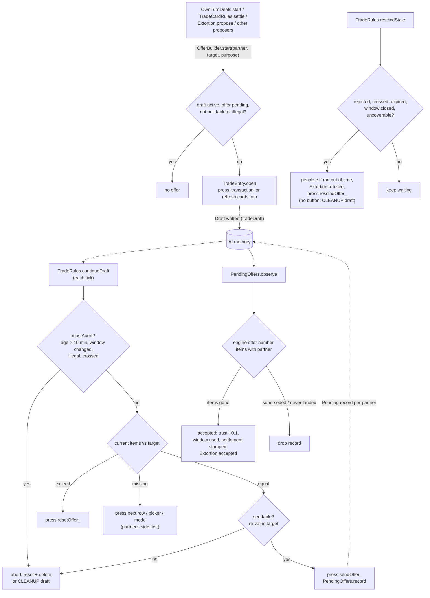
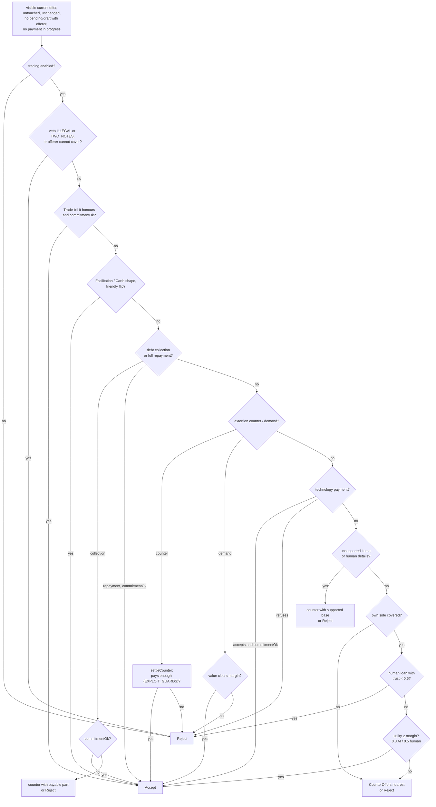

# Trading, deals, promises and promissory notes

Part of the [AI player architecture docs](/src/main/java/ti4/ai/README.md): a living document kept next to the code (packages: trade, deal, promise, promissory). The code is the source of truth; when you change behavior here, update this file.

## Components and responsibilities

Scope: `ti4.ai.trade`, `ti4.ai.deal`, `ti4.ai.promise`, `ti4.ai.promissory`. Every value below is in trade goods (TG),
the scale of [ValueScale](/src/main/java/ti4/ai/eval/ValueScale.java) (`TRADE_GOOD = 1.0`). Role labels: **decides**
(returns a choice), **evaluates** (scores options for a decider), **informs** (computes facts or state), **executes**
(presses buttons, posts messages or changes the game).

All rules are reached from the single brain [NekroBrain](/src/main/java/ti4/ai/nekro/NekroBrain.java), whose `rules`
list is evaluated in order every tick; the first rule that returns a decision wins. The trade entries sit in this
order (other rules omitted):

1. `PromissoryRules::observe`, `TradeRules::observe` (state updates; always return empty)
2. ... `ConvoysRules::next` (finishes a Trade Convoys play the turn logic opened) ... `CarthAgentRules::chooseTarget` ...
   `PromissoryRules::continuePlay` ...
3. `TradeRules::rescindStale`, `TradeRules::answerOffers`, `TradeRules::askWhatTheyWant`
4. `PromissoryRules::answerOffers`, `PromissoryRules::playCeasefire`, `PromissoryRules::playCombatNotes`
5. `ViscountUnlennSale::answer`, `SpeakerSale::answer`, `TradeRules::answerPromises`
6. `PromissoryRules::queueAgendaNote` ... `this::declineWhens` (calls `TradeRules.offerDiscardBounty`) ...
7. `TradeRules::payTheAnswerer`, `TradeRules::holdVoteForDeals`, `AgendaVoting::next`, ... `TradeRules::offerDeadlyPlotBounty`, ... `TradeRules::payDebtInAgenda`, `SpeakerSale::declare`
8. ... `CarthAgentRules::start`, ... `PromissoryRules::holdForCeasefire`
9. `TradeRules::continueDraft`, `TradeRules::settleTrade`, `TradeRules::carthDeal`, `TradeRules::carthPreWash`, `TradeRules::startDeals`, `TradeRules::awaitExtortion`
10. `DannelRules::holdTurn`, `this::takeTurn`, `StrategyCardRules::follow`, ...

So answering an incoming offer outranks starting one, finishing a half-built offer outranks starting a new one, and
all own-turn deals (and the wait for an extortion answer) run before the tactical/strategic action of the turn.

---

### TradeRules (facade)

- **Role:** informs (dispatch only).
- **Purpose:** the only public entry for the brain into `ti4.ai.trade`; almost every class behind it is
  package-private.
- **Invoked when:** method references in `NekroBrain.rules` (list above); `TradeRules.offerDiscardBounty` from
  `NekroBrain.declineWhens`; `noteGiveCost` from `ActionCardResponses.giveCost` and `MindsieveFollow`;
  `canTransact`/`ownTurnReplyMillis` from `SpeakerSale`; the Carth methods from `CarthAgentRules`.
- **Algorithm:** every brain rule entry except `answerOffers` (and `observe`, and `carthTarget`) returns empty when
  `AiSettings.isTradingEnabled()` is false (system property `ai.trading`, default `true`). `answerOffers` always runs
  so it can reject offers when trading is off. The helper entries `carthProposal`, `rememberCarthTarget`,
  `rememberedCarthTarget`, `humanDealPending`, `noteGiveCost`, `canTransact` and `ownTurnReplyMillis` are not gated.
  `PromissoryRules` is not gated by `ai.trading` at all (only `ConvoysRules.value` drops to 0 with trading off), so
  the AI still plays the notes it holds. With trading off, `StrategyCardRules.followTrade` still presses the free
  Trade follow for an AI holder or as Hacan, and `TradeCardRules.announce` is skipped. `TradeRules.carthAccepts`,
  `explainPayTheAnswerer`, `explainAvoidanceBribe` and `explainAvoidanceBribeAt` have no callers in
  `src/main/java` (only tests and trace tooling). `observe` runs, in order: `Trust.refresh`, `TradeEntry.observe`, `OfferRejections.observe`,
  `PendingOffers.observe`, `TradeCardRules.observe`, `HumanDealWatch.observe`, `PromiseDeals.observe`,
  `DiscardBountyDeals.observe`.
- **Effect on the game:** none itself.

### Deal model: Deal, DealItem, ItemType, Purpose

- **Role:** informs.
- **Purpose:** an engine-faithful representation of a transaction. [Deal](/src/main/java/ti4/ai/trade/Deal.java) is
  a list of [DealItem](/src/main/java/ti4/ai/trade/DealItem.java)s `(sender, receiver, type, detail)` parsed from
  the engine's transaction item strings `sending<A>_receiving<B>_<token>_<detail>`.
- **Inputs:** `Player.getTransactionItemsWithPlayer(other)` (`Deal.between`). The deal is always read from game
  state, never from message text.
- **Outputs:** totals per sender/type, `netTradeGoodsTo(faction)` (= TG received + commodities received − TG sent),
  a sorted `fingerprint`, an encoding for AI memory, and `sameAs`/`fitsWithin` comparisons over a summary keyed by
  parties, type and (for named items) detail.
- **Algorithm:** [ItemType](/src/main/java/ti4/ai/trade/ItemType.java) tokens: `TGs`, `Comms`, `SendDebt`,
  `ClearDebt`, `PNs`, `Frags`, `ACs`, `Planets`, `details`. Detail validation: amounts `\d{1,6}`; notes a hand
  number, `generic<n>` (the engine's "TBD" note) or an alias; fragments `(CRF|IRF|HRF|URF)\d{1,2}`; action cards a
  hand number or `generic<n>`; planets `[A-Za-z0-9]{1,40}`. Anything else becomes `UNSUPPORTED`. A faction name
  containing `_` is untradable (`DealItem.tradable`). Action cards in a deal between two players who cannot trade
  cards (neither has the `arbiters` ability or `tf-guildships`) are turned into `UNSUPPORTED` (`Deal.between`).
  [Purpose](/src/main/java/ti4/ai/trade/Purpose.java) tags why an offer was sent: settlements (`SETTLEMENT`,
  `SETTLEMENT_FEE`, `EVEN_WASH`, `FACILITATED_WASH`, `FACILITATION_SETTLE`), proposals (`WASH`, `SELL`, `NOTE_DEAL`,
  `FRAGMENT_DEAL`, `DESPERATION`, `TECHNOLOGY_REQUEST`, `TECHNOLOGY_HOLD`), favours (the two technology purposes),
  and `AGENT_TRADE`, `DEBT_PAYMENT`, `DEBT_COLLECTION`, `EXTORTION`, `COUNTER`, `CLEANUP`, `ADOPTED`.
  `SETTLEMENT`, `SETTLEMENT_FEE` and `DEBT_COLLECTION` "wait long for humans".
- **Limitations:** a note is identified by hand number for own notes and by alias (with `_` encoded as `fin9`) for
  another player's note.

### TradeLegality

- **Role:** informs.
- **Purpose:** who may transact now, and the per-window bookkeeping.
- **Algorithm:**
  - `canTransact(a, b)`: false if either is elected under `tf-censure`; true for the same player or in any
    agenda phase (`phaseOfGame` starting with `agenda`, LRR 94.6); in the action phase true when both have a space
    station, Age of Commerce mode, either has `guild_ships`, either has a Trade Convoys note
    (`convoys`, `sigma_trade_convoys`, `viability_trade_convoys`) in its play area, or they are neighbours
    (`Player.getNeighbouringPlayers(false)`, either direction; cached per game and last-modified date). It does not
    check that one of the two is the active player (LRR 94.1); see notes.
  - `isLegal(deal)`: debt-only deals are always legal; otherwise `canTransact`.
  - `window(game)`: action phase `turn|<activePlayerId>@<lastActivePlayerChange>`; agenda phase
    `agenda|<round>|<agendaCount>|<hash of currentAgendaInfo>`; otherwise `phase|<round>|<phase>`.
  - `openKey(purpose, deal)`: debt-only `SETTLEMENT_FEE` → `round|<n>`; agenda phase → the window; otherwise
    `action|<round>`. A pending offer whose open key changes is stale.
  - `useWindow` stores `tradeWindow|<window>|<partner>` in AI memory; `windowUsed` reads it; settlement, counter,
    cleanup and adopted purposes do not use a window; `releaseWindow` frees it only if the stored time matches.
- **Effect on the game:** none.

### TradeEntry and BuilderPrompts

- **Role:** executes (TradeEntry) / informs (BuilderPrompts).
- **Purpose:** reach and read the engine's transaction builder buttons.
- **Invoked when:** `OfferBuilder.start`, `idle`, `restart`; `TradeEntry.observe` in `TradeRules.observe`.
- **Algorithm:** [TradeEntry](/src/main/java/ti4/ai/trade/TradeEntry.java) presses the newest unowned `transaction`
  button whose message has been used fewer than 2 times (`MAX_USES`); it remembers the newest visible one
  (channel, message, custom id) and can press it from memory after it scrolls out. With none usable it presses a
  hidden `cardsInfo` button once per turn to have the bot repost the cards info, then waits up to 20 s
  (`REFRESH_WAIT_MILLIS`). [BuilderPrompts](/src/main/java/ti4/ai/trade/BuilderPrompts.java) classifies the newest
  untouched AI-thread prompt created since the last press (minus 5 s tolerance) as: `BUILDER` (has
  `sendOffer_<partnerColor>` and a `newTransact_SendDebt_<s>_<r>` row, whose direction tells "offering" vs "asking"
  mode), `PICKER` (no `sendOffer_` button, and every enabled `offerToTransact_` button parses as
  `offerToTransact_<type>_<s>_<r>_<detail>` with one shape between the two parties) or `PLAYER_PICKER` (an owned `transactWith_<faction or color>` button).

### OfferBuilder and Draft

- **Role:** executes.
- **Purpose:** build one offer with the engine's buttons, one press per tick, and send it.
- **Invoked when:** `TradeRules.continueDraft` (rule order 9) on every tick while a draft exists;
  `OfferBuilder.start` from every proposer (OwnTurnDeals, TradeCardRules, Facilitation, CarthDeals, Extortion,
  TechnologyRequest, NoteDeals, FragmentDeals, MilitarySupportDeals, CardSales, FriendlyTrade); `startCounter` from
  `OfferResponder.counter`; `startCleanup`/`queueCleanup` from `PendingOffers`.
- **Inputs:** a target `Deal`, a partner, a `Purpose`.
- **Outputs / decisions:** a press, a `Wait`, or empty.
- **Algorithm:**
  - `start` refuses when a draft exists, an offer to that partner is pending, the target is not buildable or not
    legal. Buildable: at most one own note; items from the partner may be TG, commodities, debt, a named note
    (alias), a planet or fragments; items from the AI may be TG, commodities, debt, fragments, or a note / action card
    given by hand number. It writes a [Draft](/src/main/java/ti4/ai/trade/Draft.java) (AI memory key `tradeDraft`)
    with a scope key (`window` for turn-bound purposes, else `openKey`), marks the window used (for windowed
    purposes) and logs the start time (for the hourly cap).
  - `continueDraft` each tick: abort if the draft is older than 10 min (`DRAFT_MAX_AGE_MILLIS`), its scope changed,
    it became illegal, an offer to the partner is pending, or the partner has a live current offer to it. If the
    current items exceed the target → reset (`resetOffer_<color>`). If they equal it → send. Otherwise press the
    next missing item in a fixed order: partner's commodities, TG, SendDebt, ClearDebt, fragments; then own
    ClearDebt, SendDebt, commodities, TG, fragments, note; partner's note; own action card; partner's planet ("asks
    before it gives", so an old Accept pressed mid-build only makes the partner pay). Pickers pick the largest amount
    ≤ what is missing and come back for the rest; a partner's note is matched by its card name, an own note by hand
    number.
  - Waiting: after each press it waits up to 20 s (`STEP_WAIT_MILLIS`) for the next prompt, then restarts once
    (`Draft.MAX_RESTARTS = 1`) by pressing `transaction` again, then aborts.
  - `send` re-checks the target right before pressing `sendOffer_<color>`: extortion needs coverable; favours need
    `commitmentOk`; proposals need coverable and `TradeValue.proposable`; counters need `TradeValue.acceptable`;
    others `commitmentOk`. On send it adds extortion details, records the pending offer, marks the window and clears
    the draft.
  - `abort` marks a settlement as `aborted`, clears the draft and, if items are left, presses the builder's
    reset then `deleteButtons`; with no builder visible it starts a `CLEANUP` draft (once per round per partner) that
    opens a fresh transaction to clear the items.
- **Effect on the game:** engine transaction items and an offer message to the partner.
- **Fallbacks:** restart once, then abort and clean up.
- **Limitations:** one draft at a time per seat (a single memory key). Evidence:
  [OfferBuilderTest](/src/test/java/ti4/ai/trade/OfferBuilderTest.java) `buildsTheTradeSettlementInNinePresses`
  checks the exact press sequence and that the builder's form, one-click wash, play-area return and Details buttons
  are never pressed; `asksBeforeItGives` checks the ordering.

### PendingOffers and Pending

- **Role:** informs and executes (rescind).
- **Purpose:** track each sent offer until it is accepted, rejected, superseded or stale; rescind stale ones.
- **Invoked when:** `PendingOffers.observe` (in `TradeRules.observe`), `TradeRules.rescindStale` (rule order 3);
  `record` from `OfferBuilder.send`.
- **Inputs:** AI memory `tradePending|<partner>` = `(offerNumber, sentAt, purpose, expiresAt, openKey,
  rescindTarget)`; the engine stored value `offerFrom<AI>To<partner>` (offer counter).
- **Algorithm:**
  - `follow`: engine counter below the record for more than 60 s → the send never landed, drop it. Counter above the
    record → superseded, drop it. Items with the partner gone → **accepted**: extortion `accepted` hook, trust
    `ACCEPTED_OFFER` (+0.1), window used, technology hold granted, settlement marked accepted and the follower stamped
    as paid (except `FACILITATION_SETTLE`). It also remembers the Rescind button once seen.
  - Reply timeouts (`replyTimeout`): extortion 5 min (AI) / 15 min (human); other offers to an AI 5 min; to a human
    24 h for `SETTLEMENT`, `SETTLEMENT_FEE`, `DEBT_COLLECTION`, else 12 h.
  - Staleness, first match wins: `REJECTED` (a rejection notice since it was sent), `CROSSED` (a live current offer
    from the partner: always against a human; against an AI only if the AI's faction sorts after the partner's or the
    partner's offer is newer than ours), `EXPIRED`, `WINDOW_CLOSED` (open key changed or deal no longer legal),
    `UNCOVERABLE` (`stillCovered`: the AI no longer holds its commodities, TG, debt tokens to clear, debt room, notes
    or named action cards, or the partner no longer holds the TG and commodities-or-TG it is asked for; fragments
    and the partner's debt items are not rechecked here).
  - `rescind`: penalise trust only when the reason is `EXPIRED`, or `WINDOW_CLOSED` with a human, and only if the
    partner could have covered its side: unpaid settlement → `FREE_FOLLOW_UNPAID` or `EXCLUDED_REPLENISH_UNPAID`
    (−0.3), unpaid collection → `COLLECTION_UNPAID` (−0.2). Extortion not crossed → `Extortion.refused`. Crossed
    settlement → `TradeCardRules.countered`. Press the newest `rescindOffer_<color>` (also the `_BMD_` black-market
    variant) or the remembered one; with none and no draft, start a cleanup draft. With no Rescind button while a
    draft is open it returns empty and keeps the record (it retries on a later tick).
  - `adoptOrphan`: items with a partner but no record (after restart or undo): if an unanswered Rescind button newer
    than the last build exists, adopt it as `ADOPTED`; otherwise queue a cleanup draft.
- **Effect on the game:** presses Rescind; changes trust and extortion state.
- **Evidence:** [PendingOffersTest](/src/test/java/ti4/ai/trade/PendingOffersTest.java)
  `rescindsAfterFiveMinutesWithAnAi`, `givesAHumanUntilTheWindowClosesOrADay`, `givesWayToAHumansCrossingOffer`,
  `theAiThatSortsFirstKeepsItsCrossingOffer`, `withdrawsWhenTheAiPartnerCounters`.

#### Diagram: Life of an offer the AI sends

Solid arrows are calls or decisions seen in code; dotted arrows are data read or written.



### IncomingOffer and OfferResponder

- **Role:** decides.
- **Purpose:** answer offers made to the AI: accept, counter or reject.
- **Invoked when:** `TradeRules.answerOffers` (rule order 3), every tick.
- **Inputs:** AI-thread prompts with an unowned `acceptOffer_<color>_<number>`, `rejectOffer_<color>` and
  `resetOffer_<color>` ("Reject and CounterOffer"); the deal from `Deal.between(offerer, seat)`.
- **Outputs / decisions:** press Accept, press Reject, or start a counter draft via `OfferBuilder.startCounter`
  (which presses the counter button).
- **Algorithm:** returns nothing while a payment is pending (`PaymentRules.isPending`). Per visible offer, newest
  first: skip if any of its three buttons was pressed or it was answered/stale; reject if the offerer's faction is
  untradable; mark stale (no answer) if the number is not the engine's latest offer number or the items are gone,
  or if the items changed since first seen (fingerprint stored on first sight); skip while an own offer to that
  partner is pending or a draft with it is open. `FriendlyTrade.observeOffer` updates relations. Then `verdict`,
  first match wins:
  1. trading disabled → reject.
  2. veto `ILLEGAL` or `TWO_NOTES` → reject; offerer cannot cover its side → reject.
  3. `TradeCardRules.honours` and `commitmentOk` → accept (below margin).
  4. Facilitation or Carth deal shape and `commitmentOk` → accept.
  5. `FriendlyTrade.acceptsFlip` → accept.
  6. a creditor collecting what is owed (`DebtRules.owedCollection`) → accept if `commitmentOk`, else counter with
     the payable part (`DebtRules.payablePart`, Purpose `DEBT_PAYMENT`), else reject.
  7. a debtor repaying in full (`DebtRules.repays`) and `commitmentOk` → accept.
  8. the extortion victim offering tribute while a threat is open (`Extortion.isCounter`, no details) →
     `settleCounter`: with `EXPLOIT_GUARDS` the tribute must be the asked item or worth ≥ `paymentFloor`
     (max(needed, 0.6 × demand value)), else refuse; otherwise any tribute settles.
  9. an extortion demand against the AI (`Extortion.isDemand`) → accept iff the valuation clears the margin.
  10. a technology payment (`TechnologyRequest.accepts` non-empty) → accept iff true and `commitmentOk`.
  11. unsupported items, or details from a human → counter with the supported base if it is acceptable and gives the
      partner ≥ 0, else reject.
  12. its own side not covered → nearest counter.
  13. a loan from a human (AI gives TG, human sends debt) with trust < 0.6 → reject.
  14. `TradeValue.of(...).clears(margin)` → accept; otherwise nearest counter (or reject).
  When the offerer was asked "what would you want" (`OfferRejections.answering`), a non-accept becomes a reject and
  drops the note deal for the round. A counter is skipped (offer left for later) if a draft is already active. At most
  2 counters per offerer per window (`MAX_COUNTERS`).
- **Effect on the game:** on accept: window used (unless debt-only), trust `PAID_DEBT` when the offerer pays debt to
  it, for a generic ("any note") ask it records which note it will give (`NoteGiving.owe`, read later by
  `ActionCardResponses.giveForcedNote`), honour and technology bookkeeping.
- **Evidence:** [OfferResponderTest](/src/test/java/ti4/ai/trade/OfferResponderTest.java)
  `countersTheSamePlayerAtMostTwicePerWindow`, `refusesToLendToAHumanItDoesNotTrust`.

#### Diagram: Verdict on an incoming offer (`OfferResponder.verdict`)



Not drawn: an offerer whose faction name contains `_` is rejected before the verdict; after the verdict, an offerer
who was asked "what would you want" (`OfferRejections.answering`) gets Reject for anything but an accept, and a
counter is left unanswered for a later tick while a draft is open. Counters are capped at 2 per offerer per window;
past the cap every counter branch becomes Reject.

### CounterOffers

- **Role:** evaluates and decides (the counter it proposes).
- **Purpose:** find the smallest edit of an incoming offer the AI would accept.
- **Invoked when:** `OfferResponder.nearest` and `withoutUnsupported`.
- **Algorithm:** `base` strips unsupported/details items, fragments the holder does not have, action cards that are
  not the AI's named cards, planets from the AI, and all of the partner's notes; keeps one own note (the held one
  with the lowest give cost); clamps every amount to what each side holds (AI commodities and TG after reserves, debt
  room). Moves: lower the AI's TG, commodities or SendDebt by 1–2; raise the partner's TG or commodities by 1–2
  within their stock; raise the partner's SendDebt by 1–2 only if the partner has no TG and no commodities and is an
  AI or trusted ≥ 0.6; drop the AI's note (cost 1). All combinations with total cost ≤ 3 are enumerated
  (`combine`). For cost 0, 1, 2, 3 in that order, the best-utility candidate that is non-empty, differs from the
  incoming deal, is coverable, clears margin + 0.25, and gives the partner ≥ 0 is returned.
- **Randomness:** none; ties resolved by stream max order.

### TradeValue, ComponentValues, Stinginess, Desperation, TradeBudget, Standings

- **Role:** evaluates.
- **Purpose:** the valuation used by every decider. Formulas in algorithms (section 6).
- **Key outputs:** `Valuation(selfGain, partnerGain, rivalry, leak, utility, veto)`; `margin(partner)` (AI 0.3,
  human 0.5); `acceptable` (coverable and clears margin); `proposal` (clears 0.5 and the partner wants it: for an
  AI partner its predicted own utility ≥ 0.3, for a human the AI's estimate of their gain ≥ 0.5);
  `commitmentOk` (no veto except `LEADER`, coverable); `coverable` = `ourSideCovered` and `theirSideCovered`.
- **Our side covered:** commodities ≤ spare commodities (minus commodities promised to others, minus commodities
  held for an AI Trade holder), TG ≤ spare TG (minus the scoring/gravity-drive/technology reserve and TG promised
  elsewhere), ClearDebt ≤ debt it holds from the partner, SendDebt ≤ `DebtRules.room`, the fragments, the notes in
  hand (or any giveable note for a generic ask), the named action cards, and no planets.
- **Their side covered:** TG ≤ their TG, commodities ≤ their commodities + TG left after the TG item, ClearDebt ≤
  debt they hold from the AI, SendDebt ≤ `DebtRules.room(partner, seat)`, fragments held.
- [TradeBudget](/src/main/java/ti4/ai/trade/TradeBudget.java) reserved TG = the TG part of
  `Wallet.plan(ScoringReserve + OpeningHold.gravityDriveReserve + TechnologyFollowReserve)`.
- [Standings](/src/main/java/ti4/ai/trade/Standings.java): real, non-eliminated players; VP and goal.

### DebtRules

- **Role:** evaluates (limits, payment shapes), decides and executes (agenda-phase payment).
- **Purpose:** the single debt gate and the debt-payment logic.
- **Invoked when:** `room` from `TradeValue`, `CounterOffers`, `TradeCardRules`, `Facilitation`, `Reoffer`,
  `PaymentValue`, `TechnologyRequest`, `PromiseDeals`, `PendingOffers`; `payInAgenda` from
  `TradeRules.payDebtInAgenda`; `payment`/`collection`/`defers` from `OwnTurnDeals`.
- **Algorithm:**
  - `room(debtor, creditor)` = min(4 − tokens the creditor holds from the debtor, 2 − (debt the debtor owes across
    the table + debt promised in unpaid pay-on-resolution promise deals)), floored at 0. `DEBT_CAP = 4`,
    `TABLE_DEBT_LIMIT = 2`: no deal can leave a player owing 3 or more in total.
  - `payment`: clear min(debt, spare commodities + spare TG), paying commodities first.
  - `collection`: ask for min(debt, their commodities) commodities then TG, clearing that much.
  - `defers`: do not pay a creditor who is near winning (`Stinginess.nearWin`) when the net TG would unlock a point
    for them.
  - `owedCollection`/`repays`: recognise an incoming collection/repayment shape.
  - `payInAgenda`: in the agenda phase, on a public prompt addressed to the AI with `sendTGTo_<faction>_…` buttons,
    press, in this order, `comm3`, `comm`, `tg3`, `tg` when the amount ≤ debt and ≤ free stock. It never presses the
    reminder's erase button.
- **Evidence:** [DebtRulesTest](/src/test/java/ti4/ai/trade/DebtRulesTest.java) `neverOwesThreeOrMoreAcrossTheTable`,
  `debtOwedToOneSeatLeavesNoRoomWithAnother`, `promisedDebtCountsTowardTheLimit` (read).

### Trust

- **Role:** informs.
- **Purpose:** how much the AI believes a human will pay or keep their word.
- **Algorithm:** AI seats always 1.0. Humans start at 0.8 (`HUMAN_START`), stored in AI memory key `tradeTrust`;
  events: `ACCEPTED_OFFER` +0.1, `PAID_DEBT` +0.1, `FREE_FOLLOW_UNPAID` −0.3, `EXCLUDED_REPLENISH_UNPAID` −0.3,
  `COLLECTION_UNPAID` −0.2; clamped to [0, 1]. With `PROMISE_DEALS` enabled, read trust is lowered by 0.3 per
  promise the player broke against this seat or left unpaid (`PromiseBook.brokenBy`). Thresholds used elsewhere:
  0.8 lower Trade fee / relations, 0.6 lending, 0.5 free follow and unsolicited offers. `refresh` rewrites the key
  once per round so the 500-entry memory does not evict it.
- **Limitations:** lives in the in-process [AiMemory](/src/main/java/ti4/ai/brain/AiMemory.java), cleared on restart
  and on undo (`AiSeatState.forgetAfterUndo`). Evidence: [TrustTest](/src/test/java/ti4/ai/trade/TrustTest.java)
  `trustSurvivesALongGameWithTheRoundlyRefresh`, `withoutTheRefreshTrustIsForgotten` (read).

### Relations and FriendlyTrade

- **Role:** informs (Relations), decides (FriendlyTrade).
- **Purpose:** a per-partner relations level that turns on free commodity flips and kinder Trade terms.
- **Algorithm:** [Relations](/src/main/java/ti4/ai/trade/Relations.java) `level` = personality start
  (`AiPersonality`: STOOGE 2, FLOATER 1, NEUTRAL 0, WARRIOR −1, WARLORD −2) + stored shift (seat stored value
  `aiRelations`) − floor(`Hostility.amount` / 2) − 1 if `AttackLedger.betrayalGrudge` > 0 − 1 if trust < 0.8, capped
  at 2. Good ≥ 1, bad ≤ −1 (`bad` uses trust 1.0). `improve`/`worsen` change the shift by 1 at most once per round
  per direction per partner, capped so the level cannot pass 2, persisted to the game.
  [FriendlyTrade](/src/main/java/ti4/ai/trade/FriendlyTrade.java): with a partner in good relations: accepts their
  commodities for at most as many of its TG (`acceptsFlip`) unless the TG could let them win; on its own turn, with
  no free commodities, offers once a round per partner to flip that partner's commodities 1:1 for its TG (`offerFlip`, Purpose
  `WASH`); as Trade holder charges them at most 1 (`chargesOneLess`). `observeTradeTerms` (AI as follower of an AI
  holder) improves relations when the fee is below standard, worsens them (while good) when the fee is above the
  friendly fee or they are excluded for anything but a win, and charges `Hostility` with the excess.
  `observeOffer` improves relations for an offer of full TG for its commodities and worsens/charges hostility for an
  offer charging more than allowed.
- **Callers outside scope:** `Relations.bad` from `VoteAnger` and `OffenseOutlook` (experiment `RELATIONS_ANGER`).

### OfferRejections and HumanDealWatch

- **Role:** informs; executes table talk.
- **Algorithm:** [OfferRejections](/src/main/java/ti4/ai/trade/OfferRejections.java) reads the bot's "has been
  rejected" notices in the AI thread (newer than the last seen), finds the rejector by name, and records the round and
  time. A rejected partner gets no unsolicited offer for the rest of the round (`coolingDown`). If the rejected offer
  asked for a note or fragment (`noteAsked`), a human is asked in table talk "what would you want for your X? Send me
  an offer." (`askWhatTheyWant`, rule order 3); their next offer within one round is accepted only if the normal
  verdict accepts, else rejected, and note deals with them stop for the round; an AI rejection just drops note deals
  for the round. [HumanDealWatch](/src/main/java/ti4/ai/trade/HumanDealWatch.java) expires the seat's latest pending
  `HumanAiDeal` (deadline, round change, or phase other than action), disables its buttons, and treats a denied or
  expired one as a rejection.

### OwnTurnDeals and DealSearch

- **Role:** decides.
- **Purpose:** which offer to start on its own turn or in the agenda phase.
- **Invoked when:** `TradeRules.startDeals` (rule order 9), `payTheAnswerer`, `holdVoteForDeals`.
- **Algorithm:** gate: trading on, no draft, < 12 drafts started in the last hour, < 3 pending non-settlement
  offers. Partners: legal partners whose window this turn is unused, with no pending offer, no open promise offer, no
  live offer to the AI, and not the AI Trade holder it is holding commodities for.
  - Action phase, only at the start of its own turn (active, no tactical action in progress or taken, no strategy card
    played this turn, no payment pending): pay debt (largest creditor first, unless deferred) → Hacan facilitation →
    [stop if 2 drafts this turn] → technology announcement → technology request → desperation purchase → extortion
    demand → territorial promise → 1:1 wash → friendly flip → note deal (not while holding an unplayed Trade) →
    fragment deal → Military Support → commodity sale → action-card sale → debt collection. Debt payment and
    facilitation run before the cap check and do not count; the technology announcement (a table-talk post) does not
    count either; only an offer started by the chain from the technology request onwards counts towards the
    2-per-turn cap.
  - Agenda phase: discard bounty → pay debt (creditors without a visible payment prompt) → collect → vote promises →
    avoidance bribes → wash with AIs whose faction sorts after its own → wash with humans.
  - Wash: free commodities ≥ 1; partners with ≥ 1 commodity that `mayApproach`; amount min(both); score =
    amount × (1 − rivalry); the first that is coverable and proposable is started.
  - Sell: only when no partner has commodities and it has ≥ 3 free; price = commodities − 1 TG.
  - Desperation: in the action phase, the smallest shortfall 1–3 TG that unlocks a point (`SpendUnlock.pointDelta`);
    at most 2 a round; lenders with TG ≥ need, rivalry < 0.6, AI or trust ≥ 0.6, ordered AI first, least rivalry,
    richest; packages = commodities need..need+3, all commodities plus 1–3 debt, need..need+3 debt, all commodities
    plus the least harmful note; each with give cost ≤ 0.75 × the point's value; `DealSearch.cheapest` picks the
    coverable, proposable package with the lowest give cost. If none and it has no scorable public objective, it
    offers its own Support for the Throne with the TG ask (gated by `ThroneSale`).
  - Collect: only from humans, once a round per debtor, when they hold something.
  - `mayApproach`: not cooling down; AI always; human only with trust ≥ 0.5 and fewer than 1 unsolicited offer this
    round.
- **Evidence:** [OwnTurnDealsTest](/src/test/java/ti4/ai/trade/OwnTurnDealsTest.java) `startsAtMostTwoDealsATurn`
  (read).

### TradeCardRules and TradeTerms

- **Role:** decides (follow choice, settlement), executes (announcement).
- **Invoked when:** `StrategyCardRules.play` → `recordPlay`; `StrategyCardRules` Trade primary → `announce`;
  `StrategyCardRules.followTrade` → `followChoice`, `followPressed`; `TradeRules.settleTrade` (rule order 9) →
  `settle`; `TradeRules.observe` → `observe`; `OfferResponder` → `honours`.
- **Holder side:**
  - `recordPlay` snapshots every other player's strategy tokens; followers whose token count dropped are
    `TOKEN` followers, others `FREE`.
  - `announce` posts terms per follower: `TradeTerms.feeFor` → a fee k (shown "X−k") or "Not offered (reason)";
    Masters of Trade (Hacan) "follows free anyway; I'll offer it an even wash"; plus the terms text.
  - `TradeTerms.standardFee`: 2 if the follower's commodity value ≥ 4, or it has more VP than the holder, or trust
    < 0.8; else 1; capped at value − 1. Friendly (`FriendlyTrade.chargesOneLess`): min(1, value − 1). Exclusions
    (in order): follower near win; for a friendly follower only "the payout could win" applies and the remaining
    checks are skipped; otherwise rivalry ≥ 0.6 ("leads"); trust < 0.5 ("unpaid debts"); rivalry ≥ 0.3 and the
    payout unlocks a point ("would let them score"). A Hacan follower gets no fee (`feeFor` is empty).
  - The TOKEN/FREE classification of each follower is made by `TradeCardRules.observe` (`observeFollows`), comparing
    the follower's strategy tokens with the snapshot `recordPlay` took.
  - `settle` (action phase, not paying, not mid tactical action, no draft): for each follower (AI first) not already
    settled/paid/pending and not in the restart baseline: a token follower or Hacan gets an even wash of
    min(free commodities, their commodities) if the two can transact now (else nothing); a free follower the holder
    can transact with now and with commodities ≥ fee + 1: ask all their commodities and pay back commodities − fee
    (own commodities first, then TG); if short of liquidity while other settlements are pending, wait up to 30 min
    (`LIQUIDITY_WAIT_MILLIS`) then ask for less; otherwise (no legal transaction now, or fewer than fee + 1
    commodities): fee 0 → nothing; fee in TG if they can transact now and hold the TG; else min(fee, debt room) as
    debt, nothing if the room is 0. Excluded followers are billed fee 2.
- **Follower side:** `followChoice`: Hacan follows free iff it gains ≥ 1; declines without its own Trade
  Agreement in hand; AI holder: free if `worthFollowingFree` (fee offered; not illegal-and-fee-over-debt-room; the
  holder could not win with the stack; legal: stack − fee − own-commodity value × current commodities ≥ 0.5; not
  legal: own-commodity × gain − 0.8 × fee ≥ 0); human holder: strategy token only when gain ≥ 4 and it has an
  outlet (and `StrategyCardRules` presses it only if it has a spare strategy token). After following an AI holder free it holds its commodities for that holder for 10 min
  (`reservedCommodities`, `holdsFor`). `honours`: accepts the holder's offer below margin when it followed an AI
  holder (or a human holder "forced" a replenish it had not pressed) and the offer fits the announced shape:
  holder gives only TG/commodities; AI gives one type; commodities ≤ its own and received ≥ given − 2; or a TG/debt
  fee ≤ 2.
- **Evidence:** [TradeCardRulesTest](/src/test/java/ti4/ai/trade/TradeCardRulesTest.java) and
  [TradeTermsTest](/src/test/java/ti4/ai/trade/TradeTermsTest.java) (test names read; bodies not read).

### Facilitation

- **Role:** decides.
- **Purpose:** an AI Hacan (Masters of Trade) washes for followers of another AI's Trade who cannot transact with the
  holder, and forwards the fee.
- **Algorithm:** applies when Hacan and the holder are AI seats and rivalry(holder → Hacan) < 0.6. Followers: not
  paid, not neighbours of the holder, with commodities, not feeding Hacan's rival, not yet offered; least rivalry
  first. Deal: Hacan receives sent = min(their commodities, free + fee) commodities and returns sent − fee
  (`FACILITATED_WASH`). Then `forward` sends the collected fees to the holder in TG then debt
  (`FACILITATION_SETTLE`). As a follower, `accepts` takes such an offer when it only moves commodities and Hacan keeps
  between the fee and 2.

### CarthDeals

- **Role:** decides.
- **Purpose:** use the Hacan agent Carth of Golden Sands on another player and buy the replenished commodities.
- **Invoked when:** `CarthAgentRules.start` (`TradeRules.carthTarget`, `carthProposal`),
  `TradeRules.carthDeal`/`carthPreWash` (rule order 9).
- **Algorithm:** gain to the target = 1 TG if their commodity value ≤ 4, else 2; when "stingy" (the target's
  rivalry toward Hacan is ≥ 0.6, or Hacan strictly leads in VP) max(standard, value / 2). Candidates: Hacan's
  rivalry toward the target < 0.6, legal, window unused, no pending offer, humans only if approachable, not already
  proposed to this turn, take = value − gain ≥ 2, gain ≤ Hacan's free commodities + TG; `bestPlan` also requires the target's current commodities
  ≤ the gain; best by take, then lower gain. For a human target it
  proposes a `HumanAiDeal` (exhaust agent on target, target sends `value` commodities, Hacan pays gain in commodities
  then TG; 12 h deadline). For an AI target it presses the agent and, after the replenish, sends an `AGENT_TRADE`
  offer. `preWash` runs on another player's turn (agent ready, action phase, no Trade card left unplayed) and washes
  the active player's commodities down to at most the gain when that makes the agent worth using on them. As target,
  `accepts` an offer after the agent is exhausted when the received goods meet `requiredGain`.

### NotesForTrade, NoteDeals, NoteSecrets

- **Role:** evaluates (NotesForTrade, NoteSecrets), decides (NoteDeals).
- **Algorithm (values):** received note value = max(0.25, base) + `NoteSecrets.value` (Support for the Throne is not
  floored: its base can be negative); base by kind: Support for the Throne (`ThroneValue.received`; its own Throne
  back: 1 + rivalry × the current holder's VP worth, or 1 if nobody holds it in play); Alliance (`AllianceValue`); Trade
  Agreement owner's commodity value − 1; Ceasefire (`CeasefireValue`, own back 1.0); Political Secret 3 (8 in the
  agenda phase when the agenda is important to its owner; 0.25 from a Galactic Threat owner; 1 from Xxcha; 2 when the
  viewer is that weak-voting owner itself and holds a rider); Trade Convoys 1.0 (own back 0.5); Military Support
  (`MilitarySupport.receivedBy`); notes it plays (`ra` 1.5, `gift` 1.0, `tekklar` 1.0, `antivirus` 0.5, `greyfire`
  0.5, `favor` 0.5, Acquiescence); others 0.3. Give cost of a foreign note = its receive value (− 0.3 when returning
  it to its owner). Own notes: Throne `ThroneValue.givenCost`; Alliance infinite to a Mahact (`hubris`) receiver,
  else `AllianceValue.givenCost`; Trade Agreement own value − 1; Ceasefire `CeasefireValue.givenCost`; Political
  Secret as above; Political Favor 5 + 1.0 × agenda phases left; Military Support; Convoys 1.0; Gift of Prescience;
  Acquiescence; Greyfire 0.5; other own notes 1.5. All floored at 0.25. `leastHarmful` = lowest give cost note in hand,
  excluding play-area notes and its own Throne, tie by `NoteGiving.giveRank`.
- **NoteDeals:** at most 2 a round, one per partner, only approachable partners (`OwnTurnDeals.mayApproach`), not
  with dropped partners. Candidates: each own note of kind
  Throne, Alliance (not to Mahact), Trade Agreement, Political Secret, Ceasefire or Convoys, sold for 1..min(6, their
  TG); each partner Throne or Alliance not in any play area (and their Ceasefire when the AI is under duress) bought
  for floor..min(6 or 9, spare TG); each one-for-one swap, plain or ±1 TG. Ranked by utility among
  coverable+proposable; the first that starts wins.
- **NoteSecrets:** when the AI holds Strengthen Bonds (and no foreign note in play) a play-area note is worth
  +0.9 × one point; Betray a Friend from a neighbour with none of their notes in play +0.4 × one point. The ask floor
  for such a note rises by 1/2/3 TG per previous ask (early/middle/late), from ceil(owner's give cost), at most 9.

### ThroneValue, ThroneTiming, ThroneSale

- **Role:** evaluates; ThroneSale is a veto in every valuation (`Stinginess.vetoes` → `THRONE`).
- **Algorithm:** received = `ThronePoint.gained` × keep chance − restriction − early cost + fit. Keep chance =
  (1 − min(0.2, 0.02 + 0.03 if neighbours + 0.02 × shared systems))^roundsLeft. Restriction per round: 0.4
  neighbours + 0.3 per shared system + 0.5 if the owner sits on Mecatol Rex the seat does not control, × rounds left,
  capped at 4. Given cost = max(0, retained − peace − fit) + early cost + tempo premium, where retained =
  min(0.75, 0.5 × roundsLeft / 4) × own VP worth; peace = min(2.5, border × aggression factor × fleet ratio clamped
  [0.5, 2]) with border 1.0 neighbours + 0.3 per shared system; fit = 1.5 for neighbours (aggressive factions: 1.5 ×
  partner fleet / strongest fleet); early cost 6 unless `ThroneTiming.open` (round ≥ 4, or round 3 late in the
  round, or both slices taken and tension); tempo premium = 0.5 × tempo lead × receiver's VP worth.
  `ThroneSale.allowed` (own Throne given): never when the receiver has a public path to win (VP + 1 + ready points
  ≥ goal); yes when it buys off an extortion that saves a point; no when a hidden path to win exists and the AI does
  not finish first (`WinRace`/`WinOdds`); otherwise only in a Throne swap, when the TG it receives unlock a point it
  cannot get from a public objective, or for ≥ 10 TG of value with no debt items.
- **Evidence:** [ThroneSaleTest](/src/test/java/ti4/ai/trade/ThroneSaleTest.java) (names read).

### Other component values: AllianceValue, CeasefireValue, ConvoysValue, MilitarySupport, TradePlanets, TradeActionCards, FragmentValue

- **Role:** evaluates.
- [AllianceValue](/src/main/java/ti4/ai/trade/AllianceValue.java): per-faction rows `(early, late, locked
  penalty)` (late from round 4); locked commander subtracts |penalty|; public buyer bonuses (e.g. Xxcha's for Nekro
  +2, Yin's for Deepwrought/Jol-Nar −3, Nomad's −4 when the buyer already has a flagship on the board); private
  bonuses only when the buyer's own hand is known; no commander → 0.25; Mahact receiver 0. Give cost = max(0.25,
  0.6 × best other buyer's value − 0.2 if neighbours). `lost` is called by `PlayAreaNotes`.
- [CeasefireValue](/src/main/java/ti4/ai/trade/CeasefireValue.java): stake = max(home: VP worth + 2 if the attacker
  outguns the home system; Mecatol: 0.5 × VP worth if held and outgunned); outgunned = incoming fleet cost ≥ max(8,
  1.5 × defense). Received = 0.75 × stake, else 0.5 (neighbour) / 0.2. Given = 0.5 under duress, else max(6, 0.5 ×
  stake against the receiver).
- [ConvoysValue](/src/main/java/ti4/ai/trade/ConvoysValue.java): worth 1.0, give 1.0, own back 0.5; `newPartners` =
  players it cannot transact with in the action phase.
- [MilitarySupport](/src/main/java/ti4/ai/trade/MilitarySupport.java): price 1 TG; lent only while the owner has no
  strategy tokens and never to a receiver with a public path to win; give cost 0.1 + 0.5 × tempo lead; received =
  max(1.5 + ground need or 0.9, min(2, spare infantry shortfall) × 1.0).
- [TradePlanets](/src/main/java/ti4/ai/trade/TradePlanets.java): planet value × min(3, rounds left), received at 0.5
  of that.
- [TradeActionCards](/src/main/java/ti4/ai/trade/TradeActionCards.java): only between card traders; received keep
  value minus the card it would have to discard; given: Sabotage and generic cards infinite, else keep value.
- [FragmentValue](/src/main/java/ti4/ai/trade/FragmentValue.java): relic value `RelicValue.BASE` (3.5) × (relics + 0.45 ×
  pairs + 0.2 × singles), unknown fragments filling the largest leftovers first; +2 per fragment up to 2 with
  Heretical Works; a fragment that completes a relic is worth +1 in a trade.

### Deal proposers for single items: FragmentDeals, MilitarySupportDeals, CardSales

- **Role:** decides.
- [FragmentDeals](/src/main/java/ti4/ai/trade/FragmentDeals.java): ≤ 2 a round, one per partner; sell one fragment for
  1–4 TG, buy one for 1–4, swap two different kinds plain or ±1 TG; best utility that is proposable.
- [MilitarySupportDeals](/src/main/java/ti4/ai/trade/MilitarySupportDeals.java): buy from the next unpassed player
  if it owns Military Support in hand with no strategy tokens and the AI wants infantry; sell its own when it has no
  strategy tokens and no unplayed Trade, to partners who want infantry and have no public path to win, ranked by
  value × (1 − rivalry) / (1 + lead). Once per partner per round, Purpose `NOTE_DEAL`.
- [CardSales](/src/main/java/ti4/ai/trade/CardSales.java): once a round, sell `ActionCardValue.spareCard` for 1–3 TG to
  a card-trading partner; best utility.

### Extortion

- **Role:** decides (demands and answers), informs (threat records).
- **Invoked when:** `OwnTurnDeals.ownTurn` → `propose`; `TradeRules.awaitExtortion` (rule order 9) → `await`;
  `OfferResponder` (`isCounter`, `isDemand`, `paysEnough`, `settle`); `TradeValue` (`relief`); `PendingOffers`
  (`accepted`, `refused`); `OfferBuilder.send` (`addDetails`).
- **Algorithm:** action phase only, < 2 demands a round (seat stored value `aiExtortionCount`). Takes
  `TacticalPlanner.ranked`; the best plan must be `ATTACK` or `RAID` with score > 0. needed = attack score − best
  score of a plan on another target (+ 2 TG per demand this victim already paid). Victims: approachable partners with
  units or planets in the target and no open threat this round. If the victim could win this round
  (`WinRace.canWinThisRound`) it only makes a demand that lets the AI finish first (`winningDemand`); otherwise
  `demandOf`: when the attack stops the victim scoring (home: ground forces land; elsewhere points at risk > 0) it first
  tries their Support for the Throne (not when the AI already has a public path to win or the point would reach its
  goal); when the attack itself scores, only the Throne is asked; else tribute: 1..min(5, their TG) TG, 1 fragment per
  kind held, each own note in hand except the Throne; must be worth > needed and ≤ 5 (the Throne demand has no ≤ 5
  cap), and the victim must accept it under the AI's own valuation of the victim (trust 0.6, with the threat's
  relief; for `winningDemand` this acceptance check applies to AI victims only); pick the highest worth, then lower
  cost to the victim; across victims the highest demand value. On send, a details item is added: "If you refuse I
  will attack X this turn. If you accept I will not attack it again this round." Reply 5 min (AI) / 15 min (human);
  `await` makes the active AI wait (poll every 15 s) until the earliest pending demand expires.
  Accepted and delivered → `settle` (target spared for the round via `ExtortionPlans.spare`, payer recorded,
  times paid + 1); accepted but not delivered, expired, rescinded or rejected → `refused` (`ExtortionPlans.commit`
  adds the demand value to that attack's plan score).
- **As victim:** the AI's valuation adds `relief` = the threat's loss (planets there + 0.5 × ship cost + ground
  forces and structures + points at risk × VP worth).
- **Evidence:** [ExtortionTest](/src/test/java/ti4/ai/trade/ExtortionTest.java) `extortsOnlyWhenTheDemandBeatsJustAttacking`,
  `asksForOneToFiveTradeGoodsOrAFragment` (read).

### TechnologyRequest and TechnologyAnnouncements

- **Role:** decides.
- **Purpose:** rounds 1–2 (`TechnologyTiming.LAST_DEAL_ROUND = 2`): pay the Technology holder 1 TG to play it soon
  (round 1 only), pay it to hold Technology until the AI can follow, or (as holder) ask a payer to pay for holding.
- **Algorithm:** two steps per round: first `announce` posts table talk ("<payer> sends <holder> N to ask them to
  play/hold Technology…" or "<holder> asks <payer> for N to hold…"), then a later own-turn tick `start`s the offer only
  if the same plan (partner, ask, direction) is still chosen within 20 min; otherwise it abandons for the round.
  Hold payment = `TechnologyTiming.holdPayment` in TG if affordable and it can still follow after paying, else as
  debt within room. As holder it accepts a 1–2 TG/debt payment when the announced (or, for humans, inferred) ask's
  value ≥ `TechnologyTiming.holdCost`/`earlyCost` and it has not committed to the opposite ask. An AI holder's fee
  ask is accepted by an AI payer only if that table-talk ask was seen.

### PromiseDeals, PromiseValue, PaymentValue, Reoffer

- **Role:** decides (proposals, answers), evaluates (values), executes (posts, bills).
- **Purpose:** deals the engine cannot enforce: promises recorded in `PromiseBook` and paid through transactions.
- **Invoked when:** `OwnTurnDeals` (`proposeOwnTurn`, `proposeVotes`), `TradeRules.answerPromises` (rule order 5),
  `TradeRules.observe` → `observe`; `VoteTurnDeals`, `AnswererDeals`, `AvoidanceBribes` → `postProposal`.
- **Gate:** experiment `PROMISE_DEALS` (enabled unless a seat or property disables it).
- **Territorial (own turn):** ≤ 2 non-declined territorial proposals a round; one deal per partner a round (a single
  declined offer may be re-offered, `Reoffer.mayDeal`); partner not a contender; AI partners must run
  `PROMISE_DEALS`. Options: if not extorting the partner, sell `NO_ATTACK` and `STAY_OUT` (their most exposed system);
  buy `NO_ATTACK` and `STAY_OUT` (its own most exposed). Protection value (`PromiseValue.protection`) = 0.75 × the
  extortion loss of the most exposed system where the seller outguns the buyer, has a tactical token and no token
  there. As buyer it values the protection at trust × that worth. Restraint cost (`PromiseValue.restraintCost`) = best forbidden plan score if it has more tactical tokens than
  better allowed targets, else max(0, best forbidden − best allowed). Seller price = floor(value − buyer minimum
  (0.3 AI / 0.5 human)) capped at their TG and 5; buyer price = max(seller's ask (AI sellers only), ceil(cost +
  seller minimum)); the proposer keeps ≥ 0.5. Best gain wins; tie prefers `STAY_OUT`.
- **Votes (agenda):** described under "Agenda promise deals" below.
- **Posting:** `Reoffer.improved` adjusts a re-offer after a decline (buyer adds 1 TG or debt, seller lowers by 1);
  a `Promise` is persisted, a non-TG payment attached, the window used (unless pay-on-resolution), and a public
  message is posted with Accept/Decline buttons owned by the partner; expiry 5 min (AI) or 15 min (human).
- **Answering:** pay an owed bill first (`aiPromisePay_` button, if affordable and the window is free); then for each
  own `aiPromiseYes_<id>` button: accept if `accepts`, else press `aiPromiseNo_<id>`. `accepts`: proposer not a
  contender, can transact, window unused, no pending bill between them, debt within room, then as promiser:
  `NOT_AGAINST` → `AnswererDeals.accepts`, `NOT_FOR` → `AvoidanceBribes.accepts`, otherwise `sells` (a `VOTE_FOR`
  only on an outcome it backs and when its votes are not committed elsewhere; pay chance ≥ 0.2; price ≥ its own ask
  and received × price − cost ≥ margin, where received = chance, times trust for pay-on-resolution deals); as promisee trust × protection − chance × price
  ≥ margin and spendable TG ≥ price (vote deals: within the Galactic Threat prediction cap). Finally post a bill for an
  `OWED` promise (by the payer itself, or by an AI payee to a human payer).
- **Observing:** own open offers expire at their deadline or when no longer open (new round, votes cast, proposer's
  turn over); `ACCEPTED` → `PromisedVotes.verdict` (votes) or `PromiseChecks.territorial`; a kept pay-on-resolution
  promise becomes `OWED` with a 15 min grace (`Promise.OWED_GRACE_MILLIS`); an `OWED` one past due, outside its agenda,
  with the parties able to transact, becomes `UNPAID`.
- **Evidence:** [PromiseDealsTest](/src/test/java/ti4/ai/trade/PromiseDealsTest.java) (names read).

### Agenda promise deals: VoteTurnDeals, AnswererDeals, AvoidanceBribes, RiderExtortion, DiscardBountyDeals

- **Role:** decides.
- **Gates:** `PromiseDeals.conditional` = `PROMISE_DEALS` and `CONDITIONAL_VOTE_DEALS`; plus `PAY_THE_ANSWERER`,
  `AVOIDANCE_BRIBES`, `RIDER_EXTORTION`, `DISCARD_BOUNTIES` respectively. Conditional deals pay only after the agenda
  resolves the agreed way (`paysOnResolution`).
- [VoteTurnDeals](/src/main/java/ti4/ai/trade/VoteTurnDeals.java) (`TradeRules.holdVoteForDeals`, before
  `AgendaVoting::next`): on its vote turn, once per agenda, propose vote deals; then wait for an answer to its own
  open `VOTE_FOR` offer, or up to 60 s for an AI buyer with TG to offer.
- `PromiseDeals.proposeVotes`: ≤ 4 offers an agenda when conditional (else 2), skipped during a boat float. Sells its
  votes (`VoteDeals.bestSale`) only on an outcome it already backs and only when not committed elsewhere (queued
  after, unplaced rider, abstained); buys votes (`VoteDeals.bestPurchase`) or, conditional, a bloc of later voters;
  rider extortion (`RiderExtortion.offer`, `NOT_AGAINST`): sell its abstention to the holder of a rider on an outcome
  it opposes, price ≤ floor(0.5 × rider payoff). The proposal with the highest gain is posted (the comparator is
  named `LIGHTEST_VOTE_DEAL` but is used with `max`), tie prefers `NOT_AGAINST`.
- [AnswererDeals](/src/main/java/ti4/ai/trade/AnswererDeals.java) (`TradeRules.payTheAnswerer`): before its own
  vote, if its planned ballot leaves it ≥ 1 TG worse, pay a player voting after it to stay out (`NOT_AGAINST`),
  price = least + ceil(0.75 × (most − least)); falls back to debt/notes via `PaymentValue.cheapestCovering`; then
  waits for the answer.
- [AvoidanceBribes](/src/main/java/ti4/ai/trade/AvoidanceBribes.java): on `execution` or `redistribution` in the voting
  phase, pick the dreaded outcome (≥ 10% likely and ≥ 2 TG worse than the average of the others), and pay a voter
  whose best ballot is that outcome not to vote for it (`NOT_FOR`); ≤ 2 an agenda.
- [DiscardBountyDeals](/src/main/java/ti4/ai/trade/DiscardBountyDeals.java): in the "when" window
  (`NekroBrain.declineWhens` and the agenda branch of `OwnTurnDeals`) post a public offer of TG to whoever plays Veto
  and/or to the Quash player; in the Deadly Plot window a Deadly Plot bounty; nothing is paid unless the card is
  played. `observe` then turns a claim (card play found in `GameStats.getActionCardPlays` after the bounty, or the
  agenda quashed) into an `OWED` `DISCARD_AGENDA` promise to bill.

### PromiseDealButtons

- **Role:** executes.
- **Purpose:** the `@ButtonHandler`s for `aiPromiseYes_`, `aiPromiseNo_`, `aiPromisePay_`, pressed by humans or AI seats.
- **Algorithm:** accept: offer still open and the presser a party; the two can transact; the payer can afford it
  (TG held, notes in hand). Pay-on-resolution: save `ACCEPTED` (with protected positions) and announce. Otherwise run
  the payment immediately with `HumanAiDealRunner.run` (TG, debt, notes from promisee to promiser) and save
  `ACCEPTED`. Pay: run the payment and save `PAID`. Decline: save `DECLINED` (the buttons are deleted even when the
  offer is no longer open). The button handlers do not recheck the debt room (`DebtRules.room`); only the AI side's
  `PromiseDeals.accepts` does, and `HumanAiDealRunner.validate` does not check debt steps.

### ti4.ai.deal: HumanAiDeal, HumanAiDealStore, HumanAiDealMessage, HumanAiDealRunner, HumanAiDealButtons

- **Role:** executes.
- **Purpose:** multi-step deals that the transaction builder cannot express (a leader exhaust plus transfers), offered
  to a human as an embed with Accept/Deny buttons; also the transfer executor for promise, speaker-sale and Viscount
  Unlenn payments.
- **Invoked when:** `AiTickRunner` posts `AiDecision.Propose` via `HumanAiDealMessage.post` (only `CarthDeals.propose`
  returns `Propose`); `HumanAiDealRunner.run`/`validate` from `HumanAiDealButtons`, `PromiseDealButtons`,
  `SpeakerSaleButtons`, `ViscountUnlennSaleButtons`.
- **Algorithm:** a deal is stored in game stored value `humanAiDeal|<id>`, with `humanAiDealLatest|<aiFaction>`
  pointing to the newest (posting a new one deletes the previous record). `validate`: both players present; not
  expired (deadline, round, phase must be `action`); simulate each step on running balances (commodities, TG; notes
  must be held; an agent exhaust must still be ready and the target's commodity gap still ≥ the expected gain).
  `run`: batches consecutive transfers into the AI's transaction items with the human and calls the engine's
  `TransactionHelper.acceptTransactionOffer` (made public in this branch), pressing the agent between batches via
  `AgentLifecycle.press`. The offer is posted in the main actions channel (the human's private channel in Fog of War
  games). Buttons are owned by the human (`ComponentIdEnvelope.ownedBy`); another player's press is
  ignored; an answered deal cannot be accepted again.
- **Evidence:** [HumanAiDealTest](/src/test/java/ti4/ai/deal/HumanAiDealTest.java) (names read).

### ti4.ai.promise: Promise, PromiseBook, PromiseChecks, PromisePayment, Presence

- **Role:** informs.
- [Promise](/src/main/java/ti4/ai/promise/Promise.java): `(id, term, promiser, promisee, proposer, round, agenda,
  target, votes, price, status, offeredAt, expiresAt, guarded, held)`. Terms `VOTE_FOR`, `NOT_AGAINST`, `NOT_FOR`,
  `NO_ATTACK`, `STAY_OUT`, `DISCARD_AGENDA`. Statuses `OFFERED`, `ACCEPTED`, `DECLINED`, `EXPIRED`, `KEPT`, `BROKEN`,
  `VOID`, `OWED`, `PAID`, `UNPAID`. On acceptance it snapshots `guarded` (NO_ATTACK: systems with the promisee's units
  or planets and no promiser token; STAY_OUT: the target unless the promiser already has a token) and `held`
  (territorial: systems with the promiser's presence and no promisee token). `binds` = accepted, or the promiser's own
  open territorial offer.
- [PromiseBook](/src/main/java/ti4/ai/promise/PromiseBook.java): game stored value `aiPromises`, at most 48 records,
  keeping this round's plus `BROKEN`/`OWED`/`UNPAID` ones. `bindingOn` (AI promisers with `PROMISE_DEALS` only),
  `bindingFor`, `brokenBy`, `brokenAgainst`, `forbidsActivating` (used by `TacticalPlanner.offLimits`).
- [PromiseChecks](/src/main/java/ti4/ai/promise/PromiseChecks.java): `territorial`: older round → `KEPT`; the
  promiser has a command token in a guarded system and (NO_ATTACK) units there or the promisee present, or (STAY_OUT)
  own ships there not standing on its own space dock → `BROKEN`; the promisee activated a held system with presence →
  `VOID`; status or agenda phase → `KEPT`. `withoutLeftSystems` drops guarded systems the promisee left.
- [PromisePayment](/src/main/java/ti4/ai/promise/PromisePayment.java): optional `(TG, debt, notes)` per promise in
  `aiPromisePayment|<id>`; default is `price` TG.
- **Evidence:** [PromiseBookTest](/src/test/java/ti4/ai/promise/PromiseBookTest.java) (names read).

### ti4.ai.promissory: PromissoryRules and its parts

- **Role:** decides and executes (plays notes the AI holds).
- [PromissoryRules](/src/main/java/ti4/ai/promissory/PromissoryRules.java): facade wired into `NekroBrain`.
- [NoteHand](/src/main/java/ti4/ai/promissory/NoteHand.java): remembers every visible `resolvePNPlay_<note>` button;
  presses the visible or remembered one; otherwise presses `refreshPNInfo` or `cardsInfo` once per turn and scope,
  then waits up to 20 s (poll 3 s).
- [NoteOffers](/src/main/java/ti4/ai/promissory/NoteOffers.java): within 10 min of the prompt, Trade Agreement
  (`useTA_<color>`) taken when the owner has commodities, else declined; Research Agreement taken for a technology
  with `ResearchPolicy.value` ≥ 2, else declined; Military Support played at the start of the owner's turn (owner
  active, prompt this turn, no action summary yet), then the 2 infantry placed on the planet with the highest ground
  need, then front-line value (waits up to 30 min for the target buttons); Gift of Prescience pre-played in the strategy
  phase.
- [CeasefireRules](/src/main/java/ti4/ai/promissory/CeasefireRules.java): as holder, play the active player's
  Ceasefire when they have activated a system holding the AI's units, have not moved yet, and have ships that could
  reach it (`MovementGraph.reach` with gravity drive). As owner whose Ceasefire is out: `holdForHolder` waits 2 min
  (`HOLDER_GRACE_MILLIS`) once per turn after activating a system where any human has units, before it moves (only
  when its remembered plan moves ships or no plan is remembered); `blocksMovement` (called by
  `TacticalRules`) holds position if its Ceasefire came back this turn; `blockChance` feeds planning.
- [CombatNotes](/src/main/java/ti4/ai/promissory/CombatNotes.java): before either side has rolled: Antivirus against
  Nekro when Nekro could copy one of its technologies; Greyfire Mutagen on a planet with ≥ 2 enemy ground forces
  including infantry (not against the note's owner), then pick the target within 60 s; Tekklar Legion in a ground
  combat against the owner, or when it does not have 3× the opponent's ground forces.
- [AgendaNotes](/src/main/java/ti4/ai/promissory/AgendaNotes.java): in the "when" window: Political Favor when Xxcha
  has a strategy token and `AgendaPolicy.veryBadFor`; else a foreign Political Secret (not Absol's) when silencing its
  owner improves the predicted election score by ≥ 3.
- [ConvoysRules](/src/main/java/ti4/ai/promissory/ConvoysRules.java): for a Trade Convoys note it holds from
  another player, value = 1.0 × new trade partners × min(2, rounds left) (0 with trading off); played (component
  action, then `ConvoysRules::next` presses `componentActionRes_pn_<note>`) instead of a tactical action whose score
  is below value + stall value, or as the last action before passing.
- [PlayAreaNotes](/src/main/java/ti4/ai/promissory/PlayAreaNotes.java): records notes in its play area at the start of
  its action; `adjustedScore` (called by `TacticalPlanner`) subtracts the loss of notes returned on activating their
  owner's units (Throne: `ThronePoint.lost`; Alliance: `AllianceValue.lost`; others 1.0) and, for plans that move,
  0.75 × score × Ceasefire block chance.
- [NoteGiving](/src/main/java/ti4/ai/promissory/NoteGiving.java): give order for forced gives (Ceasefire, Trade
  Agreement, Political Secret, other, Alliance, Throne; returning to the owner first); Military Support withheld
  while the owner has strategy tokens; `owe`/`owed` carry the note chosen in a generic ask to
  `ActionCardResponses.giveForcedNote`. `NoteGiving.leastHarmful` exists but has no caller in `src/main/java`.
- **Evidence:** tests in [src/test/java/ti4/ai/promissory](/src/test/java/ti4/ai/promissory) (names only, not read).

### RaisableTradeGoods

- **Role:** informs.
- **Purpose:** tells strategy code how many TG trading could raise this round.
- **Algorithm:** `byWashing` = max over AI partners transactable in the action phase of min(spare commodities, their
  commodities); `fromRivalTrade` (Hacan only) = max over AI holders of an unplayed Trade of min(own value, their
  value). Both 0 with trading off.
- **Callers:** `OpeningOutlook`, `TechnologyTiming`.

### Speaker sale (outside scope, uses this scope)

[SpeakerSale](/src/main/java/ti4/ai/strategy/SpeakerSale.java) (experiment `SPEAKER_SALE`) is in `ti4.ai.strategy`.
It uses `TradeRules.canTransact` to require that seller and buyer can transact, `TradeRules.ownTurnReplyMillis` for
its 5 min / 15 min deadlines, and `HumanAiDealRunner.validate`/`run` (in `SpeakerSaleButtons`) to move the TG when the
buyer presses Buy. While Politics is resolved the AI offers the speaker token to its right-hand neighbour for 2 TG
(late game, when the buyer leads: the buyer's full gain), on the condition that the seller names the strategy card it
wants next strategy phase and the buyer leaves it.

## Scenarios

### Trading, deals, promises and promissory notes

"AI" is the AI seat deciding; "partner" the other party. Values in TG. Links to classes are in
components (section 4).

| Scenario | Trigger | Handled by | Choices considered | How it chooses | Outcome / fallback |
| --- | --- | --- | --- | --- | --- |
| Incoming offer, ordinary | Accept/Reject/Counter buttons in the AI thread with the engine's latest offer number | `OfferResponder.answer` | accept, counter, reject | ordered verdict list; value utility ≥ margin (0.3 AI, 0.5 human) | press Accept; else nearest counter (cost ≤ 3, margin + 0.25); else Reject |
| Incoming offer with items changed after first sight | fingerprint differs | `OfferResponder.changedSinceSeen` | none | marks stale | not answered at all |
| Incoming offer while its own offer to that partner is pending, or a draft with it is open | `PendingOffers.with`, `OfferBuilder.partner` | `OfferResponder.waitsFor` | none | skip | answered on a later tick (or the crossing rule rescinds its own first) |
| Offer containing an action card between non-card-traders, or free-text details from a human | `UNSUPPORTED`/`DETAILS` items | `OfferResponder.withoutUnsupported` | counter without those items, reject | counter only if acceptable and partner gain ≥ 0 | counter or reject |
| Offer asking for two notes, or illegal | veto `TWO_NOTES`/`ILLEGAL` | `OfferResponder.verdict` | reject | fixed | Reject |
| Loan request from a human | AI gives TG, human sends debt | `OfferResponder.verdict` | reject / evaluate | trust < 0.6 → reject | reject, or normal valuation |
| Third uneven offer from the same player in one window | counter count ≥ 2 | `OfferResponder.mayCounter` | reject | cap 2 | Reject |
| Trade follower bill from an AI holder it followed | holder played Trade, AI followed | `TradeCardRules.honours` | accept below margin | fits announced shape | Accept once a round |
| Debt collection from its creditor | partner clears AI's debt for TG/commodities | `DebtRules.owedCollection` | accept, counter with payable part, reject | `commitmentOk` | Accept or `DEBT_PAYMENT` counter |
| Its own pending offer is rejected | bot's "has been rejected" notice | `OfferRejections.observe`, `PendingOffers.rescindStale` | rescind | staleness `REJECTED` | Rescind, no trust penalty, no unsolicited offer to that player this round; maybe table-talk question |
| Its own pending offer unanswered | timeout (AI 5 min; human 12 h / 24 h) or phase change | `PendingOffers.rescindStale` | rescind | `EXPIRED` / `WINDOW_CLOSED` | Rescind; trust penalty for unpaid Trade bills/collections the human could cover |
| Crossing offers | both sent offers to each other | `PendingOffers.crossed` | keep, rescind own | human always wins; between AIs the faction sorting first keeps, unless the partner's offer is newer (a counter) | Rescind own; then answer theirs |
| Start of own turn, owes debt | creditor holds its debt tokens | `OwnTurnDeals.payDebt` | creditors by debt desc | first payable, not deferred | `DEBT_PAYMENT` offer |
| Start of own turn, short of TG for a spend objective | shortfall 1–3 TG unlocks a point | `OwnTurnDeals.desperation` | commodity/debt/note packages; own Throne | cheapest give cost ≤ 0.75 × point value, proposable | `DESPERATION` offer, max 2 a round |
| Start of own turn, free commodities and partners with commodities | wash candidates | `OwnTurnDeals.wash` | partners | amount × (1 − rivalry), proposable | `WASH` offer |
| Free commodities, no partner has commodities | ≥ 3 free commodities | `OwnTurnDeals.sell` | partners with TG ≥ price | 1 − rivalry | sell commodities for commodities − 1 TG |
| No free commodities, friend has commodities | good relations | `FriendlyTrade.offerFlip` | partners | largest amount | 1:1 commodity-for-TG flip, once a round per partner |
| Note deals | own turn, no unplayed Trade | `NoteDeals.propose` | sell own note 1–6 TG, buy partner's Throne/Alliance/Ceasefire, swaps | best utility, proposable | `NOTE_DEAL`, max 2 a round |
| Trade Convoys instead of a tactical action | Own action turn, a Trade Convoys note from another player in hand, no action taken | `ConvoysRules.insteadOfTacticalAction` / `beforePassing`, then rule `ConvoysRules::next` | play now, before passing, or keep | value = 1.0 × new trade partners × min(2, rounds left); plays when the best tactical plan scores below value + stall value, and always as the last action before passing when value > 0 | opens the component action menu, then presses `componentActionRes_pn_<note>`; value 0 with trading off |
| Fragment deals | own turn | `FragmentDeals.propose` | sell/buy 1 for 1–4 TG, swaps | best utility | `FRAGMENT_DEAL`, max 2 a round |
| Military Support | own turn, no strategy tokens | `MilitarySupportDeals` | buy from next player / sell to wanters | proposable; score value × (1 − rivalry) / (1 + lead) | `NOTE_DEAL` at 1 TG |
| Extortion | best tactical plan is an attack/raid on a partner | `Extortion.propose` | tribute items, Throne | worth > attack − next best, ≤ 5, victim would pay | `EXTORTION` offer with details; wait for answer; spare or commit |
| AI is the extortion victim | offer from extorter matching an open threat | `OfferResponder.verdict` | accept, reject | valuation includes relief = threatened loss | Accept or Reject |
| Played Trade | Trade primary | `TradeCardRules.announce`, `settle` | per-follower fee, exclusion | `TradeTerms.feeFor` | terms post, then one bill per follower |
| Following an AI's Trade | Trade secondary | `TradeCardRules.followChoice` | free, decline | `worthFollowingFree` | press free follow; hold commodities 10 min |
| Following a human's Trade | Trade secondary | `TradeCardRules.followChoice` | token, decline | gain ≥ 4 and outlet | press token follow or nothing |
| Hacan facilitation | another AI's Trade played, followers not neighbours of holder | `Facilitation.start` | followers | least rivalry | `FACILITATED_WASH`, then `FACILITATION_SETTLE` to holder |
| Carth of Golden Sands | Hacan's own turn with agent ready | `CarthDeals`, `CarthAgentRules` | targets | take, then smaller gain | human: `HumanAiDeal` embed; AI: agent then `AGENT_TRADE` |
| Technology timing deal | rounds 1–2, Technology unplayed | `TechnologyRequest` | play early, hold, ask fee | value vs `TechnologyTiming` costs | table talk, then offer next tick |
| Territorial promise | own turn, `PROMISE_DEALS` | `PromiseDeals.proposeOwnTurn` | sell/buy `NO_ATTACK`, `STAY_OUT` | best gain (tie `STAY_OUT`) | public offer with Accept/Decline |
| Promise offer to the AI | owned `aiPromiseYes_` button | `PromiseDeals.answer` | accept, decline | `accepts` | press Accept or Decline |
| Vote deals | agenda, its vote turn | `VoteTurnDeals.hold`, `PromiseDeals.proposeVotes` | sell votes, buy votes, bloc, rider extortion | highest gain (tie `NOT_AGAINST`) | offer, then wait |
| Pay the answerer | agenda, before its vote, planned ballot ≤ −1 TG | `AnswererDeals.propose` | later voters | best gain | `NOT_AGAINST` offer, then wait |
| Avoidance bribe | Execution/Redistribution voting | `AvoidanceBribes.propose` | voters whose best ballot is the dreaded outcome | best gain | `NOT_FOR` offer |
| Discard bounty | "when" window or Deadly Plot window | `DiscardBountyDeals` | Veto, Quash, Deadly Plot bounties | expected loss caps | public post; bill on claim |
| Owed promise bill | `OWED` promise | `PromiseDeals.postOwed`, `payOwed` | pay, post bill | affordability, window | Pay button / bill message |
| Debt in the agenda phase | bot's debt reminder with `sendTGTo_` buttons | `DebtRules.payInAgenda` | comm3, comm, tg3, tg | fixed order | press a Send button; never erase |
| Holding someone's note | play window for that note | `ti4.ai.promissory` | play, decline | per-note rules | press play/decline |
| Speaker sale | Politics resolved by the AI | `SpeakerSale` (outside scope) | right neighbour buyer | price 2 TG or full gain | offer post; transfer via `HumanAiDealRunner` |
| Trading disabled | `-Dai.trading=false` | `TradeRules`, `OfferResponder` | none | — | rejects all offers, starts none; still plays held promissory notes (`PromissoryRules` is not gated) and still follows Trade free for an AI holder or as Hacan (`StrategyCardRules.followTrade`) |

#### Answering an incoming offer

- **Trigger:** a prompt in the AI's private thread with an unowned `acceptOffer_<color>_<n>`, `rejectOffer_<color>`
  and `resetOffer_<color>`, where `n` equals the game's stored `offerFrom<offerer>To<AI>` and items exist.
- **Responsible:** `OfferResponder.answer`, rule order 3 (before any own deal).
- **Choices:** Accept, Counter (via `OfferBuilder.startCounter`), Reject, or no answer (stale, changed, waiting).
- **Selection:** the ordered `verdict` list in [section 4](#incomingoffer-and-offerresponder). Special
  shapes are tested before the general valuation: Trade bills it agreed to, Hacan facilitation, Carth, friendly flips,
  debt collections and repayments, extortion, technology payments.
- **Constraints:** coverage on both sides; the debt room; per-window counter cap; payment in progress blocks all.
  An offerer whose faction name contains `_` is rejected before any of this. If the offerer was asked "what would
  you want" this round or last (`OfferRejections.answering`), anything but an accept becomes a Reject.
- **Interactions:** acceptance consumes the transaction window (except debt-only deals); records trust for debt
  repaid; a generic note ask records which note to give.
- **Why similar offers differ:** the same 3-for-3 commodity wash is accepted from an AI at utility ≥ 0.3 but needs
  ≥ 0.5 from a human; it is refused (countered) while the AI holds its commodities for an AI Trade holder (10 min after
  following free); a loan is refused to a human below trust 0.6 but evaluated normally from an AI.
- **Limitations:** an offer whose items change after first sight is never answered by the AI (it is marked stale and
  left to the human/engine).

#### Building and sending an offer

- **Trigger:** any proposer's `OfferBuilder.start`.
- **Steps:** `transaction` → `transactWith_<partner>` → mode toggle → item row → picker amount, repeated per missing
  item in a fixed order (partner's side first) → `sendOffer_<color>`. One press per tick, up to 20 s wait per step.
- **Fallback:** one restart; then reset + delete the builder; if items were left with no builder visible, a
  `CLEANUP` draft opens a new transaction to clear them (once per round per partner).
- **Re-check before sending:** the target is valued again (`OfferBuilder.sendable`); a target that stopped being
  worth it is aborted.

#### Trade strategy card as holder

- **Trigger:** the AI plays Trade (`StrategyCardRules.play` → `recordPlay`), then the primary resolution
  (`StrategyCardRules` → `TradeCardRules.announce`).
- **Choices per follower:** fee k ∈ {0, 1, 2} (capped at value − 1) or exclusion (near win, could win, leads, unpaid
  debts, would score); Hacan gets an even wash.
- **Settlement:** one offer per follower (AI followers first), as described in
  [section 4](#tradecardrules-and-tradeterms); the purpose `SETTLEMENT`/`SETTLEMENT_FEE` does not
  consume a transaction window.
- **Waiting:** when it lacks free commodities + TG to pay a follower and other settlements are still pending, it waits
  up to 30 minutes for them, then asks for fewer commodities.
- **Trust:** a human who followed free and let the bill expire (when they could pay) loses 0.3; an excluded human who
  replenished and did not pay the 2-TG fee also loses 0.3.

#### Following someone else's Trade

- **AI holder:** follow free only when `TradeTerms.feeFor` (computed from the holder's side with trust 1) offers a fee,
  the holder could not win with TG equal to the follower's commodity value, and the follow is worth ≥ 0.5 net of
  what its current commodities were worth; without a legal transaction now, only when the fee fits the debt room
  and the gain is worth more than the debt.
- **Human holder:** a strategy token only when the replenish gains ≥ 4 commodities and the AI has an outlet to wash
  them. Except as Hacan (Masters of Trade follows free whenever it gains ≥ 1 commodity), it never presses the free
  button for a human holder; if the human's primary replenished it anyway
  ("forced"), it honours that holder's bill once.
- **No own Trade Agreement in hand:** it declines (the replenish would go to the agreement's holder). Hacan is decided
  before this check, so it follows free regardless.

#### Extortion demand

- **Trigger:** start of own turn in the action phase; best `TacticalPlanner` plan is an attack/raid.
- **Choices:** per victim at the target: trade goods 1–5, one fragment of a kind they hold, one of their own notes in
  hand, their Support for the Throne.
- **Selection:** the demand must be worth more than (attack score − best other plan score + 2 × times this victim has
  paid) and at most 5, and the AI's own model of the victim must accept it. The highest-value demand across victims
  wins.
- **Waiting:** the AI keeps its turn (`TradeRules.awaitExtortion` before `takeTurn`) until the reply deadline (5 min
  AI, 15 min human), polling every 15 s.
- **Outcome:** paid and delivered: the system is spared for the round, and every other plan against the payer is
  halved unless it is the AI's only scoring plan (`ExtortionPlans.honourPayments`); refused/expired: the attack's score
  is raised by the
  demand value.
- **Why similar attacks differ:** an attack needed to score is only traded for the Throne; when the next best plan is
  nearly as good, a small demand suffices; against a player who can win this round only a demand that lets the AI
  finish first is made, and an AI victim is never asked one it would not pay.

#### Territorial promise

- **Trigger:** own turn, action phase, `PROMISE_DEALS`.
- **Choices:** sell `NO_ATTACK`/`STAY_OUT` to a partner the AI threatens (not while extorting them); buy the same
  from a partner who threatens the AI.
- **Selection:** best proposer gain (tie `STAY_OUT`); the proposer keeps ≥ 0.5. Selling: price = floor(protection −
  buyer minimum), capped at the buyer's TG and 5. Buying: price = max(an AI seller's own ask, ceil(seller's restraint
  cost + seller minimum)), at most 5 and its spendable TG.
- **Delivery:** the payment moves when the partner presses Accept (`PromiseDealButtons.accept` →
  `HumanAiDealRunner.run`).
- **Keeping:** tactical plans into protected systems are dropped while the promise binds (also while its own offer
  is open); breach detection marks `BROKEN`, which lowers trust by 0.3 per promise.
- **Human vs AI promiser:** a human's promise is never enforced on the human; the AI fears a human promiser at half
  (`ExtortionPlans.promisedFear` → 0.5) and an AI promiser not at all.

#### Agenda-phase vote and payment deals

- **Trigger:** the agenda phase; per agenda; experiment gates as listed in components.
- **Conditional payment:** with `CONDITIONAL_VOTE_DEALS`, the promisee pays only after the agenda resolves the
  promised way: the promise turns `KEPT` → `OWED` (15 min grace), the payer posts a bill with a Pay button (or the AI
  payee posts one to a human payer), and an `OWED` promise past due becomes `UNPAID`, which counts as a broken promise
  against the payer.
- **Waits:** `VoteTurnDeals.hold` waits for its own vote offer's deadline or up to 60 s for offers;
  `AnswererDeals.awaitAnswer` waits for its `NOT_AGAINST` offer's deadline.

#### Deliberate inaction and waiting

- Waits while the transaction button is being reposted (≤ 20 s) and between builder steps (≤ 20 s).
- Waits for its extortion answer before acting.
- Waits up to 30 min for liquidity before short-paying a Trade follower.
- Holds commodities 10 min for an AI Trade holder's bill; offers and accepts nothing else with them meanwhile.
- Defers paying a creditor who is near winning when the payment unlocks a point for them.
- After giving its Ceasefire away, waits 2 min (once per turn) after activating a system where any human has units,
  before moving, so a holder can play the note; it does not check which player holds the note.
- Starts nothing after its action, while paying, while a draft is open, with 3 non-settlement offers pending, or after
  12 drafts in an hour; and at most 2 counted drafts a turn.
- Approaches a human at most once a round unsolicited, never below trust 0.5, and not after their rejection this round.

## Algorithms and priorities

### What kind of algorithm this is

- **No machine learning, no randomness.** No class in scope calls a random number generator; every choice is a
  deterministic max/min over an enumerated candidate list, with ties resolved by list or stream order (and a few
  explicit tie-breaks noted below).
- **No game-tree search, rollout or simulation of play** in scope. The closest things are:
  - a bounded enumeration of counter-offer edits (`CounterOffers.combine`, total edit cost ≤ 3);
  - small enumerated candidate sets for proposals (prices 1..N, packages, swaps);
  - re-running the AI's own deal valuation from the partner's seat to predict whether another AI will accept
    (`TradeValue.predictedFor`), described below;
  - agenda deals call `AgendaForecast` / `VoteDeals` (package `ti4.ai.agenda`, outside scope), which compute expected
    utilities of outcomes with hypothetical ballots (`withVotes`, `without`); the trade code only compares those
    numbers.
- **Opponent prediction** exists in exactly these places:
  - `TradeValue.predictedFor(game, partner, seat, deal)`: evaluates the deal with the same `evaluate` function from the
    partner's side with trust 1.0 and `selfPrivate = true` (the partner's hidden hand is replaced by public priors: a
    generic note costs 1.0, action cards use `ActionCardPrior.keepPrior`, Heretical Works is ignored). With experiment
    `WIN_THREAT_FEASIBLE` the call is wrapped in `ImaginedTurn.of(partner, …)`, which hides that partner's unscored
    secrets and action cards from the scoring code it calls. An AI partner "wants" a proposal when the predicted
    utility ≥ 0.3 and no veto applies.
  - For human partners there is no mirror model: the AI uses `Stinginess.partnerGain` (its own public estimate of what
    the deal gives them) and requires ≥ 0.5.
  - `Extortion.pays`: the victim is modelled with the AI's own `TradeValue.acceptable` from the victim's side (trust
    0.6), including the relief from the threatened loss, for humans and AIs alike, except that a `winningDemand`
    (victim could win this round) skips this check for human victims.
  - `PromiseDeals.askOf`: an AI seller's ask is computed with the seller's price formula; humans are assumed to ask 0.
- **Memoisation:** `SearchMemo.remember` caches rivalry, TG rate, reserved TG and note values within one decision.

### Valuation of a deal (`TradeValue.evaluate`)

For the deciding seat S and partner P:

```
selfGain    = Σ receive(item to S) − Σ give(item from S)
            + Desperation.term(S, netTG)      // phaseFactor × scoreValue(SpendUnlock.pointDelta(S, netTG)); negative netTG can lose points
            + Stinginess.gilaBonus(S, netTG)  // 2.0 if S's locked Hacan commander crosses 10 TG
            + Extortion.relief(S, P, deal)    // threatened loss, if the deal is exactly the open demand
            − Stinginess.pillageLeak          // 1.0: deal not debt-only, a Pillage player exists, neither party is a Pillage player with the willPillageOwnTransactions setting (outside Twilight's Fall), and S would be pillageable after the deal
partnerGain = Stinginess.partnerGain(P, S, deal)
rivalry     = Stinginess.rivalry(S, P)        // in [0, 0.9] or 1.0
utility     = selfGain − rivalry × max(0, partnerGain)
veto        = first of WIN, LEADER, THRONE, UNSUPPORTED, TWO_NOTES, ILLEGAL
clears(m)   = no veto and utility ≥ m
```

netTG = TG received + commodities received − TG sent. `phaseFactor` = 1.0 action phase, 0.5 strategy or agenda
phase, 0 otherwise. `scoreValue(points)` = 30 if it reaches the goal, else points × VP worth, where VP worth = min(12,
6 + 2 × VP beyond (goal − 4) + 2 if any player is a contender) ([ScoringStakes](/src/main/java/ti4/ai/scoring/ScoringStakes.java)).

Item values for S (`ComponentValues`):

| Item | Received | Given |
| --- | --- | --- |
| Trade good | 1.0 | 1.0 |
| Commodity | 1.0 | 0.6 if some player other than P holds ≥ 1 commodity or TG and could transact with S in the action phase (`ComponentValues.hasOutlet`), else 0.3 |
| Debt sent to S (SendDebt from P) | count × trust × reach × endgame | 0.8 per token (S sends debt) |
| Debt cleared | 0.8 per token (P clears S's debt) | count × trust × reach × endgame (S clears P's debt) |
| Fragment | gain in `FragmentValue.worth` (+1 if it completes a relic) | loss in worth |
| Note | `NotesForTrade.receiveValue` (generic: 0.3) | `NotesForTrade.giveCost` (generic: least harmful note's cost; none: ∞) |
| Action card | keep value − value of the card it must discard (0 if not card traders) | keep value; Sabotage or generic ∞ |
| Planet | 0.5 × planet value × min(3, rounds left) | ∞ |

reach = 0.9 if they can transact now or it is the agenda phase, 0.75 if custodians are taken, else 0.5; endgame = 0.5
when a contender exists, else 1.0.

Partner gain (`Stinginess.partnerGain`), with rate r = 2.0 (Mirror Computing), 1.25 (Hacan commander unlocked or
alliance and custodians scored), 1.25 (Munitions Reserves and neighbours), else 1.0:

```
Σ to P:   TG, commodities r × n; debt 0.8 × n; note value to P (Military Support capped at 1); fragment gain;
          action card prior; planet worth
Σ from P: TG r × n; commodities 0.5 × n; debt 0.8 × n; P's note give cost (unknown: 1.0); fragment loss; ...
+ thresholdBonus (Hacan commander crossing 10 TG: 2.0; Quantum Datahub Node ready with a strategy token crossing 3 TG: 1.5)
+ phaseFactor × scoreValue(P, points unlocked by P's netTG)
```

Rivalry (`Stinginess.computeRivalry`, in tenths, capped at 9):

```
if P is near a win (VP ≥ goal − 2 and ≥ every player): 1.0
gap = VP(P) − VP(S); grudge = round(AttackLedger.grudge / VP value) if S remembers attacks
if gap ≤ −2: min(9, grudge) / 10
else: min(9, grudge + 1 + max(0, gap) + (P strictly leads ? 2 : 0) + (VP(P) ≥ goal − 3 ? 3 : 0)) / 10
```

Vetoes (`Stinginess.vetoes`): `WIN` the deal's points for P (TG unlock + Throne received) reach the goal; `LEADER` it
gives P a point and rivalry ≥ 0.6; `THRONE` `ThroneSale.allowed` fails; `UNSUPPORTED` unsupported items, blocked
action cards, or details written by a human; `TWO_NOTES` more than one note from either side; `ILLEGAL`.
`commitmentOk` ignores `LEADER` (paying a debt or honouring a bill may still feed a leader).

#### Decision thresholds

| Use | Threshold |
| --- | --- |
| Accept an offer (`acceptable`) | utility ≥ 0.3 (AI partner) / 0.5 (human) |
| Counter-offer candidate | utility ≥ margin + 0.25 and partner gain ≥ 0 |
| Propose (`proposal`) | own utility ≥ 0.5 and (AI: predicted partner utility ≥ 0.3; human: partner gain ≥ 0.5) |
| Promise price, buyer side | value − chance × price ≥ 0.5 |
| Promise price, seller side | chance × price − cost ≥ 0.5 |
| Partner minimum in promise prices | 0.3 (AI) / 0.5 (human) |

#### Worked example: a 3-for-3 wash

Human Sol (4 VP) offers the AI Nekro (5 VP, goal 10) 3 commodities for 3 of Nekro's commodities; no grudges, no
pillager, no point unlocked. Nekro: receives 3 commodities = 3.0; gives 3 own commodities = 3 × 0.6 = 1.8 if it has
another outlet besides Sol (3 × 0.3 = 0.9 otherwise) → selfGain 1.2 (or 2.1). Sol's gain at rate 1.0: 3.0 − 0.5 × 3 = 1.5.
Rivalry: gap −1, so tenths = 0 + 1 + 0 + 0 + 0 = 1 → 0.1. Utility = 1.2 − 0.1 × 1.5 = 1.05 ≥ 0.5 (human margin):
accept. The lower own-commodity value without an outlet makes washing more attractive, not less.

### Counter-offer search (`CounterOffers.nearest`)

Moves and costs: each step of ±1 on an amount costs 1 (at most 2 steps per amount); dropping the AI's note costs 1.
All subsets of moves with total cost ≤ 3 are enumerated depth-first. Candidates are examined by increasing cost; at
the first cost level with any acceptable candidate (coverable, clears margin + 0.25, partner gain ≥ 0, not empty, not
the incoming deal), the highest-utility one is chosen.

### Proposal ordering

- Own turn: fixed priority chain in `OwnTurnDeals.ownTurn` (debt payment, facilitation, [2-per-turn cap check],
  technology announcement, technology request, desperation, extortion, territorial promise, wash, friendly flip, note,
  fragment, Military Support, sale, card sale, collection); the first that returns a decision wins.
- Within a proposer: sorted by score or utility; the first that `OfferBuilder.start` accepts wins.
  - Wash score = washed × (1 − rivalry); sale score = 1 − rivalry; Military Support sale score = value × (1 −
    rivalry) / (1 + tempo lead); lenders ordered AI first, then least rivalry, then most TG.
  - Note/fragment/card deals: by utility.
  - Desperation package: minimum give cost (`DealSearch.cheapest`).
  - Promises: max gain (territorial tie → `STAY_OUT`; vote tie → `NOT_AGAINST`).
  - Carth: max take, then smaller gain.
  - Extortion: max demand value; per victim max worth, then smaller cost to the victim.
  - `NotesForTrade.leastHarmful`: min give cost, then `NoteGiving.giveRank`, then alias order.

### Prices

- Commodity sale: commodities − 1 TG.
- Trade settlement: ask all of the follower's commodities, pay back commodities − k (k from `TradeTerms`).
- Note deals: 1..6 TG (chased notes for Strengthen Bonds / Betray a Friend up to 9, with a rising floor).
- Fragment deals: 1..4 TG; card sales 1..3 TG; Military Support 1 TG; extortion 1..5 TG of value.
- Promise prices (`PromiseDeals.sellerPrice`, `buyerPrice`): seller price = min(floor((value − buyer minimum) /
  chance), buyer's TG, cap) with cap 5 for territorial promises; buyer price = max(seller's ask, ceil((cost + seller
  minimum) / chance)); `chance` is the probability the payment happens (1 for unconditional deals; must be ≥ 0.2).
  Vote floor = max(1, ceil((seller cost + 0.5) / chance)); with `AGENDA_VALUE_TABLE` a market ask = max(floor,
  min(monopoly, floor + 1)) except on the final agenda or when the seller's cost ≤ 0. With `AGENDA_VALUE_TABLE` and a
  Galactic Threat prediction (`GalacticThreatCost.predicts`) the buyer's total spend toward that outcome is capped at
  2 TG per agenda.
- Answerer payment: least acceptable price + ceil(0.75 × (most worth paying − least)).
- Re-offer after a decline (`Reoffer`): a buyer adds 1 (TG, else debt) over the refused payment; a seller asks 1
  less; drops the re-offer if the gain falls below 0.5.

### Throne, Alliance, Ceasefire and other note formulas

See [section 4](#thronevalue-thronetiming-thronesale) and the value bullets there; all constants
are listed with their values.

### Trust and relations arithmetic

- Trust: start 0.8 (humans), events +0.1 / +0.1 / −0.3 / −0.3 / −0.2, −0.3 per broken or unpaid promise, clamp [0, 1].
- Relations level: personality start + stored shift − floor(hostility TG / 2) − [betrayal grudge] − [trust < 0.8],
  max 2; one step up and one step down per partner per round at most.

### Timers and caps (all constants)

| Constant | Value | Where |
| --- | --- | --- |
| Reply timeout to an AI | 5 min | `PendingOffers.AI_REPLY_TIMEOUT_MILLIS` |
| Reply timeout to a human | 12 h; 24 h for Trade bills and debt collection | `PendingOffers` |
| Extortion reply | 5 min AI / 15 min human | `Extortion` |
| Promise offer expiry | 5 min AI / 15 min human | `TradeRules.ownTurnReplyMillis` |
| Owed promise grace | 15 min | `Promise.OWED_GRACE_MILLIS` |
| Send-landed grace | 60 s | `PendingOffers` |
| Builder step wait | 20 s | `OfferBuilder.STEP_WAIT_MILLIS` |
| Draft max age | 10 min | `OfferBuilder.DRAFT_MAX_AGE_MILLIS` |
| Transaction button refresh wait | 20 s | `TradeEntry` |
| Follower commodity hold | 10 min | `TradeCardRules.HONOUR_HOLD_MILLIS` |
| Liquidity wait | 30 min | `TradeCardRules.LIQUIDITY_WAIT_MILLIS` |
| Carth human deal | 12 h | `CarthDeals` |
| Vote-turn offer wait | 60 s | `VoteTurnDeals.OFFER_WAIT_MILLIS` |
| Ceasefire holder grace | 2 min | `CeasefireRules` |
| Drafts per own turn | 2 | `OwnTurnDeals.OWN_TURN_DRAFTS` |
| Drafts per hour | 12 | `OwnTurnDeals.MAX_TRADE_DRAFTS_PER_HOUR` |
| Pending non-settlement offers | 3 | `OwnTurnDeals.MAX_PENDING` |
| Desperation buys per round | 2 | `OwnTurnDeals` |
| Unsolicited offers per human per round | 1 | `OwnTurnDeals` |
| Counters per offerer per window | 2 | `OfferResponder` |
| Extortion demands per round | 2 | `Extortion.MAX_PER_ROUND` |
| Territorial promise offers per round | 2 | `PromiseDeals.MAX_PER_SCOPE` |
| Vote offers per agenda | 4 (conditional) / 2 | `PromiseDeals` |
| Note / fragment deals per round | 2 / 2 | `NoteDeals`, `FragmentDeals` |
| Debt per creditor / across the table | 4 / 2 | `DebtRules` |
| Promise ledger records | 48 | `PromiseBook.MAX_RECORDS` |
| AI memory entries | 500 (oldest evicted) | `AiMemory` |

## Edge cases and fallbacks

### Invalid or unavailable actions

- **Buttons missing or scrolled away.**
  - Transaction entry: `TradeEntry` presses a remembered `transaction` button (synthetic prompt built from the stored
    channel, message and custom id); after two uses of one message it asks the bot to repost the cards info
    (`cardsInfo`) once per turn and waits up to 20 s; if still nothing, the draft aborts.
  - Rescind: `Pending.rescindTarget` stores the Rescind button when first seen; `PendingOffers.rescind` presses it
    from memory; if no Rescind is available at all it starts a `CLEANUP` draft (unless a draft is active, then it waits).
  - Note play buttons: `NoteHand` presses a remembered `resolvePNPlay_<note>` button, else presses `refreshPNInfo` or
    `cardsInfo` once per turn and scope and waits up to 20 s (polling every 3 s); after that it gives up for the turn.
- **Builder shows the wrong step.** A picker for a different item type or direction → restart; a builder in the wrong
  mode → press the mode toggle; a missing row or picker choice → abort (reset and delete). Only one restart per draft.
- **Items exceed the target** (a stale Accept was pressed, or the engine kept leftovers) → `resetOffer_<color>` and
  rebuild; if no reset button → restart; with restarts used up → abort.
- **Offer button numbers stale.** `IncomingOffer.isCurrent` requires the Accept's number to match the game's latest
  `offerFrom<A>To<B>`; older Accepts are marked stale and never pressed (the engine would carry out whatever the
  offerer holds now).
- **Offerer or partner gone or untradable.** Faction names with `_` are rejected (incoming) or the draft is cleared;
  `HumanAiDealRunner.validate` fails "a player in this offer is gone".
- **Censure.** `TradeLegality.canTransact` is false for an elected `tf-censure` player, so drafts abort and offers go
  stale (`WINDOW_CLOSED`).
- **Promise buttons pressed late.** `PromiseDealButtons` answer "This offer is no longer open" (not open, not this
  round, votes cast, proposer's turn over), "The deal is off: … cannot transact right now", or "… no longer has …";
  "Nothing is owed on this deal any more" for Pay.
- **HumanAiDeal pressed late or by the wrong player.** Another player's press is ignored; a non-pending deal answers
  ephemerally; a failed validation marks it `FAILED`, removes the buttons and says nothing was exchanged.

### Exhausted choices

- No candidate passes `TradeValue.proposable` → the proposer returns empty and the next proposer in the chain runs;
  with nothing, the turn proceeds without a deal.
- No acceptable counter at cost ≤ 3 → Reject.
- No payable debt (no free commodities or TG) → no payment; agenda debt reminder buttons are left alone.
- Settlement cannot be paid in full → waits up to 30 min (only while other settlements are pending) then asks for fewer
  commodities; fee 0 or no debt room → marks the follower `nothing`.
- Desperation finds no affordable package and no scorable public → it may offer its own Support for the Throne; if
  `ThroneSale.allowed` vetoes it, nothing.

### Unexpected state

- **Restart or undo.** `AiSeatState.forgetAfterUndo` replaces AI memory; drafts, pending records, trust, counters,
  rejections and Trade-card notes are gone. Recovery: `PendingOffers.adoptOrphan` adopts an unanswered visible Rescind
  newer than the last build as an `ADOPTED` pending offer (its timeout counted from the copy's creation), or cleans up
  the leftover items; `TradeCardRules.baseline` skips billing followers who followed before the wipe (it cannot tell a
  free follow from a token follow). Game stored values survive and roll back with the game: promises (`aiPromises`),
  promise payments, `HumanAiDeal`s, relations (`aiRelations`), extortion threats and counts, `tradePaid|<round>`.
- **Memory eviction.** `AiMemory` keeps 500 entries; `TradeMemory.rewrite` re-inserts drafts, pending records and
  counters to keep them newest, and `Trust.refresh` rewrites trust once a round.
- **Send never landed.** Engine counter below the record for more than 60 s → the record is dropped.
- **Superseded offer.** Engine counter above the record → dropped; on a later tick `adoptOrphan` may adopt the newer
  offer as `ADOPTED` if an unanswered Rescind button newer than the last builder prompt is visible, else it queues a
  cleanup draft.
- **Offer accepted by the partner.** Detected only by the items disappearing (`Deal.between` empty); a rejected offer
  keeps its items (the engine's reject handler does not clear them), so rejection is detected from the notice text.
- **Extortion accepted but not delivered.** `Extortion.delivered` compares the victim's stock with the recorded stock
  (or the note now held by the extorter); not delivered → treated as refused.
- **Two threat record formats.** `Extortion.record` writes the 8th field (`needed`, used for the payment floor) only
  with `EXPLOIT_GUARDS`; `Extortion.threat` reads both the 7-field and the 8-field encoding (7 fields → needed 0).
- **Unstorable promise.** `Promise.storable` refuses targets containing `|`, `+`, `;`, `:` or `,`;
  `PromiseBook.save` silently skips them.
- **HumanAiDeal store collision.** Posting a new deal for an AI deletes the record of its previous one
  (`HumanAiDealStore.replaceLatest`), so only the latest deal per AI can be answered.

### Retries and timeouts

| What | Retry / timeout |
| --- | --- |
| Builder step | wait 20 s, then 1 restart, then abort and clean up |
| Draft | aborted after 10 min or when its turn/window changes |
| Transaction button | 2 presses per message; one cards-info refresh per turn; 20 s |
| Own offer | rescinded after 5 min (AI), 12 h / 24 h (human), or when the window closes |
| Extortion | 5 / 15 min, polled every 15 s while the AI keeps its turn |
| Promise offer | 5 / 15 min, then `EXPIRED` |
| Owed promise | 15 min grace, then `UNPAID` once the parties can transact outside that agenda |
| Counter-offers | 2 per offerer per window |
| Cleanup | once per round per partner |
| Greyfire target | 60 s |
| Military Support placement | 30 min |
| Ceasefire holder grace | 2 min |
| HumanAiDeal | deadline, end of round, or any phase other than action |

### Recovery from failures to execute

- `OfferBuilder.abort` always tries to leave no stray items: reset then delete the builder; otherwise a cleanup draft.
- `PendingOffers.rescind` drops the record even if no button exists (and starts a cleanup draft), so a dead offer
  does not block new deals; the exception is when no Rescind button is found while a draft is open: then it keeps the
  record and retries later.
- `HumanDealWatch.observe` expires and disables a lapsed `HumanAiDeal` and treats it as a rejection (cooling down).
- `SpeakerSale.progress` (outside scope) logs an error when a buyer paid but has no speaker button: the refund is
  manual.

## Known limitations

There are no `TODO`/`FIXME` comments and no WIP flags in `ti4.ai.trade`, `ti4.ai.deal`, `ti4.ai.promise` or
`ti4.ai.promissory` (grep). The limits below come from explicit guards, missing handlers and approximations in code.

### What the AI never does (explicit guards)

- Reads deal terms from chat. A deal is always `Deal.between` over the engine's transaction items. Text it does read:
  the bot's own "has been rejected" notice (`OfferRejections`), AI table talk about Technology payments
  (`TechnologyAnnouncements`), and the bot's debt reminder addressed to it (`DebtRules.paymentPrompts`).
- Gives a planet (`TradeValue.ourSideCovered` requires none; give cost ∞), Sabotage or a generic ("TBD") action card
  (∞), more than one note in one deal (`OfferBuilder.buildable`, veto `TWO_NOTES`), or its own Support for the Throne
  as a "least harmful" note (`NotesForTrade.pickLeastHarmful` excludes it; `NoteGiving.leastHarmful` would too but
  has no caller). Its Throne leaves
  only through `ThroneSale.allowed`.
- Gives an Alliance to a Mahact (`hubris`) player, or values receiving one when it has `hubris`.
- Trades action cards unless one party has `arbiters` or `tf-guildships`.
- Accepts or proposes a deal that hands a point reaching the goal (`WIN`), or a point to a rival with rivalry ≥ 0.6
  (`LEADER`) in valuations (but `commitmentOk`, used for debt payments, honoured Trade bills and favours, ignores
  `LEADER`).
- Lets any player owe 3+ debt across the table (`DebtRules.room`, `TABLE_DEBT_LIMIT = 2`), including debt promised in
  unpaid pay-on-resolution deals. The per-creditor cap of 4 (`DEBT_CAP`) never binds in practice: the table term
  (2 − everything owed) is always the smaller one.
- Lends TG against a human's debt below trust 0.6; collects debt from AI seats; presses the debt reminder's erase
  button; pays a near-winning creditor when the payment unlocks a point.
- Deals promises with a contender (`ScoringStakes.contender`), or with an AI seat that does not run `PROMISE_DEALS`.
- Answers an offer whose items changed after it first saw it, or presses an old Accept.
- Starts deals when trading is off; it then rejects every incoming offer. (Promissory-note play in
  `ti4.ai.promissory` is not switched off by `ai.trading`.)

### Unsupported situations

- **Planets** are never offered by the AI and only asked for when a human's offer contains them (CounterOffers keeps
  partner planets); no proposer creates planet asks.
- **Free-text terms** written by humans (`DETAILS` items) are dropped (counter without them) or vetoed; the AI only
  writes details for its own extortion demand.
- **Multi-party pacts** do not exist; every deal is bilateral (a vote bloc purchase is a chain of bilateral offers,
  `PromiseDeals.blocProposal` posts only the first member's offer).
- **Promissory notes without a handler** in `ti4.ai.promissory`: only Trade Agreement, Research Agreement, Military
  Support, Gift of Prescience, Political Secret, Political Favor, Antivirus, Tekklar Legion, Greyfire Mutagen,
  Ceasefire and Trade Convoys are played; others (e.g. War Funding) have no play rule. Support for the Throne and
  Alliance need no play. Acquiescence is played outside this scope (`ScepterFollow` via `Acquiescence.playButton`).
- **Human promisers are not bound**: `PromiseBook.bindingOn` returns nothing for a human, so only AI tactical planning
  respects territorial promises; the AI can only detect a human's breach afterwards (`PromiseChecks`) and lower trust.
- **Promise kinds** are limited to `VOTE_FOR`, `NOT_AGAINST`, `NOT_FOR`, `NO_ATTACK`, `STAY_OUT`, `DISCARD_AGENDA`.
- **Technology timing deals** only in rounds 1–2 (`TechnologyTiming.LAST_DEAL_ROUND`), the early request only in round 1.
- **Fog of War**: the only fog branch in scope is `HumanAiDealMessage.channelFor` (private channel in fog games).
  Valuations read the whole board (`FoWHelper.playerHasUnitsInSystem`, fleets, planets) without visibility checks, and
  promise and bounty posts go to the newest public prompt's channel (`PromiseDeals.channelId`, falling back to the
  seat's `getCorrectChannel()` only when no public prompt is visible).

### Approximations

- **Partner models are mirror images.** Another AI's acceptance is predicted with the AI's own valuation from the
  partner's seat using public priors; a human's interest is the AI's estimate of their gain. A human seller's own
  price ask in promise pricing is assumed to be 0 (`PromiseDeals.askOf`), so the AI buyer offers its floor price.
- **Trust is local and volatile.** Stored in the in-process AI memory (500 entries), lost on bot restart and on undo,
  per seat (two AI seats can trust the same human differently).
- **Rivalry** is a linear function of VP gap, leadership and closeness to the goal (plus attack grudges); it does not
  read hidden objectives except through `SpendUnlock`/`ScoringPaths` used in vetoes.
- **Commodity value** depends only on whether some player other than the partner holds goods and could transact
  with the seat in the action phase (0.6 / 0.3).
- **Debt** is valued by trust × reach × endgame, not by the debtor's real ability to pay later.
- **Fixed price grids** (1..6, 1..4, 1..3, 1..5) and fixed edit steps (±1, ±2) limit how finely deals are priced.
- **Throne, Alliance and Ceasefire** use hand-set weights (`ThroneValue.DEFAULT`, `AllianceValue.ROWS`, constants in
  `CeasefireValue`).
- **Extortion targets** come only from the single best tactical plan; demands are not made for second-best attacks.

### Known weaknesses (from code, consequences inferred)

- **LRR 94.1 not checked**: `TradeLegality.canTransact` in the action phase checks neighbours, space stations, Guild
  Ships, Convoys and Age of Commerce but not that one party is the active player. Settlements, facilitation and answers
  to offers may therefore happen between two non-active players. Whether the engine itself enforces 94.1 was not
  verified.
- **One draft at a time.** A seat with a long-running draft (up to 10 min) blocks all its other proposals and counters.
- **Counter skipped when busy.** If a counter would be the answer while a draft is open, the offer is left
  unanswered for now (`OfferResponder.answerVisibleOffers`).
- **`HumanAiDealRunner.run` clears all transaction items between the AI and the human** before adding the deal's
  items, which would also wipe any in-progress or pending offer between the same two players.
- **`SpeakerSaleButtons` validates with `now = offeredAt`**, so the time deadline is never the failing condition on
  that path (round and phase still are). Outside scope.
- **AI-AI promise payments reuse `HumanAiDeal`** with `aiFaction = proposer` and `humanFaction = other party`
  (`PromiseDealButtons.payment`), so for a human-proposed record the field names would be misleading; only the
  transfer steps matter there.
- **Penalties for humans only when they could cover.** `PendingOffers.penalise` charges trust only if the partner held
  enough at timeout; a human who spends the commodities first escapes the penalty.
- **Self-rescind of rejected offers** depends on recognising the rejector by `getRepresentation(false, false)` in the
  notice text; a renamed or unrecognised representation would leave the offer to time out instead.
- **Liquidity wait** only applies while other settlements are pending; otherwise the first short follower is billed
  for less immediately.
- **Debt room not rechecked on a human's Accept.** `PromiseDealButtons.accept`/`pay` check that the parties can
  transact and that the payer holds the TG and notes, but not `DebtRules.room`; `HumanAiDealRunner.validate` skips
  debt steps. A debt payment attached when the offer was posted can therefore exceed the table debt limit if debt
  changed hands in between (inferred; not tested).
- **Ceasefire hold is not targeted.** `CeasefireRules.holdForHolder` waits for any human with units in the activated
  system, whether or not that human holds the AI's Ceasefire.
- **Unused entry points.** `TradeRules.carthAccepts`, `explainPayTheAnswerer`, `explainAvoidanceBribe`,
  `explainAvoidanceBribeAt` and `NoteGiving.leastHarmful` have no caller in `src/main/java` (the explain methods are
  used by `AgendaExamTest` and `AgendaTrace`).

## Cross-references

### Callers from outside the scope

| Caller | Calls |
| --- | --- |
| `NekroBrain.rules` | `TradeRules.observe`, `rescindStale`, `answerOffers`, `askWhatTheyWant`, `answerPromises`, `payTheAnswerer`, `holdVoteForDeals`, `offerDeadlyPlotBounty`, `payDebtInAgenda`, `continueDraft`, `settleTrade`, `carthDeal`, `carthPreWash`, `startDeals`, `awaitExtortion`; `PromissoryRules.observe`, `continuePlay`, `answerOffers`, `playCeasefire`, `playCombatNotes`, `queueAgendaNote`, `holdForCeasefire` |
| `NekroBrain.declineWhens` | `TradeRules.offerDiscardBounty` |
| `NekroBrain` (turn actions) | `ConvoysRules.insteadOfTacticalAction`, `ConvoysRules.beforePassing` |
| `StrategyCardRules.play` / Trade primary / `followTrade` | `TradeCardRules.recordPlay`, `announce` (only with trading on), `followChoice`, `followPressed`; `TradeTerms.mastersOfTrade` (trading off: free follow for an AI holder or as Hacan) |
| `CarthAgentRules.start`, `chooseTarget`, `otherTarget` | `TradeRules.humanDealPending`, `carthProposal`, `rememberCarthTarget`, `rememberedCarthTarget`, `carthTarget` |
| `SpeakerSale.offer`, `awaitSellerPick` | `TradeRules.canTransact`, `ownTurnReplyMillis` |
| `SpeakerSaleButtons`, `ViscountUnlennSaleButtons` | `HumanAiDealRunner.validate`, `run` |
| `AiTickRunner` | `HumanAiDealMessage.post` for `AiDecision.Propose` |
| `ActionCardResponses.giveForcedNote` | `NoteGiving.owed`, `giveRank`, `withheld`; `TradeRules.noteGiveCost` |
| `MindsieveFollow` | `TradeRules.noteGiveCost`, `NoteGiving.withheld` |
| `TacticalPlanner.offLimits` | `PromiseBook.forbidsActivating` |
| `TacticalPlanner` (plan scoring) | `PlayAreaNotes.adjustedScore`, `pointsReturnedOnActivating` |
| `TacticalRules` | `CeasefireRules.blocksMovement` |
| `TradedSecretPoint` | `PlayAreaNotes.returnsAnyOnActivating`, `pointsReturnedOnActivating` |
| `MindsieveFollow` | `NoteGiving.isThroneOrAlliance` |
| `NekroBrain` (window prefixes) | `PromissoryRules.GREYFIRE_TARGET` |
| `AgendaExamTest`, `AgendaTrace` (tests only) | `TradeRules.explainPayTheAnswerer`, `explainAvoidanceBribe`, `explainAvoidanceBribeAt` |
| `ActionSecretRules` | `PlayAreaNotes.heldAtActionStart` |
| `ExtortionPlans.promisedFear` | `PromiseBook.bindingFor` |
| `AttackLedger` | `PromiseBook.brokenAgainst` |
| `PromisedVotes`, `BoatFloat` (agenda) | `PromiseBook.bindingOn`, `all`, `active`, `save`; `Promise.offer` |
| `VoteAnger`, `OffenseOutlook` | `Relations.bad` |
| `OpeningOutlook`, `TechnologyTiming` | `RaisableTradeGoods.byWashing`, `fromRivalTrade` |
| `ExploreValues`, `DynamisCoreFlow` | `ComponentValues.ownCommodity` |
| `CardValue`, `PlanetTargetCards`, `TableCards` | `ComponentValues.gainedFragment` |
| `ConvoysRules` (in scope) ← `ConvoysValue.newPartners`; `PlayAreaNotes` (in scope) ← `AllianceValue.lost` | |

### Calls from the scope to other packages

| Called | From |
| --- | --- |
| `TacticalPlanner.ranked`, `scores`; `TacticalPlan` | `Extortion.propose`, `PromiseDeals.rankedOnce`, `PromiseValue.restraintCost` |
| `ExtortionPlans.spare`, `commit`, `paidBy` | `Extortion.settle`, `refused` |
| `TacticalRules.inProgress`, `actionTaken`, `rememberedPlan`, `remember`, `activatedThisTurn` | `OwnTurnDeals`, `TradeCardRules`, `CeasefireRules`, `ConvoysRules`, `PlayAreaNotes` |
| `SpendUnlock.pointDelta`, `pointsLostByExhausting` | `Stinginess`, `Desperation`, `DebtRules`, `TradeTerms`, `FriendlyTrade`, `Extortion`, `ThroneSale` |
| `ScoringStakes` (VP worth, contender, tempo lead) | `Desperation`, `ThroneValue`, `NoteSecrets`, `MilitarySupport`, `PromiseDeals` |
| `ScoringPaths.readyPoints`, `WinRace`, `WinOdds`, `SecretOdds`, `ActionSecretOdds` | `ThroneSale`, `Extortion`, `MilitarySupport` |
| `ScoringReserve`, `Wallet`, `OpeningHold`, `TechnologyFollowReserve`, `PromisedTradeGoods` | `TradeBudget` |
| `PaymentRules.isPending` | `OfferResponder`, `OwnTurnDeals`, `TradeCardRules` |
| `AgendaForecast`, `AgendaVoting`, `VoteDeals`, `PromisedVotes`, `BoatFloat`, `AgendaQueue`, `DiscardBounties`, `AgendaPolicy`, `GalacticThreatCost`, `AgendaRound` | agenda promise deals, `AgendaNotes`, `NotesForTrade` |
| `AgendaCardRules`, `QuashRules` | `PromiseDeals`, `DiscardBountyDeals` |
| `OpeningNeeds`, `TechnologyTiming` | `TechnologyRequest` |
| `ActionCardValue`, `ActionCardPrior`, `AiActionCards` | `TradeActionCards`, `CardSales` |
| `GroundDrops` | `MilitarySupport`, `NoteOffers` |
| `ResearchPolicy` | `NoteOffers` |
| `Hostility.amount`, `charge`; `AttackLedger.grudge`, `betrayalGrudge`, `remembers` | `Relations`, `FriendlyTrade`, `Stinginess` |
| `AiPersonality.of` | `Relations` |
| `BoardView`, `Threats`, `Territory`, `FactionAggression`, `FlagshipRating`, `GameHorizon`, `RelicValue`, `MovementGraph`, `ImaginedTurn`, `FractureCampaign` | value classes, `CeasefireRules` |
| `AiGameWrites.persist` | `Relations`, `Extortion`, `PromiseBook`, `HumanAiDealStore` |
| Engine: `TransactionHelper.acceptTransactionOffer` | `HumanAiDealRunner.transferAll` |
| Engine: `AgentLifecycle.press` | `HumanAiDealRunner.run` |
| Engine: `Player.getTransactionItemsWithPlayer`, `addTransactionItem`, `clearTransactionItemsWithPlayer` | `Deal.between`, `Extortion.addDetails`, `HumanAiDealRunner` |
| Engine: `IsPlayerElectedService.isPlayerElected` | `TradeLegality.censured` |
| Engine: `ButtonHelperAbilities.canBePillaged`, `getPossibleTechForNekroToGainFromPlayer` | `Stinginess.pillageLeak`, `CombatNotes.antivirus` |
| Engine: `EndTurnService.findNextUnpassedPlayer` | `MilitarySupportDeals.buy` |
| Engine: `AgendaHistory`, `GameStats.getActionCardPlays` | `DiscardBountyDeals.settle` |
