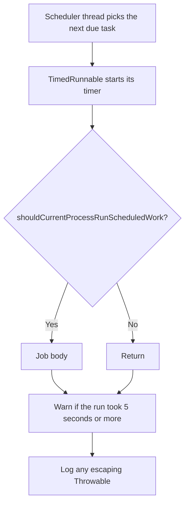

# Cron

`ti4.cron` holds the bot's scheduled jobs and [`CronManager`](CronManager.java),
the scheduler they all share. Each job is a small utility class with a static
`register()` method that tells `CronManager` when to run it. The combat replay
jobs follow the same pattern from [`ti4.contest.cron`](../contest/cron).

## How a job runs

`CronManager` wraps one `ScheduledThreadPoolExecutor` that has a **single
thread**. Every scheduled job, every one-off delayed task and every manual run
takes turns on that thread.

- **Timing.** Every task is wrapped in [`TimedRunnable`](../helpers/TimedRunnable.java),
  which logs a warning when a run takes at least five seconds. It does not stop
  the run.
- **Failures.** A wrapper catches any `Throwable` and logs
  `Unhandled exception in cron: <name>`. This keeps a periodic job scheduled
  after it throws; a bare `ScheduledThreadPoolExecutor` would cancel it.
- **Lease gate.** Each job's first line is
  `if (!ActiveLeaseService.shouldCurrentProcessRunScheduledWork()) return;`. During
  a deploy two bot processes run at once, and only the one that holds the active
  lease, and is not draining, does scheduled work. Jobs are registered in every
  process; the check happens on each run.

### One slow job delays all of them

Because there is one thread, a job that blocks holds up everything behind it,
including the [circuit breaker](../executors/README.md#circuit-breaker) resets
and delayed `BotLogger` webhook sends. Jobs use fixed-rate scheduling, so once
the thread frees up, every run that came due meanwhile fires back to back. A
burst of identical log lines usually means something stalled the scheduler.

Keep job bodies short. Long work should be handed off, as
[`DiskUsageCron`](DiskUsageCron.java) does with a virtual thread and
[`GameDatabaseReconciliationCron`](GameDatabaseReconciliationCron.java) does by
queueing the reconciliation.

## Scheduling API

| Method | Behavior |
| --- | --- |
| `schedulePeriodically(class, runnable, initialDelay, period, unit)` | Fixed-rate repeat. Returns the `ScheduledFuture`. |
| `schedulePeriodicallyAtTime(class, runnable, hour, minute, zoneId)` | Once a day at the given wall-clock time, starting at the next occurrence. |
| `scheduleOnceAfterLeaseAcquired(class, runnable, delay, unit)` | A single delayed run each time this process acquires the active lease. See [Startup jobs](#startup-jobs). |
| `registerManualOnly(class, runnable)` | No schedule; the job runs only through `runCron`. |
| `scheduleOnce(class, runnable, delay, unit)` | A single delayed run of a one-off task. **Not** offered to `runCron`. Use it for internal follow-ups such as the circuit breaker resets, delayed `BotLogger` webhook sends and the bothelper dashboard refresh. |
| `runCron(name)` | Run the job registered under `name` now, on the scheduler thread. Returns `false` for an unknown name. |
| `getCronNames()` | Names available to `runCron`. |
| `shutdown()` | Stop the scheduler with a 30-second budget, see [Shutdown](#shutdown). |

Every method except `scheduleOnce` registers the job under its class's simple
name, which is what `runCron` looks up, so pass the job's own class. Developers
reach it through the `/developer run_cron` command, which autocompletes from
`getCronNames()`, and testbed scripts reach it through their `runCron` step.

## Jobs

[`JdaService.registerAndStartCronJobs`](../discord/JdaService.java) registers the
jobs at startup, after the process starts lease participation and before it is
marked ready. `AnonymousCommsArchiveCron` is the exception: `AnonymousCommsService`
registers it the first time it is needed.

Times marked ET are `America/New_York`.

### Periodic

| Job | First run | Then every | What it does |
| --- | --- | --- | --- |
| [`InteractionLogCron`](InteractionLogCron.java) | 2 min | 2 min | Send buffered interaction logs to Discord. |
| [`LongExecutionHistoryCron`](LongExecutionHistoryCron.java) | Immediately | 1 min | Report long-running executor tasks and signal the circuit breaker. |
| [`FlushUserActiveHoursCron`](FlushUserActiveHoursCron.java) | 5 min | 5 min | Flush recorded user active hours. **Not lease gated**: each process flushes its own buffer. |
| [`AutoPingCron`](AutoPingCron.java) | 5 min | 10 min | Ping players whose turn is overdue; drop ended games from auto-ping metadata. |
| [`FastScFollowCron`](FastScFollowCron.java) | 5 min | 10 min | Resolve fast strategy card follows for games with that setting. |
| [`SabotageAutoReactCron`](SabotageAutoReactCron.java) | 5 min | 10 min | React to open Sabotage windows on behalf of players who qualify for an automatic reaction. |
| [`TechSummaryCron`](TechSummaryCron.java) | 5 min | 10 min | Post queued tech summaries. |
| [`MatchmakerCron`](MatchmakerCron.java) | 15 min | 30 min | Process the matchmaking queue, then search for matches. |
| [`AnonymousCommsArchiveCron`](AnonymousCommsArchiveCron.java) | 30 min | 30 min | Archive quiet anonymous comms threads in Fog of War games. |
| [`CloseLaunchThreadsCron`](CloseLaunchThreadsCron.java) | 5 min | 1 h | Close game launch threads that are done. Skips until `GameManager` warmup finishes. |
| [`LogCacheStatsCron`](LogCacheStatsCron.java) | 1 h | 4 h | Log cache statistics. |
| [`LogButtonRuntimeStatisticsCron`](LogButtonRuntimeStatisticsCron.java) | 1 h | 4 h | Log button processing statistics. |
| [`KeepThreadsAliveCron`](KeepThreadsAliveCron.java) | 10 min | 6 h | Refresh threads registered with `KeepThreadAliveService` so Discord doesn't archive them. |
| [`CategoryCleanupCron`](CategoryCleanupCron.java) | 6 h | 24 h | Delete empty `PBD #` categories. |

### Daily

| Job | Time | What it does |
| --- | --- | --- |
| [`GameDatabaseReconciliationCron`](GameDatabaseReconciliationCron.java) | 00:00 ET | Queue a reconciliation of game saves with the database. Skips in database maintenance mode. |
| [`EndOldGamesCron`](EndOldGamesCron.java) | 02:00 ET | Mark games that haven't been modified within the inactivity threshold as ended. |
| [`OldUndoFileCleanupCron`](OldUndoFileCleanupCron.java) | 03:00 ET | Delete old undo files and empty undo directories. |
| [`DiskUsageCron`](DiskUsageCron.java) | 04:00 ET | Log a disk usage report, on its own virtual thread. |
| [`GameMessageCleanupCron`](GameMessageCleanupCron.java) | 04:00 ET | Remove stale tracked game messages. |
| [`WinningPathCron`](WinningPathCron.java) | 04:00 ET | Recompute the winning path statistics file. |
| [`UploadStatsCron`](UploadStatsCron.java) | 13:30 UTC | Upload all game statistics, ahead of an external 14:00 UTC pull. |
| [`UploadRecentStatsCron`](UploadRecentStatsCron.java) | 13:45 UTC | Upload recent game statistics, ahead of the same pull. |

### Once, or manual only

| Job | When | What it does |
| --- | --- | --- |
| [`BothelperDashboardCron`](BothelperDashboardCron.java) | 30 s after the lease is acquired | Refresh the bothelper dashboard message. |
| [`ReuploadStaleEmojisCron`](ReuploadStaleEmojisCron.java) | 2 min after the lease is acquired | Reupload stale application emojis, delete unused ones and report missing ones. |
| [`CardsInfoPinCleanupCron`](CardsInfoPinCleanupCron.java) | Manual only | Queue cleanup of pinned bot messages in every active player's cards-info thread. |

#### Startup jobs

Jobs that should run once when the bot comes up use
`scheduleOnceAfterLeaseAcquired`. During a deploy the new process registers its
jobs while the old one still holds the lease, so a plain startup delay would
fire while the new process is on standby, hit the lease gate and never run.
Instead, `AsyncTI4DiscordBot` calls `CronManager.runLeaseStartJobs()` from its
lease-acquired callback, which schedules every startup job with its delay. A job
registered after the lease is already held is scheduled right away. If the
process loses the lease and acquires it again, the startup jobs run again, so
they must be safe to repeat.

### Combat replay contest

Registered only when `CombatContestSettings` enables the contest. They live in
[`ti4.contest.cron`](../contest/cron).

| Job | First run | Then every | What it does |
| --- | --- | --- | --- |
| `CombatReplayPromotionScoreBackfillCron` | When the lease is acquired | – | Backfill promotion scores for older candidates. |
| `CombatReplayCron` | 2 s | 2 s | Finalize expired candidates, refresh open candidate games and advance the replay. |
| `CombatReplaySelectionCron` | 5 s | 5 s | Refresh the selection settings snapshot. |
| `CombatReplayPromotionCron` | 5 s | 5 s | Promote the best candidate when one is due. |

`CombatContestJanitorCron` is intentionally off: it has a `register()` method,
but it is not registered at the moment.

## Adding a job

1. Create a `@UtilityClass` named `<Something>Cron` in this package.
2. Give it a `register()` that calls `schedulePeriodically`,
   `schedulePeriodicallyAtTime`, `scheduleOnceAfterLeaseAcquired` or
   `registerManualOnly` with its own class, so `runCron` finds it under its own
   name. Don't use `scheduleOnce` for a job.
3. Start the job body with the lease gate, then wrap the work in `try/catch` and
   log failures with `BotLogger.error`. Bracket the work with `BotLogger.logCron`
   lines if a run is worth tracing.
4. Call `register()` from `JdaService.registerAndStartCronJobs`.
5. Keep the body short, or hand the work off. Jobs that change games should go
   through `ConsumeGameUtility.consumeGames` with the right `ExecutionLockType`,
   as `EndOldGamesCron` and `FastScFollowCron` do.
6. Add the job to the tables above.

## Shutdown

`JdaService.shutdown` stops the scheduler after the process stops taking
commands and after `ExecutorServiceManager` shuts down. `CronManager.shutdown()`
uses [`ExecutorUtility.shutdownAndAwaitTermination`](../executors/README.md#shutdown)
with a 30-second budget: 15 seconds to finish gracefully, then `shutdownNow()`
and up to 15 more.

`shutdown()` cancels periodic jobs, but `ScheduledThreadPoolExecutor` keeps
one-off delayed tasks by default and waits for them. A pending startup job or
circuit breaker reset can therefore hold up the graceful wait until it runs or
the 15 seconds run out.
