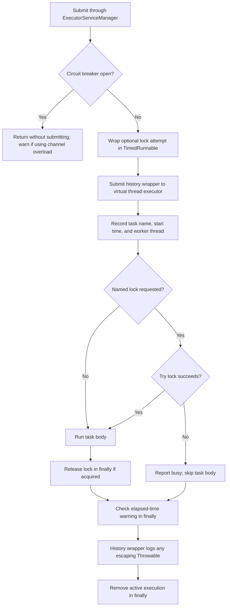
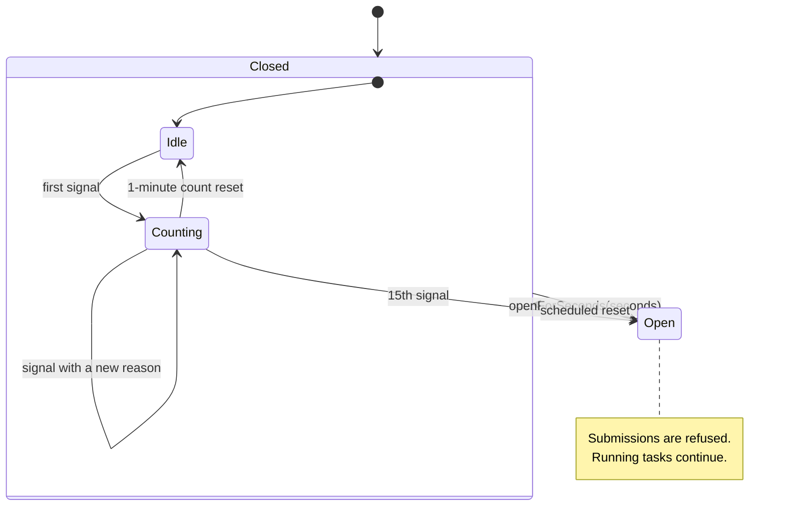
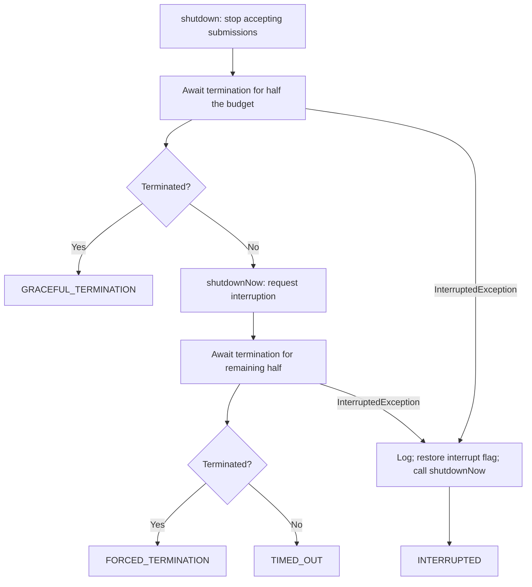

# Executors

`ti4.executors` runs background work, coordinates access through named read/write
locks, tracks running tasks, and pauses new submissions when the circuit breaker
opens. It also provides the shutdown helper shared by other executor owners.

## Package map

| Class | Responsibility |
| --- | --- |
| [ExecutorServiceManager](ExecutorServiceManager.java) | Submit tasks to a virtual thread per task executor, with optional locking and circuit breaker checks. Worker names start with `ti4-worker-`. |
| [ExecutionLockManager](ExecutionLockManager.java) | Manage process-local locks by string name, with blocking and immediate-attempt wrappers. |
| [ExecutionLockType](ExecutionLockType.java) | Select `READ` or `WRITE` access. |
| [ExecutionHistoryManager](ExecutionHistoryManager.java) | Track active executions, catch task failures, and report long-running work. Can wrap tasks on an executor supplied by another package. |
| [CircuitBreaker](CircuitBreaker.java) | Count error/timeout signals and temporarily prevent work through entry points that check it. |
| [ExecutorUtility](ExecutorUtility.java) | Stop an executor with a graceful wait followed by an interruption attempt. |
| [ShutdownResult](ShutdownResult.java) | Describe whether shutdown was graceful, forced, timed out, or interrupted. |

Scheduling lives in [`CronManager`](../cron/CronManager.java). Timing individual
tasks lives in [`TimedRunnable`](../helpers/TimedRunnable.java). Neither scheduling
nor a fixed concurrency limit is provided by `ExecutorServiceManager`.

### Visibility boundaries

The package's top-level types remain public because other packages use them for
task submission, game locking, monitoring, circuit breaker checks, and shutdown.
Implementation state and helpers are private. The try-lock wrappers in
`ExecutionLockManager` are package-private: callers outside this package use
`ExecutorServiceManager.runAsyncWithLock` for that submission policy. The blocking
lock wrapper and explicit `lock`/`unlock` methods remain public for callers that
must wait for access. Lock diagnostics `holders` and `hasQueuedThreads` are
package-private and used by the lock regression tests.

These classes have no subclass extension points, so `protected` visibility is
unnecessary. Use private for implementation details, package-private for
collaboration inside `ti4.executors`, and public for supported external entry
points.

## Submitting work

| Entry point | Lock behavior | If the circuit breaker is open |
| --- | --- | --- |
| `runAsync(name, runnable)` | No lock. | Return without submitting. |
| `runAsync(name, warningThresholdSeconds, runnable)` | No lock; customize the duration warning threshold. | Return without submitting. |
| `runAsyncWithLock(taskName, lockName, channel, runnable)` | Try the named `WRITE` lock. A blank lock name bypasses locking. | Post a cooldown warning to the supplied channel and return. |
| `runAsyncWithLock(taskName, lockName, channel, runnable, lockType)` | Same, with explicit `READ` or `WRITE` access. | Post a cooldown warning to the supplied channel and return. |
| `runAsyncWithLock(taskName, runnable)` | Try a `WRITE` lock named after the task. The name must be nonblank. | Return without submitting. |

These methods return `void`: they provide no future, result, or cancellation
handle. A successful submission does not guarantee the task body will run; the
lock attempt happens on the worker and may fail. Busy tasks are skipped without
queuing for the lock or retrying. The lock wrapper sends a busy message when a
channel is supplied, otherwise it logs a warning.



For a game mutation, use the same game name as other code accessing that game:

```java
ExecutorServiceManager.runAsyncWithLock(
        "Refresh game state",
        game.getName(),
        player.getCorrectChannel(),
        () -> refreshGameState(game));
```

Here `refreshGameState` stands for the caller's operation. It remains responsible
for saving any changed game state. Choose a channel appropriate for the audience,
especially in Fog of War games: busy messages include the lock name. Do not ping
other players in a private cards-info thread.

## Lock semantics

Locks use `ReentrantReadWriteLock` and are keyed only by the supplied string.
Callers must agree on a name to coordinate. Different names do not protect each
other, and locks do not coordinate separate bot processes.

| API | When access is unavailable | Cleanup |
| --- | --- | --- |
| `wrapWithTryLockAndRelease(name, type, task[, channel])` (package-private) | Skip immediately and report busy. | Unlock in `finally` after running the task. |
| `wrapWithLockAndRelease(name, type, task)` | Wait until the lock is acquired. | Unlock in `finally` after running the task. |
| `lock(name, type)` / `unlock(name, type)` | `lock` waits until access is available. | Caller must pair acquisition and release on the same thread, using `try/finally`. |

Multiple readers can share a name; a writer excludes other threads' readers and
writers. Reentrant acquisitions require matching releases. Blocking `lock` refuses
a read-to-write upgrade with `IllegalStateException` when the current thread holds
only the read lock. The try-lock wrapper cannot upgrade that read lock either;
it reports busy instead. Choose the required access before entering the protected
operation.

The manager counts both holders and pending acquisition attempts, retaining the
entry while either exists and removing it after the final release. Blocking
acquisitions that take at least one second produce a warning. The locks use the
default nonfair policy; do not depend on FIFO ordering.

The lock wrappers alone do not submit work, check the circuit breaker, time the
task, or catch task failures. Those behaviors come from their surrounding caller.

## Timing, monitoring, and failures

`TimedRunnable` warns when a task finishes after reaching its threshold: five
seconds by default, or the value supplied to the custom-threshold `runAsync`
overload. Its timer includes the lock wrapper. This warning does not interrupt
work or impose a deadline.

`ExecutionHistoryManager.runWithExecutionHistory(executor, timedRunnable)` records
the execution when the worker starts and removes it on completion. Despite its
name, it keeps only active executions, with no completed-task history. It catches
any `Throwable` escaping the timed runnable and logs an unhandled-task error;
there is no automatic retry. Executor submission failures occur outside that
wrapper and can propagate to the submitter.

[`LongExecutionHistoryCron`](../cron/LongExecutionHistoryCron.java) schedules a
check every minute, gated by whether the process should run scheduled work:

| Elapsed duration at the check | Action |
| --- | --- |
| Less than one minute | No long-execution report. |
| At least one minute, less than two | Signal the circuit breaker with a reason containing the task name. Log a warning if the signal is accepted. |
| Two minutes or more | Log an error with a snapshot of the worker's current stack. Subsequent checks can report it again. |

Task names therefore matter for diagnostics and reason deduplication. Monitoring
does not cancel the task or release its locks.

## Circuit breaker

The breaker is shared process-wide. Error and timeout reporting code calls
`incrementThresholdCount(reason)`. Repeated reasons are ignored while retained;
signals received while the breaker is open are ignored too. Nonblank reasons
are retained for diagnostics and deduplication.



The one-minute count reset is scheduled from the first accepted signal; this is
not a sliding window. Reaching 15 opens the breaker for three minutes and logs
the collected reasons. The earlier count-reset callback only clears the count
and reasons; it does not close an open breaker. `openForSeconds(seconds)` opens
the breaker manually and schedules a reset after the requested delay.

Opening the breaker does not stop running tasks. It only affects entry points
that consult it. In particular, direct calls to
`ExecutionHistoryManager.runWithExecutionHistory` do not check the breaker.
Reset callbacks run through `CronManager`, so reopening depends on that scheduler
being able to execute them. Reset callbacks already scheduled are not cancelled
when the breaker is manually reopened.

## Shutdown

`ExecutorServiceManager.shutdown()` gives its executor a 60-second shutdown
budget. `ExecutorUtility.shutdownAndAwaitTermination` divides the supplied budget
equally between graceful completion and waiting after `shutdownNow()`.



For the shared worker executor, each wait is 30 seconds. Forced shutdown requests
interruption; tasks must cooperate for termination to succeed. The static worker
executor is not recreated after shutdown.

## Related tests

[`ExecutionLockManagerTest`](../../../../test/java/ti4/executors/ExecutionLockManagerTest.java)
contains the lock manager's regression tests. To run that test class from the
repository root:

```shell
mvn -Dtest=ExecutionLockManagerTest test
```
