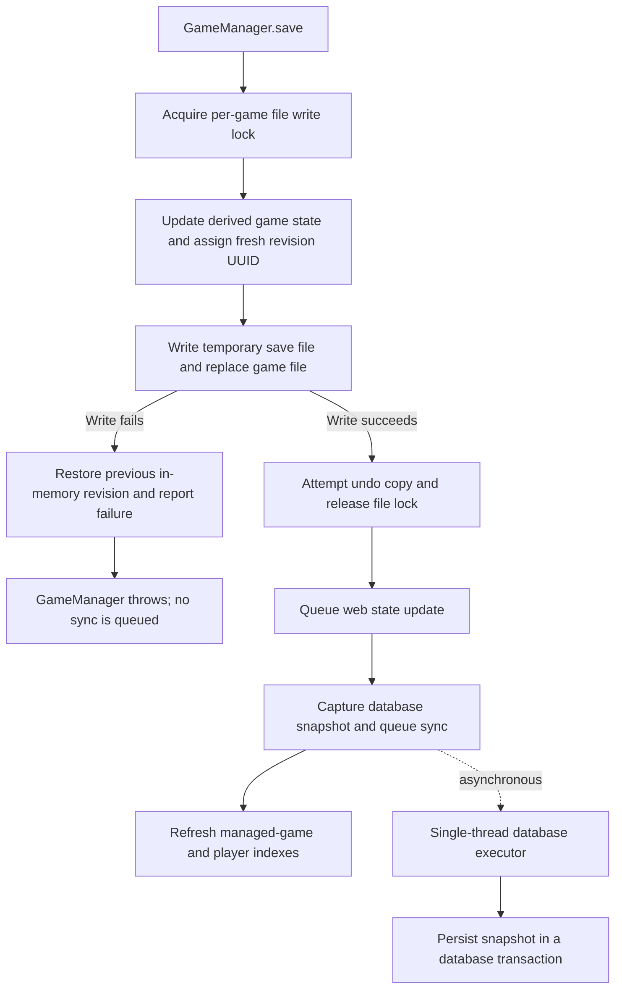
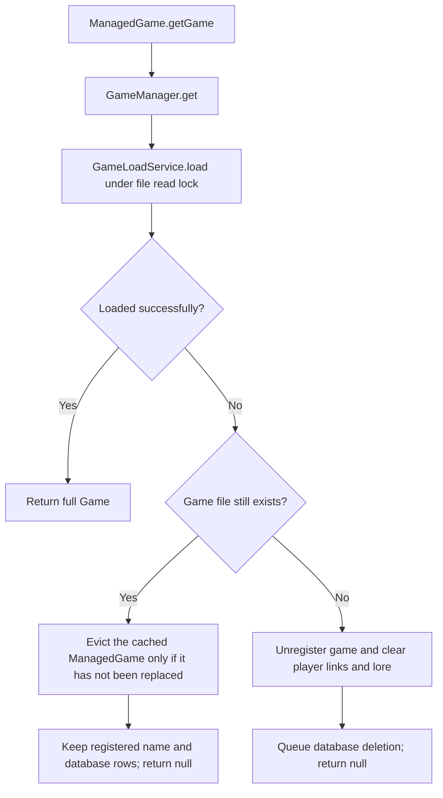
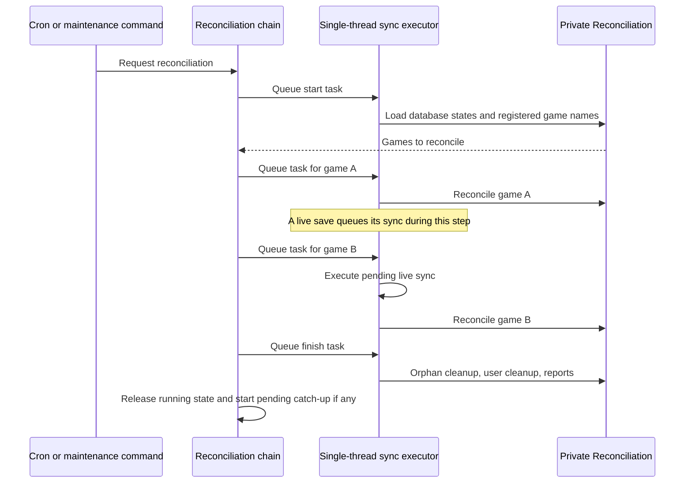
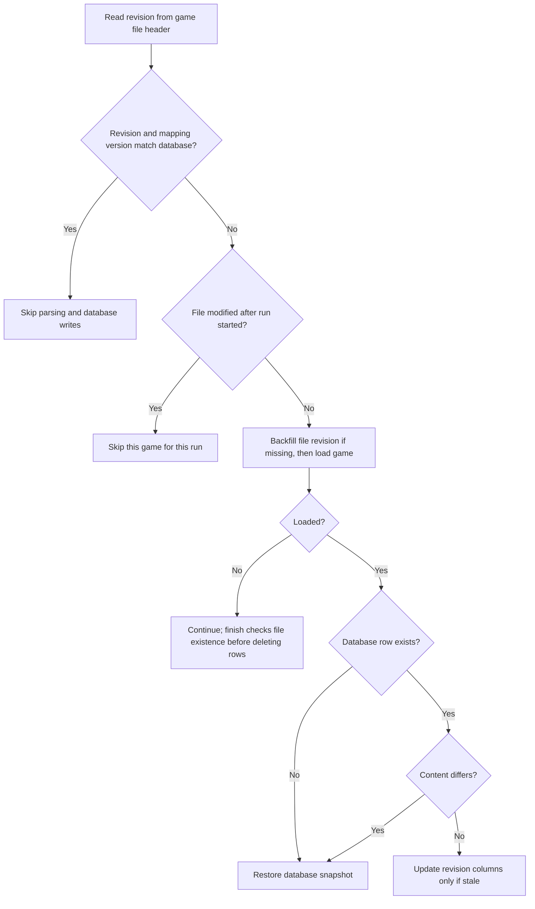

# Game persistence

This package owns game save files, undo files, the managed-game index, and the
coordination of database synchronization. Game files are the source of truth;
database rows are a derived view that reconciliation can repair.

## Boundaries and entry points

| Entry point | Responsibility |
| --- | --- |
| [GameManager](GameManager.java) | Warmup, game lookup, save, delete, reload, undo, and managed-game/player indexes. |
| [ManagedGame](ManagedGame.java), [ManagedPlayer](ManagedPlayer.java) | Lightweight metadata and player-to-game relationships. `ManagedGame.getGame()` loads the full game. |
| [ConsumeGameUtility](ConsumeGameUtility.java) | Bulk game processing with execution locks and handling for games that cannot be loaded. |
| [GameSnapshots](GameSnapshots.java) | Make an independent game copy through the save/load format for consumers such as map rendering. |
| [GameDatabaseReconciler](GameDatabaseReconciler.java) | Request nightly or catch-up reconciliation. The actual `Reconciliation` implementation is private. |
| [DatabasePersistenceGate](DatabasePersistenceGate.java) | Read or change database maintenance mode. This gate also serves database-backed features outside this package. |
| [GameDatabaseSyncPipeline](GameDatabaseSyncPipeline.java) | Own the single-thread database executor. Only shutdown is public; submission stays inside the package. |
| [migration/DataMigrationManager](migration/DataMigrationManager.java) | Run game-data migrations. |

The loaders, writers, undo service, file locks, and reconciliation chain are
package-private. The revision-file helper, `GameRevisionKeyFile`, is shared by
reconciliation and warmup.
Callers should use `GameManager` for
game lifecycle operations rather than independently changing files, indexes, or
database rows. SQL mapping, repositories, and transactions live in
[`ti4.spring.service.persistence`](../../spring/service/persistence/).

## Saving a game

`GameSaveService` writes through a temporary file in the save directory. A failed
write restores the previous revision on the in-memory game. Creating the undo
copy happens after the file replacement; an undo-copy failure does not undo the
successful file save.

The database snapshot includes the saved revision and
`GameEntityMapper.MAPPING_VERSION`. The pipeline captures it before queuing the
write. Every game gets a row. Games with fewer than 3 real or eliminated players
are stored the same way but marked `statistics_ignored`, and every statistics
query on player or title rows leaves them out. Live writes use
`GameEntityPersistenceService.replace`, which also updates user names.

Every seat in a game gets a `player` row, so warmup can rebuild each
`ManagedPlayer`. `playing_user_id` is whoever holds the seat now and `user_id`
is the user its statistics count for, which differs after a `/replace`.
`is_playing` marks real and eliminated seats. Seats still in setup and dummies,
such as the neutral player, are stored with `is_playing` false, and every
statistics query on player rows leaves them out. `ManagedGame` derives a seat's
status from `is_playing`, `is_eliminated`, `is_npc` and whether the game has
ended.

File writes and database writes are not one transaction. In particular, database
submission happens after releasing the file lock, so concurrent saves can enqueue
their database updates out of file-write order. Warmup only trusts a row whose
revision key matches the file, so such a row is rebuilt from its file. Reconciliation compares the
database revision with the revision on disk to detect this drift.

## Loading, missing files, and corrupt files

A failed parse is not evidence that a game was deleted. The loader records known
unreadable files and suppresses repeated parse-error logging until a successful
load clears that record. `GameManager.isCorrupt` consults this record.

`GameManager.getManagedGame` is a separate metadata lookup: it lazily constructs a
managed entry and throws if that construction cannot load the game.
`ConsumeGameUtility` handles such failures so bulk processing can continue.

`reload` first tries the current file, then undo recovery. If neither loads, it
uses the same missing-versus-existing-file distinction shown above. A successful
reload refreshes the managed entry when needed and queues database sync. Undo
restores the saved state's revision; the next ordinary save assigns a new one.
Explicit deletion unregisters the game and queues database deletion only after
the file deletion operation succeeds.

## Warmup

At startup `GameManager.warmup` loads every database row whose mapping version is
current, then builds each `ManagedGame`:

- With `database_warmup_reads_enabled` on, a row whose revision key matches the
  game file header builds the `ManagedGame` without parsing the file.
- Otherwise the file is parsed. Its state is compared with the row: a missing or
  outdated row queues a resync from the file, and a row with the current key but
  different content is reported as a mapping bug.

The setting is read once per startup; turning it off and restarting goes back to
files only. After a startup with reads off, `DatabaseWarmupRolloutCron` checks every
10 minutes: it logs the resync backlog while it drains, then turns the setting on
once no row differed at startup and every game's row has its current revision key.
The cron is deprecated and goes away with the setting.
With maintenance mode on, or if the database read fails, every game is built from
its file and no resync is queued.

## Reconciliation scheduling

Both ordinary database syncs and reconciliation steps use the same FIFO executor.
The chain queues its next step only after the current step runs, allowing already
queued live syncs to run between games.

`queueReconciliation()` ignores a request while a run is active.
`queueCatchUpReconciliation()` instead remembers one fresh run to start afterward;
repeated catch-up requests coalesce. Maintenance mode, interruption, a chain-level
exception, or executor rejection ends the chain and releases its running state.
Individual game failures are collected by the run so other games can continue.

`GameDatabaseReconciliationChain.ReconciliationTask` is a final, package-private
type with a private constructor. The chain creates it with the task name, warning
threshold, and execution logic. `GameDatabaseSyncPipeline.queueReconciliationTask`
accepts only that type; generic executor submission is private to the pipeline.

## Reconciling one game

The run loads database states once at startup. It reads file revision keys rather
than trusting cached `ManagedGame` metadata. A match requires a nonblank revision
and the current mapping version. Bump `GameEntityMapper.MAPPING_VERSION` whenever
snapshot mapping changes require existing database rows to be refreshed.

Legacy saves without revision keys receive a key through a locked temporary-file
rewrite before comparison. Revision metadata is excluded from content differences:
an otherwise matching row needs only a revision-column update. Actual repairs use
`restore`, which preserves existing known user names while inserting missing users
or replacing unknown-name placeholders.

At finish, database games not accounted for during the run are checked against the
filesystem. Existing files retain their rows and are reported as unloadable;
missing files permit orphan-row deletion. Unreferenced users are then cleaned up.
Reports aggregate game failures and cap their length for Discord.

## Maintenance and verification

Maintenance mode suppresses sync submission and checks again before queued database
writes execute. It also stops reconciliation steps. File saves continue. Re-enabling
persistence through the developer command requests catch-up reconciliation when the
current process is allowed to run scheduled work.

Tests in [`src/test/java/ti4/game/persistence`](../../../../../test/java/ti4/game/persistence/)
cover save/load revisions, failed writes, missing and corrupt files, undo, managed
indexes, task interleaving, catch-up coalescing, and shutdown. Database transaction
tests live in `ti4.spring.service.persistence` under the test source tree.
