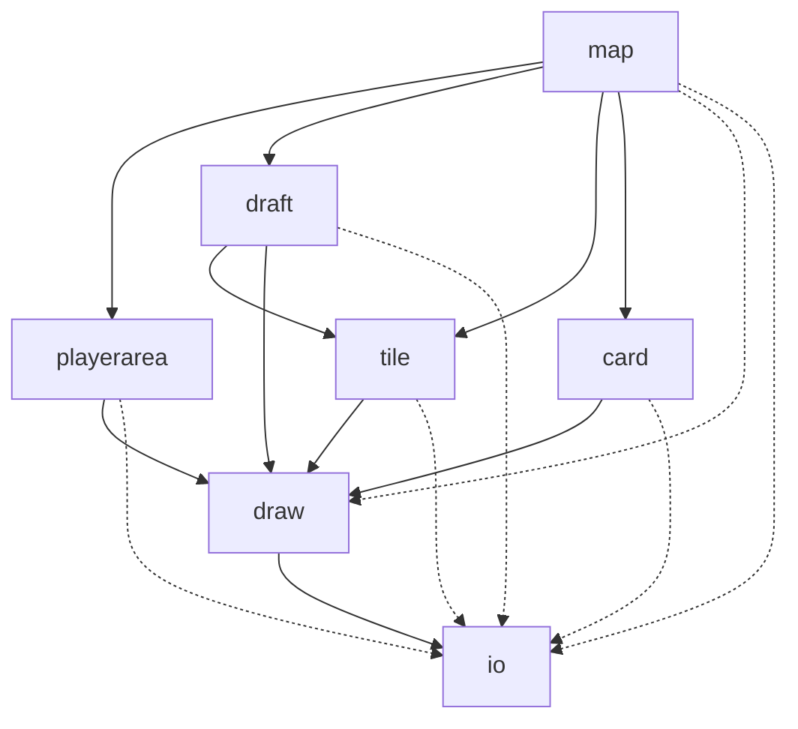
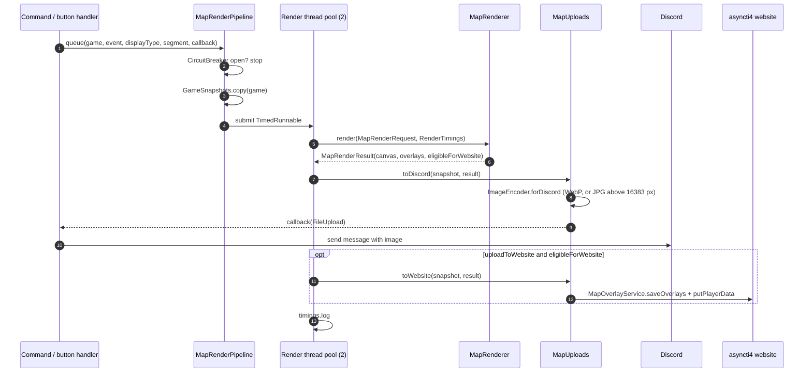
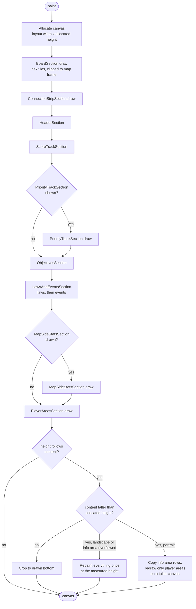
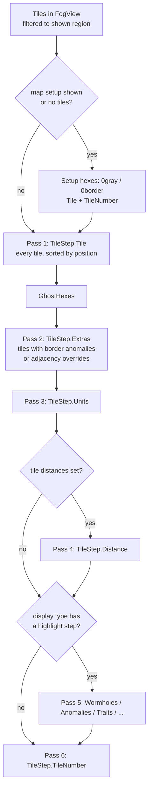
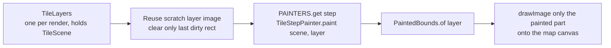
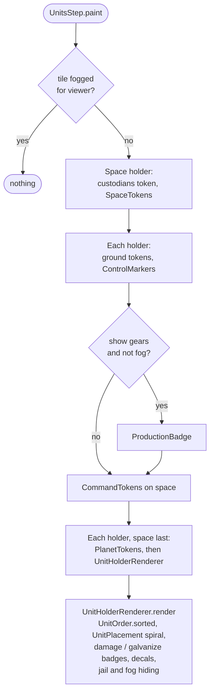
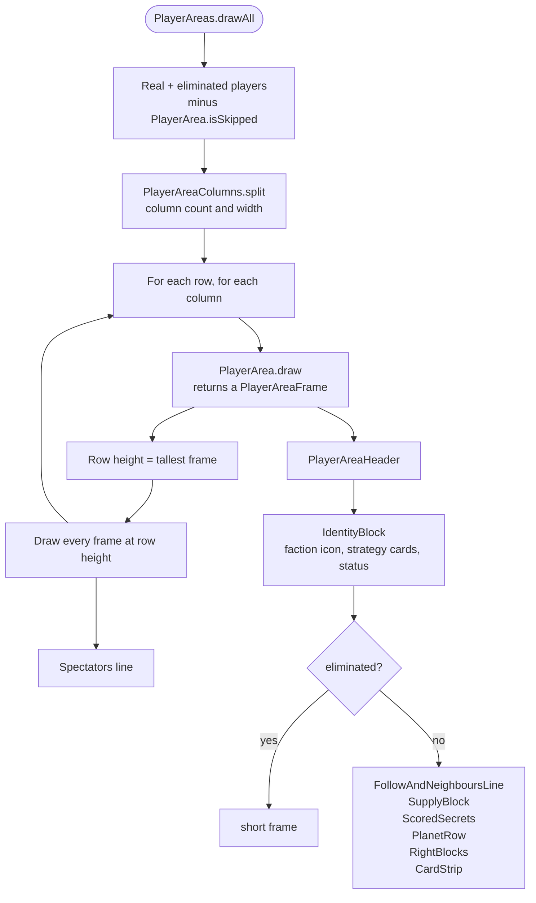
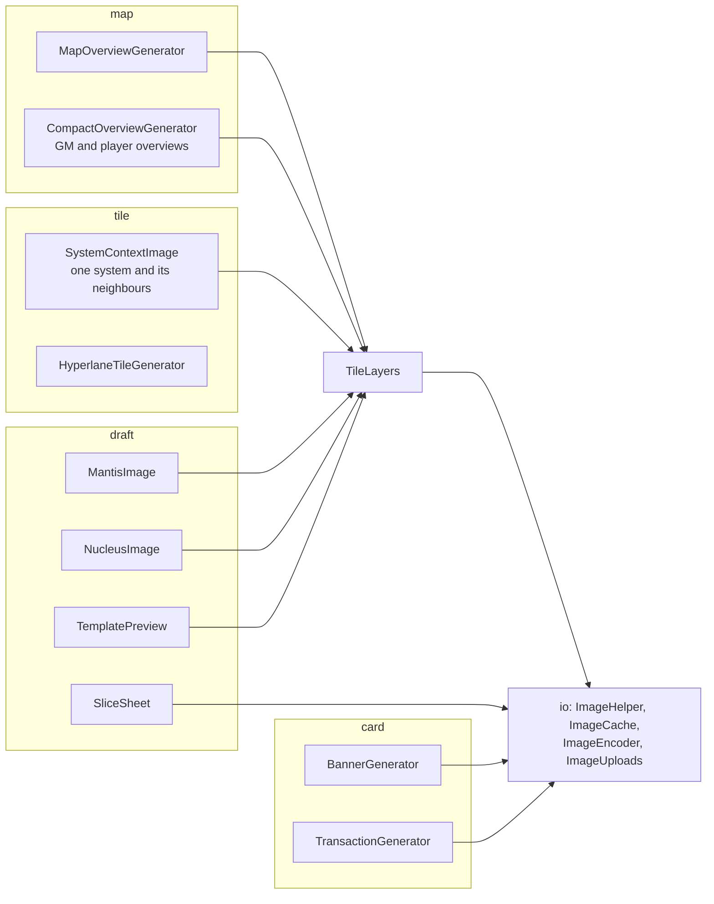
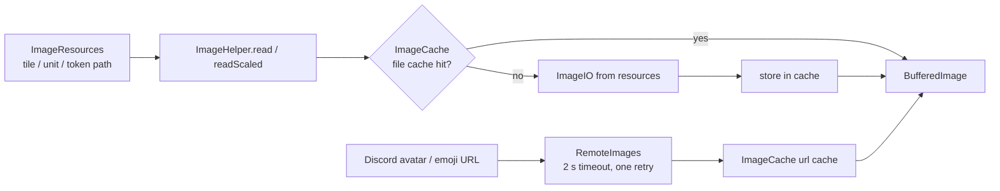

# `ti4.image`

Everything the bot draws: the game map, player areas, single tiles, draft boards,
banners and transaction cards. All drawing is plain Java2D (`BufferedImage` +
`Graphics2D`). The output is encoded and handed to Discord as a `FileUpload`, and
the full map is also pushed to the asyncti4 website.

## Package layout

| Package | What lives there |
| --- | --- |
| `map` | The full map render: pipeline, request/context, canvas layout, and the sections (board, header, score track, objectives, laws, side stats, player areas). Also the compact/overview generators and map segments (sectors). |
| `playerarea` | One player's area under the map: identity block, supply, card strip, planets, techs, leaders, secrets, homebrew token supplies. |
| `tile` | One hex: tile artwork and the `TileStep` painters (units, tokens, command tokens, fog, display-type highlights). Also `SystemContextImage` and hyperlane tiles. |
| `draft` | Draft images: slice sheets, Mantis and Nucleus boards, map template previews. |
| `card` | Banners (faction, agenda, phase) and the transaction/trade-offer images. |
| `draw` | Reusable drawing helpers: text wrapping and outlines, strokes, colours, faction icons, image grids, website overlays. |
| `io` | Reading, caching, encoding and uploading images: `ImageHelper`, `ImageCache`, `RemoteImages`, `ImageResources` (resource paths), `Fonts`, `ImageEncoder`, `ImageUploads`. |

### Layering

The packages are layered, and
[`ImagePackageLayeringTest`](../../../../test/java/ti4/image/ImagePackageLayeringTest.java)
fails the build when an import breaks the layering. `playerarea`, `tile` and `card`
never import each other, and nothing below `map` imports `map`. `ti4.game` and
`ti4.model` never import `ti4.image`.

Dotted edges are allowed direct dependencies that skip a layer.

## Full map render

Callers go through `MapRenderPipeline.queue(...)` (or `queueImage(...)` for
one-off images that should share the render threads). The pipeline:

1. Returns at once if the `CircuitBreaker` is open.
2. Copies the game with `GameSnapshots.copy`, so the render does not read the
   live `Game` while commands keep changing it. If the copy fails it logs and
   renders the live game.
3. Runs the render on a fixed pool of **2** `ti4-map-renderer-*` threads, wrapped
   in a `TimedRunnable` that warns after 10 seconds.

A result is eligible for the website only for the `all` display type when the
viewer is not a private Fog of War viewer.

### Resolving the render context

`MapRenderer.resolve` turns a request into a `RenderContext` before any pixel is
drawn.

```mermaid
flowchart LR
    Req[MapRenderRequest<br/>game, displayType, event, segment]
    Req --> Viewer[FogViewer.resolve<br/>who is looking]
    Viewer --> Prep[MapRenderPreparationService.prepare]
    Prep --> Build[RenderContext.build]
    Build --> Ctx

    subgraph Ctx[RenderContext]
        DT[displayType + basicType<br/>forced type wins]
        Fog[FogView<br/>visible tiles]
        Nb[NeighbourMap]
        Stat[MapSideStatLayout]
        Board[BoardLayout<br/>shown region, frame, segment]
        Canvas[MapCanvasLayout<br/>width, height, landscape]
        Ov[WebsiteOverlays]
    end

    Ctx --> Draws{drawsBoard?}
    Draws -- yes --> PrepBoard[MapRenderPreparationService.prepareBoard<br/>shown + connected tiles]
    Draws -- no --> Done[ready to paint]
    PrepBoard --> Done
```

Every `DisplayType` collapses to a **basic type**:

| Basic type | Display types | Draws |
| --- | --- | --- |
| `all` | `all` and anything not listed below | board, info area, player areas |
| `map` | `map`, `wormholes`, `anomalies`, `legendaries`, `empties`, `aetherstream`, `spacecannon`, `traits`, `techskips`, `attachments`, `shipless`, `unlocked` | board and info area |
| `stats` | `stats` | info area and player areas |

### Painting the canvas

`MapRenderer.paint` draws top to bottom onto one `TYPE_INT_RGB` canvas.

The canvas height is an estimate (`PlayerAreasHeightEstimate`). When the player
areas turn out taller, the renderer keeps the already drawn top of the image and
redraws only the player areas, restoring the `Graphics2D` state and truncating the
website overlays recorded after that point. It repaints at most once.

## Board and tile layers

`BoardSection` paints every visible tile once per `TileStep`, in passes, so that
for example units of one system are never covered by the artwork of a neighbour.

Each pass calls `TileLayers.paint(tile, step, g2, x, y)`:

`TileScene` carries the game, display type, `FogViewer` and `RenderWarnings`
shared by all painters. The painters are registered in `TileLayers.painters()`:

| `TileStep` | Painter |
| --- | --- |
| `Tile` / `TileUnannotated` | `TileFaceStep` (artwork, fog overlay, with or without annotations) |
| `Extras` | `BorderDecorationsStep` |
| `Units` | `UnitsStep` |
| `Distance` | `DistanceStep` |
| `Wormholes`, `Anomalies`, `Aetherstream`, `Exile`, `Legendaries`, `Empties`, `SpaceCannon`, `Traits`, `TechSkips`, `Attachments` | the matching `*Step` highlight |
| `TileNumber` | `TileNumberStep` |
| `Nucleus` | `NucleusStep` |

### Units step

Placement shares an `occupied` rectangle list across the tile so tokens and units
of different holders do not overlap.

## Player areas

`PlayerAreasSection` builds a `PlayerAreaContext` and calls
`PlayerAreas.drawAll`, which lays players out in columns and rows.

Players whose stats the viewer may not see in Fog of War are skipped
(`PlayerAreaContext.hidesStatsOf`), so other players' hidden state never reaches
the image.

## Other entry points

These render outside the full map pipeline but reuse the same lower layers.

Use `MapRenderPipeline.queueImage(game, label, image, callback)` when one of these
should render off the interaction thread on a snapshot of the game.

## Loading images

Both caches are Caffeine caches (default 2000 entries, 8 hours), registered with
`CacheManager`. Scaled reads are cached under their scale, so call
`readScaled` with a constant scale rather than scaling the result yourself.

## Testing

Tests live under [`src/test/java/ti4/image`](../../../../test/java/ti4/image):

- `ImagePackageLayeringTest`: the package layering above.
- `map/MapPaintPurityTest`: painting leaves the game unchanged (fog flags, tile
  distances) and sends nothing.
- `map/RenderThreadSafetyTest`: snapshots, two games rendering at once, and
  `Mapper` reloads during a render.
- `RenderStaticStateTest`: every static field the render path reads must be safe
  to share between the two render threads.
- `map/FogViewerRenderTest`, `playerarea/FogSafePlayerAreaTest`: Fog of War does
  not leak.
- `map/MapRenderGoldenHarness`, `ImageGeneratorsGoldenHarness`,
  `ScatteredImagesGoldenHarness`: golden-image comparisons, opt-in through the
  `golden.saves` system property.
- `*Bench` classes: timing benchmarks, opt-in through system properties such as
  `golden.timing.saves`.
