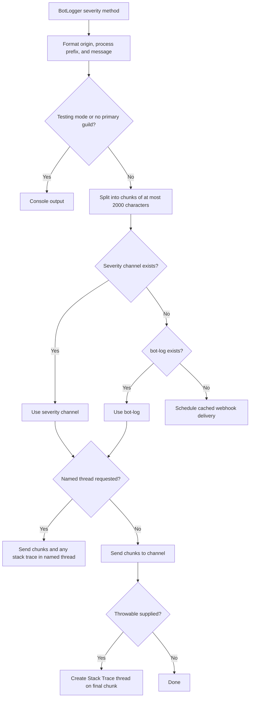
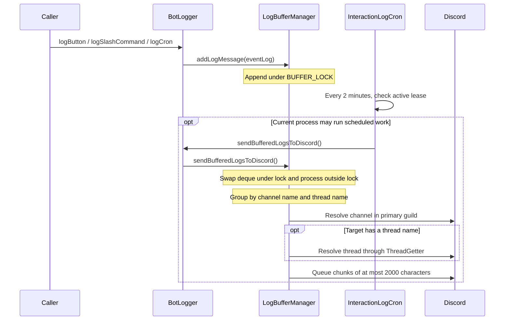

# Logging

`ti4.logging` sends operational messages and interaction history to Discord. Use
[BotLogger](BotLogger.java) as the public entry point. It supports two delivery paths:
severity-based messages sent immediately, and event logs collected in memory for
periodic delivery.

This package is separate from SLF4J/Logback logging. The repository's
[Logback configuration](../../../resources/logback.xml) writes framework and library
logs to the console at the `info` root level.

## Package map

| Class | Responsibility |
| --- | --- |
| [BotLogger](BotLogger.java) | Public logging methods, severity routing, webhook fallback, stack traces, and REST error handling. |
| [LogOrigin](LogOrigin.java) | Captures a timestamp, interaction description, and optional game jump links. |
| [LogSeverity](LogSeverity.java) | Defines severity channels, headings, and which entries count toward SRE error statistics. |
| [AbstractEventLog](AbstractEventLog.java) | Formats buffered entries with the process prefix, origin, and optional message. |
| [ButtonInteractionEventLog](ButtonInteractionEventLog.java) | Routes button interaction history to `button-log`. |
| [SlashCommandEventLog](SlashCommandEventLog.java) | Routes command history and response text to `slash-command-log`. |
| [CronEventLog](CronEventLog.java) | Routes scheduled-work messages to the `cron-log` thread under `bot-log`. |
| [LogBufferManager](LogBufferManager.java) | Drains the event buffer, groups entries by destination, and sends message chunks. |
| [SlowApiCallWarning](SlowApiCallWarning.java) | Emits warnings for incoming or outgoing API calls lasting at least five seconds. |

Both delivery paths include the process prefix supplied by
`ActiveLeaseService.getCurrentProcessLogPrefix()`.

## Visibility boundaries

`BotLogger`, `LogOrigin`, and `SlowApiCallWarning` are the public API. Callers
construct origins and pass them to the logger; origin getters remain
package-private. Scheduled work and shutdown flush buffered entries through
`BotLogger.sendBufferedLogsToDiscord()`.

`LogBufferManager`, `LogSeverity`, and all event-log types are package-private.
Event-log constructors and overridable methods also use package access: all
implementations live here, so `protected` would not provide a useful extension
point. Formatting and delivery helpers, state, and implementation constants are
private unless another class in this package needs them. The slow-call threshold
and formatting helpers retain package access for focused tests.

## Immediate messages

`info`, `warning`, `error`, `spammyError`, and `critical` format an entry and choose a
destination in the **primary guild**. An origin adds context; it does not redirect
the message to the guild or channel where the interaction occurred.



| Method | Preferred channel | Increments SRE error count | Console stream |
| --- | --- | --- | --- |
| `info` | `bot-log-info` | No | stdout |
| `warning` | `bot-log-warning` | No | stdout |
| `error` / `errorToThread` | `bot-log-error` | Yes | stderr |
| `spammyError` | `spammy-bot-log-error` | No | stdout |
| `critical` | `bot-log-critical` | Yes | stderr |

Error statistics increment once per entry, before delivery and chunking. In console
mode, Error and Critical entries append the throwable's string representation;
the console path does not print a full stack trace. Other severities print only
the formatted message.

When sending to a channel with a throwable, the final message creates a
`Stack Trace` thread with a one-hour auto-archive duration. The full trace is sent
there, and an explicit archive is queued after 15 seconds. `errorToThread` instead
uses the requested thread for both the message and trace.

### Webhook fallback

`BotLogger.init()` caches the webhook URL at startup when Discord logging is
available. It first reads `BOT_LOG_WEBHOOK_URL` from `GlobalSettings`. If no URL is
configured, it attempts to create a webhook in the Info channel, falling back to
`bot-log`, and stores the URL in the settings.

Webhook sends are scheduled at least 50 milliseconds apart using `CronManager`
when a delay is needed. This pacing applies only to webhook delivery; channel
messages use JDA's queue. If the cached URL is missing or execution fails, a
diagnostic goes to the console. The webhook path sends message text only: it does
not attach the throwable or create a stack-trace thread. A requested thread also
cannot be used when no log channel is available.

## Buffered event history

Use `logButton`, `logSlashCommand`, and `logCron` for history that can wait for a
batch. These methods enqueue package-private `AbstractEventLog` implementations.



[InteractionLogCron](../cron/InteractionLogCron.java) schedules the first flush
after two minutes and repeats every two minutes. Scheduled flushes run only when
`ActiveLeaseService.shouldCurrentProcessRunScheduledWork()` allows them.
Shutdown also calls `BotLogger.sendBufferedLogsToDiscord()` before shutting down
JDA.

| Entry point | Channel | Thread | Recorded content |
| --- | --- | --- | --- |
| `logButton(event)` | `button-log` | None | User, button representation, and source message link. |
| `logSlashCommand(event, responseMessage)` | `slash-command-log` | None | User, command string, and response display text prefixed with `Response: `. |
| `logCron(message)` | `bot-log` | `cron-log` | Timestamp and supplied message. |

The buffer preserves entry order within each destination; destination groups have
no defined send order. Each JDA send has a ten-minute timeout and uses
`BotLogger.catchRestError` as its failure callback.

Buffered delivery requires a primary guild and the exact target channel. It has
no console or webhook fallback. A missing channel produces an immediate error log
and drops that drained batch for the destination. Entries are held only in memory,
the deque's initial capacity of 500 is not a size limit, and failed sends are not
requeued by this package.

## Adding context and choosing an API

`LogOrigin` captures its timestamp when constructed. It accepts an interaction, a
game, a player, or an interaction plus a listener context/game/player. Game context
adds game jump links. Interaction context records the user's effective name and
the command, button, selection, or modal ID; button and selection descriptions
also link to the source message when available. Modal input values are not
included.

Examples inside an interaction handler:

```java
BotLogger.info("Finished loading game data.");
BotLogger.warning(new LogOrigin(game), "No eligible destination was found.");
BotLogger.error(new LogOrigin(event, game), "Failed to resolve interaction.", exception);
BotLogger.critical("Required service is unavailable.", exception);
BotLogger.errorToThread("Failed to process export.", exception, "export-errors");
BotLogger.logCron("Finished scheduled cleanup.");
```

For a new buffered event type, extend `AbstractEventLog` in this package, define
its channel/thread and message prefix, then expose a `BotLogger` method that
enqueues it. Account for the destination channel being required before relying on
the event history.

Log origins and response text can contain identities, command arguments, game
links, and private information. They are not anonymized for Fog of War. Keep log
destinations appropriately restricted and avoid adding secrets to message text.

## REST failures and slow calls

`BotLogger.catchRestError` first reports Discord server errors to the circuit
breaker. It logs non-ignorable REST failures only when the `TESTING` environment
variable is present or the global `DEBUG` setting is enabled. A quiet callback in
normal operation therefore does not establish that a send succeeded.

`SlowApiCallWarning.warnIfSlowIncoming` and `warnIfSlowOutgoing` accept a start
time from `System.nanoTime()`, a call description, and an outcome. Both warn at
elapsed times of **at least five seconds** and suppress warnings while
`AsyncTI4DiscordBot.isUnstable()` is true. They report through `BotLogger.warning`
and follow its normal routing.

Focused tests cover [origin formatting](../../../../test/java/ti4/logging/LogOriginTest.java)
and [slow-call thresholds and messages](../../../../test/java/ti4/logging/SlowApiCallWarningTest.java).
