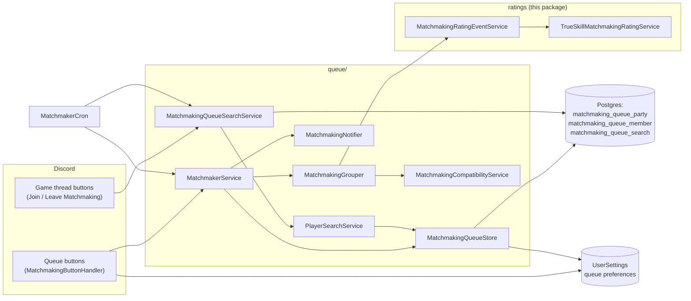
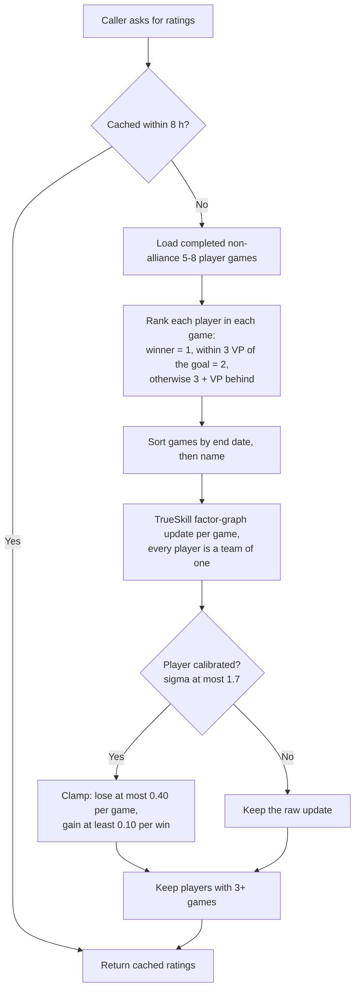
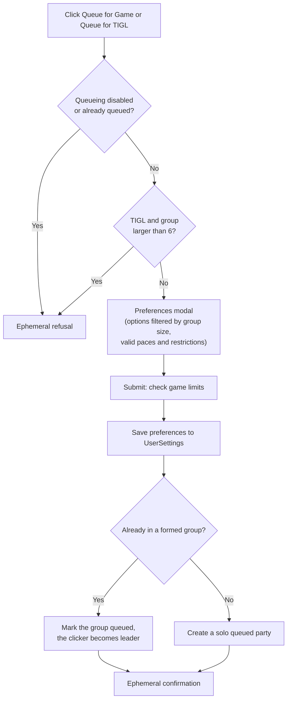
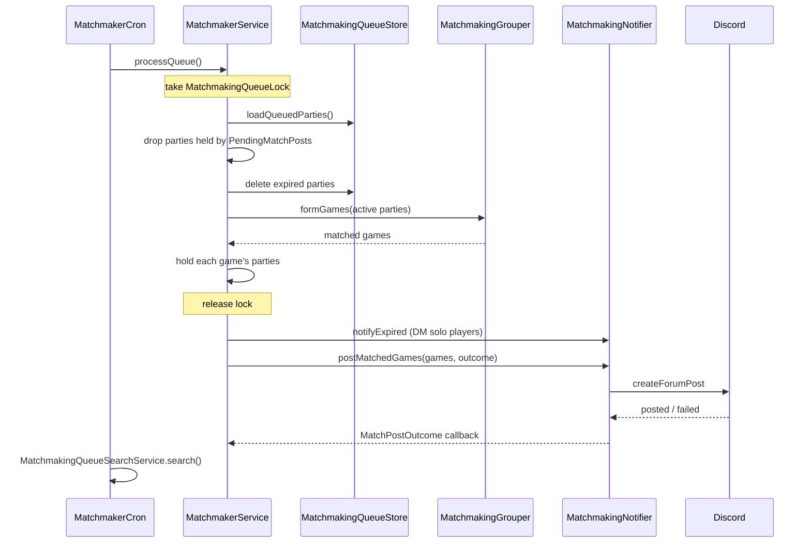
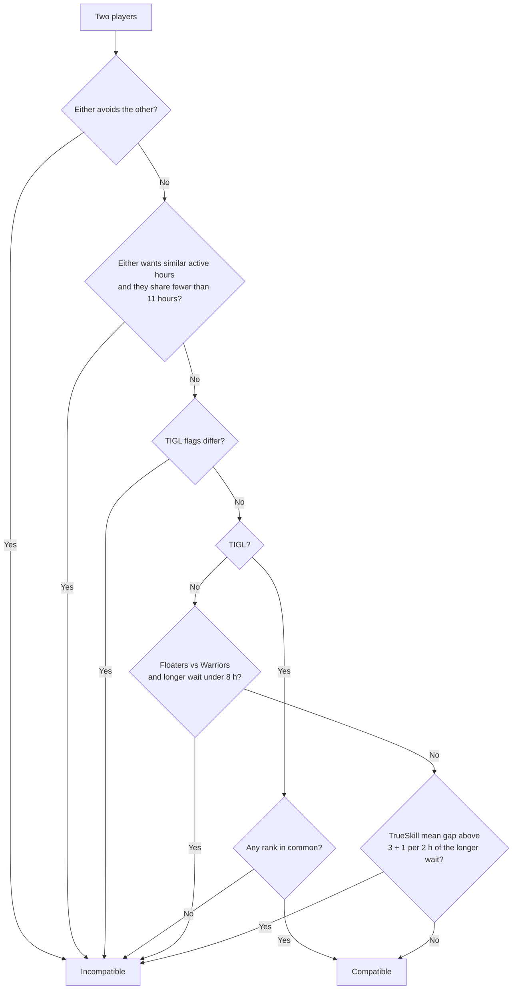
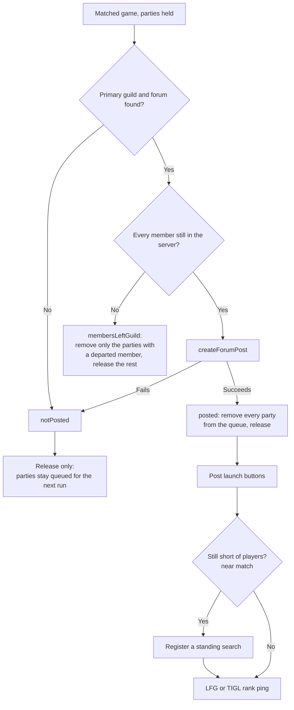
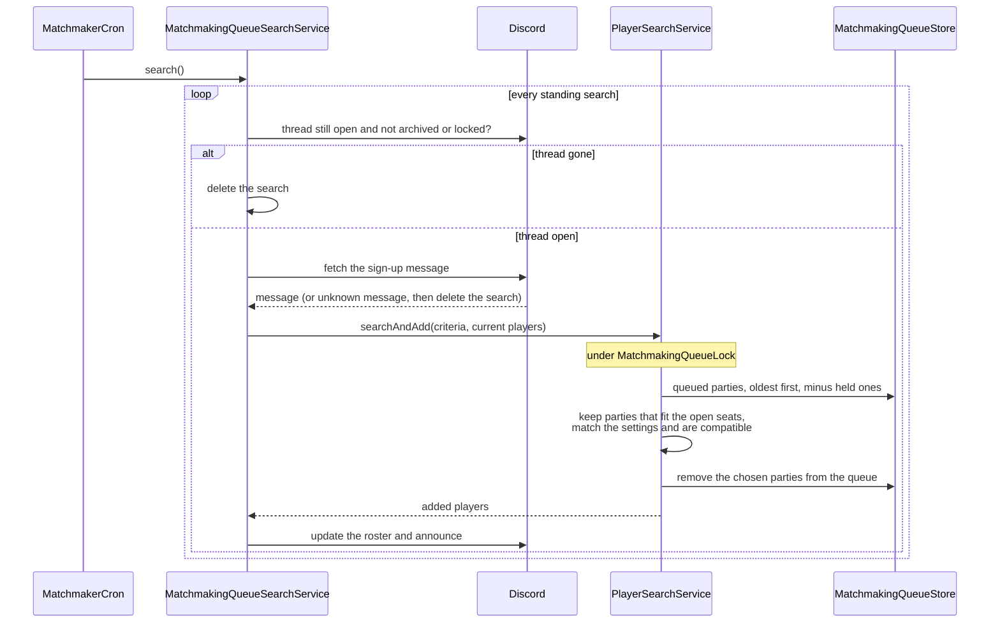

# Matchmaking

`ti4.spring.service.statistics.matchmaking` has two halves:

- **Ratings** (this package): a TrueSkill matchmaking rating (MMR) for every player, recomputed from completed
  games. It feeds `/statistics matchmaking_rating`, the game skill tiers used by statistics filters, and the
  skill check when forming matches.
- **Queue** ([`queue/`](queue)): players queue alone or as a group with their game preferences, a cron matches
  compatible parties into games and posts each one to a forum, and a launched game that is still short of
  players keeps pulling queued players in through a *standing search*.

The Discord entry points live outside the package, in
[`MatchmakingButtonHandler`](../../../../discord/interactions/buttons/handlers/matchmaking/MatchmakingButtonHandler.java)
(buttons and modals) and
[`MatchmakingOptions`](../../../../discord/interactions/buttons/handlers/matchmaking/MatchmakingOptions.java)
(every option value). Queue preferences (expansions, player counts, VP, pace, restrictions, TIGL ranks, max queue
time, avoid list) are saved on the player's `UserSettings`, not in the queue tables.

## Package map

### Ratings

| Class | Responsibility |
| --- | --- |
| [MatchmakingRatingEventService](MatchmakingRatingEventService.java) | Public facade (`get()`): cached ratings, the `/statistics matchmaking_rating` and history output, a game's `SkillTier`, average MMR. |
| [TrueSkillMatchmakingRatingService](TrueSkillMatchmakingRatingService.java) | Replays every qualifying game through the TrueSkill factor graph and clamps changes for calibrated players. |
| [MatchmakingGameInfo](MatchmakingGameInfo.java) | TrueSkill parameters (mean 25, sigma 25/3, beta 25/6, draw probability 0.05). |
| [MatchmakingGame](MatchmakingGame.java), [MatchmakingPlayer](MatchmakingPlayer.java) | One completed game and its players, with each player's finishing rank. |
| [MatchmakingRating](MatchmakingRating.java), [MatchmakingRatingHistoryEntry](MatchmakingRatingHistoryEntry.java) | A player's rating, sigma, calibration and recent trend; one game's before/after rating. |
| [SkillTier](SkillTier.java) | `LOWER` / `MEDIUM` / `HIGHER` display-rating bands used by statistics filters. |
| [GameRatingDescriber](GameRatingDescriber.java) | Formats `/developer game_mmr`. |

### Queue

| Class | Responsibility |
| --- | --- |
| [MatchmakerService](queue/MatchmakerService.java) | Queue API: `formGroup`, `queue`, `leaveQueue`, `removePlayer`, `clearQueue`, `verifyGroups`, and the cron's `processQueue`. |
| [MatchmakingQueueStore](queue/MatchmakingQueueStore.java) | Reads and writes parties and members; `loadQueuedParties` returns each queued party with its members and the leader's settings. |
| [MatchmakingQueueParty](queue/MatchmakingQueueParty.java), [MatchmakingQueueMember](queue/MatchmakingQueueMember.java) | Entities. A party has a leader, `queued`, `tigl` and `queuedAt`; a member row is unique per user, so a player is in at most one party. |
| [MatchmakingGrouper](queue/MatchmakingGrouper.java) | The matching algorithm (`formGames`): full games first, then near matches. |
| [MatchmakingCompatibilityService](queue/MatchmakingCompatibilityService.java) | Decides whether two players may share a game. |
| [PlayerMatchmakingDataFactory](queue/PlayerMatchmakingDataFactory.java), [PlayerMatchmakingData](queue/PlayerMatchmakingData.java) | One player's matching inputs: rating, avoid list, active hours, roles, restrictions, TIGL ranks, wait time. |
| [PartyValidator](queue/PartyValidator.java) | Valid paces and restrictions for a group, avoid-list conflicts, game limits. |
| [MatchDescriber](queue/MatchDescriber.java) | Forum thread title and body for a matched game, plus the "Matchmade" log line. |
| [MatchQualityCalculator](queue/MatchQualityCalculator.java) | TrueSkill match quality. Only logged and shown in `game_mmr`; it never decides a match. |
| [MatchmakingNotifier](queue/MatchmakingNotifier.java) | Expiry DMs, forum posts, launch buttons, LFG and TIGL rank pings. Reports each post's outcome through `MatchPostOutcome`. |
| [PendingMatchPosts](queue/PendingMatchPosts.java) | In-memory hold on the parties of a match whose post is in flight, so nothing matches them twice. |
| [MatchmakingQueueLock](queue/MatchmakingQueueLock.java) | One process-wide lock over the load-match-delete sections. |
| [MatchmakingQueueSearchService](queue/MatchmakingQueueSearchService.java), [MatchmakingQueueSearch](queue/MatchmakingQueueSearch.java) | Standing searches: a game thread that keeps recruiting queued players. |
| [PlayerSearchService](queue/PlayerSearchService.java), [PlayerSearchCriteria](queue/PlayerSearchCriteria.java) | `searchAndAdd`: picks compatible queued parties for one game thread and removes them from the queue. |
| [QueuedGameJoinValidator](queue/QueuedGameJoinValidator.java), [JoinBlocker](queue/JoinBlocker.java) | Checks a manual Join or Add on a recruiting thread. |
| [ViewMatchmakingQueueService](queue/ViewMatchmakingQueueService.java) | The "View Queue" embeds. |
| [GameConfig](queue/GameConfig.java), [MatchedGame](queue/MatchedGame.java), [QueuedParty](queue/QueuedParty.java), [GroupVerificationResult](queue/GroupVerificationResult.java) | Records passed between the classes above. |

### Visibility

Only the types that other packages call are public:

- **Ratings:** `MatchmakingRatingEventService` (statistics, commands and the queue's skill check), `SkillTier`
  (statistics filters) and `MatchmakingGameInfo` (the queue's default rating).
- **Queue:** the services the Discord handlers and `MatchmakerCron` call (`MatchmakerService`,
  `MatchmakingQueueSearchService`, `PlayerSearchService`, `ViewMatchmakingQueueService`), `PartyValidator` (the
  modals' valid paces and restrictions), `MatchQualityCalculator` (used by the ratings package), and the records
  they exchange (`PlayerSearchCriteria`, `JoinBlocker`, `GroupVerificationResult`).

Everything else is package-private. The queue entities, repositories and `MatchmakingQueueStore` are only reached
through the services, so all queue writes go through `MatchmakerService`, `MatchmakingQueueSearchService` and
`PlayerSearchService`. Members used by one class only are private; package-private members exist for the rest of
the package or its tests.

## Ratings

Nothing is stored. Ratings are recomputed by replaying every completed, non-alliance, 5 to 8 player game that
isn't excluded from statistics, oldest first. Results are cached for 8 hours, so a finished game shows up in
ratings within 8 hours (the slash commands compute fresh).

- **Two flavours.** Matching uses the TrueSkill *mean*. Display, tiers and statistics use the *conservative*
  rating. The display rating is the rating × 100.
- **Calibration** is `1.7 / sigma`, capped at 100%. The leaderboard shows the top 50 fully calibrated players
  who played in the last 6 months.
- **Game skill tier**: the average conservative display rating of the game's players, with unrated players
  counted at the player-base average. Below 1900 is `LOWER`, 2150 and up is `HIGHER`. A game gets no tier unless
  at least half its players are rated.
- Players without a rating match as a default TrueSkill player (mean 25).

## Queueing

The queue buttons are posted with `/developer post_matchmaking_buttons [tigl]`: Queue for Game (or Queue for
TIGL), Leave Queue, View Queue, Form Group and Additional Settings (max queue time, avoid list).

- **Groups.** Form Group picks up to 7 others. It refuses anyone already in a group or the queue, avoid-list
  conflicts within the group, and members over their game limit. The group is stored unqueued until a member
  queues it; that member's preferences become the group's.
- **TIGL** is always 6 players with Prophecy of Kings and Thunder's Edge, and offers only ranks at or below the
  player's own TIGL rank. A group of up to 6 may queue for TIGL; it uses its highest-ranked member's rank, so
  lower-ranked members can play up with a higher-ranked partner.
- **Leaving.** Leave Queue removes the player's whole party. Joining a game thread, being added to one, or
  launching a game also takes a player out of the queue.

## Matching

`MatchmakerCron` runs 15 minutes after start and then every 30 minutes, on the active instance only. Each run
calls `processQueue`, then sweeps the standing searches.

**Expiry.** A party expires once `queuedAt` plus the leader's max queue time has passed. The options are 4 hours,
8 hours, 1 day, 2 days and 1 week. The modal defaults to 2 days, and a missing or unknown setting also falls
back to 48 hours (both read `MatchmakingOptions.DEFAULT_MAX_QUEUE_TIME_OPTION`). Expired solo players get a DM; every expired party is logged.

**Forming games** (`MatchmakingGrouper.formGames`):

1. Each party offers every combination of its leader's player counts, VP goals, expansions and paces, skipping
   counts smaller than the party.
2. Configurations are tried largest player count first, ties in random order.
3. For each one, parties are ordered by longest max queue time, then oldest `queuedAt`. The first party seeds a
   game and the others join while they fit and every pair of players is compatible. For TIGL the whole game must
   still share a rank. If the game doesn't fill, the seed is dropped and the next party seeds.
4. A full game's restrictions are the union of its leaders' restrictions; its TIGL ranks are the shared ranks.
5. **Near matches.** Leftover groups short of a full game but holding at least half the seats plus one (3 of 4,
   4 of 5 or 6) also become games when some party has waited 24 hours, or when some party is within 1 hour of
   expiring. The fullest groups go first. They post with a standing search for the open seats. A 2-player game
   has no near match.

**Compatibility** (`MatchmakingCompatibilityService.areIncompatible`), checked in this order:

- "Similar active hours" is only offered when every member has at least 13 hours of activity data and every
  pair already shares at least 11.
- The Faster pace needs a completed game that took 21 days or less; Fastest needs one of 11 days or less.

## Posting a match

A matched game's parties leave the queue only once its forum post exists. The post goes to `making-tigl-games`
for TIGL games and `making-new-games` otherwise.

While a post is in flight its parties are held in [`PendingMatchPosts`](queue/PendingMatchPosts.java), so the
next `processQueue` and `searchAndAdd` skip them. The hold is in memory: if the bot stops after the forum post
succeeds but before the parties are removed, the next run can match them again and post a duplicate.

## Standing searches

A game thread in `making-new-games` or `making-tigl-games` keeps recruiting queued players while it has a
standing search. One is registered by the thread's "Join Matchmaking" button, or automatically for a near match.

- A party is picked only if its player counts include the thread's size, its expansions, VP and pace overlap the
  thread's, TIGL ranks still intersect, every pair is compatible with the players already in the thread, and it
  doesn't avoid anyone added by hand.
- **Manual joins** on a recruiting thread go through `QueuedGameJoinValidator`. A full roster, a TIGL rank above
  the player's, or an avoid list always blocks. A pace or active-hours mismatch blocks a self-join, but a member
  can still add that player; added players are exempt from the hour checks.
- Each roster change drops player counts the roster has outgrown and narrows the TIGL ranks.
- Launch is refused until the roster size is one of the queued player counts.
- **A search ends** when the game launches, the thread is deleted, archived or locked, the sign-up message is
  deleted, someone presses "Leave Matchmaking", or the roster outgrows every queued player count. A full roster
  doesn't end it; it just stops adding players.

## Concurrency and failure handling

- `MatchmakingQueueLock.LOCK` serializes the two places that remove players from the queue to put them in a
  game: `processQueue` (load, expire, match, hold) and `searchAndAdd` (load, select, remove), plus removing a
  posted match's parties. A party can never land in two games. Don't hold the lock across a Discord `.queue()`
  call or inside a database transaction.
- `formGroup`, `queue`, `leaveQueue`, `clearQueue` and `removePlayer` are each one `@Transactional` call and
  don't take the lock.
- When database maintenance mode is on (`DatabasePersistenceGate.isDisabled()`), every queue and search method
  returns early, the buttons reply that queueing is disabled, and the cron does nothing.

## Commands

| Command | What it does |
| --- | --- |
| `/developer post_matchmaking_buttons [tigl]` | Posts the queue buttons. |
| `/developer modify_matchmaking_queue action:remove_player\|clear\|verify [user]` | Removes a player's whole party, clears the queue, or lists parties whose leader's restrictions can never be met. |
| `/developer game_mmr game_name` | Each player's MMR and calibration, the average, the game's tier and its match quality. |
| `/developer mmr_history user` | A player's game-by-game rating changes. |
| `/statistics matchmaking_rating [tigl_only] [show_my_rating]` | The leaderboard, rating distribution, and the caller's own rating. |

## Known quirks

- When a recruiting TIGL thread's roster changes, `updateForRoster` narrows its ranks to those at or below the
  lowest-ranked member, while a group queues at its highest-ranked member's rank. A group-matched game queued for
  Minister and Hero can drop to Minister. It never empties the ranks.
