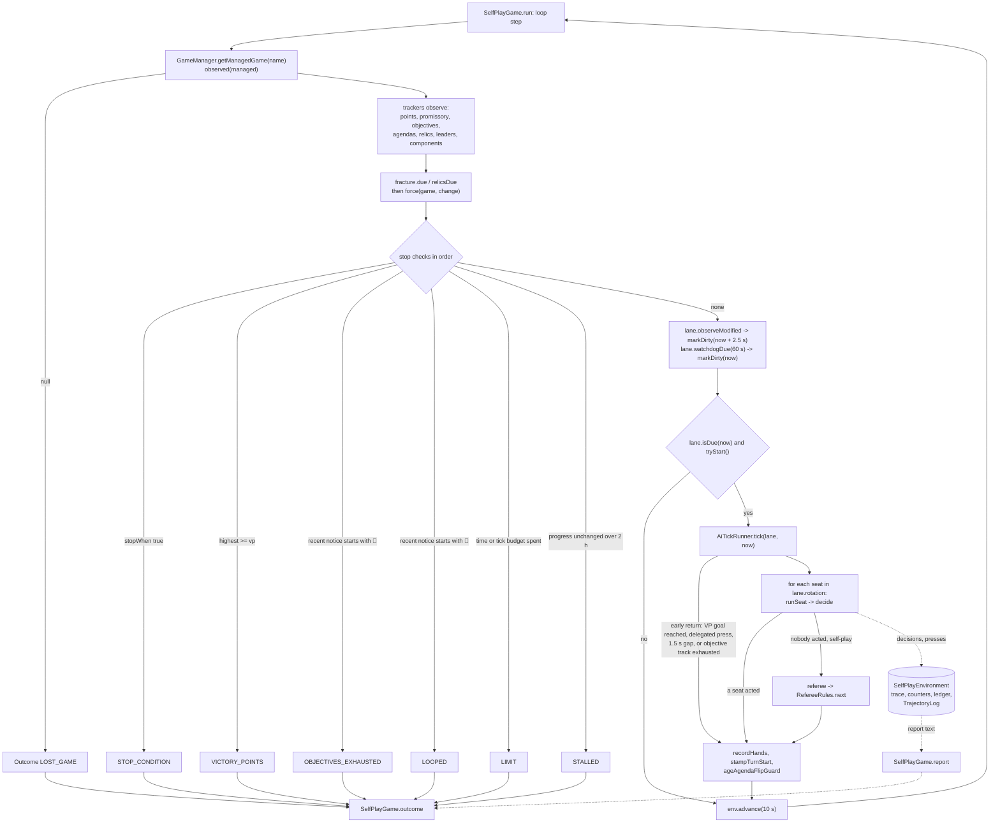
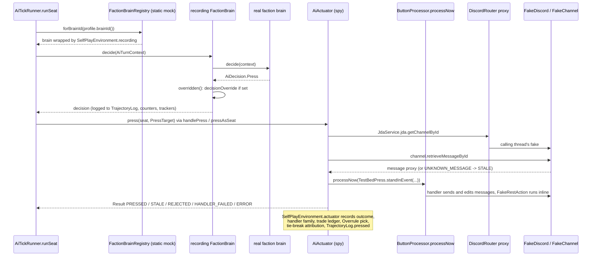

# Testing and self-play harness

Part of the [AI player architecture docs](/src/main/java/ti4/ai/README.md): a living document kept next to the code (packages: src/test/java/ti4/ai, FakeDiscord). The code is the source of truth; when you change behavior here, update this file.

## Harness components

Scope: everything under `src/test/java/ti4/ai` (516 files, all added by this branch, about 99,000 lines, 4,426 test methods: 4,421 `@Test` and 5 `@ParameterizedTest`, in 471 classes), the in-memory Discord under `src/test/java/ti4/testUtils/discord` (8 files, about 1,800 lines), and the other test files the branch adds outside `ti4.ai` (listed at the end). Production classes outside this scope are described only as far as the harness drives them.

None of the components in this scope plays the game. The harness wires the bot's real engine and the production AI ([AiTickRunner](/src/main/java/ti4/ai/runtime/AiTickRunner.java), the faction brains, [AiActuator](/src/main/java/ti4/ai/actuation/AiActuator.java)) to a fake Discord on a virtual clock, records what the AI did and reports it. The only harness pieces that change a decision are `SelfPlayEnvironment.decisionOverride` (used only by [RolloutExperimentTest](/src/test/java/ti4/ai/runtime/RolloutExperimentTest.java)) and the scenario `force` hooks that edit the game state between ticks.

---

### SelfPlayEnvironment

- **Role:** informs (instrumentation) and infrastructure. It decides nothing; one hook (`decisionOverride`) lets a caller replace a decision.
- **Purpose:** gives one in-process game everything the bot's button path needs outside the engine, replaces the services that would touch the network, database or disk, and records decisions, presses and bot log lines for the report. File: [SelfPlayEnvironment](/src/test/java/ti4/ai/runtime/SelfPlayEnvironment.java).
- **Invoked when:** constructed in a try-with-resources block by every self-play test: `AiSelfPlayTest.play`, `RoundOneSelfPlayTest.playOne`, `RoundTwoSelfPlayTest.playOne`, `DeterminismSelfPlayTest.play`, `EnvironmentSnapshotTest`, `TrajectoryReplayTest`, `RolloutExperimentTest.examine`, `SabotageSelfPlayTest.play`, `LegendarySelfPlayTest.play`, `RelicSelfPlayTest.play`, `FractureSelfPlayTest.playOnce`, `TradeFlowSelfPlayTest.play`, `HumanSeatSetupTest` (verified with a grep for `new SelfPlayEnvironment`).
- **Inputs:** the virtual clock start in milliseconds.
- **Outputs:** public fields read by [SelfPlayGame](/src/test/java/ti4/ai/runtime/SelfPlayGame.java) and the tests: `clock`, `discord`, `gameMessages`, `storage`, `botProblems`, `fallbacks`, `circuitBreakerReasons`, `missingBeans`, the trace ring buffer, `pressOutcomes`, `pressedHandlers`, `decisionReasons`, `actionsByRound`, `actionSecretRounds`, `tradeLedger`, `pressesBySeat`, `settlementsSent/Accepted`, `overrulePicks`, and the trackers it owns (`MecatolTracker`, `ExpeditionTracker`, `PromissoryTracker`, `LeaderTracker`, `FactionComponentTracker`).
- **Algorithm (install order in `install`):**
  1. `DiscordRouter.bind(discord)` (see below).
  2. A static mock of `SpringContext.getBean(Class)` that answers from a fixed map and otherwise records the class name in `missingBeans` and throws `IllegalStateException("ApplicationContext not initialized")`. The map holds:
     - `GameMessageService` → [InMemoryGameMessages](/src/test/java/ti4/testUtils/discord/InMemoryGameMessages.java).
     - `CombatContestSettings`, `CombatReplayService`, `PlayerTitleService`, `OverruleStatsService` → stub-only Mockito mocks (every call returns the default).
     - `GameEventService` → a mock whose `commitEvent` forwards `CARD_PLAY_PROMISSORY_NOTE` events to `PromissoryTracker.played`; all other events are dropped.
     - `ActiveLeaseService` → a mock whose `boolean` methods return `true` unless the method name contains "drain".
     Every other bean (for example the website notifier) is left unavailable on purpose; the class comment says such beans start work on bot threads that would reload the game from the real storage path.
  3. `Storage.getStoragePath` → a fresh temporary directory (`Files.createTempDirectory("ai-self-play")`); every other `Storage` method runs for real; then `Storage.init()`.
  4. No-op static mocks of `MapRenderPipeline`, `GameDatabaseSyncPipeline`, `AutoPingMetadataManager`, `TechSummariesMetadataManager`.
  5. `UserSettingsManager` → an in-memory map (`get` creates, `save` stores, `getAllUserSettings` lists).
  6. `AiRuntime.mayMutate()` and `AiRuntime.isProcessReady()` → `true`; other `AiRuntime` methods are real.
  7. `AiSettings.isEnabled()` → `true` (the production kill switch is a global setting); `AiSettings.thinkingBudget()` → `Duration.ZERO`, which [ThinkingLimits](/src/main/java/ti4/ai/trace/ThinkingLimits.java) reads as "no time budget" (`hasBudget()` is `budgetNanos > 0`). The re-entry limit (8), depth limit (60) and call cap (200,000) still apply because `thinkingLimits()` is real.
  8. `CircuitBreaker.isOpen` and `checkIsOpenAndPostWarningIfTrue` → `false`; `incrementThresholdCount` records its reason and returns `false`.
  9. `BotLogger`: `warning`, `error`, `critical` are captured (with a 14-frame stack summary, at most 2,000 lines); `info` lines starting with `FallbackLog.LINE_PREFIX` go to `fallbacks` and the trace; other `info` and `log*` calls are dropped; anything else runs for real.
  10. `AiActuator` is a spy (`CALLS_REAL_METHODS` default): `actuator` runs the real `press`, then records the outcome (see "Press recording" below).
  11. `FactionBrainRegistry.forBrainId` is wrapped: the real brain is returned inside a recording `FactionBrain` (see "Decision recording").
  All mocks are created with `withSettings().stubOnly()`, so Mockito keeps no invocation history; the comment notes a whole game makes millions of calls through them.
- **Decision recording** (the wrapper brain's `decide`): snapshot the seat memory if a trajectory log is open; call the real `brain.decide`; pass the result through `overridden` (the `decisionOverride` function, which clears itself once it returns an object other than the one it was given); `TrajectoryLog.decided`; `decisionListener`; `agendaDecisions`; trace line for non-idle decisions; `countReason` (reason text with digits replaced by `#` and `#`-tokens removed, counted in `decisionReasons`); `LeaderTracker.decided` and `FactionComponentTracker.decided` for presses; `noteOffer` (reasons starting `trade: send the ` remember the offer label per offerer>receiver and count `Trade settlement` sends); `rememberReason`; `countRoundAction` (kinds: `trade`, `tactical action` for reasons starting `start a tactical action` or `use Warfare for a tactical action`, `follow <Card>`); `noteActionSecretScored` (reasons matching `^score (\w+) after a combat$`); `MecatolTracker.observe`; `ExpeditionTracker.observe`; `countTacticalAction`; `countPlanKind`; `timeRanked`.
- **countPlanKind:** for a press whose reason starts with `start a tactical action`, reads the remembered plan (`TacticalRules.rememberedPlan`) and counts `plan: <kind>`; for EXPAND also `plan: <zone> <band>` where the zone comes from `Territory.zone` (HOME/LANE/SLICE → own area, BORDER, FOREIGN/OTHER_HOME → another's area, MECATOL, NEUTRAL → elsewhere) and the band is `r1-2`, `r3-4`, `r5+`; for ATTACK also attacks on another home, landings there, attacks on Mecatol, landings on Mecatol, and attacks on Mecatol while another player holds an unplayed Imperial; and `seat stack left by <kind>` when the seat holds Occupy the Seat of the Empire (`ose`) and the plan moves a non-ground-force unit out of Mecatol.
- **timeRanked:** every 8th tactical-action press across the JVM (a static counter) runs `TacticalPlanner.ranked` again on the same board and adds the nanoseconds to static `RANKED_NANOS`/`RANKED_SAMPLES`/`RANKED_MAX_NANOS`, and counts rankings that hold a STAGE plan.
- **Press recording** (`actuator`): before the real press, `offerAboutToBeAccepted` reads the offerer's transaction items for an `acceptOffer_<color>_…` press, and `overrulePickAboutToBeMade` reads the seat's points for a `winnuHero_<initiative>_…_overrule` press. After the press: `pressOutcomes` by outcome name; `LeaderTracker.pressed` and `FactionComponentTracker.pressed`; a `HEROBUILD` note for `purgeHacanHero`; for a pressed outcome: `pressedHandlers` and `pressesBySeat` by handler family (the custom id with an `FFCC_<faction>_` prefix removed, cut at the first `_`); tie-break attribution for `resolveAgendaVote_outcomeTie` (below); the trade record if the offerer's items are now empty; the Overrule pick; `agendaPresses`. For every press result (pressed or not): a trace line and `TrajectoryLog.pressed`.
- **Tie-break attribution (`tieBreakerOf`):** walks the current call stack for frames of `ti4.ai.runtime.AiTickRunner`: method `referee` → REFEREE, `fallBack` or `pressDelegated` → FALLBACK, otherwise none (the speaker AI broke the tie itself, not a defect).
- **Trace:** a ring buffer of 400 lines stamped `[t+Ns]` from the game start; identical consecutive lines collapse into `(repeated N more times)`. Lines matching `-Dai.selfplay.watch=<regex>` are also kept in `watched` for the whole game.
- **Depends on:** Mockito static mocking (thread-local), the trackers, [TrajectoryLog](/src/test/java/ti4/ai/runtime/TrajectoryLog.java), production `TacticalRules`, `TacticalPlanner`, `Territory`, `BoardView`.
- **Effect on the game:** none apart from `decisionOverride`.
- **Fallbacks:** `install` failures close everything already opened and rethrow. `close` closes the trajectory log, unseeds the thread's random source if it was seeded, closes every mock in reverse order (ignoring failures), unbinds the fake Discord and deletes the temp storage.
- **Limitations:**
  - All stubs are bound to the creating thread; work the bot hands to its own executors runs without them (stated in the class comment). Discord calls from such threads go through `DiscordRouter`'s unbound path.
  - `gameManager(InvocationOnMock)` is defined but never installed (no `GameManager` mock exists), so the "GAME MANAGER" lines it would add to `botProblems` never appear. Dead code.
  - The 8th-press sampling counter and the ranking timers are static, so they mix games of a parallel batch (intended: they are batch-level statistics).

### SelfPlayGame

- **Role:** executes (drives the AI runtime on the virtual clock, applies scenario changes) and informs (outcome and report).
- **Purpose:** sets up an all-AI (or one-human) game through the production setup path and runs it tick by tick until a stop condition. File: [SelfPlayGame](/src/test/java/ti4/ai/runtime/SelfPlayGame.java).
- **Invoked when:** created by the same tests as the environment (`new SelfPlayGame(...)`), then `setUp(...)` and `run(...)`; `snapshot`/`restore` by `EnvironmentSnapshotTest` and `RolloutExperimentTest`; `force` by every scenario test and `RoundTwoSelfPlayTest`.
- **Inputs:** environment, game name, slot (game index in a batch), seed (default `seedFor(slot)`), the faction list or a [SelfPlaySetup.Table](/src/main/java/ti4/ai/selfplay/SelfPlaySetup.java), a stop predicate, a virtual-time budget and a tick budget.
- **Outputs:** `Outcome` record: `ending`, `round`, `phase`, `ticks`, `virtualMillis`, final `victoryPoints`, `pointsAfterRound`, `actionsByRound`, `stateAtRoundStart` (table averages of tactic, fleet and strategy tokens, planets, technologies), `seats`, `TradeSummary`, `ActionCardSummary`, `SecretSummary`, the tracker summaries (Mecatol, expeditions, promissory, objectives, Fracture, relics, agendas), the text `report`, `wallSeconds`, `slot`, `controlSeats`.
- **Seeding:** `BASE_SEED = Long.getLong("ai.selfplay.seed", System.nanoTime() & 0xFFFFFFFFL)` (so without the property every JVM run picks a new base). `seedFor(slot) = BASE_SEED + pairSlot(slot)`, where `pairSlot(slot)` is `slot / 2` when an A/B run is configured and `slot` otherwise. `setUp` calls `RandomHelper.seedThisThread(seed)`; the branch routes engine randomness (dice, deck shuffles, seat ids, AI profile seeds) through `RandomHelper.current()`, which returns the thread's seeded `Random` or `ThreadLocalRandom`.
- **setUp(Table):** seed the thread; create `<name>-actions`, `<name>-table-talk` and a `<name>-bot-map-updates` thread in the fake Discord; call `SelfPlaySetup.setUp(name, owner, channels, table, fast=false, setupEvent)` (the same code `/ai watch` uses; owner id `300000000000000001`, a Mockito `Member`); `AiRuntime.forget(name)` because the harness drives its own lane; open the trajectory log if configured; point the agenda tracker at the environment's hooks; `game.setShowBanners(false)`; `markLegacySeats`; `markControlSeats`; deal `-Dai.selfplay.give` action cards (drawn from the deck if present, else set directly); `giveChosenTechs` (`-Dai.selfplay.techs`: to seats whose faction techs include it, else every seat); `revealChosenObjectives`; save and check that `GameManager` registered the game (else `IllegalStateException`).
- **revealChosenObjectives:** `-Dai.selfplay.objectives=a,b` puts those stage I ids first. `-Dai.selfplay.objectiveseed=N` sorts all other unrevealed stage I ids, shuffles them with `new Random(N * 1009 + pairSlot)` and appends up to `5 − chosen` of them. `stackOnTop` keeps the peekable list at its original size and pushes the overflow back onto the deck top (a fix: growing the peekable list made the game reveal stage I objectives forever). Verified by [SeededObjectivesTest](/src/test/java/ti4/ai/runtime/SeededObjectivesTest.java) (read in full).
- **markLegacySeats:** with `-Dai.actioncards.ab=true`, seats with `(index + slot) % 2 == 0` get `AiSettings.markLegacyActionCards` (stored value `aiLegacyActionCards=true`).
- **markControlSeats:** with `-Dai.selfplay.ab=…`, seats with `(index + slot) % 2 == 0` are control: `AiExperiments.disable(seat, experiments)` (stored value `aiExperimentsOff`, `-` for the empty set) and personality NEUTRAL. The other seats get `-Dai.selfplay.ab.personality` if set. So seats 0, 2, 4 are control in the even game of a pair and 1, 3, 5 in the odd one.
- **run loop** (each iteration, see the diagrams in section 4):
  1. Read the managed game (`observed` caches the `Game` while the `ManagedGame` instance is unchanged); `LOST_GAME` if gone.
  2. Observers: victory points per round, action card play rounds, promissory, objectives, agendas, relics, leaders, faction components; `fracture.due` → `force(fracture::enter)`; relic handout once (`-Dai.selfplay.relics=N`, first action phase with an active player, through `RelicHelper.drawRelicAndNotify`); Fracture observer; Styx probe, fleet log, research plan log; close finished Overrule picks.
  3. Stop checks in order: `stopWhen` → `STOP_CONDITION`; `AiTickRunner.reachedVictoryPoints` (`vp > 0 && highest >= vp`) → `VICTORY_POINTS`; one of the last 5 live messages in the actions channel starts with `🏁` → `OBJECTIVES_EXHAUSTED`; starts with `AiConfusionService.LOOP_NOTICE_MARK` (`🔁`) → `LOOPED`; virtual time over budget or ticks ≥ budget → `LIMIT`; progress fingerprint `lastModifiedDate|round|phase|activePlayerID` unchanged for more than `STALL_MILLIS` (2 virtual hours) → `STALLED`.
  4. `lane.observeModified(lastModifiedDate)` → `markDirty(now + AiSettings.DEBOUNCE)` (2.5 s); `lane.watchdogDue(now, WATCHDOG_PERIOD)` (1 min) → `markDirty(now)`.
  5. If `lane.isDue(now) && lane.tryStart()`: `AiTickRunner.tick(lane, now)`, `lane.finish()`, `ticks++`, `recordHands`, `stampTurnStart(now)`, `ageAgendaFlipGuard()`.
  6. `env.advance(STEP_MILLIS)` (10,000 ms).
  `Ending.finished()` is true only for `VICTORY_POINTS` and `OBJECTIVES_EXHAUSTED`.
- **Clock repairs:** `stampTurnStart` re-stamps `lastActivePlayerChange` with the virtual time of the tick that changed it (the engine stamps the wall clock; the AI compares it with message times from the virtual clock). `ageAgendaFlipGuard` lowers the `lastAgendaReactTime` stored value to `min(virtualNow, wallNow − 10 min)` so the engine's 6-second agenda-flip guard does not block the referee and the stamp is never ahead of the virtual clock (the comment records seeds 15 and 21 stalling in "agendawaiting" before this).
- **force(game, change):** applies a scenario change between ticks; if the change moved `lastActivePlayerChange`, re-stamps it with the virtual time; saves.
- **Snapshot / restore:** `Snapshot(save text via SaveText.of, FakeDiscord.Snapshot, InMemoryGameMessages snapshot, AiGameState.Snapshot, AiLane.copy(), clock, serialized RandomHelper.current(), issuedTurnStamp)`. `restore` reads the save back (`SaveText.read`), saves it, resets the observed-game cache, restores Discord, messages, AI state, lane, clock and the `Random` object (Java serialization). Checked by `EnvironmentSnapshotTest` (gated, read in full).
- **Report** (`report`): header with ending, seed, ticks, virtual minutes; per seat VP, strategy cards, tactic tokens, passed; then tail sections: victory points by round, scoreboard (revealed objectives with scorers, per-seat secrets/techs/planets/TG/action cards/fragments/laws, action cards played with `(sabotaged)` marks, promissory notes owned/received/play area), Fracture, trading (per seat commodities, debts both ways, offers sent/accepted/rescinded/countered, trade goods in/out, settlements), trade invariants, promissory note moves, thinking statistics, press outcomes, pressed handlers, decisions by reason, missing Spring beans, circuit breaker, bot warnings and errors (excluding "Bad Buttons detected and sanitized"), AI fallbacks, fake Discord action and callback failures, distinct unsupported JDA calls, watched lines and messages, the AI trace (last 80), the last 25 main-channel messages, the 3 newest combat threads (`-vs-` in the name), and button messages in each seat's private thread.
- **Trade invariants** (`invariantViolations`): no seat with negative TG or commodities; no transaction items left; no AI seat owing more than `AI_DEBT_CAP = 4` to one creditor; a `LOOPED` or `STALLED` game whose last decision reason starts with `trade: ` is a violation.
- **Depends on:** production [SelfPlaySetup](/src/main/java/ti4/ai/selfplay/SelfPlaySetup.java), `AiTickRunner`, `AiLane`, `AiGameState`, `GameManager`, `RandomHelper`, `SaveText` (test helper over `GameSaveService.writeSnapshot` / `GameLoadService.readGame`).
- **Effect on the game:** only through `force`, objective stacking, `give`/`techs`, relic handout, Fracture entry, the clock repairs above, and control/legacy marks.
- **Limitations:** a tick runs at most once per 10-second step, so the harness never exercises sub-10-second timing; `MIN_GAP_BETWEEN_ACTIONS` (1.5 s) and the debounce (2.5 s) never bind. The production poll ([AiRuntime](/src/main/java/ti4/ai/runtime/AiRuntime.java) with its 3-second cron) is not used; `AiTickRunner.tick(lane, now)` is called directly. `setUp` always passes `fast = false`, while `/ai watch` ([AiWatch](/src/main/java/ti4/ai/discord/AiWatch.java)) defaults to the fast pace, so the harness plays the normal-pace timings, not the ones a default `/ai watch` game uses. The stop checks run before the tick, so a game that reaches the VP goal ends `VICTORY_POINTS` before `AiTickRunner` posts its VP `🏁` notice.

#### Diagram: One step of `SelfPlayGame.run`

Solid arrows are calls or decisions in `SelfPlayGame.run` and the production `AiTickRunner`; dotted arrows carry recorded data into the environment.

### Production pieces the harness relies on (outside scope, summarised)

- **[AiTickRunner](/src/main/java/ti4/ai/runtime/AiTickRunner.java)** (decides who acts and executes presses). Per tick: if `AiRuntime.mayMutate()` is false, retry in 30 s; if the managed game is gone or has ended, forget the lane and stop; open `TickMemo`; list active AI seats (none → forget the lane); handle undo; once a seat has reached the VP goal, every seat stops acting (any game) and a self-play game posts `🏁` once; press a queued delegated choice; respect the 1.5 s minimum gap; read the perception snapshot; in self-play, if the objective track is exhausted (stage II peekable list empty, stage I in Omega phase mode) and the bot offers its "most points" end-game button, announce and stop; for each seat in rotation order (the seat after the last actor first, [AiLane](/src/main/java/ti4/ai/runtime/AiLane.java) `rotation`) run `decide` and act on the decision; the first seat that acts ends the tick. Acting includes a press attempt, an `Unsure` fallback, an announce, post or proposal, and a decision whose thinking was cut short (`cutShort` returns `act()`). If nobody acted and the game is self-play, `referee`. Production calls `tick(lane)` from `AiRuntime` with the wall clock; the harness calls `tick(lane, now)`.
- **Lane health in AiTickRunner.** Every failed press (`REJECTED`, `ERROR`, `HANDLER_FAILED`, not `STALE`) and every prompt that runs out of attempts calls `recordFailure`. At 3 failures in 10 minutes for the game (`GAME_FAILURE_LIMIT`), or 10 across the JVM (`GLOBAL_FAILURE_LIMIT`), `isHealthy` is false: seats decide nothing on their own (`mayActOnItsOwn`) and the referee does nothing until the failures age out of the window. A failed press also uses up the remaining attempts on that prompt key, so the next identical decision goes straight to the fallback.
- **[RefereeRules](/src/main/java/ti4/ai/selfplay/RefereeRules.java)** (decides which housekeeping button to press in self-play). Fixed step order: deal starting secrets (only once every seat is filled), first objective reveal, stage I/II reveals (skipped once the track is exhausted), start strategy phase, flip agenda, resolve agenda ("Resolve with Current Winner" label only, prompt at least 60 s old), break an agenda tie (prompt at least 10 min old), proceed to strategy. A prompt must be at least `max(refereeDelay, step minimum)` old (20 s, or 10 s at fast pace). Presser: a button owned by a faction is pressed only by the AI seat of that faction and is left alone when no AI seat holds it; an unowned button is pressed by the speaker seat, else the first seat. A press key the referee already pressed is pressed again only after `stateFingerprint` (round, phase, speaker, unscored secret counts, stored values) changes. Tests: [RefereeRulesTest](/src/test/java/ti4/ai/selfplay/RefereeRulesTest.java) (16 tests: nothing unless every seat is an AI or without seats, waits for the delay, deals only when seats are filled, owned steps pressed by the owning faction and left alone without one, unowned steps by the speaker seat or the first seat, no reveals once exhausted, recognises the end-game button, never ends the game or starts a rematch, skips buttons already pressed, game order, one-minute agenda confirmation, only the current-winner resolution, ten-minute tie break).
- **[SelfPlaySetup](/src/main/java/ti4/ai/selfplay/SelfPlaySetup.java)** (executes setup). Creates the game, sets channels, custom name "AI self-play", auto-ping off, player count, strategy cards per player (2 at 4 seats or fewer, else 1), lays out the "Thunder Dreaming" six-player map from the Thunder's Edge rulebook (`THUNDER_DREAMING_MAP_STRING`), marks unused home positions `-1`, seats AIs with `AiSeatService.addSeat` (and the human with `PlayerSetupService.setupPlayer`), `finishSetup`, saves, registers with `AiRuntime`. Tests: [SelfPlaySetupTest](/src/test/java/ti4/ai/selfplay/SelfPlaySetupTest.java) (9 tests: home spread for fewer seats, no phantom home, Thunder Dreaming adjacency checked against the rulebook picture, two cards at four seats, distinct default factions, name rules, human seating, no duplicate faction, all-AI table with first seat speaking) and [HumanSeatSetupTest](/src/test/java/ti4/ai/runtime/HumanSeatSetupTest.java) (read in full: a 6-seat table with the owner as Yin/red and 5 AIs; a 4-seat table; one speaker; `AiSeats.isSelfPlay` false with a human).
- **Self-play fallback in AiTickRunner.** When a seat is unsure, makes no progress twice on the same prompt (`MAX_ATTEMPTS_PER_PROMPT = 2`, key includes `AiProgress.fingerprint`) or stalls past `stallThreshold` (3 min, 1 min at fast pace), `fallBack` in a self-play game calls `chooseWithoutHumans`: `AiConfusionService.stalledChoice` (on a system picker: a `ringTile_` system holding only the seat's own units) or `selfPlayChoice` (the first button whose handler id or label, lowercased, contains a declining hint — `decline`, `pass`, `no_`, `not follow`, `deletebuttons`, `done`, `skip`, `cancel` — else the first enabled button that is not an `ultimateUndo`), never a form-opening button, a hit-cancel button, or an early pass (the last only with experiment `EXPLOIT_GUARDS`); pressed through `RedistributionGuard.pressRestoringTokens`. Fallbacks are counted per reason and turn (`AiSeatState.recordFallback`): the first `MAX_REPEATED_FALLBACKS = 5` choose, the sixth posts the `🔁` loop notice (which the harness reads as `LOOPED`) and later ones do nothing. A press that lands clears the count.

### FakeDiscord, FakeChannel, FakeMessage, FakeRestAction, ProxySupport

- **Role:** infrastructure (in-memory Discord). Decides nothing.
- **Purpose:** answer the JDA calls the bot makes during a game without a network. Files: [FakeDiscord](/src/test/java/ti4/testUtils/discord/FakeDiscord.java), [FakeChannel](/src/test/java/ti4/testUtils/discord/FakeChannel.java), [FakeMessage](/src/test/java/ti4/testUtils/discord/FakeMessage.java), [FakeRestAction](/src/test/java/ti4/testUtils/discord/FakeRestAction.java), [ProxySupport](/src/test/java/ti4/testUtils/discord/ProxySupport.java).
- **Invoked when:** `SelfPlayEnvironment` creates one per game; [FakeDiscordTest](/src/test/java/ti4/testUtils/discord/FakeDiscordTest.java) installs one directly into `JdaService.jda`/`guildPrimary`; `AiCombatThreadSelectionTest` (perception) also uses it (its `restoreDiscord` method).
- **Algorithm:**
  - Every JDA interface (`JDA`, `Guild`, `SelfUser`, `SelfMember`, `TextChannel`/`ThreadChannel` with their unions, `Message`, every `RestAction` subtype) is a `java.lang.reflect.Proxy`. `ProxySupport.proxy` dispatches by method name to a handler; if the handler returns `UNHANDLED`, it calls the interface's default method when there is one, and otherwise records the call in `unsupportedCalls` and returns a type default (`false`, `0`, `""`, empty collection, `Optional.empty()`, a no-op `RestAction` proxy, or `null`).
  - Ids are Discord snowflakes: `TimeUtil.getDiscordTimestamp(max(clock, lastMillis)) | sequence`, the sequence counting up within one millisecond (22 bits, overflow moves to the next millisecond). Bot id `400000000000000001`, guild id `400000000000000002`.
  - Messages keep content, embeds, components, attachment names, reactions, pinned, deleted and an edit count. Posting assigns unique component ids to components with a negative unique id (three passes of `ComponentReplacer` for nested components) and rejects a message whose buttons repeat a `custom_id` (Discord does). Partial edits change only the fields the `MessageEditData` marks as set (read through reflection on `isReplace`/`isSet`). Deleted or unknown messages throw a mocked `ErrorResponseException` with `UNKNOWN_MESSAGE` and a 404 response.
  - Channels: text channels and threads (public or private); a thread started from a message takes the message's id; `getHistory().retrievePast(n)` returns the newest `n` (1 to 100) live messages, newest first; archive state via `getManager().setArchived`.
  - `FakeRestAction` runs its body once, inline on the calling thread, the first time it is queued, completed or submitted; delays (`queueAfter`, `completeAfter`, `delay`, `timeout`) are ignored; fluent setters are applied to a `MessageCreateBuilder`/`MessageEditBuilder` when one exists; success and failure consumers of `queue` are called inline; failures go to `actionFailures`, callback exceptions to `callbackFailures` (each list capped at 10,000).
  - `snapshot()`/`restore()` keep channel message lists, message states and the id counters, and drop anything created after the snapshot.
- **Tests:** `FakeDiscordTest` (read in full): planet sticker lookup, buttons sent through `MessageHelper.sendMessageToChannelWithButtons`, unique ids on nested buttons, history newest first and stamped by the clock, partial edits keep untouched fields, deleted messages are unknown, threads from a message share its id, duplicate custom ids rejected.
- **Limitations:** no rate limits, no gateway events, no modals, no member lookups (`getMemberById` returns `null`, `retrieveMemberById` completes with `null`), no reactions list (`getReactions` is empty), message channel type of a thread message is always `GUILD_PUBLIC_THREAD` even for private threads (`FakeMessage.handle` `getChannelType`), and every `queue()` completes synchronously, so ordering bugs that depend on asynchronous completion cannot appear.

#### Diagram: A seat's press through the stubs

### DiscordRouter

- **Role:** infrastructure.
- **Purpose:** lets several fakes run in one JVM, one per game thread. File: [DiscordRouter](/src/test/java/ti4/testUtils/discord/DiscordRouter.java).
- **Algorithm:** the first `bind` saves the current `JdaService.jda`/`guildPrimary` and installs routing proxies; each call goes to the fake bound to the calling thread (a `ThreadLocal`). A thread with no binding (bot executors) increments `unboundCalls` and, with one fake bound or with no arguments, uses the first bound fake; otherwise asks every bound fake and returns the first non-null, non-empty result. The last `unbind` restores the previous values.
- **Invoked when:** `SelfPlayEnvironment.install` / `close`.
- **Limitations:** an unbound call with no arguments (for example `getGuilds()`) always goes to the first bound game. `AiSelfPlayTest.play` asserts at the end that every channel in a game's fake contains the game's name, which catches channels created in the wrong fake but not reads or edits routed to the wrong game.

### InMemoryGameMessages

- **Role:** infrastructure.
- **Purpose:** a `GameMessageService` in memory, because the game's "everyone has reacted" bookkeeping (strategy card follows, scoring, when/after windows) runs through it. File: [InMemoryGameMessages](/src/test/java/ti4/testUtils/discord/InMemoryGameMessages.java).
- **Algorithm:** a stub-only mock whose default answer implements `add` (skip duplicates by message id), `replace` (by type and key), `removeGames`, `removeSavedAfter`, `remove` (by id or by type and key), `getOne`, `getAll`, `getAllByGame`, `addReaction`, `importMissing` (returns 0). `snapshot`/`restore` copy the reaction sets so later reactions do not leak into a snapshot.

### TrajectoryLog

- **Role:** informs.
- **Purpose:** a per-game JSON-lines log for mining decisions against results, and optional per-decision snapshots for replay. File: [TrajectoryLog](/src/test/java/ti4/ai/runtime/TrajectoryLog.java).
- **Invoked when:** `SelfPlayGame.setUp` calls `openIfEnabled` when `-Dai.selfplay.trajectories=DIR` is set; the recording brain calls `decided`; `SelfPlayEnvironment.actuator` calls `pressed`; `SelfPlayGame.outcome` calls `finish`; the environment closes it.
- **Outputs:** `DIR/GAME.jsonl.gz` with `decision` lines (game, index, round, phase, active faction, seat, virtual millis, kind, reason, chosen button, enabled buttons grouped by prompt as `[customId, label]`, per-seat board summary: VP, TG, commodities, planets, tactic/fleet/strategy tokens, action card count, secrets scored/held, technologies, strategy cards, passed), `press` lines (outcome and detail for the last press decision of that seat when the custom id matches), and one `outcome` line (ending, seed, decision count, round, points, leaders). Idle and wait decisions are not logged (`records`). With `-Dai.selfplay.trajectories.snapshots=true`, `DIR/GAME.snapshots.zip` adds `NNNNNN.save.txt` (the save text) and `NNNNNN.context.json` (seat, user id, now, pressed keys, memory before the decision, full prompts with button metadata, the game's message reactions, `AiGameState` open follows, slay intents and Fracture marches).

### TrajectoryReplay

- **Role:** executes (asks a brain again; changes no live game).
- **Purpose:** rebuild a recorded decision's turn context from a snapshot and call the brain. File: [TrajectoryReplay](/src/test/java/ti4/ai/runtime/TrajectoryReplay.java).
- **Invoked when:** only by `TrajectoryReplayTest` (gated by `-Dai.selfplay.replay=true`).
- **Algorithm:** `load` reads the save into a `Game` (`SaveText.read`), finds the seat by user id, builds `AiProfile.of(seat)`, the brain from `FactionBrainRegistry`, an `AiMemory` restored from the snapshot, prompts and pressed keys, and the recorded `now`. `decide` restores the game messages and `AiGameState` (with an empty `AttackLedger.Pictures`, since the ledger itself is in the save), opens `Thinking` and `DecisionMemo` scopes and calls `brain.decide`.
- **Limitations:** the seat's runtime state beyond pressed keys and memory (attempt counts, stall timers, delegation state in `AiSeatState`), the `TickMemo` tick scope and the seeded `Random` state are not restored, so a decision that depends on them can replay differently; the test treats any difference as a defect to close.

### Determinizer

- **Role:** executes (rewrites hidden state of a game copy for an offline rollout).
- **Purpose:** resample what a deciding seat cannot know before a rollout continuation. File: [Determinizer](/src/test/java/ti4/ai/runtime/Determinizer.java). Test-only; no production code references it.
- **Invoked when:** `RolloutExperimentTest.determinize`, before each continuation; tested by [DeterminizerTest](/src/test/java/ti4/ai/runtime/DeterminizerTest.java) (read in full).
- **Algorithm:** every other seat's action cards and unscored secrets go back into their decks, remembering hand slot numbers; `game.shuffleDecks()` and `game.shuffleAgendas()` (through `RandomHelper.current()`, which the caller has set to the continuation `Random`); agendas the seat legally knows (`AgendaKnowledge.knownTop`) are put back on top in order; unrevealed stage I and stage II objectives (peekable list followed by deck, as one hidden order) are shuffled with the given `Random` except those the seat itself peeked at, which keep their positions; each other seat is dealt the same number of cards and secrets into the same slots. The seat's own hand, revealed cards and promissory notes stay as they are.
- **Tests (DeterminizerTest):** other seats get fresh hands of the same size and slots, the decider's hand and secrets are unchanged, no action card is lost or duplicated; the same seed deals the same cards; the next objectives to be revealed are resampled within the same set; only objectives the decider peeked at stay in place.
- **Limitations:** promissory notes and other seats' relic fragment identities are not resampled; explore and relic decks are shuffled by `shuffleDecks` even though their order is already hidden (harmless).

### RolloutExperimentTest

- **Role:** evaluates (offline experiment over one decision type); decides nothing in a real game.
- **Purpose:** branch-and-compare on the first strategy card pick of round R. File: [RolloutExperimentTest](/src/test/java/ti4/ai/runtime/RolloutExperimentTest.java). Gated by `-Dai.selfplay.rollouts=true`.
- **Algorithm:** for each of `GAMES` (default 6) seeds `BASE_SEED + slot` (default base 5000), on a thread pool of `THREADS` (default 6): play to the first pick of round `ROUND` (default 2; strategy phase, active player set, nobody holds a card); take the picking seat's top `OPTIONS` (default 3) open cards by `StrategyCardRanking.value`; snapshot; for each option and each of `SEEDS` (default 12) continuation seeds `seed * 1000 + k`: restore, determinize, set `decisionOverride` so that the seat's next `scPick_` press is replaced by the press of `scPick_<initiative>`, play to the start of round `ROUND + 2`, record margin = seat VP − best other VP and the seat's VP. The same continuation seeds are used for every option (common random numbers).
- **Report:** per decision, each option's card value, mean margin ± standard error (sample standard deviation over continuations / √n), points, the AI's own pick and the best option by mean margin; then "AI pick was the best rollout option in X of Y decisions; mean regret" where regret = best mean margin − chosen mean margin.
- **Limitations:** `aiPick` is overwritten by every continuation's first pick, so it records the AI's choice in the last continuation (the AI's own pick could differ between continuations after determinization). If no enabled button matches the forced initiative, `forced` returns the original press unchanged, the override does not clear itself and stays armed for that seat's next `scPick_` press. This is a measurement harness only: no production decision uses rollouts.

### AbSummary

- **Role:** evaluates (statistics for mixed-brain A/B batches).
- **Purpose:** treatment-minus-control estimates over seed pairs. File: [AbSummary](/src/test/java/ti4/ai/runtime/AbSummary.java).
- **Invoked when:** `AiSelfPlayTest.sixAiSeatsPlayFullGames` and `RoundTwoSelfPlayTest.playTwoRounds` when `SelfPlayGame.AB` is present.
- **Algorithm:** per game: treatment mean VP − control mean VP; treatment win share = treatment seats among the seats on the highest score / all seats on it (0.5 if none), set to NaN unless the game `finished()` (VICTORY_POINTS or OBJECTIVES_EXHAUSTED). Games are grouped by seed; only pairs of two finished games count; per pair the two games' values are averaged. `meanAndError` prints mean ± standard error (sample variance / n, square-rooted) and `t = (mean − null) / error` with null 0 for points and 0.5 for win share. Prints `ABGAME` lines per game.
- **Test:** [AbSummaryTest](/src/test/java/ti4/ai/runtime/AbSummaryTest.java) (read in full): only pairs of finished games count; every other ending yields NaN win share.
- **Limitation:** see section 10 (round-two A/B points).

### Trackers and diagnostics (all inform)

All are test-only, read public or full game state between ticks, and only print. None feeds a decision.

| Class | Reads | Reports | Called from |
| --- | --- | --- | --- |
| [MecatolTracker](/src/test/java/ti4/ai/runtime/MecatolTracker.java) | public state at every decision | round the custodians token went, taker, taker's initiative/speaker/first action, round-1 Politics → round-2 speaker + Leadership chain, Mecatol control changes, targets of tactical actions | `SelfPlayEnvironment` recording brain; `AiSelfPlayTest.printMecatol` |
| [ExpeditionTracker](/src/test/java/ti4/ai/runtime/ExpeditionTracker.java) | state and decisions | slices claimed by seat, round and kind, Fracture rolls and entry, ingress tokens and presses, Thunder's Edge placement, strategy card picks with an expedition use | recording brain; `printExpeditions` |
| [PromissoryTracker](/src/test/java/ti4/ai/runtime/PromissoryTracker.java) | play events and hands | transfers, plays (own/other), received-unplayed, never left owner | `GameEventService` mock, `SelfPlayGame.run`; tested by `PromissoryTrackerTest` |
| [LeaderTracker](/src/test/java/ti4/ai/runtime/LeaderTracker.java) | leader states, decisions, presses | `LEADERS` lines per game | environment, `AiSelfPlayTest.play` |
| [FactionComponentTracker](/src/test/java/ti4/ai/runtime/FactionComponentTracker.java) | offered buttons, presses, reasons, state changes, bot messages | `FACTIONUSE` lines per game and a static `BATCH` | environment, `AiSelfPlayTest` |
| [ObjectiveTracker](/src/test/java/ti4/ai/runtime/ObjectiveTracker.java) | status phase snapshots | leader's points by source (`WinningPathBreakdown`), scoring share per status phase, per-objective "short by" (via `ListPlayerInfoService.getPlayerProgressOnObjective`, `-1` = unmodelled), secrets held/scored, Mechanize/Fringe progress; owns `ProduceTracker`, `SeatTracker`, `DebateTracker`, `DirectHitTracker`, `HomeRaidTracker`, `FringeTracker`, `NexusWatch`, `PerimeterTracker`, `SupplyLinesTracker`, `TraitTracker`, `VoidMartyrTracker` (per-secret diagnostics) | `SelfPlayGame.run`; tested by `ObjectiveTrackerTest`, `DebateTrackerTest`, `PerimeterTrackerTest` |
| [AgendaTracker](/src/test/java/ti4/ai/runtime/AgendaTracker.java) | each agenda from reveal to the next reveal or phase end | realized utility (utility of the winning outcome at reveal minus the mean over outcomes, valued by `AgendaUtilityProbe` on one reference table whatever the seat's experiment flags), rider net (payoff if won minus average action card cost), agenda VP/TG deltas, defects (referee- or fallback-broken ties, missing utilities, waits over `-Dai.selfplay.agenda.waitbudget`, default 30 virtual minutes); per-agenda A/B over pairs | `SelfPlayGame`; `AiSelfPlayTest`, `RoundTwoSelfPlayTest`; tested by `AgendaTrackerTest` |
| [AgendaTrace](/src/test/java/ti4/ai/runtime/AgendaTrace.java) | the agenda window | an "AGENDA TRACE" block per agenda: ballots with reasons and `BallotProbe` numbers, riders, deals, other decisions, per-seat deltas; off with `-Dai.selfplay.agenda.trace=false` | `AgendaTracker`; tested by `AgendaTraceTest`, `AgendaTraceSeatsTest`, `AgendaTraceVotingOrderTest` |
| [RelicTracker](/src/test/java/ti4/ai/runtime/RelicTracker.java) | relics between ticks | gains, spends, passes, held at end, holder points | `SelfPlayGame` |
| [FractureTracker](/src/test/java/ti4/ai/runtime/FractureTracker.java) | Fracture planets | entry round, ingress, changes of hands, Styx changes; also enters the Fracture at round 2 with `-Dai.selfplay.fracture=true` (systems from `-Dai.selfplay.fractureseed`, default 7, × 1009 + slot) | `SelfPlayGame` |
| [ScoringDiagnostic](/src/test/java/ti4/ai/runtime/ScoringDiagnostic.java) | spends per round by press purpose | per status phase: met / scored / almost / "crowded out" (could have paid with what it spent that round) | `RoundOneSelfPlayTest`, `RoundTwoSelfPlayTest` |
| [ResearchPlanLog](/src/test/java/ti4/ai/runtime/ResearchPlanLog.java) | research plans | `RESEARCHPLAN` lines at round start and on change (`-Dai.selfplay.researchplan=true`, off by default) | `SelfPlayGame`; tested by `ResearchPlanLogTest` |
| [FleetLog](/src/test/java/ti4/ai/tactical/FleetLog.java), [StyxProbe](/src/test/java/ti4/ai/tactical/StyxProbe.java), [OpeningProbe](/src/test/java/ti4/ai/strategy/OpeningProbe.java) | board / planner | `FLEETLOG`, `STYXPROBE`, round-one pick/Gravity Drive/ranked-plan probes | `SelfPlayGame`, `RoundOneSelfPlayTest.probe`, `RoundTwoSelfPlayTest.pickProbe` |

Trackers read hidden information (for example `ObjectiveTracker` measures how far a seat is from its own secrets; `AgendaTracker` reads the agenda hidden under Covert Legislation). Their comments say this is measurement only and never reaches the AI; no production class references them.

### Batch drivers

- **[AiSelfPlayTest](/src/test/java/ti4/ai/runtime/AiSelfPlayTest.java).** `sixAiSeatsPlayTheirFirstRound` (not gated: runs in every `mvn test`, including CI) plays the six `AiSettings.DEFAULT_FACTIONS` (nekro, sardakk, hacan, letnev, sol, xxcha) until round 2 within one virtual day and 5,000 ticks and asserts `STOP_CONDITION`. `sixAiSeatsPlayFullGames` (`-Dai.selfplay.full=true`) plays `ai.selfplay.games` (default 1) games of up to 14 virtual days and 100,000 ticks on `ai.selfplay.threads` threads (default processors / 2, clamped to 1..games), prints per-game lines and batch statistics (leader and table VP, final round, points per round, endings, trading, promissory notes, relics, action cards and their per-draw rate against `ActionCardPrior.firstPlayRateOfName` with a flag below half the human rate, Overrule, secrets, objectives, plan kinds, Mecatol, expeditions, Fracture, expansion zones, tactical actions and follows per seat per round, round-start token/planet/tech averages, A/B, agenda report, faction component batch), and asserts no game ended unfinished. Names: `aiab<seed mod 1e6>a|b` in A/B runs, `aiseed<…>` with a fixed seed, else `aiselfplay<random>`. Clock start: `1_790_000_000_000` with a fixed seed, else the wall clock, plus `slot` (or `slot / 2` in A/B). Faction choice: `-Dai.selfplay.factions` or a rotating window of 6 from `-Dai.selfplay.factionpool` moving 3 per game.
- **[RoundOneSelfPlayTest](/src/test/java/ti4/ai/runtime/RoundOneSelfPlayTest.java)** (`-Dai.selfplay.roundone=true`, default 6 games on 6 threads, `-Dai.selfplay.rounds`, default 1): seating rotated by slot; "own area" weights (LANE/SLICE planets 1.0, BORDER 0.5, only planets nobody controls and without custodians) taken against planets held at the end; points; picked cards; `ScoringDiagnostic` report; optional `-Dai.selfplay.probe=<faction>`.
- **[RoundTwoSelfPlayTest](/src/test/java/ti4/ai/runtime/RoundTwoSelfPlayTest.java)** (`-Dai.selfplay.roundtwo=true`): plays `ai.selfplay.roundtwo.rounds` rounds (default 2); skips every agenda phase (deletes every live button message in the fake, readies cards with `RefreshCardsService`, starts the strategy phase) unless `.playagenda`; `.forceagenda`/`.playagenda` score the custodians for the first seat before round 1; `.topagendas=id[@N]` and `.keeptop` stack agendas; `.sardakkleaders` unlocks Sardakk's commander and hero and counts presses whose reason names G'hom Sek'kus or Sh'val; reports points per seat ± standard error over games, points by source, distribution, territory, per-faction, per-objective and per-pick lines; agenda and A/B reports.

### Scenario self-play tests (not gated; run in CI)

Each plays a six-seat game in-process on the fake Discord and forces a starting state once the first action phase begins (`SelfPlayGame.force`). All read in full unless noted.

| Test | Forced state | Asserts |
| --- | --- | --- |
| [SabotageSelfPlayTest](/src/test/java/ti4/ai/runtime/SabotageSelfPlayTest.java) | the active seat gets points to `vp − 2`, holds Overrule and plays it through `ActionCardHelper.playAC`; another seat holds `sabo1` | the Overrule play is canceled, a `sabotage` handler was pressed, `resolveOverrule` was not |
| [LegendarySelfPlayTest](/src/test/java/ti4/ai/runtime/LegendarySelfPlayTest.java) | five seats are given Mallice, Hope's End, Primor, Ordinian, Emelpar (placing tiles if needed) | the abilities of Mallice, Hope's End, Primor and Ordinian were exhausted (Emelpar is not required) and handlers `mallice` and `placeOneNDone` were pressed |
| [RelicSelfPlayTest](/src/test/java/ti4/ai/runtime/RelicSelfPlayTest.java) | Hacan: Dynamis Core, JR-XS455-O, Crown of Emphidia with a Tomb; Sol: Codex (three discards) and Nano-Forge (with Tarmann); Jol-Nar: Circlet with a frontier token; Xxcha: Book of Latvinia through `RelicHelper.gainRelicAndNotify`; Yin: three cultural fragments; Letnev: five more relics not checked | all eight checked uses happened (by handler or state) and handlers `componentActionRes`, `drawRelicFromFrag`, `purge`, `nanoforgePlanet`, `codexCardPick` were pressed |
| [FractureSelfPlayTest](/src/test/java/ti4/ai/runtime/FractureSelfPlayTest.java) | `FractureService.spawnFracture`; a fleet beside the Fracture (8 dreadnoughts, 4 carriers, 16 infantry for Styx; 2/1/4 for Cocytus; optional Flank Speed) | Styx taken with +1 VP (Shard of the Throne point excluded) and one relic; with Flank Speed from frac2, taken in the same round; Cocytus taken with a relic. Up to 3 attempts with seeds `BASE_SEED + attempt` when the fleet died in the Fracture |
| [TradeFlowSelfPlayTest](/src/test/java/ti4/ai/runtime/TradeFlowSelfPlayTest.java) (read partly) | three scenarios: neighbours with 3 commodities each; a non-Hacan Trade holder with no tactic token; a non-Hacan holder of Trade Convoys | a 1:1 commodity wash between the active seat and its neighbour through `transaction`, `transactWith`, `newTransact`, `sendOffer`, `acceptOffer`; every follower settled with the holder, some by debt, no items left; Convoys played as a component action followed by `turnEnd` |
| [HumanSeatSetupTest](/src/test/java/ti4/ai/runtime/HumanSeatSetupTest.java) | `Table.withHuman` | see SelfPlaySetup above |

### Gated self-play tests (skipped by default)

| Test | Switch | What it checks |
| --- | --- | --- |
| `AiSelfPlayTest.sixAiSeatsPlayFullGames` | `-Dai.selfplay.full=true` | no game ends unfinished |
| `RoundOneSelfPlayTest.playRoundOne` | `-Dai.selfplay.roundone=true` | prints only; no assertion |
| `RoundTwoSelfPlayTest.playTwoRounds` | `-Dai.selfplay.roundtwo=true` | prints only; no assertion |
| [DeterminismSelfPlayTest](/src/test/java/ti4/ai/runtime/DeterminismSelfPlayTest.java) | `-Dai.selfplay.determinism=true` (`.seed`, default 20261025; `.rounds`, default 2) | the same name, clock start (1_790_000_000_000) and seed played twice in one JVM give identical trajectory logs line by line (between runs it forgets `AiRuntime`, `SecondaryQueue`, the game, and seat ids through `ManagedPlayers.forgetWithoutGames`) |
| [EnvironmentSnapshotTest](/src/test/java/ti4/ai/runtime/EnvironmentSnapshotTest.java) | `-Dai.selfplay.snapshot=true` | seed 731: play to round 2, snapshot, play to round 3, restore, play to round 3 again; the two lists of logged decisions (`now`, faction, custom id and reason) are identical and non-empty |
| [TrajectoryReplayTest](/src/test/java/ti4/ai/runtime/TrajectoryReplayTest.java) | `-Dai.selfplay.replay=true` | round 1 with snapshots; every recorded press replays to the same custom id |
| `RolloutExperimentTest.comparePicksByRollout` | `-Dai.selfplay.rollouts=true` | prints only |

### AiSegregationTest

- **Role:** enforces a build rule.
- **File:** [AiSegregationTest](/src/test/java/ti4/ai/AiSegregationTest.java) (read in full).
- **Algorithm:** walks `src/main/java`, skips files under `src/main/java/ti4/ai`, reads every other `.java` file and fails if it matches the regex `\bti4\.ai\.` unless its relative path is in `SEAMS` = { `ti4/discord/interactions/commands/SlashCommandManager.java` (registers `/ai`), `ti4/service/testbed/TestBedService.java` (test-bed games with an AI seat can be reset and scripted) }. A second test fails if a listed seam no longer exists. Verified on this branch: those two files are the only matches (`import ti4.ai.discord.AiCommand;` and `import ti4.ai.AiSeats;`).
- **What it does not enforce:** it is a text match on the fully qualified package prefix, so it does not see references without `ti4.ai.` in the text (for example reflection or string ids such as button handler prefixes that route to `ti4.ai` handlers), resource files, test code, or engine changes made for the AI that do not name the package (against the merge base with `origin/master`, the branch changes 143 files outside `ti4.ai`, 113 of them under `src/main/java`, mostly small edits such as routing randomness through `RandomHelper.current()`).

### AiTestGame and other fixtures

- **[AiTestGame](/src/test/java/ti4/ai/AiTestGame.java)** (read in full): an in-memory `Game` named `ai-test-game` in round 2 with a Nekro AI seat (`7100000123456789`, black) and a human Sol seat (`200000000000000001`, blue), or Sol as a second AI (`withSolAi`). Clears `SecondaryQueue`, `SlayIntent`, `AttackLedger`, keeps `AiLogStore` in memory. Helpers: `nekroHome` (tile 08 at position 301 with a space dock on Mordai II), `solHomeBeside`, `claimableSystemsBeside`, `units`, `points` (custom public objective), `isActive`, `context(...)` (an `AiTurnContext` with profile OPPORTUNIST/DYNAMIC/RUNNING, seed 7, at `NOW = 1_800_000_000_000`), `prompt(...)`, `pressedId`. Used by most unit tests in scope.
- Package fixtures: `CardTable` (action cards), `AgendaUtilityProbe`, `BallotProbe` (agenda), `RaceTable` (eval), `SardakkTestBoard`, `WinnuTestBoard`, `YinTestBoard`, `DefenseScenario`, `FractureScenario`, `TradeTable`, `TradeButtons`, [HandPricingRecursionTable](/src/test/java/ti4/ai/HandPricingRecursionTable.java) (a table on which hand pricing used to recurse without end).

### Unit tests by behaviour

The table below maps test classes to the behaviours they check. Unless marked "read", the mapping comes from each class's comments and test method names (the method names are full sentences); the class was not read line by line. Counts are test methods.

| Package (tests) | Test classes → behaviour |
| --- | --- |
| root (20) | `AiSeatsTest` (7): AI ids are 16 digits with prefix `7100000`, distinct from test-bed seats and real snowflakes; self-play only when every real player is an AI, spectators ignored. `AiSettingsTest` (4): fast pace only without humans, `ai.secrets.hold`, `ai.trading`, `ai.actioncards.ab` switches. `HostilityTest` (7): hostility costs per pair (attacks, planets, blockades per round, home parking, Sabotage, "mean" cards; combat cards excluded). `AiSegregationTest` (2, read). |
| actioncards (535) | `ActionCardPriorTest`, `ExpertTiersTest`, `ActionCardValueTest`, `CardScoringTest`, `DrawnCardValueTest`, `HandPressureTest`: card values from statistics, expert tiers and scoring stakes. `SabotagePolicyTest` (34), `InstinctTrainingTest`, `SabotagePassDelayTest`, `AgendaSabotageTest`: when to cancel a card. `OverruleCardTest` (33), `StrategizeCardTest`, `StrategizeLeadershipTest`, `StrategizeTokensTest`: strategy-card action cards. `CombatCardFlowTest` (36), `DirectHitCardTest`, `HitCancelCardsTest`, `SkilledRetreatCardTest`, `CombatCardPlumbingTest`, `InvolvementTest`: combat cards. `ComponentCardPlansTest` (41), `ComponentCardFlowTest`, `StallCardPlansTest` (43, includes a deck-coverage check that every action-window card is registered or explicitly deferred), `StallCardFlowTest`, `EnduranceCardsTest`, `MasterPlanCardTest`, `CounterstrokeCardTest`, `NeutralUnitCardsTest`, `DustTargetTest`, `SignalJammingWinBreakTest`, `ResearchCardTest`, `SecretCardTest`: component and stall cards. `VetoCardTest`, `AgendaCardRulesTest`, `AgendaRevealClockTest`: agenda cards. `ActionCardRulesTest`, `ActionCardResponsesTest`: play/keep timing, Sabotage window waiting. `HandPricingRecursionTest`: pricing a hand terminates with finite values. |
| agenda (460) | `AgendaExamTest` (135, of which 25 are `@Disabled` with milestone reasons; the only `@Disabled` tests in scope), `AgendaValuesTest`, `ExpertCardValuesTest`, `ExpertDirectiveValuesTest`, `ExpertElectionValuesTest`, `ExpertLawValuesTest`, `ExpertMechAgendaValuesTest`, `ExpertPlanetValuesTest`, `CovertValuesTest`: agenda outcome values. `AgendaForecastTest`, `MutinyForecastTest`, `AbstainChoiceForecastTest`, `AgendaPolicyTest`, `AgendaPriorTest`, `AgendaKnowledgeTest`, `BallotPlannerTest`: forecasts and ballots. `AgendaVotingTest`, `PromisedVotesTest`, `XxchaCommanderVotingTest`, `BoatFloatTest`, `VoteAngerTest`: voting. `GalacticThreatCostTest`, `GalacticThreatRulesTest`, `RiderPayoffTest`, `RiderPayoutsTest`: riders. `ShenanigansPlayTest`, `ShenanigansRulesTest`, `EarlyDeadlyPlotTest`: shenanigans and Deadly Plot. |
| strategy (458) | `StrategyCardRulesTest` (56), `StrategyCardPlannerTest`, `StrategyCardRankingTest`, `StrategyCardTurnTest`, `StrategyCardPickLogTest`, `PickPriorTest`, `CardPlanTest`, `PlannedPrimariesTest`, `OpeningOutlookTest`, `GravityDriveOpeningTest`, `TradeAndPoliticsPickValueTest`: picks and primaries. Per card: `ConstructionFollowTest`, `ConstructionProductionValueTest`, `PerimeterTest`, `StructurePolicyTest`, `DiplomacyUseTest`, `DiplomacyTimingTest`, `DiplomacyDefaultLockTest`, `DiplomacyLockCredibilityTest`, `DiplomacyRefundsLeadershipTest`, `PeaceAccordsStrategyTest`, `LeadershipTimingTest`, `LeadershipCustodiansReserveTest`, `StrategizeLeadershipPurchaseTest`, `ImperialPointsTest`, `TechnologyTimingTest`, `TechnologyFollowReserveTest`, `WarfareFarReachTest`, `WarfareTokensTest`, `SpeakerSaleTest`, `SpeakerSaleButtonsTest`, `PoliticsSpeakerHandoffTest`, `ChecksAndBalancesTest`, `TradeSpendObjectiveTest`, `CustodiansStrategyTest`, `DefenseStrategyTest`, `ExpeditionCardUsesTest`, `TechSkipExpeditionOverTokensTest`, `SecondaryQueueTest`, `FollowBeforeOwnTurnTest`. Research: `ResearchPlanTest` (25), `ResearchPolicyTest`, `ResearchPriorTest`, `TechPathTest`, `PrerequisiteSkipsTest`, `BrotherOmarTechPathTest`, `ScarPlanTest`, `ScarTokenTest`. Tokens and re-entry: `StrategyTokenCostTest`, `TokensAfterBuildAndResearchTest`, `TokenPurchaseHandPricingTest`, `PlanInputsFreeingTest`, `PlanInputsReentryTest`. Docks: `MechanizeDockSiteTest`, `SeatDockSiteTest`. |
| tactical (894) | Planner core: `TacticalPlannerTest` (59), `TacticalRulesTest` (29), `PlanCodecTest`, `StrikeEvaluatorTest`, `OffenseTest`, `StagingTest`, `TwoFleetAttackTest`, `SharedSystemAttackTest`, `TerritoryPlanningTest`, `AdvanceExposureTest`, `CapacityUseTest`, `CarrierCargoTest`, `SpareTokenBudgetTest`, `FlankSpeedPlanTest`, `PostStrikeWorldTest`. Defense: `TacticalDefenseTest`, `HomeDefenseTest`, `DefenseOutlookTest`, `IncomingForcesTest`, `DefendersTest`, `ProductionDefenseTest`, `RetreatRulesTest`. Production: `ProductionPlannerTest`, `ProductionFleetSlotTest`, `ProductionPresenceTest`, `CarrierCargoProductionTest`, `FrontlineProductionTest`, `BlockadedProductionTest`, `WarMachineBuildTest`, `HacanProductionTest`, `ReservePaymentTest`, `InfluenceWastePaymentTest`, `XxchaPaymentTest`, `FleetSupplyRulesTest`. Combat: `CombatRulesTest`, `CombatForecastTest`, `CombatCardHookTest`, `CombatAwaitsSeatTest`, `CombatTechRulesTest`, `ReadyForDiceTest` (seeded "ready" moments), `ExtraDieTargetTest`, `PrecisionRulesTest`, `BombardmentRulesTest`, `L4DisruptorsPlanningTest`, `SpaceCannonWaitTest`, `CannonCoverRiskTest`, `CannonExposureTest`, `ZeroHitAssignmentTest`, faction force tests (`SardakkCombatForcesTest`, `LetnevCombatForcesTest`, `LetnevRoundStartHookTest`, `XxchaSpaceCannonTest`). Secrets and objectives on the board: `HomeRaidSecretsTest`, `SeatCaptureTest`, `SeatOfTheEmpireTest`, `SeatStackTest`, `SeizeAnIconTest`, `TraitRaidTest`, `CutSupplyLinesTest`, `DustRaidTest`, `BraveTheVoidBonusTest`, `DestroyGreatestShipBonusTest`, `EntropicScarPositionTest`, `NexusPositionTest`, `FringeStackTest`, `GroundCampaignTest`, `GroundDropsTest`, `ThroneReturnTest`. Mecatol and custodians: `CustodiansApproachTest`, `MecatolHoldTest`, `WinAwareCustodiansTest`, `WinBreakStrikeTest`. Fracture: `FractureTargetsTest` (41), `FractureActivationTest`, `GravleashStyxTest`, `StyxWinThreatTest`, `NeutralUnitsTest`, `NeutralSetupsTest`. Politics of attack: `GrievanceTest`, `AttackMemoryTest`, `PromiseGrievanceTest`, `PromisePlansTest`, `ExtortionPlansTest`, `StandingsTest`, `StandingsSecretsTest`, `TacticalStrengthTest`, `IdleTradeGoodsTest`. Movement: `GravityDriveOncePerActionTest`, `GravleashMovementTest`, `TransitDiodesRulesTest`. Other: `SingularityRulesTest`, `SlayIntentTest`, `SlingRelayRulesTest`, `IntegratedEconomyRulesTest`, `PeaceAccordsTest`. |
| trade (537) | Values: `TradeValueTest`, `ComponentValuesTest`, `NoteWorthTest`, `PaymentValueTest`, `ConvoysValueTest`, `CeasefireValueTest`, `PoliticalFavorTradeTest`, `MilitarySupportTradeTest`, `MilitarySupportDemandTest`, `TradePlanetsTest`, `TradeActionCardsTest`, `GreyfireGiveCostTest`, `DesperationTest`, `StinginessTest`, `AttackMemoryStinginessTest`, `TrustTest`. Legality and mechanics: `TradeLegalityTest`, `DealItemTest`, `DealTest`, `OfferBuilderTest`, `TradeEntryTest`, `TradeBudgetTest`, `PendingOffersTest`, `OfferRejectionsTest`, `ReofferTest`, `HiddenInfoGuardTest` (read partly: a Mockito spy on Sol's seat verifies that valuing deals without promissory notes, estimating Sol's scoring, forecasting an agenda and answering offers never call `getSecretsUnscored`, `getActionCards` or `getPromissoryNotes`, and that an offered note or card is looked up only by its id). Deals: `OwnTurnDealsTest`, `OfferResponderTest` (30), `FriendlyTradeTest`, `HacanTradeTest`, `TradeCardRulesTest`, `TradeTermsTest`, `DebtRulesTest`, `ExtortionTest`, `FragmentDealsTest`, `NoteDealsTest`, `NoteSecretsTest`, `PromiseDealsTest`, `PromiseDealButtonsTest`, `ConditionalVoteDealsTest`, `AnswererDealsTest`, `AvoidanceBribesTest`, `RiderExtortionTest`, `DiscardBountiesTest`, `TechnologyRequestTest`, `ThroneSaleTest`, `ThroneTimingTest`, `GravityDriveReserveTest`. |
| scoring (176) | `ObjectiveValueTest`, `WinAwareObjectiveValueTest`, `ObjectiveOddsTest`, `ScoringStakesTest`, `ScoringPathsTest`, `PublicScoringPlanTest`, `ScoringReserveProjectionTest`, `SpendUnlockTest`, `WalletTest` (planets before TG), `PaymentRulesTest`, `PromisedTradeGoodsTest`, `ExpectedTradeGoodsTest`, `CustodiansReserveTest`, `DenialMapTest`, `GroundSecretsTest`, `MecatolTakeWinOddsTest`, `WinOddsTest`, `WinRaceTest`, `WinRaceSecretsTest`, `XxchaPoolingTest`. |
| secrets (124) | `SecretValueTest`, `SecretDrawValueTest`, `SecretDrawsTest`, `SecretOddsTest`, `SecretOddsMeasuredTest`, `SecretStatisticsTest`, `ActionSecretOddsTest`, `ActionSecretRulesTest`, `ActionSecretTimingTest`, `AdaptNewStrategiesProgressTest`, `SecretCostRulesTest`, `SecretRulesTest`, `SpyNetworkTest`. |
| eval (122) | `CombatOddsTest`, `CombatOddsDetailedTest`, `CombatOddsFirstRoundTest` (combat probability model), `CustodiansRaceTest`, `CustodiansCoverTest`, `GameHorizonTest`, `MecatolStakeTest`, `MovementGraphTest`, `MovementGraphFractureTest`, `TerritoryTest`, `ThreatsTest`, `RelicValueTest`, `ShardPrizeTest`, `MechRatingTest`, `FactionAggressionTest`, `IconStakeClaimOrderTest`, `ImaginedTurnTest` (read partly: while a rival's turn is imagined, `ImaginedTurn.unscoredSecrets` and `ImaginedTurn.actionCards` return empty for that rival only, and the imagined seat chases only public objectives). |
| explore (105), expedition (58), legendary (18) | `CardRulesTest`, `ExplorationRulesTest`, `ExploreDeckTest`, `ExploreGainsTest`, `ExploreOutlookTest`, `FragmentRulesTest`, `FreelancersRulesTest`, `EnigmaticDeviceRulesTest`, `RelicFlowsTest`; `ExpeditionOutlookTest`, `ExpeditionReserveTest`, `ExpeditionRulesTest`, `ExpeditionStatsTest`, `FractureRulesTest`, `ThundersEdgeRulesTest`, `KindPricingKeepValuesTest`; `LegendaryRulesTest`. |
| factions | nekro (89: `NekroBrainTest` 45, `CommandTokenPolicyTest` 29, `NekroLeaderRulesTest`, `NekroRulesTest`, `FleetLogisticsTest`), sardakk (66), letnev (79), sol (65), xxcha (44), hacan (14), naalu (63), winnu (48), yin (54): leader, ability, faction technology and flagship rules per faction. |
| promissory (46), promise (16), deal (8) | `PromissoryRulesTest`, `CeasefireRulesTest`, `ConvoysRulesTest`, `NoteGivingTest`, `PlayAreaNotesTest`; `PromiseBookTest`, `PromisePaymentTest`; `HumanAiDealTest` (store round trip, embed, accept/deny steps). |
| runtime (106) | `AiLaneTest` (rotation, per-seat state, delegation requests, undo clears memory, referee retry on state change, delegation ceilings, repeated-fallback stop), `AiStallDetectorTest`, `AiTickRunnerThinkingTest` (aborts, abort storms, stack overflow, retry rules), `AiTickRunnerPausedTest` (read partly: a paused seat hands nothing over, paused time does not count, explicit requests still delegate), `AiProgressTest` (progress fingerprint), `DecisionInputsTest`, `AiRuntimeTest`, tracker tests, harness tests above. |
| fallback (30), perception (17), brain (18), trace (37), actuation (5), discord (11), profile (4), seat (19), endurance (24), tech (31) | `AiConfusionServiceTest` (13: safe defaults decline, never open forms, never cancel hits, never pass while able to act, delegation guards, stalled system picker), `DelegationChoiceTest`, `FallbackLogTest`, `RedistributionGuardTest`; `AiPerceptionTest`, `AiCombatThreadSelectionTest`; `AiMemoryTest`, `SearchMemoTest`, `TickMemoTest`, `BrainRuleTest`; `ThinkingTest`, `ThinkingAbortedTest`, `ThinkingStatsTest`, `TimingReportTest`, `ShadowCheckTest`, `AiDebugLogTest`, `AiLogStoreTest`; `AiActorTest`, `SyncMessageTest`; `AiCommandTest` (command builds, choices), `AiPlayTest`, `AiThinkingProfileTest`; `AiProfileTest`; `AiGameSupportTest`, `AiSeatServiceTest`, `AiSetupRestoreTest`; `EnduranceTest`, `EnduranceBrainTest`; `TechRulesTest`, `EntropicScarRulesTest`. |

### Test files the branch adds outside ti4.ai

| File | Checks |
| --- | --- |
| [SpaceCannonDefenceHitsTest](/src/test/java/ti4/discord/interactions/buttons/handlers/combat/SpaceCannonDefenceHitsTest.java) | Space Cannon Defense hits get Auto-assign / Manual / one owned Cancel button per roll; cancelling the last hit removes the assignment (an AI seat once pressed "Auto-assign Hits" for 0 hits forever) |
| [DirectHitButtonTest](/src/test/java/ti4/helpers/DirectHitButtonTest.java) | Direct Hit offers only damaged enemy ships that can be hit (not Dreadnought II, not own ships) and destroys the chosen one |
| [MunitionsReservesButtonTest](/src/test/java/ti4/helpers/MunitionsReservesButtonTest.java) | a second press before the roll does not charge another 2 TG |
| [SardakkCommanderButtonsTest](/src/test/java/ti4/helpers/SardakkCommanderButtonsTest.java) | G'hom Sek'kus offers each planet's force once per activation |
| [XxchaAgentInfantryRemovalTest](/src/test/java/ti4/helpers/XxchaAgentInfantryRemovalTest.java) | Ggrocuto Rinn's removal needs a controlled planet in an adjacent system |
| [XxchaSpendMessageTest](/src/test/java/ti4/helpers/XxchaSpendMessageTest.java) | the spend message for the Xxcha hero and breakthrough |
| [StringHelperEscapeTest](/src/test/java/ti4/helpers/StringHelperEscapeTest.java) | `unescape` reverses `escape`, keeps plain values as the same instance |
| [GameSnapshotsTest](/src/test/java/ti4/game/persistence/GameSnapshotsTest.java) | `GameSnapshots.copy` leaves `lastModifiedDate` alone (AI caches read it) |
| [SaveText](/src/test/java/ti4/game/persistence/SaveText.java), [ManagedPlayers](/src/test/java/ti4/game/persistence/ManagedPlayers.java) | helpers: save text through `GameSaveService.writeSnapshot` and back through `GameLoadService.readGame`; reflection on `GameManager.userIdToManagedPlayer` to forget seat ids without games so a replay can draw the same ids |

## Harness scenarios

The "scenarios" in this scope are situations the harness meets while it runs a game, and the scenario tests that force a board state. The decisions inside a game are made by the production AI; the table names the harness or production class that handles each case.

| Scenario | Trigger | Handled by | Choices considered | How it chooses | Outcome / fallback |
| --- | --- | --- | --- | --- | --- |
| Game setup | `SelfPlayGame.setUp` | `SelfPlaySetup.setUp`, then harness extras | factions from the test, `-Dai.selfplay.factions`, or a 6-faction window of `-Dai.selfplay.factionpool` | fixed list order; pool window starts at `slot * 3` | registered game; `IllegalStateException` if `GameManager` does not hold it |
| Nothing changed this step | `lastModifiedDate` unchanged and no watchdog due | `SelfPlayGame.run` | tick or skip | lane due time (`AiLane.isDue`) | clock advances 10 s, no tick |
| Save changed | `ManagedGame.lastModifiedDate` differs from the last one seen | `SelfPlayGame.run` → `AiLane.markDirty(now + 2.5 s)` | | | tick on the next step |
| Watchdog | 60 virtual seconds since the last watchdog | `AiLane.watchdogDue` | | | tick now, even without a save |
| A seat acts | a tick runs | `AiTickRunner.tickGame` | seats in rotation order | the first seat whose decision acts ends the tick | press, post, announce or propose; next tick 2.5 s later (next 10 s step) |
| Nobody acts in self-play | every seat idle or waiting | `AiTickRunner.referee` → `RefereeRules.next` | the fixed housekeeping steps | first step in order whose prompt is old enough and not already pressed in this state | housekeeping press; else wake at the earliest seat wake time or `now + refereeDelay` |
| A seat is unsure / makes no progress / stalls | `Unsure` decision, a press repeated twice without progress, or a stall past 3 virtual minutes | `AiTickRunner.fallBack` → `chooseWithoutHumans` | enabled buttons on the prompt | `stalledChoice` or `selfPlayChoice` | press and announce; `stuck` notice if no allowed choice; `🔁` loop notice on the sixth fallback with the same reason in one turn |
| Victory point goal reached | `highest >= vp` | harness stop check, which runs before the next tick, so `AiTickRunner` never gets to post its VP `🏁` notice in the harness | | | `VICTORY_POINTS` |
| Objective track exhausted | the bot offers its "most points" end button and the track is empty | `AiTickRunner.tickGame` posts `🏁`; harness reads it | | | `OBJECTIVES_EXHAUSTED` |
| Repeated fallback loop | `🔁` among the last 5 live messages of the actions channel | harness stop check | | | `LOOPED` |
| No progress for 2 virtual hours | `lastModifiedDate|round|phase|active` unchanged | harness stop check | | | `STALLED` |
| Budget exhausted | virtual time or ticks over the test's budget | harness stop check | | | `LIMIT` |
| Game vanished | `GameManager.getManagedGame` returns null | harness | | | `LOST_GAME` |
| Agenda flip guard | engine stamp `lastAgendaReactTime` newer than allowed | `SelfPlayGame.ageAgendaFlipGuard` | | stamp lowered to `min(virtual now, wall now − 10 min)` | the referee can flip; the AI reads a settled reveal |
| Turn start stamp | `lastActivePlayerChange` changed by a tick | `SelfPlayGame.stampTurnStart` | | re-stamp with the tick's virtual time | turn-relative timing in the AI uses virtual time |
| Contender's Overrule | `SabotageSelfPlayTest` | production Sabotage policy | each holder: cancel or pass | production | test asserts the play was canceled and not resolved |
| Legendary planets handed out | `LegendarySelfPlayTest` | production legendary rules | use or keep each ability | production | four abilities exhausted |
| Relics handed out | `RelicSelfPlayTest` | production relic flows | use or keep | production | eight uses observed |
| Fleet beside the Fracture | `FractureSelfPlayTest` | production tactical planner and combat rules | attack Styx/Cocytus, Flank Speed | production | planet taken; retried up to 3 times if the fleet died |
| Trade scenarios | `TradeFlowSelfPlayTest` | production trade code | offers, accepts, settlements | production | wash, settlements, Convoys action |
| Agenda phases in round-two runs | phase starts with `agenda` and `.playagenda` is off | `RoundTwoSelfPlayTest.skipAgenda` | | delete all live button messages, ready cards, start the strategy phase | agenda never played |
| A/B control seats | `-Dai.selfplay.ab` | `SelfPlayGame.markControlSeats` | | `(index + slot) % 2 == 0` is control | control seats play with the named experiments off |
| Rollout branch | `RolloutExperimentTest` | `decisionOverride` | top 3 cards by `StrategyCardRanking.value` | forced in turn | margins per option |

### Self-play referee

- **Trigger:** a tick in which no seat acted, the game is self-play (`AiSeats.isSelfPlay`: at least one real player and every real player an AI seat), AI enabled (stubbed true), the lane healthy, and at least `refereeDelay` (20 s; 10 s at fast pace, which `SelfPlayGame` never sets) since the lane's last action.
- **Responsible component:** `AiTickRunner.referee` (production), `RefereeRules.next` (production).
- **Choices:** buttons of public prompts that match a step: `deal2SOToAll`, `startOfGameObjReveal`, `reveal_stage_1position_*`, `reveal_stage_2position_*`, `reveal_stage_1`, `reveal_stage_2`, `startStrategyPhase`, `flip_agenda`, `agendaResolution_*` with label "Resolve with Current Winner", `resolveAgendaVote_outcomeTie*`, `proceed_to_strategy`.
- **Selection logic:** steps in that order; within a step, prompts in perception order; the prompt must be older than `max(refereeDelay, step minimum)` (agenda resolution 60 s, tie break 10 min); the press key must not have been pressed by the referee in the same `stateFingerprint`; reveal steps are skipped once the objective track is exhausted; dealing secrets waits until `getRealPlayers().size() >= getPlayerCountForMap()`.
- **Constraints:** the referee does nothing while any seat is paused or over its hourly action cap (`seatHeldBack`), or while the lane is unhealthy (3 failed presses in 10 minutes for the game, or 10 across the JVM). A button owned by a faction with no AI seat is never pressed by the referee (`RefereeRulesTest.stepsOwnedByAFactionWithoutAnAiSeatAreLeftAlone`). The referee's tick counts as acted even when its press fails. It never presses the end-game or rematch buttons (tested in `RefereeRulesTest.neverEndsTheGameOrStartsARematch`).
- **Interactions:** the speaker AI breaks agenda ties itself; a referee tie break counts as a harness defect in `AgendaTracker` (attributed from the call stack by `SelfPlayEnvironment.tieBreakerOf`).
- **Outcome:** one press per tick, then the lane wakes 2.5 s later.
- **Fallback:** if no step applies, the lane wakes at `now + refereeDelay` while `now − lastModifiedDate < DORMANT_AFTER` (1 day). In the harness `now` is virtual but `lastModifiedDate` is stamped by `GameSaveService.writeGame` with the wall clock. With a fixed seed the clock starts at `1_790_000_000_000` (September 2026), behind the wall clock, so the difference is negative and the condition holds; in an unseeded run the clock starts at the wall clock and runs ahead of it (14 virtual days in minutes), so after about one virtual day the condition fails and the referee's own wake-up is dropped. The lane still wakes on a save, on a seat's wake time, and at the latest on the one-minute watchdog (`SelfPlayGame.run` → `AiLane.watchdogDue`), so the referee runs up to a minute later than its delay. This is inferred from the code, not measured.
- **Why similar situations differ:** a reveal prompt 19 s old is left alone while one 21 s old is pressed; an agenda's "Resolve with Current Winner" waits a minute while the plain reveal does not; a tie stands for ten minutes so that the speaker AI's own tie-break logic gets the first chance.

### Stall, loop and the self-play fallback

- **Trigger:** `AiTickRunner.runSeat` gets `Unsure`; or `handlePress` sees the same prompt/button/progress-fingerprint key already attempted `MAX_ATTEMPTS_PER_PROMPT = 2` times (a press that failed counts as using up both attempts at once); or `handleIdle` finds wait reasons (`AiStallDetector.waitReasons`) older than `stallThreshold` (3 virtual minutes at normal pace), or a delegation request is pending. A `Wait` decision reaches `handleIdle` only while a delegation request is pending.
- **Responsible component:** `AiTickRunner.fallBack` → (self-play, seat not paused) `chooseWithoutHumans`.
- **Choices:** the prompt's enabled buttons that are unowned or owned by the seat, and for `combatRoll_` buttons only the seat's own roll.
- **Selection logic:** timeouts and explicit requests use `AiConfusionService.stalledChoice` (on a system picker: the first `ringTile_` system holding only the seat's units and no enemy); unsure and no-progress use `selfPlayChoice`: the first button whose handler id or label contains, in hint order, `decline`, `pass`, `no_`, `not follow`, `deletebuttons`, `done`, `skip`, `cancel`; else the first enabled button. Excluded: buttons that open a form (`~MDL` in the id), hit-cancel buttons, `ultimateUndo`, and `passForRound` while the seat still has a tactic token or an unplayed strategy card (`passesEarly`, behind experiment `EXPLOIT_GUARDS`).
- **Constraints:** at most 30 delegations per seat and 60 per game per round; fallbacks are counted per reason and turn (`turnKey` = active player + turn start): the first 5 choose, the sixth posts the `🔁` notice, and from then on the seat stops choosing for that reason in that turn. A press that lands resets the count.
- **Outcome:** the press goes through `RedistributionGuard.pressRestoringTokens` (puts command tokens back before a "Done" press if a redistribution left some missing). The choice is announced in the actions channel and recorded in the fallback log, which `SelfPlayEnvironment.botLogger` copies into the report.
- **Fallback:** no allowed choice → `announceStuck` and a "stuck" fallback record.
- **Harness reaction:** `🔁` → `LOOPED`; two virtual hours without a save/phase/active-player change → `STALLED`; a stuck game whose last decision was a trade reason also adds a trade invariant violation.
- **Why the AI deliberately does nothing:** `Wait` decisions return a wake time and do not count as acting; `Idle` with no wait reason returns immediately; a paused seat neither decides nor hands its choice over (`AiTickRunnerPausedTest`). A seat also decides nothing (treated as idle) while it is over its hourly action cap (150 at normal pace), while the lane is unhealthy, while its thinking is held after an abort (until the progress fingerprint changes or 5 minutes pass), and once any seat has reached the VP goal.

### Scenario tests that force a state

- **Trigger:** the stop predicate of each test sees the first action phase with an active player, sets a flag, and calls `SelfPlayGame.force(game, change)`, which saves the game (and re-stamps the turn if it changed).
- **Responsible component:** the production AI decides everything after the forced state; the test only observes `pressedHandlers`, game stats and the board.
- **Selection logic:** none in the harness.
- **Outcome / fallback:** the predicate returns true when the expected state is seen (`STOP_CONDITION`); otherwise the run hits its tick budget (`LIMIT`, 1,500 to 6,000 ticks) or stalls, and the assertion on `ending()` fails with the full report as the message. `FractureSelfPlayTest` alone retries: if the attacking fleet is gone from the Fracture with no unit in transit (`fleetLost`), it plays a fresh game with the next seed, up to 3 attempts, because neutral dice are real.
- **Limitations:** the scenario tests are not seeded by default (seed `BASE_SEED`, drawn from `System.nanoTime()` unless `-Dai.selfplay.seed` is set; names from `ThreadLocalRandom` except `FractureSelfPlayTest`, which names the game after its seed; clocks from the wall clock except `FractureSelfPlayTest`), so a failure is reproduced only with the seed printed in the report header. `HumanSeatSetupTest` is the exception: it uses fixed seeds (11 and 12), a fixed clock, and plays no game.

### Round-two runs and skipped agenda phases

- **Trigger:** `RoundTwoSelfPlayTest` sees a phase starting with `agenda` and `.playagenda` is off.
- **Choices:** none; the harness removes the phase.
- **Logic:** before the last round: delete every live message with buttons in the whole fake Discord, refresh every seat's cards (`RefreshCardsService.refreshPlayerCards`), start the strategy phase through `StartPhaseService.startStrategyPhase`, count the skipped agenda. In the last round the run stops as soon as the agenda phase begins.
- **Why:** the measurement targets scoring over two rounds; agendas add variance. `.forceagenda` credits the custodians to the first seat before round 1 so that agenda phases happen and the skip is exercised.

### A/B pairs

- **Trigger:** `-Dai.selfplay.ab=EXPERIMENT,...|all|none` (`none` is an A/A run).
- **Logic:** games run in pairs: slots `2k` and `2k+1` share seed `BASE_SEED + k`, seating rotation (`pairSlot`), seeded objectives (`-Dai.selfplay.objectiveseed` uses `pairSlot`) and clock start (`clockStart + slot / 2`); in the even game seats 0, 2, 4 are control, in the odd game seats 1, 3, 5. Control seats get the experiments disabled and the NEUTRAL personality; treatment seats get `-Dai.selfplay.ab.personality` if set.
- **Outcome:** `AbSummary.print` (points, win share), `AgendaTracker.reportAb` (agenda metrics).
- **Limitation:** both games of a pair share the seed, but once the two halves decide differently the games diverge, so dice and draws are only common up to the first different decision.

### Rollouts on one decision

- **Trigger:** `RolloutExperimentTest`, the first strategy card pick of round `ROUND`.
- **Choices:** the top `OPTIONS` open strategy cards by the seat's own `StrategyCardRanking.value`.
- **Logic:** restore one snapshot per continuation; resample hidden information (`Determinizer.resample`) with `Random(seed * 1000 + k)`; force the pick through `decisionOverride`; play to the start of round `ROUND + 2`; score the VP margin against the best other seat.
- **Outcome:** a printed comparison; no assertion and no effect on production decisions.

## Harness algorithms

This scope contains no game-playing algorithm. It contains a driver loop, statistics, an offline rollout experiment and a hidden-information resampler. Everything below is test code unless a production class is named.

### Search, simulation, rollouts, opponent prediction

- **In production decisions: no rollouts and no game-tree search are run from this scope.** The harness never calls a brain to look ahead; it calls `AiTickRunner.tick(lane, now)` exactly as the production poll does (with a virtual `now`). `Determinizer` and `SelfPlayEnvironment.decisionOverride` are referenced only by `RolloutExperimentTest` (grep over `src/` finds no production reference).
- **Offline rollouts (`RolloutExperimentTest`, gated):** a whole-game simulation using the real engine and the real AI for every seat, branched at one decision. It is a determinized Monte Carlo comparison: options = top 3 open strategy cards by `StrategyCardRanking.value(game, seat, initiative)`; per option, 12 continuations with seeds `seed * 1000 + k` (`k = 0..11`) shared across options (common random numbers); each continuation restores one `SelfPlayGame.Snapshot`, calls `Determinizer.resample` with `new Random(continuationSeed)` installed as the thread's `RandomHelper` source, forces the option, plays to the start of round `R + 2`. Score per continuation: `margin = VP(seat) − max VP(other seats)`. Per option: mean margin and standard error `sqrt(s² / n)` with `s²` the sample variance (divisor `n − 1`). Regret per decision = best option's mean margin − mean margin of the option the AI picked. The result is printed, not fed back.
- **Opponent prediction under test (production, outside scope):** `ImaginedTurnTest` checks that inside `ImaginedTurn.of(rival, ...)` the accessors `ImaginedTurn.unscoredSecrets` and `ImaginedTurn.actionCards` return nothing for that rival (and only for it); production `EnemyIntent` uses it to run `TacticalPlanner.ranked` from a rival's seat. `HiddenInfoGuardTest` checks with a Mockito spy that valuing deals without promissory notes, scoring estimates, agenda forecasts and offer answers never read another seat's secrets, action cards or promissory note hand.

### Determinizer (hidden-information resampling)

1. For each seat other than the decider: move its action cards and unscored secrets back to the action card and secret objective decks, remembering the hand slot numbers.
2. `game.shuffleDecks()`, `game.shuffleAgendas()` (both draw from `RandomHelper.current()`, which the caller has set to the continuation's `Random`).
3. Put the agendas the decider legally knows (`AgendaKnowledge.knownTop(game, seat)`) back on top in their known order.
4. For stage I and stage II separately: treat `peekable ++ deck` as one hidden order; collect the objectives the decider has not peeked at, shuffle them with the given `Random`, and write them back into the positions of unseen objectives only. Peeked objectives keep their positions.
5. Deal each other seat the same number of action cards and secrets from the top of the decks into the remembered slots (stopping early if a deck runs out).

Not resampled: promissory notes, relic fragments' identities, anything already revealed. Tested by `DeterminizerTest` (same sizes and slots, no card lost or duplicated, same seed same deal, objectives resampled within the set, peeked objectives fixed).

### Randomness and seeding

- **Engine randomness** goes through production `RandomHelper.current()`: a per-thread seeded `java.util.Random` when set, else `ThreadLocalRandom`. The branch changed `RandomHelper` to add `seedThisThread`, `useForThisThread`, `unseedThisThread` and routed engine shuffles and draws through it (for example `FractureService` now passes `RandomHelper.current()` to `Collections.shuffle`).
- **Per game:** `SelfPlayGame.setUp` calls `RandomHelper.seedThisThread(seed)`; `seed = seedFor(slot) = BASE_SEED + pairSlot(slot)`; `BASE_SEED = -Dai.selfplay.seed` or `System.nanoTime() & 0xFFFFFFFF`. The environment unseeds the thread on close.
- **Batch replay:** with `-Dai.selfplay.seed`, `AiSelfPlayTest` also fixes the clock start (`1_790_000_000_000 + slot`, or `+ slot / 2` in A/B) and the names (`aiseed<(BASE_SEED + slot) mod 1e6>` or `aiab…a|b`), because message ids (snowflakes from the clock) and names reach the AI.
- **Unseeded inputs that remain:** game names from `ThreadLocalRandom` in unseeded runs and in the scenario tests (except `FractureSelfPlayTest`, which names the game after its seed); `RoundOneSelfPlayTest` and `RoundTwoSelfPlayTest` always use the wall clock for the clock start and random names (except A/B names); the wall-clock `lastModifiedDate` stamp written by `GameSaveService.writeGame`.
- **Objective seeding:** `-Dai.selfplay.objectiveseed=N` shuffles the sorted unrevealed stage I ids with `new Random(N * 1009 + pairSlot)`; the first `5 − chosen` go on top.
- **Fracture seeding:** `FractureTracker` is built with `ai.selfplay.fractureseed` (default 7) `* 1009 + slot`.
- **Determinism checks:** `DeterminismSelfPlayTest` (two runs, same JVM, trajectory lines equal), `EnvironmentSnapshotTest` (restore and replay equal decisions), `TrajectoryReplayTest` (every recorded press replays to the same custom id). All three are gated.
- **No softmax or temperature** appears anywhere in this scope.

### Virtual clock and scheduling

- `clock` is an `AtomicLong`; `SelfPlayGame.run` advances it by `STEP_MILLIS = 10,000` per loop iteration whether or not a tick ran.
- A tick runs when `AiLane.isDue(now)` (due time set and ≤ now) and `tryStart` succeeds. `markDirty(at)` keeps the earlier of the current and the new due time. Due times: save changed → `now + 2,500`; watchdog every 60,000 ms → `now`; inside the tick: `mayMutate` false → `now + 30,000`; within 1,500 ms of the last action → last action + 1,500; acted (seat, delegated press or referee) → `now + 2,500`; nobody acted → the earliest seat wake time, and in self-play also `now + refereeDelay` (20,000) while `now − lastModifiedDate` is under one day.
- Effective cadence: at most one tick per 10-second step, one seat action per tick.
- Stall test: progress string `lastModifiedDate|round|phase|activePlayerID`; unchanged for more than `2 * 60 * 60 * 1000` ms → `STALLED`.
- `FakeDiscord` snowflakes are `getDiscordTimestamp(max(clock, lastMillis)) | sequence`, so message creation times follow the virtual clock and are strictly increasing within one fake.

### Statistics in the reports

- **Batch averages (`AiSelfPlayTest`):** leader VP, table VP and final round averaged over games; "per round" series average only the games still running in that round (`perRound`, `perRoundDecimal`, each value shown with its game count).
- **Per-seat per-round counts:** `Outcome.perSeat(kinds)` = count of matching `actionsByRound` entries in round r / number of seats.
- **Action card play rate:** plays / draws, where a draw is "a seat held a copy at any point of the game" (`heldCards` from `recordHands` after every tick); flagged when `rate < human / 2` with `human = ActionCardPrior.firstPlayRateOfName(name)` and `human > 0`; legacy seats in an action-card A/B run are excluded.
- **A/B (`AbSummary`):** per game `diff = mean VP(treatment) − mean VP(control)`; `winShare = treatment seats on the top score / all seats on the top score` (0.5 if none; NaN unless the game finished). Per complete pair (both games finished): the average of the two games. Report: mean ± SE, `t = (mean − null) / SE` with null 0 and 0.5. `AgendaTracker.reportAb` does the same per seat-agenda for utility, rider net, agenda VP and agenda TG, over pairs with two games having both sides present, finished or not.
- **Round-two runs:** mean points per seat per game and its standard error over games (`sqrt(Σ(x − mean)² / (n − 1) / n)`), because seats in one game are correlated.
- **Round-one own area:** planet weights 1.0 for LANE/SLICE zones and 0.5 for BORDER (`Territory.zone`), only planets nobody controlled and without custodians at the start; taken = sum of weights of those planets held at the end.
- **Agenda utility (`AgendaTracker`):** realized utility = `AgendaUtility(winning outcome at reveal) − mean over outcomes`, in trade-good units, each seat valued from its own view on one reference value table; rider net = payoff when the rider's outcome won − average action card cost (Galactic Threat and Keleres riders are not action cards).
- **Trade flow (`SelfPlayGame.flow`):** items parsed with `^sending([^_]+)_receiving([^_]+)_([A-Za-z]+)_(\d{1,6})$`; trade goods in = TG and commodities received; out = TG given; commodities out separately; table "trade goods gained" = Σ(in − out).

### Decision-reason grouping

`SelfPlayEnvironment.countReason`: `reason.replaceAll("\\d+", "#").replaceAll("\\s+#\\S*", "").trim()`, prefixed `UNSURE: ` for unsure decisions; counts are printed as "Decisions by reason".

### Priority orderings in the harness

- Stop checks: stop predicate, victory points, `🏁`, `🔁`, budget, stall.
- `RefereeRules` steps (production): deal secrets, first reveal, positioned stage I, positioned stage II, stage I, stage II, start strategy phase, flip agenda, resolve agenda, break tie, proceed to strategy.
- `selfPlayChoice` hints (production): decline, pass, no_, not follow, deletebuttons, done, skip, cancel; then the first enabled button that is not `ultimateUndo` (form-opening, hit-cancel and, with `EXPLOIT_GUARDS`, early-pass buttons are excluded throughout).

## Edge cases and fallbacks

### Invalid or unavailable actions

- **Button gone, disabled or message deleted.** `AiActuator.press` (production) returns `STALE` when the channel, message or enabled button is missing; `FakeChannel.retrieveMessageById` throws the mocked `UNKNOWN_MESSAGE` error for deleted or unknown ids, which `AiActuator.retrieve` turns into `Optional.empty()`. `AiTickRunner.pressAsSeat` treats `STALE` as done (no failure recorded). The harness counts it under "Press outcomes".
- **Button opens a form.** Custom ids containing `~MDL` are rejected before pressing (`REJECTED`); a handler that replies with a modal is also `REJECTED`. The self-play fallback never chooses such a button.
- **Handler rejects the presser.** Replies containing "is not a player of the game" or "these buttons are for someone else" make the press `REJECTED`; `pressAsSeat` records a lane failure and a `BotLogger.warning`, which the environment captures into "Bot warnings and errors".
- **Handler throws.** `ButtonProcessor.processNow` exceptions become `ERROR` with `BotLogger.error`; a failed handler reply (`SyncMessage.handlerFailed`) becomes `HANDLER_FAILED`. Both count as failures.
- **Duplicate custom ids.** `FakeMessage.withUniqueIds` throws `IllegalArgumentException`, so the send fails like on Discord; the failure is in "Fake Discord action failures" and the message is never posted (`FakeDiscordTest.rejectsMessagesWithDuplicateCustomIds`).
- **JDA calls the fake does not model.** `ProxySupport` returns a type default and records the call; the report lists distinct unsupported calls. A default method that needs JDA internals (`ClassCastException`) is recorded with "(default method needs JDA internals)".
- **Missing Spring bean.** `SpringContext.getBean` throws `IllegalStateException("ApplicationContext not initialized")` and the class is listed under "Missing Spring beans", the same exception production code sees before the context starts.

### Exhausted choices

- **No safe choice in self-play.** `chooseWithoutHumans` finds no allowed button → `announceStuck` + a "stuck: no choice it may make for itself" fallback record. The game then waits; the harness ends it as `STALLED` after two virtual hours without progress, or as `LOOPED` if the `🔁` notice appears.
- **Delegation budget spent.** More than 30 delegations for a seat or 60 for the game in one round → "stuck: no delegations left this round".
- **Same fallback repeated.** Five fallbacks with one reason in one turn are allowed; the sixth → `announceLoop` (`🔁 … was unsure about the same thing 6 times in a row this turn … has stopped choosing on its own`) → harness `LOOPED`.
- **Repeated press failures.** Each failed press (`REJECTED`, `ERROR`, `HANDLER_FAILED`) and each prompt that runs out of attempts is a lane failure. Three in 10 minutes for the game, or 10 across the JVM, make the lane unhealthy: no seat decides on its own and the referee does nothing until they age out (`AiTickRunner.isHealthy`). In the harness the window is measured on the virtual clock.
- **Referee has nothing to press.** `RefereeRules.next` returns empty; the lane sleeps until the earliest seat wake time or `now + refereeDelay`. A press key the referee has pressed (whether or not the engine acted on it) is pressed again only after `RefereeRules.stateFingerprint` changes (`AiLaneTest.refereeRetriesOnlyAfterTheStateChanges`).
- **Objective track exhausted.** Reveals are skipped; when the bot shows its "most points" end button the AI posts `🏁` and stops; the harness ends `OBJECTIVES_EXHAUSTED`, which counts as finished.
- **Determinizer deck runs out.** Dealing stops early (`if deck empty break`), leaving a seat with fewer cards than before.

### Unexpected states

- **Game disappears.** `GameManager.getManagedGame(name) == null` → `LOST_GAME`; the report then prints whether the name is registered and whether the save file exists, plus the bot problems and fallbacks.
- **Brain throws.** `AiTickRunner.decide` catches `RuntimeException`, logs `BotLogger.error` (captured) and treats the decision as idle.
- **Game ended or removed under the AI.** `AiTickRunner.tickOnce` forgets the lane when the managed game is gone or `isHasEnded`; with no active AI seat it forgets it too. The harness keeps calling `tick` on its own lane, which then does nothing, so such a game ends `STALLED` or `LIMIT` unless the game is gone (`LOST_GAME`).
- **Thinking cut short.** `ThinkingAborted` (re-entry limit 8, depth 60, 200,000 calls; the time budget is off in the harness) or `StackOverflowError` → the seat holds its thinking until its progress fingerprint changes or 5 minutes pass (`THINKING_RETRY`), the aborted decision counts as the tick's action (a `THINKING_ABORTED` fallback record is written and the tick ends), an abort line is logged once per seat and round, and three consecutive aborts on every seat log one "abort storm" error (`AiTickRunnerThinkingTest`). The report's "Thinking" and "Last thinking abort" sections show them.
- **Wall-clock stamps on a virtual clock.** `stampTurnStart` and `ageAgendaFlipGuard` repair the two engine stamps the AI compares with virtual message times. Before the flip-guard repair, seeded games started in September 2026 saw a wall-clock stamp "a month in the future" and stalled in `agendawaiting` (comment in `SelfPlayGame`).
- **Calls from bot threads.** With no fake bound to the thread, `DiscordRouter` searches every bound fake; the batch prints how many calls needed this ("Discord calls routed from bot threads"). `AiSelfPlayTest.play` asserts each fake holds only its own game's channels.
- **Undo during a game.** `AiTickRunner.tickGame` compares the latest undo index; a lower index makes `AiLane.forgetAfterUndo` clear every seat's turn memory, `SecondaryQueue`, `AttackLedger` and referee attempts (`AiLaneTest.anUndoClearsEverySeatsTurnMemory`). The harness itself never undoes.
- **Neutral dice kill the attacking fleet.** `FractureSelfPlayTest` detects `fleetLost` (no attacker units in the seven Fracture positions and no units in transit after the arranged round) and plays a fresh game with the next seed, up to 3 attempts.
- **Replay of a seeded game reuses seat ids.** `ManagedPlayers.forgetWithoutGames` removes the previous run's seat ids from `GameManager`'s registry by reflection, because the seat id generator would reject them as taken.

### Retries and timeouts

| Mechanism | Value | Where |
| --- | --- | --- |
| Harness step | 10 virtual s | `SelfPlayGame.STEP_MILLIS` |
| Harness stall | 2 virtual h without progress | `SelfPlayGame.STALL_MILLIS` |
| Debounce after a save or action | 2.5 s | `AiSettings.DEBOUNCE` |
| Watchdog tick | 60 s | `AiSettings.WATCHDOG_PERIOD` |
| Referee delay | 20 s (10 s at fast pace, unused by the harness) | `AiSettings.REFEREE_DELAY` |
| Agenda confirmation / tie break minimum age | 60 s / 10 min | `RefereeRules` |
| Seat stall threshold | 3 min (1 min fast) | `AiSettings.STALL_THRESHOLD` |
| Attempts per prompt and progress | 2 | `AiSettings.MAX_ATTEMPTS_PER_PROMPT` |
| Repeated fallback limit | 5 | `AiSettings.MAX_REPEATED_FALLBACKS` |
| Lane health | 3 failures in 10 min per game, 10 in 10 min across the JVM | `AiTickRunner.GAME_FAILURE_LIMIT`, `GLOBAL_FAILURE_LIMIT` |
| Actions per seat per hour | 150 (600 fast) | `AiSettings.MAX_ACTIONS_PER_HOUR` |
| Thinking retry after an abort | 5 min | `AiSettings.THINKING_RETRY` |
| Pending edit wait after a press | 15 s (real time) | `AiActuator.PENDING_EDIT_TIMEOUT` |
| Full game budget | 14 virtual days, 100,000 ticks | `AiSelfPlayTest.playFullGame` |
| First-round test budget | 1 virtual day, 5,000 ticks | `AiSelfPlayTest.sixAiSeatsPlayTheirFirstRound` |
| Scenario tests | 1 virtual day, 1,500 to 6,000 ticks | each test's `MAX_TICKS` |
| Agenda wait budget (report only) | 30 virtual min | `-Dai.selfplay.agenda.waitbudget` |
| Fracture scenario retries | 3 attempts; relic wait 25 harness steps | `FractureSelfPlayTest` |

### Recovery and cleanup

- Every self-play test closes the environment in `try-with-resources`. `AiSelfPlayTest`, the scenario tests, `DeterminismSelfPlayTest`, `EnvironmentSnapshotTest`, `TrajectoryReplayTest` and `RolloutExperimentTest` also call `AiRuntime.forget(name)` and `GameManager.delete(name)` in a `finally` block; `DeterminismSelfPlayTest` also forgets `SecondaryQueue` and seat ids; `HumanSeatSetupTest` only deletes the game. `RoundOneSelfPlayTest` and `RoundTwoSelfPlayTest` neither delete their games nor forget them in `AiRuntime`, so their games stay registered in `GameManager` for the rest of the JVM (the save files go with the temporary storage folder).
- `SelfPlayEnvironment.close` closes mocks in reverse order and ignores individual failures, unbinds the fake Discord (restoring `JdaService.jda` and `guildPrimary` after the last unbind), unseeds the thread and deletes the temporary storage folder (best effort).
- `SelfPlayEnvironment` constructor failure: `install` exceptions close what was opened and rethrow.
- `FakeDiscordTest` sets `JdaService.jda` and `guildPrimary` directly in `@BeforeEach` and does not restore them afterwards; any later test in the same JVM that reads `JdaService.jda` without installing its own sees that test's fake.

## Known limitations

Each item cites the code that shows it.

### Harness defects found while reading

- **Round-two A/B point estimates are empty in practice.** `AbSummary.GameResult` sets the win share to NaN and `completedPair` rejects the pair unless both games `finished()` (`VICTORY_POINTS` or `OBJECTIVES_EXHAUSTED`). `RoundTwoSelfPlayTest` ends its games through its stop predicate (`STOP_CONDITION`) after the last round (default 2); only a game that reached the VP goal within those rounds would count, so `AbSummary.print` reports 0 complete pairs and `n/a`, although the class comment of `RoundTwoSelfPlayTest` says the batch prints "treatment minus control with the standard error over pairs, for points". `AgendaTracker.reportAb` does not check endings, so its agenda metrics still print. `AbSummaryTest` pins the finished-only rule.
- **The JVM-wide failure counter mixes virtual clocks.** `AiTickRunner.RECENT_FAILURES` is a static deque pruned with each caller's `now`. In a parallel batch every game has its own virtual clock (starts a millisecond apart, then drift apart by up to days), so a failure stamped by one game can be kept or pruned by another game's time, and `GLOBAL_FAILURE_LIMIT = 10` failures across games stops every game from acting on its own (`isHealthy`). Not covered by a test.
- **`SelfPlayEnvironment.gameManager` is dead code.** It is defined but never installed as a mock answer, so "GAME MANAGER" lines never reach the report.
- **Rollout bookkeeping.** `RolloutExperimentTest` overwrites `aiPick[0]` in every continuation (the last continuation's pick is reported), and `forced` returns the original press when the wanted `scPick_<initiative>` button is not enabled, so `decisionOverride` stays armed for that seat's next pick.
- **Round-one and round-two batches leave their games registered.** `RoundOneSelfPlayTest.playOne` and `RoundTwoSelfPlayTest.playOne` close the environment but never call `GameManager.delete` or `AiRuntime.forget`, unlike every other self-play test, so their games stay in `GameManager` (and `AiRuntime`'s registry, which `SelfPlayGame.setUp` already cleared once) for the rest of the JVM. Harmless for a batch run on its own; not checked against later tests in the same JVM.
- **`FakeDiscordTest` leaks its fake** into `JdaService.jda` / `guildPrimary` after the test class runs (no `@AfterEach` restore).
- **`-Dai.shadow=true` measures nothing today.** `ShadowCheck.choose` has no caller in `src/main/java` (grep), so the shadow report printed by `AiSelfPlayTest.printObjectives` only says "SHADOW no checks recorded". `ShadowCheckTest` tests the mechanism only.

### What the harness does not model

- **Asynchronous Discord.** `FakeRestAction` runs every action inline once and calls callbacks synchronously; `queueAfter`/`completeAfter` delays are ignored. Ordering problems between queued actions cannot appear.
- **Discord surfaces:** modals (the AI cannot complete them anyway), member and user lookups (`null`), reactions lists (empty), rate limits, permissions (the bot member has all), gateway events, and the channel type of a message in a private thread (`FakeMessage` reports `GUILD_PUBLIC_THREAD` for every thread message, while `FakeChannel.getType` distinguishes private threads).
- **Production scheduling.** The harness calls `AiTickRunner.tick(lane, now)` on the test thread every 10 virtual seconds. The production `AiRuntime` poll (3 s cron, worker threads, `AiRuntimeLifecycle`) is not exercised (only `AiRuntimeTest` with one case). Sub-10-second behaviour (`MIN_GAP_BETWEEN_ACTIONS` 1.5 s, debounce 2.5 s) never binds.
- **Thinking time budget.** `AiSettings.thinkingBudget` is stubbed to zero (no time limit) in every harness run, so `-Dai.thinking.budget.seconds` has no effect there and time-budget aborts never happen in self-play. Re-entry, depth and call caps remain.
- **Bot threads.** Static stubs are thread-local; work the bot queues on its own executors runs without them and reaches Discord through `DiscordRouter`'s search across all bound fakes. Unbound calls with no arguments go to the first bound fake.
- **Spring services** other than the seven provided are unavailable; code paths needing them fail with "ApplicationContext not initialized" (listed under "Missing Spring beans").
- **Humans.** Apart from `HumanSeatSetupTest` (setup only) every harness game is all-AI, so `AiSeats.isSelfPlay` is true and the production paths for human tables (delegating a choice to the table, `AiConfusionService.delegate`, `AiTickRunner.pressDelegated`, Sabotage delays against humans, trust of human partners) are not exercised in games; some have unit tests (`AiConfusionServiceTest`, `SabotagePassDelayTest`, `TrustTest`, `DelegationChoiceTest`).
- **Fast pace.** `SelfPlayGame.setUp` passes `fast = false`, so the fast-pace referee delay (10 s), stall threshold (1 min) and action cap (600/h) are never used in harness games (`AiSettingsTest` checks the switch). `/ai watch` defaults to the fast pace (`AiWatch`: fast unless the pace option is the normal one), so the harness does not play a default `/ai watch` game's timings.
- **Fog of War, homebrew, other maps.** All harness games use the Thunder Dreaming six-player map from `SelfPlaySetup` (fewer seats leave home positions empty) and official factions; Fog of War is never set up.

## Cross-references

Nothing in `src/main/java` calls into this scope (it is test code). The harness calls into production code at these points:

| Harness method | Calls |
| --- | --- |
| `SelfPlayGame.setUp` | `SelfPlaySetup.setUp`, `AiRuntime.forget`, `RandomHelper.seedThisThread`, `GameManager.save/isValid/getManagedGame`, `AiSettings.markLegacyActionCards`, `AiExperiments.disable`, `AiPersonality.set/parse`, `Game.drawSpecificActionCard`, `Player.setActionCard/addTech` |
| `SelfPlayGame.run` | `AiLane.observeModified/markDirty/watchdogDue/isDue/tryStart/finish`, `AiTickRunner.tick(lane, now)`, `AiTickRunner.reachedVictoryPoints`, `RelicHelper.drawRelicAndNotify`, `TimingReport.recordOutside` |
| `SelfPlayGame.snapshot/restore` | `SaveText.of/read` (→ `GameSaveService.writeSnapshot`, `GameLoadService.readGame`), `AiGameState.snapshot/restore`, `AiLane.copy`, `RandomHelper.current/useForThisThread` |
| `SelfPlayEnvironment` recording brain | `FactionBrainRegistry.forBrainId` (real), `FactionBrain.decide`, `TacticalRules.rememberedPlan`, `TacticalPlanner.ranked`, `Territory.of(...).zone`, `BoardView.GROUND_FORCES`, `StrategyCard.of` |
| `SelfPlayEnvironment.actuator` | `AiActuator.press` (real), `Player.getTransactionItemsWithPlayer` |
| `TrajectoryReplay.decide` | `FactionBrain.decide`, `Thinking.open`, `DecisionMemo.open`, `AiGameState.restore` |
| `Determinizer.resample` | `AgendaKnowledge.knownTop`, `Game.shuffleDecks/shuffleAgendas`, `Player.setActionCard/setSecret/removeActionCard/removeSecret` |
| `RolloutExperimentTest` | `StrategyCardRanking.value/initiative` |
| `AgendaTracker` | `AgendaUtilityProbe` (test) over production agenda values |
| `ObjectiveTracker` | `ListPlayerInfoService.getPlayerProgressOnObjective`, `WinningPathBreakdown` |
| `RoundTwoSelfPlayTest.skipAgenda` | `RefreshCardsService.refreshPlayerCards`, `StartPhaseService.startStrategyPhase` |
| Scenario tests | `ActionCardHelper.playAC`, `AddPlanetService.addPlanet`, `RelicHelper.gainRelicAndNotify`, `FractureService.spawnFracture` |

Production code called by the harness and its callers in production:

- `AiTickRunner.tick(lane)` is called by `AiRuntime` (`src/main/java/ti4/ai/runtime/AiRuntime.java`); the harness uses the `tick(lane, now)` overload.
- `SelfPlaySetup.setUp` is also called by `AiWatch` and `AiPlay` (`src/main/java/ti4/ai/discord/`), through a launcher lambda `(name, owner, channels) -> SelfPlaySetup.setUp(...)` with `fast = false` in `AiPlay` and, in `AiWatch`, `fast` true unless the pace option names the normal pace (the harness always passes `false`); the launcher (`AiGameLauncher`) was not read.
- `RefereeRules.next` is called only from `AiTickRunner.referee`.
